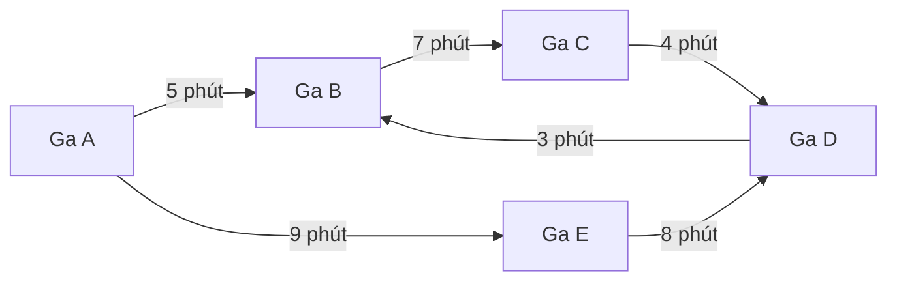

# Lấy danh sách nút, quan hệ và độ dài từ một đường đi trong Neo4j

Trong Neo4j, một **đường đi (path)** không chỉ là cặp node đầu–cuối. Nó lưu **thứ tự các node và relationship** đã được khớp theo một mẫu Cypher. Khi cần giải thích “qua những điểm nào?”, “đã đi qua cạnh nào?”, “mất bao nhiêu bước?” hoặc “tổng thời gian trên tuyến là bao nhiêu?”, hãy gán đường đi cho một biến, sau đó sử dụng các hàm `nodes(p)`, `relationships(p)` và `length(p)`.

Bài học thuộc chương **Đường đi và duyệt đồ thị** của module `DATABASE_ENGINE_GRAPH_NEO4J`, sử dụng Neo4j property graph và Cypher để làm việc với các dữ liệu liên kết. Kỹ thuật trích xuất thông tin path cũng hữu ích khi trả dữ liệu cho Java Driver, Spring Data Neo4j, dịch vụ tìm tuyến, kiểm tra chuỗi phụ thuộc hoặc phân tích đồ thị.

Sau bài này, bạn sẽ biết:

- Gán biến cho một path trong `MATCH` và trả path nguyên dạng hoặc biến đổi thành dữ liệu có cấu trúc.
- Lấy **danh sách node**, **danh sách relationship**, **số bước nhảy** và các thuộc tính của từng phần tử.
- Hiểu thứ tự các phần tử trên path, kể cả khi truy vấn đi ngược chiều relationship đã lưu.
- Đọc node/cạnh ở vị trí cụ thể, tách từng chặng thành dòng kết quả, tính tổng trọng số.
- Xử lý path độ dài 0, nhiều path cùng đích, chu trình và trường hợp không tìm thấy path.

## 1. Path trong property graph là gì?

Neo4j biểu diễn dữ liệu bằng **node** (thực thể) và **relationship** (liên kết có kiểu, chiều và thuộc tính). Một path là chuỗi xen kẽ:

```text
(node 0) --[relationship 0]--> (node 1)
                                   |
                              [relationship 1]
                                   |
                                   v
                                (node 2)
```

Với một path có **k relationship**:

- `length(p) = k`: độ dài path tính theo số relationship, còn gọi là **số bước nhảy (hop count)**.
- `size(relationships(p)) = k`: số relationship đã duyệt.
- `size(nodes(p)) = k + 1`: số **lượt xuất hiện node** trong danh sách path, kể cả khi có node xuất hiện lại.

Ví dụ, path `A → B → C → D` có bốn lượt node và ba relationship, nên `length(p) = 3`.

**Phân biệt:** độ dài theo số bước nhảy không tự động là khoảng cách vật lý, thời gian di chuyển, chi phí hoặc số node **duy nhất**. Nếu relationship có trọng số, phải đọc và tổng hợp các thuộc tính ấy riêng.

## 2. Tạo đồ thị mẫu độc lập

Giả sử một mạng ga tàu được mô hình bằng node `:PathDemoStation` và relationship `:PATH_DEMO_ROUTE` có hướng. Mỗi cạnh có `minutes` (phút) và `km` (kilômét). Nhãn và kiểu relationship riêng cho bài thực hành giúp tránh trùng dữ liệu với bài Neo4j khác trong cùng database.

Tạo năm ga:

```cypher
UNWIND [
  {code: 'A', name: 'Ga A'},
  {code: 'B', name: 'Ga B'},
  {code: 'C', name: 'Ga C'},
  {code: 'D', name: 'Ga D'},
  {code: 'E', name: 'Ga E'}
] AS item
MERGE (s:PathDemoStation {code: item.code})
SET s.name = item.name;
```

Tạo sáu tuyến một chiều:

```cypher
UNWIND [
  {source: 'A', target: 'B', minutes: 5, km: 4},
  {source: 'B', target: 'C', minutes: 7, km: 6},
  {source: 'C', target: 'D', minutes: 4, km: 3},
  {source: 'A', target: 'E', minutes: 9, km: 8},
  {source: 'E', target: 'D', minutes: 8, km: 5},
  {source: 'D', target: 'B', minutes: 3, km: 2}
] AS item
MATCH (u:PathDemoStation {code: item.source})
MATCH (v:PathDemoStation {code: item.target})
MERGE (u)-[r:PATH_DEMO_ROUTE]->(v)
SET r.minutes = item.minutes, r.km = item.km;
```

`MERGE` tái sử dụng node hoặc relationship đã khớp theo mẫu; ví dụ giả định dữ liệu không có node `PathDemoStation` trùng `code`. Trong hệ thống thực, nên dùng unique constraint để bảo vệ mã định danh của ga.



Từ **A đến D** theo chiều mũi tên, trong tối đa ba bước có hai đường đi:

| Đường đi | Số relationship | Số node trên path | Tổng phút | Tổng km |
| --- | ---: | ---: | ---: | ---: |
| A → E → D | 2 | 3 | 17 | 13 |
| A → B → C → D | 3 | 4 | 16 | 13 |

Đồ thị còn có chu trình `B → C → D → B`. Những ví dụ dưới đây sử dụng đúng dữ liệu này.

## 3. Gán toàn bộ đường đi vào biến `p`

Trong Cypher, đặt `p =` trước mẫu đường đi trong `MATCH` để lưu toàn bộ path đã khớp:

```cypher
MATCH p = (a:PathDemoStation {code: 'A'})
          -[:PATH_DEMO_ROUTE*1..3]->
          (d:PathDemoStation {code: 'D'})
RETURN p;
```

`p` là một giá trị **PATH**, chứa cả node và relationship theo thứ tự duyệt. Neo4j Browser có thể hiển thị kết quả dưới dạng đồ thị; các ứng dụng khác có thể cần dữ liệu dạng danh sách hoặc bảng.

- `a` và `d` là biến đại diện **node đầu và cuối**.
- `p` đại diện **đường đi trọn vẹn**.
- `*1..3` chọn các path có từ **1 đến 3 relationship** đi theo chiều `PATH_DEMO_ROUTE`.
- Một mẫu có thể khớp **nhiều path**, vì thế `RETURN p` có thể trả nhiều bản ghi.

Nếu chỉ dùng `RETURN a, d`, ta đánh mất thông tin về **những node trung gian và relationship đã đi qua**. Khi cần trích xuất hoặc giải thích lộ trình, hãy giữ biến path.

## 4. Ba hàm cốt lõi: `nodes`, `relationships`, `length`

### 4.1. Lấy danh sách node theo thứ tự

```cypher
MATCH p = (a:PathDemoStation {code: 'A'})
          -[:PATH_DEMO_ROUTE*1..3]->
          (d:PathDemoStation {code: 'D'})
RETURN [n IN nodes(p) | n.code] AS cac_ga,
       size(nodes(p)) AS so_luot_node
ORDER BY so_luot_node;
```

Kết quả:

| `cac_ga` | `so_luot_node` |
| --- | ---: |
| `[A, E, D]` | 3 |
| `[A, B, C, D]` | 4 |

`nodes(p)` trả về **LIST<NODE>**, tức một danh sách các đối tượng node; list comprehension `[n IN nodes(p) | n.code]` trích thuộc tính `code` của mỗi node để dễ hiển thị, xuất JSON hoặc đưa sang ứng dụng.

Thứ tự của danh sách là **thứ tự các node xuất hiện khi duyệt path**, không phải thứ tự theo `code`, theo thời gian tạo hoặc theo ID nội bộ.

### 4.2. Lấy danh sách relationship theo thứ tự

```cypher
MATCH p = (a:PathDemoStation {code: 'A'})
          -[:PATH_DEMO_ROUTE*1..3]->
          (d:PathDemoStation {code: 'D'})
RETURN [n IN nodes(p) | n.code] AS cac_ga,
       [r IN relationships(p) | r.minutes] AS phut_tung_chang,
       [r IN relationships(p) | type(r)] AS kieu_quan_he,
       size(relationships(p)) AS so_canh
ORDER BY so_canh;
```

Kết quả:

| `cac_ga` | `phut_tung_chang` | `kieu_quan_he` | `so_canh` |
| --- | --- | --- | ---: |
| `[A, E, D]` | `[9, 8]` | `[PATH_DEMO_ROUTE, PATH_DEMO_ROUTE]` | 2 |
| `[A, B, C, D]` | `[5, 7, 4]` | `[PATH_DEMO_ROUTE, PATH_DEMO_ROUTE, PATH_DEMO_ROUTE]` | 3 |

`relationships(p)` trả về **LIST<RELATIONSHIP>**, cũng theo thứ tự **cạnh được đi qua** trên path. Mỗi relationship có kiểu (`type(r)`), node đầu/cuối theo chiều lưu, và các thuộc tính (`r.minutes`, `r.km`).

**Lưu ý:** danh sách `relationships(p)` giữ các đối tượng relationship thật, không chỉ tên kiểu hay giá trị thuộc tính. Dùng list comprehension để chọn đúng trường cần chuyển cho client.

### 4.3. Lấy độ dài đường đi

```cypher
MATCH p = (a:PathDemoStation {code: 'A'})
          -[:PATH_DEMO_ROUTE*1..3]->
          (d:PathDemoStation {code: 'D'})
RETURN [n IN nodes(p) | n.code] AS cac_ga,
       length(p) AS so_buoc_nhay,
       size(relationships(p)) AS so_relationship,
       size(nodes(p)) AS so_node
ORDER BY so_buoc_nhay;
```

| `cac_ga` | `so_buoc_nhay` | `so_relationship` | `so_node` |
| --- | ---: | ---: | ---: |
| `[A, E, D]` | 2 | 2 | 3 |
| `[A, B, C, D]` | 3 | 3 | 4 |

Với mọi path thông thường:

```text
length(p) = size(relationships(p))
size(nodes(p)) = length(p) + 1
```

Hai công thức trên đếm **số phần tử xuất hiện trong path**, không phải tổng số node/relationship duy nhất của cả graph.

## 5. Biến danh sách node và relationship thành dữ liệu có cấu trúc

Trả trực tiếp đối tượng NODE/RELATIONSHIP có thể thuận tiện trong Neo4j Browser, nhưng API thường chỉ cần các thuộc tính được chọn. Có thể tạo map ngay trong list comprehension:

```cypher
MATCH p = (a:PathDemoStation {code: 'A'})
          -[:PATH_DEMO_ROUTE*1..3]->
          (d:PathDemoStation {code: 'D'})
RETURN
  [n IN nodes(p) |
    {code: n.code, name: n.name, nhan: labels(n)}
  ] AS danh_sach_nut,
  [r IN relationships(p) |
    {kieu: type(r), minutes: r.minutes, km: r.km}
  ] AS danh_sach_quan_he,
  length(p) AS do_dai
ORDER BY do_dai;
```

Các biểu thức hữu ích:

| Biểu thức | Kết quả |
| --- | --- |
| `nodes(p)` | Danh sách đối tượng NODE |
| `relationships(p)` | Danh sách đối tượng RELATIONSHIP |
| `[n IN nodes(p) \| n.code]` | Danh sách mã ga |
| `[r IN relationships(p) \| r.minutes]` | Danh sách số phút từng chặng |
| `[r IN relationships(p) \| type(r)]` | Danh sách kiểu relationship |
| `[n IN nodes(p) \| labels(n)]` | Danh sách nhãn của mỗi node |
| `[r IN relationships(p) \| properties(r)]` | Danh sách map chứa thuộc tính của từng relationship |

Hàm `properties(r)` lấy map thuộc tính hiện có; nó không tự kèm kiểu relationship hoặc hai endpoint. Nếu cần các trường ấy, thêm `type(r)`, `startNode(r)`, `endNode(r)` theo nhu cầu.

### Bảo toàn thứ tự và giá trị thiếu

Nếu một relationship không có `minutes`, `r.minutes` có thể cho giá trị `null`. Trong list comprehension, phần tử tương ứng thường vẫn được giữ trong danh sách với giá trị `null`. Khi cộng trọng số, cần quy định trước nghiệp vụ có chấp nhận dữ liệu thiếu hay không; đừng mặc định mọi path đều tính được tổng phút.

Ví dụ chỉ nhận các path mà **mọi relationship đều có thời gian dạng số**:

```cypher
MATCH p = (a:PathDemoStation {code: 'A'})
          -[:PATH_DEMO_ROUTE*1..3]->
          (d:PathDemoStation {code: 'D'})
WHERE all(r IN relationships(p) WHERE r.minutes IS NOT NULL)
RETURN [n IN nodes(p) | n.code] AS cac_ga,
       [r IN relationships(p) | r.minutes] AS phut_tung_chang;
```

Trong dữ liệu mẫu, cả hai path đều có đủ `minutes`.

## 6. Lấy node hoặc relationship ở vị trí cụ thể

Vì `nodes(p)` và `relationships(p)` là **list**, có thể dùng index bắt đầu từ **0** và các hàm `head`, `last`:

```cypher
MATCH p = (a:PathDemoStation {code: 'A'})
          -[:PATH_DEMO_ROUTE*1..3]->
          (d:PathDemoStation {code: 'D'})
WITH p, nodes(p) AS ns, relationships(p) AS rs
RETURN
  head(ns).code AS diem_bat_dau,
  last(ns).code AS diem_ket_thuc,
  ns[1].code AS ga_sau_buoc_dau,
  head(rs).minutes AS phut_chang_dau,
  last(rs).minutes AS phut_chang_cuoi,
  length(p) AS so_chang
ORDER BY so_chang;
```

| `so_chang` | `diem_bat_dau` | `diem_ket_thuc` | `ga_sau_buoc_dau` | `phut_chang_dau` | `phut_chang_cuoi` |
| ---: | --- | --- | --- | ---: | ---: |
| 2 | A | D | E | 9 | 8 |
| 3 | A | D | B | 5 | 4 |

- `head(ns)`: node xuất hiện đầu tiên trong path.
- `last(ns)`: node xuất hiện cuối cùng.
- `ns[1]`: node thứ hai của path.
- `head(rs)`/`last(rs)`: relationship đầu tiên/cuối cùng **theo thứ tự path**.

**Lưu ý biên:** với path độ dài 0, `relationships(p)` rỗng; `head(relationships(p))` không cho một relationship hợp lệ. Với path chỉ một node, `nodes(p)[1]` không có phần tử; hãy xử lý giá trị `null`/kiểm tra độ dài trước khi dùng thuộc tính.

## 7. Tách path thành từng chặng có thứ tự

Một lộ trình đôi khi cần gửi lên giao diện dưới dạng danh sách chặng `từ → đến → số phút`. Ta có thể dùng `UNWIND` và chỉ số của các list:

```cypher
MATCH p = (a:PathDemoStation {code: 'A'})
          -[:PATH_DEMO_ROUTE*1..3]->
          (d:PathDemoStation {code: 'D'})
WITH p, nodes(p) AS ns, relationships(p) AS rs
UNWIND range(0, size(rs) - 1) AS i
RETURN
  length(p) AS so_chang_trong_path,
  i + 1 AS thu_tu_chang,
  ns[i].code AS ga_di,
  ns[i + 1].code AS ga_den,
  type(rs[i]) AS kieu_quan_he,
  rs[i].minutes AS so_phut
ORDER BY so_chang_trong_path, thu_tu_chang;
```

Kết quả:

| `so_chang_trong_path` | `thu_tu_chang` | `ga_di` | `ga_den` | `so_phut` |
| ---: | ---: | --- | --- | ---: |
| 2 | 1 | A | E | 9 |
| 2 | 2 | E | D | 8 |
| 3 | 1 | A | B | 5 |
| 3 | 2 | B | C | 7 |
| 3 | 3 | C | D | 4 |

Vì các path đang có **ít nhất một relationship**, `range(0, size(rs) - 1)` sinh đúng các chỉ số từ 0 đến phần tử cuối. `nodes(p)` có **nhiều hơn** `relationships(p)` đúng một phần tử, nên cặp `ns[i]` và `ns[i+1]` là hai node kề nhau theo thứ tự duyệt, còn `rs[i]` là cạnh nối chúng.

Với path dài 0, sẽ không có chặng để xuất thành hàng; hãy xử lý riêng nếu giao diện muốn hiển thị điểm xuất phát dù chưa đi chặng nào. Trong hệ thống có nhiều path bằng số chặng nhau, nên kèm thêm mã path hoặc danh sách node để phân biệt nhóm hàng.

## 8. Thứ tự duyệt của path và chiều relationship đã lưu

**`nodes(p)` luôn theo thứ tự của path được khớp**. Trong khi đó, `startNode(r)` và `endNode(r)` nói về **chiều của relationship lưu trong database**. Hai cách nhìn có thể trùng hoặc khác nhau tùy cách truy vấn.

Ví dụ duyệt từ **D về A**, cho phép đi qua cạnh theo **cả hai chiều**:

```cypher
MATCH p = (d:PathDemoStation {code: 'D'})
          -[:PATH_DEMO_ROUTE*2]-
          (a:PathDemoStation {code: 'A'})
RETURN [n IN nodes(p) | n.code] AS cac_ga_theo_duong_di,
       [r IN relationships(p) |
          startNode(r).code + '->' + endNode(r).code
       ] AS cac_canh_theo_chieu_luu;
```

Hai path phù hợp là:

| Thứ tự node khi duyệt | Chiều lưu của các relationship theo đúng thứ tự path |
| --- | --- |
| `[D, E, A]` | `[E->D, A->E]` |
| `[D, B, A]` | `[D->B, A->B]` |

Ở path `D — E — A`, ta duyệt **D → E** theo thứ tự path nhưng relationship thực tế là **E → D**. Vì vậy không thể luôn giả định `startNode(relationships(p)[i]) = nodes(p)[i]` nếu mẫu truy vấn không ràng buộc chiều.

Để mô tả các chặng **theo hướng duyệt path**, dùng `nodes(p)[i]` và `nodes(p)[i+1]`. Để xác minh **chiều relationship đã lưu**, dùng `startNode(r)` và `endNode(r)`.

## 9. Path độ dài 0 và chu trình

### 9.1. Đường đi không có relationship

Nếu mẫu cho phép **0 bước**, path có một node và không có relationship:

```cypher
MATCH p = (a:PathDemoStation {code: 'A'})
          -[:PATH_DEMO_ROUTE*0..1]->
          (dich:PathDemoStation)
RETURN [n IN nodes(p) | n.code] AS cac_ga,
       [r IN relationships(p) | r.minutes] AS phut_tung_chang,
       length(p) AS so_chang
ORDER BY so_chang, cac_ga;
```

Kết quả:

| `cac_ga` | `phut_tung_chang` | `so_chang` |
| --- | --- | ---: |
| `[A]` | `[]` | 0 |
| `[A, B]` | `[5]` | 1 |
| `[A, E]` | `[9]` | 1 |

`length(p) = 0` có nghĩa đường đi tồn tại và chứa **chính node xuất phát**, không đồng nghĩa kết nối lỗi hoặc thiếu kết quả.

### 9.2. Node có thể xuất hiện nhiều lần trên path

Đồ thị có chu trình B → C → D → B. Truy vấn:

```cypher
MATCH p = (bat_dau:PathDemoStation {code: 'B'})
          -[:PATH_DEMO_ROUTE*3]->
          (ket_thuc:PathDemoStation {code: 'B'})
RETURN [n IN nodes(p) | n.code] AS cac_ga,
       length(p) AS so_chang,
       size(nodes(p)) AS so_luot_node,
       size(relationships(p)) AS so_canh;
```

Có kết quả `[B, C, D, B]`: **3 relationship**, **4 lượt node**, nhưng chỉ **3 node khác nhau**. `nodes(p)` **không mặc nhiên loại trùng**. Với cách khớp độ dài biến thiên truyền thống, một relationship không được dùng lại trong cùng một path thông thường, song node vẫn có thể xuất hiện lại trong chu trình.

Nếu muốn đếm **node duy nhất**, cần phép tổng hợp riêng thay vì lấy `size(nodes(p))`; nên xác định rõ nghiệp vụ đang hỏi số **lượt node** hay số **thực thể khác nhau**.

## 10. Tính toán từ danh sách relationship

### 10.1. Tổng thời gian và tổng quãng đường

`length(p)` chỉ đếm cạnh. Để tính các đại lượng có trọng số, dùng `reduce` trên `relationships(p)`:

```cypher
MATCH p = (a:PathDemoStation {code: 'A'})
          -[:PATH_DEMO_ROUTE*1..3]->
          (d:PathDemoStation {code: 'D'})
RETURN [n IN nodes(p) | n.code] AS cac_ga,
       length(p) AS so_chang,
       reduce(total = 0, r IN relationships(p) | total + r.minutes) AS tong_phut,
       reduce(total = 0, r IN relationships(p) | total + r.km) AS tong_km
ORDER BY tong_phut;
```

| `cac_ga` | `so_chang` | `tong_phut` | `tong_km` |
| --- | ---: | ---: | ---: |
| `[A, B, C, D]` | 3 | 16 | 13 |
| `[A, E, D]` | 2 | 17 | 13 |

Như vậy, path **ít cạnh hơn** không nhất thiết **mất ít thời gian hơn**. Các công thức `reduce(...)` giả định tất cả relationship đang xét đều có giá trị số hợp lệ. Nếu thiếu trường, hãy lọc dữ liệu hoặc quy định cách xử lý trước.

### 10.2. Một node đích có thể có nhiều path

Đếm đường đi từ A đến D trong 1–3 bước:

```cypher
MATCH p = (a:PathDemoStation {code: 'A'})
          -[:PATH_DEMO_ROUTE*1..3]->
          (d:PathDemoStation {code: 'D'})
RETURN count(p) AS so_duong_di,
       count(DISTINCT d) AS so_node_dich;
```

Kết quả: **2 đường đi** nhưng **1 node đích duy nhất**. Nếu trả `DISTINCT d`, bạn chỉ nhìn thấy một D và mất thông tin hai tuyến khác nhau đã dẫn tới D.

Ví dụ lấy số bước nhỏ nhất trong **phạm vi 1–3** cho node đích:

```cypher
MATCH p = (a:PathDemoStation {code: 'A'})
          -[:PATH_DEMO_ROUTE*1..3]->
          (d:PathDemoStation {code: 'D'})
RETURN d.code AS ga_dich,
       min(length(p)) AS buoc_it_nhat_trong_pham_vi;
```

Kết quả `D, 2`. Đây là phép tổng hợp các path đã khớp trong giới hạn cho trước; với đồ thị lớn và yêu cầu chỉ cần path ngắn nhất giữa hai node, nên cân nhắc chức năng shortest path thay vì liệt kê mọi path.

## 11. Phân biệt không có đường đi và path độ dài 0

Khi `MATCH` không khớp path, Cypher thường **không trả dòng**. Trong khi đó, path độ dài 0 có thể khớp khi node đầu chính là node cuối và mẫu cho phép 0 relationship.

Nếu cần giữ một hàng dù không có path, dùng `OPTIONAL MATCH`:

```cypher
MATCH (d:PathDemoStation {code: 'D'})
MATCH (a:PathDemoStation {code: 'A'})
OPTIONAL MATCH p = (d)-[:PATH_DEMO_ROUTE*1..3]->(a)
RETURN p IS NULL AS khong_tim_thay_duong,
       nodes(p) AS cac_node,
       relationships(p) AS cac_quan_he,
       length(p) AS so_buoc;
```

Đồ thị mẫu không có path **theo chiều cạnh** từ D về A, nên kết quả gồm một dòng với `khong_tim_thay_duong = true`; các trường lấy từ `p` không tồn tại có giá trị `null`. Điều này khác với path 0-hop: khi khớp path 0-hop, `length(p)` là số **0**, `nodes(p)` có một node, `relationships(p)` là list rỗng.

Đối với API, không nên thay mọi `null` của `length(p)` bằng `0`, vì như vậy có thể nhầm **không có đường đi** với **đường đi hợp lệ dài 0 bước**.

## 12. Trả dữ liệu path qua Java Driver

Ứng dụng Java có thể đọc các giá trị PATH/NODE/RELATIONSHIP của Neo4j Driver. Tuy nhiên, với một API trả JSON, thường đơn giản hơn khi dùng Cypher biến đổi path thành **list các thuộc tính** ngay từ truy vấn:

```cypher
MATCH p = (a:PathDemoStation {code: 'A'})
          -[:PATH_DEMO_ROUTE*1..3]->
          (d:PathDemoStation {code: 'D'})
RETURN [n IN nodes(p) | n.code] AS stationCodes,
       [r IN relationships(p) | r.minutes] AS minutesPerLeg,
       length(p) AS hops
ORDER BY hops;
```

Ví dụ **Java Driver** với Java 17+ (điều chỉnh địa chỉ, tài khoản và mật khẩu theo môi trường):

```java
import org.neo4j.driver.AuthTokens;
import org.neo4j.driver.GraphDatabase;
import org.neo4j.driver.Value;

import java.util.List;

public class ReadPathExample {
    public static void main(String[] args) {
        try (var driver = GraphDatabase.driver(
                 "bolt://localhost:7687",
                 AuthTokens.basic("neo4j", "<password>"));
             var session = driver.session()) {

            var result = session.run("""
                MATCH p = (a:PathDemoStation {code: 'A'})
                          -[:PATH_DEMO_ROUTE*1..3]->
                          (d:PathDemoStation {code: 'D'})
                RETURN [n IN nodes(p) | n.code] AS stationCodes,
                       [r IN relationships(p) | r.minutes] AS minutesPerLeg,
                       length(p) AS hops
                ORDER BY hops
                """);

            while (result.hasNext()) {
                var record = result.next();
                List<String> codes =
                    record.get("stationCodes").asList(Value::asString);
                List<Integer> minutes =
                    record.get("minutesPerLeg").asList(Value::asInt);
                int hops = record.get("hops").asInt();

                System.out.println(codes + " / " + minutes +
                                   " / hops=" + hops);
            }
        }
    }
}
```

Đầu ra dự kiến:

```text
[A, E, D] / [9, 8] / hops=2
[A, B, C, D] / [5, 7, 4] / hops=3
```

Các list đã được chuyển thành kiểu dữ liệu ứng dụng dễ sử dụng. Nếu cần xử lý path nguyên bản trong Java, có thể `RETURN p` rồi lấy `record.get("p").asPath()`; khi đó mỗi node/relationship là đối tượng của Neo4j Driver. Trong Spring Data Neo4j, cần thiết kế mapping/DTO phù hợp với hình dạng dữ liệu được trả, thay vì giả định kết quả path tự động tương ứng một entity đơn.

## 13. Lỗi thường gặp và cách khắc phục

| Lỗi hoặc hiểu nhầm | Vì sao sai | Cách xử lý |
| --- | --- | --- |
| Dùng `size(nodes(p))` như số bước nhảy | Path có k cạnh nhưng k + 1 lượt node | Dùng `length(p)` |
| Nghĩ `nodes(p)` chỉ gồm node duy nhất | Path có thể đi qua node đã xuất hiện trước đó | Đếm/trích các lượt node; loại trùng riêng khi cần |
| Nghĩ `relationships(p)` không có thứ tự | List phản ánh thứ tự các cạnh trong path | Dùng index hoặc `UNWIND` đúng thứ tự |
| Đồng nhất `startNode(r)` với node đi trước | Khi duyệt ngược chiều, đầu cạnh đã lưu có thể khác node trước trong path | Dùng `nodes(p)[i]` để lấy hướng duyệt; `startNode(r)` để lấy hướng lưu |
| Cộng `length(p)` để tính thời gian/quãng đường | `length` chỉ đếm cạnh | `reduce` trên thuộc tính số của relationship |
| Gọi path 0-hop là “không tìm thấy đường” | 0-hop là path hợp lệ có một node | Phân biệt `length(p) = 0` với `p IS NULL` |
| Chỉ trả node đích, bỏ biến path | Mất các node và cạnh trung gian | Gán `p = ...` trong `MATCH` |
| Dùng `LIMIT` để thay giới hạn độ sâu | `LIMIT` giới hạn dòng kết quả, không phải số cạnh mỗi path | Đặt cận trong mẫu, như `*1..3` |
| Mở rộng nhiều bước từ quá nhiều node | Số path có thể tăng mạnh, nhất là khi có nhiều nhánh | Neo vào node đầu, lọc loại/chiều cạnh, giới hạn số bước và xem `EXPLAIN`/`PROFILE` |

**Gợi ý hiệu năng:** các hàm `nodes(p)`, `relationships(p)` và `length(p)` làm việc trên path đã khớp. Chi phí nặng thường nằm ở **việc tìm và mở rộng các path**, không chỉ ở phép lấy danh sách. Với đồ thị lớn, nên giới hạn độ dài, kiểu/chiều relationship và điểm đầu; chỉ xuất các thuộc tính cần dùng để tránh payload lớn.

## 14. Bài tập có đáp án

### Bài 1. Lấy các ga theo thứ tự và số chặng

**Yêu cầu:** trả tất cả đường từ A đến D có tối đa ba chặng; chỉ xuất mã ga và độ dài.

```cypher
MATCH p = (a:PathDemoStation {code: 'A'})
          -[:PATH_DEMO_ROUTE*1..3]->
          (d:PathDemoStation {code: 'D'})
RETURN [n IN nodes(p) | n.code] AS cac_ga,
       length(p) AS so_chang
ORDER BY so_chang;
```

**Đáp án:** `[A, E, D]` dài 2 và `[A, B, C, D]` dài 3.

### Bài 2. Lấy thời gian từng relationship

**Yêu cầu:** với hai path trên, lấy list `minutes` theo thứ tự và tổng thời gian.

```cypher
MATCH p = (a:PathDemoStation {code: 'A'})
          -[:PATH_DEMO_ROUTE*1..3]->
          (d:PathDemoStation {code: 'D'})
RETURN [n IN nodes(p) | n.code] AS cac_ga,
       [r IN relationships(p) | r.minutes] AS phut_tung_chang,
       reduce(t = 0, r IN relationships(p) | t + r.minutes) AS tong_phut
ORDER BY tong_phut;
```

**Đáp án:** tuyến A–B–C–D có `[5,7,4]` và 16 phút; tuyến A–E–D có `[9,8]` và 17 phút.

### Bài 3. Lấy ga đầu, ga cuối và ga trung gian

**Yêu cầu:** với đường từ A đến D trong tối đa 3 bước, chỉ lấy ga nằm **giữa** điểm đầu và điểm cuối.

```cypher
MATCH p = (a:PathDemoStation {code: 'A'})
          -[:PATH_DEMO_ROUTE*1..3]->
          (d:PathDemoStation {code: 'D'})
WITH p, nodes(p) AS ns
RETURN head(ns).code AS dau,
       [n IN ns[1..-1] | n.code] AS ga_trung_gian,
       last(ns).code AS cuoi
ORDER BY length(p);
```

**Đáp án:** ga trung gian là `[E]` hoặc `[B,C]`. Với list slicing `[1..-1]`, chỉ số 1 là phần tử thứ hai, còn cận cuối -1 loại phần tử cuối (cận trên không bao gồm).

### Bài 4. Phân biệt chiều lưu và chiều duyệt

**Yêu cầu:** dự đoán `nodes(p)` và `startNode(r)` của path đi từ D qua E tới A khi truy vấn không ràng buộc chiều.

```cypher
MATCH p = (d:PathDemoStation {code: 'D'})
          -[:PATH_DEMO_ROUTE*2]-
          (a:PathDemoStation {code: 'A'})
WHERE [n IN nodes(p) | n.code] = ['D','E','A']
RETURN [n IN nodes(p) | n.code] AS thu_tu_duyet,
       [r IN relationships(p) | startNode(r).code] AS nut_dau_theo_chieu_luu;
```

**Đáp án:** thứ tự duyệt `[D,E,A]`, các node đầu theo chiều lưu `[E,A]`. Do đó không thể dùng `startNode(r)` thay cho node đi trước trong một path duyệt ngược.

### Bài 5. Phân biệt số node xuất hiện và số node khác nhau

**Yêu cầu:** với chu trình B → C → D → B, hãy cho biết `length(p)`, `size(nodes(p))` và số node **duy nhất**.

**Đáp án:** `length(p) = 3`, `size(nodes(p)) = 4`, nhưng số node khác nhau là **3**: B, C và D. `nodes(p)` ghi nhận cả hai lần B xuất hiện trên path.

## 15. Ghi nhớ

- Gán `p = (...)` trong `MATCH` để lấy **toàn bộ path**. Nếu chỉ giữ endpoint, các đoạn trung gian không còn trong kết quả.
- `nodes(p)` trả **LIST<NODE>**; `relationships(p)` trả **LIST<RELATIONSHIP>**; cả hai **theo thứ tự duyệt path**.
- `length(p) = size(relationships(p))` và `size(nodes(p)) = length(p) + 1`. Công thức tính **số lần xuất hiện**, không loại các node lặp.
- Dùng list comprehension để đổi node/cạnh thành mã, tên, kiểu, thời gian hoặc map thuộc tính; dùng `head`, `last` và chỉ số để truy cập phần tử.
- `startNode(r)` và `endNode(r)` biểu diễn **chiều lưu** của relationship; nó có thể khác với **thứ tự đi qua** trong `nodes(p)` khi duyệt ngược chiều.
- Dùng `reduce` để tổng hợp trọng số. Độ dài theo hop và tổng phút/kilômét là các đại lượng khác nhau.
- Path độ dài 0 là **một path hợp lệ gồm một node**, còn trường hợp không có path trong `OPTIONAL MATCH` tạo giá trị `null`.
- Khi trả về ứng dụng Java hoặc API, hãy giữ đủ thông tin cho câu hỏi nghiệp vụ và chọn dạng **list/map thuộc tính** nếu không cần object path nguyên bản.

Khi làm việc với một đường đi trong Neo4j, hãy nhớ bộ ba: **`nodes(p)` cho biết đi qua những node nào, `relationships(p)` cho biết các liên kết nào đã được đi qua, và `length(p)` cho biết đã đi qua bao nhiêu relationship**. Đây là nền tảng để giải thích tuyến đường, phân tích liên kết, tổng hợp trọng số và truyền kết quả truy vấn đồ thị sang ứng dụng.
