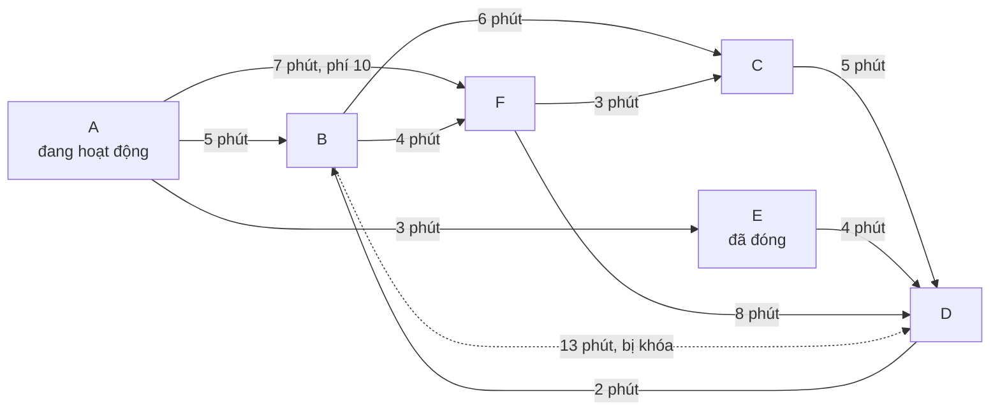

# Điều kiện lọc trên nút và quan hệ trong quá trình tìm đường bằng Cypher

Trong một **property graph** của Neo4j, việc tìm được một đường nối hai node chưa chắc đã giải quyết được bài toán. Đường đó có thể đi qua một trạm đang đóng cửa, một kết nối không khả dụng, cạnh có phí hoặc vùng bị hạn chế. Muốn tìm những đường **hợp lệ về nghiệp vụ**, ta phải kiểm tra thuộc tính của **các node và relationship trên toàn bộ path**, đôi khi áp điều kiện ngay trong mẫu duyệt để tránh mở rộng những nhánh chắc chắn không phù hợp.

Bài thuộc chương **Đường đi và duyệt đồ thị** của module `DATABASE_ENGINE_GRAPH_NEO4J`. Nội dung sử dụng Cypher để lọc đường đi qua node, relationship và điều kiện kết hợp, phù hợp với nền tảng Neo4j, Java Driver, Spring Data Neo4j và tư duy tối ưu truy vấn đồ thị. Trọng tâm là câu hỏi **đường nào được phép đi qua?**, chứ không chỉ đếm số bước hoặc lấy danh sách node.

Sau bài học, bạn có thể:

- Phân biệt điều kiện trên **node đầu/cuối**, **node trung gian**, **mọi node** và **mọi relationship** trong path.
- Viết các biểu thức `WHERE` với `all`, `any`, `none`, `single`, `nodes(p)` và `relationships(p)`.
- Lọc theo từng bước và theo **tổng thuộc tính** (như tổng phút, tổng phí), đồng thời xử lý giá trị `null`.
- Hiểu ý nghĩa của việc đặt điều kiện **sau khi khớp path** so với **bên trong quantified path pattern** nếu phiên bản Cypher hỗ trợ.
- Chọn giới hạn độ sâu, hướng duyệt, kiểu quan hệ và cách kiểm tra kế hoạch thực thi để giữ truy vấn trong phạm vi hợp lý.

## 1. Đồ thị mẫu: tuyến đường nào được phép sử dụng?

Giả sử hệ thống điều phối có các điểm `:FilterDemoStop`. Mỗi điểm có thuộc tính `active` cho biết còn hoạt động hay không. Một kết nối `:FILTER_DEMO_ROAD` có các thuộc tính:

| Thuộc tính | Kiểu minh họa | Ý nghĩa |
| --- | --- | --- |
| `enabled` | Boolean | Kết nối đang được phép sử dụng |
| `minutes` | Integer | Thời gian di chuyển trên một chặng |
| `toll` | Integer | Phí qua chặng, đơn vị quy ước |
| `code` trên node | String | Mã điểm dùng để xác định điểm đi/đến |
| `zone` trên node | String | Phân vùng hoạt động để lọc theo khu vực |

Trong các ví dụ, **E đang đóng**, đoạn **B → D bị khóa**, còn đoạn **A → F có phí 10**. Các chặng khác được phép dùng và không thu phí.

### 1.1. Tạo node

```cypher
UNWIND [
  {code: 'A', active: true,  zone: 'NORTH'},
  {code: 'B', active: true,  zone: 'NORTH'},
  {code: 'C', active: true,  zone: 'CENTER'},
  {code: 'D', active: true,  zone: 'SOUTH'},
  {code: 'E', active: false, zone: 'CENTER'},
  {code: 'F', active: true,  zone: 'CENTER'}
] AS item
MERGE (s:FilterDemoStop {code: item.code})
SET s.active = item.active,
    s.zone = item.zone;
```

### 1.2. Tạo relationship có hướng

```cypher
UNWIND [
  {source: 'A', target: 'B', minutes: 5,  enabled: true,  toll: 0},
  {source: 'B', target: 'C', minutes: 6,  enabled: true,  toll: 0},
  {source: 'C', target: 'D', minutes: 5,  enabled: true,  toll: 0},
  {source: 'A', target: 'E', minutes: 3,  enabled: true,  toll: 0},
  {source: 'E', target: 'D', minutes: 4,  enabled: true,  toll: 0},
  {source: 'A', target: 'F', minutes: 7,  enabled: true,  toll: 10},
  {source: 'F', target: 'D', minutes: 8,  enabled: true,  toll: 0},
  {source: 'B', target: 'D', minutes: 13, enabled: false, toll: 0},
  {source: 'B', target: 'F', minutes: 4,  enabled: true,  toll: 0},
  {source: 'F', target: 'C', minutes: 3,  enabled: true,  toll: 0},
  {source: 'D', target: 'B', minutes: 2,  enabled: true,  toll: 0}
] AS item
MATCH (a:FilterDemoStop {code: item.source})
MATCH (b:FilterDemoStop {code: item.target})
MERGE (a)-[r:FILTER_DEMO_ROAD]->(b)
SET r.minutes = item.minutes,
    r.enabled = item.enabled,
    r.toll = item.toll;
```

Nhãn `FilterDemoStop` và kiểu `FILTER_DEMO_ROAD` chỉ dùng cho ví dụ này để tránh lẫn với dữ liệu bài học khác. `MERGE` tái sử dụng mẫu node/cạnh đã khớp khi chạy lại. Trong cơ sở dữ liệu thực, nên dùng **unique constraint** trên `FilterDemoStop.code` để tránh node trùng định danh.



Truy vấn chỉ quan tâm **đường đi có hướng từ A đến D trong 1–3 bước nhảy**. Nếu chưa áp bộ lọc nghiệp vụ, có **6 path**:

| Path | Bước nhảy | Tổng phút | Vấn đề |
| --- | ---: | ---: | --- |
| A → E → D | 2 | 7 | Qua node E đã đóng |
| A → F → D | 2 | 15 | Cạnh A → F có phí 10 |
| A → B → D | 2 | 18 | Cạnh B → D bị khóa |
| A → B → C → D | 3 | 16 | Hợp lệ, không phí |
| A → B → F → D | 3 | 17 | Hợp lệ, không phí |
| A → F → C → D | 3 | 15 | Cạnh A → F có phí 10 |

Cạnh `D → B` tạo chu trình trong đồ thị, nhưng **không sinh thêm path A–D dài tối đa 3** theo hướng đang xét.

## 2. Gán biến path rồi lọc bằng `WHERE`

Để kiểm tra **mọi phần tử** của một đường đi, trước hết gán biến `p`:

```cypher
MATCH p = (a:FilterDemoStop {code: 'A'})
          -[:FILTER_DEMO_ROAD*1..3]->
          (d:FilterDemoStop {code: 'D'})
RETURN [n IN nodes(p) | n.code] AS cac_diem,
       length(p) AS so_buoc
ORDER BY so_buoc;
```

Trong cú pháp độ dài biến thiên truyền thống `*1..3`, mỗi path khớp có từ 1 đến 3 relationship theo **chiều mũi tên**. Với dữ liệu mẫu, truy vấn trả sáu dòng; `nodes(p)` là danh sách các node của path theo thứ tự duyệt, còn `relationships(p)` là danh sách các relationship trên path cũng theo thứ tự duyệt.

Điều kiện `WHERE` sau `MATCH` có thể xét:

- **Điểm đầu/cuối:** `a.active = true`, `d.active = true`.
- **Mọi node:** `all(n IN nodes(p) WHERE n.active = true)`.
- **Mọi relationship:** `all(r IN relationships(p) WHERE r.enabled = true)`.
- **Tổng thuộc tính của path:** `reduce(total = 0, r IN relationships(p) | total + r.minutes) <= 16`.

Điểm quan trọng: các điều kiện trên mô tả **path hợp lệ trong kết quả**. Chúng không mặc định bảo đảm engine chỉ mở rộng những cạnh hợp lệ ngay từ đầu; quyết định thực thi phụ thuộc cách biểu diễn và query planner.

## 3. Lọc theo thuộc tính node

### 3.1. Mọi node trên đường đều phải hoạt động

```cypher
MATCH p = (a:FilterDemoStop {code: 'A'})
          -[:FILTER_DEMO_ROAD*1..3]->
          (d:FilterDemoStop {code: 'D'})
WHERE all(n IN nodes(p) WHERE n.active = true)
RETURN [n IN nodes(p) | n.code] AS cac_diem,
       length(p) AS so_buoc
ORDER BY so_buoc;
```

`all(n IN nodes(p) WHERE ...)` chỉ trả `true` khi **mọi node** trong danh sách thỏa điều kiện. Vì E có `active = false`, path `A → E → D` bị loại. **Năm path** còn lại vẫn xuất hiện, kể cả path có cạnh bị khóa `B → D`, bởi truy vấn mới chỉ kiểm tra **node**.

### 3.2. Chỉ lọc node trung gian

Nếu điểm đầu và điểm cuối được kiểm tra riêng, có thể dùng **list slicing** để loại hai endpoint khỏi danh sách cần kiểm tra:

```cypher
MATCH p = (a:FilterDemoStop {code: 'A'})
          -[:FILTER_DEMO_ROAD*1..3]->
          (d:FilterDemoStop {code: 'D'})
WHERE a.active = true
  AND d.active = true
  AND all(n IN nodes(p)[1..-1] WHERE n.active = true)
RETURN [n IN nodes(p) | n.code] AS cac_diem;
```

`nodes(p)[1..-1]` lấy các node từ vị trí thứ hai tới **trước node cuối**, vì cận phải của slice không được tính vào kết quả. Với path `A → B → C → D`, danh sách trung gian là `[B, C]`; với path `A → F → D`, nó là `[F]`.

Ví dụ này hữu ích khi điểm xuất phát và điểm đến có quy tắc riêng, chẳng hạn khách hàng được phép đứng ở trạm đầu/đích nhưng không được đi qua các trạm trung gian bảo trì.

### 3.3. Lọc node thuộc vùng cấm

```cypher
MATCH p = (a:FilterDemoStop {code: 'A'})
          -[:FILTER_DEMO_ROAD*1..3]->
          (d:FilterDemoStop {code: 'D'})
WHERE none(n IN nodes(p)[1..-1] WHERE n.code = 'E')
RETURN [n IN nodes(p) | n.code] AS cac_diem;
```

`none(... WHERE ...)` yêu cầu **không có** node trung gian nào mang mã E. Kết quả loại đúng path `A → E → D`. Trong ứng dụng thực, có thể lọc theo `n.zone` hoặc một thuộc tính đánh dấu vùng nguy hiểm thay vì chỉ kiểm tra một mã cố định.

> Truy vấn lọc node trong một path không tự kiểm tra các node **khác** không nằm trên path. Phạm vi của `nodes(p)` chỉ là chuỗi node được khớp trong kết quả đó.

## 4. Lọc theo thuộc tính relationship

### 4.1. Mọi cạnh phải đang được phép sử dụng

```cypher
MATCH p = (a:FilterDemoStop {code: 'A'})
          -[:FILTER_DEMO_ROAD*1..3]->
          (d:FilterDemoStop {code: 'D'})
WHERE all(r IN relationships(p) WHERE r.enabled = true)
RETURN [n IN nodes(p) | n.code] AS cac_diem
ORDER BY length(p);
```

Vì `B → D` có `enabled = false`, path `A → B → D` bị loại; còn **năm path**. Truy vấn này chưa loại trạm E đã đóng vì đó là thuộc tính **node**, không phải relationship.

### 4.2. Lọc path không có bất kỳ cạnh thu phí

```cypher
MATCH p = (a:FilterDemoStop {code: 'A'})
          -[:FILTER_DEMO_ROAD*1..3]->
          (d:FilterDemoStop {code: 'D'})
WHERE none(r IN relationships(p) WHERE r.toll > 0)
RETURN [n IN nodes(p) | n.code] AS cac_diem;
```

Path đi qua cạnh `A → F` bị loại, vì có `toll = 10`. Lúc này vẫn có thể xuất hiện `A → E → D` (E đã đóng) và `A → B → D` (cạnh bị khóa): **không thu phí** khác với **được phép đi qua**.

### 4.3. Giới hạn thời gian từng chặng

```cypher
MATCH p = (a:FilterDemoStop {code: 'A'})
          -[:FILTER_DEMO_ROAD*1..3]->
          (d:FilterDemoStop {code: 'D'})
WHERE all(r IN relationships(p) WHERE r.minutes <= 8)
RETURN [n IN nodes(p) | n.code] AS cac_diem;
```

Path `A → B → D` bị loại vì chặng `B → D` mất **13 phút**; năm path còn lại đều có **từng** chặng không quá 8 phút. Dù ví dụ này cũng vô tình loại cạnh bị khóa B → D, **hai điều kiện có ý nghĩa khác nhau**: `minutes <= 8` không bảo đảm cạnh được cấp phép dùng.

**Điểm cần phân biệt:** lọc `all(r ... r.minutes <= 8)` là kiểm tra **trần từng cạnh**; nó khác với kiểm tra **tổng thời gian của path**.

## 5. Kết hợp điều kiện trên node và relationship

Một tuyến được xem là **đang khả dụng** khi **mọi node hoạt động** và **mọi cạnh được kích hoạt**:

```cypher
MATCH p = (a:FilterDemoStop {code: 'A'})
          -[:FILTER_DEMO_ROAD*1..3]->
          (d:FilterDemoStop {code: 'D'})
WHERE all(n IN nodes(p) WHERE n.active = true)
  AND all(r IN relationships(p) WHERE r.enabled = true)
RETURN [n IN nodes(p) | n.code] AS cac_diem,
       length(p) AS so_buoc
ORDER BY so_buoc;
```

**Bốn path** còn lại:

| Path | Số bước | Tổng phút | Tổng phí |
| --- | ---: | ---: | ---: |
| A → F → D | 2 | 15 | 10 |
| A → B → C → D | 3 | 16 | 0 |
| A → B → F → D | 3 | 17 | 0 |
| A → F → C → D | 3 | 15 | 10 |

Nếu thêm điều kiện **không thu phí**:

```cypher
MATCH p = (a:FilterDemoStop {code: 'A'})
          -[:FILTER_DEMO_ROAD*1..3]->
          (d:FilterDemoStop {code: 'D'})
WHERE all(n IN nodes(p) WHERE n.active = true)
  AND all(r IN relationships(p) WHERE r.enabled = true)
  AND none(r IN relationships(p) WHERE r.toll > 0)
RETURN [n IN nodes(p) | n.code] AS cac_diem
ORDER BY length(p);
```

Chỉ còn **hai path**: `A → B → C → D` và `A → B → F → D`.

Có thể viết điều kiện không thu phí tương đương bằng `all(r IN relationships(p) WHERE r.toll = 0)` **nếu dữ liệu đã bảo đảm thuộc tính `toll` không thiếu**. Nếu `toll` có thể là `null`, hai cách cần được đánh giá với quy tắc dữ liệu rõ ràng trước khi dùng trong nghiệp vụ.

## 6. `all`, `any`, `none`, `single`: dùng đúng lượng từ logic

Các hàm predicate làm việc trên **danh sách** và một điều kiện `WHERE`:

| Hàm | Khi nào trả `true`? | Ví dụ |
| --- | --- | --- |
| `all(x IN list WHERE P(x))` | Mọi phần tử thỏa P | Mọi trạm đều hoạt động |
| `any(x IN list WHERE P(x))` | Có ít nhất một phần tử thỏa P | Tuyến đi qua ít nhất một trạm vùng CENTER |
| `none(x IN list WHERE P(x))` | Không phần tử nào thỏa P | Tuyến không có cạnh thu phí |
| `single(x IN list WHERE P(x))` | Có **đúng một** phần tử thỏa P | Tuyến có đúng một cạnh thu phí |

Ví dụ đếm path có **ít nhất một** cạnh thu phí sau khi lọc điều kiện hoạt động:

```cypher
MATCH p = (a:FilterDemoStop {code: 'A'})
          -[:FILTER_DEMO_ROAD*1..3]->
          (d:FilterDemoStop {code: 'D'})
WHERE all(n IN nodes(p) WHERE n.active = true)
  AND all(r IN relationships(p) WHERE r.enabled = true)
  AND any(r IN relationships(p) WHERE r.toll > 0)
RETURN [n IN nodes(p) | n.code] AS cac_diem;
```

Kết quả: `A → F → D` và `A → F → C → D`.

Nếu thay `any` bằng `single` trong **dữ liệu mẫu này**, kết quả vẫn là hai path, vì mỗi path đó chỉ có **một** cạnh thu phí A → F. Nhưng trong một đồ thị khác có path gồm **hai** cạnh thu phí, `any` vẫn chấp nhận còn `single` loại bỏ.

### Chú ý path độ dài 0

Khi đường đi cho phép **0 hop**, danh sách `relationships(p)` rỗng. Khi đó theo ngữ nghĩa lượng từ trên danh sách rỗng:

- `all(... )` là `true` (không có cạnh nào vi phạm).
- `none(... )` là `true` (không có cạnh nào thỏa điều kiện bị cấm).
- `any(... )` và `single(... )` là `false`.

Vì thế nếu nghiệp vụ bắt buộc **phải thực sự đi qua ít nhất một relationship**, hãy chọn mẫu `*1..N` hoặc thêm `length(p) >= 1`; chỉ kiểm tra `all(r IN relationships(p) WHERE r.enabled)` chưa đủ loại 0-hop path.

## 7. Lọc từng chặng khác lọc tổng trọng số của path

Các câu hỏi sau không tương đương:

- **Mỗi chặng không quá 8 phút:** `all(r IN relationships(p) WHERE r.minutes <= 8)`.
- **Tổng hành trình không quá 16 phút:** tính tổng bằng `reduce` rồi so sánh.

Với điều kiện node và relationship khả dụng, câu lệnh kiểm tra **tổng phút**:

```cypher
MATCH p = (a:FilterDemoStop {code: 'A'})
          -[:FILTER_DEMO_ROAD*1..3]->
          (d:FilterDemoStop {code: 'D'})
WHERE all(n IN nodes(p) WHERE n.active = true)
  AND all(r IN relationships(p) WHERE r.enabled = true)
WITH p,
     reduce(total = 0, r IN relationships(p) | total + r.minutes) AS tong_phut
WHERE tong_phut <= 16
RETURN [n IN nodes(p) | n.code] AS cac_diem,
       length(p) AS so_buoc,
       tong_phut
ORDER BY tong_phut, so_buoc;
```

Kết quả:

| Path | Số bước | Tổng phút |
| --- | ---: | ---: |
| A → F → D | 2 | 15 |
| A → F → C → D | 3 | 15 |
| A → B → C → D | 3 | 16 |

`A → B → F → D` (17 phút) không thỏa trần tổng, dù mỗi chặng của nó chỉ mất 5, 4 hoặc 8 phút. Câu lệnh `reduce` hoạt động trên **các relationship của path đã khớp**. Nó tính tổng trong phạm vi path được xét; đây không tự động là một thuật toán tìm đường có tổng trọng số nhỏ nhất trên toàn đồ thị.

Tương tự, có thể tính **tổng phí**:

```cypher
MATCH p = (a:FilterDemoStop {code: 'A'})
          -[:FILTER_DEMO_ROAD*1..3]->
          (d:FilterDemoStop {code: 'D'})
WHERE all(n IN nodes(p) WHERE n.active = true)
  AND all(r IN relationships(p) WHERE r.enabled = true)
WITH p, reduce(cost = 0, r IN relationships(p) | cost + r.toll) AS tong_phi
WHERE tong_phi <= 0
RETURN [n IN nodes(p) | n.code] AS cac_diem, tong_phi;
```

Vì mọi `toll` trong ví dụ không âm, `tong_phi <= 0` tương đương `tong_phi = 0` và cho hai path không phí. Nếu mô hình cho phép phí âm/chiết khấu, **tổng phí bằng 0 không đồng nghĩa mọi chặng đều miễn phí**.

## 8. Giá trị `null` và thuộc tính bị thiếu

Cypher sử dụng logic ba giá trị **true / false / null**. Nếu một relationship không có thuộc tính `enabled`, biểu thức `r.enabled = true` có thể là `null`, thay vì `false`. Tương tự, `r.minutes <= 8` cho `null` khi `minutes` thiếu.

Đối với các hàm lượng từ:

- `all(...)` trả `false` nếu có phần tử chắc chắn **vi phạm**; nếu không có vi phạm nhưng còn kết quả `null`, kết quả có thể là `null`.
- `any(...)` trả `true` nếu có phần tử chắc chắn **thỏa**; nếu không có giá trị true nhưng còn kết quả `null`, kết quả có thể là `null`.
- `none(...)` và `single(...)` cũng có thể trả `null` khi dữ liệu chưa đủ để xác định kết luận.
- `WHERE` chỉ giữ những dòng có điều kiện là `true`; cả `false` và `null` đều không được chọn.

Nếu nghiệp vụ quy định **thiếu thông tin đồng nghĩa không được đi qua**, hãy thể hiện ý định rõ ràng bằng `coalesce`:

```cypher
MATCH p = (a:FilterDemoStop {code: 'A'})
          -[:FILTER_DEMO_ROAD*1..3]->
          (d:FilterDemoStop {code: 'D'})
WHERE all(n IN nodes(p) WHERE coalesce(n.active, false) = true)
  AND all(r IN relationships(p) WHERE coalesce(r.enabled, false) = true)
RETURN [n IN nodes(p) | n.code] AS cac_diem;
```

Với hai thuộc tính Boolean, `coalesce(value, false)` chuyển `null` thành `false`. Trường số cần quy tắc riêng: có thể loại path thiếu `minutes` bằng `all(r IN relationships(p) WHERE r.minutes IS NOT NULL)` trước khi tổng hợp. Không tự thay `minutes = null` bằng `0` nếu thời gian chưa được xác nhận.

**Thực hành mô hình dữ liệu:** nên quy định thuộc tính bắt buộc, giá trị mặc định và kiểu dữ liệu ngay từ khâu nạp dữ liệu. Điều kiện lọc dễ bảo trì hơn khi trạng thái node/cạnh được biểu diễn nhất quán.

## 9. Điều kiện trong mẫu truy vấn: nhãn, kiểu, chiều và endpoint

`WHERE` không phải cách lọc duy nhất. Ta có thể giới hạn phạm vi khớp bằng chính mẫu đường đi:

```cypher
MATCH p = (a:FilterDemoStop {code: 'A', active: true})
          -[:FILTER_DEMO_ROAD*1..3]->
          (d:FilterDemoStop {code: 'D', active: true})
RETURN p;
```

Truy vấn khớp những path có **endpoint** đang hoạt động, nhưng chưa chắc các **node trung gian** cũng hoạt động. Cụ thể, nó vẫn có thể trả `A → E → D`. Do đó cần kết hợp lọc `nodes(p)` nếu yêu cầu mọi điểm trung gian phải hợp lệ.

| Cách giới hạn | Tác dụng |
| --- | --- |
| `(a:FilterDemoStop {code:'A'})` | Neo điểm xuất phát theo label và mã |
| `(d:FilterDemoStop {code:'D'})` | Neo điểm đích |
| `-[:FILTER_DEMO_ROAD]->` | Chỉ đi qua một cạnh kiểu được chỉ định |
| `->` | Đi theo chiều relationship đã lưu |
| `<-` | Đi ngược chiều relationship đã lưu |
| `-[:FILTER_DEMO_ROAD]-` | Đi qua cạnh phù hợp theo cả hai chiều |
| `*1..3` | Giới hạn từ 1 đến 3 relationship trên mỗi path |

Trong hệ thống phân quyền, `:CAN_ACCESS` thường phải duyệt đúng chiều; còn trong mạng kết nối vật lý hai chiều, mẫu không ràng buộc hướng có thể phù hợp hơn. Chọn chiều dựa trên **ý nghĩa nghiệp vụ**. Bỏ mũi tên trong `MATCH` không sửa chiều của relationship được lưu trong database.

## 10. Lọc ngay trong quantified path pattern (Neo4j 5.9+)

Với những phiên bản **hỗ trợ quantified path patterns (QPP)**, có thể viết `WHERE` ngay **bên trong đoạn mẫu lặp**. Điều này mô tả rõ điều kiện cần thỏa trong **mỗi lần lặp**, thay vì chỉ lọc path hoàn chỉnh:

```cypher
// Neo4j 5.9+ có hỗ trợ quantified path patterns.
MATCH p = (a:FilterDemoStop {code: 'A'})
          ((u:FilterDemoStop)-[r:FILTER_DEMO_ROAD]->(v:FilterDemoStop)
            WHERE r.enabled = true AND v.active = true){1,3}
          (d:FilterDemoStop {code: 'D'})
WHERE a.active = true
RETURN [n IN nodes(p) | n.code] AS cac_diem,
       length(p) AS so_buoc
ORDER BY so_buoc;
```

Trong mỗi lần lặp:

1. `r.enabled = true`: relationship của chặng đang được phép đi.
2. `v.active = true`: node đến sau chặng đó đang hoạt động.
3. `a.active = true` (ngoài QPP): kiểm tra điểm xuất phát, vì nó không được xét qua biến `v` ở bước đầu.

Truy vấn trả **bốn path khả dụng** như mục 5. Đây là cách diễn đạt tốt cho bài toán “không được đi qua điểm/cạnh bị cấm”. Với QPP, query planner **có cơ hội** tận dụng điều kiện từng lần lặp để loại sớm nhánh không phù hợp, nhưng chi phí thực tế còn phụ thuộc phiên bản và kế hoạch thực thi.

### Giới hạn của QPP và cách chọn cú pháp

- `((u)-[r:TYPE]->(v) WHERE ...){1,3}` là **QPP**, yêu cầu phiên bản Cypher hỗ trợ (Neo4j 5.9 trở lên).
- `-[:TYPE*1..3]->` là **variable-length relationship pattern** truyền thống, phù hợp khi cần tương thích với các phiên bản không hỗ trợ QPP.
- Trong QPP, các biến khai báo **bên trong** đoạn lặp có thể là **group variables** trong biểu thức ngoài đoạn lặp; không mặc định coi `r` hoặc `v` là một phần tử đơn lẻ ở bên ngoài QPP.
- Nếu chỉ cần lặp một cạnh mà không có ràng buộc trong mẫu, các phiên bản hỗ trợ cũng có cú pháp **quantified relationship** `-[:TYPE]->{1,3}`.
- Cận trên nhỏ theo nghiệp vụ giúp hạn chế số tổ hợp path phải xét; cận không giới hạn có thể phát sinh nhiều đường trên đồ thị lớn.

## 11. Lọc kết quả khác với tìm đường ngắn nhất trong tập đường hợp lệ

Giả sử cần **ít bước nhảy nhất mà vẫn tránh trạm đóng hoặc cạnh khóa**. Trên đồ thị mẫu:

- Path ít hop bất kể trạng thái có `A → E → D`, `A → B → D` và `A → F → D` (đều 2 hop).
- Trong các path đang hoạt động, `A → F → D` là path hợp lệ dài **2 hop**.
- Nếu còn yêu cầu **không thu phí**, các path hợp lệ chỉ còn `A → B → C → D` và `A → B → F → D`, đều dài **3 hop**.

Nếu chọn đường ngắn nhất **trước** rồi mới kiểm tra trạng thái node/cạnh, ứng dụng có thể bỏ sót một đường **dài hơn nhưng hợp lệ**. Do đó phải xác định trước **tập path được phép**, sau đó mới tối ưu số hop hoặc trọng số trong tập ấy.

Câu lệnh dưới đây là một ví dụ đơn giản để tính số hop nhỏ nhất trong phạm vi đã biết **1–3**, áp bộ lọc trước khi tổng hợp:

```cypher
MATCH p = (a:FilterDemoStop {code: 'A'})
          -[:FILTER_DEMO_ROAD*1..3]->
          (d:FilterDemoStop {code: 'D'})
WHERE all(n IN nodes(p) WHERE n.active = true)
  AND all(r IN relationships(p) WHERE r.enabled = true)
  AND none(r IN relationships(p) WHERE r.toll > 0)
RETURN min(length(p)) AS it_buoc_nhat_khong_phi;
```

Kết quả là **3**. Nhưng truy vấn vẫn có thể phải khớp nhiều path để tổng hợp. Với đồ thị lớn, cân nhắc cơ chế shortest path có điều kiện phù hợp với phiên bản Cypher hoặc các thuật toán trong Neo4j Graph Data Science; cần xem tài liệu và khả năng áp điều kiện lên quá trình tìm đường của công cụ cụ thể.

**Phân biệt trọng số:** path ít hop nhất chưa chắc là path có tổng `minutes` hoặc tổng `toll` thấp nhất. Với yêu cầu tối ưu tổng trọng số trên mạng lớn, thường cần thuật toán như Dijkstra với mô hình trọng số và bộ lọc hợp lệ rõ ràng.

## 12. Tối ưu hóa và vận hành truy vấn có bộ lọc

Một câu `WHERE` đúng về **kết quả** chưa chắc có chi phí hợp lý nếu công cụ phải mở rộng một số lượng lớn path trước khi đánh giá. Hãy áp dụng các nguyên tắc sau:

1. **Neo node đầu/đích bằng label và khóa định danh:** `(a:FilterDemoStop {code:$from})` giúp thu hẹp vị trí bắt đầu. Unique constraint hoặc index phù hợp có thể hỗ trợ tìm node.
2. **Giới hạn kiểu quan hệ và hướng:** `-[:FILTER_DEMO_ROAD*1..3]->` hẹp hơn `-[*1..3]-` vì tránh duyệt những kiểu cạnh không liên quan và chiều không hợp lệ.
3. **Đặt cận trên độ sâu ngay trong mẫu:** `*1..3` hoặc `{1,3}`. `LIMIT 10` cuối truy vấn chỉ giới hạn số dòng trả về, **không đồng nghĩa giới hạn duyệt 10 bước**.
4. **Đẩy điều kiện cục bộ vào phần mẫu hỗ trợ khi hợp lý:** ví dụ QPP inline predicate cho trạng thái của từng chặng và node kế tiếp.
5. **Phân biệt lọc từng phần tử và tổng path:** `all(r ... r.minutes <= 8)` có thể ràng buộc từng chặng; `reduce(...) <= 16` phải xét tổng nhiều chặng.
6. **Giám sát kết quả trung gian bằng `EXPLAIN` và `PROFILE`:** chú ý số hàng ở các bước mở rộng path, chi phí truy vấn, điều kiện lọc, index sử dụng và kích thước dữ liệu.
7. **Giới hạn đầu vào API:** nhận `$from`, `$to`, `$maxLegMinutes` dưới dạng tham số Cypher, kiểm tra giá trị độ sâu được phép ở phía ứng dụng. Cận `*1..3` truyền thống phải được ghi dưới dạng literal trong mẫu, không trực tiếp đặt `*1..$depth`.

Ví dụ tham số hóa thuộc tính trong Java Driver hoặc dịch vụ backend:

```cypher
// Tham số: $from = 'A', $to = 'D', $maxLegMinutes = 8.
MATCH p = (a:FilterDemoStop {code: $from})
          -[:FILTER_DEMO_ROAD*1..3]->
          (d:FilterDemoStop {code: $to})
WHERE all(n IN nodes(p) WHERE coalesce(n.active, false) = true)
  AND all(r IN relationships(p) WHERE coalesce(r.enabled, false) = true)
  AND all(r IN relationships(p) WHERE r.minutes IS NOT NULL
                               AND r.minutes <= $maxLegMinutes)
RETURN [n IN nodes(p) | n.code] AS duong_di,
       [r IN relationships(p) | r.minutes] AS phut_tung_chang,
       length(p) AS so_buoc;
```

Với dữ liệu mẫu và tham số nêu trên, kết quả gồm **bốn path khả dụng**: `A-F-D`, `A-B-C-D`, `A-B-F-D`, `A-F-C-D`. Các tham số liên quan đến `code` và `minutes` không thay đổi cấu trúc truy vấn, nên không cần ghép chuỗi trực tiếp từ dữ liệu người dùng.

Để đọc kế hoạch mà không chạy truy vấn:

```cypher
EXPLAIN
MATCH p = (a:FilterDemoStop {code: 'A'})
          -[:FILTER_DEMO_ROAD*1..3]->
          (d:FilterDemoStop {code: 'D'})
WHERE all(n IN nodes(p) WHERE n.active = true)
  AND all(r IN relationships(p) WHERE r.enabled = true)
RETURN length(p) AS so_buoc;
```

`PROFILE` thực thi truy vấn và trả thống kê thực tế; nên dùng khi đã kiểm soát phạm vi, đặc biệt thận trọng với truy vấn ghi dữ liệu. Dữ liệu lớn có nhiều nhánh, chu trình hoặc nhiều path đồng đích có thể làm chi phí tăng mạnh dù số kết quả cuối nhỏ.

## 13. Bài tập thực hành có đáp án

Các bài dưới đây sử dụng dữ liệu `FilterDemoStop`/`FILTER_DEMO_ROAD` ở mục 1, với path theo chiều A → D, tối đa ba bước.

### Bài 1. Chỉ lọc node đang hoạt động

**Yêu cầu:** dùng một `WHERE all(...)` để loại path qua điểm đã đóng.

```cypher
MATCH p = (a:FilterDemoStop {code: 'A'})
          -[:FILTER_DEMO_ROAD*1..3]->
          (d:FilterDemoStop {code: 'D'})
WHERE all(n IN nodes(p) WHERE n.active = true)
RETURN [n IN nodes(p) | n.code] AS duong_di;
```

**Đáp án:** có **5 path**; chỉ `A-E-D` bị loại. `A-B-D` vẫn được trả vì node B và D hoạt động, dù cạnh B → D bị khóa.

### Bài 2. Chỉ lọc relationship đang hoạt động

**Yêu cầu:** dùng `all(r IN relationships(p) WHERE r.enabled = true)`; dự đoán đường bị loại.

**Đáp án:** có **5 path**; chỉ `A-B-D` bị loại. `A-E-D` vẫn có thể xuất hiện vì hai cạnh trên path này đều được kích hoạt, dù E đóng cửa.

### Bài 3. Lọc đồng thời node, cạnh và phí

**Yêu cầu:** path phải đi qua toàn bộ node hoạt động, mọi relationship được kích hoạt và không có cạnh có phí.

```cypher
MATCH p = (a:FilterDemoStop {code: 'A'})
          -[:FILTER_DEMO_ROAD*1..3]->
          (d:FilterDemoStop {code: 'D'})
WHERE all(n IN nodes(p) WHERE n.active = true)
  AND all(r IN relationships(p) WHERE r.enabled = true)
  AND none(r IN relationships(p) WHERE r.toll > 0)
RETURN [n IN nodes(p) | n.code] AS duong_di;
```

**Đáp án:** chỉ còn `A-B-C-D` (16 phút) và `A-B-F-D` (17 phút).

### Bài 4. Giới hạn tổng phút không quá 16

**Yêu cầu:** trong các path có node và cạnh hoạt động, chỉ lấy path tổng phút ≤ 16.

```cypher
MATCH p = (a:FilterDemoStop {code: 'A'})
          -[:FILTER_DEMO_ROAD*1..3]->
          (d:FilterDemoStop {code: 'D'})
WHERE all(n IN nodes(p) WHERE n.active = true)
  AND all(r IN relationships(p) WHERE r.enabled = true)
WITH p, reduce(t = 0, r IN relationships(p) | t + r.minutes) AS tong_phut
WHERE tong_phut <= 16
RETURN [n IN nodes(p) | n.code] AS duong_di, tong_phut;
```

**Đáp án:** `A-F-D` (15), `A-F-C-D` (15), `A-B-C-D` (16). Path `A-B-F-D` bị loại vì mất 17 phút.

### Bài 5. Viết điều kiện trên từng lần lặp bằng QPP

**Yêu cầu:** với Neo4j hỗ trợ QPP, viết mẫu chỉ đi qua cạnh kích hoạt và tới node hoạt động, không quá ba bước.

```cypher
MATCH p = (a:FilterDemoStop {code: 'A'})
          ((u)-[r:FILTER_DEMO_ROAD]->(v)
             WHERE r.enabled = true AND v.active = true){1,3}
          (d:FilterDemoStop {code: 'D'})
WHERE a.active = true
RETURN [n IN nodes(p) | n.code] AS duong_di;
```

**Đáp án:** kết quả gồm **bốn path khả dụng** đã liệt kê ở mục 5. Viết `WHERE` trong QPP đặt điều kiện cho từng chặng được lặp; điều kiện trên node bắt đầu được kiểm tra riêng.

### Bài 6. Xử lý thuộc tính `enabled` thiếu

**Yêu cầu:** nghiệp vụ quy định relationship **thiếu** `enabled` thì **không được dùng**. Hãy điều chỉnh bộ lọc.

**Đáp án:** `all(r IN relationships(p) WHERE coalesce(r.enabled, false) = true)`. Với `null`, `coalesce(..., false)` trả `false` nên path bị loại rõ ràng.

## 14. Những lỗi thường gặp

| Sai sót | Hậu quả | Cách khắc phục |
| --- | --- | --- |
| Chỉ lọc `a.active` và `d.active` | Vẫn đi qua node trung gian đã đóng | Kiểm tra `all(n IN nodes(p) WHERE ...)` |
| Chỉ lọc `enabled` của cạnh | Vẫn có thể đi qua node đã đóng | Kiểm tra đồng thời node và relationship |
| Dùng `any` thay cho `all` | Chỉ cần một phần tử đúng, các phần tử khác có thể không hợp lệ | Dùng `all` khi yêu cầu **từng node/cạnh** phải hợp lệ |
| Dùng `none(r ... r.toll > 0)` khi `toll` có thể thiếu | Kết quả có thể là `null` hoặc không phản ánh quy tắc thiếu dữ liệu | Xác định chính sách thiếu dữ liệu và dùng `coalesce`/`IS NOT NULL` phù hợp |
| Dùng giới hạn từng chặng thay giới hạn tổng phút | Path có thể có tổng lớn dù mỗi chặng nhỏ | `reduce` trên `relationships(p)` |
| Dùng `LIMIT` thay cận độ sâu | Có thể xét nhiều path trước khi lấy ít dòng | Giới hạn bước ngay trong pattern |
| Lọc đường đi sau khi chọn đường ngắn nhất bất kỳ | Có thể bỏ sót đường dài hơn nhưng hợp lệ | Đặt điều kiện hợp lệ vào quá trình chọn path thích hợp |
| Không giới hạn hướng hoặc kiểu quan hệ | Truy vấn có thể duyệt các liên kết không liên quan | Chỉ rõ `:TYPE` và `->` / `<-` |
| Mặc định `WHERE all(...)` luôn đẩy điều kiện vào quá trình mở rộng | Khó dự đoán hiệu năng thực tế | Dùng `EXPLAIN`/`PROFILE` và cân nhắc QPP inline predicates |

## 15. Ghi nhớ

- Một path hợp lệ theo nghiệp vụ thường cần đồng thời điều kiện trên **node**, **relationship**, **chiều duyệt** và **số bước nhảy**.
- `all(n IN nodes(p) WHERE ...)` kiểm tra mọi node; `all(r IN relationships(p) WHERE ...)` kiểm tra mọi relationship; `none(...)` loại path có phần tử bị cấm.
- `any` nghĩa là **ít nhất một**, `single` nghĩa là **đúng một**; chúng không thay thế `all` khi tất cả chặng đều phải hợp lệ.
- Lọc **mỗi cạnh** (`r.minutes <= 8`) khác lọc **tổng path** (`reduce(...) <= 16`).
- `null` trong Cypher cần được xử lý theo quy tắc nghiệp vụ. Với trạng thái Boolean, `coalesce(..., false)` có thể biểu diễn chính sách “thiếu trạng thái thì không cho đi”.
- Legacy Cypher cho phép `MATCH p = ... -[:TYPE*1..N]-> ... WHERE ...`; từ Neo4j 5.9, QPP có thể đặt `WHERE` trong **đoạn lặp** để biểu diễn ràng buộc từng lần duyệt.
- Giới hạn độ sâu ngay trong mẫu, neo node đầu/đích, chọn đúng chiều và kiểu relationship, và xem kế hoạch thực thi trước khi áp dụng cho đồ thị lớn.
- Khi tìm **đường ngắn nhất hoặc đường có tổng trọng số nhỏ nhất**, phải xác định tập đường hợp lệ **trước khi tối ưu**.

Một truy vấn tìm đường đáng tin cậy cần trả lời đồng thời hai câu hỏi: **đường nối các điểm nào?** và **đường ấy có tuân thủ mọi điều kiện sử dụng hay không?** Kết hợp bộ lọc node, relationship và trọng số trong Cypher sẽ giúp kết quả đúng nghĩa nghiệp vụ và có thể kiểm soát khi hệ thống mở rộng.
