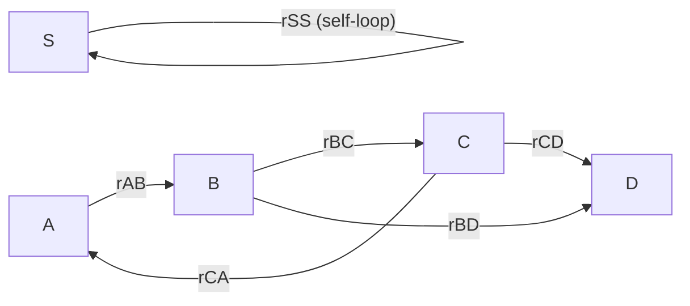

# Chu trình, quan hệ lặp và ngữ nghĩa khớp đường đi theo phiên bản Neo4j/Cypher

Trong Neo4j, **đường đi (path)** là một chuỗi node nối với nhau bằng các relationship. Đồ thị có thể chứa chu trình, vì vậy truy vấn tìm đường có thể quay lại node đã ghé thăm. Tuy nhiên, **quay lại một node** không đồng nghĩa với **đi lại chính relationship đã sử dụng**. Cypher có quy tắc riêng về việc một node hoặc relationship được phép xuất hiện bao nhiêu lần trong một lần khớp mẫu. Quy tắc ấy còn có thể thay đổi khi chủ động chọn **match mode** và **path mode** ở các phiên bản hỗ trợ.

Bài thuộc chương **Đường đi và duyệt đồ thị** của module `DATABASE_ENGINE_GRAPH_NEO4J`, trong đó Neo4j dùng **property graph** để lưu node, relationship, thuộc tính và truy vấn đường đi bằng Cypher. Việc hiểu đúng chu trình và tính duy nhất của phần tử giúp xây dựng truy vấn phân tích phụ thuộc, mạng kết nối, vòng lặp quy trình, giám sát hệ thống; đồng thời tránh diễn giải sai kết quả khi chạy truy vấn từ Java Driver hoặc Spring Data Neo4j.

**Sau bài học**, bạn có thể:

- Phân biệt **walk**, **trail**, đường đi không lặp node, **chu trình** và **self-loop**.
- Giải thích vì sao Cypher mặc định có thể quay lại node cũ nhưng không khớp lặp relationship trong cùng một kết quả `MATCH`.
- Xử lý tình huống nhiều mẫu trong **một `MATCH`** so với nhiều `MATCH` riêng; hiểu phạm vi kiểm tra duy nhất relationship.
- Dùng `REPEATABLE ELEMENTS` và `ACYCLIC` ở đúng phiên bản Cypher/Neo4j, đồng thời phân biệt `WALK`/`TRAIL` với **match mode**.
- Thiết kế cận số bước hợp lý để tránh bùng nổ số đường đi trong đồ thị có chu trình.

## 1. Bốn khái niệm dễ nhầm

Giả sử các mũi tên là relationship có hướng. Một số cách đi qua đồ thị có ý nghĩa khác nhau:

| Khái niệm | Có lặp node? | Có lặp relationship? | Ví dụ |
| --- | --- | --- | --- |
| **Walk** (lối đi tổng quát) | Có thể | Có thể | A → B → C → A → B |
| **Trail** (đường không lặp cạnh) | Có thể | **Không** | A → B → C → A |
| **Đường đi không lặp node** (*node-simple / acyclic path*) | **Không** | Không | A → B → C → D |
| **Chu trình khép kín** | Node đầu = node cuối | Có thể không lặp cạnh | A → B → C → A |

Các thuật ngữ hình học đồ thị trên mô tả **loại lối đi**. Trong Cypher, kết quả thực tế còn phụ thuộc **ngữ nghĩa khớp mẫu** đang được chọn.

Ví dụ **A → B → C → A** là một chu trình ba cạnh: node A xuất hiện hai lần, nhưng ba relationship là ba cạnh khác nhau. Nó vẫn có thể được tìm thấy bằng `MATCH` mặc định. Ngược lại, **A → B → C → A → B** cần dùng lại relationship A → B; đó là walk có relationship lặp và không phù hợp quy tắc mặc định.

**Self-loop** là relationship nối một node với chính node đó, như `(X)-[:LINK]->(X)`. Một path có self-loop có `length(p) = 1` và `nodes(p) = [X, X]`: node lặp, relationship chỉ xuất hiện một lần. Không nên nhầm với **zero-hop path**, nơi `length(p) = 0` và không có relationship nào.

> Trong lý thuyết đồ thị, một **chu trình đơn** có thể cho phép node đầu trùng node cuối nhưng không lặp các node nội bộ. Còn chế độ `ACYCLIC` trong Cypher 25 nghiêm ngặt hơn: nó cấm **mọi** node lặp bên trong một path, kể cả khi node đầu chính là node cuối của chu trình.

## 2. Tạo đồ thị mẫu để kiểm chứng

Bài thực hành dùng nhãn `CycleDemoNode` và kiểu cạnh `CYCLE_DEMO_LINK` riêng để không lẫn dữ liệu của các bài Neo4j khác trong cùng database. Có bốn node A, B, C, D; một chu trình A → B → C → A; và hai lối đến D. Thêm một node S có self-loop độc lập.

### 2.1. Tạo node

```cypher
UNWIND ['A', 'B', 'C', 'D', 'S'] AS code
MERGE (n:CycleDemoNode {code: code});
```

### 2.2. Tạo relationship

```cypher
UNWIND [
  {source: 'A', target: 'B', edgeCode: 'rAB'},
  {source: 'B', target: 'C', edgeCode: 'rBC'},
  {source: 'C', target: 'A', edgeCode: 'rCA'},
  {source: 'B', target: 'D', edgeCode: 'rBD'},
  {source: 'C', target: 'D', edgeCode: 'rCD'},
  {source: 'S', target: 'S', edgeCode: 'rSS'}
] AS item
MATCH (from:CycleDemoNode {code: item.source})
MATCH (to:CycleDemoNode {code: item.target})
MERGE (from)-[r:CYCLE_DEMO_LINK]->(to)
SET r.edgeCode = item.edgeCode;
```

Ở đây `rAB`, `rBC`... là mã minh họa để nhìn ra cạnh nào được dùng lại. Mỗi relationship có **danh tính riêng**, khác với node đầu/cuối và kiểu quan hệ. Trong database thực, có thể có nhiều relationship song song giữa cùng hai node; các relationship đó vẫn là **các cạnh khác nhau**. Ví dụ trên giả định không có node `CycleDemoNode` trùng `code`; nên có unique constraint cho khóa định danh khi triển khai thực tế.



Các đường đi quan trọng:

| Chuỗi node | Các cạnh theo thứ tự | Nhận xét |
| --- | --- | --- |
| A → B | [rAB] | Một bước, không lặp |
| A → B → C | [rAB, rBC] | Hai bước, không lặp |
| A → B → D | [rAB, rBD] | Hai bước đến D |
| A → B → C → D | [rAB, rBC, rCD] | Ba bước đến D |
| A → B → C → A | [rAB, rBC, rCA] | Chu trình, lặp node A nhưng **không lặp cạnh** |
| A → B → C → A → B | [rAB, rBC, rCA, rAB] | Walk phải **dùng lại rAB** |
| S → S | [rSS] | Self-loop dài một cạnh |

## 3. Quy tắc mặc định: relationship không lặp trong một kết quả `MATCH`

Cypher mặc định áp dụng ngữ nghĩa **relationship uniqueness**: trong một lần khớp graph pattern của **cùng một `MATCH`**, **cùng một relationship không được sử dụng hai lần**, bất kể ta đi qua nó xuôi hay ngược chiều. Quy tắc này áp dụng cả khi graph pattern chứa nhiều path pattern phân tách bởi dấu phẩy. **Node không chịu ràng buộc duy nhất tương tự**.

Đây là quy tắc nền tảng của **Cypher 5** và vẫn là hành vi mặc định ở **Cypher 25**. Trong Cypher 25, nó có tên match mode **`DIFFERENT RELATIONSHIPS`** (có thể viết tường minh từ Neo4j 2025.06); việc không ghi keyword vẫn mang hành vi mặc định này.

### 3.1. Chu trình A → B → C → A vẫn khớp

```cypher
MATCH p = (a:CycleDemoNode {code: 'A'})
          -[:CYCLE_DEMO_LINK*3]->
          (finish:CycleDemoNode {code: 'A'})
RETURN [n IN nodes(p) | n.code] AS cac_node,
       [r IN relationships(p) | r.edgeCode] AS cac_canh,
       length(p) AS so_buoc;
```

Kết quả:

| `cac_node` | `cac_canh` | `so_buoc` |
| --- | --- | ---: |
| [A, B, C, A] | [rAB, rBC, rCA] | 3 |

Node A xuất hiện ở đầu và cuối, nhưng `rAB`, `rBC`, `rCA` đều khác nhau, nên path được chấp nhận.

### 3.2. Đi thêm một bước A → B lần nữa bị loại

```cypher
MATCH p = (a:CycleDemoNode {code: 'A'})
          -[:CYCLE_DEMO_LINK*4]->
          (b:CycleDemoNode {code: 'B'})
RETURN [n IN nodes(p) | n.code] AS cac_node,
       [r IN relationships(p) | r.edgeCode] AS cac_canh;
```

**Không có kết quả**. Đường A → B → C → A → B dài bốn bước phải đi qua `rAB` **hai lần**; đó là lý do mặc định bị loại. Không có đường bốn bước hợp lệ nào khác từ A đến B trong đồ thị mẫu.

**Đừng kết luận nhầm** rằng đồ thị không chứa đường đi vật lý A–B–C–A–B. Nó tồn tại như một **walk**; chỉ là mẫu `MATCH` mặc định không cho phép dùng lại cạnh.

### 3.3. Cách quan sát node và cạnh lặp

```cypher
MATCH p = (a:CycleDemoNode {code: 'A'})
          -[:CYCLE_DEMO_LINK*1..3]->
          (finish:CycleDemoNode)
RETURN [n IN nodes(p) | n.code] AS node_theo_thu_tu,
       [r IN relationships(p) | r.edgeCode] AS canh_theo_thu_tu,
       length(p) AS so_buoc
ORDER BY so_buoc, node_theo_thu_tu;
```

Trong kết quả có path A → B → C → A (độ dài 3) **dù A lặp**; không có path dài 4 trở lên do cận trên là 3. Dùng hai danh sách `nodes(p)` và `relationships(p)` sẽ chỉ rõ phần tử nào xuất hiện lại trên mỗi path; `length(p)` chỉ đếm số relationship, không đếm số node duy nhất.

## 4. Phạm vi duy nhất: một `MATCH` và nhiều `MATCH` khác nhau

Một điểm quan trọng là **tính duy nhất relationship được xét trong một kết quả của cùng graph pattern thuộc một `MATCH`**. Hai mẫu phân tách bởi dấu phẩy **trong một `MATCH`** vẫn chịu chung ràng buộc; còn **hai `MATCH` liên tiếp** là hai lần khớp mẫu độc lập, có thể cùng tham chiếu một relationship đã khớp.

### 4.1. Hai mẫu trong **cùng** một `MATCH`

```cypher
MATCH (a:CycleDemoNode {code: 'A'})-[r:CYCLE_DEMO_LINK]->(b:CycleDemoNode {code: 'B'}),
      (a)-[s:CYCLE_DEMO_LINK]->(b)
RETURN count(*) AS so_ket_qua;
```

Trong đồ thị mẫu chỉ có **một** cạnh A → B là `rAB`. Hai mẫu cùng cố khớp cạnh ấy với `r` và `s`, nên truy vấn mặc định trả `so_ket_qua = 0`.

### 4.2. Hai `MATCH` **riêng** có thể tái sử dụng cạnh

```cypher
MATCH (a:CycleDemoNode {code: 'A'})-[r:CYCLE_DEMO_LINK]->(b:CycleDemoNode {code: 'B'})
MATCH (a)-[s:CYCLE_DEMO_LINK]->(b)
RETURN r = s AS co_cung_relationship,
       r.edgeCode AS canh_thu_nhat,
       s.edgeCode AS canh_thu_hai;
```

Kết quả: `co_cung_relationship = true`, cả hai mã đều là `rAB`.

Hai `MATCH` này **không** mô tả một path A → B → A; chúng tạo ra hai lần khớp độc lập có cùng cặp endpoint. Việc tách `MATCH` chỉ để né quy tắc có thể khiến ý nghĩa nghiệp vụ khác đi. Nếu thực sự muốn một walk được phép dùng lại relationship **trong cùng path**, dùng match mode chuyên dụng ở các phiên bản hỗ trợ.

## 5. Phiên bản Neo4j và Cypher quyết định tính năng nào khả dụng?

Từ năm 2025, Neo4j sử dụng phiên bản server theo lịch `YYYY.MM`. Neo4j 2025.06 giới thiệu **Cypher 25** bên cạnh **Cypher 5**. Cần phân biệt **phiên bản server** với **phiên bản ngôn ngữ Cypher được chọn để chạy truy vấn**.

| Phiên bản / ngôn ngữ | Quy tắc và cú pháp liên quan |
| --- | --- |
| **Cypher 5** (trên Neo4j 5.x hoặc khi chủ động chạy Cypher 5 ở server mới) | Mặc định không lặp relationship trong một kết quả `MATCH`; dùng legacy `-[:TYPE*1..N]->` và QPP nếu phiên bản Neo4j 5 đủ mới |
| **Neo4j 5.9+** | Hỗ trợ quantified path patterns và quantified relationships, ví dụ `-[:TYPE]->{1,3}` |
| **Neo4j 2025.06+ với Cypher 25** | Có keyword tường minh `DIFFERENT RELATIONSHIPS` và match mode `REPEATABLE ELEMENTS` |
| **Neo4j 2026.03+ với Cypher 25** | Có các path mode `WALK`, `TRAIL`, `ACYCLIC` |
| **Mặc định ở các phiên bản hỗ trợ** | Vẫn áp relationship uniqueness nếu không chủ động chọn `REPEATABLE ELEMENTS` |

**Cảnh báo tương thích:** chỉ cài server mới chưa đảm bảo query đang dùng ngôn ngữ mới. Môi trường có thể cấu hình Cypher 5 làm mặc định; các keyword mới như `REPEATABLE ELEMENTS` và `ACYCLIC` cần **Cypher 25** và phiên bản server đủ điều kiện.

Từ Neo4j 2025.06, có thể chỉ định ngôn ngữ cho **từng truy vấn** bằng tiền tố:

```cypher
CYPHER 25
MATCH (n:CycleDemoNode {code: 'A'})
RETURN n.code;
```

Hoặc chỉ định rõ Cypher 5:

```cypher
CYPHER 5
MATCH (n:CycleDemoNode {code: 'A'})
RETURN n.code;
```

Có thể cấu hình mặc định Cypher cho database. Khi làm việc qua Java Driver hoặc Spring Data Neo4j, kiểm tra ngôn ngữ được database sử dụng và thêm tiền tố `CYPHER 25` cho những câu lệnh cần tính năng mới; **driver không tự làm cho một cú pháp không được server hỗ trợ trở nên hợp lệ**.

Nguồn chính thức về khả năng chọn phiên bản: [Select Cypher version – Neo4j Manual](https://neo4j.com/docs/cypher-manual/current/queries/select-version/).

## 6. `REPEATABLE ELEMENTS`: cho phép dùng lại relationship (Cypher 25)

Match mode `REPEATABLE ELEMENTS` được giới thiệu trong **Neo4j 2025.06, chỉ có trong Cypher 25**. Khi chọn mode này, relationship được phép xuất hiện **nhiều lần trong cùng kết quả `MATCH`**, bên cạnh việc node cũng có thể lặp. Đó là hành vi phù hợp khi nghiệp vụ cần mô tả walk tổng quát.

### 6.1. Truy vấn được phép quay lại cạnh `rAB`

```cypher
CYPHER 25
MATCH REPEATABLE ELEMENTS p =
      (a:CycleDemoNode {code: 'A'})
      -[:CYCLE_DEMO_LINK]->{4}
      (b:CycleDemoNode {code: 'B'})
RETURN [n IN nodes(p) | n.code] AS cac_node,
       [r IN relationships(p) | r.edgeCode] AS cac_canh,
       length(p) AS so_buoc;
```

Với đồ thị mẫu, truy vấn này trả:

| `cac_node` | `cac_canh` | `so_buoc` |
| --- | --- | ---: |
| [A, B, C, A, B] | [rAB, rBC, rCA, rAB] | 4 |

So với mục 3.2, cùng một chuỗi node đã trở thành kết quả hợp lệ do **match mode cho phép relationship lặp**. Phần `-[:CYCLE_DEMO_LINK]->{4}` là **quantified relationship**: lặp quan hệ đúng bốn lần, với cú pháp có hỗ trợ từ Neo4j 5.9. Dạng legacy `*4` vẫn có ngữ nghĩa không lặp cạnh khi `MATCH` dùng mặc định.

### 6.2. Chu trình lặp hai vòng

```cypher
CYPHER 25
MATCH REPEATABLE ELEMENTS p =
      (start:CycleDemoNode {code: 'A'})
      -[:CYCLE_DEMO_LINK]->{3,6}
      (finish:CycleDemoNode {code: 'A'})
RETURN DISTINCT length(p) AS so_buoc
ORDER BY so_buoc;
```

Kết quả `so_buoc = 3` và `so_buoc = 6`:

- Ba bước: `A → B → C → A`, đi mỗi cạnh của chu trình một lần.
- Sáu bước: `A → B → C → A → B → C → A`, đi lại ba cạnh của chu trình lần thứ hai.

Trong khi đó, với **match mode mặc định**:

```cypher
MATCH p = (a:CycleDemoNode {code: 'A'})
          -[:CYCLE_DEMO_LINK*3..6]->
          (d:CycleDemoNode {code: 'A'})
RETURN DISTINCT length(p) AS so_buoc;
```

Chỉ có kết quả `so_buoc = 3`. Path sáu bước phải lặp cạnh và bị loại.

### 6.3. Bắt buộc đặt cận trên hữu hạn

Khi sử dụng `REPEATABLE ELEMENTS`, **mọi quantifier độ dài biến thiên phải có cận trên**. Ví dụ `{4}`, `{1,4}` hay `{,4}` hợp lệ; các mẫu không giới hạn trên như `+`, `*` hoặc `{1,}` không được phép.

Lý do: nếu đồ thị có chu trình và relationship được lặp không giới hạn, có thể tồn tại vô số walk, nên việc liệt kê mọi walk không kết thúc. Cận trên hữu hạn làm không gian kết quả hữu hạn với đồ thị hữu hạn, nhưng **không đảm bảo số lượng path nhỏ**.

`REPEATABLE ELEMENTS` còn cho phép cùng một relationship được khớp bởi **hai path pattern trong cùng `MATCH`**, khác với chế độ mặc định. Bởi vậy khi dùng mode này, đừng chỉ nhìn số node/cạnh khác nhau trong đồ thị để dự đoán số kết quả.

## 7. `WALK`, `TRAIL` và `ACYCLIC`: path mode của Cypher 25

Từ **Neo4j 2026.03**, **Cypher 25** hỗ trợ ba **path mode**. Path mode đặt ở **đầu một path pattern**, quy định mức ràng buộc duy nhất **bên trong path đó**:

| Path mode | Quy tắc riêng của path |
| --- | --- |
| `WALK` | Bản thân path mode không hạn chế lặp node hay relationship |
| `TRAIL` | Không lặp relationship, nhưng có thể lặp node |
| `ACYCLIC` | Không lặp node trong path, nên cũng không lặp relationship |

Tuy nhiên, **path mode và match mode cùng có hiệu lực**. Do đó, chọn `WALK` khi match mode vẫn là `DIFFERENT RELATIONSHIPS` **không** đủ để lặp relationship. Muốn cho lặp cạnh thực sự, chọn `REPEATABLE ELEMENTS` (có thể kết hợp `WALK` ở phiên bản hỗ trợ).

| Match mode | Path mode | Kết quả hiệu lực |
| --- | --- | --- |
| `DIFFERENT RELATIONSHIPS` (mặc định) | Không ghi, hoặc `TRAIL` | Không lặp relationship; node có thể lặp |
| `DIFFERENT RELATIONSHIPS` | `WALK` | Vẫn **không lặp relationship** do match mode |
| `DIFFERENT RELATIONSHIPS` | `ACYCLIC` | Không lặp node trong từng path |
| `REPEATABLE ELEMENTS` | Không ghi, hoặc `WALK` | Có thể lặp cả node và relationship |
| `REPEATABLE ELEMENTS` | `TRAIL` hoặc `ACYCLIC` | **Không hỗ trợ kết hợp** |

Các path pattern trong **cùng một `MATCH`** phải dùng path mode nhất quán; muốn áp dụng nhiều chế độ khác nhau, tách chúng thành những `MATCH` riêng, đồng thời đánh giá lại ý nghĩa ngữ nghĩa của truy vấn.

### 7.1. `ACYCLIC` loại chu trình A → B → C → A

```cypher
CYPHER 25
MATCH p = ACYCLIC
      (a:CycleDemoNode {code: 'A'})
      -[:CYCLE_DEMO_LINK]->{3}
      (d:CycleDemoNode {code: 'A'})
RETURN [n IN nodes(p) | n.code] AS cac_node;
```

**Không có kết quả**, vì A xuất hiện lại ở cuối path. Chú ý `ACYCLIC` đặt **trước path pattern** (sau phần `p =`) và yêu cầu **Neo4j 2026.03+ với Cypher 25**.

Ngược lại, nếu muốn đường không lặp node từ A đến D:

```cypher
CYPHER 25
MATCH p = ACYCLIC
      (a:CycleDemoNode {code: 'A'})
      -[:CYCLE_DEMO_LINK]->{1,4}
      (d:CycleDemoNode {code: 'D'})
RETURN [n IN nodes(p) | n.code] AS duong_di,
       length(p) AS so_buoc
ORDER BY so_buoc;
```

Kết quả là `A → B → D` (2 bước) và `A → B → C → D` (3 bước), vì cả hai không lặp node.

### 7.2. `TRAIL` không phải cách cho phép lặp cạnh

```cypher
CYPHER 25
MATCH p = TRAIL
      (a:CycleDemoNode {code: 'A'})
      -[:CYCLE_DEMO_LINK]->{4}
      (b:CycleDemoNode {code: 'B'})
RETURN p;
```

Truy vấn vẫn **không có kết quả**: A → B → C → A → B phải đi lại `rAB`. `TRAIL` có tính chất relationship uniqueness. Dùng `WALK` mà vẫn để mặc định `DIFFERENT RELATIONSHIPS` cũng không thay đổi kết luận này.

### 7.3. `REPEATABLE ELEMENTS` + `WALK`

```cypher
CYPHER 25
MATCH REPEATABLE ELEMENTS p = WALK
      (a:CycleDemoNode {code: 'A'})
      -[:CYCLE_DEMO_LINK]->{4}
      (b:CycleDemoNode {code: 'B'})
RETURN [r IN relationships(p) | r.edgeCode] AS cac_canh;
```

Truy vấn có thể trả `[rAB, rBC, rCA, rAB]`. Hai mode lúc này nhất quán: match mode cho phép lặp cạnh và path mode `WALK` không áp thêm hạn chế. Vì `WALK` là tính năng của **Neo4j 2026.03+**, ở server 2025.06–2026.02 hãy dùng `MATCH REPEATABLE ELEMENTS p = ...` **không ghi `WALK`**.

## 8. Làm gì nếu cần path không lặp node trên Cypher 5?

Trước phiên bản hỗ trợ `ACYCLIC`, có thể dùng **bộ lọc sau khi khớp path** để loại những path lặp node:

```cypher
MATCH p = (a:CycleDemoNode {code: 'A'})
          -[:CYCLE_DEMO_LINK*1..4]->
          (finish:CycleDemoNode)
WHERE all(n IN nodes(p)
          WHERE single(m IN nodes(p) WHERE m = n))
RETURN [n IN nodes(p) | n.code] AS duong_di,
       length(p) AS so_buoc
ORDER BY so_buoc, duong_di;
```

Biểu thức `single(m IN nodes(p) WHERE m = n)` kiểm tra rằng **mỗi node đang xét xuất hiện đúng một lần trong danh sách path**. Với đồ thị mẫu, kết quả gồm:

| `duong_di` | `so_buoc` |
| --- | ---: |
| [A, B] | 1 |
| [A, B, C] | 2 |
| [A, B, D] | 2 |
| [A, B, C, D] | 3 |

Path `[A, B, C, A]` bị loại vì A xuất hiện hai lần. Cách lọc này giúp **giữ kết quả không lặp node** nhưng không nhất thiết ngăn engine mở rộng các path lặp node trước đó. Nó còn phải so sánh các node trong danh sách, nên với path dài có thể tốn kém. Khi server và ngôn ngữ đã hỗ trợ `ACYCLIC`, ưu tiên diễn đạt đúng ý định bằng path mode và dùng `EXPLAIN`/`PROFILE` để so sánh chi phí.

**Lưu ý:** việc “không lặp node” là một ràng buộc theo **đường đi**; `DISTINCT end` chỉ gộp node đích giống nhau giữa các bản ghi, **không** làm cho các node trong từng path trở nên duy nhất.

## 9. Đếm kết quả và các lỗi suy luận thường gặp

### 9.1. `length(p)` không cho biết số node khác nhau

Với chu trình `A → B → C → A`:

```cypher
MATCH p = (a:CycleDemoNode {code: 'A'})
          -[:CYCLE_DEMO_LINK*3]->
          (d:CycleDemoNode {code: 'A'})
RETURN length(p) AS so_canh,
       size(nodes(p)) AS so_luot_node,
       [n IN nodes(p) | n.code] AS cac_node;
```

Kết quả có **3 cạnh, 4 lượt node**, nhưng chỉ có **3 node khác nhau**. Nếu nghiệp vụ hỏi số node duy nhất, cần phép khử trùng hoặc tổng hợp riêng; `size(nodes(p))` không tự làm điều đó.

### 9.2. Số path khác số node đích

```cypher
MATCH p = (a:CycleDemoNode {code: 'A'})
          -[:CYCLE_DEMO_LINK*1..3]->
          (d:CycleDemoNode {code: 'D'})
RETURN count(p) AS so_path,
       count(DISTINCT d) AS so_node_dich;
```

Kết quả: `so_path = 2`, `so_node_dich = 1`. Hai đường hợp lệ là `A → B → D` và `A → B → C → D`; cả hai có **cạnh khác nhau trên từng path**, nhưng chia sẻ node đích D. `DISTINCT` chỉ gộp node D ở kết quả, không thay đổi ngữ nghĩa duyệt relationship.

### 9.3. Hướng duyệt không thay đổi danh tính cạnh

Với pattern không mũi tên `(a)-[:CYCLE_DEMO_LINK]-(b)`, Cypher có thể khớp relationship theo cả hai hướng. Một relationship `rAB` vẫn là **một cạnh duy nhất**, kể cả khi ta đi từ A sang B rồi muốn quay ngược B về A. `DIFFERENT RELATIONSHIPS` không cho dùng lại `rAB` chỉ vì hướng đi đã đổi.

Với `REPEATABLE ELEMENTS`, cùng cạnh ấy có thể xuất hiện nhiều lần; tuy nhiên cần chọn cận độ sâu và đảm bảo nghiệp vụ thực sự cho phép đi ngược chiều. Hướng `->`, `<-` hoặc không mũi tên là **ràng buộc khác** với ràng buộc duy nhất relationship.

### 9.4. Self-loop và zero-hop path

```cypher
MATCH p = (s:CycleDemoNode {code: 'S'})
          -[:CYCLE_DEMO_LINK]->
          (finish:CycleDemoNode {code: 'S'})
RETURN [n IN nodes(p) | n.code] AS cac_node,
       [r IN relationships(p) | r.edgeCode] AS cac_canh,
       length(p) AS so_buoc;
```

Kết quả `[S,S]`, `[rSS]`, `1`; self-loop **không vi phạm** relationship uniqueness vì cạnh `rSS` chỉ xuất hiện một lần. Ngược lại, với mẫu `*0..1`, path `[S]` có thể xuất hiện ở độ dài 0 và không chứa cạnh nào. Chỉ path độ dài 1 mới thực sự sử dụng self-loop.

Trong chế độ `ACYCLIC`, path `[S,S]` sẽ bị loại vì node S lặp; còn path zero-hop `[S]` không lặp node và có thể được chấp nhận nếu lượng từ cho phép 0 bước.

## 10. Tác động hiệu năng khi cho phép lặp

Một đồ thị hữu hạn có thể có số **walk** rất lớn khi cho phép lặp relationship, đặc biệt là trong mạng có chu trình hoặc nhiều nhánh. Nếu có trung bình b lựa chọn ở mỗi bước, số chuỗi đường đi độ sâu d có thể tăng rất nhanh theo d (một hình dung đơn giản là cỡ b mũ d trong mạng phân nhánh đều). Số path thực tế còn phụ thuộc nhãn, kiểu cạnh, chiều và điều kiện lọc.

| Lựa chọn truy vấn | Lợi ích / chi phí thường gặp |
| --- | --- |
| `*1..3` hoặc `->{1,3}` | Đặt cận nghiệp vụ rõ ràng, giảm phạm vi mở rộng |
| `DIFFERENT RELATIONSHIPS` mặc định | Chặn sử dụng lại cạnh trong một kết quả `MATCH` |
| `REPEATABLE ELEMENTS` | Diễn đạt walk có thể lặp cạnh; **số tổ hợp có thể lớn hơn nhiều** |
| `ACYCLIC` | Loại path quay lại node cũ theo path mode (khi hỗ trợ) |
| Lọc `WHERE` sau khi khớp | Bảo đảm kết quả nhưng có thể tạo nhiều path trung gian trước khi loại |
| Neo điểm đầu/đích, chọn loại và chiều cạnh | Thu hẹp phạm vi và làm rõ ý nghĩa nghiệp vụ |
| `EXPLAIN` / `PROFILE` | Quan sát kế hoạch và thống kê mở rộng path |

**Quy tắc quan trọng:** `LIMIT 10` cuối query chỉ giới hạn số dòng trả về, không tương đương giới hạn mỗi path **10 bước** và không đảm bảo engine tránh mọi phép mở rộng tốn kém trước khi trả kết quả. Đặc biệt không dùng `REPEATABLE ELEMENTS` với cận quá lớn do đầu vào người dùng cung cấp.

Khi chạy truy vấn đồ thị qua Java Driver hoặc Spring Data Neo4j:

1. Kiểm tra phiên bản server và ngôn ngữ Cypher của database.
2. Đặt cận độ sâu hữu hạn phù hợp nghiệp vụ.
3. Neo node đầu/đích bằng label và thuộc tính được index/constraint hỗ trợ.
4. Chỉ chọn kiểu relationship, chiều duyệt và thuộc tính cần trả về.
5. Dùng timeout tài nguyên và quan sát `PROFILE` ở môi trường phù hợp khi số kết quả tăng bất thường.

## 11. Bài tập thực hành có đáp án

Các bài sau sử dụng đúng đồ thị `CycleDemoNode` và `CYCLE_DEMO_LINK` ở mục 2.

### Bài 1. Chu trình có hợp lệ theo mặc định không?

**Đề:** tính độ dài của path A → B → C → A và giải thích vì sao Cypher mặc định trả được nó.

```cypher
MATCH p = (:CycleDemoNode {code: 'A'})
          -[:CYCLE_DEMO_LINK*3]->
          (:CycleDemoNode {code: 'A'})
RETURN [n IN nodes(p) | n.code] AS cac_node,
       [r IN relationships(p) | r.edgeCode] AS cac_canh,
       length(p) AS so_buoc;
```

**Đáp án:** `length(p) = 3`, danh sách node là `[A,B,C,A]`; các relationship `rAB`, `rBC`, `rCA` đều khác nhau. Quy tắc mặc định chặn **lặp cạnh**, không chặn **lặp node**.

### Bài 2. Walk bốn bước nào bị chặn?

**Đề:** A → B → C → A → B có xuất hiện trong `MATCH` mặc định không? Nếu không thì vì sao?

**Đáp án:** **Không**. Quan hệ `rAB` phải xuất hiện hai lần trong cùng path. `CYPHER 25 MATCH REPEATABLE ELEMENTS` với quantified relationship `->{4}` cho phép khớp walk này từ Neo4j 2025.06.

### Bài 3. `MATCH` có dấu phẩy so với hai `MATCH`

**Đề:** chỉ có một cạnh A → B. Hai mẫu `(a)-[r]->(b), (a)-[s]->(b)` trong một `MATCH` có thể khớp cùng cạnh theo mặc định không?

**Đáp án:** **Không**, do uniqueness trong cùng một graph pattern. Nếu đặt mỗi mẫu vào một `MATCH` độc lập, hai biến relationship có thể tham chiếu cùng `rAB`, nhưng lúc ấy là hai lần khớp mẫu riêng, không phải một path đi hai chặng.

### Bài 4. Cấu hình nào thực sự cho lặp cạnh?

**Đề:** so sánh `MATCH p = WALK ...` và `MATCH REPEATABLE ELEMENTS p = WALK ...` trên Cypher 25 đủ mới.

**Đáp án:** `WALK` là **path mode**. Khi `MATCH` vẫn dùng `DIFFERENT RELATIONSHIPS` mặc định, relationship vẫn không được lặp. Chỉ khi bật `REPEATABLE ELEMENTS`, walk mới có thể dùng lại relationship. Dùng `WALK` tường minh cần Neo4j 2026.03+; `REPEATABLE ELEMENTS` có từ Neo4j 2025.06 với Cypher 25.

### Bài 5. `ACYCLIC` có khớp chu trình đơn không?

**Đề:** chạy `MATCH p = ACYCLIC (A)-[:CYCLE_DEMO_LINK]->{3}(A)` trên Cypher 25 đủ mới. Kết quả là gì?

**Đáp án:** Không có path. `ACYCLIC` cấm lặp node trong cùng path, kể cả node đầu trùng node cuối. Cần Neo4j 2026.03+ và Cypher 25 để dùng keyword này.

### Bài 6. Vì sao `REPEATABLE ELEMENTS` đòi cận trên?

**Đề:** giải thích vì sao cú pháp `->{1,5}` được phép nhưng `->+` không được phép khi đang dùng `REPEATABLE ELEMENTS`.

**Đáp án:** nếu lặp cạnh và có chu trình, chuỗi path có thể kéo dài vô hạn. Cận trên hữu hạn đảm bảo phép khớp có phạm vi độ dài hữu hạn. Dù vậy, một cận lớn vẫn có thể tạo số kết quả rất lớn, nên phải kiểm soát ở ứng dụng và trong pattern.

### Bài 7. Đường từ A đến D có bao nhiêu path theo mặc định?

**Đề:** với độ sâu 1–3, hãy cho biết số path và số node đích duy nhất.

**Đáp án:** hai path: `A-B-D` (2 bước) và `A-B-C-D` (3 bước). Cùng đích D nên `count(p) = 2` và `count(DISTINCT d) = 1`. Không cần `REPEATABLE ELEMENTS` để tìm hai đường này.

## 12. Bảng quyết định khi thiết kế truy vấn

| Yêu cầu nghiệp vụ | Lựa chọn phù hợp |
| --- | --- |
| Cho phép quay lại node nhưng không đi lại cạnh | `MATCH` mặc định; có thể ghi `DIFFERENT RELATIONSHIPS` ở Cypher 25 |
| Phát hiện chu trình khép kín | Ràng buộc node đầu và cuối cùng định danh; dùng cận độ dài dương |
| Cần walk có thể quay lại cả node và cạnh | `REPEATABLE ELEMENTS` (Cypher 25, Neo4j 2025.06+), với **cận trên hữu hạn** |
| Chặn mọi node xuất hiện lần thứ hai trong path | `ACYCLIC` (Cypher 25, Neo4j 2026.03+) |
| Phải tương thích với Cypher 5 | Dùng ngữ nghĩa mặc định và bộ lọc trên `nodes(p)`/`relationships(p)` khi cần ràng buộc thêm |
| Chỉ cần đường ít hop nhất hoặc tổng trọng số nhỏ nhất | Xem xét toán tử shortest path hoặc thuật toán trọng số thích hợp; vẫn xác định rõ chế độ khớp path |

## 13. Nguồn đọc thêm và lưu ý tương thích

- [Neo4j Cypher Manual – Match modes and path modes](https://neo4j.com/docs/cypher-manual/current/patterns/reference/match-modes-and-path-modes/): bảng kết hợp `DIFFERENT RELATIONSHIPS`, `REPEATABLE ELEMENTS`, `WALK`, `TRAIL` và `ACYCLIC`.
- [Neo4j Cypher Manual – Paths with unique relationships](https://neo4j.com/docs/cypher-manual/current/patterns/unique-relationship-paths/): ngữ nghĩa mặc định và ví dụ không lặp relationship.
- [Neo4j Cypher Manual – Paths with repeated nodes and relationships](https://neo4j.com/docs/cypher-manual/current/patterns/repeatable-node-and-relationship-paths/): `REPEATABLE ELEMENTS`.
- [Neo4j Cypher Manual – Acyclic paths](https://neo4j.com/docs/cypher-manual/current/patterns/acyclic-paths/): `ACYCLIC` trên Cypher 25, từ Neo4j 2026.03.
- [Neo4j Cypher Manual – Select Cypher version](https://neo4j.com/docs/cypher-manual/current/queries/select-version/): cách chọn `CYPHER 5` và `CYPHER 25`.

Các liên kết dẫn đến tài liệu chính thức **current**. Khi triển khai với một phiên bản server cố định, cần đối chiếu phần manual **đúng phiên bản** để biết keyword hoặc tính năng nào khả dụng. Nếu môi trường chưa hỗ trợ `REPEATABLE ELEMENTS`/`ACYCLIC`, không được giả định cú pháp mới sẽ chạy thành công chỉ vì ví dụ này sử dụng nó.

## 14. Ghi nhớ

- **Chu trình** làm node đầu xuất hiện lại; điều đó **không mặc nhiên vi phạm** ngữ nghĩa mặc định của Cypher.
- Trong `MATCH` mặc định, **mỗi relationship chỉ được khớp một lần trong một kết quả**; node có thể xuất hiện nhiều lần.
- **Một `MATCH`** có thể chứa nhiều path pattern nhưng cùng chịu ràng buộc relationship uniqueness. **Hai `MATCH`** độc lập có thể tham chiếu cùng relationship vì chúng là hai phép khớp riêng.
- `REPEATABLE ELEMENTS` cho phép lặp cả node và relationship, có từ **Neo4j 2025.06 / Cypher 25**, và **đòi cận trên hữu hạn**.
- `WALK`, `TRAIL`, `ACYCLIC` là **path mode** có từ **Neo4j 2026.03 / Cypher 25**. `WALK` một mình không vượt qua match mode mặc định; `ACYCLIC` chặn mọi node lặp.
- `length(p)` là số relationship đi qua; `nodes(p)` và `relationships(p)` cho biết chuỗi phần tử của path. `DISTINCT` trên node đích không chứng minh path không có vòng lặp.
- Giới hạn **kiểu cạnh**, **chiều duyệt**, **độ sâu tối đa**, và kiểm tra ngôn ngữ Cypher được chọn trước khi triển khai trên đồ thị lớn.

Để dự đoán đúng truy vấn tìm đường trong Neo4j, hãy trả lời ba câu hỏi theo thứ tự: **có được quay lại node không, có được đi lại chính relationship không, và phiên bản Cypher đang áp dụng những quy tắc nào?** Cùng một đồ thị có thể cho những tập kết quả khác nhau khi đổi match mode hoặc path mode; hiểu điều đó là nền tảng để viết truy vấn đường đi chính xác và vận hành an toàn.
