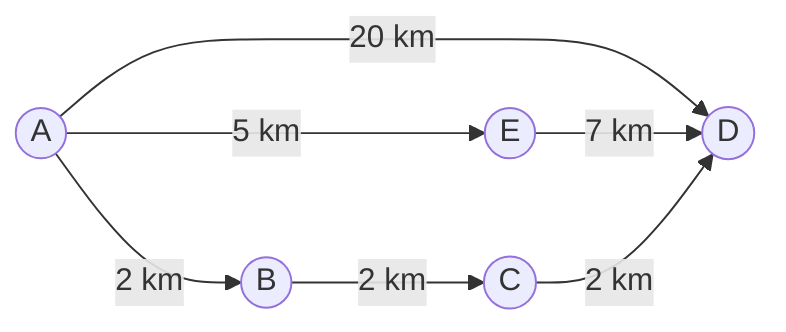

# Phân biệt đường ngắn nhất theo số cạnh với đường có tổng trọng số nhỏ nhất

Khi truy vấn đường đi trong **Neo4j**, chữ “ngắn nhất” chỉ có ý nghĩa nếu xác định rõ **đơn vị đo**. Một đường qua ít quan hệ (relationship) có thể có quãng đường dài, thời gian di chuyển lớn hoặc chi phí cao hơn một đường đi qua nhiều quan hệ. Đây là khác biệt cốt lõi giữa **shortest path theo số cạnh (minimum hops)** và **shortest path theo tổng trọng số (minimum total weight)**.

Bài học thuộc chủ đề **Đường đi và duyệt đồ thị** trong mô hình **property graph**: địa điểm là node, tuyến nối là relationship và trọng số nằm trong thuộc tính của relationship. Ta sẽ dựng một ví dụ có thể chạy với Cypher, sau đó dùng thư viện Neo4j Graph Data Science (GDS) để tìm đường có tổng trọng số nhỏ nhất.

## 1. Hai bài toán tối ưu khác nhau

Xét đường đi `P = (v0, e1, v1, e2, ..., ek, vk)` từ node nguồn đến node đích:

- **Số cạnh**: `hops(P) = k`, chính là số relationship trên đường đi. Mỗi cạnh được xem như có “giá” bằng 1.
- **Tổng trọng số**: `cost(P) = w(e1) + w(e2) + ... + w(ek)`, trong đó `w(e)` là một thuộc tính số của cạnh, chẳng hạn `km` (kilômét), `minutes` (phút) hoặc `fee` (đồng).
- **Đường ít cạnh nhất**: chọn `P` làm cho `hops(P)` nhỏ nhất.
- **Đường có tổng trọng số nhỏ nhất**: chọn `P` làm cho `cost(P)` nhỏ nhất.

Hai đáp án **chỉ chắc chắn trùng nhau trong trường hợp các cạnh đều có cùng trọng số dương**. Nếu mọi cạnh có trọng số `c > 0` thì `cost(P) = c * hops(P)`; ngoài điều kiện đó, không được suy ra đường ít cạnh nhất cũng có tổng trọng số thấp nhất.

| Tiêu chí | Ít cạnh nhất | Tổng trọng số nhỏ nhất |
| --- | --- | --- |
| Hàm mục tiêu | `min hops(P)` | `min cost(P)` |
| Cách hiểu | Ít bước chuyển tiếp, ít mối quan hệ trung gian | Ngắn nhất theo km, nhanh nhất theo phút, rẻ nhất theo phí... |
| Dữ liệu cần | Topology: node và relationship | Topology **và** trọng số hợp lệ trên relationship |
| Thuật toán tiêu biểu | BFS trên đồ thị không trọng số | Dijkstra với trọng số không âm; hoặc thuật toán phù hợp với mô hình trọng số |
| Trong Neo4j | Cypher `ANY SHORTEST`, `shortestPath()` | GDS Dijkstra với `relationshipWeightProperty` |

> **Lưu ý tên thuật toán:** Dijkstra cũng thường được gọi là “shortest path”, nhưng ở đây “độ dài” của đường là **tổng trọng số**, không mặc định là số cạnh. Mục tiêu của thuật toán phải khớp mục tiêu nghiệp vụ.

## 2. Ví dụ: ba đường từ A đến D

Giả sử mỗi relationship `:ROAD` là một tuyến đường **có hướng**, với thuộc tính `km` là số kilômét. Đồ thị có các kết nối sau:



| Đường đi | Số cạnh | Tổng `km` |
| --- | ---: | ---: |
| **A → D** | **1** | 20 |
| A → E → D | 2 | 12 |
| **A → B → C → D** | 3 | **6** |

Kết luận của ví dụ:

- **Đường ít cạnh nhất** là `A → D`: chỉ một cạnh, dù tổng là 20 km.
- **Đường có tổng trọng số nhỏ nhất** là `A → B → C → D`: ba cạnh, nhưng chỉ 6 km.
- `A → E → D` là một phương án trung gian: ít cạnh hơn đường tối ưu theo km nhưng xa hơn.

Nếu sản phẩm yêu cầu “ít lần trung chuyển nhất”, chọn đường theo số cạnh là hợp lý. Nếu yêu cầu “ít kilômét nhất”, chọn đường theo số cạnh có thể đưa ra kết quả sai.

## 3. Dựng dữ liệu mẫu bằng Cypher

Chạy các câu lệnh sau trên **cơ sở dữ liệu thử nghiệm**. Constraint giúp mỗi node `Station` có một `id` duy nhất, tạo điểm đầu và điểm cuối rõ ràng cho truy vấn.

```cypher
CREATE CONSTRAINT station_id_unique IF NOT EXISTS
FOR (s:Station)
REQUIRE s.id IS UNIQUE;
```

Sau đó tạo năm node và sáu relationship. `MERGE` cho phép chạy lại ví dụ mà không cố ý tạo thêm node hoặc tuyến đường trùng nhau trong bộ dữ liệu mẫu.

```cypher
MERGE (a:Station {id: 'A'})
MERGE (b:Station {id: 'B'})
MERGE (c:Station {id: 'C'})
MERGE (d:Station {id: 'D'})
MERGE (e:Station {id: 'E'})
MERGE (a)-[ad:ROAD]->(d)
SET ad.km = 20
MERGE (a)-[ae:ROAD]->(e)
SET ae.km = 5
MERGE (e)-[ed:ROAD]->(d)
SET ed.km = 7
MERGE (a)-[ab:ROAD]->(b)
SET ab.km = 2
MERGE (b)-[bc:ROAD]->(c)
SET bc.km = 2
MERGE (c)-[cd:ROAD]->(d)
SET cd.km = 2;
```

Kiểm tra các cạnh:

```cypher
MATCH (from:Station)-[r:ROAD]->(to:Station)
RETURN from.id AS fromId, to.id AS toId, r.km AS km
ORDER BY fromId, toId;
```

Trong dữ liệu này, hướng từ A đến D là hướng của relationship. Mẫu `(a)-[:ROAD]->(b)` **khác** `(a)-[:ROAD]-(b)`: mẫu thứ hai cho phép duyệt theo cả hai chiều.

## 4. Tìm đường ít cạnh nhất bằng Cypher

Ở Neo4j hỗ trợ cú pháp shortest-path selector (từ Neo4j 5.21), `ANY SHORTEST` chọn một đường có **số relationship nhỏ nhất** giữa hai node:

```cypher
MATCH (start:Station {id: 'A'}), (finish:Station {id: 'D'})
MATCH p = ANY SHORTEST (start)-[:ROAD]->+(finish)
RETURN
  [n IN nodes(p) | n.id] AS route,
  length(p) AS hops,
  reduce(total = 0.0, r IN relationships(p) | total + r.km) AS totalKm;
```

Kết quả dự kiến:

```text
route       hops   totalKm
["A", "D"]   1      20.0
```

Giải thích từng thành phần:

1. `(start)-[:ROAD]->+(finish)` chỉ duyệt một hoặc nhiều cạnh `ROAD` theo chiều mũi tên.
2. `ANY SHORTEST` tìm một đường ít cạnh nhất. Nếu có nhiều đường cùng số cạnh tối thiểu, đường được chọn **không được bảo đảm** là đường có trọng số thấp nhất trong số đó.
3. `length(p)` đếm **số relationship**, không cộng `r.km`.
4. `reduce(...)` ở phần `RETURN` chỉ **tính tổng km của đường đã chọn**; nó không thay đổi tiêu chí tìm đường của `ANY SHORTEST`.

Với môi trường dùng cú pháp truyền thống, có thể thay mệnh đề `MATCH p` bằng:

```cypher
MATCH p = shortestPath((start)-[:ROAD*]->(finish))
```

`shortestPath()` và `allShortestPaths()` vẫn được hỗ trợ trong Cypher, nhưng những hàm này cũng tối ưu theo **số cạnh**, không theo tổng thuộc tính trọng số. Nếu cần tất cả đường cùng ít cạnh nhất, dùng `ALL SHORTEST` (hoặc `allShortestPaths()` trong cú pháp cũ); điều đó vẫn **không** tìm đường có tổng km nhỏ nhất trong toàn đồ thị.

## 5. Tìm đường có tổng trọng số nhỏ nhất bằng GDS Dijkstra

Để tối ưu theo `km`, sử dụng **Neo4j Graph Data Science (GDS)** với thuật toán Dijkstra. Phần này cần cài đặt và cấp quyền sử dụng GDS phù hợp với môi trường Neo4j đang chạy.

### Bước 1 — Chiếu đồ thị vào bộ nhớ GDS

GDS chạy thuật toán trên **đồ thị được project vào bộ nhớ**; quan hệ `ROAD` và thuộc tính `km` phải được đưa vào projection.

```cypher
CALL gds.graph.project(
  'station-roads',
  'Station',
  {
    ROAD: {
      orientation: 'NATURAL',
      properties: 'km'
    }
  }
)
YIELD graphName, nodeCount, relationshipCount
RETURN graphName, nodeCount, relationshipCount;
```

Đồ thị mẫu có **5 node, 6 relationship**. `NATURAL` giữ nguyên hướng của các cạnh trong Neo4j. Nếu bài toán cho phép đi ngược chiều, phải mô hình hóa đúng hướng đi hoặc chủ động chọn projection `UNDIRECTED`; không nên đảo chiều một cách mặc định vì sẽ làm sai các mạng đường một chiều.

> Projection tồn tại trong bộ nhớ GDS. Thay đổi `ROAD.km` trong Neo4j **không tự động cập nhật** projection đã tạo; phải tạo lại hoặc cập nhật projection phù hợp trước khi tính toán với dữ liệu mới.

### Bước 2 — Chạy Dijkstra với trọng số `km`

```cypher
MATCH (start:Station {id: 'A'}), (finish:Station {id: 'D'})
CALL gds.shortestPath.dijkstra.stream('station-roads', {
  sourceNode: start,
  targetNodes: finish,
  relationshipWeightProperty: 'km'
})
YIELD totalCost, nodeIds, costs
RETURN
  [nodeId IN nodeIds | gds.util.asNode(nodeId).id] AS route,
  size(nodeIds) - 1 AS hops,
  totalCost AS totalKm,
  costs AS cumulativeKm;
```

Kết quả dự kiến:

```text
route                  hops   totalKm   cumulativeKm
["A", "B", "C", "D"]    3      6.0       [0.0, 2.0, 4.0, 6.0]
```

Ở đây:

- `relationshipWeightProperty: 'km'` chỉ rõ thuộc tính cạnh dùng để tính chi phí.
- `totalCost` là tổng trọng số của đường tối ưu; `costs` là danh sách chi phí tích lũy đến từng node.
- `nodeIds` biểu diễn các node trên đường đi; phép ánh xạ `gds.util.asNode(nodeId).id` chuyển chúng thành mã địa điểm dễ đọc.
- `targetNodes` là tên cấu hình hiện hành của GDS; tham số cũ `targetNode` đã được đánh dấu deprecated.

Dijkstra giải bài toán tối ưu tổng trọng số khi các trọng số **không âm**; trong mô hình này các giá trị `km` đều dương. Thuộc tính trọng số cần là số hợp lệ và có cùng đơn vị. Nếu không khai báo `relationshipWeightProperty`, ta không còn yêu cầu thuật toán tối ưu theo `km`.

### Bước 3 — Giải phóng projection khi không cần nữa

```cypher
CALL gds.graph.drop('station-roads')
YIELD graphName
RETURN graphName;
```

Lệnh này xóa **đồ thị trong bộ nhớ GDS** có tên `station-roads`, không xóa các node hoặc relationship của cơ sở dữ liệu Neo4j.

## 6. Không có GDS: đối chiếu bằng cách liệt kê đường đi giới hạn

Với **đồ thị nhỏ**, Cypher có thể duyệt các đường có tối đa bốn cạnh, tự cộng trọng số rồi xếp hạng. Đây là một cách kiểm chứng ví dụ, **không phải** giải pháp tổng quát để tìm đường tối ưu trên mạng lớn.

```cypher
MATCH (start:Station {id: 'A'}), (finish:Station {id: 'D'})
MATCH p = (start)-[:ROAD*1..4]->(finish)
WHERE all(r IN relationships(p) WHERE r.km IS NOT NULL AND r.km >= 0)
WITH p, reduce(total = 0.0, r IN relationships(p) | total + r.km) AS totalKm
RETURN
  [n IN nodes(p) | n.id] AS route,
  length(p) AS hops,
  totalKm
ORDER BY totalKm ASC, hops ASC
LIMIT 1;
```

Kết quả ở dữ liệu mẫu cũng là `A → B → C → D` với `totalKm = 6`. Tuy nhiên, nếu đường tối ưu cần **năm cạnh trở lên**, giới hạn `*1..4` sẽ loại nó. Tăng giới hạn tùy tiện có thể khiến số đường cần xét tăng rất nhanh, đặc biệt trên đồ thị nhiều nhánh hoặc có chu trình. Không dùng `ORDER BY totalKm LIMIT 1` sau `ANY SHORTEST` để “biến” thuật toán ít cạnh thành thuật toán có trọng số: lúc đó Cypher chỉ sắp xếp **những đường đã qua bộ chọn ít cạnh**.

## 7. Chọn giải pháp đúng cho yêu cầu nghiệp vụ

| Câu hỏi thực tế | Đơn vị cần tối ưu | Cách tiếp cận |
| --- | --- | --- |
| Qua ít người trung gian nhất trong mạng quan hệ? | Số relationship | Cypher shortest path theo số cạnh |
| Di chuyển qua ít trạm trung chuyển nhất? | Số chặng | Cypher shortest path theo số cạnh |
| Tổng khoảng cách đường bộ nhỏ nhất? | Tổng `km` | Dijkstra có trọng số khoảng cách |
| Tổng thời gian đi lại nhỏ nhất? | Tổng `minutes` | Dijkstra có trọng số thời gian nếu mô hình thời gian cộng được và không âm |
| Tổng phí đi lại nhỏ nhất? | Tổng `fee` | Dijkstra theo chi phí nếu phí trên từng cạnh không âm |
| Vừa ít chuyển tuyến, vừa ít km? | Nhiều tiêu chí | Định nghĩa thứ tự ưu tiên hoặc một hàm chi phí rõ ràng trước khi chọn thuật toán |

Cần đặc biệt phân biệt **ít cạnh** với **chi phí nhỏ** khi đưa kết quả vào ứng dụng Java, Neo4j Java Driver hoặc Spring Data Neo4j. Một câu Cypher trả về tên trường `totalKm` không chứng minh rằng nó đã tối ưu theo `km`; phải kiểm tra thuật toán và cấu hình truy vấn tạo ra kết quả đó.

### Các lỗi thường gặp

1. **Nhầm `length(p)` với độ dài vật lý.** `length(p)` đếm relationship; khoảng cách thực phải đọc thuộc tính và cộng chúng.
2. **Đo chi phí sau khi đã chọn đường theo hops.** `reduce` ở `RETURN` không làm thay đổi cách Cypher tìm `p`.
3. **Quên chiều cạnh.** Đường hợp lệ trên đồ thị có hướng có thể không tồn tại theo chiều ngược lại.
4. **Dữ liệu trọng số thiếu hoặc sai đơn vị.** Mọi cạnh cần một thuộc tính số thích hợp (ví dụ cùng đơn vị km); không nên trộn km và phút trong cùng tổng.
5. **Dùng Dijkstra với trọng số âm.** Dijkstra không phù hợp với mô hình có cạnh mang chi phí âm; phải xem lại mô hình hoặc chọn thuật toán thích hợp.
6. **Dùng projection GDS đã cũ.** Dữ liệu Neo4j thay đổi sau khi project có thể khiến kết quả thuật toán dựa trên snapshot không còn khớp dữ liệu mới.
7. **Liệt kê mọi đường đi trên đồ thị lớn.** Việc duyệt không giới hạn rồi sắp xếp theo chi phí có nguy cơ bùng nổ số đường. Nên ưu tiên thuật toán chuyên dụng và xem kế hoạch truy vấn với `EXPLAIN` / `PROFILE`.

## 8. Tự kiểm tra

**Câu 1.** Nếu đổi trọng số của cạnh `A → D` từ 20 km thành 4 km và cập nhật projection, hai bài toán cho kết quả nào?

<details>
<summary>Gợi ý đáp án</summary>

Cả hai đều chọn `A → D`: đường này vừa có một cạnh, vừa có tổng trọng số nhỏ nhất (4 km). Kết quả trùng nhau ở **bộ dữ liệu này** không có nghĩa hai bài toán luôn tương đương.

</details>

**Câu 2.** Tại sao `ORDER BY totalKm LIMIT 1` đặt sau `MATCH p = ANY SHORTEST ...` không tìm được tuyến 6 km trong ví dụ ban đầu?

<details>
<summary>Gợi ý đáp án</summary>

Vì `ANY SHORTEST` chỉ trả về một đường có **số cạnh tối thiểu** (`A → D`). `ORDER BY` không có các đường 2 hoặc 3 cạnh để so sánh với nó. Cần tìm theo trọng số từ đầu, chẳng hạn dùng GDS Dijkstra.

</details>

**Câu 3.** Trong hệ thống có đường một chiều và trọng số phút thay đổi theo giờ cao điểm, cần xem lại những điều gì trước khi áp dụng Dijkstra?

<details>
<summary>Gợi ý đáp án</summary>

Phải giữ đúng hướng của relationship, xác định thời điểm lấy `minutes`, bảo đảm trọng số không âm và nhất quán, cập nhật dữ liệu/projection khi giá trị thay đổi. Nếu chi phí của một cạnh phụ thuộc vào **thời điểm đến cạnh đó**, bài toán có thể cần thuật toán định tuyến theo thời gian thay vì Dijkstra tĩnh đơn giản.

</details>

## Ghi nhớ

- **Ít cạnh nhất:** tối ưu `length(p)`; phù hợp với số bước hoặc số lần chuyển tiếp.
- **Tổng trọng số nhỏ nhất:** tối ưu `sum(weight)` trên toàn đường; phù hợp với khoảng cách, thời gian hoặc chi phí.
- **Neo4j Cypher shortest path mặc định giải bài toán ít cạnh.** Khi cần tổng trọng số nhỏ nhất với trọng số không âm, chọn thuật toán có trọng số như **GDS Dijkstra** và truyền đúng `relationshipWeightProperty`.

### Tài liệu tham khảo

- [Neo4j Cypher Manual — Shortest paths](https://neo4j.com/docs/cypher-manual/current/patterns/shortest-paths/)
- [Neo4j GDS — Dijkstra Source-Target Shortest Path](https://neo4j.com/docs/graph-data-science/current/algorithms/dijkstra-source-target/)
- [Neo4j GDS — Native projection](https://neo4j.com/docs/graph-data-science/current/management-ops/graph-creation/graph-project/)
