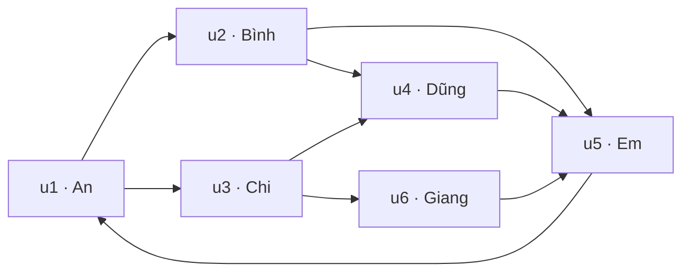

# Giới hạn tập kết quả để tránh số đường đi tăng theo cấp số nhân

## 1. Bài toán trong đồ thị Neo4j

Trong **Neo4j**, các node và relationship tạo thành mô hình **property graph**. Ngôn ngữ **Cypher** cho phép tìm node liên quan, duyệt các relationship và truy vấn đường đi (*path*) giữa các thực thể. Đây là nền tảng của nhiều bài toán: tìm mối liên hệ giữa người dùng, phân tích chuỗi phụ thuộc dịch vụ, truy vết giao dịch, đề xuất nội dung và phát hiện rủi ro.

Tuy nhiên, một truy vấn đường đi có thể sinh ra lượng kết quả rất lớn dù đồ thị không quá lớn. Nếu mỗi node trung bình có nhiều nhánh đi tiếp và truy vấn cho phép đi nhiều bước (*hops*), số đường đi ứng viên có thể **tăng theo cấp số nhân**. Khi đó, truy vấn có thể mất nhiều thời gian, chiếm bộ nhớ và truyền về quá nhiều dòng cho ứng dụng.

Bài này thuộc chương **Đường đi và duyệt đồ thị** của module `DATABASE_ENGINE_GRAPH_NEO4J`. Ta sẽ tập trung vào cách **giới hạn độ sâu và tập đường đi cần xét**, hiểu đúng vai trò của `LIMIT`, chọn cách duyệt phù hợp và xác minh hiệu năng bằng công cụ của Neo4j. Các ví dụ được viết bằng Cypher và có thể áp dụng khi ứng dụng truy cập Neo4j qua **Java Driver** hoặc **Spring Data Neo4j**.

### Sau bài học, bạn có thể

- Giải thích vì sao số đường đi tăng rất nhanh khi tăng độ sâu duyệt.
- Phân biệt **giới hạn số dòng kết quả** với **giới hạn không gian tìm kiếm**.
- Viết truy vấn Cypher đặt giới hạn số hop, nhãn node, loại và hướng relationship.
- Chọn giữa liệt kê đường đi, tìm điểm đích, và tìm một đường đi ngắn nhất.
- Đọc `EXPLAIN` / `PROFILE` để phát hiện truy vấn sinh ra quá nhiều đường đi trung gian.

## 2. Tại sao số đường đi có thể bùng nổ?

Giả sử trung bình một node có thể tiếp tục đến `b` node khác. Nếu xét đúng `d` bước, số chuỗi lựa chọn có thể xấp xỉ:

\[
P(d) \approx b^d
\]

Nếu lấy tất cả các đường đi có độ dài từ 1 đến `d`, tổng số lựa chọn trong mô hình cây phân nhánh đều là:

\[
P(1..d) \approx b + b^2 + \cdots + b^d
\]

Với `b = 10`, số đường đi tiềm năng ở **bước thứ 5** là `10^5 = 100.000`; cộng từ bước 1 đến bước 5 là `111.110`. Trong thực tế, kết quả phụ thuộc cấu trúc đồ thị, hướng quan hệ, mức độ trùng lặp và quy tắc không lặp lại relationship trên một đường đi. Tuy vậy, công thức minh họa đúng rủi ro: **thêm một hop có thể khiến khối lượng tìm kiếm tăng vọt**.

| Số hop tối đa | Đường đi tại hop cuối nếu `b = 5` | Tổng từ 1 đến hop đó |
| ---: | ---: | ---: |
| 1 | 5 | 5 |
| 2 | 25 | 30 |
| 3 | 125 | 155 |
| 4 | 625 | 780 |
| 5 | 3.125 | 3.905 |
| 6 | 15.625 | 19.530 |

Đặc biệt, một **node đích có thể được nối tới bằng nhiều đường đi khác nhau**. Truy vấn trả về đường đi sẽ có một dòng cho từng đường đi khớp mẫu, ngay cả khi nhiều dòng cùng kết thúc ở một node.

> Trong phép khớp đường đi độ dài biến thiên thông thường của Cypher, một relationship không được đi qua hai lần trong **cùng một** đường đi; nhưng node có thể xuất hiện lại khi đồ thị có chu trình. Quy tắc này không loại bỏ được hiện tượng tăng nhanh số đường đi, vì vẫn có thể tồn tại rất nhiều chuỗi relationship khác nhau.

### Những tình huống dễ gây bùng nổ

1. Bắt đầu từ rất nhiều node, chẳng hạn `MATCH (n)` mà không lọc nhãn hay định danh.
2. Duyệt quan hệ không giới hạn loại/hướng, ví dụ `-[*1..6]-`.
3. Cho phép độ sâu quá lớn so với nhu cầu nghiệp vụ.
4. Liệt kê mọi đường đi dù chỉ cần biết **có liên hệ hay không** hoặc **đường ngắn nhất**.
5. Dùng `collect(p)`, `DISTINCT` hay `ORDER BY` trên lượng đường đi lớn rồi mới giới hạn kết quả.

## 3. Dữ liệu mẫu có nhiều nhánh và chu trình

Giả sử ta mô hình hóa một mạng theo dõi người dùng. Các node có nhãn `TraversalUser`; quan hệ có hướng `FOLLOWS` nghĩa là người đứng bên trái đang theo dõi người đứng bên phải. Đặt nhãn riêng cho dữ liệu thực hành giúp ví dụ không phụ thuộc vào các node `User` của một ứng dụng sẵn có.



Tạo sáu node và chín quan hệ:

```cypher
UNWIND [
  {uid: 'u1', name: 'An'},
  {uid: 'u2', name: 'Bình'},
  {uid: 'u3', name: 'Chi'},
  {uid: 'u4', name: 'Dũng'},
  {uid: 'u5', name: 'Em'},
  {uid: 'u6', name: 'Giang'}
] AS item
MERGE (u:TraversalUser {uid: item.uid})
SET u.name = item.name;
```

```cypher
UNWIND [
  ['u1', 'u2'],
  ['u1', 'u3'],
  ['u2', 'u4'],
  ['u2', 'u5'],
  ['u3', 'u4'],
  ['u3', 'u6'],
  ['u4', 'u5'],
  ['u6', 'u5'],
  ['u5', 'u1']
] AS pair
MATCH (a:TraversalUser {uid: pair[0]})
MATCH (b:TraversalUser {uid: pair[1]})
MERGE (a)-[:FOLLOWS]->(b);
```

Hai câu lệnh trên phù hợp để thử trên cơ sở dữ liệu thực hành chưa có dữ liệu trùng định danh. Trong hệ thống dùng thật, nên đặt unique constraint cho `TraversalUser.uid` nếu đây là định danh nghiệp vụ duy nhất.

Xét riêng đường đi từ An (`u1`) đến Em (`u5`) dài tối đa ba hop:

```text
u1 -> u2 -> u5                   (2 hops)
u1 -> u2 -> u4 -> u5             (3 hops)
u1 -> u3 -> u4 -> u5             (3 hops)
u1 -> u3 -> u6 -> u5             (3 hops)
```

Có **bốn đường đi** khác nhau cùng kết thúc tại `u5`; chỉ một trong số đó ngắn nhất. Truy vấn bên dưới trả về cả bốn:

```cypher
MATCH (s:TraversalUser {uid: 'u1'})
MATCH (t:TraversalUser {uid: 'u5'})
MATCH p = (s)-[:FOLLOWS*1..3]->(t)
RETURN [n IN nodes(p) | n.uid] AS duongDi,
       length(p) AS soHop
ORDER BY soHop;
```

`length(p)` đếm số relationship trên đường đi; `nodes(p)` trả về danh sách node theo thứ tự xuất hiện trên đường đi. Danh sách có thể được chuyển thành chuỗi để hiển thị trong giao diện nếu cần.

## 4. Chiến lược quan trọng nhất: giới hạn số hop

### 4.1. Đặt cận trên cho đường đi biến độ dài

Trong cú pháp Cypher với quan hệ có độ dài biến thiên, mẫu:

```cypher
MATCH p = (s)-[:FOLLOWS*1..3]->(t)
```

có nghĩa là tìm các đường đi theo hướng `FOLLOWS`, dài từ **1 đến 3 relationship**. Một số biến thể:

| Mẫu | Phạm vi |
| --- | --- |
| `-[:FOLLOWS]->` | Đúng 1 hop |
| `-[:FOLLOWS*1..2]->` | Từ 1 đến 2 hop |
| `-[:FOLLOWS*2..4]->` | Từ 2 đến 4 hop |
| `-[:FOLLOWS*..3]->` | Từ 1 đến 3 hop |
| `-[:FOLLOWS*1..]->` | Từ 1 hop, **không có cận trên tường minh** |

**Ưu tiên cận trên cụ thể** phù hợp với nghiệp vụ, ví dụ tìm «người quen trong tối đa ba cấp» thì dùng `*1..3`. Một truy vấn `*1..10` có thể lớn hơn rất nhiều; nếu người dùng chỉ cần ba cấp, mười cấp không đem lại giá trị tương xứng.

Ví dụ tìm người được An tiếp cận trong tối đa hai hop:

```cypher
MATCH (s:TraversalUser {uid: 'u1'})
MATCH p = (s)-[:FOLLOWS*1..2]->(t:TraversalUser)
RETURN [n IN nodes(p) | n.uid] AS duongDi,
       length(p) AS soHop
ORDER BY soHop;
```

Lưu ý: giới hạn hop **giảm số đường đi cần xem xét**, nhưng không tự bảo đảm số dòng đầu ra nhỏ. Một đồ thị có hàng nghìn nhánh ngay ở hop thứ nhất vẫn có thể tạo rất nhiều kết quả với `*1..2`.

### 4.2. Giới hạn điểm bắt đầu, nhãn, loại và hướng quan hệ

So sánh hai truy vấn:

```cypher
// Phạm vi rất rộng: nhiều node gốc, mọi loại quan hệ, cả hai hướng.
MATCH p = (s)-[*1..4]-(t)
RETURN p
LIMIT 20;
```

```cypher
// Phạm vi hẹp: một điểm bắt đầu, loại và hướng quan hệ xác định.
MATCH (s:TraversalUser {uid: 'u1'})
MATCH p = (s)-[:FOLLOWS*1..3]->(t:TraversalUser)
RETURN t.uid AS nguoiDuocTheoDoi,
       length(p) AS soHop
LIMIT 20;
```

Truy vấn thứ hai tốt hơn về mặt định hướng tìm kiếm vì:

- Node bắt đầu được tìm từ nhãn `TraversalUser` và thuộc tính `uid`.
- Chỉ duyệt relationship có type `FOLLOWS`.
- Chỉ duyệt **cùng hướng** với `FOLLOWS`.
- Không vượt quá ba hop.

Nếu có chỉ mục hoặc unique constraint cho `TraversalUser.uid`, việc xác định node bắt đầu cũng có thể rẻ hơn đáng kể. Khi chỉ biết một tập điểm xuất phát, hãy chọn tập đó trước khi mở rộng đường đi.

**Chú ý:** Lọc node đích bằng `WHERE t.uid = ...` sau khi tạo đường đi không luôn giúp bộ lập kế hoạch tránh duyệt những đường đi trung gian. Với hai endpoint cụ thể, nên nêu cả hai trong `MATCH` như ví dụ ở phần 3, rồi dùng `EXPLAIN` / `PROFILE` để kiểm chứng kế hoạch.

## 5. Hiểu đúng `LIMIT`: giới hạn dòng trả về, không nhất thiết giới hạn việc duyệt

`LIMIT` là công cụ cần có để tránh gửi về hàng triệu kết quả:

```cypher
MATCH (s:TraversalUser {uid: 'u1'})
MATCH p = (s)-[:FOLLOWS*1..3]->(t:TraversalUser)
RETURN [n IN nodes(p) | n.uid] AS duongDi,
       length(p) AS soHop
LIMIT 10;
```

Tuy nhiên, cần phân biệt hai câu hỏi:

1. **Có bao nhiêu dòng được trả về cho ứng dụng?** `LIMIT 10` đặt cận trên là 10 dòng.
2. **Có bao nhiêu đường đi Neo4j phải xem xét trước khi trả lời?** Điều này phụ thuộc kế hoạch thực thi, thứ tự các toán tử, điều kiện lọc, sắp xếp và dữ liệu. `LIMIT 10` **không có nghĩa** là truy vấn chắc chắn chỉ duyệt tối đa mười đường đi.

Nếu không có `ORDER BY`, mười dòng được chọn không có thứ tự ổn định được bảo đảm. Nếu thêm `ORDER BY` để tìm những đường «ngắn nhất trong tập đã khớp»:

```cypher
MATCH (s:TraversalUser {uid: 'u1'})
MATCH p = (s)-[:FOLLOWS*1..4]->(t:TraversalUser)
RETURN t.uid AS dich,
       [n IN nodes(p) | n.uid] AS duongDi,
       length(p) AS soHop
ORDER BY soHop ASC
LIMIT 10;
```

thì các dòng kết quả được xếp theo số hop. Nhưng Neo4j vẫn có thể cần tạo và đánh giá một lượng lớn đường đi ứng viên **trước khi chọn top 10**. Cách này không tương đương với thuật toán tìm đường đi ngắn nhất cho một cặp đầu–cuối.

### 5.1. `LIMIT` sau `DISTINCT` hoặc `collect()`

Nếu nghiệp vụ chỉ cần danh sách người có thể tiếp cận, không cần từng đường đi:

```cypher
MATCH (s:TraversalUser {uid: 'u1'})
MATCH (s)-[:FOLLOWS*1..3]->(t:TraversalUser)
RETURN DISTINCT t.uid AS nguoiCoTheTiepCan
ORDER BY nguoiCoTheTiepCan
LIMIT 10;
```

`DISTINCT` loại các node đích trùng trong kết quả, nhưng bản thân nó **không bảo đảm** cắt giảm công việc mở rộng đường đi phía trước. Tương tự, cách:

```cypher
MATCH (s:TraversalUser {uid: 'u1'})
MATCH p = (s)-[:FOLLOWS*1..4]->(t:TraversalUser)
WITH collect(p) AS tatCaDuongDi
RETURN tatCaDuongDi[0..10] AS muoiDuongDau;
```

phải thu thập danh sách đường đi trước khi cắt mười phần tử. Với dữ liệu lớn, `collect(p)` có thể gây tốn bộ nhớ; **không dùng kiểu cắt danh sách này như biện pháp bảo vệ chính** trước bùng nổ đường đi.

### 5.2. Giới hạn tập điểm bắt đầu trước khi mở rộng

Nếu truy vấn quét nhiều người dùng, có thể giới hạn **số node gốc** trước:

```cypher
MATCH (s:TraversalUser)
WITH s
ORDER BY s.uid
LIMIT 2
MATCH p = (s)-[:FOLLOWS*1..2]->(t:TraversalUser)
RETURN s.uid AS nguoiBatDau,
       t.uid AS nguoiKetThuc,
       length(p) AS soHop;
```

`WITH ... LIMIT 2` giới hạn số node đầu vào của bước mở rộng còn hai node. Điều này giảm số điểm xuất phát cần xử lý, nhưng **mỗi node gốc vẫn có thể sinh rất nhiều đường đi**, vì vậy vẫn cần cận số hop và điều kiện lọc phù hợp.

### 5.3. Giới hạn kết quả theo từng node gốc

Khi cần tối đa ba đường đi cho **mỗi người dùng**, có thể dùng subquery tương quan:

```cypher
MATCH (s:TraversalUser)
WITH s
ORDER BY s.uid
LIMIT 2
CALL {
  WITH s
  MATCH p = (s)-[:FOLLOWS*1..3]->(t:TraversalUser)
  RETURN p
  ORDER BY length(p)
  LIMIT 3
}
RETURN s.uid AS nguoiBatDau,
       [n IN nodes(p) | n.uid] AS duongDi,
       length(p) AS soHop;
```

Subquery được thực hiện trong ngữ cảnh của từng `s` nên `LIMIT 3` áp dụng cho từng điểm bắt đầu, thay vì cho toàn bộ kết quả gộp. Đây là cách **kiểm soát số hàng đầu ra theo nhóm**. Dù vậy, việc sắp xếp theo `length(p)` bên trong subquery vẫn có thể phải xử lý nhiều đường đi trước khi lấy ba đường ngắn hơn.

> Khi nhiều đường đi có cùng độ dài, `ORDER BY length(p)` chưa xác định đầy đủ thứ tự giữa chúng. Nếu sản phẩm yêu cầu phân trang hoặc kết quả hoàn toàn ổn định, cần thêm tiêu chí sắp xếp có khả năng phân biệt các đường đi.

## 6. Chọn đúng loại truy vấn theo câu hỏi nghiệp vụ

Không phải yêu cầu nào cũng cần liệt kê mọi đường đi. Việc xác định chính xác kết quả cần trả về thường đem lại hiệu quả lớn hơn chỉ thêm `LIMIT`.

| Câu hỏi nghiệp vụ | Kết quả cần | Hướng tiếp cận |
| --- | --- | --- |
| An theo dõi trực tiếp ai? | Node nối bởi 1 quan hệ | `(s)-[:FOLLOWS]->(t)` |
| Trong ba cấp, có những người nào có thể tiếp cận? | Tập node đích | Đặt cận hop, chọn `DISTINCT t` khi cần |
| Có những đường đi nào trong tối đa ba cấp? | Từng đường đi | `MATCH p = ...*1..3` + giới hạn phù hợp |
| Đường đi ngắn nhất từ An đến Em là gì? | Một path ngắn nhất | `shortestPath(...)` với endpoint cụ thể |
| Đường đi nào có tổng trọng số nhỏ nhất? | Path tối ưu theo trọng số | Thuật toán phù hợp, chẳng hạn Dijkstra trong Graph Data Science nếu được cài và cấu hình |

### 6.1. Khi chỉ cần một đường đi ngắn nhất

Trong Cypher, `shortestPath()` dùng để tìm một đường đi có **ít relationship nhất** giữa hai node theo mẫu được chỉ định:

```cypher
MATCH (s:TraversalUser {uid: 'u1'})
MATCH (t:TraversalUser {uid: 'u5'})
MATCH p = shortestPath((s)-[:FOLLOWS*..5]->(t))
RETURN [n IN nodes(p) | n.uid] AS duongNganNhat,
       length(p) AS soHop;
```

Ở dữ liệu ví dụ, kết quả là `u1 -> u2 -> u5`, dài **2 hop**. Cận `*..5` ngăn bài toán mở rộng quá năm hop.

Không nên thay yêu cầu này bằng «liệt kê mọi đường đi, sắp xếp theo `length(p)` rồi `LIMIT 1`» khi đồ thị lớn. Đó là hai cách giải có chi phí có thể rất khác nhau. Với `shortestPath()`, nếu tồn tại nhiều đường đi ngắn bằng nhau, hàm trả về **một** đường đi; đừng giả định nó chọn đường đi nào khi có hòa.

**Giới hạn cần nhớ:** `shortestPath()` tối ưu **số hop**, không tự tối ưu tổng trọng số như chi phí, thời gian hoặc rủi ro trên relationship. Những ràng buộc phức tạp trên toàn bộ đường đi cũng có thể ảnh hưởng lớn đến kế hoạch thực thi; hãy đánh giá bằng `PROFILE` trên dữ liệu thật.

### 6.2. Khi chỉ cần kiểm tra có đường đi hay không

Nếu nghiệp vụ chỉ cần trả lời câu hỏi «An có thể tiếp cận Em trong tối đa ba hop không?», ta không cần trả về mỗi path dưới dạng một dòng:

```cypher
MATCH (s:TraversalUser {uid: 'u1'})
MATCH (t:TraversalUser {uid: 'u5'})
RETURN EXISTS {
  MATCH (s)-[:FOLLOWS*1..3]->(t)
} AS coTheTiepCan;
```

`EXISTS { ... }` trả về Boolean. Nó thể hiện đúng ý nghĩa **kiểm tra tồn tại** và tránh phải chuyển danh sách đường đi tới ứng dụng. Cận trên ba hop vẫn thiết yếu để kiểm soát phạm vi tìm kiếm.

### 6.3. Khi chỉ cần các node đích khác nhau

```cypher
MATCH (s:TraversalUser {uid: 'u1'})
MATCH (s)-[:FOLLOWS*1..2]->(t:TraversalUser)
RETURN DISTINCT t.uid AS nguoiKetThuc
ORDER BY nguoiKetThuc;
```

Đây là mô hình trả về **tập node đích** thay vì các path. Nó giảm dữ liệu truyền về, nhưng `DISTINCT` không phải phép giới hạn độ phức tạp của quá trình duyệt; hãy kết hợp với cận hop.

## 7. Tùy chọn mở rộng: duyệt có cấu hình với APOC

Nếu môi trường Neo4j đã cài **APOC** phù hợp phiên bản, thủ tục `apoc.path.expandConfig` hỗ trợ cấu hình thêm giới hạn duyệt, chiến lược BFS và quy tắc không lặp node:

```cypher
MATCH (s:TraversalUser {uid: 'u1'})
CALL apoc.path.expandConfig(s, {
  relationshipFilter: 'FOLLOWS>',
  minLevel: 1,
  maxLevel: 3,
  bfs: true,
  uniqueness: 'NODE_PATH',
  limit: 20
}) YIELD path
RETURN [n IN nodes(path) | n.uid] AS duongDi,
       length(path) AS soHop;
```

Ý nghĩa chính:

- `relationshipFilter: 'FOLLOWS>'`: chỉ theo quan hệ `FOLLOWS` theo chiều đi ra.
- `minLevel: 1` và `maxLevel: 3`: chỉ tìm đường đi dài từ một đến ba hop.
- `bfs: true`: mở rộng theo hướng *breadth-first search* (duyệt theo bề rộng).
- `uniqueness: 'NODE_PATH'`: không dùng lại cùng một node trong một path; khác với việc chỉ bảo đảm không lặp relationship.
- `limit: 20`: đặt cận trên số path mà thủ tục trả về.

**Phân biệt ngữ nghĩa:** thay đổi quy tắc `uniqueness` có thể thay đổi **tập đường đi hợp lệ**, đặc biệt trên đồ thị có chu trình. `limit` của thủ tục có thể cho phép dừng ở mức bộ duyệt thay vì chỉ cắt dòng ở cuối truy vấn, nhưng vẫn cần kiểm thử kế hoạch và hành vi trên dữ liệu thực tế. Đây là tiện ích **tùy chọn**, không phải cú pháp Cypher chuẩn và không dùng được nếu APOC chưa được cài/cấp quyền.

## 8. Quy trình chẩn đoán truy vấn bị nổ số đường đi

### Bước 1. Xác định chính xác đầu ra cần thiết

Hãy hỏi liệu ứng dụng cần **tất cả path**, chỉ **một path**, các **node đích duy nhất**, hay chỉ một cờ Boolean. Mỗi kiểu đầu ra tương ứng với cách truy vấn khác nhau như phần 6.

### Bước 2. Đặt cận tìm kiếm ngay ở mẫu

Đặt node bắt đầu và node đích cụ thể nếu có, khai báo nhãn, loại và hướng quan hệ, rồi chọn số hop tối đa theo nghiệp vụ. Thí dụ:

```cypher
MATCH (s:TraversalUser {uid: $startUid})
MATCH p = (s)-[:FOLLOWS*1..3]->(t:TraversalUser)
RETURN t.uid, length(p)
LIMIT $resultLimit;
```

Ứng dụng có thể truyền `$startUid` và `$resultLimit` dưới dạng tham số. Ngoài giới hạn dòng đầu ra, ứng dụng nên **kiểm soát các mức độ sâu cho phép** theo nghiệp vụ, thay vì cho phép truy vấn với độ sâu tùy ý. Ví dụ `*1..3` là một cấu hình độ sâu cố định đã được kiểm soát.

### Bước 3. Dùng `EXPLAIN` rồi `PROFILE`

`EXPLAIN` hiển thị kế hoạch dự kiến mà **không thực thi truy vấn**:

```cypher
EXPLAIN
MATCH (s:TraversalUser {uid: 'u1'})
MATCH p = (s)-[:FOLLOWS*1..3]->(t:TraversalUser)
RETURN t.uid, length(p)
LIMIT 10;
```

Sau khi xác nhận phạm vi truy vấn an toàn, dùng `PROFILE` để thực thi và quan sát:

```cypher
PROFILE
MATCH (s:TraversalUser {uid: 'u1'})
MATCH p = (s)-[:FOLLOWS*1..3]->(t:TraversalUser)
RETURN t.uid, length(p)
LIMIT 10;
```

Chú ý các chỉ số và toán tử trong kế hoạch:

| Dấu hiệu | Ý nghĩa thực hành |
| --- | --- |
| Nhiều `Rows` sau bước mở rộng path | Có nhiều path trung gian được sinh ra. |
| `DbHits` tăng mạnh | Công cụ phải đọc nhiều node/relationship hoặc dữ liệu chỉ mục. |
| `Sort` hoặc `Distinct` xử lý nhiều dòng | Có thể tốn CPU và bộ nhớ trước khi `LIMIT` có hiệu lực. |
| Bước lấy node gốc phải quét rộng | Nên xem lại nhãn, điều kiện lọc và chỉ mục. |
| Thêm một hop làm thời gian tăng mạnh | Có thể đang gặp tăng trưởng theo số nhánh. |

Tên toán tử cụ thể có thể khác nhau theo phiên bản và trình tối ưu của Neo4j. Khi đo `PROFILE`, dùng dữ liệu đại diện cho đồ thị thực, vì đồ thị sáu node trong bài chỉ minh họa cú pháp.

### Bước 4. Áp dụng giới hạn ở tầng ứng dụng

Ở Java Driver hoặc Spring Data Neo4j, cần giới hạn hợp lý độ sâu, số dòng và thời gian chạy theo yêu cầu sản phẩm. Dùng tham số truy vấn cho định danh và số dòng; tránh cho client tự nhập Cypher tùy ý. Các công cụ như **transaction timeout**, theo dõi hiệu năng và hủy truy vấn tốn tài nguyên là lớp bảo vệ bổ sung khi người dùng truy vấn đồ thị lớn.

Không thể trông cậy chỉ vào timeout để giải quyết truy vấn sinh đường đi không cần thiết: hãy sửa phạm vi duyệt trước, rồi dùng timeout để chặn các trường hợp bất thường.

## 9. Những ngộ nhận thường gặp

| Ngộ nhận | Thực tế | Cách xử lý |
| --- | --- | --- |
| `LIMIT 10` nghĩa là chỉ duyệt tối đa 10 path. | `LIMIT` ràng buộc số hàng sau các toán tử đứng trước; công việc tìm kiếm có thể nhiều hơn. | Ràng buộc hop, node gốc, type và hướng; kiểm tra `PROFILE`. |
| `DISTINCT t` loại bỏ chi phí sinh path trùng. | Kết quả đích trùng được loại sau khi khớp mẫu; không bảo đảm giảm duyệt ban đầu. | Chỉ duyệt tới độ sâu cần thiết, cân nhắc truy vấn tồn tại. |
| `collect(p)[0..10]` giúp tiết kiệm bộ nhớ. | Danh sách thường đã được thu thập trước khi cắt. | Tránh gom toàn bộ path nếu không cần. |
| `ORDER BY length(p) LIMIT 1` luôn rẻ như shortest path. | Có thể phải xét rất nhiều path để xếp hạng. | Dùng `shortestPath()` khi chỉ cần một đường ngắn nhất theo số hop. |
| Tăng số hop từ 3 lên 4 chỉ tốn thêm một bước nhỏ. | Số nhánh có thể khiến khối lượng tăng mạnh theo cấp số nhân. | Đặt cận dựa trên nghiệp vụ, đo trên dữ liệu thật. |
| Chỉ cần lọc node đích là đủ. | Nếu nhiều ứng viên trung gian, truy vấn vẫn có thể sinh lượng path lớn. | Thu hẹp cả điểm bắt đầu, loại/hướng quan hệ và độ sâu. |
| Không có chu trình thì không sợ bùng nổ. | Cây phân nhánh không chu trình vẫn có thể có `b^d` đường đi. | Giới hạn độ sâu và số nhánh cần xét. |

## 10. Bài thực hành

### Bài 1. So sánh số đường đi khi tăng độ sâu

Trên dữ liệu `TraversalUser`, chạy lần lượt hai truy vấn và so sánh số lượng:

```cypher
MATCH (s:TraversalUser {uid: 'u1'})
MATCH p = (s)-[:FOLLOWS*1..2]->(:TraversalUser)
RETURN count(p) AS soDuongDiToiDa2Hop;
```

```cypher
MATCH (s:TraversalUser {uid: 'u1'})
MATCH p = (s)-[:FOLLOWS*1..3]->(:TraversalUser)
RETURN count(p) AS soDuongDiToiDa3Hop;
```

`count(p)` chỉ trả về một con số nhưng Neo4j vẫn phải xác định các path khớp mẫu. Vì vậy, phép đếm không có nghĩa là miễn phí. Hãy dự đoán vì sao truy vấn thứ hai có nhiều path hơn.

### Bài 2. Chỉ lấy đường ngắn nhất giữa hai node

Viết truy vấn tìm một đường đi ngắn nhất từ `u1` tới `u5`, theo chiều `FOLLOWS` và không vượt quá bốn hop.

<details>
<summary>Gợi ý lời giải</summary>

```cypher
MATCH (s:TraversalUser {uid: 'u1'})
MATCH (t:TraversalUser {uid: 'u5'})
MATCH p = shortestPath((s)-[:FOLLOWS*..4]->(t))
RETURN [n IN nodes(p) | n.uid] AS duongDi,
       length(p) AS soHop;
```

Kết quả dự kiến: `['u1', 'u2', 'u5']` và `soHop = 2`.

</details>

### Bài 3. Kiểm tra khả năng tiếp cận mà không trả path

Hãy trả về `true`/`false` cho câu hỏi «Từ `u3` có đi đến `u5` trong tối đa hai hop được không?».

<details>
<summary>Gợi ý lời giải</summary>

```cypher
MATCH (s:TraversalUser {uid: 'u3'})
MATCH (t:TraversalUser {uid: 'u5'})
RETURN EXISTS {
  MATCH (s)-[:FOLLOWS*1..2]->(t)
} AS coTheTiepCan;
```

Kết quả dự kiến là `true`: có hai đường hai hop `u3 -> u4 -> u5` và `u3 -> u6 -> u5`.

</details>

### Bài 4. Phân tích tác động của `LIMIT`

Chạy `EXPLAIN` rồi `PROFILE` với một truy vấn liệt kê path có `ORDER BY length(p) LIMIT 2`. Sau đó thu hẹp `*1..4` thành `*1..2`. So sánh `Rows` tại bước mở rộng quan hệ và tổng `DbHits`. Tự trả lời: **điều gì thay đổi ở phạm vi duyệt, điều gì chỉ thay đổi ở số hàng trả về?**

Không sử dụng `PROFILE` cho truy vấn không giới hạn trên đồ thị sản xuất có dữ liệu lớn; `PROFILE` thực sự chạy truy vấn.

## 11. Ghi nhớ

Để ngăn số đường đi tăng theo cấp số nhân trong Neo4j, hãy **giới hạn từ lúc tạo mẫu truy vấn**: xác định node đầu/cuối, khai báo nhãn và relationship type, chọn hướng, đặt độ sâu tối đa. Dùng `LIMIT` để khống chế lượng kết quả trả về, nhưng đừng coi đó là bảo đảm cho khối lượng duyệt. Nếu nghiệp vụ chỉ cần tính tồn tại hoặc một đường đi ngắn nhất, hãy sử dụng công cụ phù hợp như `EXISTS { ... }` hoặc `shortestPath()`. Cuối cùng, đọc kế hoạch bằng `EXPLAIN` và đo thực tế bằng `PROFILE` để biết giới hạn đã đặt có thực sự giúp truy vấn hiệu quả hay chưa.
