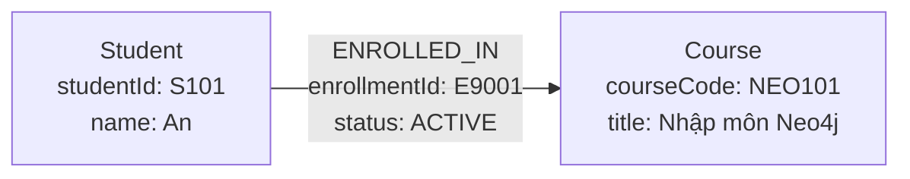

# Vai trò của ràng buộc trong bảo vệ tính toàn vẹn đồ thị

## 1. Vì sao cơ sở dữ liệu đồ thị cần ràng buộc?

Neo4j lưu dữ liệu theo **property graph**: **node** biểu diễn thực thể, **relationship** biểu diễn quan hệ có hướng giữa các thực thể, còn **property** mô tả thuộc tính của node hoặc relationship. Cách mô hình hóa này đặc biệt phù hợp với dữ liệu liên kết như người dùng – khóa học, tài khoản – giao dịch, sản phẩm – danh mục hoặc dịch vụ – thành phần phụ thuộc.

Tính linh hoạt của property graph cho phép hai node cùng nhãn (`:User`) có các tập thuộc tính khác nhau. Điều đó tiện khi phát triển mô hình nhưng cũng tạo ra rủi ro: hai người dùng cùng mã định danh; một khóa học thiếu mã; hoặc một quan hệ đăng ký học có dữ liệu sai kiểu. Những lỗi này có thể làm kết quả truy vấn Cypher bị nhân đôi, khiến ứng dụng cập nhật nhầm đối tượng hoặc làm báo cáo thiếu tin cậy.

**Ràng buộc dữ liệu (data constraint)** là quy tắc được Neo4j lưu trong schema và kiểm tra khi dữ liệu thay đổi. Nếu thao tác ghi làm vi phạm một ràng buộc đang có hiệu lực, cơ sở dữ liệu từ chối thao tác đó. Nhờ đặt quy tắc ở nơi lưu trữ, nhiều ứng dụng cùng ghi vào đồ thị vẫn phải tuân theo một chuẩn nhất quán.

Sau bài học, người học có thể:

- Phân biệt tính toàn vẹn cấu trúc đồ thị với tính toàn vẹn của dữ liệu nghiệp vụ.
- Giải thích khi nào nên dùng uniqueness, property existence, property type, node key và relationship key.
- Tạo, kiểm tra và quản lý constraint bằng Cypher; hiểu vì sao thêm constraint có thể thất bại trên dữ liệu cũ.
- Nhận ra những quy tắc mà constraint của Neo4j **không tự bảo đảm**, từ đó phân bổ trách nhiệm cho transaction, truy vấn Cypher và tầng ứng dụng Java/Spring Data Neo4j.

## 2. Tính toàn vẹn trong property graph gồm những gì?

Giả sử hệ thống học tập có hai loại node là `:Student` và `:Course`, kết nối bằng relationship `:ENROLLED_IN`:



Trong mô hình đó, cần xem xét ít nhất ba lớp tính toàn vẹn:

| Lớp tính toàn vẹn | Ví dụ | Cơ chế bảo vệ phù hợp |
| --- | --- | --- |
| **Cấu trúc đồ thị** | Relationship luôn gắn với node đầu và node cuối còn tồn tại. | Bản thân mô hình lưu trữ Neo4j: không có relationship “mồ côi” trỏ đến node đã biến mất. |
| **Thuộc tính và định danh** | Mỗi `Student` có `studentId` duy nhất, mỗi `Course` có `courseCode`, `status` của quan hệ có kiểu `STRING`. | Schema constraint với phạm vi nhãn node hoặc loại relationship tương ứng. |
| **Quy tắc nghiệp vụ liên thực thể** | Một sinh viên không đăng ký hai lần cùng khóa; chỉ sinh viên đang hoạt động được đăng ký; quan hệ `ENROLLED_IN` phải nối `Student` đến `Course`. | Truy vấn ghi có kiểm tra điều kiện, transaction và/hoặc logic nghiệp vụ; một số quy tắc có thể được thiết kế lại thành định danh có constraint. |

Neo4j bảo vệ tính hợp lệ của cấu trúc quan hệ: không thể lưu một relationship không có hai đầu mút. Khi xóa node còn relationship, thao tác `DELETE` thông thường bị từ chối; `DETACH DELETE` xóa cả các relationship nối vào node đó. Tuy nhiên, **có hai đầu mút hợp lệ không đồng nghĩa với đúng loại đầu mút về mặt nghiệp vụ**. Constraint thông thường không tự quy định `(:Student)-[:ENROLLED_IN]->(:Course)` là kiểu kết nối duy nhất được phép.

Hãy phân biệt ba khái niệm thường bị dùng thay nhau:

- **Constraint** quyết định dữ liệu nào được phép tồn tại, ví dụ không có hai node `:Student` mang cùng `studentId`.
- **Index** giúp tìm dữ liệu nhanh hơn, ví dụ tra cứu sinh viên theo tên. Index thông thường không cấm hai sinh viên trùng tên. Một số uniqueness/key constraint được Neo4j hỗ trợ bằng index đi kèm.
- **Validation trong ứng dụng** kiểm tra yêu cầu nghiệp vụ và tạo thông báo thân thiện, ví dụ khóa học đã đóng đăng ký. Validation hữu ích nhưng không thay thế được constraint ở database khi có nhiều đường ghi dữ liệu.

## 3. Những ràng buộc quan trọng của Neo4j

Các ví dụ dưới đây dùng cú pháp schema của **Neo4j 5.x trở lên**. Khả năng hỗ trợ một số loại constraint, đặc biệt là property existence, property type và key, phụ thuộc phiên bản và edition đang chạy; cần đối chiếu tài liệu tương ứng trước khi áp dụng. Mỗi ví dụ minh họa một lựa chọn thiết kế, không nhất thiết là một tập lệnh phải chạy nối tiếp.

### 3.1. Uniqueness: ngăn trùng định danh

Định danh của sinh viên phải duy nhất trong số các node mang nhãn `:Student`:

```cypher
CREATE CONSTRAINT student_id_unique IF NOT EXISTS
FOR (s:Student)
REQUIRE s.studentId IS UNIQUE;
```

Khi ràng buộc đã được tạo thành công, các lệnh sau minh họa tình huống vi phạm:

```cypher
CREATE (:Student {studentId: 'S101', name: 'An'});

// Bị từ chối nếu node S101 ở trên đã tồn tại.
CREATE (:Student {studentId: 'S101', name: 'Bình'});
```

Điểm dễ nhầm: **uniqueness không yêu cầu property phải tồn tại**. Nếu chưa đặt thêm ràng buộc khác, nhiều node `:Student` có thể *không có* `studentId`; giá trị bị thiếu (`null`) không được xem là một mã trùng để cấm. Uniqueness cũng chỉ áp dụng cho các node có nhãn `:Student`, không áp dụng tự động cho mọi node trong cơ sở dữ liệu.

Khi định danh gồm nhiều thành phần, có thể dùng uniqueness tổng hợp:

```cypher
CREATE CONSTRAINT course_code_term_unique IF NOT EXISTS
FOR (c:Course)
REQUIRE (c.courseCode, c.term) IS UNIQUE;
```

Quy tắc này cho phép cùng `courseCode` ở các học kỳ khác nhau nhưng ngăn hai node `:Course` trùng **đồng thời** cả `courseCode` lẫn `term`, khi các property tương ứng có giá trị. Nó không tự buộc cả hai property phải hiện diện.

### 3.2. Property existence: buộc thuộc tính bắt buộc phải có

Để mọi sinh viên đều có mã định danh:

```cypher
CREATE CONSTRAINT student_id_required IF NOT EXISTS
FOR (s:Student)
REQUIRE s.studentId IS NOT NULL;
```

Constraint này ngăn tạo hoặc cập nhật node `:Student` đến trạng thái thiếu `studentId`. Tuy nhiên, giá trị chuỗi rỗng `''` vẫn **khác** `null`: ràng buộc hiện diện không tự kiểm tra định dạng, độ dài hoặc ý nghĩa của mã. Nếu yêu cầu `studentId` phải có mẫu `S` theo sau là chữ số, cần kiểm tra ở bước nhập liệu hoặc nghiệp vụ.

Relationship cũng có thể có property bắt buộc. Ví dụ một lần ghi danh cần có `enrollmentId`:

```cypher
CREATE CONSTRAINT enrollment_id_required IF NOT EXISTS
FOR ()-[e:ENROLLED_IN]-()
REQUIRE e.enrollmentId IS NOT NULL;
```

Ví dụ này áp dụng cho **tất cả** relationship loại `ENROLLED_IN`, bất kể đầu mút nối đến node nào. Đó cũng là lý do cần mô hình hóa loại relationship nhất quán.

### 3.3. Property type: chặn giá trị sai kiểu

Nếu hợp đồng dữ liệu quy định `studentId` là chuỗi và `credits` của khóa học là số nguyên, có thể đặt type constraint, khi phiên bản/edition hỗ trợ:

```cypher
CREATE CONSTRAINT student_id_string IF NOT EXISTS
FOR (s:Student)
REQUIRE s.studentId IS :: STRING;

CREATE CONSTRAINT course_credits_integer IF NOT EXISTS
FOR (c:Course)
REQUIRE c.credits IS :: INTEGER;
```

Type constraint kiểm tra **kiểu của giá trị được lưu**. Chẳng hạn, nó không cho phép lưu `credits: '3'` thay vì `credits: 3`. Nhưng nó chưa bảo đảm số tín chỉ nằm trong khoảng hợp lệ (ví dụ từ 1 đến 10), cũng không bảo đảm property luôn tồn tại. Muốn có cả tính bắt buộc và tính đúng kiểu, cần kết hợp quy tắc tương ứng.

Lưu ý khi gửi dữ liệu từ Java Driver: tham số có kiểu Java khác nhau có thể được chuyển thành các kiểu property khác nhau của Neo4j. Định nghĩa kiểu rõ ràng ở database giúp phát hiện lệch hợp đồng dữ liệu sớm hơn.

### 3.4. Node key: định danh vừa duy nhất vừa bắt buộc

Khi một mã nghiệp vụ phải **luôn tồn tại** và **không được trùng**, node key thể hiện đồng thời hai yêu cầu:

```cypher
CREATE CONSTRAINT student_id_key IF NOT EXISTS
FOR (s:Student)
REQUIRE s.studentId IS NODE KEY;
```

Về ý nghĩa, `NODE KEY` kết hợp yêu cầu tồn tại của property với tính duy nhất cho các node cùng nhãn. Key nhiều property có thể thể hiện định danh tổ hợp, ví dụ `(tenantId, studentId)` trong hệ thống đa khách hàng:

```cypher
CREATE CONSTRAINT student_tenant_key IF NOT EXISTS
FOR (s:Student)
REQUIRE (s.tenantId, s.studentId) IS NODE KEY;
```

Ở đây mỗi cặp `(tenantId, studentId)` phải đủ hai thành phần và không được lặp trên các node `:Student`. Nếu `studentId` phải duy nhất **toàn hệ thống** thay vì chỉ trong từng tenant thì định danh tổ hợp trên không đáp ứng yêu cầu đó; phải chọn key theo quy tắc nghiệp vụ thực tế.

Các lệnh node key trên là **phương án thay thế** cho những constraint uniqueness/existence minh họa trước đó. Không cần tạo tất cả lên cùng một cặp nhãn–property chỉ để diễn đạt cùng một quy tắc.

### 3.5. Relationship uniqueness/key: quản lý danh tính của quan hệ

Nếu mỗi lần ghi danh được nhận diện bằng `enrollmentId`, có thể đặt ràng buộc duy nhất cho property của relationship khi bản Neo4j đang dùng hỗ trợ:

```cypher
CREATE CONSTRAINT enrollment_id_unique IF NOT EXISTS
FOR ()-[e:ENROLLED_IN]-()
REQUIRE e.enrollmentId IS UNIQUE;
```

Với edition hỗ trợ relationship key, có thể diễn đạt yêu cầu `enrollmentId` vừa hiện diện vừa duy nhất:

```cypher
CREATE CONSTRAINT enrollment_id_key IF NOT EXISTS
FOR ()-[e:ENROLLED_IN]-()
REQUIRE e.enrollmentId IS RELATIONSHIP KEY;
```

**Cần phân biệt:** `enrollmentId` duy nhất **không có nghĩa** Neo4j tự cấm hai relationship `ENROLLED_IN` khác nhau nối cùng một cặp `(Student, Course)`. Nếu hai relationship có hai `enrollmentId` khác nhau, uniqueness/key trên property đó không phát hiện trùng theo cặp đầu mút. Muốn bảo đảm “mỗi sinh viên chỉ ghi danh một lần vào một khóa học”, cần thiết kế cách nhận diện lần ghi danh và kiểm soát thao tác ghi phù hợp, nhất là khi nhiều transaction chạy đồng thời.

## 4. Constraint thực thi quy tắc khi nào?

Có hai thời điểm quan trọng:

1. **Khi tạo constraint:** Neo4j phải xác nhận dữ liệu đang có thỏa quy tắc. Nếu đã có hai `:Student` trùng `studentId`, việc tạo uniqueness constraint sẽ thất bại. Tên constraint chỉ xuất hiện trong schema sau khi tạo thành công.
2. **Khi ghi dữ liệu sau đó:** các thao tác `CREATE`, `MERGE`, `SET`, `REMOVE` và các thay đổi nhãn/loại đối tượng có liên quan đều phải tạo ra trạng thái dữ liệu hợp lệ. Một lần ghi vi phạm constraint sẽ bị từ chối và transaction chứa lần ghi đó phải được xử lý theo cơ chế lỗi/rollback tương ứng.

Ví dụ, việc sửa định danh có thể gây xung đột dù không tạo node mới:

```cypher
// Giả sử đã có hai sinh viên S101 và S102.
MATCH (s:Student {studentId: 'S102'})
SET s.studentId = 'S101';
// Bị từ chối nếu uniqueness/node key trên studentId đang có hiệu lực.
```

Constraint vì thế bảo vệ **trạng thái cuối cùng được chấp nhận trong database**, không chỉ dữ liệu đi qua một API cụ thể. Một ứng dụng Java, một job import và một thao tác Cypher thủ công đều chịu cùng quy tắc.

## 5. Tình huống thực tế: bảo vệ dữ liệu đăng ký khóa học

Giả sử một nền tảng học tập có các nghiệp vụ:

- Mỗi sinh viên có mã `studentId` duy nhất và bắt buộc.
- Mỗi khóa học có mã `courseCode` duy nhất và bắt buộc.
- Mỗi lượt đăng ký có mã `enrollmentId` duy nhất.
- Sinh viên chỉ được đăng ký khóa học thực sự tồn tại; ứng dụng không được âm thầm tạo khóa học “rỗng” do gõ sai mã.

Trong một database hỗ trợ node key và relationship key, có thể chọn bộ schema sau:

```cypher
CREATE CONSTRAINT student_id_key IF NOT EXISTS
FOR (s:Student)
REQUIRE s.studentId IS NODE KEY;

CREATE CONSTRAINT course_code_key IF NOT EXISTS
FOR (c:Course)
REQUIRE c.courseCode IS NODE KEY;

CREATE CONSTRAINT enrollment_id_key IF NOT EXISTS
FOR ()-[e:ENROLLED_IN]-()
REQUIRE e.enrollmentId IS RELATIONSHIP KEY;
```

Nếu edition không hỗ trợ key, cần đánh giá khả năng kết hợp uniqueness và existence theo những loại constraint edition đó cung cấp. Không được giả định rằng chỉ tạo uniqueness là đã bắt buộc có property.

Để thực hiện ghi danh, có thể bắt đầu bằng truy vấn tham số hóa:

```cypher
MATCH (s:Student {studentId: $studentId})
MATCH (c:Course {courseCode: $courseCode})
CREATE (s)-[e:ENROLLED_IN {
    enrollmentId: $enrollmentId,
    status: 'ACTIVE',
    enrolledAt: datetime()
}]->(c)
RETURN s.studentId AS studentId,
       c.courseCode AS courseCode,
       e.enrollmentId AS enrollmentId;
```

Hai câu `MATCH` chỉ tạo relationship nếu cả sinh viên và khóa học được tìm thấy. Nếu không có đối tượng phù hợp, truy vấn trả về 0 dòng và không tạo đăng ký; **ứng dụng phải kiểm tra trường hợp 0 dòng** để phản hồi “không tìm thấy sinh viên/khóa học”. Nếu `enrollmentId` đã được sử dụng, relationship key sẽ từ chối lần ghi mới.

Tuy nhiên, truy vấn trên **chưa chặn** một sinh viên đăng ký cùng khóa học nhiều lần với các `enrollmentId` khác nhau. Có thể dùng `MERGE` theo cặp đầu mút để hỗ trợ thao tác lặp lại:

```cypher
MATCH (s:Student {studentId: $studentId})
MATCH (c:Course {courseCode: $courseCode})
MERGE (s)-[e:ENROLLED_IN]->(c)
ON CREATE SET e.enrollmentId = $enrollmentId,
              e.enrolledAt = datetime(),
              e.status = 'ACTIVE'
RETURN e.enrollmentId AS enrollmentId;
```

`MERGE` hữu ích để tìm hoặc tạo một mẫu quan hệ trong điều kiện thông thường; nó **không tự biến quy tắc “tối đa một relationship giữa hai node” thành schema constraint trong mọi tình huống đồng thời**. Để bảo vệ bất biến này khi có cạnh tranh ghi, cần thiết kế định danh đăng ký ổn định gắn với cặp sinh viên–khóa học (ví dụ dùng node `:Enrollment` có key tổ hợp), hoặc bổ sung cơ chế đồng bộ và kiểm tra trong transaction phù hợp với tải thực tế. Việc chọn `CREATE`, `MERGE` hay mô hình hóa `Enrollment` thành node phụ thuộc vào ý nghĩa của “lần đăng ký”: có cho phép đăng ký lại nhiều đợt hay lưu lịch sử hay không.

### Nếu mô hình hóa lượt đăng ký thành node

Khi mỗi cặp sinh viên–khóa học chỉ được có một đăng ký, một phương án là:


```cypher
CREATE CONSTRAINT enrollment_pair_key IF NOT EXISTS
FOR (e:Enrollment)
REQUIRE (e.studentId, e.courseCode) IS NODE KEY;
```

Key này cấm hai **node `Enrollment`** cùng cặp định danh và buộc cả hai thuộc tính hiện diện. Dẫu vậy, nó không tự đối chiếu hai giá trị `studentId`, `courseCode` trên `Enrollment` với node `Student`, `Course` ở hai đầu relationship. Cần dùng transaction để tra cứu đúng hai node và tạo đúng các relationship theo quy tắc nghiệp vụ. Nếu cho phép mỗi sinh viên đăng ký lại cùng khóa qua nhiều đợt, key nên bổ sung một thuộc tính phân biệt đợt đăng ký.

## 6. Những điều constraint không thể thay thế

Constraint là một phần của thiết kế toàn vẹn dữ liệu, không phải toàn bộ hệ thống kiểm soát nghiệp vụ.

| Yêu cầu | Có được bảo đảm trực tiếp bằng các constraint kể trên? | Cần làm thêm |
| --- | --- | --- |
| Không có hai `Student` cùng `studentId` đã khai báo | **Có** – uniqueness/node key. | Chọn đúng phạm vi nhãn và khóa định danh. |
| Mỗi `Student` đều có `studentId` | **Có** – existence/node key, khi được hỗ trợ. | Kiểm tra `studentId` không rỗng hoặc sai mẫu ở nghiệp vụ. |
| `credits` có kiểu số nguyên | **Có** – property type, khi được hỗ trợ. | Kiểm tra miền giá trị hợp lệ, ví dụ `1 <= credits <= 10`. |
| Relationship có hai đầu mút tồn tại | **Có** – quy tắc cấu trúc của Neo4j. | Kiểm tra nhãn và quyền kết nối nghiệp vụ. |
| `ENROLLED_IN` chỉ được nối `Student` đến `Course` | **Không** theo các constraint thuộc tính thông thường. | Chỉ ghi thông qua truy vấn kiểm tra đúng nhãn/đầu mút và các lớp kiểm soát phù hợp. |
| Một sinh viên không được ghi danh trùng cùng khóa | **Không**, nếu chỉ ràng buộc `enrollmentId` duy nhất. | Mô hình hóa danh tính theo cặp hoặc thiết kế quy trình ghi đồng thời an toàn. |
| Không có chu trình trong quan hệ phụ thuộc | **Không** theo uniqueness/existence/type/key. | Kiểm tra đường đi và bất biến đồ thị ở tầng nghiệp vụ. |
| Chỉ quản trị viên được thay đổi khóa học | **Không**. | Phân quyền, kiểm tra xác thực và ủy quyền. |

Đối với Java Driver hoặc Spring Data Neo4j, nên kết hợp hai lớp:

**Ở ứng dụng:** validate đầu vào, sử dụng tham số Cypher, kiểm tra các tình huống không tìm thấy đối tượng, thực hiện các bước ghi liên quan trong transaction thích hợp và chuyển lỗi constraint thành phản hồi nghiệp vụ rõ ràng.

**Ở Neo4j:** duy trì constraint như lớp bảo vệ cuối cùng, đặc biệt khi có nhiều service, batch import, migration hoặc người vận hành cùng có quyền ghi. Validation ở Java chỉ bảo vệ đường đi qua mã Java đó; constraint bảo vệ mọi thao tác ghi đi vào cùng database.

## 7. Áp dụng constraint an toàn trên dữ liệu đang tồn tại

### Bước 1: Khảo sát dữ liệu trước khi tạo constraint

Tìm các sinh viên thiếu `studentId`:

```cypher
MATCH (s:Student)
WHERE s.studentId IS NULL
RETURN elementId(s) AS nodeId, s.name AS name
LIMIT 20;
```

Tìm các mã sinh viên bị lặp:

```cypher
MATCH (s:Student)
WHERE s.studentId IS NOT NULL
WITH s.studentId AS studentId,
     count(*) AS occurrences,
     collect(elementId(s)) AS nodeIds
WHERE occurrences > 1
RETURN studentId, occurrences, nodeIds
ORDER BY occurrences DESC
LIMIT 20;
```

`elementId()` ở ví dụ kiểm tra là định danh nội bộ phục vụ quan sát, **không phải business ID bền vững** để lưu vào hệ thống ngoài. Khi phát hiện trùng lặp, cần xác định node nào là bản ghi đúng, quan hệ nào cần chuyển hướng và lịch sử nào cần bảo toàn trước khi hợp nhất hay xóa dữ liệu.

### Bước 2: Chuẩn hóa và sửa dữ liệu vi phạm

Ví dụ: bổ sung định danh thiếu theo quy tắc có thể kiểm chứng; hợp nhất bản ghi trùng sau khi rà soát các relationship; chuyển chuỗi `'3'` thành số `3` nếu đó thực sự là số tín chỉ; sửa quy tắc import gây ra sai dữ liệu. Không nên tự gán một mã mặc định giống nhau cho mọi bản ghi thiếu vì có thể tạo lỗi trùng mới.

### Bước 3: Tạo constraint và kiểm tra schema

Sau khi dữ liệu hợp lệ, chạy lệnh `CREATE CONSTRAINT` trong quy trình migration được kiểm soát. Có thể xem danh sách hiện hành bằng:

```cypher
SHOW CONSTRAINTS;
```

`IF NOT EXISTS` hỗ trợ triển khai lặp lại nhưng không thay cho việc **xác minh đúng tên, loại, nhãn và property** của constraint thực tế. Với hệ thống lớn, việc tạo constraint có thể phải quét dữ liệu hiện có và tốn tài nguyên; nên tính đến thời gian triển khai và tác động vận hành.

Khi yêu cầu thay đổi, có thể xóa constraint theo **tên**:

```cypher
DROP CONSTRAINT student_id_unique IF EXISTS;
```

Đây là ví dụ cú pháp quản trị; chỉ xóa khi đã xác định rõ ảnh hưởng. Xóa constraint làm mất hàng rào kiểm tra liên quan đối với các lần ghi tiếp theo, và có thể làm mất index được hệ thống tạo để phục vụ constraint đó.

### Bước 4: Kiểm thử đường ghi thật

Kiểm tra tối thiểu các trường hợp: tạo bản ghi hợp lệ; tạo mã trùng; bỏ property bắt buộc; ghi sai kiểu; cập nhật bản ghi đang tồn tại thành giá trị vi phạm; và tình huống hai request cạnh tranh tạo cùng định danh. Thực hiện các kiểm thử phá vỡ constraint trên database thử nghiệm, tránh để các ví dụ ghi dữ liệu rác vào môi trường sản xuất.

## 8. Các lỗi tư duy thường gặp

1. **“Có unique rồi nên chắc chắn có ID.”** Sai: uniqueness và property existence là hai bất biến khác nhau; node key mới diễn đạt cả hai trong một constraint.
2. **“Constraint sẽ tự sửa dữ liệu sai cũ.”** Sai: tạo constraint chỉ thành công nếu dữ liệu hiện có đã phù hợp. Cần làm sạch trước.
3. **“`MERGE` luôn loại bỏ mọi quan hệ trùng.”** Sai: cách mô hình hóa pattern và tính đồng thời của các transaction quyết định hành vi; phải xác định rõ khóa định danh nghiệp vụ.
4. **“Relationship có thật thì chắc chắn nối đúng hai loại node.”** Sai: Neo4j bảo đảm đầu mút tồn tại, nhưng các constraint thuộc tính được giới thiệu không kiểm tra nhãn nghiệp vụ của đầu mút.
5. **“Có index tức là đã bảo vệ dữ liệu.”** Sai: index thông thường phục vụ tìm kiếm; chỉ các ràng buộc tương ứng mới từ chối dữ liệu vi phạm.
6. **“Chỉ cần bắt lỗi ở giao diện.”** Sai: job nhập liệu, công cụ quản trị hoặc service khác vẫn có thể ghi sai; database constraint là lớp bảo vệ chung.

## 9. Tổng kết thiết kế

Khi mô hình hóa Neo4j, hãy bắt đầu từ **bất biến nghiệp vụ**: thực thể nào cần danh tính riêng, property nào bắt buộc, kiểu dữ liệu nào phải nhất quán, một mối quan hệ được nhận diện bằng gì. Từ đó quyết định bất biến nào có thể được thực thi trực tiếp bằng uniqueness, existence, property type hoặc key constraint; bất biến nào cần transaction và kiểm tra nghiệp vụ.

Một hệ thống đồ thị đáng tin cậy kết hợp **mô hình quan hệ đúng**, **constraint đặt đúng phạm vi**, **truy vấn Cypher có chủ đích** và **quy trình vận hành kiểm tra dữ liệu trước khi thay đổi schema**. Constraint giữ cho định danh và thuộc tính nền tảng không bị phá vỡ; phần logic còn lại bảo đảm đồ thị biểu diễn đúng thế giới nghiệp vụ mà hệ thống đang quản lý.
