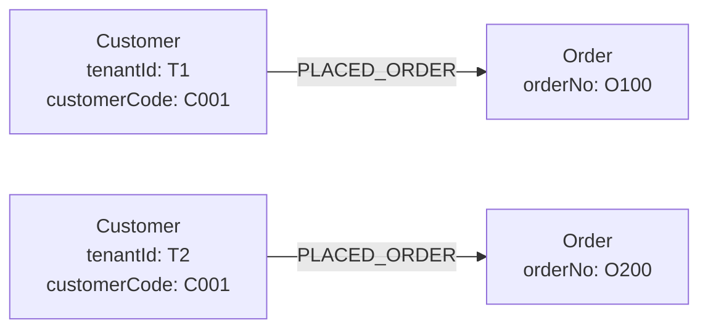

# Ràng buộc duy nhất trên khóa nghiệp vụ của nút

## 1. Khóa nghiệp vụ là gì và vì sao phải duy nhất?

Trong Neo4j, mỗi **node** đại diện cho một thực thể và có thể mang một hoặc nhiều nhãn (label) cùng các thuộc tính (property). Một hệ thống quản lý khách hàng có thể lưu `(:Customer {customerCode: 'C001', name: 'An'})`; hệ thống học tập có thể dùng `(:Student {studentId: 'S101'})`. `customerCode` và `studentId` là những **khóa nghiệp vụ (business key)**: giá trị mà các quy trình của hệ thống dùng để nhận diện đối tượng theo quy ước của miền nghiệp vụ.

Nếu hai node `:Customer` cùng mang `customerCode: 'C001'` trong khi quy tắc yêu cầu mã khách hàng duy nhất, truy vấn sau không thể xác định một khách hàng duy nhất:

```cypher
MATCH (c:Customer {customerCode: 'C001'})
RETURN c;
```

Hậu quả có thể là cập nhật nhầm nhiều node, nhân đôi số lượng quan hệ `:PLACED_ORDER`, hiển thị lặp khách hàng hoặc liên kết đơn hàng với sai bản ghi. Trong cơ sở dữ liệu đồ thị, lỗi trùng node càng nguy hiểm khi nhiều relationship đã gắn vào từng bản sao: việc sửa dữ liệu không chỉ là sửa một dòng thuộc tính mà còn phải đánh giá và xử lý các kết nối liên quan.

**Node property uniqueness constraint** là cơ chế của Neo4j bảo đảm các node thuộc một **nhãn cụ thể** không thể có cùng giá trị khóa đã khai báo. Neo4j kiểm tra quy tắc này khi tạo constraint và trong các thao tác ghi tiếp theo. Đây là một lớp bảo vệ ở database, áp dụng cho truy vấn Cypher, Java Driver, Spring Data Neo4j, job nhập dữ liệu và các nguồn ghi khác cùng truy cập cơ sở dữ liệu.

Sau bài học, bạn có thể:

- Chọn đúng khóa nghiệp vụ và **phạm vi duy nhất** cho node.
- Tạo ràng buộc duy nhất cho một hoặc nhiều property bằng Cypher.
- Phân biệt **duy nhất**, **bắt buộc tồn tại** và **node key**.
- Dùng `MERGE` theo khóa đã ràng buộc và tránh những cách viết gây xung đột bất ngờ.
- Phát hiện dữ liệu trùng trước migration, kiểm tra constraint sau triển khai và xử lý lỗi ghi ở ứng dụng.

## 2. Xác định đúng phạm vi của khóa trước khi viết Cypher

Giả sử hệ thống bán hàng đa khách hàng (multi-tenant) có node `:Customer`:



Hai khách hàng ở sơ đồ cùng có mã `C001`, nhưng thuộc **hai tenant khác nhau**. Tùy quy tắc nghiệp vụ, có hai lựa chọn:

| Quy tắc | Khóa dùng để định danh | Ý nghĩa |
| --- | --- | --- |
| Mã khách hàng duy nhất trên toàn bộ hệ thống | `customerCode` | Không thể có hai node `:Customer` cùng mã, dù ở tenant khác nhau. |
| Mã chỉ cần duy nhất **trong từng tenant** | `(tenantId, customerCode)` | `T1/C001` và `T2/C001` hợp lệ; hai node `T1/C001` là trùng. |

Trước khi chọn constraint, cần trả lời: khóa duy nhất **trên đối tượng nào**, trong **phạm vi nào**, và có thể **thay đổi theo thời gian** hay không. Một mã đơn hàng có thể duy nhất toàn công ty, nhưng số chứng từ kế toán có thể chỉ duy nhất theo năm hoặc chi nhánh. Nếu chọn nhầm khóa, database có thể vừa từ chối dữ liệu hợp lệ vừa bỏ lọt dữ liệu trùng thực sự.

Phân biệt thêm ba loại định danh:

- **Khóa nghiệp vụ**: được quy định bởi miền nghiệp vụ, như `customerCode`, `courseCode`, `taxId`; có thể là một thuộc tính hoặc một bộ thuộc tính.
- **Định danh kỹ thuật do ứng dụng cấp**: ví dụ UUID được gán cho `customerId`. Nếu UUID là định danh dùng để tra cứu thực thể, vẫn nên bảo vệ tính duy nhất của nó bằng schema phù hợp.
- **`elementId()` của Neo4j**: định danh nội bộ hữu ích cho chẩn đoán hoặc thao tác trong ngữ cảnh được hỗ trợ; không nên dùng làm khóa nghiệp vụ bền vững hoặc hợp đồng định danh với hệ thống khác.

## 3. Tạo uniqueness constraint trên một property

Nếu quy định `customerCode` duy nhất trên mọi node `:Customer`, khai báo:

```cypher
CREATE CONSTRAINT customer_code_unique IF NOT EXISTS
FOR (c:Customer)
REQUIRE c.customerCode IS UNIQUE;
```

Đọc câu lệnh từ dưới lên:

- `REQUIRE c.customerCode IS UNIQUE`: không có hai node trong phạm vi constraint mang cùng giá trị `customerCode` đã tồn tại.
- `FOR (c:Customer)`: chỉ xét những node có nhãn `Customer`.
- `customer_code_unique`: tên của constraint để quản trị, kiểm tra và xóa theo tên.
- `IF NOT EXISTS`: hỗ trợ chạy script tạo schema nhiều lần khi constraint phù hợp đã tồn tại; vẫn cần kiểm tra schema thực tế sau migration.

Ví dụ với database thử nghiệm đang trống và constraint đã tạo thành công:

```cypher
CREATE (:Customer {customerCode: 'C001', name: 'An'});

// Thất bại: C001 đã được một Customer khác sử dụng.
CREATE (:Customer {customerCode: 'C001', name: 'Bình'});
```

Constraint cũng bảo vệ khi cập nhật thuộc tính:

```cypher
CREATE (:Customer {customerCode: 'C002', name: 'Bình'});

// Thất bại: đổi C002 thành C001 làm phát sinh trùng mã.
MATCH (c:Customer {customerCode: 'C002'})
SET c.customerCode = 'C001';
```

Lỗi ở ví dụ là lỗi **vi phạm tính toàn vẹn**, không phải lỗi truy vấn `MATCH` không tìm được node. Khi một lần ghi vi phạm constraint, database từ chối thao tác và ứng dụng phải xử lý transaction tương ứng; không được giả định dữ liệu vi phạm đã được lưu thành công.

### Phạm vi theo nhãn, không theo tên property toàn cơ sở dữ liệu

Với constraint vừa tạo, các node nhãn khác vẫn có thể dùng cùng giá trị:

```cypher
CREATE (:Supplier {customerCode: 'C001', name: 'Nhà cung cấp X'});
```

Đây **không phải** lỗi uniqueness của `:Customer` vì `:Supplier` không mang nhãn `Customer`. Ngược lại, node có *nhiều nhãn* và trong đó có `:Customer` vẫn thuộc phạm vi ràng buộc. Thao tác `SET n:Customer` gắn thêm nhãn cũng có thể bị từ chối nếu node đó mang giá trị trùng với một node `:Customer` khác.

> Các ví dụ `CREATE` gây xung đột trong bài dùng để mô tả hành vi. Hãy chạy riêng trên database thử nghiệm, không chạy toàn bộ một mạch trên dữ liệu sản xuất.

## 4. Uniqueness không đồng nghĩa với khóa bắt buộc tồn tại

Đây là giới hạn quan trọng nhất khi áp dụng uniqueness vào khóa nghiệp vụ. Với **chỉ** constraint `customer_code_unique`, những node sau **không vi phạm uniqueness**:

```cypher
CREATE (:Customer {name: 'Khách chưa cấp mã A'});
CREATE (:Customer {name: 'Khách chưa cấp mã B'});
```

Lý do: uniqueness không yêu cầu mọi node phải có property `customerCode`. Trong Neo4j, `null` biểu diễn thuộc tính không có giá trị; gán property bằng `null` sẽ làm property đó không còn được lưu. Nhiều node thiếu `customerCode` vì vậy không bị xem là trùng mã theo constraint này.

Phân biệt các mục tiêu:

| Mục tiêu | Loại constraint | Ví dụ điều kiện |
| --- | --- | --- |
| Không được có hai mã giống nhau **khi mã hiện diện** | Uniqueness | `c.customerCode IS UNIQUE` |
| Mọi node đều phải có mã | Property existence | `c.customerCode IS NOT NULL` |
| Mọi node phải có mã **và** mã không trùng | Node key | `c.customerCode IS NODE KEY` |

Nếu môi trường Neo4j hỗ trợ property existence constraint, có thể kết hợp với uniqueness:

```cypher
CREATE CONSTRAINT customer_code_required IF NOT EXISTS
FOR (c:Customer)
REQUIRE c.customerCode IS NOT NULL;
```

Hoặc dùng **node key** để diễn đạt đồng thời tồn tại và duy nhất:

```cypher
CREATE CONSTRAINT customer_code_key IF NOT EXISTS
FOR (c:Customer)
REQUIRE c.customerCode IS NODE KEY;
```

Property existence và node key có yêu cầu về phiên bản/edition; trong các bản Neo4j 5 sử dụng phổ biến, chúng là tính năng cần Neo4j Enterprise, còn node property uniqueness có sẵn ở Community. Khi thiết kế cho một deployment cụ thể, hãy kiểm tra edition và tài liệu phiên bản đang chạy trước khi chọn cú pháp và loại constraint. Các câu lệnh trên là **các phương án minh họa**, không yêu cầu tạo đồng thời nhiều constraint chồng lấp cùng một ý nghĩa.

Ngay cả khi property tồn tại, `customerCode: ''` (chuỗi rỗng) vẫn khác với `null`. Existence/node key không tự áp đặt quy tắc `customerCode` phải có định dạng như `C` cộng bốn chữ số. Những yêu cầu đó cần validation khi nhập liệu và quy trình cấp mã tương ứng.

## 5. Khóa nghiệp vụ tổng hợp: duy nhất theo nhiều property

Quay lại ví dụ đa tenant. Nếu mỗi tenant được phép có mã `C001` riêng, dùng uniqueness tổng hợp:

```cypher
CREATE CONSTRAINT customer_tenant_code_unique IF NOT EXISTS
FOR (c:Customer)
REQUIRE (c.tenantId, c.customerCode) IS UNIQUE;
```

Kết quả mong muốn:

| Node `:Customer` được ghi | Kết quả với constraint tổng hợp | Lý do |
| --- | --- | --- |
| `{tenantId: 'T1', customerCode: 'C001'}` | Thành công nếu chưa có cặp đó | Cặp mới. |
| `{tenantId: 'T2', customerCode: 'C001'}` | Thành công nếu chưa có cặp đó | Khác `tenantId`. |
| `{tenantId: 'T1', customerCode: 'C002'}` | Thành công nếu chưa có cặp đó | Khác `customerCode`. |
| Thêm node thứ hai `{tenantId: 'T1', customerCode: 'C001'}` | Bị từ chối | Trùng đồng thời cả hai giá trị. |
| `{tenantId: 'T1'}` | Không bị cấm bởi **uniqueness này** | Thiếu một thành phần khóa; không có cặp đầy đủ để kiểm tra trùng. |

Đừng hiểu uniqueness tổng hợp là “`tenantId` phải duy nhất **và** `customerCode` phải duy nhất”. Nó bảo vệ tính duy nhất của **tổ hợp**. Nếu nghiệp vụ yêu cầu đủ cả hai thành phần và edition hỗ trợ node key, có thể chọn:

```cypher
CREATE CONSTRAINT customer_tenant_code_key IF NOT EXISTS
FOR (c:Customer)
REQUIRE (c.tenantId, c.customerCode) IS NODE KEY;
```

Node key tổng hợp vừa yêu cầu `tenantId`, `customerCode` phải có, vừa cấm các cặp giá trị trùng. Lưu ý: nếu ứng dụng luôn cần tra cứu `customerCode` độc lập với tenant, hãy đánh giá lại yêu cầu định danh; chỉ ràng buộc theo cặp không bảo đảm tra cứu bằng một property sẽ trả về đúng một node.

## 6. Chọn giá trị khóa ổn định và chuẩn hóa nhất quán

Constraint so sánh **giá trị được lưu**, không tự hiểu hai biểu diễn là cùng một mã theo quy tắc doanh nghiệp. Ví dụ với string, `'c001'` và `'C001'` là hai chuỗi khác nhau; khoảng trắng đầu/cuối cũng tạo ra giá trị khác.

Nếu hệ thống coi các cách viết đó là cùng một mã, cần thiết kế bước chuẩn hóa **trước khi ghi**. Chẳng hạn, ứng dụng quy định mã khách hàng luôn được cắt khoảng trắng và viết hoa:

```text
Đầu vào                  Mã chuẩn hóa
" c001 "                 "C001"
"C001"                   "C001"
"c001"                   "C001"
```

Hoặc với địa chỉ email đăng nhập, hệ thống có thể duy trì riêng một property `normalizedEmail` theo chính sách so khớp email đã thống nhất:

```cypher
CREATE CONSTRAINT user_normalized_email_unique IF NOT EXISTS
FOR (u:User)
REQUIRE u.normalizedEmail IS UNIQUE;
```

Không nên tự áp dụng phép chuẩn hóa email, Unicode hay quy tắc đổi chữ hoa/thường tùy tiện: chính sách phải phù hợp với cách hệ thống xác định danh tính và được thực hiện giống nhau ở API, tác vụ nhập liệu, migration. Constraint không tự chạy `trim()`, `toUpper()` hoặc logic chuẩn hóa tùy chỉnh trước khi so sánh các property.

Về thiết kế lâu dài, nên ưu tiên business key ổn định. Các thuộc tính có thể thay đổi như tên người dùng, số điện thoại hoặc email không mặc nhiên là định danh tốt, dù có thể cần một constraint riêng theo yêu cầu nghiệp vụ. Khi khóa có thể đổi, phải xác định cách cập nhật tham chiếu từ hệ thống bên ngoài và cách xử lý lịch sử.

## 7. Ghi node đúng cách với `MERGE` và constraint

Một luồng thường gặp là “khách hàng đã tồn tại thì dùng lại, chưa có thì tạo mới”. Với khóa tổng hợp `(tenantId, customerCode)`, truy vấn nên tìm hoặc tạo node bằng **chính bộ thuộc tính nhận diện đã được ràng buộc**:

```cypher
MERGE (c:Customer {
    tenantId: $tenantId,
    customerCode: $customerCode
})
ON CREATE SET c.name = $name,
              c.createdAt = datetime()
RETURN c.tenantId AS tenantId,
       c.customerCode AS customerCode,
       c.name AS name;
```

Ứng dụng truyền các tham số `tenantId`, `customerCode`, `name` bằng Java Driver hoặc tầng truy cập dữ liệu. Với các giá trị khóa hợp lệ, `MERGE` tìm mẫu có sẵn hoặc tạo node mới theo mẫu đó; `ON CREATE SET` chỉ chạy khi mẫu được tạo. Cùng một truy vấn lặp lại với cùng khóa thông thường sẽ tìm lại node cũ.

**Đừng đưa các thuộc tính thường thay đổi vào mẫu `MERGE` nếu chúng không thuộc khóa định danh.** Ví dụ:

```cypher
// Dễ gây xung đột uniqueness khi tên được cập nhật.
MERGE (c:Customer {
    tenantId: $tenantId,
    customerCode: $customerCode,
    name: $name
})
RETURN c;
```

Nếu đã có `T1/C001` với tên `An` nhưng request mới gửi tên `Nguyễn An`, toàn bộ mẫu chứa `name` sẽ không khớp. `MERGE` thử tạo một node mới cùng cặp `tenantId/customerCode` và gặp lỗi uniqueness. Cách phù hợp hơn là `MERGE` theo khóa, rồi quyết định cập nhật `name` bằng `ON MATCH SET` hoặc một nghiệp vụ cập nhật riêng, tùy chính sách của hệ thống.

### Ghi đồng thời: `MERGE` là thao tác tiện lợi, constraint là hàng rào cuối

Giả sử hai request cùng tạo `T1/C001`. Không có uniqueness constraint, những thao tác ghi đồng thời có thể tạo hai node riêng có cùng khóa. Khi đã tạo uniqueness trên cặp khóa, database không cho hai bản ghi trùng được ghi nhận thành công. Request có thể phải chờ khóa, tìm lại node hiện có hoặc nhận lỗi xung đột theo ngữ cảnh thực thi; ứng dụng vẫn cần xử lý lỗi và chính sách retry phù hợp.

Đặc biệt, nếu đặt **nhiều uniqueness constraint độc lập** rồi dùng `MERGE` với nhiều thuộc tính cùng lúc, có thể gặp xung đột khi một thuộc tính trỏ tới một node còn thuộc tính kia trỏ tới node khác. Chẳng hạn `customerCode` và `taxId` được ràng buộc duy nhất riêng nhưng dữ liệu đưa vào tham chiếu hai khách hàng khác nhau. Không nên coi `MERGE` là cơ chế tự hòa giải những mâu thuẫn định danh đó.

Một mẫu vận hành an toàn hơn là xác định **khóa chính được dùng để nhận diện node**, `MERGE` theo khóa đó, rồi kiểm tra hoặc cập nhật các thuộc tính còn lại theo quy tắc. Các constraint độc lập khác vẫn có thể phát hiện mâu thuẫn và từ chối ghi nếu dữ liệu không nhất quán.

## 8. Áp dụng từ Java Driver và Spring Data Neo4j

Với Neo4j Java Driver 5.x, có thể truyền các giá trị khóa bằng tham số để giữ truy vấn tách biệt với dữ liệu đầu vào:

```java
import org.neo4j.driver.Driver;
import java.util.Map;

public String upsertCustomer(
        Driver driver, String tenantId, String customerCode, String name) {

    String cypher = """
        MERGE (c:Customer {
            tenantId: $tenantId,
            customerCode: $customerCode
        })
        ON CREATE SET c.name = $name,
                      c.createdAt = datetime()
        RETURN c.customerCode AS customerCode
        """;

    try (var session = driver.session()) {
        return session.executeWrite(tx -> tx.run(cypher, Map.of(
            "tenantId", tenantId,
            "customerCode", customerCode,
            "name", name
        )).single().get("customerCode").asString());
    }
}
```

Ví dụ giả định `Driver` đã được khởi tạo, khóa đã được kiểm tra hợp lệ và database có constraint tương ứng. `executeWrite` thực hiện transaction ghi theo API của driver; khi gặp lỗi constraint không thể giải quyết bằng retry thông thường, ứng dụng cần bắt lỗi phù hợp và trả về kết quả nghiệp vụ như “mã khách hàng đã tồn tại hoặc không khớp định danh”. Không nên trả nguyên văn thông báo lỗi database hoặc lặng lẽ bỏ qua xung đột.

Với **Spring Data Neo4j**, cần tách biệt:

- `@Node` khai báo thực thể đồ thị cho tầng ánh xạ.
- `@Id` xác định thuộc tính định danh dùng trong cơ chế ánh xạ/persistence của Spring Data Neo4j.
- Uniqueness constraint là **quy tắc schema ở Neo4j**; không nên suy ra rằng chỉ cần khai báo `@Id` hoặc validation annotation trong Java là database đã có uniqueness constraint cho một business key bất kỳ.

Nếu mô hình `Customer` có ID kỹ thuật và bộ khóa nghiệp vụ `(tenantId, customerCode)`, hãy quản lý constraint của bộ khóa trong migration Cypher phù hợp với môi trường triển khai. Các API và batch import cũng phải dùng chung quy ước chuẩn hóa và xác định đúng tenant.

## 9. Migration: tìm lỗi trùng trước khi tạo constraint

Khi database đã có dữ liệu, lệnh `CREATE CONSTRAINT` phải kiểm tra trạng thái hiện tại. Nó **không tự gộp** những node trùng khóa. Nếu dữ liệu đang vi phạm quy tắc, việc tạo constraint thất bại và cần sửa dữ liệu trước.

### 9.1. Tìm các cặp khóa bị trùng

Với khóa `(tenantId, customerCode)`:

```cypher
MATCH (c:Customer)
WHERE c.tenantId IS NOT NULL
  AND c.customerCode IS NOT NULL
WITH c.tenantId AS tenantId,
     c.customerCode AS customerCode,
     count(*) AS total,
     collect(elementId(c)) AS nodeIds
WHERE total > 1
RETURN tenantId, customerCode, total, nodeIds
ORDER BY total DESC
LIMIT 20;
```

Danh sách `nodeIds` giúp nhận diện tạm các bản ghi trong quá trình rà soát; không chuyển chúng thành business key lâu dài. Đối với tập dữ liệu lớn, việc `collect()` mọi ID trong một nhóm có thể tốn bộ nhớ; nên điều chỉnh truy vấn thống kê và lấy chi tiết theo từng nhóm khi xử lý thực tế.

Nếu ứng dụng có quy tắc chuẩn hóa mã, cần thêm đợt kiểm tra trùng **theo giá trị đã chuẩn hóa**, vì bản ghi `' c001 '` và `'C001'` có thể đang khác nhau trong database nhưng trở thành cùng một mã sau migration.

### 9.2. Tìm node thiếu thành phần khóa

```cypher
MATCH (c:Customer)
WHERE c.tenantId IS NULL
   OR c.customerCode IS NULL
RETURN elementId(c) AS nodeId,
       c.tenantId AS tenantId,
       c.customerCode AS customerCode,
       c.name AS name
LIMIT 20;
```

Query này cần thiết khi mục tiêu cuối cùng là **node key** hoặc kết hợp uniqueness với property existence. Nếu chỉ triển khai uniqueness, các node thiếu thành phần khóa không làm thất bại quy tắc đó; nhưng chúng vẫn có thể không đạt yêu cầu định danh nghiệp vụ của hệ thống.

### 9.3. Sửa dữ liệu và quan hệ trước khi khóa schema

Nếu có hai node cùng business key, cần xác định bản ghi chuẩn và rà soát tất cả relationship nối đến chúng. Tùy nghiệp vụ, có thể phải chuyển quan hệ về node chuẩn, hợp nhất thuộc tính, giữ dấu vết lịch sử rồi mới xóa bản ghi dư. Không nên xóa hoặc `DETACH DELETE` hàng loạt chỉ dựa trên kết quả `count(*) > 1`: làm vậy có thể đánh mất dữ liệu liên kết quan trọng.

Sau khi xử lý dữ liệu trùng và nhập thiếu khóa theo chính sách rõ ràng, mới chạy migration schema. Với database lớn, quá trình tạo constraint có thể cần quét và xác minh dữ liệu hiện có, vì thế phải tính đến thời gian và tài nguyên hệ thống.

## 10. Kiểm tra, quản lý và xác minh constraint

Xem danh sách constraint đang có:

```cypher
SHOW CONSTRAINTS;
```

Để đọc các trường liên quan phục vụ kiểm tra:

```cypher
SHOW CONSTRAINTS
YIELD name, type, entityType, labelsOrTypes, properties
RETURN name, type, entityType, labelsOrTypes, properties
ORDER BY name;
```

Sau migration, cần xác nhận constraint đúng **tên, loại, nhãn `Customer`, bộ property `tenantId`/`customerCode`**. `IF NOT EXISTS` chỉ hỗ trợ triển khai lặp lại; nó không bảo đảm cấu hình đã đúng với mong muốn nếu schema đang tồn tại khác với kỳ vọng.

Uniqueness constraint được Neo4j hỗ trợ bằng một index liên quan đến khóa được ràng buộc. Index đó cũng có thể phục vụ truy vấn tìm node theo khóa khi planner chọn sử dụng. Không cần mặc định tạo thêm một range index có cùng schema chỉ vì muốn lookup nhanh hơn. Tuy nhiên, mục đích **đảm bảo duy nhất** và **tăng tốc tìm kiếm** vẫn là hai yêu cầu khác nhau: range index thông thường không từ chối bản ghi trùng.

Nếu phải gỡ một constraint cũ trong quá trình đổi thiết kế:

```cypher
DROP CONSTRAINT customer_code_unique IF EXISTS;
```

Lệnh này chỉ là ví dụ cú pháp; trước khi xóa, hãy kiểm tra tên thực tế và tác động. Khi constraint bị xóa, database sẽ không còn áp đặt quy tắc duy nhất đó cho các lần ghi sau; index hỗ trợ được tạo cho constraint cũng có thể bị loại bỏ. Nếu chuyển từ khóa đơn sang khóa tổng hợp, cần lập kế hoạch thay đổi dữ liệu và query cùng lúc để không tạo khoảng trống trong kiểm soát định danh.

## 11. Các tình huống cần kiểm thử

Sau khi tạo constraint, dùng database thử nghiệm để xác nhận hành vi:

| Tình huống | Kết quả kỳ vọng với uniqueness `(tenantId, customerCode)` |
| --- | --- |
| Tạo một node với khóa chưa tồn tại | Thành công. |
| Tạo node thứ hai có cùng cặp khóa | Bị từ chối. |
| Tạo cùng `customerCode` ở tenant khác | Thành công nếu cặp khóa mới. |
| Đổi thuộc tính để hai node có cặp khóa giống nhau | Bị từ chối. |
| Tạo node thiếu `customerCode` | Không bị từ chối bởi uniqueness **đơn thuần**; node key/existence sẽ có hành vi khác. |
| Tạo node cùng giá trị nhưng không có nhãn `Customer` | Không vi phạm constraint trên `:Customer`. |
| Gắn thêm nhãn `Customer` cho node có khóa trùng | Bị từ chối. |
| Chạy hai yêu cầu tạo cùng cặp khóa đồng thời | Không thể ghi nhận thành công hai node trùng khóa; ứng dụng phải xử lý xung đột/retry nếu phát sinh. |
| Gửi cùng khóa nhưng thuộc tính `name` khác vào mẫu `MERGE` chứa cả `name` | Có thể phát sinh lỗi uniqueness; chỉ nên `MERGE` theo khóa định danh. |

Đặc biệt, đừng chỉ kiểm thử lần tạo đầu tiên. Các nghiệp vụ **đổi mã**, **chuyển tenant**, **nhập dữ liệu hàng loạt**, **gắn thêm nhãn** và **chuyển đổi dữ liệu giữa các hệ thống** đều có thể tạo vi phạm uniqueness dù không có một câu `CREATE (:Customer ...)` trực tiếp trong code ứng dụng.

## 12. Ghi nhớ khi thiết kế business key trong đồ thị

Một constraint đúng bắt đầu từ một định nghĩa khóa đúng. Hãy xác định quy tắc nghiệp vụ và phạm vi nhãn, chọn một property hay tổ hợp property tương ứng, chuẩn hóa nhất quán và phân biệt giữa **không trùng** với **bắt buộc có mặt**. Khóa có thể thiếu vẫn thỏa uniqueness; nếu không chấp nhận điều đó, phải thiết kế thêm yêu cầu tồn tại hoặc node key theo edition hỗ trợ.

Sau khi chọn khóa, hãy dùng chính khóa ấy trong truy vấn tra cứu/`MERGE`, xử lý các xung đột ở Java Driver hoặc Spring Data Neo4j, làm sạch dữ liệu cũ trước migration và xác minh constraint được tạo đúng. Khi đó Neo4j có thể bảo vệ danh tính node ngay tại tầng lưu trữ, giúp các truy vấn quan hệ và đường đi bằng Cypher dựa trên những thực thể được nhận diện nhất quán.
