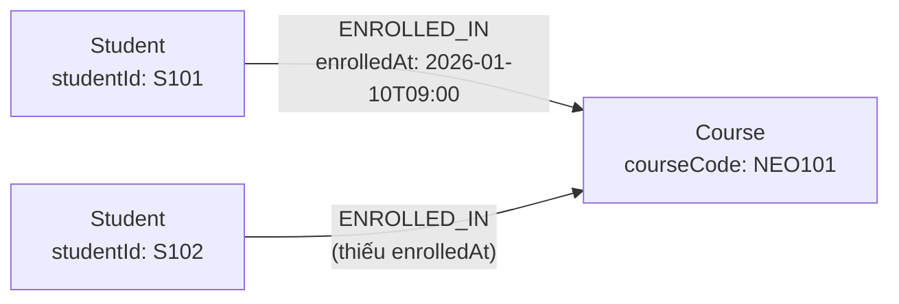

# Ràng buộc tồn tại thuộc tính theo khả năng của phiên bản và edition

## 1. Vì sao cần ràng buộc thuộc tính bắt buộc trong đồ thị?

Neo4j lưu dữ liệu theo mô hình **property graph**: node đại diện cho thực thể, relationship nối các thực thể, còn property lưu thông tin của từng node hoặc relationship. Một ưu điểm của mô hình này là các node cùng nhãn không bắt buộc phải có tập thuộc tính giống hệt nhau. Tuy nhiên, tính linh hoạt đó có thể trở thành rủi ro khi nghiệp vụ quy định **một thuộc tính nhất định luôn phải có**.

Hãy xét hệ thống quản lý khóa học:

```cypher
CREATE (:Course {courseCode: 'NEO101', title: 'Nhập môn Neo4j'});
CREATE (:Course {title: 'Khóa học chưa có mã'});
```

Nếu không có quy tắc bổ sung, Neo4j có thể lưu cả hai node. Khi ứng dụng tìm khóa học theo `courseCode`, node thứ hai khó được nhận diện một cách ổn định. Tương tự, một relationship `:ENROLLED_IN` thiếu `enrolledAt` khiến hệ thống không xác định được thời điểm ghi danh.

**Property existence constraint** (ràng buộc tồn tại thuộc tính) yêu cầu mọi node thuộc một nhãn, hoặc mọi relationship thuộc một loại, phải có giá trị **khác `null`** cho property được chỉ định. Khi cơ sở dữ liệu hỗ trợ loại constraint này, Neo4j thực thi quy tắc ở tầng lưu trữ: một thao tác ghi làm đối tượng thiếu thuộc tính bắt buộc sẽ bị từ chối.

Đây là một thành phần quan trọng trong chủ đề **ràng buộc dữ liệu** của Neo4j, bên cạnh uniqueness constraint, node/relationship key, property type constraint và các cơ chế kiểm tra nghiệp vụ trong ứng dụng Java Driver hoặc Spring Data Neo4j.

Mục tiêu bài học:

- Giải thích chính xác “tồn tại” nghĩa là gì đối với property trong Neo4j.
- Kiểm tra **phiên bản và edition** trước khi sử dụng property existence constraint.
- Viết Cypher cho cả node lẫn relationship, nhận biết các thao tác gây lỗi.
- Chuẩn bị dữ liệu cũ và thực hiện migration schema có kiểm soát.
- Phân biệt constraint ở database với validation trong ứng dụng, và chọn hướng xử lý khi edition không hỗ trợ.

## 2. Property tồn tại nghĩa là gì?

Trong Neo4j, một property không có giá trị được biểu diễn bằng `null`; về mặt lưu trữ, property mang giá trị `null` tương đương với việc không có property đó. Chẳng hạn:

```cypher
CREATE (c:Course {courseCode: 'NEO101', title: 'Cypher cơ bản'});

// Thao tác dưới đây sẽ bỏ property courseCode nếu không bị constraint chặn.
MATCH (c:Course {courseCode: 'NEO101'})
SET c.courseCode = null;
```

Khi chưa đặt existence constraint, node sau thao tác trên sẽ không còn `courseCode`. Nếu có constraint yêu cầu `courseCode`, thao tác `SET ... = null` bị từ chối.

Cần phân biệt các giá trị sau:

| Giá trị property | Có thỏa điều kiện tồn tại (`IS NOT NULL`)? | Đã bảo đảm hợp lệ theo nghiệp vụ? |
| --- | --- | --- |
| Không có property | **Không** | Không. |
| `null` | **Không** | Không. |
| `''` (chuỗi rỗng) | **Có** | Chưa chắc; mã khóa học rỗng vẫn thường là dữ liệu sai. |
| `'   '` (chỉ có khoảng trắng) | **Có** | Chưa chắc; cần chuẩn hóa và kiểm tra nội dung. |
| `0` | **Có** | Phụ thuộc miền giá trị cho phép. |
| `false` | **Có** | Phụ thuộc quy tắc nghiệp vụ. |
| `'NEO101'` | **Có** | Cần kiểm tra thêm định dạng và tính duy nhất nếu nghiệp vụ yêu cầu. |

Vì vậy, **“bắt buộc có” khác với “đúng định dạng”, “đúng kiểu” và “duy nhất”**. Một existence constraint không tự cắt khoảng trắng, kiểm tra regex, giới hạn giá trị hoặc cấp mã mặc định cho dữ liệu.

### Phạm vi áp dụng của ràng buộc

Ràng buộc tồn tại không áp dụng cho mọi node trong database nếu ta không khai báo như vậy. Nó gắn với **nhãn** ở node hoặc **loại relationship**:



Nếu có constraint trên `:Course(courseCode)`, mọi node mang nhãn `Course` đều phải có `courseCode`, kể cả node có nhiều nhãn như `:Course:Published`. Nếu có constraint trên `:ENROLLED_IN(enrolledAt)`, **mọi relationship loại `ENROLLED_IN`** đều phải có `enrolledAt`, không phụ thuộc hai đầu mút là loại node nào. Việc tồn tại thuộc tính ở relationship **không** tự kiểm soát nhãn node ở hai đầu quan hệ.

## 3. Kiểm tra khả năng hỗ trợ theo phiên bản và edition

Không nên lấy một lệnh Cypher trong tài liệu và giả định nó chạy trên mọi bản Neo4j. **Cú pháp và quyền sử dụng từng loại constraint có thể khác nhau theo phiên bản, edition và dịch vụ triển khai.**

Trong **các bản Neo4j 5.x**, property existence constraint cho node và relationship là tính năng của **Enterprise Edition**. Neo4j Community Edition hỗ trợ một số loại constraint khác, chẳng hạn uniqueness, nhưng **không cung cấp property existence constraint ở tầng schema** như ví dụ trong bài. Các bản có cách đánh số phát hành mới hơn cần được đối chiếu tài liệu tương ứng; khi dùng Neo4j Aura, cũng cần xem gói dịch vụ và tính năng database đang cấp.

### 3.1. Xem phiên bản và edition thực tế

Trong Neo4j Browser hoặc Cypher Shell, có thể kiểm tra:

```cypher
CALL dbms.components()
YIELD name, versions, edition
RETURN name, versions, edition;
```

Kết quả thể hiện thành phần DBMS, danh sách phiên bản và edition đang chạy (cấu trúc thông tin có thể khác giữa các thế hệ phát hành). Đừng nhầm thông số **phiên bản Neo4j Driver của Java** với phiên bản **Neo4j DBMS**: khả năng đặt constraint do **database** quyết định.

Sau khi biết phiên bản, kiểm tra phần **Constraints → Property existence constraints** trong tài liệu chính thức dành đúng bản triển khai. Nếu kết quả báo Community hoặc môi trường không hỗ trợ, các lệnh tạo constraint bên dưới không phải là giải pháp tương thích trực tiếp.

### 3.2. Chọn cú pháp đúng với thế hệ phát hành

| Môi trường | Cú pháp/khả năng cần lưu ý |
| --- | --- |
| Neo4j 5.x Enterprise và các bản mới hỗ trợ cú pháp tương ứng | Dùng `CREATE CONSTRAINT ... FOR ... REQUIRE property IS NOT NULL`. |
| Neo4j 5.x Community | Không dùng được property existence constraint; uniqueness cũng không tự yêu cầu property hiện diện. |
| Một số phiên bản 3.x/4.x đời cũ | Có cú pháp kiểu `ON ... ASSERT exists(...)` cho ràng buộc tồn tại, ở các edition hỗ trợ; cú pháp cũ này không dùng nguyên xi trên Neo4j 5.x. |
| Các giai đoạn chuyển tiếp hoặc dịch vụ quản lý | Kiểm tra tài liệu chính xác cho bản đang chạy; không suy đoán hỗ trợ chỉ từ việc một ví dụ Cypher có trong tài liệu phiên bản khác. |

Những ví dụ thực hành tiếp theo sử dụng **cú pháp Neo4j 5.x**, giả định database hỗ trợ loại constraint này. Chúng là ví dụ học tập; không nên chạy trực tiếp vào dữ liệu sản xuất nếu chưa khảo sát dữ liệu và lên kế hoạch migration.

## 4. Tạo ràng buộc tồn tại thuộc tính cho node

Giả sử mọi khóa học bắt buộc có mã `courseCode`. Trên database có hỗ trợ:

```cypher
CREATE CONSTRAINT course_code_required IF NOT EXISTS
FOR (c:Course)
REQUIRE c.courseCode IS NOT NULL;
```

Giải nghĩa:

- `CREATE CONSTRAINT course_code_required` tạo một ràng buộc với tên để quản trị.
- `IF NOT EXISTS` giúp script migration có thể chạy lại khi đã có constraint phù hợp; nó **không nâng cấp edition**, không sửa dữ liệu và không thay cho việc kiểm tra schema thực tế.
- `FOR (c:Course)` xác định nhãn node chịu ràng buộc.
- `REQUIRE c.courseCode IS NOT NULL` yêu cầu property này phải tồn tại.

Sau khi tạo thành công:

```cypher
// Hợp lệ: courseCode đã hiện diện.
CREATE (:Course {
  courseCode: 'NEO101',
  title: 'Nhập môn Neo4j'
});

// Không hợp lệ khi có course_code_required.
CREATE (:Course {
  title: 'Khóa học thiếu mã'
});
```

Ràng buộc còn chặn các cách xóa thuộc tính khỏi node đang có:

```cypher
// Giả sử Course NEO101 đã tồn tại.
MATCH (c:Course {courseCode: 'NEO101'})
REMOVE c.courseCode;

// Tương đương về ý nghĩa bỏ property:
MATCH (c:Course {courseCode: 'NEO101'})
SET c.courseCode = null;
```

Mỗi câu lệnh trên là **một ví dụ độc lập về trường hợp vi phạm**. Không nên chạy chúng liên tục để kiểm thử trên dữ liệu thật.

### 4.1. Các thay đổi gián tiếp cũng có thể vi phạm

Không chỉ lệnh `CREATE` hoặc `REMOVE`. Khi sử dụng:

```cypher
// Thay toàn bộ tập thuộc tính; có nguy cơ làm mất courseCode.
MATCH (c:Course {courseCode: 'NEO101'})
SET c = {title: 'Chỉ còn tên khóa học'};
```

Neo4j sẽ từ chối thao tác nếu nó làm node `:Course` mất `courseCode`. Phép cập nhật `SET c += $props` thường giữ lại các property không được nêu, nhưng vẫn phải cẩn thận khi dữ liệu đầu vào chứa giá trị `null` cho thuộc tính bắt buộc.

Việc **thêm nhãn `Course`** cho một node vốn không có `courseCode` cũng có thể bị chặn:

```cypher
CREATE (n:Draft {title: 'Bản nháp chưa cấp mã'});

// Nếu ràng buộc tồn tại trên :Course đang có hiệu lực, lệnh sau bị từ chối.
MATCH (n:Draft {title: 'Bản nháp chưa cấp mã'})
SET n:Course;
```

Ngược lại, một node không mang nhãn `Course` nằm **ngoài** phạm vi của constraint đó. Vì thế cần thiết kế quy tắc gắn nhãn nhất quán, nhất là khi dữ liệu đi qua nhiều dịch vụ hay đợt import.

## 5. Tạo ràng buộc tồn tại thuộc tính cho relationship

Trong property graph, relationship cũng có property riêng. Ví dụ `:ENROLLED_IN` có thể lưu thời điểm sinh viên đăng ký:

```cypher
CREATE CONSTRAINT enrollment_time_required IF NOT EXISTS
FOR ()-[r:ENROLLED_IN]-()
REQUIRE r.enrolledAt IS NOT NULL;
```

Khác với node constraint, phần `FOR ()-[r:ENROLLED_IN]-()` chọn **loại relationship**. Cú pháp schema này không yêu cầu khai báo hướng mũi tên; constraint áp dụng cho mọi relationship loại `ENROLLED_IN`.

Ví dụ ghi danh hợp lệ:

```cypher
MATCH (s:Student {studentId: $studentId})
MATCH (c:Course {courseCode: $courseCode})
CREATE (s)-[r:ENROLLED_IN {
    enrolledAt: datetime(),
    status: 'ACTIVE'
}]->(c)
RETURN elementId(r) AS enrollmentElementId;
```

Truy vấn dùng tham số `$studentId`, `$courseCode` do ứng dụng truyền vào. Nếu không tìm thấy sinh viên hoặc khóa học, các câu `MATCH` trả về không có dòng phù hợp và relationship không được tạo; ứng dụng cần kiểm tra trường hợp không có kết quả. Nếu tạo relationship mà bỏ `enrolledAt`, constraint sẽ từ chối:

```cypher
// Minh họa trường hợp vi phạm trên dữ liệu có Student và Course tương ứng.
MATCH (s:Student {studentId: 'S101'})
MATCH (c:Course {courseCode: 'NEO101'})
CREATE (s)-[:ENROLLED_IN {status: 'ACTIVE'}]->(c);
```

Một số quy tắc liên quan vẫn **nằm ngoài phạm vi** của existence constraint: `ENROLLED_IN` có phải nối `Student` đến `Course` hay không, một sinh viên có được ghi danh cùng khóa hai lần không, và `enrolledAt` có phải thời điểm hợp lệ theo lịch đăng ký hay không. Những bất biến đó cần được biểu diễn thêm bằng khóa thích hợp, thiết kế mô hình và transaction/nghiệp vụ tương ứng.

## 6. Phân biệt existence, uniqueness, node key, property type và index

Ví dụ mọi node `:Course` phải có `courseCode` **vừa hiện diện, vừa duy nhất**, có thể chọn nhiều cơ chế tùy edition:

| Cơ chế | Bảo đảm | Điều không tự bảo đảm |
| --- | --- | --- |
| **Property existence** | Mọi `Course` có `courseCode` khác `null`. | Không cấm hai khóa học cùng mã. |
| **Property uniqueness** | Các `Course` có mã được khai báo không trùng nhau. | Không buộc mọi `Course` phải có mã. |
| **Node key** | Mã bắt buộc có **và** duy nhất trong phạm vi nhãn. | Không kiểm tra định dạng/ý nghĩa mã. |
| **Property type** | Giá trị mã, khi có, thuộc kiểu được khai báo như `STRING`. | Không buộc hiện diện hoặc duy nhất chỉ nhờ type constraint. |
| **Index thông thường** | Hỗ trợ truy vấn tra cứu theo property. | Không chặn thiếu mã hay trùng mã. |

Để chỉ bảo đảm không trùng, có thể tạo uniqueness constraint:

```cypher
CREATE CONSTRAINT course_code_unique IF NOT EXISTS
FOR (c:Course)
REQUIRE c.courseCode IS UNIQUE;
```

Nếu bản Neo4j hỗ trợ cả existence và uniqueness, có thể dùng **hai constraint với hai ý nghĩa khác nhau**:

```cypher
// Bắt buộc có mã.
CREATE CONSTRAINT course_code_required IF NOT EXISTS
FOR (c:Course)
REQUIRE c.courseCode IS NOT NULL;

// Mã không được trùng.
CREATE CONSTRAINT course_code_unique IF NOT EXISTS
FOR (c:Course)
REQUIRE c.courseCode IS UNIQUE;
```

Hoặc cân nhắc **node key**, thể hiện đồng thời cả hai bất biến:

```cypher
CREATE CONSTRAINT course_code_key IF NOT EXISTS
FOR (c:Course)
REQUIRE c.courseCode IS NODE KEY;
```

Đây là **những phương án thiết kế thay thế hoặc kết hợp có chủ đích**, không phải yêu cầu chạy chồng tất cả các ví dụ lên cùng một schema. Node key cũng có điều kiện hỗ trợ theo edition; không thể xem nó là cách vượt qua giới hạn của Community Edition.

Nếu cần bảo đảm property là chuỗi, bản có hỗ trợ property type constraint có thể bổ sung:

```cypher
CREATE CONSTRAINT course_code_string IF NOT EXISTS
FOR (c:Course)
REQUIRE c.courseCode IS :: STRING;
```

Ngay cả khi đã có type và existence, giá trị `''` vẫn là chuỗi hợp lệ có tồn tại. Quy tắc “không rỗng”, “không khoảng trắng”, “đúng mẫu mã” phải được kiểm tra bằng nghiệp vụ hoặc cơ chế phù hợp khác.

### Existence có tự tạo index không?

**Không nên giả định existence constraint tự tạo một index để tăng tốc tra cứu**. Nó nhằm bảo vệ tính đầy đủ của property. Nếu cần truy vấn hiệu quả theo `courseCode`, hãy đánh giá index riêng hoặc uniqueness/node key theo thiết kế và kiểm tra `SHOW INDEXES` cùng kế hoạch `EXPLAIN`. Uniqueness và key có cơ chế index hỗ trợ, còn existence tự nó không thay thế cho bài toán tối ưu truy vấn.

## 7. Vì sao thêm existence constraint vào dữ liệu cũ có thể thất bại?

Neo4j phải kiểm tra các node hoặc relationship **đã tồn tại** khi tạo constraint. Nếu bất kỳ đối tượng nào trong phạm vi thiếu property bắt buộc, lệnh tạo constraint bị từ chối. Schema không tự bổ sung mã, tự tạo ngày đăng ký hoặc sửa bản ghi thiếu dữ liệu.

Giả sử database đã có:

```cypher
CREATE (:Course {courseCode: 'NEO101', title: 'Cypher cơ bản'});
CREATE (:Course {title: 'Khóa học chưa được cấp mã'});
```

Lệnh `CREATE CONSTRAINT course_code_required ...` sẽ thất bại cho đến khi xử lý node `Course` thiếu `courseCode`.

### 7.1. Tìm node thiếu property

```cypher
MATCH (c:Course)
WHERE c.courseCode IS NULL
RETURN elementId(c) AS nodeElementId,
       c.title AS title
LIMIT 50;
```

Đếm tổng số bản ghi cần xử lý:

```cypher
MATCH (c:Course)
WHERE c.courseCode IS NULL
RETURN count(c) AS missingCourseCodes;
```

Để phát hiện các mã “có mặt nhưng không dùng được”, cần kiểm tra sâu hơn theo chính sách định dạng. Ví dụ, nếu mã luôn là chuỗi:

```cypher
MATCH (c:Course)
WHERE c.courseCode IS NOT NULL
  AND c.courseCode = ''
RETURN elementId(c) AS nodeElementId, c.title AS title
LIMIT 50;
```

Nếu dữ liệu thực tế có mã lưu sai kiểu, cần sửa kiểu trước khi dùng các hàm chuỗi hoặc thêm type constraint. Kết quả của `elementId()` chỉ nên dùng để hỗ trợ chẩn đoán/chọn bản ghi trong môi trường hiện tại; nó **không phải business ID ổn định** cho các hệ thống ngoài.

### 7.2. Tìm relationship thiếu property

```cypher
MATCH (s)-[r:ENROLLED_IN]->(c)
WHERE r.enrolledAt IS NULL
RETURN elementId(r) AS relationshipElementId,
       labels(s) AS sourceLabels,
       labels(c) AS targetLabels
LIMIT 50;
```

Truy vấn này cố ý dùng mẫu **có hướng** để đọc relationship một lần theo hướng được lưu và giúp rà soát đầu mút. Nếu hệ thống đã định nghĩa `ENROLLED_IN` chỉ từ `Student` đến `Course`, có thể bổ sung nhãn vào truy vấn kiểm tra. Tuy nhiên, để không bỏ sót relationship vi phạm có đầu mút bất thường, bản khảo sát tổng thể không nên giới hạn nhãn ngay từ đầu.

### 7.3. Sửa dữ liệu theo đúng ý nghĩa nghiệp vụ

Không nên tự gán cùng một mã giả như `'UNKNOWN'` cho mọi khóa học thiếu mã: existence constraint có thể chấp nhận chuỗi đó nhưng ứng dụng sẽ khó nhận diện đúng thực thể; nếu có thêm uniqueness, các mã giả lặp lại còn vi phạm ràng buộc. Với `enrolledAt`, việc tùy tiện gán `datetime()` cho các đăng ký cũ sẽ làm sai lịch sử.

Quy trình xử lý hợp lý là xác định nguồn dữ liệu chuẩn, phân loại bản ghi có thể bổ sung thông tin, bản ghi cần hợp nhất/hủy và bản ghi cần giữ làm lịch sử. Đối với node có quan hệ, sửa hoặc xóa phải xem xét ảnh hưởng tới các đường đi trong đồ thị, không dùng `DETACH DELETE` hàng loạt chỉ để làm sạch số liệu thống kê.

## 8. Quy trình triển khai constraint an toàn

Áp dụng một quy trình có thể kiểm chứng:

1. **Xác nhận DBMS:** kiểm tra phiên bản/edition và quyền thực hiện DDL; đọc tài liệu đúng phiên bản.
2. **Chốt yêu cầu nghiệp vụ:** property nào là bắt buộc, trên nhãn/loại quan hệ nào; có cần uniqueness và type hay không.
3. **Khảo sát dữ liệu:** tìm node/relationship thiếu property, kiểm tra chuỗi rỗng, giá trị sai kiểu và dữ liệu import.
4. **Sửa nguồn ghi và dữ liệu cũ:** bảo đảm ứng dụng, batch import, job đồng bộ đều cung cấp giá trị hợp lệ; sau đó xử lý dữ liệu hiện có.
5. **Tạo constraint qua migration:** chạy cú pháp dành đúng DBMS; chọn thời điểm triển khai phù hợp vì database có thể cần quét dữ liệu để xác minh.
6. **Đọc lại schema và thử ghi:** xác minh constraint đang có và thử trường hợp hợp lệ/vi phạm trên môi trường thử nghiệm.

### Xem constraint sau khi tạo

```cypher
SHOW CONSTRAINTS;
```

Hoặc lọc các trường quan trọng (trên các bản hỗ trợ các trường `YIELD` này):

```cypher
SHOW CONSTRAINTS
YIELD name, type, entityType, labelsOrTypes, properties
RETURN name, type, entityType, labelsOrTypes, properties
ORDER BY name;
```

Kiểm tra **tên, loại, nhãn/relationship type và property**. `IF NOT EXISTS` không tự chứng minh rằng schema đã đúng như migration kỳ vọng. Nếu câu lệnh thất bại vì thiếu dữ liệu hoặc edition không hỗ trợ, không được tiếp tục quy trình với giả định constraint đã có.

Khi phải bỏ một constraint cũ:

```cypher
DROP CONSTRAINT course_code_required IF EXISTS;
```

Chỉ thực hiện sau khi đánh giá các luồng ghi đang dựa vào ràng buộc đó. Xóa constraint sẽ bỏ quy tắc bảo vệ cho các thao tác ghi sau này.

## 9. Tích hợp với Java Driver và Spring Data Neo4j

Một số yêu cầu có thể được kiểm tra ngay tại API nhưng **tầng database vẫn cần ràng buộc riêng** nếu muốn bảo vệ mọi đường ghi.

### 9.1. Java Driver: kiểm tra đầu vào và ghi tham số hóa

Ví dụ sử dụng Java Driver 5.x:

```java
import org.neo4j.driver.Driver;
import org.neo4j.driver.Session;
import java.util.Map;

public class CourseRepository {
    private final Driver driver;

    public CourseRepository(Driver driver) {
        this.driver = driver;
    }

    public void createCourse(String courseCode, String title) {
        if (courseCode == null || courseCode.isBlank()) {
            throw new IllegalArgumentException(
                "Mã khóa học không được để trống");
        }
        if (title == null || title.isBlank()) {
            throw new IllegalArgumentException(
                "Tên khóa học không được để trống");
        }

        String cypher = """
            CREATE (c:Course {
                courseCode: $courseCode,
                title: $title
            })
            RETURN c.courseCode AS code
            """;

        try (Session session = driver.session()) {
            session.executeWrite(tx -> {
                tx.run(cypher, Map.of(
                    "courseCode", courseCode,
                    "title", title
                )).single();
                return null;
            });
        }
    }
}
```

Validation này tạo lỗi dễ hiểu trước khi gửi truy vấn, và query dùng tham số nên không phải ghép chuỗi dữ liệu vào Cypher. Tuy nhiên, một script Cypher ngoài ứng dụng hoặc dịch vụ khác vẫn có thể tạo `:Course` thiếu `courseCode` **nếu database không có constraint**. Khi property existence constraint tồn tại, một luồng ghi sai có thể bị từ chối bất kể đi qua ứng dụng nào.

Nếu database từ chối ghi do constraint, ứng dụng cần xử lý ngoại lệ driver phù hợp, xác định transaction thất bại và chuyển thành phản hồi nghiệp vụ. Không nên bỏ qua lỗi rồi báo tạo khóa học thành công. Với thao tác gồm nhiều node/relationship, cần dùng transaction để không để lại kết quả dở dang do lỗi ở bước sau.

### 9.2. Spring Data Neo4j: annotation và schema là hai lớp

Với Spring Data Neo4j, `@Node` và `@Relationship` khai báo ánh xạ thực thể; các annotation validation như `@NotNull` hoặc `@NotBlank` thuộc cơ chế kiểm tra dữ liệu ở phía Java khi được kích hoạt đúng trong luồng ứng dụng. **Chúng không tự động tương đương với property existence constraint có hiệu lực trong Neo4j**. `@Id` xác định danh tính dùng khi persistence cũng không phải lời bảo đảm rằng mọi đường ghi vào database sẽ tuân theo quy tắc bắt buộc của một property nghiệp vụ khác.

Nếu `courseCode` là thuộc tính bắt buộc, hãy kết hợp validation tại ranh giới API/DTO, kiểm tra ở service và schema migration Cypher ở database hỗ trợ. Với hệ thống đa service hoặc nhập dữ liệu định kỳ, schema constraint có vai trò đặc biệt lớn vì tất cả nguồn ghi chia sẻ một kho dữ liệu.

## 10. Khi sử dụng Community Edition hoặc môi trường không hỗ trợ

Không thể áp dụng một loại constraint chỉ bằng cách đổi tên câu lệnh hoặc thêm `IF NOT EXISTS` nếu edition không hỗ trợ. Cũng không nên dùng uniqueness như một “bản sao” của existence:

```cypher
// Uniqueness được dùng để chống trùng mã,
// nhưng vẫn có thể cho phép nhiều Course thiếu courseCode.
CREATE CONSTRAINT course_code_unique IF NOT EXISTS
FOR (c:Course)
REQUIRE c.courseCode IS UNIQUE;
```

Với hệ thống Community Edition, các biện pháp khả thi gồm kiểm tra input tại API, kiểm tra dữ liệu trong service, buộc job import tuân theo hợp đồng dữ liệu, theo dõi truy vấn phát hiện node/relationship thiếu property và phân quyền giới hạn đường ghi. Các biện pháp này **giảm nguy cơ** nhưng không tạo thành bảo đảm schema tương đương property existence constraint khi nhiều tác nhân có quyền ghi.

Nếu nghiệp vụ yêu cầu **tính toàn vẹn bắt buộc ở tầng database** cho tất cả nguồn ghi, cần lựa chọn phiên bản/edition hoặc dịch vụ thực sự hỗ trợ property existence (hay key constraint phù hợp), sau khi đánh giá chi phí vận hành và kế hoạch migration.

## 11. Những nhầm lẫn thường gặp

| Nhầm lẫn | Cách hiểu đúng |
| --- | --- |
| “Node có thể linh hoạt property nên không cần ràng buộc.” | Linh hoạt hữu ích với thuộc tính tùy chọn; định danh và dữ liệu bắt buộc vẫn cần chính sách rõ ràng. |
| “`IS UNIQUE` đồng nghĩa `IS NOT NULL`.” | Uniqueness ngăn trùng giá trị đã có, không tự buộc mỗi node phải có property. |
| “`IS NOT NULL` cấm chuỗi rỗng.” | Chuỗi rỗng vẫn là giá trị khác `null`; cần validation bổ sung. |
| “Thêm constraint sẽ tự điền dữ liệu còn thiếu.” | Neo4j kiểm tra dữ liệu hiện có; nếu vi phạm, việc tạo constraint thất bại. |
| “Constraint trên relationship bảo đảm hai đầu là đúng nhãn.” | Existence chỉ kiểm tra property trên relationship được chỉ định. |
| “Community có thể dùng node key để thay existence.” | Node key cũng có yêu cầu edition; phải kiểm tra hỗ trợ thực tế. |
| “Có `WHERE x.prop IS NOT NULL` trong query là đủ.” | `WHERE` chỉ lọc kết quả của truy vấn đó; không ngăn nguồn ghi khác lưu dữ liệu thiếu. |
| “Ứng dụng đã có `@NotNull` thì database tự có constraint.” | Validation Java và constraint Neo4j là hai cơ chế riêng. |

## 12. Bài thực hành tự kiểm tra

Trên **database thử nghiệm hỗ trợ property existence constraint**:

1. Tạo một số `:Course` có `courseCode` hợp lệ và kiểm tra truy vấn tìm property thiếu.
2. Cố tạo một node `:Course` không có `courseCode` khi chưa có constraint, quan sát kết quả; bổ sung dữ liệu đúng quy tắc.
3. Tạo constraint `course_code_required` và dùng `SHOW CONSTRAINTS` để xác minh.
4. Thử lần lượt: tạo node thiếu mã, đặt mã về `null`, `REMOVE` mã, và gắn nhãn `Course` cho node không có mã. Ghi nhận thao tác nào bị từ chối.
5. Thử mã `''`, sau đó bổ sung validation “không rỗng” ở ứng dụng; giải thích vì sao constraint existence vẫn chưa đủ.
6. Tạo và kiểm tra tương tự relationship `:ENROLLED_IN` có property `enrolledAt`.

Nếu dùng Community Edition, hãy thay phần thực hành DDL không được hỗ trợ bằng việc **kiểm tra phiên bản/edition**, xác nhận giới hạn và viết truy vấn kiểm tra dữ liệu thiếu property. Không cần cố chạy lệnh DDL bị từ chối nhiều lần.

## 13. Kết luận

Property existence constraint bảo vệ một bất biến nhỏ nhưng thiết yếu: **node thuộc nhãn được chỉ định hoặc relationship thuộc loại được chỉ định phải có property bắt buộc**. Bất biến này giúp các truy vấn quan hệ và đường đi trong Neo4j dựa trên những thực thể có thông tin nền tảng đầy đủ, đồng thời giảm sai lệch khi nhiều service cùng ghi vào đồ thị.

Muốn dùng đúng, cần xác nhận **Neo4j version + edition**, lựa chọn cú pháp tương thích, rà soát dữ liệu trước migration và phân biệt rõ sự tồn tại của giá trị với tính duy nhất, kiểu và hợp lệ nghiệp vụ. Khi database không hỗ trợ, validation tại Java/Spring và kiểm tra dữ liệu định kỳ vẫn hữu ích nhưng không thay thế được bảo đảm tồn tại ở tầng schema; chính yêu cầu toàn vẹn của hệ thống quyết định giải pháp triển khai phù hợp.
