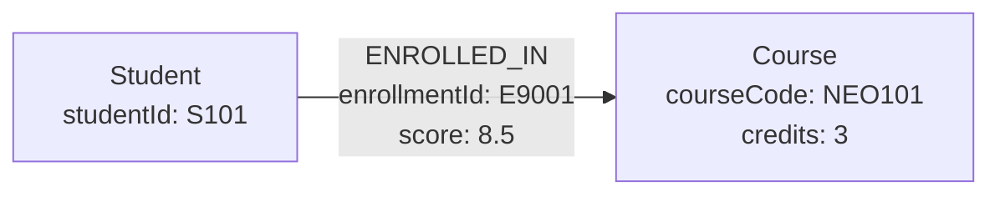
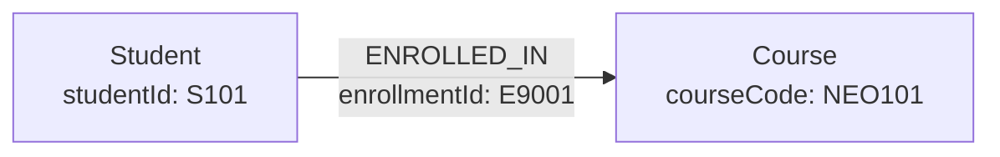

# Ràng buộc khóa và ràng buộc kiểu thuộc tính khi được hỗ trợ

## 1. Bối cảnh: từ property graph linh hoạt đến dữ liệu có hợp đồng

Neo4j là cơ sở dữ liệu đồ thị theo mô hình **property graph**: **node** biểu diễn thực thể, **relationship** biểu diễn kết nối có hướng giữa các thực thể, còn **property** lưu các giá trị mô tả. Các node mang cùng nhãn có thể có tập thuộc tính khác nhau. Điều này giúp mở rộng mô hình nhanh, nhưng cũng khiến dữ liệu sai dễ lọt vào nếu không xác định rõ quy tắc.

Giả sử một nền tảng học tập có node `:Course` và relationship `:ENROLLED_IN`:



Về nghiệp vụ, hệ thống có thể yêu cầu:

1. Mỗi khóa học phải có một `courseCode` **và** không khóa học nào dùng trùng mã.
2. Một lượt ghi danh phải có `enrollmentId` **và** không có hai lượt ghi danh cùng ID.
3. `credits` phải được lưu bằng **số nguyên**, còn `score` phải là kiểu **số thực**.
4. Giá trị `credits` phải nằm trong khoảng cho phép; `score` phải nằm trong thang điểm hợp lệ.

Hai yêu cầu đầu được biểu diễn gọn bằng **key constraints**; yêu cầu thứ ba có thể được kiểm tra bằng **property type constraints**. Yêu cầu thứ tư là quy tắc miền giá trị, không được tự động bảo đảm chỉ bằng các constraint khóa và kiểu dữ liệu giới thiệu ở bài này.

Bài học thuộc chương **Ràng buộc dữ liệu**, hướng đến khả năng thiết kế schema Neo4j, viết Cypher, thực hiện nhập dữ liệu và phối hợp với Java Driver hoặc Spring Data Neo4j. Trọng tâm là **chọn và áp dụng node/relationship key cùng property type constraint đúng phạm vi, đúng phiên bản và edition**.

Sau bài học, bạn sẽ:

- Giải thích sự khác nhau giữa uniqueness, existence, node key, relationship key và property type.
- Tạo key constraint cho một property hoặc một bộ property.
- Chỉ rõ type constraint kiểm tra điều gì và không kiểm tra điều gì.
- Nhận biết phiên bản/edition cần xác minh trước khi chạy lệnh schema.
- Kiểm tra dữ liệu cũ, tạo migration và xử lý lỗi ghi khi constraint có hiệu lực.

## 2. Khóa của node và relationship giải quyết vấn đề gì?

Trong hệ thống quan hệ, khóa chính thường biểu diễn danh tính của một bản ghi. Ở Neo4j, **node key** thể hiện đồng thời hai bất biến đối với các node trong một **nhãn**:

- Các property của khóa **bắt buộc tồn tại**, tức không được thiếu hoặc là `null`.
- Bộ giá trị của khóa **duy nhất** giữa các node có nhãn đó.

**Relationship key** có ý nghĩa tương tự, nhưng áp dụng cho các relationship thuộc một **loại relationship** cụ thể.

Điểm quan trọng là key constraint bảo vệ **thuộc tính định danh**, không phải mọi quy tắc hình học hoặc nghiệp vụ của đồ thị. Ví dụ relationship key trên `enrollmentId` không tự cấm hai relationship khác ID nối cùng một cặp `Student`–`Course`.

### 2.1. So sánh các lựa chọn

| Cơ chế | Property bắt buộc tồn tại? | Giá trị có duy nhất? | Phạm vi |
| --- | --- | --- | --- |
| Node uniqueness | Không | Có, với các giá trị hiện diện | Node mang nhãn được khai báo |
| Node property existence | Có | Không | Node mang nhãn được khai báo |
| **Node key** | **Có, mọi thành phần khóa** | **Có, theo cả bộ khóa** | Node mang nhãn được khai báo |
| Relationship key | **Có, mọi thành phần khóa** | **Có, theo cả bộ khóa** | Relationship thuộc loại được khai báo |
| Property type | Không, nếu chỉ có type constraint | Không | Node hoặc relationship thuộc phạm vi khai báo |

Nếu chỉ đặt uniqueness lên `courseCode`, hai node `:Course` **không có** property đó vẫn có thể tồn tại. Node key loại bỏ khoảng trống này. Nếu chỉ đặt type constraint lên `credits`, property có thể **vắng mặt** mà không vi phạm type constraint; cần thêm quy tắc hiện diện nếu nghiệp vụ bắt buộc có tín chỉ.

## 3. Kiểm tra phiên bản và edition trước khi tạo constraint

**Key constraints và property type constraints không có cùng khả năng hỗ trợ ở mọi bản Neo4j.** Đặc biệt, với dòng Neo4j 5.x:

| Loại ràng buộc | Mốc/cách hiểu khi dùng Neo4j 5.x | Edition |
| --- | --- | --- |
| Node key | Có trong các bản 5.x hỗ trợ Cypher schema hiện đại | Enterprise |
| Relationship key | Được bổ sung trong dòng 5.x, từ Neo4j 5.7 | Enterprise |
| Node/relationship property type | Được bổ sung trong dòng 5.x, từ Neo4j 5.9 | Enterprise |
| Node uniqueness | Được hỗ trợ từ trước; phân biệt với node key | Có ở Community và Enterprise |

Các mốc trên giúp đọc ví dụ **trong dòng 5.x**; nếu dùng phiên bản cũ hơn hoặc nhánh phát hành mới hơn (chẳng hạn các bản mang tên theo năm), cần tra tài liệu chính thức đúng bản chạy thực tế. Dịch vụ Neo4j được quản lý cũng có thể có chính sách tính năng theo gói triển khai.

Kiểm tra DBMS bằng Cypher:

```cypher
CALL dbms.components()
YIELD name, versions, edition
RETURN name, versions, edition;
```

Khi nhận được kết quả, cần đọc ba thông tin: **phiên bản Neo4j DBMS**, **edition** và **các loại constraint được bản đó hỗ trợ**. Phiên bản Java Driver/Spring Data Neo4j là thông tin khác; nâng cấp driver không tự bổ sung khả năng schema cho database.

Các ví dụ `CREATE CONSTRAINT` bên dưới dùng cú pháp của Neo4j 5.x có hỗ trợ tính năng tương ứng. Nếu chạy trên Community Edition không hỗ trợ key/type constraint, lệnh DDL sẽ không trở nên hợp lệ chỉ nhờ thêm `IF NOT EXISTS`.

## 4. Node key: danh tính bắt buộc và duy nhất cho node

Giả sử mỗi khóa học có một mã `courseCode` duy nhất toàn hệ thống. Trong môi trường hỗ trợ node key:

```cypher
CREATE CONSTRAINT course_code_key IF NOT EXISTS
FOR (c:Course)
REQUIRE c.courseCode IS NODE KEY;
```

Câu lệnh có bốn thành phần:

- `course_code_key` là **tên constraint** dùng để tra cứu/quản trị.
- `IF NOT EXISTS` hỗ trợ chạy lặp lại migration khi có constraint phù hợp; không có nghĩa lệnh có thể thay thế cho kiểm tra schema.
- `FOR (c:Course)` quy định đối tượng chịu ràng buộc là **mọi node mang nhãn `Course`**.
- `REQUIRE c.courseCode IS NODE KEY` yêu cầu `courseCode` vừa tồn tại vừa duy nhất.

Sau khi constraint đã được tạo thành công:

```cypher
// Hợp lệ: có mã mới.
CREATE (:Course {courseCode: 'NEO101', title: 'Nhập môn Neo4j'});

// Lỗi: trùng khóa NEO101.
CREATE (:Course {courseCode: 'NEO101', title: 'Cypher căn bản'});

// Lỗi: thiếu khóa.
CREATE (:Course {title: 'Khóa học chưa có mã'});
```

Các câu lệnh trên mô tả **những tình huống kiểm thử riêng biệt**. Đừng chạy cả khối liên tục vào hệ thống thật sau khi câu thứ hai đã cố ý gây lỗi.

Ngoài `CREATE`, các thao tác làm mất hoặc thay đổi khóa cũng phải tuân theo constraint:

```cypher
// Không hợp lệ nếu khóa học NEO101 đang tồn tại và có node key.
MATCH (c:Course {courseCode: 'NEO101'})
REMOVE c.courseCode;

// Không hợp lệ: SET ... = null tương đương xóa property.
MATCH (c:Course {courseCode: 'NEO101'})
SET c.courseCode = null;
```

Node key không giới hạn toàn bộ database: một node `:Resource` không mang nhãn `:Course` có thể có cùng giá trị `courseCode`. Ngược lại, node mang nhiều nhãn, trong đó có `Course`, vẫn phải tuân theo constraint. Nếu bổ sung nhãn `Course` cho một node thiếu `courseCode`, thao tác có thể bị từ chối.

### 4.1. Node key tổng hợp cho ứng dụng đa tenant

Trong mô hình multi-tenant, mã khóa học có thể chỉ duy nhất **trong mỗi tenant**. Khi đó `tenantId` và `courseCode` tạo thành một **khóa tổng hợp**:

```cypher
CREATE CONSTRAINT tenant_course_key IF NOT EXISTS
FOR (c:Course)
REQUIRE (c.tenantId, c.courseCode) IS NODE KEY;
```

Hành vi:

| Node `:Course` | Kết quả nếu chưa có node cùng cặp khóa |
| --- | --- |
| `{tenantId: 'T1', courseCode: 'NEO101'}` | Hợp lệ |
| `{tenantId: 'T2', courseCode: 'NEO101'}` | Hợp lệ, khác tenant |
| Tạo **thêm** `{tenantId: 'T1', courseCode: 'NEO101'}` | Vi phạm khóa |
| `{tenantId: 'T1'}` | Vi phạm vì thiếu `courseCode` |
| `{courseCode: 'NEO101'}` | Vi phạm vì thiếu `tenantId` |

Khóa tổng hợp chỉ cấm **trùng cả bộ giá trị**. Nó **không** yêu cầu mỗi `tenantId` phải duy nhất hoặc mỗi `courseCode` phải duy nhất toàn database.

Chọn đúng danh tính trước khi viết constraint: nếu hai tenant được phép dùng chung mã, khóa đơn `courseCode` sẽ từ chối dữ liệu hợp lệ. Nếu toàn hệ thống chỉ cho phép một mã, khóa tổng hợp lại quá rộng và cho phép trùng mã ở các tenant khác nhau.

### 4.2. Key constraint không kiểm tra định dạng

Ngay cả node key vẫn chấp nhận `courseCode: ''` (chuỗi rỗng), vì `''` là giá trị hiện diện, khác `null`. Nếu `''` chưa được dùng ở node khác, nó vẫn có thể là một khóa duy nhất **về mặt kỹ thuật**, dù vi phạm yêu cầu nghiệp vụ.

Node key cũng không tự kiểm tra mã bắt đầu bằng `NEO`, không kiểm tra ngày mở khóa học, không tự chuyển chữ thường thành chữ hoa và không tự giới hạn số tín chỉ. Các bất biến này cần validation, chuẩn hóa hoặc mô hình hóa bổ sung.

## 5. Relationship key: định danh cho quan hệ

Relationship trong Neo4j cũng có property, ví dụ một lượt ghi danh có `enrollmentId`:



Khi bản Neo4j có hỗ trợ relationship key, có thể yêu cầu mỗi relationship loại `ENROLLED_IN` có `enrollmentId` không thiếu và không trùng:

```cypher
CREATE CONSTRAINT enrollment_id_key IF NOT EXISTS
FOR ()-[r:ENROLLED_IN]-()
REQUIRE r.enrollmentId IS RELATIONSHIP KEY;
```

Phạm vi `FOR ()-[r:ENROLLED_IN]-()` chỉ định **loại relationship**. Hướng giữa node đầu và node cuối không phải một phần của mẫu schema ở đây; mọi relationship loại `ENROLLED_IN` đều nằm trong phạm vi.

Ví dụ ghi danh:

```cypher
MATCH (s:Student {studentId: $studentId})
MATCH (c:Course {courseCode: $courseCode})
CREATE (s)-[r:ENROLLED_IN {
    enrollmentId: $enrollmentId,
    enrolledAt: datetime()
}]->(c)
RETURN r.enrollmentId AS enrollmentId;
```

Nếu `$enrollmentId` là `null` hoặc đã thuộc một `ENROLLED_IN` khác, thao tác bị từ chối bởi key constraint. Nếu không tìm thấy một trong hai node trong `MATCH`, không có dòng đầu vào để tạo relationship; **ứng dụng cần kiểm tra truy vấn trả về 0 dòng** và phản hồi đúng tình huống thiếu sinh viên/khóa học.

### 5.1. Relationship key tổng hợp

Một hệ thống đa tenant có thể dùng `(tenantId, enrollmentId)` làm danh tính của lượt ghi danh:

```cypher
CREATE CONSTRAINT tenant_enrollment_key IF NOT EXISTS
FOR ()-[r:ENROLLED_IN]-()
REQUIRE (r.tenantId, r.enrollmentId) IS RELATIONSHIP KEY;
```

Tất cả relationship `ENROLLED_IN` phải có cả hai property và mỗi cặp phải duy nhất. Đừng đồng thời áp dụng nguyên xi key đơn `enrollmentId` ở ví dụ trước nếu nghiệp vụ cho phép hai tenant dùng cùng ID: key đơn sẽ làm quy tắc nghiêm ngặt hơn dự định.

### 5.2. Điều relationship key không làm được

Relationship key chỉ bảo vệ property định danh trên relationship. Nó **không tự bảo đảm**:

- `ENROLLED_IN` nhất định phải nối `Student` đến `Course`; Neo4j bảo đảm hai đầu mút là node tồn tại, không tự ép nhãn nghiệp vụ bằng key constraint.
- Giữa hai node chỉ được có một relationship `ENROLLED_IN`; hai relationship mang hai ID khác nhau vẫn có thể cùng nối một cặp node.
- Sinh viên không thể đăng ký cùng khóa trong hai lần/đợt khác nhau; câu hỏi này cần quy tắc danh tính phù hợp với lịch sử nghiệp vụ.

Nếu yêu cầu “mỗi sinh viên chỉ có một bản ghi ghi danh trong một khóa học”, có thể mô hình hóa `Enrollment` thành node với key tổng hợp `(studentId, courseCode)`, hoặc thiết kế quá trình ghi có kiểm soát cạnh tranh. Khi có nhiều lần đăng ký hợp lệ theo học kỳ, phải bổ sung `term` hoặc một yếu tố định danh kỳ đăng ký. Các relationship kết nối đến node `Enrollment` vẫn cần được ghi đúng bằng transaction và truy vấn có kiểm tra.

## 6. Property type constraint: nhất quán kiểu dữ liệu

Giả sử ứng dụng tính học phí theo số tín chỉ. Nếu `credits` đôi khi là số nguyên `3` và đôi khi là chuỗi `'3'`, mã Java và các biểu thức Cypher có thể lỗi hoặc cho kết quả bất ngờ. **Property type constraint** bảo vệ kiểu dữ liệu được lưu cho một property trong phạm vi nhãn/loại relationship.

Ví dụ một khóa học có mã kiểu `STRING` và số tín chỉ kiểu `INTEGER`:

```cypher
CREATE CONSTRAINT course_code_string IF NOT EXISTS
FOR (c:Course)
REQUIRE c.courseCode IS :: STRING;

CREATE CONSTRAINT course_credits_integer IF NOT EXISTS
FOR (c:Course)
REQUIRE c.credits IS :: INTEGER;
```

Trên relationship, điểm hoặc số lần thử có thể có kiểu cụ thể:

```cypher
CREATE CONSTRAINT enrollment_attempt_integer IF NOT EXISTS
FOR ()-[r:ENROLLED_IN]-()
REQUIRE r.attempt IS :: INTEGER;
```

Cú pháp `IS :: TYPE` là cú pháp Neo4j 5.x khi tính năng được hỗ trợ. Các tên kiểu và dạng kiểu được hỗ trợ khác nhau theo phiên bản; trước khi khai báo kiểu phức tạp như list hoặc temporal, cần kiểm tra tài liệu của DBMS đang chạy.

### 6.1. Khác biệt giữa property sai kiểu và property không có

| Dữ liệu `Course` | Khi có `credits IS :: INTEGER` nhưng chưa có yêu cầu tồn tại |
| --- | --- |
| `credits: 3` | Hợp lệ |
| `credits: 0` | Hợp lệ về kiểu, dù có thể không hợp lệ về nghiệp vụ |
| `credits: -5` | Hợp lệ về kiểu, dù nghiệp vụ có thể cấm số âm |
| `credits: '3'` | Vi phạm: chuỗi khác số nguyên |
| `credits: 3.0` | Vi phạm nếu giá trị lưu là `FLOAT`, dù numerically gần `3` |
| Thiếu `credits` | Không bị cấm bởi **type constraint đơn thuần** |

Type constraint **không** tự ép kiểu. Neo4j không tự chuyển `'3'` thành `3` để thỏa ràng buộc. Tác vụ nhập dữ liệu và tầng ứng dụng phải cung cấp giá trị đúng kiểu.

### 6.2. Kết hợp type với key và existence

Khi `courseCode` là danh tính bắt buộc và `credits` cũng bắt buộc tồn tại, thiết kế có thể gồm:

```cypher
// Yêu cầu courseCode vừa tồn tại vừa duy nhất.
CREATE CONSTRAINT course_code_key IF NOT EXISTS
FOR (c:Course)
REQUIRE c.courseCode IS NODE KEY;

// Mã có kiểu chuỗi.
CREATE CONSTRAINT course_code_string IF NOT EXISTS
FOR (c:Course)
REQUIRE c.courseCode IS :: STRING;

// Số tín chỉ có kiểu nguyên.
CREATE CONSTRAINT course_credits_integer IF NOT EXISTS
FOR (c:Course)
REQUIRE c.credits IS :: INTEGER;

// Nếu edition hỗ trợ: tín chỉ bắt buộc có mặt.
CREATE CONSTRAINT course_credits_required IF NOT EXISTS
FOR (c:Course)
REQUIRE c.credits IS NOT NULL;
```

Các constraint mô tả **những bất biến khác nhau** và chỉ nên tạo theo yêu cầu thực tế, sau khi xác minh edition và dữ liệu. Không nên đặt thêm một constraint trùng ý nghĩa chỉ để “cho chắc”. Đối với `credits`, ngay cả khi đã có type và existence, kiểm tra `credits > 0` hoặc giới hạn số tín chỉ vẫn cần thực hiện ở tầng nghiệp vụ.

### 6.3. Kiểu ở Java có thể dẫn đến kiểu lưu ở Neo4j

Khi Java Driver truyền tham số Cypher, giá trị `Integer`/`Long` thường được ánh xạ sang `INTEGER` của Neo4j; `Double`/`Float` được ánh xạ theo kiểu số thực thích hợp; `String` vẫn là chuỗi. Do đó đoạn nhập liệu đọc số tín chỉ thành chuỗi từ CSV rồi truyền nguyên `'3'` sẽ vi phạm `IS :: INTEGER`, dù người dùng nhìn thấy ký tự số.

Cách đúng là xác thực và parse đầu vào theo chính sách, phát hiện giá trị không hợp lệ, sau đó truyền đúng kiểu. Không nên dựa vào việc database tự chuyển kiểu hoặc nuốt lỗi constraint.

## 7. Dùng key constraint với `MERGE` và các thao tác ghi đồng thời

Nếu `Course` có khóa `(tenantId, courseCode)`, có thể tìm hoặc tạo node bằng **chính bộ khóa định danh**:

```cypher
MERGE (c:Course {
    tenantId: $tenantId,
    courseCode: $courseCode
})
ON CREATE SET c.title = $title,
              c.credits = $credits,
              c.createdAt = datetime()
RETURN c.tenantId AS tenantId,
       c.courseCode AS courseCode,
       c.title AS title;
```

Nếu các property ngoài khóa có thể đổi theo thời gian, không nên đưa chúng vào mẫu `MERGE`:

```cypher
// Không nên dùng nếu title chỉ là dữ liệu mô tả có thể thay đổi.
MERGE (c:Course {
    tenantId: $tenantId,
    courseCode: $courseCode,
    title: $title
})
RETURN c;
```

Nếu node đã có cùng khóa nhưng khác `title`, toàn bộ mẫu không khớp, `MERGE` có thể cố tạo một node khác và gặp lỗi key constraint. Cách đúng là `MERGE` theo khóa, sau đó quyết định cập nhật `title` bằng `ON MATCH SET` hoặc nghiệp vụ riêng.

Trong điều kiện hai transaction cùng ghi một khóa chưa tồn tại, key constraint là **hàng rào bảo vệ tính toàn vẹn**: không thể có hai node cùng khóa được commit thành công. Tuy nhiên, ứng dụng vẫn phải xử lý chờ khóa, retry hoặc lỗi xung đột theo trường hợp cụ thể; không nên diễn giải `MERGE` là cơ chế giải quyết mọi vấn đề cạnh tranh ghi.

Khi thiếu một thành phần khóa, `MERGE` với giá trị `null` trong mẫu property không phải đường đi hợp lệ để tự bổ sung key. Ứng dụng phải kiểm tra `tenantId`, `courseCode` trước khi chạy Cypher.

## 8. Chuẩn bị migration từ dữ liệu có sẵn

Neo4j cần kiểm tra các node/relationship đã tồn tại trước khi tạo key hoặc type constraint. Nếu có bản ghi **trùng khóa**, **thiếu thành phần khóa** hoặc **sai kiểu property**, lệnh tạo constraint tương ứng sẽ thất bại. Không có bước tự hợp nhất, điền khóa hay chuyển kiểu an toàn cho mọi nghiệp vụ.

### 8.1. Tìm node thiếu key

```cypher
MATCH (c:Course)
WHERE c.tenantId IS NULL
   OR c.courseCode IS NULL
RETURN elementId(c) AS nodeElementId,
       c.tenantId AS tenantId,
       c.courseCode AS courseCode,
       c.title AS title
LIMIT 50;
```

Để đánh giá số lượng:

```cypher
MATCH (c:Course)
WHERE c.tenantId IS NULL
   OR c.courseCode IS NULL
RETURN count(c) AS missingKeyCount;
```

### 8.2. Tìm khóa tổng hợp trùng

```cypher
MATCH (c:Course)
WHERE c.tenantId IS NOT NULL
  AND c.courseCode IS NOT NULL
WITH c.tenantId AS tenantId,
     c.courseCode AS courseCode,
     count(*) AS total,
     collect(elementId(c)) AS nodeIds
WHERE total > 1
RETURN tenantId, courseCode, total, nodeIds
ORDER BY total DESC
LIMIT 50;
```

`elementId()` có thể giúp tìm bản ghi khi rà soát, nhưng không nên dùng làm business key lâu dài hoặc lưu tham chiếu ra ngoài database. `collect()` có thể tốn bộ nhớ nếu một nhóm trùng chứa rất nhiều bản ghi; trên dữ liệu lớn, nên tách thống kê và lấy chi tiết theo nhóm.

Trước khi gộp hai node trùng khóa, hãy xác minh các relationship nối đến chúng. Xóa ngay một node dư có thể làm mất lịch sử ghi danh, đánh giá hoặc liên kết liên quan. Quy trình hợp nhất phải giữ đúng ý nghĩa nghiệp vụ, bảo toàn dữ liệu cần thiết và sửa nguyên nhân import tạo ra trùng lặp.

### 8.3. Tìm relationship thiếu hoặc trùng key

```cypher
MATCH ()-[r:ENROLLED_IN]->()
WHERE r.enrollmentId IS NULL
RETURN elementId(r) AS relationshipElementId
LIMIT 50;
```

```cypher
MATCH ()-[r:ENROLLED_IN]->()
WHERE r.enrollmentId IS NOT NULL
WITH r.enrollmentId AS enrollmentId,
     count(*) AS total,
     collect(elementId(r)) AS relationshipIds
WHERE total > 1
RETURN enrollmentId, total, relationshipIds
ORDER BY total DESC
LIMIT 50;
```

Các truy vấn này kiểm tra relationship theo hướng đã lưu; chúng không tự giới hạn nhãn node đầu/cuối. Nếu muốn áp dụng relationship key **tổng hợp**, phải kiểm tra mọi thành phần của bộ khóa.

### 8.4. Tìm dữ liệu sai kiểu

Trên bản Neo4j hỗ trợ cú pháp type predicate, có thể lọc các `credits` hiện diện nhưng không phải `INTEGER`:

```cypher
MATCH (c:Course)
WHERE c.credits IS NOT NULL
  AND NOT (c.credits IS :: INTEGER)
RETURN elementId(c) AS nodeElementId,
       c.courseCode AS courseCode,
       c.credits AS credits
LIMIT 50;
```

Nếu phiên bản không hỗ trợ type predicate, cần chọn cơ chế kiểm tra kiểu tương thích với bản đó (ví dụ quy trình export/kiểm tra ở ứng dụng); không nên chạy lệnh của bản mới rồi coi lỗi cú pháp là lỗi dữ liệu.

Khi sửa dữ liệu, phải phân biệt chuỗi số hợp lệ `'3'` với dữ liệu sai `'ba tín chỉ'` hoặc `'3.5'`. Chuyển kiểu phải dựa trên chính sách rõ ràng, tránh ép một giá trị sai thành số mặc định chỉ để migration qua được.

## 9. Quy trình triển khai và xác minh schema

Một thứ tự triển khai thực tế:

1. **Xác định bất biến:** chọn khóa đơn hay tổng hợp, nhãn node hoặc loại relationship, property bắt buộc, type và miền giá trị.
2. **Kiểm tra khả năng hỗ trợ:** xác định Neo4j DBMS version, edition, quyền tạo schema và loại constraint.
3. **Khảo sát dữ liệu:** tìm trùng, thiếu, sai kiểu, cùng các cách viết mã không nhất quán (ví dụ `'neo101'` khác `'NEO101'`).
4. **Sửa pipeline ghi trước:** chuẩn hóa dữ liệu ở Java/service/CSV import để không tiếp tục tạo lỗi; sau đó làm sạch bản ghi cũ.
5. **Tạo constraint qua migration:** chạy các `CREATE CONSTRAINT` tương ứng, với lịch triển khai phù hợp vì bước tạo có thể quét dữ liệu hiện hữu và tiêu tốn tài nguyên.
6. **Đọc lại schema và thử các đường ghi:** xác minh constraint thực sự tồn tại, đúng đối tượng và đúng property; kiểm tra các thao tác hợp lệ và vi phạm.

Kiểm tra:

```cypher
SHOW CONSTRAINTS;
```

Ở các bản Neo4j 5.x có các trường metadata tương ứng:

```cypher
SHOW CONSTRAINTS
YIELD name, type, entityType, labelsOrTypes, properties
RETURN name, type, entityType, labelsOrTypes, properties
ORDER BY name;
```

Đối chiếu **tên**, **loại constraint**, **nhãn/relationship type** và **danh sách property** với kế hoạch migration. `IF NOT EXISTS` chỉ giúp lệnh có tính lặp lại trong tình huống phù hợp; không bảo đảm rằng một constraint khác cùng tên hoặc một schema cũ đã đúng mong đợi.

Các key constraint được hỗ trợ bằng index do Neo4j quản lý; index đó cũng có thể hỗ trợ truy vấn tìm kiếm theo khóa. **Property type constraint không phải index tìm kiếm**. Không nên mặc định tạo thêm index trùng schema nếu key constraint đã có index đi kèm; dùng `SHOW INDEXES` và `EXPLAIN` để đánh giá truy vấn cụ thể.

Khi không còn cần một constraint, có thể xóa theo tên:

```cypher
DROP CONSTRAINT course_code_key IF EXISTS;
```

Chỉ thực hiện khi đã xem xét tác động: các lần ghi sau sẽ không còn được bảo vệ bởi ràng buộc đó; index hỗ trợ key có thể bị loại bỏ cùng constraint.

## 10. Java Driver và Spring Data Neo4j: hai lớp kiểm tra phối hợp

Constraint ở Neo4j bảo vệ dữ liệu **bất kể đường ghi**; validation Java giúp phản hồi lỗi sớm và kiểm tra quy tắc nghiệp vụ phức tạp hơn.

### 10.1. Ghi bằng tham số với Java Driver

Ví dụ Java Driver 5.x tạo khóa học có khóa `tenantId + courseCode` và `credits` kiểu số nguyên:

```java
import org.neo4j.driver.Driver;
import org.neo4j.driver.Session;
import java.util.Map;

public final class CourseWriter {
    private final Driver driver;

    public CourseWriter(Driver driver) {
        this.driver = driver;
    }

    public void createCourse(
            String tenantId,
            String courseCode,
            String title,
            int credits) {

        if (tenantId == null || tenantId.isBlank()
                || courseCode == null || courseCode.isBlank()) {
            throw new IllegalArgumentException("Khóa học thiếu định danh");
        }
        if (title == null || title.isBlank()) {
            throw new IllegalArgumentException("Tên khóa học không được trống");
        }
        if (credits <= 0) {
            throw new IllegalArgumentException("Số tín chỉ phải dương");
        }

        String cypher = """
            CREATE (c:Course {
                tenantId: $tenantId,
                courseCode: $courseCode,
                title: $title,
                credits: $credits
            })
            RETURN c.courseCode AS courseCode
            """;

        try (Session session = driver.session()) {
            session.executeWrite(tx -> {
                tx.run(cypher, Map.of(
                    "tenantId", tenantId,
                    "courseCode", courseCode,
                    "title", title,
                    "credits", credits
                )).single();
                return null;
            });
        }
    }
}
```

Trong ví dụ, ứng dụng kiểm tra `credits > 0` (quy tắc miền giá trị), còn type constraint kiểm tra kiểu `INTEGER` và node key kiểm tra tính bắt buộc/duy nhất của định danh. Khi người dùng gửi khóa đã tồn tại, database sẽ từ chối `CREATE` theo key constraint. Nếu yêu cầu nghiệp vụ là “tìm hoặc tạo”, phải thiết kế lại truy vấn theo `MERGE` và quyết định chính sách cập nhật.

`Session.executeWrite` thực hiện transaction ghi theo API của driver. Ứng dụng cần xử lý ngoại lệ ghi do constraint, thông báo nghiệp vụ phù hợp và không báo thành công nếu transaction thất bại. Một giao dịch tạo nhiều node/relationship nên được tổ chức để khi lỗi ở bước sau, các thay đổi liên quan không bị commit dở dang.

### 10.2. Spring Data Neo4j

Với Spring Data Neo4j, các annotation như `@Node`, `@Relationship`, `@Id` và `@Property` khai báo cách ánh xạ object Java vào đồ thị. Các annotation validation như `@NotNull`, `@NotBlank`, `@Min` chỉ có tác dụng trong những luồng validation đã được kích hoạt đúng; **không mặc nhiên tạo key/type constraint trong Neo4j**.

Khi business key là `(tenantId, courseCode)` nhưng entity Java sử dụng một ID kỹ thuật, đừng nhầm `@Id` với ràng buộc khóa nghiệp vụ ở database. Hãy quản lý schema Cypher qua migration phù hợp, cho phép service kiểm tra đầu vào nhưng vẫn để database bảo vệ tính toàn vẹn nếu tác vụ import hoặc service khác ghi dữ liệu.

## 11. Phương án khi bản Neo4j không hỗ trợ key/type constraint

Nếu DBMS/edition không hỗ trợ node key, relationship key hoặc property type constraint, phải chọn hướng xử lý dựa trên **bất biến nào thật sự cần bảo đảm**.

| Yêu cầu | Hướng khả thi trong môi trường hỗ trợ hạn chế | Hạn chế |
| --- | --- | --- |
| Node không trùng `courseCode` | Node uniqueness constraint nếu bản đang chạy hỗ trợ | Không tự bắt buộc property tồn tại |
| Property định danh bắt buộc | Kiểm tra API/service/import, truy vấn giám sát dữ liệu thiếu | Không có bảo đảm database tương đương existence/key |
| `credits` bắt buộc kiểu `INTEGER` | Parse/validate trước khi ghi, kiểm tra dữ liệu sau import | Nguồn ghi bỏ qua validation vẫn có thể ghi sai |
| Relationship có ID bắt buộc và duy nhất | Chọn mô hình định danh khác phù hợp, kết hợp validation và các constraint hiện có | Có thể không đạt bảo đảm tương đương relationship key |

Không nên phát biểu rằng `IS UNIQUE` có cùng ý nghĩa `IS NODE KEY`, hoặc một annotation Java có thể thay thế hoàn toàn constraint ở database. Khi nhiều ứng dụng có quyền ghi trực tiếp, những kiểm tra nằm ngoài database dễ bị bỏ qua nếu không có quy trình chung và quyền truy cập được kiểm soát.

Nếu tính toàn vẹn đó là yêu cầu bắt buộc của hệ thống, cần đánh giá triển khai Neo4j edition/dịch vụ hỗ trợ hoặc điều chỉnh mô hình dữ liệu và kiến trúc ghi sao cho yêu cầu được thực thi đúng mức.

## 12. Bài thực hành: dự đoán hành vi constraint

Giả sử database thử nghiệm có:

```cypher
CREATE CONSTRAINT course_key IF NOT EXISTS
FOR (c:Course)
REQUIRE (c.tenantId, c.courseCode) IS NODE KEY;

CREATE CONSTRAINT course_credits_type IF NOT EXISTS
FOR (c:Course)
REQUIRE c.credits IS :: INTEGER;
```

Hãy dự đoán kết quả từng thao tác **độc lập**:

| Thao tác | Kết quả kỳ vọng |
| --- | --- |
| Tạo `Course {tenantId:'T1', courseCode:'NEO101', credits:3}` | Thành công nếu chưa có cặp khóa `T1/NEO101` |
| Tạo thêm node khác cùng `T1/NEO101` | Bị từ chối bởi node key |
| Tạo `T2/NEO101` với `credits:4` | Thành công nếu cặp khóa chưa tồn tại |
| Tạo `Course` chỉ có `tenantId:'T1'` | Bị từ chối vì thiếu `courseCode` |
| Tạo `T1/NEO102` nhưng `credits:'3'` | Bị từ chối vì sai kiểu `credits` |
| Tạo `T1/NEO103` nhưng không có `credits` | Không bị **hai constraint trên** cấm chỉ vì thiếu `credits` |
| Tạo `T1/NEO104` với `credits:-2` | Không bị **hai constraint trên** cấm vì `-2` vẫn là số nguyên |
| Gỡ `tenantId` khỏi node có key | Bị từ chối |
| Tạo node `:Draft` có cặp khóa trùng với `:Course` | Không vi phạm node key của nhãn `Course` |

Muốn chặn hai tình huống cuối liên quan đến `credits` thiếu hoặc âm, cần bổ sung **existence constraint** cho `credits` ở môi trường hỗ trợ, đồng thời validation nghiệp vụ kiểm tra giới hạn tín chỉ.

Với relationship key, hãy thử tạo hai relationship `:ENROLLED_IN` nối cùng một cặp node nhưng mang hai `enrollmentId` khác nhau. Giải thích vì sao **relationship key không từ chối** nếu các ID đều khác nhau và tồn tại; từ đó xác định xem nghiệp vụ cần khóa của relationship, khóa của một node `Enrollment` hay kiểm soát khác.

## 13. Những lỗi thiết kế thường gặp

1. **Chọn sai phạm vi duy nhất.** Dùng khóa đơn `courseCode` trong hệ thống đa tenant có thể từ chối mã trùng hợp lệ giữa tenant; dùng khóa tổng hợp lại có thể bỏ lọt trùng mã toàn hệ thống.
2. **Nhầm type constraint với bắt buộc tồn tại.** Property không có giá trị vẫn có thể vượt qua type constraint; cần existence hoặc key theo yêu cầu.
3. **Nhầm node key với kiểm tra định dạng.** Key vẫn có thể là chuỗi rỗng hoặc mã không đúng quy tắc nếu không có validation khác.
4. **Gắn key lên relationship rồi giả định đầu mút đúng loại.** Relationship key không ép `ENROLLED_IN` nối chính xác từ `Student` đến `Course`.
5. **Dùng mẫu `MERGE` gồm cả thuộc tính mô tả.** Khi mô tả thay đổi, `MERGE` có thể cố tạo bản ghi trùng key và phát sinh lỗi.
6. **Triển khai constraint trên dữ liệu chưa sạch.** Node/relationship thiếu khóa, trùng khóa hoặc sai kiểu khiến lệnh DDL thất bại.
7. **Giả định mọi edition hỗ trợ.** Chạy câu lệnh thuộc tính năng Enterprise trên Community có thể lỗi; ứng dụng phải nhận diện đúng khả năng triển khai.
8. **Coi migration đã thành công chỉ vì dùng `IF NOT EXISTS`.** Phải đọc lại schema và xác minh đúng constraint, tên, nhãn/loại quan hệ và tập property.

## 14. Kết luận

**Node key** và **relationship key** là lựa chọn khi danh tính của một thực thể hoặc quan hệ phải **bắt buộc có và duy nhất**. **Property type constraint** bảo đảm giá trị lưu trên node/relationship có **kiểu phù hợp**, nhưng không tự bảo đảm property phải tồn tại, không kiểm tra giới hạn giá trị hay toàn bộ quy tắc nghiệp vụ.

Áp dụng các cơ chế này đúng cách đòi hỏi xác định **phạm vi nhãn/loại relationship**, **khóa đơn hay khóa tổng hợp**, **Neo4j version/edition**, dữ liệu cũ trước migration và quy tắc ghi ở Java Driver/Spring Data Neo4j. Khi schema và ứng dụng phối hợp đúng, đồ thị giữ được danh tính ổn định và hợp đồng dữ liệu rõ ràng, giúp các truy vấn quan hệ, đường đi bằng Cypher và vận hành hệ thống đáng tin cậy hơn.
