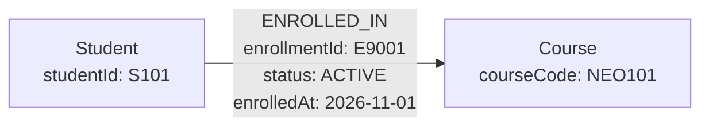

# Ràng buộc trên quan hệ theo phiên bản và edition

## 1. Vì sao relationship cũng cần ràng buộc dữ liệu?

Neo4j sử dụng mô hình **property graph**, trong đó **node** biểu diễn thực thể, còn **relationship** diễn tả cách các thực thể liên kết với nhau. Một relationship có **loại (type)**, **hướng**, **node đầu**, **node cuối** và có thể có **property** riêng. Chẳng hạn, hệ thống học tập lưu việc sinh viên đăng ký khóa học bằng relationship `:ENROLLED_IN`:



Nếu dữ liệu thiếu `enrollmentId`, có thể khó xác định một lần đăng ký cụ thể để cập nhật hay đồng bộ. Nếu hai relationship dùng trùng `enrollmentId`, một truy vấn tìm theo ID có thể trả về nhiều kết quả. Nếu `attempt` lúc là số nguyên, lúc là chuỗi, các báo cáo về số lần học lại có thể gặp lỗi kiểu. **Relationship constraints** được thiết kế để bảo vệ những bất biến về **property của quan hệ** ngay tại cơ sở dữ liệu.

Chủ đề này thuộc chương **Ràng buộc dữ liệu** trong mô-đun Neo4j. Người học cần hiểu không chỉ các lệnh Cypher như `CREATE CONSTRAINT` và `SHOW CONSTRAINTS`, mà còn phải biết **loại constraint nào có ở phiên bản/edition đang chạy**. Điều này đặc biệt quan trọng khi xây dựng service Java Driver, Spring Data Neo4j, tác vụ nhập dữ liệu hoặc hệ thống có nhiều bên cùng ghi vào đồ thị.

Sau bài này, bạn có thể:

- Phân biệt **tính toàn vẹn cấu trúc relationship** với các ràng buộc **property** và quy tắc **nghiệp vụ**.
- Tạo relationship property **existence**, **uniqueness**, **key** và **type** constraint khi được hỗ trợ.
- Nhận biết các khác biệt chính giữa Neo4j 4.4, Neo4j 5.x và khả năng mở rộng schema bằng **Graph Types** ở các bản mới.
- Hiểu vì sao key/uniqueness của relationship không tự cấm tạo nhiều cạnh giữa hai node.
- Khảo sát dữ liệu vi phạm, triển khai migration, kiểm tra schema và xử lý lỗi ở Java/Spring.

## 2. Relationship được Neo4j bảo vệ sẵn ở mức nào?

Neo4j bảo đảm một relationship được lưu phải nối **hai node tồn tại**. Bạn không thể tạo một relationship “mồ côi” hoàn toàn không có node đầu/cuối. Khi xóa node đang có relationship, `DELETE` thông thường bị từ chối; `DETACH DELETE` xóa cả các relationship liên kết theo semantics của lệnh.

Tuy nhiên, những điều sau là **quy tắc nghiệp vụ** cần được định nghĩa rõ:

- Relationship `ENROLLED_IN` phải nối từ `Student` đến `Course`.
- Mỗi sinh viên chỉ được có **một** lần ghi danh cho một khóa học trong mỗi học kỳ.
- Relationship `ENROLLED_IN` phải có `enrollmentId`, `enrolledAt` và `status`.
- Giá trị `status` chỉ thuộc tập `ACTIVE`, `CANCELLED` hoặc `COMPLETED`.
- Quan hệ phụ thuộc `DEPENDS_ON` không được tạo chu trình.

Các constraint thuộc tính truyền thống với cú pháp `CREATE CONSTRAINT ... FOR ()-[r:TYPE]-() REQUIRE ...` chỉ kiểm soát thuộc tính của **mọi relationship có type được khai báo**. Chúng **không tự ép** nhãn node đầu/cuối, giới hạn số relationship giữa hai node, kiểm tra tập giá trị enum hay phát hiện chu trình. Trong các bản Neo4j mới có **Graph Types** dành cho Cypher 25, có thêm khả năng ràng buộc nhãn node đầu/cuối; phần này sẽ được phân biệt ở mục 9.

| Lớp bảo vệ | Ví dụ | Bảo đảm đến từ đâu? |
| --- | --- | --- |
| Cấu trúc lưu trữ | Relationship có hai node đầu/cuối còn tồn tại. | Mô hình dữ liệu Neo4j. |
| Thuộc tính của relationship | `enrollmentId` duy nhất, `enrolledAt` bắt buộc. | Schema constraint phù hợp phiên bản/edition. |
| Kiểu property | `attempt` phải là `INTEGER`. | Property type constraint nếu được hỗ trợ. |
| Nhãn node đầu/cuối | `ENROLLED_IN` phải từ `Student` đến `Course`. | Kiểm tra truy vấn/ứng dụng; hoặc Graph Types trên bản hỗ trợ. |
| Quy tắc liên quan nhiều node/cạnh | Không đăng ký trùng một khóa/học kỳ, không tạo chu trình. | Thiết kế khóa/mô hình, transaction, kiểm tra nghiệp vụ; không được bảo đảm chỉ bằng constraint property. |

## 3. Ma trận phiên bản và edition cần biết

**Đừng suy luận khả năng của database từ cú pháp tìm thấy trên Internet hoặc phiên bản Java Driver.** Khả năng constraint do **Neo4j DBMS**, Cypher version và edition/gói triển khai quyết định.

### 3.1. Những mốc đáng nhớ

| Loại constraint trên relationship | Neo4j 4.4 | Neo4j 5.x | Edition đáng lưu ý |
| --- | --- | --- | --- |
| **Property existence** | Đã có trong Enterprise, dùng cú pháp schema của thế hệ 4.x. | Có, với cú pháp `REQUIRE r.prop IS NOT NULL`. | **Enterprise**. |
| **Property uniqueness** | Chưa có loại relationship uniqueness theo cú pháp 5.7. | **Từ 5.7**, dùng `REQUIRE r.prop IS UNIQUE`. | **Community và Enterprise** trên phiên bản hỗ trợ. |
| **Relationship key** | Chưa có loại relationship key theo cú pháp 5.7. | **Từ 5.7**, dùng `REQUIRE r.prop IS RELATIONSHIP KEY`. | **Enterprise**. |
| **Property type** | Chưa có type constraint theo cơ chế 5.9. | **Từ 5.9**, dùng `REQUIRE r.prop IS :: TYPE`. | **Enterprise**. |

Các mốc trên nói về **dòng Neo4j 5.x**. Với Neo4j mang tên phiên bản theo năm (ví dụ dòng 2025/2026), hãy đọc đúng tài liệu phát hành tương ứng. Một tính năng được giới thiệu trong một bản không có nghĩa mọi bản cũ hơn đều hiểu cú pháp đó.

### 3.2. Kiểm tra bản Neo4j đang chạy

```cypher
CALL dbms.components()
YIELD name, versions, edition
RETURN name, versions, edition;
```

Sau đó kiểm tra schema hiện có:

```cypher
SHOW CONSTRAINTS;
```

Nếu sử dụng môi trường Neo4j Aura, cần kiểm tra thêm khả năng của **gói dịch vụ thực tế**. Không nên giả định mọi dịch vụ quản lý có đầy đủ tính năng của Enterprise self-managed.

### 3.3. Quy tắc chọn giải pháp theo edition

- **Neo4j 5.7+ Community:** có thể dùng relationship property uniqueness; **không** thay thế được property existence/key/type khi các loại đó không được edition hỗ trợ.
- **Neo4j 5.7–5.8 Enterprise:** có thể dùng uniqueness, existence và relationship key; **chưa** dùng property type constraint được giới thiệu từ 5.9.
- **Neo4j 5.9+ Enterprise:** có thể kết hợp bốn loại constraint trên, tùy các kiểu property được phiên bản cụ thể hỗ trợ.
- **Neo4j cũ hơn 5.7:** có thể cần đổi thiết kế hoặc nâng cấp để sử dụng relationship uniqueness/key; cú pháp và edition phải kiểm tra theo tài liệu của bản đang chạy.

Ví dụ Cypher sau đây sử dụng **cú pháp Neo4j 5.x**, và mỗi đoạn minh họa một bất biến riêng. Không nhất thiết chạy mọi constraint lên cùng schema nếu chúng chồng lấp hoặc mâu thuẫn yêu cầu nghiệp vụ.

## 4. Relationship property existence: thuộc tính bắt buộc

Nếu mỗi lần ghi danh bắt buộc có thời điểm `enrolledAt`, trên bản hỗ trợ ta tạo:

```cypher
CREATE CONSTRAINT enrolled_at_required IF NOT EXISTS
FOR ()-[r:ENROLLED_IN]-()
REQUIRE r.enrolledAt IS NOT NULL;
```

Ý nghĩa từng phần:

- `FOR ()-[r:ENROLLED_IN]-()` chọn **mọi relationship có type `ENROLLED_IN`**. Cú pháp schema không phân biệt hướng mũi tên.
- `REQUIRE r.enrolledAt IS NOT NULL` yêu cầu thuộc tính `enrolledAt` phải hiện diện với giá trị khác `null`.
- `IF NOT EXISTS` hỗ trợ migration lặp lại, nhưng không mở khóa tính năng ngoài edition và không sửa dữ liệu cũ.

Sau khi tạo constraint thành công, ví dụ sau **hợp lệ** nếu đã có sinh viên và khóa học tương ứng:

```cypher
MATCH (s:Student {studentId: 'S101'})
MATCH (c:Course {courseCode: 'NEO101'})
CREATE (s)-[r:ENROLLED_IN {
    enrollmentId: 'E9001',
    enrolledAt: datetime(),
    status: 'ACTIVE'
}]->(c)
RETURN r.enrolledAt AS enrolledAt;
```

Trái lại, trường hợp cố tình **thiếu `enrolledAt`** sẽ bị từ chối:

```cypher
// Ví dụ VI PHẠM để chạy riêng trong database thử nghiệm.
MATCH (s:Student {studentId: 'S101'})
MATCH (c:Course {courseCode: 'NEO101'})
CREATE (s)-[:ENROLLED_IN {
    enrollmentId: 'E9002',
    status: 'ACTIVE'
}]->(c);
```

Một relationship đang có cũng không được phép mất property bắt buộc:

```cypher
// Ví dụ VI PHẠM, không thực hiện trên dữ liệu sản xuất.
MATCH ()-[r:ENROLLED_IN {enrollmentId: 'E9001'}]->()
REMOVE r.enrolledAt;
```

`SET r.enrolledAt = null` cũng có ý nghĩa xóa property và gây vi phạm. Nếu dùng `SET r = $properties` để thay toàn bộ thuộc tính, phải bảo đảm bộ thuộc tính mới vẫn chứa `enrolledAt`.

### `null`, chuỗi rỗng và dữ liệu giả

Trong Neo4j, gán một property bằng `null` sẽ bỏ property đó. Existence constraint cấm trạng thái thiếu thuộc tính, nhưng một chuỗi rỗng `''` vẫn được coi là một giá trị **đã tồn tại**. Với dữ liệu kiểu thời gian, không nên gán giá trị hiện tại cho mọi bản ghi cũ thiếu thời điểm chỉ để “qua migration” nếu nó làm sai lịch sử. Tính hợp lệ theo nghiệp vụ phải được xử lý riêng.

## 5. Relationship property uniqueness: giá trị không trùng

Nếu `enrollmentId` là mã duy nhất của từng lượt đăng ký, trên Neo4j 5.7+ có thể tạo:

```cypher
CREATE CONSTRAINT enrollment_id_unique IF NOT EXISTS
FOR ()-[r:ENROLLED_IN]-()
REQUIRE r.enrollmentId IS UNIQUE;
```

Với constraint này, hai relationship `ENROLLED_IN` **không được có cùng giá trị `enrollmentId` khi property hiện diện**. Tính duy nhất có phạm vi **toàn bộ relationship type**, không chỉ các relationship từ một sinh viên hay đến một khóa học cụ thể.

```cypher
// Giả sử relationship ENROLLED_IN có enrollmentId E9001 đã tồn tại.
// Lần tạo tiếp theo với cùng ID sẽ bị từ chối.
MATCH (s:Student {studentId: 'S102'})
MATCH (c:Course {courseCode: 'NEO101'})
CREATE (s)-[:ENROLLED_IN {enrollmentId: 'E9001'}]->(c);
```

Nhưng **uniqueness không buộc property phải tồn tại**. Nếu chỉ dùng `IS UNIQUE`, có thể tạo nhiều `ENROLLED_IN` **không có `enrollmentId`**, vì các relationship thiếu property không nằm trong phép kiểm tra trùng ID.

### 5.1. Uniqueness trên nhiều thuộc tính

Nếu hệ thống đa tenant cho phép mỗi tenant có dãy `enrollmentId` riêng, thì danh tính có thể là cặp `(tenantId, enrollmentId)`:

```cypher
CREATE CONSTRAINT enrollment_tenant_id_unique IF NOT EXISTS
FOR ()-[r:ENROLLED_IN]-()
REQUIRE (r.tenantId, r.enrollmentId) IS UNIQUE;
```

| Relationship mới | Với constraint tổng hợp `(tenantId, enrollmentId)` |
| --- | --- |
| `{tenantId:'T1', enrollmentId:'E001'}` | Hợp lệ nếu chưa có cặp này. |
| `{tenantId:'T2', enrollmentId:'E001'}` | Hợp lệ nếu chưa có cặp này; khác tenant. |
| Thêm một `{tenantId:'T1', enrollmentId:'E001'}` khác | Bị từ chối vì trùng **cả hai** giá trị. |
| `{tenantId:'T1'}` | Không bị cấm bởi **uniqueness đơn thuần** vì thiếu một thành phần. |

Tính duy nhất của **bộ giá trị** không có nghĩa từng property phải duy nhất riêng. Nếu nghiệp vụ yêu cầu cả hai property bắt buộc có mặt, cân nhắc relationship key trên edition hỗ trợ.

## 6. Relationship key: hiện diện và duy nhất trong một quy tắc

**Relationship key** kết hợp hai điều kiện: mọi relationship thuộc type xác định phải có property khóa, và bộ giá trị khóa phải duy nhất. Ví dụ trên Neo4j 5.7+ Enterprise:

```cypher
CREATE CONSTRAINT enrollment_id_key IF NOT EXISTS
FOR ()-[r:ENROLLED_IN]-()
REQUIRE r.enrollmentId IS RELATIONSHIP KEY;
```

Khác với `IS UNIQUE`, key sẽ từ chối relationship **thiếu `enrollmentId`**. Key còn từ chối một relationship có ID đã thuộc về relationship khác cùng type.

Đối với danh tính đa tenant:

```cypher
CREATE CONSTRAINT enrollment_tenant_key IF NOT EXISTS
FOR ()-[r:ENROLLED_IN]-()
REQUIRE (r.tenantId, r.enrollmentId) IS RELATIONSHIP KEY;
```

Trong trường hợp này, mọi `ENROLLED_IN` phải có cả `tenantId` **và** `enrollmentId`; không cặp giá trị nào được lặp lại. Hai tenant có thể dùng cùng mã `E001` nếu toàn bộ cặp khóa khác nhau.

**Lưu ý khi chọn phương án:** nếu nghiệp vụ cho phép `T1/E001` và `T2/E001`, một relationship key đơn trên `enrollmentId` sẽ nghiêm ngặt quá mức. Ngược lại, nếu ID phải duy nhất toàn hệ thống thì key tổng hợp có thể bỏ lọt hai relationship cùng `enrollmentId` ở hai tenant. Chọn khóa theo quy tắc định danh trước khi tạo schema.

### 6.1. Key không kiểm soát cặp node đầu/cuối

Giả sử đã có:

```text
(Student S101)-[:ENROLLED_IN {enrollmentId:'E001'}]->(Course NEO101)
(Student S101)-[:ENROLLED_IN {enrollmentId:'E002'}]->(Course NEO101)
```

Hai relationship trên có ID khác nhau, nên **không vi phạm relationship key trên `enrollmentId`**, dù cùng nối một cặp node. Nếu yêu cầu mỗi sinh viên chỉ đăng ký một lần vào mỗi khóa, cần một cơ chế định danh theo cặp sinh viên–khóa học, hoặc theo cặp và học kỳ. Có thể mô hình hóa lượt đăng ký thành **node `:Enrollment`** và đặt node key tổng hợp, đồng thời tạo các relationship liên quan trong transaction.


Với mô hình node `Enrollment`, danh tính của một lần ghi danh có thể là `(studentId, courseCode, term)`. Nhưng node key này **vẫn không tự kiểm chứng** property bên trong node `Enrollment` khớp với hai node đích của relationship; cần bảo đảm bằng logic ghi/Graph Types hỗ trợ hoặc kiểm tra dữ liệu phù hợp.

## 7. Relationship property type constraint: nhất quán kiểu dữ liệu

Nếu relationship `ENROLLED_IN` có `attempt` là số nguyên và `status` là chuỗi, trên Neo4j 5.9+ Enterprise có thể tạo:

```cypher
CREATE CONSTRAINT enrollment_attempt_integer IF NOT EXISTS
FOR ()-[r:ENROLLED_IN]-()
REQUIRE r.attempt IS :: INTEGER;

CREATE CONSTRAINT enrollment_status_string IF NOT EXISTS
FOR ()-[r:ENROLLED_IN]-()
REQUIRE r.status IS :: STRING;
```

Nếu `enrolledAt` được lưu bằng `datetime()` và môi trường hỗ trợ kiểu này:

```cypher
CREATE CONSTRAINT enrollment_time_datetime IF NOT EXISTS
FOR ()-[r:ENROLLED_IN]-()
REQUIRE r.enrolledAt IS :: ZONED DATETIME;
```

Các constraint kiểu trên kiểm tra **kiểu của property khi nó hiện diện**. Chúng không tự buộc relationship phải có `attempt`, `status` hoặc `enrolledAt`; yêu cầu tồn tại phải được biểu diễn riêng nếu cần.

| Giá trị `attempt` | Với type constraint `IS :: INTEGER` | Giải thích |
| --- | --- | --- |
| `1` | Hợp lệ. | Số nguyên. |
| `0` | Hợp lệ về kiểu. | Miền giá trị có thể cấm 0 nhưng type constraint không biết. |
| `-1` | Hợp lệ về kiểu. | Số âm vẫn là số nguyên. |
| `'1'` | Bị từ chối. | Đây là chuỗi. |
| `1.0` | Bị từ chối nếu lưu là `FLOAT`. | Kiểu thực không phải `INTEGER`. |
| Thiếu `attempt` | Không bị type constraint **đơn thuần** từ chối. | Property chưa hiện diện để kiểm tra kiểu. |

**Type constraint không phải enum constraint.** `status IS :: STRING` vẫn chấp nhận `'WHATEVER'`, dù nghiệp vụ chỉ cho `ACTIVE`, `CANCELLED`, `COMPLETED`. Kiểm tra tập giá trị phải được thiết kế thêm ở ứng dụng hoặc một cơ chế schema khác thực sự hỗ trợ yêu cầu đó.

Trong Java Driver, việc gửi `"2"` (String) thay vì `2` (Integer/Long) là khác nhau; database không tự chuyển chuỗi sang số nguyên chỉ vì constraint yêu cầu kiểu `INTEGER`.

## 8. Những gì constraint truyền thống không bảo đảm

Các ví dụ trên sử dụng **constraint thuộc tính truyền thống** của Cypher 5.x. Chúng không tương đương với quy tắc toàn vẹn của toàn bộ sơ đồ liên kết.

| Quy tắc cần bảo đảm | Existence/uniqueness/key/type trên relationship có đủ không? | Giải pháp cần cân nhắc |
| --- | --- | --- |
| Mọi `ENROLLED_IN` đều có `enrollmentId` | Có, với existence hoặc relationship key. | Dùng constraint khi edition hỗ trợ. |
| `enrollmentId` không trùng trong cùng relationship type | Có, với uniqueness hoặc key. | Chọn đúng phạm vi global/tenant. |
| `attempt` luôn là số nguyên | Có, với property type nếu hỗ trợ. | Bổ sung kiểm tra miền giá trị. |
| `ENROLLED_IN` nối đúng `Student` → `Course` | **Không** chỉ bằng các constraint thuộc tính `CREATE CONSTRAINT`. | Cypher ghi đúng đầu mút; hoặc Graph Types có endpoint label constraints ở bản hỗ trợ. |
| Một sinh viên chỉ có một `ENROLLED_IN` đến một khóa học trong học kỳ | **Không** nếu chỉ khóa `enrollmentId`. | Định danh ổn định theo cặp/học kỳ, node `Enrollment` hoặc transaction phù hợp. |
| Relationship không tạo chu trình trong đồ thị phụ thuộc | **Không**. | Truy vấn kiểm tra đường đi và quy tắc nghiệp vụ trong transaction thích hợp. |
| Relationship phải nối giữa hai node có quyền nghiệp vụ hợp lệ | **Không**. | Validation, phân quyền và kiểm tra trạng thái hai đầu mút. |

Khi gặp quy tắc liên quan **nhiều node, nhiều cạnh, đường đi hoặc điều kiện miền giá trị**, cần phân tích lại mô hình; không nên cố gán mọi vấn đề cho `enrollmentId` duy nhất.

## 9. Điểm mới: Graph Types trong Neo4j 2026.02+ và Cypher 25

Tài liệu Neo4j phiên bản mới giới thiệu **Graph Types**: cách định nghĩa schema của một đồ thị rộng hơn các constraint thuộc tính riêng lẻ. Theo tài liệu chính thức, tính năng này được giới thiệu từ **Neo4j 2026.02**, yêu cầu **Cypher 25** và **Enterprise Edition**.

Một **relationship element type** trong Graph Types có thể khai báo **nhãn node nguồn/đích** và loại relationship, ví dụ ý tưởng `(:Student)-[:ENROLLED_IN]->(:Course)`. Schema đó có khả năng tạo **relationship source/target label constraints**, điều mà các lệnh `CREATE CONSTRAINT ... REQUIRE r.property ...` truyền thống **không tạo được**.

Đây là khác biệt thiết yếu khi trả lời câu hỏi “Neo4j có ép được relationship nối đúng nhãn hai đầu không?”:

- **Với Cypher 5 và những constraint property truyền thống:** không có cú pháp `CREATE CONSTRAINT` tương đương khóa ngoại theo nhãn hai đầu; phải kiểm soát ở tầng ghi hoặc chọn cách mô hình hóa khác.
- **Với bản có Graph Types trên Cypher 25 Enterprise:** có thể khai báo relationship element type với nhãn đầu/cuối, nếu mô hình và phiên bản thực tế hỗ trợ.

**Cảnh báo vận hành:** lệnh `ALTER CURRENT GRAPH TYPE SET` dùng để thiết lập Graph Type có thể **thay thế toàn bộ Graph Type/constraint đã định nghĩa trước**. Đây là thao tác thay đổi schema ở phạm vi lớn; không lấy một đoạn ví dụ rồi chạy trên cơ sở dữ liệu đang có. Cần thiết kế **đầy đủ schema mong muốn**, kiểm tra phiên bản, dữ liệu đang có, chuẩn bị migration và đánh giá tác động trước khi áp dụng.

Graph Types giúp kiểm soát thêm cấu trúc đầu mút nhưng **không tự đồng nghĩa với mọi quy tắc về cardinality hay không có chu trình**. Bất biến “một người chỉ có một đăng ký cho một khóa học mỗi học kỳ” vẫn cần thiết kế và kiểm chứng theo cách phù hợp.

Đối với bài học tập trung relationship property constraints, các ví dụ thực hành tiếp tục dùng `CREATE CONSTRAINT` kiểu Neo4j 5.x để dễ so sánh version/edition.

## 10. Khảo sát dữ liệu trước khi tạo relationship constraint

Khi tạo constraint, Neo4j phải kiểm tra **dữ liệu đã tồn tại**. Nếu có relationship vi phạm (thiếu property bắt buộc, trùng khóa, sai kiểu), thao tác tạo constraint có thể thất bại. Database **không tự bổ sung property hay sửa dữ liệu**.

### 10.1. Tìm relationship thiếu thuộc tính bắt buộc

```cypher
MATCH ()-[r:ENROLLED_IN]->()
WHERE r.enrollmentId IS NULL
RETURN elementId(r) AS relationshipElementId,
       properties(r) AS currentProperties
LIMIT 50;
```

Tìm những relationship thiếu thời điểm đăng ký:

```cypher
MATCH ()-[r:ENROLLED_IN]->()
WHERE r.enrolledAt IS NULL
RETURN elementId(r) AS relationshipElementId,
       startNode(r).studentId AS studentId,
       endNode(r).courseCode AS courseCode
LIMIT 50;
```

`elementId(r)` phù hợp để **chẩn đoán**; không nên lưu nó như mã nghiệp vụ bền vững ở hệ thống ngoài. Việc lấy `studentId` và `courseCode` từ hai đầu mút chỉ minh họa trường hợp kết nối đúng kiểu; nếu dữ liệu có quan hệ nối sai nhãn, các cột đó có thể trả về `null`.

### 10.2. Tìm ID trùng

```cypher
MATCH ()-[r:ENROLLED_IN]->()
WHERE r.enrollmentId IS NOT NULL
WITH r.enrollmentId AS enrollmentId,
     count(*) AS total,
     collect(elementId(r)) AS relationshipIds
WHERE total > 1
RETURN enrollmentId, total, relationshipIds
ORDER BY total DESC
LIMIT 50;
```

Với uniqueness/key tổng hợp, phải nhóm theo **toàn bộ bộ khóa** thay vì chỉ một property:

```cypher
MATCH ()-[r:ENROLLED_IN]->()
WHERE r.tenantId IS NOT NULL
  AND r.enrollmentId IS NOT NULL
WITH r.tenantId AS tenantId,
     r.enrollmentId AS enrollmentId,
     count(*) AS total
WHERE total > 1
RETURN tenantId, enrollmentId, total
ORDER BY total DESC
LIMIT 50;
```

Với hệ thống lớn, việc `collect(elementId(r))` cho mọi nhóm có thể ngốn bộ nhớ; có thể lấy thống kê trước, sau đó chỉ truy xuất chi tiết các nhóm thực sự cần xử lý.

### 10.3. Tìm property sai kiểu

Trên bản Neo4j hỗ trợ type predicate tương ứng, có thể kiểm tra `attempt`:

```cypher
MATCH ()-[r:ENROLLED_IN]->()
WHERE r.attempt IS NOT NULL
  AND NOT (r.attempt IS :: INTEGER)
RETURN elementId(r) AS relationshipElementId,
       r.attempt AS invalidAttempt
LIMIT 50;
```

Nếu DBMS không hiểu `IS :: INTEGER`, hãy dùng cách kiểm tra dữ liệu phù hợp phiên bản hoặc qua công cụ nhập/xuất. Không coi lỗi cú pháp từ một phiên bản cũ là bằng chứng dữ liệu đúng hoặc sai.

### 10.4. Phân loại và sửa vi phạm

Trước khi đặt constraint:

1. Xác định danh tính **thực sự** của mỗi lần ghi danh, kể cả trường hợp được đăng ký lại.
2. Với relationship thiếu ID, tìm nguồn phát sinh bản ghi và quy tắc cấp ID hợp lệ.
3. Với relationship trùng ID, xác định đâu là sự kiện đúng, lịch sử nào cần giữ và dữ liệu liên kết nào có thể bị ảnh hưởng.
4. Với giá trị sai kiểu, chuyển đổi có kiểm chứng; không tự biến mọi chuỗi không hợp lệ thành `0`.
5. Sửa pipeline Java/CSV import đang tạo dữ liệu sai **trước** khi khóa schema để tránh lỗi tái diễn.

Đừng xóa hàng loạt relationship chỉ để câu lệnh `CREATE CONSTRAINT` chạy qua: xóa một relationship có thể làm mất lịch sử và thay đổi các kết quả truy vấn đường đi.

## 11. Tạo schema và kiểm tra sau migration

Một quy trình triển khai an toàn:

1. Kiểm tra DBMS version, edition và quyền quản trị schema.
2. Định nghĩa quy tắc: property nào bắt buộc, duy nhất, đúng kiểu; có yêu cầu theo tenant không?
3. Khảo sát và xử lý dữ liệu vi phạm bằng các truy vấn ở mục 10.
4. Chọn **một bộ constraint phù hợp** với quy tắc và edition; ví dụ relationship key có thể thay cho việc diễn đạt riêng uniqueness + existence trên cùng khóa.
5. Chạy migration có kiểm soát; việc tạo constraint trên dữ liệu lớn có thể cần quét dữ liệu và tiêu tốn thời gian/tài nguyên.
6. Đọc lại schema, thử các tình huống ghi hợp lệ/vi phạm và theo dõi lỗi ứng dụng.

Kiểm tra chi tiết constraint ở các bản hỗ trợ các cột sau:

```cypher
SHOW CONSTRAINTS
YIELD name, type, entityType, labelsOrTypes, properties
RETURN name, type, entityType, labelsOrTypes, properties
ORDER BY name;
```

Cần xác nhận `entityType` là relationship, `labelsOrTypes` chứa `ENROLLED_IN`, đúng `type` và `properties`. Nếu dùng `IF NOT EXISTS` mà không kiểm tra lại, migration có thể bỏ qua một constraint đã tồn tại nhưng **không đúng kỳ vọng của ứng dụng**.

Uniqueness và key constraints được hỗ trợ bằng **range index** đi kèm, có thể giúp tìm kiếm theo khóa. Khi xóa constraint, backing index cũng bị xóa; nếu chỉ muốn tối ưu truy vấn, range index thông thường không thay thế quy tắc duy nhất.

```cypher
// Chỉ chạy sau khi xác định tác động đối với schema thực tế.
DROP CONSTRAINT enrollment_id_unique IF EXISTS;
```

Không nên xóa constraint ở môi trường đang hoạt động để “tạm cho ghi dữ liệu trùng”; điều đó có thể tạo các vi phạm khiến việc tái lập constraint thất bại.

## 12. Ghi relationship đúng từ Java Driver và Spring Data Neo4j

### 12.1. Java Driver: validation, transaction và phản hồi lỗi

Ví dụ minh họa Java Driver 5.x, giả định database có `Student` và `Course` với mã duy nhất, và có relationship key trên `ENROLLED_IN(enrollmentId)`:

```java
import org.neo4j.driver.Driver;
import org.neo4j.driver.Session;
import java.util.Map;

public class EnrollmentRepository {
    private final Driver driver;

    public EnrollmentRepository(Driver driver) {
        this.driver = driver;
    }

    public String enroll(
            String studentId,
            String courseCode,
            String enrollmentId) {

        if (studentId == null || studentId.isBlank()
                || courseCode == null || courseCode.isBlank()
                || enrollmentId == null || enrollmentId.isBlank()) {
            throw new IllegalArgumentException("Thiếu định danh ghi danh");
        }

        String cypher = """
            MATCH (s:Student {studentId: $studentId})
            MATCH (c:Course {courseCode: $courseCode})
            CREATE (s)-[r:ENROLLED_IN {
                enrollmentId: $enrollmentId,
                enrolledAt: datetime(),
                status: 'ACTIVE',
                attempt: 1
            }]->(c)
            RETURN r.enrollmentId AS enrollmentId
            """;

        try (Session session = driver.session()) {
            return session.executeWrite(tx -> tx.run(cypher, Map.of(
                    "studentId", studentId,
                    "courseCode", courseCode,
                    "enrollmentId", enrollmentId
            )).single().get("enrollmentId").asString());
        }
    }
}
```

Lệnh `MATCH` giúp relationship chỉ được tạo khi **cả sinh viên và khóa học tồn tại**. Nếu thiếu một đầu mút, kết quả không có dòng và `single()` sẽ báo lỗi; application service cần chuyển lỗi này thành phản hồi “không tìm thấy đối tượng”. Nếu `enrollmentId` đã tồn tại, key/uniqueness constraint tương ứng sẽ chặn lần ghi mới.

Lưu ý: ví dụ này chưa giới hạn sinh viên ghi danh **một lần theo từng khóa học**. Mỗi request gửi `enrollmentId` khác nhau vẫn có thể tạo relationship mới giữa cùng hai node. Quy tắc đó phải được thiết kế riêng theo danh tính nghiệp vụ.

Ở tầng dịch vụ Java, cần phân biệt các loại lỗi:

- Input thiếu hoặc sai định dạng: báo sớm bằng validation trước khi chạy truy vấn.
- `MATCH` không tìm thấy node: trả về kết quả “không tìm thấy” phù hợp.
- Vi phạm constraint: nhận diện lỗi database và báo xung đột dữ liệu hoặc đầu vào không hợp lệ; không báo thành công.
- Transient error khi ghi đồng thời: áp dụng chính sách retry theo loại lỗi và khả năng idempotent của nghiệp vụ.

Thao tác gồm nhiều bước liên quan cần đi trong transaction phù hợp để khi một bước bị từ chối bởi constraint, dữ liệu liên quan không bị commit dở dang.

### 12.2. Spring Data Neo4j không tự thay thế constraint

Trong Spring Data Neo4j, các annotation như `@Node`, `@Relationship`, `@Id`, `@Property` mô tả cách ánh xạ dữ liệu. Các quy tắc validation ở Java như `@NotNull`, `@NotBlank` hoặc kiểm tra enum chỉ có hiệu lực khi được kích hoạt trong luồng ứng dụng. **Chúng không đồng nghĩa với việc Neo4j đã tạo relationship key, existence hay type constraint.**

Đối với quy trình ghi quan hệ, service nên xác định chính xác node đầu/cuối, chỉ ghi relationship sau khi xác minh điều kiện nghiệp vụ và dùng transaction để đồng bộ các thay đổi liên quan. Constraint ở database là bảo vệ bổ sung cho mọi đường ghi, gồm cả script Cypher, nhập CSV và job đồng bộ không đi qua service Java đó.

## 13. Khi môi trường không hỗ trợ constraint cần thiết

Ví dụ một hệ thống đang chạy Neo4j Community bản không hỗ trợ relationship key/existence/type:

- Nếu từ **Neo4j 5.7**, có thể dùng relationship **uniqueness** để cấm giá trị trùng, nhưng relationship vẫn có thể thiếu property.
- Nếu cần property bắt buộc, hãy validate trong API/service, chuẩn hóa pipeline import, giám sát định kỳ các quan hệ thiếu property và hạn chế đường ghi trực tiếp.
- Nếu cần kiểm tra kiểu, parse đúng kiểu trước khi gửi đến DBMS và đặt các kiểm tra chất lượng dữ liệu tại ranh giới service/import.
- Nếu quan hệ phải có danh tính bắt buộc ở **tầng database** với nhiều nguồn ghi, hãy đánh giá edition/dịch vụ hỗ trợ hoặc thay đổi mô hình cùng kiến trúc ghi cho phù hợp.

Không nên diễn giải các giải pháp kiểm tra ở ứng dụng là bảo đảm tương đương database constraint khi có nhiều tác nhân có quyền ghi.

## 14. Bài thực hành: dự đoán constraint trên relationship

Giả sử database thử nghiệm **Neo4j 5.9+ Enterprise** có schema:

```cypher
CREATE CONSTRAINT enrollment_identity IF NOT EXISTS
FOR ()-[r:ENROLLED_IN]-()
REQUIRE r.enrollmentId IS RELATIONSHIP KEY;

CREATE CONSTRAINT enrollment_attempt_type IF NOT EXISTS
FOR ()-[r:ENROLLED_IN]-()
REQUIRE r.attempt IS :: INTEGER;
```

Hãy dự đoán kết quả khi tạo các relationship `ENROLLED_IN` độc lập:

| Trường hợp | Kết quả nếu chưa tồn tại ID đó |
| --- | --- |
| `{enrollmentId:'E001', attempt:1}` | Thành công. |
| Thêm relationship thứ hai có `enrollmentId:'E001'` | Bị từ chối bởi relationship key. |
| `{attempt:1}`, thiếu `enrollmentId` | Bị từ chối bởi relationship key. |
| `{enrollmentId:'E002', attempt:'1'}` | Bị từ chối bởi type constraint. |
| `{enrollmentId:'E003', attempt:-1}` | Thành công về hai constraint đang xét; miền giá trị có thể vẫn sai. |
| `{enrollmentId:'E004'}`, không có `attempt` | Thành công về hai constraint đang xét vì type không buộc property tồn tại. |
| Relationship loại `VIEWED` có ID `E001` | Không chịu constraint trên `ENROLLED_IN`. |
| Hai `ENROLLED_IN` cùng cặp node nhưng có `enrollmentId` khác nhau | Không vi phạm chỉ vì trùng cặp đầu mút. |

Trên bản **Neo4j 5.7+ Community**, thử chỉ dùng `IS UNIQUE` và giải thích vì sao các relationship không có `enrollmentId` không bị từ chối. Trên bản chưa hỗ trợ, chỉ khảo sát version/edition và dự đoán hành vi; không cần cố chạy DDL ngoài khả năng của DBMS.

## 15. Những hiểu lầm phổ biến

1. **“Đã có relationship thì dữ liệu quan hệ chắc chắn đúng nghiệp vụ.”** Neo4j bảo vệ đầu mút tồn tại, nhưng không tự biết nhãn/kiểu kết nối hợp lệ theo miền nghiệp vụ.
2. **“Uniqueness cũng làm property bắt buộc có.”** Sai: `IS UNIQUE` chỉ kiểm tra các giá trị hiện diện; key/existence mới giải quyết tính bắt buộc.
3. **“Relationship key cấm hai cạnh cùng nối một cặp node.”** Sai nếu hai cạnh có ID khác nhau.
4. **“Type constraint tự chuyển chuỗi thành số.”** Sai: database từ chối giá trị sai kiểu khi property hiện diện.
5. **“Constraint trên `ENROLLED_IN` cũng áp dụng cho `VIEWED`.”** Sai: phạm vi dựa trên loại relationship.
6. **“Mọi Neo4j 5.x đều dùng được relationship type constraint.”** Sai: property type constraint được giới thiệu từ 5.9 và yêu cầu edition hỗ trợ.
7. **“Mọi bản Neo4j đều không thể kiểm tra nhãn đầu/cuối bằng schema.”** Nhận định này đã không còn đúng với Graph Types trên Cypher 25/Neo4j mới hỗ trợ; cần phân biệt với constraint property truyền thống.
8. **“`IF NOT EXISTS` bảo đảm migration đúng.”** Nó không thay cho kiểm tra schema sau triển khai.

## 16. Tài liệu tham khảo chính thức

- [Neo4j 5 — Constraints: tổng quan](https://neo4j.com/docs/cypher-manual/5/constraints/).
- [Neo4j 5 — Cú pháp constraint theo version](https://neo4j.com/docs/cypher-manual/5/constraints/syntax/).
- [Neo4j 5 — Tạo property uniqueness, existence, type và key constraints](https://neo4j.com/docs/cypher-manual/5/constraints/create-constraints/).
- [Neo4j hiện hành — Khác biệt Community và Enterprise](https://neo4j.com/docs/cypher-manual/current/introduction/cypher-neo4j/).
- [Neo4j hiện hành — Graph Types và ràng buộc nhãn đầu/cuối relationship](https://neo4j.com/docs/cypher-manual/current/schema/graph-types/set-graph-types/).

## 17. Kết luận

Ràng buộc trên relationship là công cụ quan trọng để bảo vệ tính toàn vẹn dữ liệu liên kết: **existence** yêu cầu property có mặt; **uniqueness** ngăn giá trị trùng; **relationship key** kết hợp cả hai; **property type** bảo vệ kiểu dữ liệu được lưu. Phạm vi của chúng là **relationship type**, không tự bao quát mọi quy tắc về node đầu/cuối, cardinality hoặc đường đi của đồ thị.

Khi thiết kế Neo4j, cần bắt đầu từ bất biến nghiệp vụ, kiểm tra **version/edition**, lựa chọn constraint thích hợp, làm sạch dữ liệu trước migration và kiểm tra lại schema. Với các bản mới hỗ trợ **Graph Types**, cần đánh giá thêm khả năng ràng buộc cấu trúc đầu mút cùng những tác động khi thay đổi Graph Type. Kết hợp Cypher, transaction và validation tại Java Driver/Spring Data Neo4j sẽ giúp đồ thị vừa linh hoạt vừa đáng tin cậy trong vận hành.
