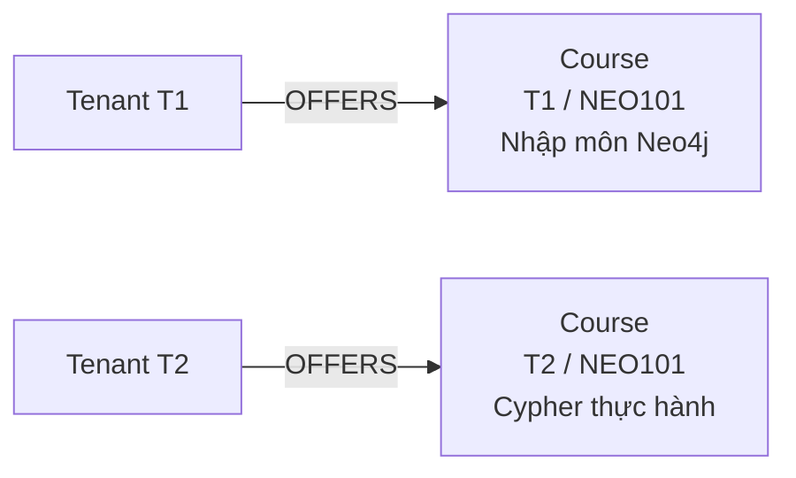
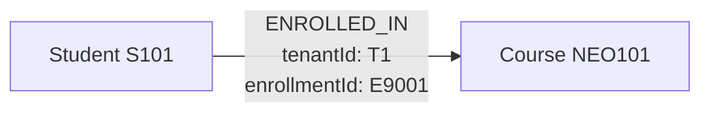
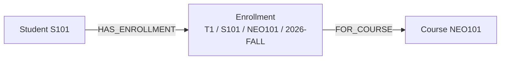

# Ràng buộc ghép nhiều thuộc tính và lựa chọn khóa phù hợp

## 1. Vì sao cần ràng buộc ghép?

Trong **property graph** của Neo4j, node đại diện cho thực thể, relationship thể hiện sự liên kết, còn property lưu dữ liệu mô tả hoặc định danh. Nhiều thực thể không thể được nhận diện chính xác bằng một thuộc tính riêng lẻ.

Ví dụ, một nền tảng học tập phục vụ nhiều tổ chức (**multi-tenant**) lưu node `:Course`. Tổ chức `T1` và `T2` đều có thể mở khóa học mang mã `NEO101`. Mã này **chỉ duy nhất trong phạm vi tổ chức**, không duy nhất toàn hệ thống:



Hai node `Course` đó có cùng `courseCode` nhưng **khác `tenantId`**, nên phải được phép cùng tồn tại. Ngược lại, hai node cùng `tenantId: 'T1'` và `courseCode: 'NEO101'` là trùng danh tính nghiệp vụ: việc truy vấn và tạo relationship đến khóa học có thể trở nên mơ hồ.

Một **ràng buộc duy nhất tổng hợp** (*composite uniqueness constraint*) xem **cả bộ giá trị** như một khóa. Một **node key tổng hợp** (*composite node key*) còn yêu cầu từng thành phần của bộ khóa phải hiện diện. Việc chọn giữa hai cơ chế phụ thuộc yêu cầu nghiệp vụ, phiên bản và edition của Neo4j.

Sau bài này, bạn sẽ có thể:

- Phân biệt duy nhất từng property với duy nhất **tổ hợp property**.
- Hiểu rõ sự khác nhau giữa composite uniqueness, composite node key, relationship key và composite index.
- Chọn khóa theo phạm vi global, tenant, kỳ học hoặc thực thể trung gian.
- Thiết kế truy vấn `MATCH`/`MERGE` dựa trên khóa ổn định và tránh lỗi trùng khi ghi đồng thời.
- Khảo sát dữ liệu cũ, chuẩn hóa khóa, triển khai constraint và kiểm tra kết quả.
- Tích hợp quy tắc định danh với Neo4j Java Driver và Spring Data Neo4j.

## 2. Tư duy về khóa: một thuộc tính hay một bộ thuộc tính?

Giả sử có ba khóa học:

| Node | `tenantId` | `courseCode` | Có trùng với node khác không? |
| --- | --- | --- | --- |
| A | `T1` | `NEO101` | Không trùng B hoặc C theo **cặp khóa** |
| B | `T2` | `NEO101` | Khác A về tenant |
| C | `T1` | `NEO102` | Khác A về mã khóa học |

Nếu áp dụng **uniqueness riêng cho `courseCode`**, A và B sẽ xung đột dù ở hai tenant khác nhau. Nếu áp dụng **uniqueness riêng cho `tenantId`**, A và C sẽ xung đột dù mỗi tenant đương nhiên có thể quản lý nhiều khóa học.

Ràng buộc đúng trong trường hợp này là tính duy nhất của **cặp `(tenantId, courseCode)`**.

```text
Khóa đơn:
    courseCode = NEO101
    -> không đủ để xác định một Course toàn hệ thống

Khóa ghép:
    (tenantId, courseCode) = (T1, NEO101)
    -> định danh một Course trong mô hình đã chọn
```

Điểm cần nhớ: **duy nhất theo cặp không đồng nghĩa mỗi thành phần phải duy nhất**. Tính duy nhất được kiểm tra trên **toàn bộ tuple** sau khi xác định phạm vi nhãn.

### Phạm vi nhãn luôn là một phần của thiết kế

Ràng buộc áp dụng cho các node mang nhãn khai báo, ví dụ `:Course`. Node `:LearningResource` có thể mang cùng một cặp giá trị mà không vi phạm constraint trên `:Course`, trừ khi chính node đó cũng có nhãn `Course`.

Với node mang nhiều nhãn, chỉ cần **một trong các nhãn** là `Course` thì constraint trên `Course` có hiệu lực. Việc bổ sung nhãn `Course` vào node đang có cũng có thể bị từ chối nếu khóa của nó trùng khóa học đã tồn tại.

## 3. Tạo composite uniqueness constraint bằng Cypher

Nếu khóa học được phép tạo ở trạng thái nháp chưa có đầy đủ mã, nhưng **khi đã có đủ mã thì cặp giá trị không được trùng**, có thể chọn composite uniqueness:

```cypher
CREATE CONSTRAINT course_tenant_code_unique IF NOT EXISTS
FOR (c:Course)
REQUIRE (c.tenantId, c.courseCode) IS UNIQUE;
```

Các thành phần:

- `CREATE CONSTRAINT course_tenant_code_unique`: đặt tên cho constraint để kiểm tra và quản lý.
- `IF NOT EXISTS`: hỗ trợ chạy lại migration khi đã có constraint phù hợp; không bảo đảm schema tồn tại đúng như dự kiến nếu chưa đọc lại.
- `FOR (c:Course)`: phạm vi là các node mang nhãn `Course`.
- `REQUIRE (c.tenantId, c.courseCode) IS UNIQUE`: cấm hai node có **cùng cả hai giá trị khi bộ property được cung cấp đầy đủ**.

Trên database thử nghiệm đã tạo constraint, xem những trường hợp độc lập:

```cypher
// Thành công nếu cặp khóa chưa tồn tại.
CREATE (:Course {
  tenantId: 'T1',
  courseCode: 'NEO101',
  title: 'Nhập môn Neo4j'
});

// Thành công: cùng mã nhưng khác tenant.
CREATE (:Course {
  tenantId: 'T2',
  courseCode: 'NEO101',
  title: 'Cypher thực hành'
});

// Thành công: cùng tenant nhưng khác mã.
CREATE (:Course {
  tenantId: 'T1',
  courseCode: 'NEO102',
  title: 'Tối ưu truy vấn'
});

// Bị từ chối: cặp (T1, NEO101) đã xuất hiện.
CREATE (:Course {
  tenantId: 'T1',
  courseCode: 'NEO101',
  title: 'Bản sao không hợp lệ'
});
```

Constraint cũng kiểm tra cập nhật. Nếu một node `Course` được đổi `courseCode` hoặc `tenantId` khiến bộ giá trị trùng với node khác, thao tác `SET` bị từ chối.

### 3.1. Quy tắc về `null` và thành phần còn thiếu

**Composite uniqueness không bắt buộc mọi thành phần khóa phải tồn tại.** Với **chỉ** constraint ở trên, các node sau không bị từ chối chỉ vì thiếu `courseCode`:

```cypher
CREATE (:Course {tenantId: 'T1', title: 'Bản nháp 1'});
CREATE (:Course {tenantId: 'T1', title: 'Bản nháp 2'});
```

Lý do: tính duy nhất tổng hợp chỉ kiểm tra những node có **đủ các property tham gia bộ khóa**. Nếu thiếu một thành phần, không có tuple đầy đủ để so sánh. Tương tự, nhiều node thiếu `tenantId` cũng có thể tồn tại dù đều có `courseCode: 'NEO101'`.

Trong Neo4j, property gán `null` tương đương không có property đó; không có chuyện giữ một giá trị `null` như thành phần khóa hợp lệ. Ngoài ra, chuỗi rỗng `''` **khác `null`**: nó có mặt và có thể được so sánh trong phép kiểm tra uniqueness. Nếu mã trống không hợp lệ theo nghiệp vụ, phải có kiểm tra bổ sung.

### 3.2. Uniqueness tổng hợp khác hai uniqueness riêng

Đừng thay constraint tổng hợp bằng hai constraint sau nếu muốn mỗi tenant có nhiều khóa học và các tenant được dùng chung mã:

```cypher
// KHÔNG phù hợp với khóa (tenantId, courseCode) được phép lặp từng thành phần.
CREATE CONSTRAINT tenant_unique IF NOT EXISTS
FOR (c:Course)
REQUIRE c.tenantId IS UNIQUE;

CREATE CONSTRAINT course_code_global_unique IF NOT EXISTS
FOR (c:Course)
REQUIRE c.courseCode IS UNIQUE;
```

Hai ràng buộc trên lần lượt cấm hai khóa học trong cùng tenant và cấm hai tenant dùng cùng mã. Chúng biểu diễn **hai bất biến khác hẳn** so với uniqueness trên tuple.

## 4. Khi mọi thành phần khóa đều bắt buộc: composite node key

Nếu quy tắc nghiệp vụ yêu cầu **mọi `:Course` đều có cả `tenantId` và `courseCode`, và mỗi cặp phải duy nhất**, thì **node key tổng hợp** diễn đạt đầy đủ hơn:

```cypher
CREATE CONSTRAINT course_tenant_code_key IF NOT EXISTS
FOR (c:Course)
REQUIRE (c.tenantId, c.courseCode) IS NODE KEY;
```

Node key bảo vệ **hai điều kiện cùng lúc**:

1. Cả `tenantId` và `courseCode` đều phải có giá trị khác `null`.
2. Bộ giá trị `(tenantId, courseCode)` không được lặp giữa các node mang nhãn `Course`.

| Dữ liệu thử tạo trên `:Course` | Composite uniqueness | Composite node key |
| --- | --- | --- |
| Cặp `T1/NEO101` mới | Chấp nhận | Chấp nhận |
| Cặp `T1/NEO101` đã có | Từ chối | Từ chối |
| `{tenantId:'T1'}`, thiếu `courseCode` | Chấp nhận về mặt uniqueness | **Từ chối** vì thiếu thành phần khóa |
| `{courseCode:'NEO101'}`, thiếu `tenantId` | Chấp nhận về mặt uniqueness | **Từ chối** vì thiếu thành phần khóa |
| Cặp `T2/NEO101` mới | Chấp nhận | Chấp nhận |
| `{tenantId:'T1', courseCode:''}` | Có thể chấp nhận nếu chưa trùng tuple | Có thể chấp nhận nếu chưa trùng tuple; cần kiểm tra mã rỗng riêng |

Với dòng **Neo4j 5.x**, node key cần **Enterprise Edition**. Composite uniqueness có thể được sử dụng trên Community Edition hỗ trợ loại constraint đó, nhưng **không tự bảo đảm tính bắt buộc**. Trên các phiên bản/edition có property existence constraint, một lựa chọn khác là kết hợp uniqueness và existence cho từng thành phần khóa. Nếu dùng node key, không nhất thiết tạo thêm các constraint có cùng ý nghĩa chỉ để mô tả lại cùng bất biến.

Các ví dụ `IS UNIQUE` và `IS NODE KEY` trong hai mục trên là **phương án thiết kế thay thế** cho cùng bộ property. Khi thực hành, hãy chọn một phương án tương ứng với yêu cầu, dữ liệu và edition.

### 4.1. Phân biệt định danh với kiểu và miền giá trị

Node key không yêu cầu `tenantId` hoặc `courseCode` phải là chuỗi, cũng không biết mã có đúng định dạng hay không. Nếu bản Neo4j hỗ trợ property type constraint, có thể bổ sung quy tắc kiểu:

```cypher
CREATE CONSTRAINT course_tenant_type IF NOT EXISTS
FOR (c:Course)
REQUIRE c.tenantId IS :: STRING;

CREATE CONSTRAINT course_code_type IF NOT EXISTS
FOR (c:Course)
REQUIRE c.courseCode IS :: STRING;
```

Type constraint không tự kiểm tra độ dài, `trim()`, chữ hoa/chữ thường hay mẫu mã `NEO\d+`. Một bộ khóa đúng phải có **chính sách chuẩn hóa và validation** nhất quán, đồng thời chọn constraint tương ứng để bảo vệ tính duy nhất/tồn tại tại database.

## 5. Chọn khóa phù hợp theo nghiệp vụ

Khóa có thể dài một property hoặc gồm nhiều property; có thể là mã nghiệp vụ, ID kỹ thuật hoặc kết hợp. Trước khi viết Cypher, hãy trả lời năm câu hỏi sau:

| Câu hỏi thiết kế | Vì sao cần trả lời? | Ví dụ |
| --- | --- | --- |
| **Duy nhất trong phạm vi nào?** | Tránh làm khóa quá chặt hoặc quá lỏng. | `courseCode` duy nhất theo `tenantId`, không phải toàn hệ thống. |
| **Mọi bản ghi đều có khóa không?** | Quyết định uniqueness hay key/existence. | Khóa học chính thức bắt buộc có mã; bản nháp có thể chưa có. |
| **Giá trị có ổn định theo thời gian?** | Khóa thay đổi thường xuyên làm phức tạp liên kết và đồng bộ. | Tên khóa học đổi được, `courseCode` tương đối ổn định. |
| **Có chiều thời gian hoặc phân vùng không?** | Định danh có thể phải bổ sung kỳ học, chi nhánh hoặc phiên bản. | `(tenantId, studentId, courseCode, term)`. |
| **Khóa được dùng ở đâu?** | Xác định hợp đồng API, import, truy vấn và chi phí thay đổi. | Mọi dịch vụ phải truyền `tenantId` khi tra cứu khóa học. |

### 5.1. Ví dụ lựa chọn theo tình huống

| Bài toán | Khóa đề xuất | Constraint điển hình |
| --- | --- | --- |
| Mỗi người dùng có UUID toàn hệ thống | `userId` | Uniqueness hoặc node key nếu bắt buộc hiện diện. |
| Mã khóa học chỉ duy nhất trong tenant | `(tenantId, courseCode)` | Composite node key nếu cả hai luôn bắt buộc. |
| Mỗi khóa học có các đợt mở khác nhau | `(tenantId, courseCode, term)` trên node `CourseOffering` | Composite node key, giữ `Course` là khái niệm chung nếu cần. |
| Sinh viên có mã trong mỗi trường | `(schoolId, studentCode)` | Composite key theo phạm vi trường. |
| Một phiếu yêu cầu có số tăng theo chi nhánh và năm | `(branchId, fiscalYear, requestNo)` | Composite key nếu đủ cả ba thành phần. |
| Tên khóa học hoặc tên người dùng | Không nên làm khóa duy nhất chỉ vì tiện hiển thị | Sử dụng ID ổn định; tên thường có thể trùng và thay đổi. |

Không có đáp án “cứ càng nhiều thành phần càng tốt”. Khóa quá ít thành phần có thể va chạm giữa các phạm vi; khóa quá nhiều thành phần dễ phải thay đổi khi nghiệp vụ biến động, làm truy vấn `MATCH`/`MERGE` dài hơn và gây tốn kém khi lập chỉ mục, truyền tham số hoặc đồng bộ dữ liệu.

### 5.2. Business key hay ID kỹ thuật?

Một **business key** là danh tính có nghĩa trong miền nghiệp vụ, chẳng hạn `(tenantId, courseCode)`. Một **ID kỹ thuật** như UUID có thể được tạo để giữ ổn định ngay cả khi mã nghiệp vụ được đổi.

Hai thiết kế phổ biến:

**Thiết kế A — dùng khóa nghiệp vụ làm danh tính chính.** Phù hợp nếu mã rõ ràng, luôn hiện diện, ít thay đổi, tất cả hệ thống đều thống nhất cách cấp mã. Khi đó các truy vấn thường dùng tuple:

```cypher
MATCH (c:Course {tenantId: $tenantId, courseCode: $courseCode})
RETURN c.title AS title;
```

**Thiết kế B — dùng ID kỹ thuật ổn định và bảo vệ thêm business key.** Phù hợp nếu mã nghiệp vụ có thể đổi, được cấp muộn, hoặc có lịch sử thay thế:

```cypher
// Khóa kỹ thuật duy nhất và bắt buộc khi có hỗ trợ NODE KEY.
CREATE CONSTRAINT course_uuid_key IF NOT EXISTS
FOR (c:Course)
REQUIRE c.courseId IS NODE KEY;

// Không cho trùng business key đầy đủ trong từng tenant.
CREATE CONSTRAINT course_business_key_unique IF NOT EXISTS
FOR (c:Course)
REQUIRE (c.tenantId, c.courseCode) IS UNIQUE;
```

Trong thiết kế B, `courseId` là định danh ổn định cho tích hợp; `tenantId` và `courseCode` vẫn được bảo vệ để không tạo hai khóa học có cùng mã. Nếu business key cũng bắt buộc hiện diện, cần yêu cầu existence hoặc node key tương ứng khi edition hỗ trợ. Đừng dùng `elementId()` của Neo4j thay cho một business/technical ID bền vững để lưu trong hệ thống ngoài.

**Bất biến phải phản ánh trạng thái thực tế.** Nếu bản nháp thực sự được phép thiếu mã, đừng đặt node key bắt buộc mã lên cùng nhãn `Course` rồi cố gán mã giả như `'UNKNOWN'`. Có thể thiết kế vòng đời/nhãn khác cho bản nháp, hoặc dùng uniqueness khi mã có mặt và quản lý trạng thái nháp theo nghiệp vụ.

### 5.3. Chuẩn hóa giá trị trước khi so sánh

Neo4j kiểm tra **giá trị được lưu**. `'neo101'`, `'NEO101'` và `' NEO101 '` là những chuỗi khác nhau, dù người dùng có thể coi là cùng một mã.

Ví dụ quy ước:

```text
Đầu vào       Giá trị lưu sau chuẩn hóa
" neo101 "    "NEO101"
"NEO101"      "NEO101"
"neo101"      "NEO101"
```

Quy trình cấp/nhập mã phải dùng chung cách chuẩn hóa ở API, Java Driver, batch import và migration. Với hệ thống đa tenant, `tenantId` cũng phải theo cùng một quy ước; nếu `T1` và `t1` cùng chỉ một tổ chức nhưng được lưu khác nhau, constraint trên tuple không biết để gộp chúng. Không nên tự động đổi chính sách chữ hoa/chữ thường hoặc Unicode nếu nghiệp vụ chưa xác nhận cách so khớp.

## 6. Composite constraint trên relationship: cùng nguyên tắc, khác phạm vi

Relationship cũng có property định danh. Giả sử `:ENROLLED_IN` lưu `tenantId` và `enrollmentId`; một lượt ghi danh được xác định bằng **cặp** đó:



Trên dòng Neo4j **5.7 trở lên** có hỗ trợ relationship uniqueness:

```cypher
CREATE CONSTRAINT enrollment_tenant_unique IF NOT EXISTS
FOR ()-[r:ENROLLED_IN]-()
REQUIRE (r.tenantId, r.enrollmentId) IS UNIQUE;
```

Nếu phiên bản/edition hỗ trợ **relationship key** (ví dụ Neo4j 5.7+ Enterprise):

```cypher
CREATE CONSTRAINT enrollment_tenant_key IF NOT EXISTS
FOR ()-[r:ENROLLED_IN]-()
REQUIRE (r.tenantId, r.enrollmentId) IS RELATIONSHIP KEY;
```

Về mặt ý nghĩa, relationship key yêu cầu đủ cả `tenantId` lẫn `enrollmentId` và cấm hai `ENROLLED_IN` trùng cặp. Composite relationship uniqueness chỉ cấm trùng khi có **đủ bộ property**. Hai cách này cũng là những phương án cần chọn theo yêu cầu, không phải mặc định tạo cả hai.

Constraint trên relationship có phạm vi **type `ENROLLED_IN`**. Các relationship mang type khác, như `:COMPLETED` hoặc `:VIEWED`, không chịu constraint đó.

### Một khóa relationship không đồng nghĩa duy nhất theo đầu mút

Hai relationship khác ID nhưng nối cùng cặp `Student`–`Course` **không vi phạm** key trên `(tenantId, enrollmentId)`:

```text
(Student S101)-[:ENROLLED_IN {tenantId:'T1', enrollmentId:'E001'}]->(Course NEO101)
(Student S101)-[:ENROLLED_IN {tenantId:'T1', enrollmentId:'E002'}]->(Course NEO101)
```

Nếu nghiệp vụ yêu cầu **một lượt đăng ký duy nhất cho mỗi sinh viên, khóa học và kỳ học**, một cách mô hình hóa là đưa lượt đăng ký thành **node `:Enrollment`** với business key tổng hợp:

```cypher
CREATE CONSTRAINT enrollment_business_key IF NOT EXISTS
FOR (e:Enrollment)
REQUIRE (
  e.tenantId,
  e.studentId,
  e.courseCode,
  e.term
) IS NODE KEY;
```



Bộ khóa `(tenantId, studentId, courseCode, term)` cấm hai **node `Enrollment`** cùng một tổ hợp. Nếu cho phép ghi danh lại trong cùng học kỳ với lịch sử nhiều lần, có thể cần thêm `attempt` hoặc ID của một sự kiện đăng ký. Nếu `studentId` được cấp theo tenant, bỏ `tenantId` khỏi bộ khóa có thể làm đồng nhất nhầm sinh viên của hai tổ chức.

Lưu ý: node key trên `Enrollment` **không tự kiểm tra** `e.studentId` và `e.courseCode` có khớp với các node `Student`, `Course` được kết nối hay không. Cần tạo và kiểm tra những relationship đó trong transaction; các phiên bản hỗ trợ schema đồ thị mở rộng có thể có thêm cơ chế nhưng phải xác minh riêng.

## 7. `MERGE` theo khóa tổng hợp và xử lý ghi đồng thời

Khi muốn “đã có thì tìm lại, chưa có thì tạo”, hãy dùng **đúng bộ property tham gia danh tính** trong mẫu `MERGE`:

```cypher
MERGE (c:Course {
    tenantId: $tenantId,
    courseCode: $courseCode
})
ON CREATE SET
    c.title = $title,
    c.createdAt = datetime()
RETURN c.tenantId AS tenantId,
       c.courseCode AS courseCode,
       c.title AS title;
```

Với node key/uniqueness phù hợp, database không cho phép **hai node có cùng bộ khóa đầy đủ** được commit thành công. `MERGE` cho phép tìm hoặc tạo theo mẫu, nhưng ứng dụng vẫn cần xử lý lỗi đồng thời và retry khi phù hợp.

### 7.1. Vì sao không nên đưa `title` vào khóa của `MERGE`?

```cypher
// Dễ gây xung đột nếu title là thuộc tính mô tả thay đổi theo thời gian.
MERGE (c:Course {
    tenantId: $tenantId,
    courseCode: $courseCode,
    title: $title
})
RETURN c;
```

Giả sử node `T1/NEO101` đã tồn tại với `title: 'Neo4j cơ bản'`. Request mới gửi cùng khóa nhưng `title: 'Neo4j từ đầu'`. Toàn bộ mẫu ba property **không còn khớp**; `MERGE` có thể thử tạo node mới trùng `(tenantId, courseCode)` và bị constraint chặn.

Cách phù hợp là `MERGE` theo bộ khóa, rồi cập nhật thuộc tính mô tả có chủ đích:

```cypher
MERGE (c:Course {
    tenantId: $tenantId,
    courseCode: $courseCode
})
ON CREATE SET c.createdAt = datetime()
SET c.title = $title
RETURN c;
```

Trong ví dụ này, `SET c.title` chạy cho cả node mới và cũ. Nếu chính sách yêu cầu **không thay tên khi tìm lại**, nên dùng `ON CREATE SET c.title = $title` thay vì `SET` chung. Cách chọn cập nhật dữ liệu mô tả là quyết định nghiệp vụ.

### 7.2. Lỗi `null` trong mẫu `MERGE`

Không thể yêu cầu `MERGE` tạo hoặc tìm mẫu theo property có giá trị `null`:

```cypher
// Tham số $courseCode = null gây lỗi với mẫu MERGE có property này.
MERGE (c:Course {
    tenantId: $tenantId,
    courseCode: $courseCode
})
RETURN c;
```

Điểm cần làm ở ứng dụng là **xác thực tham số đầu vào** trước khi chạy truy vấn. Nếu nghiệp vụ thực sự có trạng thái nháp thiếu mã, phải thiết kế luồng ghi nháp riêng; không dùng `MERGE` với giá trị khóa không xác định để “tự cấp mã”.

### 7.3. `MATCH` rồi `CREATE` không tự thay thế được constraint

Một cách viết dễ gặp:

```cypher
OPTIONAL MATCH (c:Course {
    tenantId: $tenantId,
    courseCode: $courseCode
})
RETURN c;
```

Sau khi thấy không có kết quả, client gửi lệnh `CREATE`. Hai client có thể **đều thấy chưa có node** rồi cùng tạo bản ghi. Nếu database không có uniqueness/key constraint, dữ liệu trùng có thể được ghi. Vì vậy, thiết kế cần constraint phù hợp ngay tại database, ngoài kiểm tra trước khi ghi và transaction hợp lý.

Uniqueness/key là hàng rào đảm bảo không commit dữ liệu trùng theo bộ khóa; nó không tự khiến mọi request cạnh tranh đều thành công. Một request có thể nhận lỗi hoặc phải thử lại có điều kiện. Với tác vụ có side effect bên ngoài, retry cần gắn với tính idempotent của thao tác.

## 8. Java Driver và Spring Data Neo4j sử dụng khóa tổng hợp ra sao?

### 8.1. Java Driver: tham số hóa và kiểm tra giá trị

Ví dụ Java Driver 5.x: truyền bộ khóa `(tenantId, courseCode)` bằng tham số, tránh ghép chuỗi SQL/Cypher từ input:

```java
import org.neo4j.driver.Driver;
import org.neo4j.driver.Session;
import java.util.Map;

public final class CourseService {
    private final Driver driver;

    public CourseService(Driver driver) {
        this.driver = driver;
    }

    public String upsertCourse(
            String tenantId, String courseCode, String title) {
        if (tenantId == null || tenantId.isBlank()
                || courseCode == null || courseCode.isBlank()) {
            throw new IllegalArgumentException(
                "Thiếu tenantId hoặc courseCode");
        }
        if (title == null || title.isBlank()) {
            throw new IllegalArgumentException(
                "Tên khóa học không được rỗng");
        }

        String cypher = """
            MERGE (c:Course {
                tenantId: $tenantId,
                courseCode: $courseCode
            })
            ON CREATE SET c.title = $title,
                          c.createdAt = datetime()
            RETURN c.courseCode AS courseCode
            """;

        try (Session session = driver.session()) {
            return session.executeWrite(tx ->
                tx.run(cypher, Map.of(
                    "tenantId", tenantId,
                    "courseCode", courseCode,
                    "title", title
                )).single().get("courseCode").asString()
            );
        }
    }
}
```

Ví dụ giả định `Driver` đã được cấu hình và database có constraint đúng theo mô hình. Validation Java giúp phản hồi sớm cho đầu vào thiếu. **Constraint mới bảo vệ tất cả đường ghi** vào cùng database, gồm cả job nhập liệu, công cụ Cypher thủ công và service khác.

Nếu `MERGE` xảy ra xung đột constraint, ứng dụng phải phân loại lỗi và quyết định xử lý; không mặc nhiên bắt mọi lỗi database rồi báo thao tác thành công. Khi nghiệp vụ cần phân biệt “tạo mới” với “đã tồn tại”, hãy thiết kế đầu ra hoặc cách truy vấn phù hợp, đừng coi `MERGE` luôn là phép tạo mới.

### 8.2. Spring Data Neo4j: `@Id` không tự diễn đạt mọi business key

Trong Spring Data Neo4j, `@Node` và `@Relationship` mô tả ánh xạ đồ thị, còn `@Id` xác định ID phục vụ lưu trữ entity. Một entity có thể dùng `courseId` dạng UUID làm ID kỹ thuật nhưng business key vẫn là `(tenantId, courseCode)`.

Việc đặt `@Id` trên một trường **không tự tạo** composite node key trên hai trường nghiệp vụ tại Neo4j. Tương tự, `@NotNull` và `@NotBlank` chỉ hữu ích khi ứng dụng thực sự kích hoạt validation; không bảo đảm các nguồn ghi ngoài Java tuân thủ.

Nên quản lý những constraint cần thiết qua schema migration tương thích phiên bản/edition; API/service kiểm tra đầu vào, xác định đúng tenant, chạy transaction cho những thay đổi liên quan và chuyển lỗi constraint thành phản hồi nghiệp vụ phù hợp.

## 9. Khảo sát dữ liệu trước khi tạo constraint

Khi tạo uniqueness/key constraint, Neo4j phải kiểm tra dữ liệu đang có. Nếu đã tồn tại hai node có cùng tuple đầy đủ, thao tác tạo constraint thất bại. Với **node key**, bất kỳ node `:Course` thiếu một thành phần khóa cũng làm lệnh thất bại.

### 9.1. Tìm node thiếu thành phần khóa

```cypher
MATCH (c:Course)
WHERE c.tenantId IS NULL OR c.courseCode IS NULL
RETURN elementId(c) AS nodeElementId,
       c.tenantId AS tenantId,
       c.courseCode AS courseCode,
       c.title AS title
LIMIT 50;
```

Đếm số node có khóa chưa đầy đủ:

```cypher
MATCH (c:Course)
WHERE c.tenantId IS NULL OR c.courseCode IS NULL
RETURN count(c) AS missingKeyCount;
```

Với **uniqueness đơn thuần**, những node này có thể vẫn được chấp nhận; với **node key**, phải có kế hoạch bổ sung hoặc chuyển đổi chúng theo đúng yêu cầu nghiệp vụ.

### 9.2. Tìm các tuple trùng

```cypher
MATCH (c:Course)
WHERE c.tenantId IS NOT NULL AND c.courseCode IS NOT NULL
WITH c.tenantId AS tenantId,
     c.courseCode AS courseCode,
     count(*) AS total,
     collect(elementId(c)) AS nodeIds
WHERE total > 1
RETURN tenantId, courseCode, total, nodeIds
ORDER BY total DESC
LIMIT 50;
```

`elementId(c)` có thể giúp định vị bản ghi khi sửa dữ liệu, nhưng không nên dùng như ID nghiệp vụ bền vững trong hệ thống ngoài. Với nhóm trùng rất lớn, `collect()` có thể tiêu tốn bộ nhớ; nên truy vấn số lượng trước rồi lấy chi tiết từng nhóm.

Khi sửa các node trùng, cần xác định node chuẩn, kiểm tra relationship đã gắn vào từng bản sao và quyết định chuyển/hợp nhất chúng. **Không xóa node trùng một cách máy móc**, vì có thể làm mất đăng ký, lịch sử hoặc các kết nối liên quan.

### 9.3. Tìm trường hợp trùng sau chuẩn hóa

Một cặp khóa được lưu dưới các dạng `'neo101'`, `'NEO101'` hay `' NEO101 '` có thể không bị Neo4j xem là trùng theo giá trị thô. Nếu quy định nghiệp vụ là mã viết hoa và không có khoảng trắng đầu/cuối, cần khảo sát trên **dạng chuẩn hóa dự kiến** trước khi sửa:

```cypher
MATCH (c:Course)
WHERE c.tenantId IS NOT NULL
  AND c.courseCode IS NOT NULL
  AND c.tenantId IS :: STRING
  AND c.courseCode IS :: STRING
WITH toUpper(trim(c.tenantId)) AS normalizedTenant,
     toUpper(trim(c.courseCode)) AS normalizedCode,
     count(*) AS total
WHERE total > 1
RETURN normalizedTenant, normalizedCode, total
ORDER BY total DESC
LIMIT 50;
```

Ví dụ trên dùng **type predicate `IS :: STRING`** của các bản Neo4j có hỗ trợ cú pháp này. Nếu bản cũ không hiểu type predicate, hãy kiểm tra kiểu qua cơ chế tương thích trước khi gọi các hàm chuỗi. Đừng tự động chuẩn hóa email hoặc chuỗi Unicode theo một quy tắc chưa được nghiệp vụ xác nhận.

### 9.4. Quy trình áp dụng trên dữ liệu hiện hữu

1. Xác định danh tính chính thức và phạm vi: global, tenant, kỳ học hay chi nhánh.
2. Kiểm tra những node có khóa thiếu, tuple trùng, sai kiểu và sai quy tắc chuẩn hóa.
3. Sửa hệ thống tạo dữ liệu trước: API, Java Driver, Spring Data Neo4j, batch import, job đồng bộ.
4. Hợp nhất/chỉnh sửa dữ liệu cũ có kiểm chứng, bảo toàn các relationship cần thiết.
5. Trên database có edition phù hợp, tạo composite uniqueness hoặc composite key bằng migration.
6. Đọc lại schema, thử tạo bản ghi hợp lệ, trùng khóa, thiếu khóa và ghi đồng thời trên môi trường thử nghiệm.

Việc tạo constraint có thể quét dữ liệu hiện có và dùng tài nguyên đáng kể; cần bố trí thời điểm triển khai phù hợp với dung lượng cơ sở dữ liệu và tải thực tế.

## 10. Kiểm tra schema, index và vòng đời constraint

Sau khi triển khai:

```cypher
SHOW CONSTRAINTS;
```

Có thể kiểm tra các cột mô tả:

```cypher
SHOW CONSTRAINTS
YIELD name, type, entityType, labelsOrTypes, properties
RETURN name, type, entityType, labelsOrTypes, properties
ORDER BY name;
```

Hãy xác minh `labelsOrTypes` có `Course`, `properties` chứa đúng **hai thành phần `tenantId` và `courseCode`**, và `type` phản ánh uniqueness hay node key như thiết kế. `IF NOT EXISTS` không thay thế cho bước này.

**Uniqueness và key constraints được Neo4j hỗ trợ bằng index liên quan.** Index đó có thể phục vụ việc tra cứu theo bộ khóa khi bộ tối ưu chọn sử dụng. Tuy nhiên, **range index thông thường không ngăn dữ liệu trùng**; không nên thay constraint bằng index thuần nếu mục tiêu là bảo vệ định danh.

Xem các index:

```cypher
SHOW INDEXES;
```

Đánh giá cách truy vấn sử dụng index bằng:

```cypher
EXPLAIN
MATCH (c:Course {
    tenantId: $tenantId,
    courseCode: $courseCode
})
RETURN c;
```

`EXPLAIN` hiển thị kế hoạch mà **không chạy truy vấn**. Có index hỗ trợ không có nghĩa mọi truy vấn đều chắc chắn dùng nó; planner cân nhắc tính chọn lọc, thống kê và cấu trúc truy vấn.

Khi quy tắc danh tính thay đổi, có thể xóa constraint theo tên:

```cypher
DROP CONSTRAINT course_tenant_code_unique IF EXISTS;
```

Đây là ví dụ cú pháp quản trị; chỉ xóa sau khi đã xác định schema hiện có và ảnh hưởng đến dữ liệu. Xóa constraint đồng nghĩa các lần ghi sau không còn được bảo vệ bởi quy tắc đó, đồng thời index do constraint tạo cũng có thể bị loại bỏ. Khi chuyển từ khóa đơn sang khóa ghép, cần chuẩn bị dữ liệu và điều chỉnh truy vấn trước khi gỡ hàng rào bảo vệ cũ.

## 11. Tự kiểm tra: chọn loại khóa theo yêu cầu

Giả sử bạn thiết kế database quản lý khóa học đa tenant. Với mỗi tình huống, hãy xác định bộ khóa và loại constraint phù hợp.

| Yêu cầu | Gợi ý thiết kế | Giải thích |
| --- | --- | --- |
| `courseCode` duy nhất trong từng tenant, nhưng có thể chưa được cấp ở bản nháp | Composite uniqueness trên `(tenantId, courseCode)` | Chặn trùng tuple đầy đủ, cho phép thiếu thành phần. |
| Mọi khóa học phải có `tenantId` và `courseCode`, cặp không trùng | Composite node key | Cấm cả thiếu thành phần và trùng tuple; cần edition hỗ trợ. |
| Một người dùng có UUID duy nhất toàn hệ thống | Key đơn trên `userId` nếu bắt buộc | Không cần thêm tenant nếu UUID đã là định danh global. |
| Mỗi khóa học có nhiều lần mở theo từng kỳ | Node `CourseOffering` với `(tenantId, courseCode, term)` | Thêm `term` vì mỗi lần mở là thực thể riêng. |
| Mỗi `ENROLLED_IN` có `enrollmentId` duy nhất trong một tenant | Relationship key hoặc uniqueness tổng hợp trên `(tenantId, enrollmentId)` | Chọn key nếu các property bắt buộc, khi DBMS hỗ trợ. |
| Chỉ một lượt ghi danh cho mỗi sinh viên/khóa học/kỳ | Node `Enrollment` với key tổng hợp theo nghiệp vụ | Key trên `enrollmentId` riêng không giới hạn cùng cặp đầu mút. |

Kiểm thử tối thiểu trên database thử nghiệm:

1. Tạo hai khóa học `T1/NEO101` và `T2/NEO101`; chúng có được cùng tồn tại không?
2. Tạo thêm một `T1/NEO101`; constraint có từ chối không?
3. Tạo `:Course` chỉ có `tenantId`; uniqueness và node key có phản ứng khác nhau không?
4. Đổi `courseCode` của một node thành giá trị trùng; thao tác `SET` có bị từ chối không?
5. Gọi `MERGE` hai lần với cùng tuple nhưng tiêu đề khác nhau; điều gì xảy ra nếu đặt `title` vào mẫu `MERGE`?
6. Tạo hai relationship cùng cặp đầu mút nhưng ID khác nhau; vì sao relationship key theo ID không tự chặn?
7. Thử ghi đồng thời vào cùng tuple; kiểm tra dữ liệu cuối cùng và cách ứng dụng xử lý lỗi.

## 12. Những nhầm lẫn cần tránh

- **“Ghép hai property nghĩa là từng property cũng unique.”** Sai: chỉ **toàn bộ tuple** phải khác nhau.
- **“Composite uniqueness buộc mọi thành phần khóa có mặt.”** Sai: cần node/relationship key hoặc kết hợp existence phù hợp.
- **“Khóa càng có nhiều trường càng an toàn.”** Không hẳn: thêm trường không thuộc danh tính có thể cho phép trùng về nghiệp vụ hoặc khiến danh tính đổi khi thuộc tính mô tả thay đổi.
- **“`MERGE` tự chống trùng mọi tình huống.”** Không: cần constraint bảo vệ ghi đồng thời và mẫu `MERGE` phải dùng đúng bộ định danh.
- **“Constraint trên `enrollmentId` cấm nhiều cạnh giữa hai node.”** Sai: các cạnh có ID khác nhau vẫn có thể cùng nối một cặp node.
- **“Node key luôn dùng được trong Community Edition.”** Sai với Neo4j 5.x; phải kiểm tra phiên bản, edition và loại constraint được hỗ trợ.
- **“Có index rồi thì không cần uniqueness.”** Sai: index thường phục vụ truy vấn, constraint bảo vệ tính toàn vẹn.
- **“Khóa chuỗi được so sánh như cách người dùng nhìn.”** Sai: phải chuẩn hóa có chủ đích trước khi lưu và trước migration.

## 13. Kết luận

Ràng buộc ghép nhiều thuộc tính là cách diễn đạt **danh tính dựa trên ngữ cảnh** trong property graph. Với `(tenantId, courseCode)`, Neo4j phân biệt được những khóa học cùng mã ở các tenant khác nhau mà vẫn ngăn bản sao trong cùng tenant. **Composite uniqueness** chỉ bảo vệ tính duy nhất khi bộ khóa hiện diện; **composite node/relationship key** còn yêu cầu các thành phần khóa phải tồn tại trong những phiên bản và edition hỗ trợ.

Việc quan trọng nhất không phải viết câu `CREATE CONSTRAINT` dài bao nhiêu, mà là **chọn đúng đối tượng và phạm vi khóa**: tenant, học kỳ, lần đăng ký hay định danh kỹ thuật ổn định. Khi chuẩn hóa dữ liệu nhất quán, dùng `MATCH`/`MERGE` đúng bộ khóa, triển khai migration có kiểm chứng và phối hợp Java Driver/Spring Data Neo4j với constraint của database, hệ thống đồ thị sẽ tránh được định danh mơ hồ và giữ các truy vấn quan hệ, đường đi bằng Cypher đáng tin cậy hơn.
