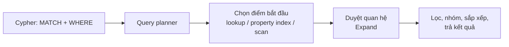
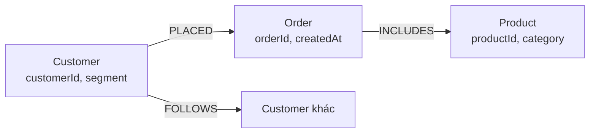

# Chỉ mục giải quyết chi phí tìm điểm bắt đầu của truy vấn

Trong Neo4j, truy vấn đồ thị thường gồm hai công việc khác nhau: **tìm các nút hoặc quan hệ ban đầu** thỏa điều kiện và **duyệt các quan hệ** từ những điểm đó để tìm mẫu đường đi. Nếu truy vấn bắt đầu ở quá nhiều nút, chi phí duyệt có thể tăng mạnh dù mẫu Cypher chỉ dài vài cạnh. Chỉ mục (*index*) giúp bộ lập kế hoạch truy vấn (*query planner*) tìm điểm bắt đầu phù hợp và giảm lượng dữ liệu phải xem xét.

Bài học thuộc chương **Chỉ mục tra cứu** của module `DATABASE_ENGINE_GRAPH_NEO4J`, tập trung vào **lookup index** cho nhãn nút (*node labels*) và loại quan hệ (*relationship types*), đồng thời giải thích ranh giới giữa lookup index và chỉ mục thuộc tính. Đây là kiến thức nền để sử dụng `MATCH`, `WHERE`, `EXPLAIN`, `PROFILE` và tối ưu các truy vấn Cypher trên mô hình *property graph*. Ví dụ sử dụng cú pháp Neo4j 5.x; kế hoạch thực thi thực tế có thể khác theo phiên bản, dữ liệu và thống kê của cơ sở dữ liệu.

## 1. Vì sao tìm điểm bắt đầu có thể đắt?

Giả sử hệ thống thương mại lưu hàng triệu nút khách hàng, đơn hàng, sản phẩm và các quan hệ giữa chúng:

```cypher
MATCH (c:Customer)-[:PLACED]->(o:Order)
WHERE c.customerId = 'C01'
RETURN o.orderId;
```

Ý nghĩa nghiệp vụ rất đơn giản: tìm tất cả đơn hàng của khách hàng `C01`. Nhưng để thực hiện, Neo4j phải chọn **tìm khách hàng `C01` bằng cách nào**:

- Quét nhiều nút để tìm nhãn `Customer` rồi kiểm tra `customerId`.
- Dùng chỉ mục thuộc tính trên `Customer.customerId` để tìm trực tiếp những khách hàng thỏa điều kiện.
- Trong truy vấn khác, có thể bắt đầu từ phía `Order` nếu bộ lọc ở đơn hàng chọn lọc hơn, sau đó duyệt ngược quan hệ `PLACED`.

Sau khi có nút bắt đầu, toán tử mở rộng quan hệ (*expand*) mới lần theo `PLACED` để lấy các đơn hàng. Vì vậy, tối ưu **đầu vào** và tối ưu **quá trình duyệt quan hệ** có liên quan nhưng không phải cùng một bài toán.



Một cách hình dung chi phí, không phải công thức đo thời gian chính xác, là:

```text
Chi phí truy vấn ≈ chi phí tìm điểm bắt đầu
                 + chi phí mở rộng những quan hệ liên quan
                 + chi phí lọc, tổng hợp và xử lý kết quả
```

Nếu điều kiện đầu vào chỉ khớp một khách hàng, số cạnh phải duyệt thường nhỏ hơn nhiều so với việc khớp cả triệu khách hàng rồi lần theo quan hệ của từng người. Tuy nhiên, mức tiết kiệm phụ thuộc **độ chọn lọc**, **bậc nút** và **số dòng kết quả trung gian**.

## 2. Lookup index là gì trong Neo4j?

**Lookup index** là chỉ mục dùng để xác định thực thể theo **token cấu trúc** của đồ thị:

- **Node label lookup index:** giúp tìm các nút mang một nhãn như `:Customer`, `:Order` hoặc `:Product`.
- **Relationship type lookup index:** giúp tìm các quan hệ có loại như `:PLACED`, `:FOLLOWS` hoặc `:INCLUDES`.

Lookup index **không đánh chỉ mục giá trị thuộc tính** như `customerId = 'C01'`, `createdAt >= date(...)` hay `price > 100`. Đó là phạm vi của các loại chỉ mục thuộc tính, chẳng hạn **range index**.

| Loại chỉ mục / cơ chế | Dữ liệu dùng để tra cứu | Ví dụ điều kiện | Phạm vi hỗ trợ |
| --- | --- | --- | --- |
| **Node label lookup** | Nhãn nút | `MATCH (c:Customer)` | Xác định tập nút mang nhãn `Customer` |
| **Relationship type lookup** | Loại quan hệ | `MATCH ()-[r:PLACED]->()` | Xác định tập quan hệ kiểu `PLACED` |
| **Range index trên thuộc tính nút** | Nhãn và giá trị thuộc tính | `c.customerId = 'C01'`, so sánh ngày/số | Thu hẹp tập nút theo giá trị thuộc tính |
| **Range index trên thuộc tính quan hệ** | Loại quan hệ và giá trị thuộc tính | `r.since >= date(...)` | Thu hẹp tập quan hệ theo giá trị thuộc tính |
| **Text / full-text / vector index** | Nội dung văn bản hoặc vector, theo cơ chế riêng | Tìm văn bản, tìm kiếm tương tự | Các bài toán tìm kiếm chuyên biệt, không thay thế lookup index |

**Dễ nhầm:** Tên chương là *Chỉ mục tra cứu* nhưng `lookup index` trong Neo4j có nghĩa cụ thể là **chỉ mục nhãn nút hoặc loại quan hệ**. Nó không có nghĩa rằng mọi phép tra cứu theo thuộc tính đều sử dụng lookup index.

### 2.1. Lookup index tác động đến truy vấn nào?

Truy vấn theo nhãn:

```cypher
MATCH (c:Customer)
RETURN c.customerId AS customerId, c.name AS name;
```

Một kế hoạch khả dĩ dùng toán tử `NodeByLabelScan` để lấy các nút mang nhãn `Customer`. Từ “Scan” trong tên toán tử không nhất thiết nghĩa là Neo4j đang quét **toàn bộ** nút của database: khi có node label lookup index, thao tác này có thể sử dụng cấu trúc tra cứu nhãn.

Truy vấn theo loại quan hệ:

```cypher
MATCH (a)-[r:PLACED]->(b)
RETURN elementId(r) AS relationshipId, elementId(a) AS fromId,
       elementId(b) AS toId;
```

Bộ lập kế hoạch có thể dùng toán tử quét theo loại quan hệ, chẳng hạn `DirectedRelationshipTypeScan`, để lấy những cạnh `PLACED`. Tên toán tử có thể thay đổi theo phiên bản và hướng của mẫu quan hệ. Nếu truy vấn có nút đầu vào rất chọn lọc, planner cũng có thể chọn tìm nút trước rồi mở rộng quan hệ từ nút đó.

### 2.2. Lookup index chưa giải quyết điều gì?

Xét truy vấn:

```cypher
MATCH (c:Customer)
WHERE c.segment = 'Retail'
RETURN c.customerId;
```

Lookup index có thể tìm tập `Customer`, nhưng **không tra trực tiếp giá trị `segment = 'Retail'`**. Nếu không có chỉ mục phù hợp trên `Customer.segment`, Neo4j có thể duyệt các nút `Customer` rồi lọc từng nút theo thuộc tính `segment`.

Vì vậy, cần phân biệt:

1. **Có nhãn / loại quan hệ:** dùng token lookup.
2. **Có giá trị thuộc tính cụ thể:** cân nhắc property index phù hợp.
3. **Có mẫu quan hệ:** phải đánh giá chi phí duyệt (*expansion*) và số đường đi sinh ra.

## 3. Bộ dữ liệu thực hành

Dùng database học tập hoặc môi trường thử nghiệm vì các câu lệnh sau tạo nút và quan hệ. Chúng được viết bằng `MERGE` để có thể chạy lại trên bộ dữ liệu chưa bị chỉnh sửa, nhưng không thay thế ràng buộc duy nhất trong hệ thống có ghi đồng thời.



```cypher
MERGE (an:Customer {customerId: 'C01'})
SET an.name = 'An', an.segment = 'Retail'
MERGE (binh:Customer {customerId: 'C02'})
SET binh.name = 'Bình', binh.segment = 'Retail'
MERGE (chi:Customer {customerId: 'C03'})
SET chi.name = 'Chi', chi.segment = 'SMB'
MERGE (dung:Customer {customerId: 'C04'})
SET dung.name = 'Dũng', dung.segment = 'Enterprise'

MERGE (o1:Order {orderId: 'O01'})
SET o1.createdAt = date('2026-10-10')
MERGE (o2:Order {orderId: 'O02'})
SET o2.createdAt = date('2026-11-01')
MERGE (o3:Order {orderId: 'O03'})
SET o3.createdAt = date('2026-11-05')

MERGE (p1:Product {productId: 'P01'})
SET p1.category = 'Thực phẩm'
MERGE (p2:Product {productId: 'P02'})
SET p2.category = 'Sách'

MERGE (an)-[:PLACED]->(o1)
MERGE (an)-[:PLACED]->(o2)
MERGE (binh)-[:PLACED]->(o3)

MERGE (an)-[:FOLLOWS]->(binh)
MERGE (chi)-[:FOLLOWS]->(an)

MERGE (o1)-[l1:INCLUDES]->(p1)
SET l1.quantity = 2
MERGE (o1)-[l2:INCLUDES]->(p2)
SET l2.quantity = 1
MERGE (o2)-[l3:INCLUDES]->(p1)
SET l3.quantity = 3
MERGE (o3)-[l4:INCLUDES]->(p2)
SET l4.quantity = 1;
```

Bộ dữ liệu mẫu gồm **4 Customer**, **3 Order**, **2 Product**, **3 quan hệ PLACED**, **2 quan hệ FOLLOWS** và **4 quan hệ INCLUDES**. Khách hàng `C03` và `C04` chưa đặt đơn; khách hàng `C01` có hai đơn hàng.

Để tra cứu khách hàng theo tên, loại quan hệ hoặc nhóm sản phẩm, Neo4j phải quyết định liệu nên bắt đầu ở một nút, một tập nút theo nhãn hay các quan hệ theo loại.

## 4. Kiểm tra và tạo lookup index

### 4.1. Xem lookup index hiện có

Neo4j 5.x thường tạo sẵn một chỉ mục tra cứu nhãn nút và một chỉ mục tra cứu loại quan hệ khi khởi tạo database. Trước khi tạo, hãy xem trạng thái thực tế:

```cypher
SHOW LOOKUP INDEXES
YIELD name, entityType, state, populationPercent
RETURN name, entityType, state, populationPercent
ORDER BY entityType, name;
```

Cần chú ý:

- `name`: tên chỉ mục để quản trị.
- `entityType`: `NODE` hoặc `RELATIONSHIP`.
- `state`: `ONLINE` nghĩa là chỉ mục sẵn sàng phục vụ truy vấn.
- `populationPercent`: tiến độ xây dựng chỉ mục; khi hoàn thành thường là `100.0`.

Tên index thực tế có thể khác nhau giữa các database. Trong các phiên bản Neo4j có hỗ trợ cú pháp này, `SHOW INDEXES` hiển thị toàn bộ chỉ mục; `SHOW LOOKUP INDEXES` giới hạn kết quả vào lookup index.

### 4.2. Tạo lookup index khi chưa có

Câu lệnh cho nhãn nút:

```cypher
CREATE LOOKUP INDEX node_label_lookup_index IF NOT EXISTS
FOR (n) ON EACH labels(n);
```

Câu lệnh cho loại quan hệ:

```cypher
CREATE LOOKUP INDEX rel_type_lookup_index IF NOT EXISTS
FOR ()-[r]-() ON EACH type(r);
```

Trong cú pháp trên:

- `FOR (n)` nghĩa là chỉ mục trên **nút**; `labels(n)` là biểu thức token nhãn cần tra cứu.
- `FOR ()-[r]-()` nghĩa là chỉ mục trên **quan hệ**; `type(r)` là biểu thức token loại quan hệ.
- `ON EACH` là một phần của cú pháp khai báo lookup index.
- `IF NOT EXISTS` giúp tránh lỗi khi chỉ mục tương ứng đã tồn tại.

Mỗi database Neo4j chỉ cần tối đa **một node label lookup index** và **một relationship type lookup index**. Không tạo riêng một lookup index cho `Customer` và một lookup index khác cho `Order`; một chỉ mục token nhãn phục vụ tra cứu nhiều nhãn. Nếu hệ thống đã tạo sẵn, không cần tạo thêm.

> **Quản trị vận hành:** Không xóa lookup index đang phục vụ workload chỉ để minh họa hiệu năng. Việc thiếu lookup index có thể khiến nhiều truy vấn phải dùng phương án quét kém hiệu quả hơn. Thực hiện thao tác tạo/xóa chỉ mục trong môi trường phù hợp và quan sát trạng thái `ONLINE` trước khi so sánh.

## 5. Từ Cypher đến kế hoạch: tìm điểm bắt đầu theo nhãn

Hãy xét truy vấn tìm khách hàng thuộc phân khúc Retail:

```cypher
EXPLAIN
MATCH (c:Customer)
WHERE c.segment = 'Retail'
RETURN c.customerId AS customerId, c.name AS name;
```

`EXPLAIN` chỉ dựng kế hoạch mà không chạy phần truy vấn đọc dữ liệu. Một kế hoạch phổ biến khi **không có chỉ mục trên `Customer.segment`** sẽ gồm các bước có ý nghĩa:

1. Tìm tập nút mang nhãn `Customer`, có thể bằng `NodeByLabelScan` với label lookup index.
2. Lọc thuộc tính theo `c.segment = 'Retail'`.
3. Lấy các thuộc tính cần trả về.

Nếu database có 1 triệu nút `Customer` mà chỉ vài chục nút `Retail`, bộ lọc thuộc tính sau bước lấy theo nhãn vẫn có thể tốn chi phí lớn. **Lookup index loại bỏ nhu cầu tìm nhãn bằng cách quét mọi loại nút, nhưng không thu hẹp tập nút theo giá trị `segment`.**

Kiểm tra số hàng và số lần truy cập dữ liệu bằng:

```cypher
PROFILE
MATCH (c:Customer)
WHERE c.segment = 'Retail'
RETURN c.customerId AS customerId, c.name AS name;
```

`PROFILE` **thực thi truy vấn** rồi hiển thị số dòng đi qua mỗi toán tử, số lần truy cập dữ liệu (*DB Hits*) và các thông tin thực thi khác. Với dữ liệu nhỏ, chi phí thời gian không đủ để kết luận index nào nhanh hơn trên dữ liệu lớn.

### Kết quả mong đợi với dữ liệu mẫu

| customerId | name |
| --- | --- |
| C01 | An |
| C02 | Bình |

Nếu database có dữ liệu khác ngoài bộ mẫu, kết quả có thể có thêm bản ghi.

## 6. Tìm điểm bắt đầu theo loại quan hệ

Trong đồ thị có nhiều loại cạnh, truy vấn có thể cần tìm mọi quan hệ `PLACED` mà không biết trước khách hàng nào tạo ra chúng:

```cypher
EXPLAIN
MATCH (c:Customer)-[r:PLACED]->(o:Order)
RETURN c.customerId AS customerId,
       o.orderId AS orderId,
       type(r) AS relationshipType;
```

Khi bắt đầu từ **loại quan hệ**, relationship type lookup index có thể giúp Neo4j lấy trực tiếp các cạnh `PLACED`, sau đó truy cập hai nút đầu–cuối và kiểm tra nhãn cần thiết. Kế hoạch khả dĩ có toán tử `DirectedRelationshipTypeScan`. Planner cũng có thể chọn kế hoạch bắt đầu từ các nút `Customer` hoặc `Order` nếu ước lượng rẻ hơn.

Mẫu trên trả về ba quan hệ `PLACED` trong bộ dữ liệu:

| customerId | orderId | relationshipType |
| --- | --- | --- |
| C01 | O01 | PLACED |
| C01 | O02 | PLACED |
| C02 | O03 | PLACED |

Nếu biết `customerId` trước, bài toán sẽ khác:

```cypher
MATCH (c:Customer {customerId: 'C01'})-[:PLACED]->(o:Order)
RETURN o.orderId AS orderId
ORDER BY orderId;
```

Bộ lập kế hoạch có thể tối ưu hơn bằng cách **tìm đúng một khách hàng**, rồi đi theo các cạnh `PLACED` xuất phát từ nút đó. Việc quét toàn bộ quan hệ `PLACED` sẽ không nhất thiết là lựa chọn tốt. Đây là lý do **không thể đoán index được dùng chỉ từ sự xuất hiện của `:PLACED` trong Cypher**: planner chọn kế hoạch cho cả truy vấn.

## 7. Khi cần chỉ mục thuộc tính để giảm mạnh tập đầu vào

Lookup index giúp tra nhãn; để tìm một khách hàng theo `customerId`, dùng **range index** hoặc **ràng buộc duy nhất** có chỉ mục hỗ trợ.

### 7.1. Tạo range index trên khóa tra cứu

```cypher
CREATE RANGE INDEX customer_id_range_idx IF NOT EXISTS
FOR (c:Customer) ON (c.customerId);
```

Khi index đã ở trạng thái `ONLINE`, thử xem kế hoạch:

```cypher
EXPLAIN
MATCH (c:Customer)
WHERE c.customerId = 'C01'
RETURN c.customerId AS customerId, c.name AS name;
```

Nếu planner chọn chỉ mục này, có thể thấy toán tử `NodeIndexSeek` (hoặc biến thể tương ứng) thay vì lấy nhiều nút `Customer` rồi lọc. Chỉ mục thuộc tính thường hữu ích nhất khi điều kiện chọn lọc, chẳng hạn mã khách hàng duy nhất.

Trong hệ thống thực tế, nếu `customerId` phải duy nhất, ràng buộc sau vừa bảo vệ tính toàn vẹn vừa cung cấp chỉ mục hỗ trợ:

```cypher
CREATE CONSTRAINT customer_id_unique IF NOT EXISTS
FOR (c:Customer) REQUIRE c.customerId IS UNIQUE;
```

Không cần tạo **cả hai** chỉ mục riêng và ràng buộc duy nhất cho cùng một mục tiêu nếu ràng buộc đã đáp ứng nhu cầu tra cứu. Ràng buộc unique sẽ thất bại nếu dữ liệu đang có mã trùng; cần kiểm tra và làm sạch dữ liệu trước khi áp dụng trong hệ thống đang vận hành.

> Với bộ dữ liệu chỉ có bốn khách hàng, planner **không bắt buộc** chọn `NodeIndexSeek` dù index đã tồn tại; thao tác quét một tập rất nhỏ có thể được ước lượng rẻ hơn. Sự hiện diện của index không đảm bảo index xuất hiện trong mọi kế hoạch.

### 7.2. Chỉ mục có thể thay đổi chiều bắt đầu duyệt đồ thị

Xét yêu cầu: liệt kê khách hàng có đơn hàng trong tháng 11/2026.

```cypher
MATCH (c:Customer)-[:PLACED]->(o:Order)
WHERE o.createdAt >= date('2026-11-01')
  AND o.createdAt < date('2026-12-01')
RETURN c.customerId AS customerId,
       o.orderId AS orderId
ORDER BY customerId, orderId;
```

Vì bộ lọc thuộc tính nằm ở `Order`, Neo4j có thể bắt đầu từ các đơn hàng thỏa ngày rồi **duyệt ngược** `PLACED` về khách hàng. Để hỗ trợ phương án này, có thể tạo range index:

```cypher
CREATE RANGE INDEX order_created_at_idx IF NOT EXISTS
FOR (o:Order) ON (o.createdAt);
```

Với chỉ mục phù hợp, bộ lập kế hoạch có thể chọn một `NodeIndexSeekByRange` hoặc toán tử index seek tương đương trên `Order.createdAt`. **Chiều mũi tên trong mẫu Cypher diễn đạt chiều của quan hệ trong dữ liệu, không bắt planner phải bắt đầu thực thi ở nút bên trái.**

Kết quả mẫu:

| customerId | orderId |
| --- | --- |
| C01 | O02 |
| C02 | O03 |

Mặc dù lọc tháng 11 chỉ trả về hai đơn hàng, không thể khẳng định index sẽ nhanh hơn trên cơ sở dữ liệu nhỏ. Việc so sánh có ý nghĩa hơn khi dữ liệu và phân bố giá trị phản ánh workload thật.

## 8. Khi điểm bắt đầu đã tốt nhưng truy vấn vẫn chậm

Index giải quyết **tìm thực thể đầu vào**; sau đó truy vấn đồ thị vẫn cần duyệt quan hệ. Ví dụ tìm các sản phẩm trong đơn hàng của `C01`:

```cypher
MATCH (c:Customer {customerId: 'C01'})
      -[:PLACED]->(o:Order)
      -[line:INCLUDES]->(p:Product)
RETURN o.orderId AS orderId,
       p.productId AS productId,
       p.category AS category,
       line.quantity AS quantity
ORDER BY orderId, productId;
```

Một kế hoạch hợp lý có thể gồm:

1. **NodeIndexSeek:** tìm khách hàng `C01` theo thuộc tính (nếu có range index tương ứng và planner chọn dùng).
2. **Expand:** tìm đơn hàng qua `PLACED`.
3. **Expand:** tìm sản phẩm qua `INCLUDES`.
4. **Projection / Sort:** lấy các thuộc tính và sắp xếp kết quả.

Kết quả gồm `O01/P01/2`, `O01/P02/1` và `O02/P01/3`. Index trên `Customer.customerId` giúp giảm đầu vào xuống một khách hàng, nhưng không làm biến mất chi phí duyệt các dòng hàng.

Nếu một khách hàng có hàng trăm nghìn quan hệ `PLACED`, truy vấn vẫn có thể đắt. Khi ấy cần xem xét thêm giới hạn thời gian, phân trang, mô hình dữ liệu, số bước duyệt, điều kiện ở mỗi đầu quan hệ và cấu trúc trả về.

### 8.1. Hiểu độ chọn lọc và số dòng trung gian

Độ chọn lọc là mức thu hẹp tập thực thể do điều kiện tạo ra. Những điều kiện như `customerId = 'C01'` thường chọn lọc hơn `segment = 'Retail'` khi `Retail` chiếm phần lớn khách hàng.

| Tình huống | Điểm bắt đầu đáng cân nhắc | Lý do |
| --- | --- | --- |
| Tất cả khách hàng | Nhãn `:Customer` | Không có điều kiện thuộc tính; lookup index phù hợp |
| Một mã khách hàng | `Customer.customerId` | Index theo giá trị có thể thu hẹp còn một nút |
| Mọi cạnh `:PLACED` | Loại quan hệ `PLACED` | Relationship type lookup có thể hữu ích |
| Đơn theo khoảng ngày hẹp | `Order.createdAt` | Range index có thể thu hẹp tập đơn trước khi duyệt |
| Nhiều bước qua các nút bậc lớn | Chọn đầu vào chọn lọc và kiểm soát expansion | Index ban đầu chưa đủ nếu số đường đi tăng mạnh |

Không nên hiểu các gợi ý này là quy tắc buộc planner dùng một toán tử cố định. Neo4j kết hợp thống kê, khả năng áp dụng index và đặc điểm toàn truy vấn để lựa chọn kế hoạch.

### 8.2. Tránh tạo tích Descartes không cần thiết

Hai mẫu `MATCH` không nối với nhau có thể tạo số dòng bằng tích số nút của hai tập:

```cypher
// Tạo cặp Customer × Product, chỉ phù hợp khi thực sự cần mọi cặp
MATCH (c:Customer), (p:Product)
RETURN c.customerId, p.productId;
```

Để lấy sản phẩm đã mua, phải nối bằng đường đi nghiệp vụ:

```cypher
MATCH (c:Customer)-[:PLACED]->(:Order)-[:INCLUDES]->(p:Product)
RETURN DISTINCT c.customerId AS customerId,
       p.productId AS productId;
```

Lookup index không tự sửa lỗi mô hình truy vấn thiếu quan hệ nối. Cần kiểm tra toán tử `CartesianProduct`, số dòng tăng mạnh và lựa chọn `DISTINCT` dựa trên định nghĩa kết quả mong muốn.

## 9. Quy trình phân tích bằng EXPLAIN và PROFILE

Một quy trình có thể áp dụng khi phát hiện truy vấn Cypher chậm:

1. **Xác định điều kiện chọn đầu vào:** nhãn, loại quan hệ, mã định danh, khoảng ngày và các thuộc tính lọc. Đánh giá điều kiện nào có khả năng chọn lọc nhất.
2. **Kiểm tra index hiện có:** dùng `SHOW LOOKUP INDEXES` cho token lookup và `SHOW INDEXES` cho toàn bộ chỉ mục; xác nhận `state = 'ONLINE'`.
3. **Chạy `EXPLAIN`:** xem truy vấn bắt đầu bằng `NodeByLabelScan`, `NodeIndexSeek`, relationship type scan hay toán tử khác; theo dõi thứ tự mở rộng quan hệ.
4. **Chạy `PROFILE` với truy vấn đọc an toàn:** so sánh số dòng và `DB Hits` qua từng toán tử, chú ý bước lọc nhiều bản ghi hoặc expansion tạo nhiều đường đi.
5. **Chọn điều chỉnh có căn cứ:** cân nhắc thêm range index trên thuộc tính lọc chọn lọc, đổi cách tổ chức truy vấn hoặc giảm lượng dữ liệu cần duyệt.
6. **Đo lại trên workload thực tế:** cùng tham số, cùng tập dữ liệu và điều kiện tải tương đương; tránh kết luận từ vài bản ghi thử hoặc một lần chạy có cache khác nhau.

Một số dấu hiệu cần chú ý:

| Dấu hiệu trong kế hoạch | Cách diễn giải | Việc nên kiểm tra |
| --- | --- | --- |
| `NodeByLabelScan` → `Filter` với rất nhiều dòng | Có thể đang lọc thuộc tính sau khi lấy cả nhãn | Index thuộc tính theo điều kiện `WHERE`, độ chọn lọc |
| `DirectedRelationshipTypeScan` trên loại rất phổ biến | Phải xét nhiều cạnh của một loại | Có thể bắt đầu từ nút có điều kiện chọn lọc hơn không? |
| `NodeIndexSeek` nhưng `Expand` sinh rất nhiều dòng | Đã tìm điểm đầu tốt, nhưng đường đi fan-out lớn | Bậc nút, số bước, giới hạn nghiệp vụ |
| `CartesianProduct` ngoài dự kiến | Hai tập mẫu không được nối, làm phình kết quả | Sửa mẫu Cypher và các biến dùng để nối |
| `Sort` / `Aggregation` xử lý lượng dòng lớn | Chi phí nằm sau giai đoạn tra cứu | Giảm dòng đầu vào, chỉ trả thuộc tính cần thiết |

**Giới hạn quan sát:** `DB Hits` phản ánh hoạt động truy cập dữ liệu theo cách đo của Neo4j, không phải số mili giây. Thời gian thực thi chịu ảnh hưởng bộ nhớ, cache, tải hệ thống, mạng và lượng dữ liệu trả về ứng dụng.

## 10. Ứng dụng từ Java Driver và Spring Data Neo4j

Dù truy vấn được chạy trong Neo4j Browser, thông qua **Neo4j Java Driver** hay được Spring Data Neo4j sinh ra, **việc chọn điểm bắt đầu và dùng index là trách nhiệm của Neo4j query planner**. Mã Java nên truyền tham số, giữ câu Cypher rõ ràng và tránh tải dữ liệu đồ thị không cần thiết.

Ví dụ với Neo4j Java Driver (giả sử đã có đối tượng `Driver driver`):

```java
import java.util.Map;
import org.neo4j.driver.Driver;

public class CustomerLookup {
    public static String findName(Driver driver, String customerId) {
        try (var session = driver.session()) {
            return session.executeRead(tx ->
                tx.run(
                    "MATCH (c:Customer {customerId: $id}) " +
                    "RETURN c.name AS name",
                    Map.of("id", customerId)
                ).single().get("name").asString()
            );
        }
    }
}
```

Câu truy vấn tham số hóa hỗ trợ thực thi nhất quán và tránh ghép giá trị trực tiếp vào Cypher. Nếu `Customer.customerId` có chỉ mục phù hợp, server có thể lựa chọn đường truy cập hiệu quả như `NodeIndexSeek`. Đoạn ví dụ giả định khách hàng tồn tại đúng một bản ghi; ứng dụng thật cần xử lý trường hợp không tìm thấy dữ liệu.

Trong **Spring Data Neo4j**, các phương thức repository tìm theo thuộc tính hoặc truy vấn `@Query` cũng hưởng lợi từ schema index thích hợp. Hãy dùng `EXPLAIN` với Cypher thực tế được tạo hoặc khai báo để kiểm tra; tên phương thức repository tự nó không đảm bảo server dùng chỉ mục.

## 11. Các nhầm lẫn thường gặp

**“Có lookup index là lọc theo mọi thuộc tính sẽ nhanh.”** Sai. Lookup index tra token nhãn hoặc loại quan hệ, không tra giá trị `customerId` hay `createdAt`. Muốn thu hẹp theo giá trị, cần xem xét property index hoặc ràng buộc thích hợp.

**“`NodeByLabelScan` nghĩa là quét toàn bộ database.”** Không nhất thiết. Toán tử nói rằng query lấy các nút theo nhãn. Khi node label lookup index đang hoạt động, việc tra nhãn có thể dùng chỉ mục token.

**“Cứ xuất hiện `:PLACED` là relationship type lookup được dùng.”** Sai. Planner có thể tìm khách hàng qua index rồi mở rộng `PLACED`; cách này thường phù hợp khi có một khách hàng duy nhất.

**“Index tự làm phép duyệt nhiều bước trở nên rẻ.”** Sai. Index thường giúp tìm điểm xuất phát; số cạnh và đường đi được mở rộng vẫn là yếu tố quyết định sau đó.

**“Tạo thật nhiều lookup index theo từng nhãn sẽ tốt hơn.”** Sai. Lookup index nhãn là cấu trúc bao quát nhiều nhãn của database; không cần một lookup index cho từng nhãn.

**“Index vừa tạo sẽ lập tức được dùng trong mọi truy vấn.”** Sai. Chỉ mục cần ở trạng thái `ONLINE`; planner còn xét độ chọn lọc và chi phí ước lượng. Với tập nhỏ, quét có thể rẻ hơn seek.

## 12. Bài tập thực hành và kết quả đối chiếu

**Bài tập 1 — Phân biệt lookup index và range index.** Với truy vấn bên dưới, hãy nêu phần nào có thể hưởng lợi từ lookup index và phần nào cần range index nếu dữ liệu đủ lớn:

```cypher
MATCH (c:Customer)-[:PLACED]->(o:Order)
WHERE c.customerId = 'C01'
RETURN o.orderId;
```

*Gợi ý:* `:Customer` và `:PLACED` là nhãn/loại quan hệ; `c.customerId = 'C01'` là điều kiện thuộc tính. Khởi đầu từ một `Customer` cụ thể thường được hỗ trợ tốt bởi range index trên `Customer.customerId`.

**Bài tập 2 — Kiểm tra loại quan hệ.** Dùng `SHOW LOOKUP INDEXES` để xem chỉ mục token hiện có, sau đó chạy `EXPLAIN` cho truy vấn lấy mọi cạnh `:INCLUDES`:

```cypher
EXPLAIN
MATCH ()-[r:INCLUDES]->()
RETURN elementId(r) AS relationshipId;
```

*Gợi ý:* xem planner có chọn toán tử quét theo loại quan hệ hay không. Với bộ dữ liệu mẫu có **4 cạnh `INCLUDES`**.

**Bài tập 3 — Tìm điểm bắt đầu tốt nhất.** Cần lấy đơn hàng trong tháng 11/2026 cùng khách hàng đặt đơn. Hãy viết truy vấn và đánh giá hai phương án: bắt đầu từ `Customer` rồi duyệt `PLACED`, hoặc tìm `Order` theo `createdAt` rồi duyệt ngược.

*Đối chiếu:* với dữ liệu mẫu, kết quả là đơn `O02` của `C01` và đơn `O03` của `C02`. Trên database lớn có nhiều đơn cũ và ít đơn trong kỳ, range index `Order.createdAt` có thể giảm đáng kể lượng đầu vào.

**Bài tập 4 — Tìm nguyên nhân ngoài index.** Sau khi thêm index trên `Customer.customerId`, truy vấn từ một khách hàng vẫn chậm khi duyệt ba, bốn bước. Hãy mở `PROFILE` và tìm các toán tử tạo nhiều dòng ở bước `Expand`; đề xuất giới hạn phạm vi đường đi hoặc thêm điều kiện nghiệp vụ phù hợp.

### Ghi nhớ

Lookup index của Neo4j giải quyết **tìm nút theo nhãn** và **tìm quan hệ theo loại**. Nó là một phần quan trọng của việc tìm điểm bắt đầu truy vấn, nhưng **không thay thế chỉ mục thuộc tính** khi lọc theo mã định danh, ngày hoặc giá trị khác. Khi tối ưu Cypher, hãy quan sát **điểm truy cập ban đầu, độ chọn lọc của bộ lọc, số cạnh được duyệt và số dòng trung gian** bằng `EXPLAIN`/`PROFILE`. Index hiệu quả là index giúp giảm công việc thực tế của toàn truy vấn, không chỉ khiến một toán tử riêng lẻ có tên “Seek”.
