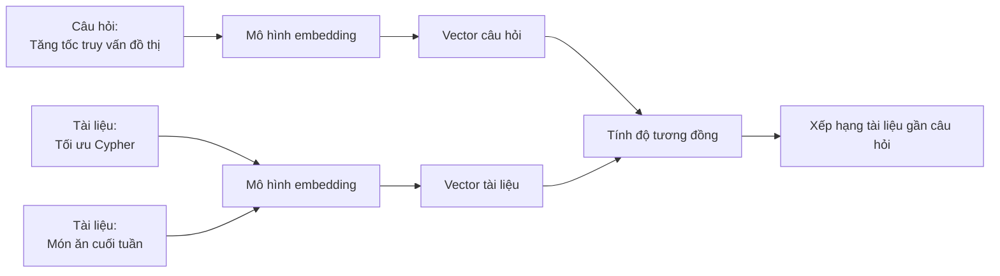
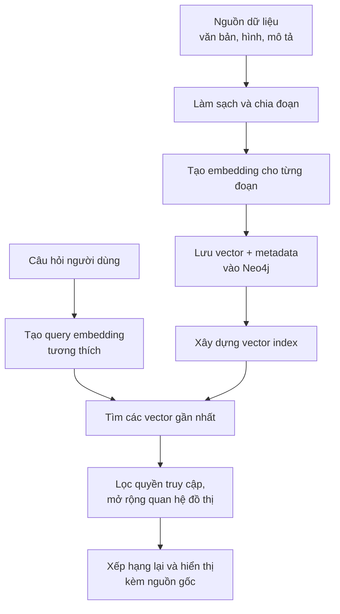

# Biểu diễn dữ liệu bằng vector và ý nghĩa của độ tương đồng

Trong nhiều hệ thống, người dùng không biết chính xác từ khóa xuất hiện trong dữ liệu. Họ có thể hỏi “Làm sao để truy vấn nhanh hơn khi đồ thị lớn?” trong khi tài liệu được lưu với tiêu đề “Tối ưu truy vấn Cypher”. Truy vấn bằng so khớp chuỗi đơn thuần có thể bỏ qua tài liệu có nội dung liên quan nhưng dùng cách diễn đạt khác. **Biểu diễn dữ liệu bằng vector** (*vector representation* hoặc *embedding*) là một cách chuyển nội dung thành dãy số để máy tính ước lượng mức độ gần nhau giữa các đối tượng.

Trong Neo4j, vector và độ tương đồng bổ sung cho mô hình **property graph**: vector hỗ trợ tìm các nút có nội dung gần với câu hỏi, còn các **node**, **relationship** và truy vấn **Cypher** giúp đi tiếp từ kết quả đó đến thông tin có liên hệ nghiệp vụ. Bài thuộc chương **Tìm kiếm nâng cao** của module `DATABASE_ENGINE_GRAPH_NEO4J` và tập trung vào ý nghĩa của vector, các phép đo tương đồng, cách lưu/truy vấn vector trên Neo4j, cùng các giới hạn khi đưa độ tương đồng vào sản phẩm.

## 1. Vì sao cần biểu diễn dữ liệu thành vector?

Cơ sở dữ liệu truyền thống và truy vấn Cypher xử lý tốt các điều kiện xác định:

- “Tìm khách hàng có `customerId = 'C01'`”.
- “Tìm các đơn hàng được tạo sau ngày 01/11”.
- “Tìm tất cả tài liệu thuộc chủ đề Neo4j thông qua quan hệ `:ABOUT`”.

Nhưng các câu hỏi như “Tài liệu nào nói gần giống ý này?” hoặc “Sản phẩm nào có mô tả tương tự?” khó diễn đạt bằng phép bằng chuỗi. **Embedding model** biến văn bản, hình ảnh hoặc dữ liệu thuộc loại được hỗ trợ thành một vector số thực có số chiều cố định. Một mô hình được huấn luyện cho tìm kiếm ngữ nghĩa thường sắp xếp các biểu diễn liên quan ở gần nhau trong một không gian vector.

Ví dụ khái niệm:



Mô hình không “hiểu” dữ liệu theo nghĩa con người và độ gần vector **không chứng minh** hai tài liệu có cùng nội dung, đúng sự thật hoặc phù hợp với quyền truy cập. Độ tương đồng chỉ là một **tín hiệu xếp hạng** do mô hình và thước đo xác định.

### 1.1. Từ thuộc tính sang vector

Một nút trong Neo4j có thể lưu cả metadata có cấu trúc lẫn vector:

```cypher
(:SearchDocument {
  docId: 'D001',
  title: 'Tổng quan Neo4j',
  category: 'Graph',
  language: 'vi',
  embedding: [1.0, 0.0, 0.0]
})
```

Ở đây:

| Thuộc tính | Vai trò | Cách sử dụng |
| --- | --- | --- |
| `docId` | Mã nghiệp vụ duy nhất | Tra cứu chính xác, cập nhật, liên kết |
| `title` | Nội dung con người đọc được | Hiển thị, tìm từ khóa |
| `category` | Nhóm nghiệp vụ | Lọc, phân quyền hoặc tổng hợp |
| `language` | Ngôn ngữ | Phân nhóm, chọn mô hình phù hợp |
| `embedding` | Vector số | So sánh khoảng cách, tìm hàng xóm gần nhất |

Ba số trong `embedding` trên chỉ là ví dụ hình học dễ tính, **không phải kết quả của một mô hình embedding ngôn ngữ**. Vector thực tế có thể có hàng trăm hoặc hàng nghìn chiều; từng tọa độ riêng lẻ thường không mang ý nghĩa đơn giản như “chiều thứ nhất là chủ đề đồ thị”.

### 1.2. Vector khác gì quan hệ trong đồ thị?

- **Quan hệ `(:Document)-[:ABOUT]->(:Topic)`** là một liên kết rõ ràng được lưu trong dữ liệu, thể hiện phát biểu nghiệp vụ có thể kiểm tra.
- **Vector của `Document`** giúp ước lượng mức gần về nội dung hoặc đặc trưng học được từ dữ liệu.
- Hai nút **không có cạnh nối trực tiếp** vẫn có thể có vector tương tự; hai nút có cạnh nối trực tiếp không nhất thiết có nội dung giống nhau.

Trong sản phẩm tìm kiếm, có thể lấy các nút bằng vector trước, sau đó đi qua quan hệ để tìm chuyên gia, tài liệu nguồn, sản phẩm, khách hàng hoặc các thực thể liên quan.

## 2. Không gian vector, chiều và độ lớn

Một vector `d` chiều có dạng:

\[
\mathbf{x} = (x_1, x_2, \ldots, x_d)
\]

Chẳng hạn, vector ba chiều `[1.0, 0.0, 0.0]` là một điểm trong không gian ba chiều; vector `[0.8, 0.6, 0.0]` là một điểm khác. **Số chiều** (*dimension*) là số tọa độ, không phải số tài liệu hay số nhãn của đồ thị.

Độ dài hay **chuẩn Euclid** của vector:

\[
\|\mathbf{x}\|_2 = \sqrt{\sum_{i=1}^{d} x_i^2}
\]

Ví dụ, `[0.8, 0.6, 0.0]` có độ dài:

\[
\sqrt{0.8^2 + 0.6^2 + 0^2} = 1
\]

Một vector có chuẩn bằng `1` gọi là **vector đơn vị**. Chuẩn hóa L2 chuyển một vector khác vector không thành vector đơn vị:

\[
\hat{\mathbf{x}}=\frac{\mathbf{x}}{\|\mathbf{x}\|_2}
\]

Việc chuẩn hóa hữu ích khi muốn so sánh **hướng** của các vector thay vì độ lớn của chúng. Tuy nhiên, có nên chuẩn hóa hay không phụ thuộc vào mô hình embedding và phép đo tương đồng; không nên tự ý thay đổi quy trình mà mô hình khuyến nghị.

### 2.1. Quy tắc quan trọng về số chiều

Để so sánh hai vector, chúng phải nằm trong **cùng không gian biểu diễn**: cùng số chiều, cách tạo tương thích và ý nghĩa tọa độ tương thích. Hai vector cùng `1536` chiều được sinh bởi **hai mô hình hoàn toàn khác nhau** vẫn có thể không so sánh được về ngữ nghĩa.

Giả sử hệ thống chuyển từ mô hình embedding A sang mô hình B:

1. Vector câu hỏi từ mô hình B thường không thể đem so sánh tùy ý với vector tài liệu do A tạo ra.
2. Nếu B thay đổi số chiều, các vector có thể bị từ chối khi truy vấn index cũ.
3. Nếu B vẫn có cùng số chiều, kết quả có thể sai mà **không báo lỗi kỹ thuật**, vì không gian ngữ nghĩa đã khác.

Do đó, quản lý `modelId`, phiên bản mô hình, số chiều, cách tiền xử lý và thời điểm tạo embedding là một phần của quản trị dữ liệu tìm kiếm.

## 3. Độ tương đồng là gì?

**Độ tương đồng** (*similarity*) cho biết hai vector gần nhau đến mức nào theo một quy tắc đo. **Khoảng cách** (*distance*) là cách biểu diễn mức xa nhau. Chúng có thể cho thứ tự xếp hạng tương ứng trong một số điều kiện, nhưng không đồng nhất và có thể dẫn tới thứ hạng khác khi dữ liệu hoặc phép chuẩn hóa thay đổi.

Ba khái niệm cần phân biệt là **cosine similarity**, **Euclidean distance** và **dot product**.

### 3.1. Cosine similarity: so sánh hướng

Cosine similarity đo cosin của góc giữa hai vector khác vector không:

\[
\operatorname{cosSim}(\mathbf{x}, \mathbf{y}) =
\frac{\mathbf{x}\cdot\mathbf{y}}
{\|\mathbf{x}\|_2\|\mathbf{y}\|_2}
=
\frac{\sum_{i=1}^{d}x_i y_i}
{\sqrt{\sum_{i=1}^{d}x_i^2}\sqrt{\sum_{i=1}^{d}y_i^2}}
\]

Giá trị toán học nằm trong khoảng **[-1, 1]**:

- Gần `1`: hai vector gần cùng hướng.
- Gần `0`: hai vector gần vuông góc.
- Gần `-1`: hai vector gần ngược hướng.

Cosine **không thay đổi khi nhân một vector với hệ số dương**. Ví dụ `[1, 0]` và `[100, 0]` có cosine bằng `1` dù độ lớn khác nhau.

> **Không suy diễn quá mức:** Cosine gần `1` không có nghĩa “hai câu giống 100%”, không biểu thị xác suất câu trả lời đúng và không chứng minh nội dung cùng ý nghĩa trong mọi ngữ cảnh. Đó là phép đo hình học trong không gian do mô hình tạo ra.

### 3.2. Euclidean distance: đo độ dài đoạn nối hai điểm

Khoảng cách Euclid:

\[
d_2(\mathbf{x},\mathbf{y}) =
\sqrt{\sum_{i=1}^{d}(x_i-y_i)^2}
\]

**Khoảng cách càng nhỏ thì các điểm càng gần**. Euclid nhạy với **độ lớn** của vector. Ví dụ `[1, 0]` và `[100, 0]` nằm cùng hướng nhưng cách nhau `99` đơn vị.

Với các vector đều được chuẩn hóa L2, cosine similarity và Euclidean distance có mối liên hệ:

\[
\|\hat{\mathbf{x}}-\hat{\mathbf{y}}\|_2^2 =
2-2\,\operatorname{cosSim}(\hat{\mathbf{x}},\hat{\mathbf{y}})
\]

Vì vậy, **trên các vector đơn vị**, sắp xếp theo cosine giảm dần tương đương với sắp xếp theo khoảng cách Euclid tăng dần. Điều này **không tự động đúng** đối với vector chưa chuẩn hóa.

### 3.3. Dot product: nhân vô hướng

Tích vô hướng:

\[
\mathbf{x}\cdot\mathbf{y} = \sum_{i=1}^{d}x_i y_i
\]

Dot product phản ánh đồng thời **hướng và độ lớn**. Nó không bị giới hạn trong `[-1, 1]` khi vector chưa chuẩn hóa. Với vector đã chuẩn hóa L2, dot product chính là cosine similarity.

Các mô hình tìm kiếm khác nhau có thể dùng cosine, dot product hoặc các biến thể khác. **Thước đo dùng trong chỉ mục và thước đo mô hình được huấn luyện để tối ưu nên tương thích**; chọn cosine theo thói quen không bảo đảm xếp hạng tốt nhất cho mọi mô hình.

## 4. Tự tính ví dụ ba chiều

Giả sử truy vấn và ba tài liệu được biểu diễn bằng các vector minh họa sau:

| Đối tượng | Vector | Nội dung minh họa |
| --- | --- | --- |
| Câu hỏi `Q` | `[1.0, 0.0, 0.0]` | “Tìm tài liệu về Neo4j” |
| Tài liệu `D001` | `[1.0, 0.0, 0.0]` | “Tổng quan Neo4j” |
| Tài liệu `D002` | `[0.8, 0.6, 0.0]` | “Tối ưu Cypher” |
| Tài liệu `D003` | `[0.0, 1.0, 0.0]` | “Thực đơn lành mạnh” |

Tất cả vector đều có độ dài `1`. Đây là các **tọa độ do bài học tự chọn** để làm rõ toán học; không dùng chúng làm chuẩn đánh giá một mô hình ngôn ngữ.

| So sánh | Cosine similarity | Euclidean distance | Ý nghĩa trong ví dụ |
| --- | ---: | ---: | --- |
| `Q` với `D001` | `1.0` | `0.000` | Gần nhất |
| `Q` với `D002` | `0.8` | `0.632` | Tương đối gần |
| `Q` với `D003` | `0.0` | `1.414` | Xa nhất |

Cách tính cho `D002`:

\[
\operatorname{cosSim}(Q,D002) =
\frac{1(0.8)+0(0.6)+0(0)}{1\cdot1} = 0.8
\]

\[
d_2(Q,D002) = \sqrt{(1-0.8)^2+(0-0.6)^2+0^2}
=\sqrt{0.40}\approx0.632
\]

Với ba vector này, thứ hạng theo cosine từ cao xuống thấp và theo Euclid từ thấp lên cao đều là **D001 → D002 → D003**.

**Điểm cần nhớ:** Trong hệ thống tìm kiếm vector, đầu vào là **vector truy vấn**, đầu ra thường là các **hàng xóm gần nhất** (*nearest neighbors*) và điểm xếp hạng. Hệ thống không diễn giải tự động “vì sao ngữ nghĩa giống nhau”; muốn giải thích kết quả cần bổ sung metadata, văn bản gốc và quan hệ nghiệp vụ.

## 5. Embedding được tạo và duy trì thế nào?

Một quy trình tìm kiếm ngữ nghĩa điển hình:



### 5.1. Tạo vector từ nội dung

Ứng dụng có thể lấy embedding từ mô hình cục bộ, dịch vụ mô hình hoặc quy trình ETL. Neo4j lưu và lập chỉ mục vector, nhưng **vector không tự xuất hiện chỉ vì đã tạo vector index**. Phải có bước tạo dữ liệu embedding theo một mô hình cụ thể và ghi vào thuộc tính cần lập chỉ mục.

Với tài liệu dài, nên cân nhắc chia thành những *chunk* có ý nghĩa:

```text
(:Document {docId: "DOC-01"})
    -[:HAS_CHUNK]->
(:Chunk {chunkId: "DOC-01-01", text: "...", embedding: [...]})
    -[:MENTIONS]->
(:Topic {name: "Neo4j"})
```

Lợi ích của chia đoạn:

- Vector một đoạn thường tập trung vào một ý hơn vector của toàn bộ tài liệu quá dài.
- Kết quả có thể trỏ tới **đoạn liên quan** thay vì chỉ trả tiêu đề tài liệu.
- Có thể truy ngược `Chunk → Document` để hiển thị nguồn đầy đủ và tiếp tục duyệt các quan hệ như `MENTIONS`, `AUTHOR` hoặc `BELONGS_TO`.

Đổi lại, chia quá nhỏ có thể mất ngữ cảnh; chia quá lớn có thể pha loãng chủ đề. Cần đánh giá kích thước chunk trên tập truy vấn thực tế.

### 5.2. Giữ nhất quán giữa dữ liệu và câu hỏi

Tại thời điểm tìm kiếm, hệ thống cần biểu diễn **câu hỏi** trong cùng không gian vector với tài liệu. Một số mô hình có hướng dẫn riêng về chuỗi hướng dẫn (*prompt*) hoặc encoder cho *query* và *document*; hãy dùng đúng cặp được mô hình thiết kế.

Ví dụ kiểm tra trước khi ghi/truy vấn:

1. `embedding` là danh sách số hữu hạn, có đúng số chiều đã chọn.
2. Vector hợp lệ đối với phép đo tương đồng; với cosine, tránh vector toàn số không.
3. Không trộn embeddings của các phiên bản hoặc mô hình không tương thích.
4. Khi cập nhật văn bản/chunk, cập nhật lại embedding tương ứng và metadata phiên bản.
5. Đảm bảo dữ liệu gửi tới mô hình embedding tuân thủ chính sách bảo mật và quyền truy cập.

Các điều kiện này giúp tránh cả lỗi rõ ràng như **dimension mismatch** lẫn lỗi âm thầm như xếp hạng sai vì trộn không gian embedding.

## 6. Thực hành lưu vector trên Neo4j

Các ví dụ dưới đây dùng Neo4j 5.x có hỗ trợ **vector index** và thủ tục `db.index.vector.queryNodes`. Cú pháp/API có thể thay đổi giữa các phiên bản; nên đối chiếu tài liệu của phiên bản Neo4j đang vận hành. Hãy chạy trong **database thử nghiệm**, bởi đoạn mã sẽ tạo dữ liệu và chỉ mục.

### 6.1. Tạo dữ liệu mẫu

Trước tiên, bảo vệ khóa nghiệp vụ của tài liệu:

```cypher
CREATE CONSTRAINT search_document_id IF NOT EXISTS
FOR (d:SearchDocument)
REQUIRE d.docId IS UNIQUE;
```

Sau đó tạo ba tài liệu cùng các vector 3 chiều đã dùng ở phần tính toán:

```cypher
MERGE (d1:SearchDocument {docId: 'D001'})
SET d1.title = 'Tổng quan Neo4j',
    d1.category = 'Graph',
    d1.language = 'vi',
    d1.embedding = [1.0, 0.0, 0.0]

MERGE (d2:SearchDocument {docId: 'D002'})
SET d2.title = 'Tối ưu Cypher',
    d2.category = 'Graph',
    d2.language = 'vi',
    d2.embedding = [0.8, 0.6, 0.0]

MERGE (d3:SearchDocument {docId: 'D003'})
SET d3.title = 'Thực đơn lành mạnh',
    d3.category = 'Lifestyle',
    d3.language = 'vi',
    d3.embedding = [0.0, 1.0, 0.0]

MERGE (t:Topic {topicId: 'T-GRAPH'})
SET t.name = 'Cơ sở dữ liệu đồ thị'
MERGE (d1)-[:ABOUT]->(t)
MERGE (d2)-[:ABOUT]->(t);
```

Mỗi `SearchDocument` có một vector trong thuộc tính `embedding`; hai tài liệu đồ thị có quan hệ `:ABOUT` đến cùng một `Topic`. `D003` không có quan hệ đó, nhưng vẫn là một ứng viên của tìm kiếm vector vì có thuộc tính `embedding`.

> **Lưu ý mô hình dữ liệu:** `MERGE` được dùng để chạy lại ví dụ trên dữ liệu mẫu; với hệ thống có ghi đồng thời, cần ràng buộc duy nhất trên các khóa nghiệp vụ của từng loại nút muốn bảo vệ. Ví dụ này chưa đặt ràng buộc cho `Topic.topicId` vì chỉ tạo một chủ đề minh họa.

### 6.2. Tạo vector index

Một vector index trên node label `:SearchDocument` và thuộc tính `embedding`:

```cypher
CREATE VECTOR INDEX search_document_embedding IF NOT EXISTS
FOR (d:SearchDocument) ON (d.embedding)
OPTIONS {
  indexConfig: {
    `vector.dimensions`: 3,
    `vector.similarity_function`: 'cosine'
  }
};
```

Ở đây:

| Phần cấu hình | Ý nghĩa |
| --- | --- |
| `FOR (d:SearchDocument) ON (d.embedding)` | Lập chỉ mục vector trên thuộc tính `embedding` của các nút `SearchDocument` |
| `vector.dimensions: 3` | Các vector được index phải có 3 chiều; thực tế đặt bằng số chiều của mô hình |
| `vector.similarity_function: 'cosine'` | Dùng độ tương đồng cosine để tìm ứng viên gần nhất |
| `IF NOT EXISTS` | Tránh lỗi tạo lại khi index tương ứng đã tồn tại |

Dấu backtick quanh khóa `vector.dimensions` và `vector.similarity_function` là cần thiết trong map cấu hình Cypher vì tên khóa chứa dấu chấm. Trong hệ thống thực, số chiều thường lớn hơn `3`; phải chọn đúng theo embedding model.

### 6.3. Kiểm tra trạng thái index

```cypher
SHOW VECTOR INDEXES
YIELD name, state, populationPercent
RETURN name, state, populationPercent
ORDER BY name;
```

Đợi chỉ mục `search_document_embedding` đạt `state = 'ONLINE'` trước khi dùng cho truy vấn. Một chỉ mục đang `POPULATING` có thể chưa sẵn sàng. `populationPercent` hiển thị tiến độ nạp dữ liệu.

**Đừng nhầm các loại index:**

- **Lookup index**: tra nhãn nút và loại quan hệ.
- **Range index / constraint index**: hỗ trợ lọc giá trị thuộc tính có cấu trúc như `docId`, ngày và số.
- **Full-text index**: tra từ/ngữ trong văn bản theo cơ chế phân tích từ.
- **Vector index**: tìm ứng viên theo độ gần trong không gian vector.

Mỗi loại phục vụ một dạng điều kiện; một truy vấn tìm kiếm thực tế có thể phối hợp nhiều loại.

### 6.4. Tìm hàng xóm gần nhất bằng Cypher

Với câu hỏi được giả lập bằng vector `[1.0, 0.0, 0.0]`:

```cypher
CALL db.index.vector.queryNodes(
  'search_document_embedding',
  3,
  [1.0, 0.0, 0.0]
)
YIELD node, score
RETURN node.docId AS docId,
       node.title AS title,
       score
ORDER BY score DESC;
```

Tham số thứ hai là **`k`**, số ứng viên gần nhất yêu cầu; tham số thứ ba là vector truy vấn. Thủ tục trả về các nút ứng viên và điểm `score` để xếp hạng; với cách dùng này, **điểm lớn hơn biểu thị gần hơn**.

Đối với bộ dữ liệu mẫu, thứ tự mong đợi là **D001 → D002 → D003**, tương ứng phép tính hình học ở phần 4. Giá trị `score` do API chỉ mục trả về **không được mặc định xem là đúng nguyên giá trị cosine toán học hoặc xác suất liên quan**. Khi dùng trong sản phẩm, cần kiểm tra cách định nghĩa điểm số của phiên bản Neo4j và phương thức tương đồng cụ thể.

Trên dữ liệu lớn, vector index thường dùng thuật toán **tìm hàng xóm gần đúng** (*approximate nearest neighbor*, ANN), chẳng hạn cơ chế dựa trên HNSW. Vì thế, `k = 3` yêu cầu tối đa ba ứng viên gần nhất theo tìm kiếm của index, **không phải cam kết tuyệt đối** rằng đó là ba điểm gần nhất của toàn bộ tập nếu so sánh chính xác từng vector.

### 6.5. Truy vấn có tham số

Trong ứng dụng, vector câu hỏi được mô hình embedding sinh ra và truyền vào Cypher qua tham số:

```cypher
CALL db.index.vector.queryNodes(
  'search_document_embedding',
  $topK,
  $queryEmbedding
)
YIELD node, score
RETURN node.docId AS docId,
       node.title AS title,
       node.category AS category,
       score
ORDER BY score DESC;
```

Ví dụ tham số:

```json
{
  "topK": 3,
  "queryEmbedding": [1.0, 0.0, 0.0]
}
```

Tách tham số khỏi câu Cypher giúp ứng dụng sử dụng lại truy vấn và tránh ghép trực tiếp chuỗi do người dùng nhập vào cú pháp truy vấn. Đối với dữ liệu thực, `queryEmbedding` phải có số chiều và quy trình tạo tương thích với index.

## 7. Kết hợp tìm kiếm vector với quan hệ đồ thị

Khác biệt quan trọng của Neo4j là sau khi vector index trả về một nút, ta có thể **duyệt các cạnh đã lưu** để lấy ngữ cảnh, nguồn gốc và các đối tượng liên quan.

Ví dụ: sau khi tìm tài liệu gần truy vấn, lấy các chủ đề mà tài liệu nhắc tới:

```cypher
CALL db.index.vector.queryNodes(
  'search_document_embedding', $topK, $queryEmbedding
)
YIELD node, score
OPTIONAL MATCH (node)-[:ABOUT]->(t:Topic)
WITH node, score, collect(DISTINCT t.name) AS topics
RETURN node.docId AS docId,
       node.title AS title,
       node.category AS category,
       topics,
       score
ORDER BY score DESC;
```

Với `$topK = 3` và vector truy vấn mẫu:

- **D001** và **D002** có danh sách chủ đề gồm `Cơ sở dữ liệu đồ thị`.
- **D003** có danh sách `topics` rỗng do không có cạnh `:ABOUT`.
- `OPTIONAL MATCH` giữ tài liệu **D003** trong kết quả ngay cả khi không có quan hệ phù hợp.

Kết quả này cho phép hiển thị cả **mức gần vector** lẫn **liên kết nghiệp vụ được xác định rõ**, từ đó giải thích người dùng đang xem tài liệu nào và nó thuộc chủ đề nào.

### 7.1. Lọc theo metadata sau khi tìm vector

Giả sử ứng dụng chỉ muốn hiển thị tài liệu thuộc nhóm `Graph`:

```cypher
CALL db.index.vector.queryNodes(
  'search_document_embedding', $candidateK, $queryEmbedding
)
YIELD node, score
WHERE node.category = 'Graph'
RETURN node.docId AS docId,
       node.title AS title,
       score
ORDER BY score DESC;
```

Điểm quan trọng về **thứ tự thao tác**:

1. Vector index lấy tối đa `$candidateK` ứng viên trên tập mà index phục vụ.
2. `WHERE` lọc các ứng viên đã lấy theo `category`.
3. Kết quả có thể có **ít hơn `$candidateK` dòng**, dù database còn nhiều tài liệu nhóm `Graph` gần truy vấn.

Vì vậy, lọc **sau** ANN không tương đương với truy vấn “top-k chính xác **trong riêng nhóm Graph**”. Có thể tăng số ứng viên, thiết kế index/phân vùng thích hợp theo khả năng của phiên bản Neo4j, hoặc dùng chiến lược truy xuất khác khi bộ lọc rất chọn lọc.

Với điều kiện **quyền truy cập**, ứng dụng phải bảo đảm chỉ dữ liệu được phép mới được trả về. `WHERE` ở câu Cypher là một lớp thực thi điều kiện, nhưng thiết kế an toàn còn phải xét phân quyền cơ sở dữ liệu, cô lập tenant, truy xuất qua API và những trường hợp lọc làm mất ứng viên. Không nên nhầm `score` cao với quyền được phép xem kết quả.

### 7.2. Kết hợp với tìm kiếm từ khóa

Tìm kiếm vector thường tốt khi câu hỏi và văn bản dùng từ khác nhau nhưng gần về ngữ nghĩa. Tìm kiếm từ khóa hoặc full-text có thể tốt hơn khi người dùng nêu **mã sản phẩm**, **tên hàm Cypher**, **mã lỗi** hoặc một chuỗi cần khớp chính xác.

Ví dụ tạo full-text index cho tiêu đề tài liệu:

```cypher
CREATE FULLTEXT INDEX search_document_title IF NOT EXISTS
FOR (d:SearchDocument)
ON EACH [d.title];
```

Truy vấn từ khóa:

```cypher
CALL db.index.fulltext.queryNodes('search_document_title', 'Cypher')
YIELD node, score
RETURN node.docId AS docId, node.title AS title, score
ORDER BY score DESC;
```

Một hệ thống **hybrid search** có thể lấy ứng viên từ cả full-text và vector index, sau đó hợp nhất thứ hạng bằng quy tắc như *reciprocal rank fusion* (RRF) hoặc mô hình reranker. Không nên cộng trực tiếp `score` full-text với `score` vector nếu chưa hiệu chỉnh, vì **hai loại điểm có thang đo và ý nghĩa khác nhau**.

## 8. Ý nghĩa nghiệp vụ của “tương đồng”

Độ tương đồng hình học chỉ có ích khi gắn với **mục tiêu tìm kiếm**.

| Bài toán | Cần gần theo điều gì? | Điều cần bổ sung ngoài vector |
| --- | --- | --- |
| Tìm tài liệu giải đáp câu hỏi | Ý nghĩa câu hỏi và đoạn tài liệu | Ngôn ngữ, quyền đọc, độ mới, nguồn trích dẫn |
| Tìm sản phẩm thay thế | Công dụng, mô tả, thuộc tính quan trọng | Danh mục, giá, tồn kho, điều kiện tương thích |
| Tìm sự cố đã từng xảy ra | Mô tả lỗi, log, hiện tượng | Phiên bản phần mềm, môi trường, mức độ nghiêm trọng |
| Gợi ý người có chuyên môn | Mô tả kỹ năng hoặc chủ đề | Quan hệ công việc, phân quyền, thông tin cập nhật |
| Tìm hình ảnh tương tự | Đặc trưng thị giác hoặc đa phương thức | Bản quyền, chất lượng ảnh, ngữ cảnh sử dụng |

Ví dụ sản phẩm “pin 12V” và “pin 9V” có thể gần về mô tả ngôn ngữ, nhưng không nhất thiết thay thế được nhau. Ứng dụng cần lọc bằng **điều kiện chính xác** trên điện áp, chủng loại hoặc tương thích kỹ thuật trước khi gợi ý thay thế. Vector similarity không làm thay nhiệm vụ xác minh yêu cầu nghiệp vụ.

Cũng cần tách biệt:

- **Gần về ngữ nghĩa:** diễn đạt liên quan hoặc cùng chủ đề.
- **Giống hệt nhau:** cùng đối tượng, cùng mã hoặc cùng dữ liệu.
- **Có quan hệ nghiệp vụ:** hai thực thể được nối bằng cạnh xác định.
- **Phù hợp để trả lời:** nội dung có bằng chứng đáng tin, đúng phạm vi và quyền truy cập.

Các ý trên có thể chồng lấn nhưng **không tương đương**.

## 9. Đánh giá chất lượng tìm kiếm vector

Tạo được index và nhận kết quả không chứng minh rằng tìm kiếm đã tốt. Cần tập hợp các câu hỏi đại diện và đánh giá kết quả thực tế.

### 9.1. Các phép đo cơ bản

| Chỉ số | Ý nghĩa | Khi sử dụng |
| --- | --- | --- |
| **Precision@k** | Tỷ lệ kết quả liên quan trong `k` kết quả đầu | Muốn giảm kết quả nhiễu |
| **Recall@k** | Tỷ lệ kết quả liên quan được tìm thấy trong top `k` | Muốn tránh bỏ sót tài liệu quan trọng |
| **MRR** | Trung bình nghịch đảo vị trí của kết quả liên quan đầu tiên | Người dùng chủ yếu cần một kết quả tốt |
| **nDCG@k** | Chất lượng xếp hạng có xét mức độ liên quan và vị trí | Tài liệu có nhiều mức hữu ích khác nhau |
| **ANN recall@k** | Mức độ trùng với top-k khi tìm chính xác toàn bộ vector | Đánh giá sai số do index gần đúng |
| **Latency** | Thời gian truy xuất theo phân vị như p50/p95 | Đánh giá trải nghiệm và tải hệ thống |

Cần phân biệt **ANN recall@k** (mức khớp với hàng xóm toán học khi tìm chính xác) với **recall@k nghiệp vụ** (mức tìm đủ tài liệu thực sự liên quan). Một index có ANN recall cao vẫn có thể cho tài liệu không hữu ích nếu embedding model không phù hợp.

### 9.2. Xây dựng tập đánh giá

Một bộ đánh giá tối thiểu nên có:

1. Các câu truy vấn thực tế: câu hỏi ngắn, câu dài, lỗi chính tả, thuật ngữ kỹ thuật, tên mã.
2. Danh sách tài liệu được đánh giá có liên quan, tốt nhất có nhiều mức độ và người đánh giá độc lập.
3. Phân nhóm theo ngôn ngữ, chủ đề, tenant hoặc quyền truy cập nếu là tiêu chí sản phẩm.
4. So sánh các biến thể: model embedding, kích thước chunk, độ tương đồng, `k`, bộ lọc và reranker.
5. Đo chất lượng **và** chi phí vận hành, không chỉ chọn cấu hình có điểm tìm kiếm cao nhất.

Đặc biệt, nên kiểm tra các cặp “gần về từ vựng nhưng sai nghiệp vụ”, chẳng hạn “cấp quyền xem” và “thu hồi quyền xem”. Mô hình embedding có thể đặt hai nội dung gần nhau vì chung chủ đề, dù hành động lại đối lập.

## 10. Hiệu năng và các giới hạn khi vận hành

### 10.1. Tìm gần đúng và đánh đổi độ trễ

Trên dữ liệu lớn, so sánh chính xác vector câu hỏi với **tất cả** vector sẽ tốn tài nguyên. Vector index sử dụng cấu trúc tìm hàng xóm gần đúng để giảm số ứng viên cần xét. Đánh đổi thường gặp:

- **Độ trễ thấp hơn** nhưng có thể bỏ qua một số hàng xóm gần đúng tuyệt đối.
- Cần thêm bộ nhớ và không gian lưu trữ cho index.
- Thêm/cập nhật vector làm thay đổi dữ liệu được index; cần theo dõi tốc độ ingest và tính sẵn sàng.
- Tham số cấu hình index, chiến lược truy vấn và hỗ trợ lọc có thể khác giữa các phiên bản Neo4j.

Không có một giá trị `k` tốt cho mọi hệ thống. Với tìm kiếm có lọc metadata hoặc reranker, số ứng viên ban đầu thường lớn hơn số kết quả cuối cùng hiển thị.

### 10.2. Tránh hiểu nhầm điểm score

**Sai:** “`score = 0.92` nghĩa là tài liệu đúng 92%”.

**Đúng:** `score` là số do cơ chế truy xuất tạo ra để **xếp hạng trong ngữ cảnh của chỉ mục/phép đo**. Muốn chuyển thành mức tin cậy, cần một quy trình hiệu chỉnh và đánh giá độc lập.

Thêm nữa, so sánh điểm tuyệt đối giữa hai **model embedding**, hai index khác cấu hình hoặc hai phiên bản hệ thống có thể không có ý nghĩa ngay cả khi chúng đều trả về số thực.

### 10.3. Dữ liệu có thể lỗi thời

Nếu nội dung tài liệu thay đổi mà `embedding` không được cập nhật, vector phản ánh **phiên bản cũ**. Nên duy trì quy trình cập nhật:

```text
Tài liệu thay đổi
    → xác định chunk bị ảnh hưởng
    → tạo lại embedding theo model hiện hành
    → cập nhật thuộc tính vector + modelVersion + updatedAt
    → kiểm tra index ONLINE và chất lượng truy vấn
```

Tương tự, nếu thay mô hình hoặc thay số chiều, cần có kế hoạch tái tạo vector và chỉ mục tương thích; không trộn dữ liệu cũ và mới mà chưa kiểm tra.

### 10.4. Dữ liệu nhạy cảm và đa tenant

Embedding có thể phản ánh nội dung nguồn và phát sinh từ dữ liệu nội bộ. Khi dùng dịch vụ embedding bên ngoài, cần kiểm soát dữ liệu được gửi, lưu trữ và quyền truy cập theo chính sách tổ chức.

Trong ứng dụng đa tenant, **không dựa vào điểm tương đồng để phân quyền**. Ràng buộc bảo mật phải được áp dụng trước khi hiển thị, xuất dữ liệu hoặc sử dụng tài liệu làm nguồn cho tác vụ tiếp theo. Nếu cần bảo đảm tìm kiếm top-k trong phạm vi từng tenant, hãy thiết kế cơ chế truy xuất và chỉ mục cho đúng ranh giới đó, thay vì chỉ cắt bớt kết quả sau khi lấy top-k toàn cục.

## 11. Kết nối ứng dụng Java với truy vấn vector

Trong ứng dụng Java, mô hình embedding thường được gọi ở một bước riêng; **Neo4j Java Driver** nhận `List<Double>` biểu diễn vector và gửi vào tham số Cypher. Ví dụ tối giản với driver Neo4j 5.x (giả định index đã `ONLINE`):

```java
import java.util.List;
import java.util.Map;
import org.neo4j.driver.Driver;

public class VectorSearchService {
    public static void search(Driver driver, List<Double> queryEmbedding) {
        var result = driver.executableQuery("""
            CALL db.index.vector.queryNodes(
              'search_document_embedding', $topK, $queryEmbedding
            )
            YIELD node, score
            RETURN node.docId AS docId,
                   node.title AS title,
                   score
            ORDER BY score DESC
            """)
            .withParameters(Map.of(
                "topK", 3,
                "queryEmbedding", queryEmbedding
            ))
            .execute();

        result.records().forEach(row -> {
            System.out.println(row.get("docId").asString()
                + ": " + row.get("title").asString()
                + " (score=" + row.get("score").asDouble() + ")");
        });
    }
}
```

Lời gọi thử nghiệm:

```java
VectorSearchService.search(
    driver,
    List.of(1.0, 0.0, 0.0)
);
```

Trong ứng dụng thực, `queryEmbedding` phải do bước embedding tương thích với model của dữ liệu sinh ra; số chiều và chất lượng giá trị phải được kiểm tra trước khi gọi Neo4j. Nếu ứng dụng dùng **Spring Data Neo4j**, có thể thực thi truy vấn Cypher chuyên biệt qua repository hoặc `Neo4jClient` tùy thiết kế; vector index và tính toán gần đúng vẫn diễn ra ở phía Neo4j.

## 12. Lỗi thường gặp và cách nhận biết

| Hiện tượng | Nguyên nhân thường gặp | Cách xử lý |
| --- | --- | --- |
| Vector truy vấn bị từ chối | Sai số chiều, giá trị không hợp lệ, cấu hình index không khớp | Kiểm tra model, danh sách số và `vector.dimensions` |
| Index chưa thể truy vấn | Đang `POPULATING` hoặc không ở `ONLINE` | Xem `SHOW VECTOR INDEXES` |
| Kết quả rất lạ dù đúng số chiều | Trộn model/version hoặc tiền xử lý khác nhau | Tạo lại embedding tương thích, kiểm tra modelId |
| Tìm gần nhưng sai nghiệp vụ | Gần từ vựng/ngữ nghĩa không đồng nghĩa tương thích | Thêm điều kiện cứng, metadata, graph traversal và reranker |
| Sau lọc chỉ còn ít kết quả | Bộ lọc áp dụng sau top-k ANN | Điều chỉnh candidateK và thiết kế truy xuất có lọc |
| Có kết quả nhưng chậm | Quá nhiều ứng viên, duyệt đồ thị rộng, gọi model tốn thời gian | `PROFILE` Cypher, đo riêng thời gian embedding/index/traversal |
| Tài liệu mới/cập nhật không xếp hạng đúng | Embedding cũ hoặc chưa được sinh | Đồng bộ pipeline ingest và re-embedding |
| Điểm cao bị diễn giải thành xác suất đúng | Chưa hiệu chỉnh thang đo score | Dùng đánh giá nghiệp vụ, không coi score là xác suất |

## 13. Bài tập thực hành

**Bài tập 1 — Tính độ tương đồng.** Với `Q = [1, 0, 0]` và `B = [0.6, 0.8, 0]`, hãy tính cosine và khoảng cách Euclid. Sau đó nhân `B` với `10` và giải thích vì sao cosine không đổi nhưng khoảng cách Euclid thay đổi.

*Đối chiếu:* cosine ban đầu bằng `0.6`; khoảng cách ban đầu là `sqrt(0.8) ≈ 0.894`. Sau khi nhân `10`, cosine vẫn bằng `0.6` nhưng khoảng cách đến `Q` tăng lên `sqrt(89) ≈ 9.434`.

**Bài tập 2 — Kiểm tra index.** Tạo ba nút `SearchDocument` và vector index như phần 6. Chạy `SHOW VECTOR INDEXES` rồi tìm top-2 với `[1.0, 0.0, 0.0]`. Giải thích vì sao `D001` và `D002` được kỳ vọng đứng trên `D003`.

**Bài tập 3 — Phối hợp vector với graph.** Viết truy vấn vector trả top-3 tài liệu, đồng thời trả chủ đề qua quan hệ `:ABOUT`. Bảo đảm `D003` không bị mất khi thiếu cạnh bằng `OPTIONAL MATCH`.

**Bài tập 4 — Phân tích hậu lọc.** Với vector mẫu, truy vấn top-1 sau đó lọc `category = 'Lifestyle'`. Tại sao có thể nhận **0** kết quả dù `D003` tồn tại? Hãy điều chỉnh `candidateK` và giải thích vì sao cách này vẫn không bảo đảm kết quả top-k có điều kiện trong hệ thống lớn.

**Bài tập 5 — Lựa chọn kỹ thuật.** Thiết kế tính năng tìm tài liệu hỗ trợ người dùng theo cả câu hỏi tự nhiên và chuỗi mã lỗi chính xác. Hãy nêu vai trò tương ứng của full-text index, vector index, lọc metadata, graph traversal và việc đánh giá `Precision@k`/`Recall@k`.

## Ghi nhớ

**Embedding** là cách biểu diễn nội dung thành vector để máy tính đo mức gần theo một không gian được mô hình học. **Cosine similarity** so sánh hướng, **Euclidean distance** so sánh độ xa, còn **dot product** phụ thuộc cả hướng và độ lớn nếu vector chưa chuẩn hóa. Trên Neo4j, **vector index** giúp tìm ứng viên gần nội dung truy vấn, trong khi **property graph** cho phép kết nối ứng viên với chủ đề, tài liệu nguồn và các đối tượng nghiệp vụ qua Cypher.

Một kết quả có vector gần **không mặc nhiên** là kết quả đúng, an toàn, được phép truy cập hay phù hợp nghiệp vụ. Chất lượng tìm kiếm phụ thuộc vào mô hình embedding, dữ liệu đầu vào, độ tương đồng, quy trình lọc, truy xuất đồ thị, khả năng duy trì index và đánh giá trên câu hỏi thực tế.
