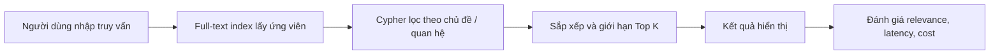

# Đánh giá chất lượng kết quả, độ trễ và chi phí tài nguyên

## 1. Tại sao cần đánh giá tìm kiếm theo ba chiều?

Trong Neo4j, ứng dụng có thể tìm tài liệu, sản phẩm, người dùng hoặc đường đi trong **property graph** bằng Cypher, chỉ mục thuộc tính, **full-text index**, **vector index** hoặc kết hợp nhiều cách truy xuất. Một câu truy vấn chạy được và trả về dữ liệu chưa đủ chứng minh hệ thống tìm kiếm hoạt động tốt.

Ví dụ, chức năng tìm tài liệu kỹ thuật có thể gặp các tình huống:

- Trả kết quả rất nhanh nhưng bài viết quan trọng nằm ngoài mười vị trí đầu.
- Tìm đúng nhiều bài nhưng `p95` tăng đột biến khi có nhiều người dùng đồng thời.
- Cải thiện độ phù hợp bằng cách mở rộng hàng nghìn node và relationship, đổi lại nhiều `DB Hits`, CPU, bộ nhớ và đọc đĩa.

Vì vậy, phải đánh giá **cả ba chiều**:

| Chiều | Câu hỏi | Chỉ số tiêu biểu |
|---|---|---|
| **Chất lượng kết quả** | Có tìm được tài liệu liên quan và xếp đúng thứ tự không? | `Precision@K`, `Recall@K`, `MRR`, `nDCG@K`, tỷ lệ không có kết quả |
| **Độ trễ và khả năng phục vụ** | Người dùng chờ bao lâu, nhất là ở phân vị cao và khi tăng tải? | `p50`, `p95`, `p99`, truy vấn/giây (QPS), tỷ lệ lỗi, timeout |
| **Chi phí tài nguyên** | Mỗi yêu cầu và toàn hệ thống tiêu tốn bao nhiêu? | `DB Hits`, rows, CPU, heap/GC, page-cache miss, I/O, dung lượng index |

Đây là bài học thuộc phần **Tìm kiếm nâng cao** của module `DATABASE_ENGINE_GRAPH_NEO4J`. Ta sẽ dùng dữ liệu node/relationship thực tế, chỉ mục full-text, Cypher và ví dụ Java Driver để đo cả ba mặt, đồng thời chỉ ra khi nào nên dùng `EXPLAIN`, `PROFILE` và đo tại ứng dụng.

### Mục tiêu học tập

Sau bài, bạn có thể:

1. Xây bộ truy vấn kiểm thử cùng nhãn độ liên quan (*relevance judgments*).
2. Tính và diễn giải `Precision@K`, `Recall@K`, `MRR`, `nDCG@K`.
3. Tách **thời gian truy vấn tại Neo4j** khỏi **độ trễ đầu cuối** và đo phân vị ở tải đại diện.
4. Dùng `EXPLAIN`/`PROFILE` kết hợp số liệu hệ thống để tìm nút thắt tài nguyên.
5. So sánh hai phương án tìm kiếm có kiểm soát, ra quyết định theo ngưỡng chất lượng và ngân sách độ trễ.

## 2. Xây tập dữ liệu và truy vấn tìm kiếm có thể lặp lại

Giả sử một cổng học tập cần tìm bài về Neo4j, Cypher, Java và cơ sở dữ liệu. Mỗi tài liệu là node `AS007Doc` có `id`, `title`, `body` và `topic`. Relationship `AS007_ABOUT` nối tài liệu với chủ đề, để minh họa bước lọc trên đồ thị sau khi tìm kiếm văn bản.



### 2.1. Tạo tám tài liệu mẫu

Các nhãn và tên chỉ mục có tiền tố `AS007` dành riêng cho bài. **Chỉ chạy trong cơ sở dữ liệu thực hành**; `MERGE` giúp chạy lại không tự thêm node trùng `id`.

```cypher
UNWIND [
  {id: 'd01', title: 'Neo4j Graph Modeling',
   body: 'Model nodes, relationships and property graph schema',
   topic: 'graph'},
  {id: 'd02', title: 'Cypher Path Queries',
   body: 'Find shortest paths and traversals in Neo4j',
   topic: 'graph'},
  {id: 'd03', title: 'Spring Data Neo4j',
   body: 'Map Java entities and Neo4j repositories',
   topic: 'java'},
  {id: 'd04', title: 'Graph Search Techniques',
   body: 'Full text retrieval, graph ranking and search evaluation',
   topic: 'graph'},
  {id: 'd05', title: 'Relational Database Indexes',
   body: 'B-tree indexes and SQL execution plans',
   topic: 'relational'},
  {id: 'd06', title: 'Neo4j Full Text Index',
   body: 'Search documents with text indexing in Neo4j',
   topic: 'graph'},
  {id: 'd07', title: 'Graph Theory Basics',
   body: 'Graph vertices, edges and algorithms',
   topic: 'graph'},
  {id: 'd08', title: 'Java Logging Basics',
   body: 'Configure logs and observe application latency',
   topic: 'java'}
] AS row
MERGE (d:AS007Doc {id: row.id})
SET d.title = row.title,
    d.body  = row.body,
    d.topic = row.topic;
```

Tạo quan hệ giữa tài liệu và chủ đề:

```cypher
MATCH (d:AS007Doc)
MERGE (t:AS007Topic {name: d.topic})
MERGE (d)-[:AS007_ABOUT]->(t);
```

Kiểm tra dữ liệu:

```cypher
MATCH (d:AS007Doc)-[:AS007_ABOUT]->(t:AS007Topic)
RETURN d.id AS docId, d.title AS title, t.name AS topic
ORDER BY docId;
```

Nếu chỉ có dữ liệu mẫu của bài, kỳ vọng **8 dòng**, một dòng cho mỗi tài liệu. Bộ dữ liệu nhỏ để học cách đo và kiểm chứng kết quả; **không dùng tám node để kết luận về hiệu năng sản xuất**.

### 2.2. Tạo full-text index và kiểm tra trạng thái

Trong Neo4j 5.x, full-text index dùng bộ phân tích văn bản để lập chỉ mục token và hỗ trợ truy vấn theo cú pháp Lucene. Nó khác với TEXT index dùng cho các predicate chuỗi như `CONTAINS`, `ENDS WITH` trong Cypher.

```cypher
CREATE FULLTEXT INDEX as007_doc_fts IF NOT EXISTS
FOR (d:AS007Doc)
ON EACH [d.title, d.body];
```

```cypher
SHOW FULLTEXT INDEXES
YIELD name, type, state, populationPercent, labelsOrTypes, properties
WHERE name = 'as007_doc_fts'
RETURN name, type, state, populationPercent, labelsOrTypes, properties;
```

Trước khi đo, xác nhận index tồn tại, gắn với `AS007Doc(title, body)` và có `state = 'ONLINE'`. Nếu còn `POPULATING` hoặc index đã trùng tên nhưng khác schema, kết quả đo không đáng tin. Việc xây dựng index cần thời gian và tài nguyên, không được gộp chi phí xây index vào thời gian truy vấn ổn định nếu mục đích là đánh giá truy vấn thường ngày.

### 2.3. Chạy tìm kiếm chuẩn

```cypher
CALL db.index.fulltext.queryNodes('as007_doc_fts', 'graph')
YIELD node, score
RETURN node.id AS docId, node.title AS title, score
ORDER BY score DESC, docId
LIMIT 5;
```

`score` là điểm xếp hạng do cơ chế full-text tạo ra, **không phải xác suất đúng**, và không nên so trực tiếp với score vector hay một chỉ mục khác. Kết quả cùng điểm được sắp theo `docId` để ổn định thứ tự. Bộ phân tích văn bản có thể làm thay đổi số ứng viên và thứ tự; do đó hãy **ghi lại kết quả thực tế** thay vì giả định một thứ tự cố định giữa các phiên bản hoặc cấu hình.

Một biến thể kết hợp đồ thị để chỉ trả tài liệu thuộc chủ đề `graph`:

```cypher
CALL db.index.fulltext.queryNodes('as007_doc_fts', 'graph')
YIELD node, score
MATCH (node)-[:AS007_ABOUT]->(:AS007Topic {name: 'graph'})
RETURN node.id AS docId, node.title AS title, score
ORDER BY score DESC, docId
LIMIT 5;
```

Đây là mô hình thường gặp: index tạo ứng viên, Cypher xác minh ngữ cảnh đồ thị, sau đó xếp hạng. **Lọc quá sớm bằng `LIMIT` trước bước `MATCH` có thể loại mất tài liệu phù hợp**; còn lọc quan hệ sau khi tạo quá nhiều ứng viên có thể tăng chi phí. Cả chất lượng và hiệu năng phải được đo ở **toàn pipeline**.

## 3. Đánh giá chất lượng bằng bộ nhãn relevance

Chỉ kiểm tra câu lệnh chạy được là chưa đủ. Cần một tập truy vấn người dùng và câu trả lời chuẩn (*golden set*, *qrels*) được gán nhãn độc lập với hệ thống đang thử.

Ví dụ người đánh giá cho truy vấn `graph` chấm:

| `docId` | Nội dung | Độ liên quan |
|---|---|---:|
| `d01` | Neo4j Graph Modeling | 3 — rất phù hợp |
| `d04` | Graph Search Techniques | 2 — phù hợp |
| `d07` | Graph Theory Basics | 1 — liên quan một phần |
| `d02` | Cypher Path Queries | 1 — liên quan gián tiếp |
| `d03`, `d05`, `d06`, `d08` | Các nội dung còn lại | 0 — không phù hợp cho ý định cụ thể này |

Các nhãn trên là **đánh giá giả định phục vụ bài tập**, không phải chân lý phổ quát. Tùy mục đích tìm kiếm (học khái niệm graph, thiết kế đồ thị Neo4j hay tối ưu truy vấn), cùng một tài liệu có thể được chấm khác.

Quy trình xây `qrels` đáng tin cậy:

1. **Chọn truy vấn đại diện** từ các ý định thực tế: điều hướng đến tài liệu, tìm lỗi Cypher, câu hỏi khái niệm, tìm tên sản phẩm, truy vấn dài bằng tiếng Việt, từ khóa sai chính tả.
2. **Lấy mẫu ứng viên từ nhiều phương án** (full-text, tìm theo thuộc tính, vector/hybrid, tìm thủ công) để tránh chỉ gán nhãn những gì một hệ thống trả về.
3. **Định nghĩa thang nhãn trước** (ví dụ 0–3); nhiều người đánh giá độc lập rồi xử lý bất đồng bằng cùng một quy tắc.
4. **Tách bộ phát triển và bộ kiểm tra**; không điều chỉnh trọng số để khớp chính các câu hỏi đem báo cáo kết quả cuối.
5. **Cập nhật theo thời gian** khi nội dung, ngôn ngữ, mục đích người dùng thay đổi; giữ phiên bản dữ liệu và bộ nhãn để so sánh được.

Nhãn có thể thiếu cho tài liệu chưa từng được đánh giá. **Không được mặc định mọi tài liệu chưa gán nhãn đều không liên quan** khi tính recall; điều đó làm chỉ số sai lệch. Cần ghi rõ cách xử lý *unjudged documents* hoặc bổ sung đánh giá.

### 3.1. Precision@K — độ chính xác trong K kết quả đầu

Quy ước `relevant` là nhãn **lớn hơn 0**:

```text
Precision@K = số tài liệu liên quan trong Top K / K
```

Giả sử một phương án xếp thứ tự **minh họa**, không phải kết quả mặc định của Neo4j:

| Thứ hạng | Tài liệu | Nhãn |
|---:|---|---:|
| 1 | d05 | 0 |
| 2 | d04 | 2 |
| 3 | d01 | 3 |
| 4 | d07 | 1 |
| 5 | d08 | 0 |

Top 3 có hai tài liệu liên quan, nên `Precision@3 = 2/3 ≈ 0,667`. Precision đặc biệt hữu ích khi giao diện chỉ hiển thị một trang kết quả, nhưng không cho biết còn bao nhiêu tài liệu tốt bị bỏ sót.

### 3.2. Recall@K — mức độ bao phủ tài liệu liên quan

```text
Recall@K = số tài liệu liên quan trong Top K
           / tổng số tài liệu liên quan trong tập đánh giá
```

Với bốn tài liệu được xem là liên quan (`d01`, `d02`, `d04`, `d07`), Top 3 tìm được hai nên `Recall@3 = 2/4 = 0,5`. Recall quan trọng cho tìm kiếm tri thức, rà soát tài liệu hoặc bài toán cần hạn chế bỏ sót.

Một đoạn Cypher kiểm chứng hai phép tính trên **bảng thứ hạng giả định**:

```cypher
WITH ['d05', 'd04', 'd01'] AS top3,
     ['d01', 'd02', 'd04', 'd07'] AS relevantIds
WITH top3, relevantIds,
     size([id IN top3 WHERE id IN relevantIds]) AS hits
RETURN toFloat(hits) / size(top3) AS precisionAt3,
       toFloat(hits) / size(relevantIds) AS recallAt3;
```

Kết quả kỳ vọng: `precisionAt3 ≈ 0,6667`, `recallAt3 = 0,5`. Ở hệ thống thật, **mỗi truy vấn phải có danh sách nhãn riêng**, không dùng cố định một `relevantIds` cho mọi câu hỏi.

### 3.3. MRR — ưu tiên tài liệu liên quan xuất hiện sớm

Với một truy vấn, **Reciprocal Rank (RR)** bằng nghịch đảo vị trí của **tài liệu liên quan đầu tiên**:

```text
RR(query) = 1 / vị trí của kết quả liên quan đầu tiên
MRR = trung bình RR trên tất cả truy vấn đánh giá
```

Trong ví dụ, kết quả liên quan đầu tiên nằm ở vị trí `2` nên `RR = 1/2 = 0,5`. Nếu một truy vấn không có kết quả liên quan trong phạm vi được xét, đặt `RR = 0`. `MRR` đặc biệt hợp lý cho truy vấn **điều hướng**, khi người dùng thường chỉ cần nhanh chóng tìm tài liệu đích; nó không đo trực tiếp chất lượng của toàn bộ danh sách sau vị trí đầu tiên.

### 3.4. nDCG@K — đánh giá thứ tự với mức độ liên quan nhiều cấp

`nDCG@K` dùng các nhãn `0–3` thay vì chỉ phân biệt liên quan/không liên quan. Với cách tính phổ biến:

```text
DCG@K  = tổng theo i = 1..K của (2^rel_i - 1) / log2(i + 1)
IDCG@K = DCG@K của thứ tự lý tưởng theo nhãn giảm dần
nDCG@K = DCG@K / IDCG@K   (nếu IDCG@K > 0)
```

Top 3 minh họa có các nhãn `[0, 2, 3]`:

```text
DCG@3  = 0/1 + 3/log2(3) + 7/log2(4) ≈ 5,393
IDCG@3 = 7/1 + 3/log2(3) + 1/log2(4) ≈ 9,393
nDCG@3 ≈ 5,393 / 9,393 ≈ 0,574
```

Thứ tự tốt hơn sẽ đặt `d01` (nhãn 3) trước `d04` (nhãn 2), rồi tới tài liệu có nhãn 1. Thường nDCG nằm trong khoảng `0–1` khi nhãn không âm; `1` là thứ tự lý tưởng trong phạm vi đánh giá. Với truy vấn không có tài liệu nào có nhãn dương, cần **quy ước rõ** (ví dụ bỏ qua khi lấy trung bình nDCG hoặc ghi 0), không chia cho `IDCG = 0`.

### 3.5. Chọn chỉ số theo ý định

| Tình huống | Chỉ số ưu tiên | Lý do |
|---|---|---|
| Người dùng muốn một tài liệu đúng tên | `MRR`, `Success@1` | Vị trí của kết quả đầu quan trọng |
| Danh sách 10 kết quả đầu | `Precision@10`, `nDCG@10` | Chất lượng và thứ tự trang đầu |
| Tra cứu tài liệu không được bỏ sót | `Recall@K` | Cần bao phủ tài liệu liên quan |
| Kết quả có nhiều mức độ phù hợp | `nDCG@K` | Phân biệt "rất đúng" và "hơi liên quan" |
| Tìm kiếm trên nhiều nhóm truy vấn | Chỉ số chia theo nhóm + trung bình tổng | Tránh một nhóm phổ biến che khuất nhóm khó |

Thực tế nên báo cáo **theo từng nhóm ý định** và theo lát cắt ngôn ngữ, số từ, mức phổ biến. Chỉ một con số trung bình có thể che mất sự sụt giảm với truy vấn hiếm hoặc có dấu tiếng Việt.

## 4. Đo độ trễ từ người dùng đến Neo4j

**Độ trễ đầu cuối** là thời gian từ khi ứng dụng nhận yêu cầu đến khi đã có kết quả dùng được. Với ứng dụng Java/Spring Data Neo4j, phần này có thể gồm:

```text
HTTP/API → xác thực → tạo/nhận session Driver
         → gửi Cypher qua mạng → Neo4j lập kế hoạch/thực thi
         → truyền và giải mã record → ánh xạ DTO → phản hồi API
```

`PROFILE` của Neo4j mô tả công việc **bên trong truy vấn**. Nó không phản ánh toàn bộ chi phí HTTP, giao tiếp mạng, deserialization, UI hay thời gian chờ thread. Vì vậy, **cần hai tầng đo**: đo end-to-end trong ứng dụng và chẩn đoán bên trong DB.

### 4.1. p50, p95, p99 và QPS

| Chỉ số | Diễn giải |
|---|---|
| `p50` | 50% lượt yêu cầu có độ trễ không vượt quá giá trị này (theo cách ước lượng phân vị đã chọn) |
| `p95` | Khoảng 95% lượt yêu cầu không vượt quá giá trị này; quan sát nhóm yêu cầu chậm |
| `p99` | Nhóm khoảng 1% lượt yêu cầu chậm nhất; nhạy với đột biến tải |
| `QPS` | Số truy vấn hoàn thành trong một giây; cần ghi kèm concurrency, lỗi và độ trễ |
| `Timeout/error rate` | Tỷ lệ vượt thời hạn hoặc thất bại; phải tính cả khi báo cáo chất lượng phục vụ |

Ví dụ đo mười lượt chạy với độ trễ ms giả định:

```cypher
UNWIND [18, 20, 21, 23, 24, 25, 28, 30, 45, 95] AS latencyMs
RETURN round(avg(latencyMs), 1) AS meanMs,
       percentileCont(latencyMs, 0.50) AS p50Ms,
       percentileCont(latencyMs, 0.95) AS p95Ms;
```

Theo phép nội suy tuyến tính của `percentileCont`: `meanMs = 32,9`, `p50Ms = 24,5`, `p95Ms = 72,5`. **Mười mẫu chỉ giúp minh họa cách tính**, không đủ để báo cáo p95/p99 đáng tin cậy. Khi benchmark cần số mẫu phù hợp, bao gồm truy vấn nhanh, chậm, không có kết quả và các trường hợp lỗi.

Độ trễ cao ở p95 nhưng p50 tốt thường gợi ý có nhóm truy vấn khó, tình trạng cache miss, cạnh tranh tài nguyên, GC hoặc truy vấn chịu tải đồng thời. Không thể xác định nguyên nhân chỉ từ hai số phân vị.

### 4.2. Đo thời gian thực thi tại Java Driver

Đo quanh lệnh gọi **và việc tiêu thụ kết quả**; nếu chỉ đo thời điểm nhận cursor khi dùng kết quả lazy, số liệu có thể bỏ sót thời gian truyền record.

```java
String cypher = """
    CALL db.index.fulltext.queryNodes('as007_doc_fts', $q)
    YIELD node, score
    RETURN node.id AS docId, node.title AS title, score
    ORDER BY score DESC, docId
    LIMIT $k
    """;

long startNs = System.nanoTime();
try (var session = driver.session()) {
    var rows = session.executeRead(tx ->
        tx.run(cypher, java.util.Map.of("q", "graph", "k", 5)).list()
    );
    long elapsedNs = System.nanoTime() - startNs;
    double elapsedMs = elapsedNs / 1_000_000.0;
    System.out.printf("rows=%d latencyMs=%.2f%n", rows.size(), elapsedMs);
}
```

`driver` ở đây là một `org.neo4j.driver.Driver` đã cấu hình; đoạn code mô tả cách đo phía ứng dụng, không thay thế bộ benchmark. Thời gian trên đo **toàn khối mở session, chạy read transaction và materialize danh sách**. Muốn đo endpoint, phải đặt đồng hồ ở tầng HTTP/API và báo cáo riêng thời gian ánh xạ/serialization. Tránh ghi log toàn bộ dữ liệu kết quả trên đường nóng vì logging có thể làm méo số đo.

### 4.3. Thiết kế phép đo tải

Một quy trình benchmark độ trễ tối thiểu:

1. **Cố định môi trường:** phiên bản Neo4j, cấu hình bộ nhớ, số CPU, dung lượng dữ liệu, trạng thái index `ONLINE`, phiên bản schema, phiên bản Java Driver và loại phần cứng.
2. **Chạy warm-up:** khởi động kết nối, bộ lập kế hoạch và page cache; đo riêng *cold* và *warm* nếu đó là nhu cầu thực tế, đừng trộn hai trạng thái mà không ghi chú.
3. **Trộn truy vấn thực tế:** kết hợp truy vấn từ khóa phổ biến/hiếm, nhiều token, sai chính tả, có bộ lọc quan hệ, không tìm thấy kết quả và các giá trị `K` khác nhau.
4. **Tăng concurrency có kiểm soát:** ghi số client đồng thời, QPS, timeout, độ trễ p50/p95/p99 và tỷ lệ lỗi cho từng mức tải; đừng chỉ báo cáo QPS cao nhất.
5. **Chạy lặp và đối chiếu:** đủ mẫu theo thời gian, đổi thứ tự thử nghiệm A/B, giữ các yếu tố khác tương đương; xem chênh lệch qua nhiều lần chạy thay vì dựa vào một lượt.
6. **Thử khi có ghi:** nếu sản xuất vừa index/cập nhật tài liệu vừa tìm kiếm, đo cả độ trễ tìm kiếm lẫn chi phí cập nhật index.

**Ví dụ SLO minh họa** (phải chỉnh theo sản phẩm, không phải chuẩn Neo4j): ở tải `100 QPS`, `p95 < 250 ms`, tỷ lệ lỗi `< 0,1%`, `nDCG@10 ≥ 0,85`. Một phương án đạt p95 nhưng giảm mạnh recall vẫn không thể gọi là cải tiến.

## 5. Đánh giá chi phí tài nguyên trong Neo4j

### 5.1. EXPLAIN và PROFILE trả lời gì?

`EXPLAIN` sinh kế hoạch **mà không thực thi** truy vấn; dùng để xem hướng truy cập index, mở rộng quan hệ, sort, aggregation. `PROFILE` **chạy truy vấn** và thu thập thông tin thực thi (tùy phiên bản và runtime), đặc biệt:

- **Rows:** số dòng đi qua từng toán tử; tăng vọt sau `Expand` hoặc `MATCH` thường dẫn đến chi phí lớn.
- **DB Hits:** số lượt truy cập dữ liệu do toán tử yêu cầu; là chỉ báo về công việc cơ sở dữ liệu, **không phải thời gian ms** và không đồng nghĩa số lần đọc đĩa.
- **Memory:** bộ nhớ toán tử sử dụng/ước lượng khi kế hoạch hỗ trợ, nhất là `Sort`, aggregation, join.
- **Page cache hits/misses:** nếu hiển thị trong profiling/monitoring, dùng để xem phần dữ liệu có được phục vụ từ cache hay phải tải thêm.

Ví dụ:

```cypher
EXPLAIN
CALL db.index.fulltext.queryNodes('as007_doc_fts', 'graph')
YIELD node, score
MATCH (node)-[:AS007_ABOUT]->(:AS007Topic {name: 'graph'})
RETURN node.id AS docId, score
ORDER BY score DESC, docId
LIMIT 5;
```

```cypher
PROFILE
CALL db.index.fulltext.queryNodes('as007_doc_fts', 'graph')
YIELD node, score
MATCH (node)-[:AS007_ABOUT]->(:AS007Topic {name: 'graph'})
RETURN node.id AS docId, score
ORDER BY score DESC, docId
LIMIT 5;
```

Khi đọc kế hoạch, hãy tìm vị trí `ProcedureCall` truy vấn full-text, các bước đi qua relationship, lọc theo `Topic`, sắp xếp và giới hạn kết quả. Tên toán tử cụ thể thay đổi theo phiên bản/runtimes. **DB Hits nhỏ không bảo đảm response nhanh** nếu ứng dụng truyền nhiều record qua mạng hoặc CPU dành cho xử lý Lucene/vector cao.

### 5.2. Đọc số liệu hệ thống và cân đối nguồn lực

| Nguồn số liệu | Theo dõi | Dấu hiệu nên điều tra |
|---|---|---|
| Query plan/`PROFILE` | Rows, DB Hits, sort, aggregation | Nhân số dòng sau mở rộng quan hệ; lọc quá muộn |
| Neo4j metrics/monitoring | CPU, heap, GC, page cache, disk I/O | Cache miss tăng, GC pause, CPU bão hòa |
| Hệ điều hành/container | RSS, giới hạn CPU/memory, I/O, disk | Throttling, hoán đổi bộ nhớ, hết dung lượng |
| Ứng dụng/Driver | Connection pool, thời gian chờ, retry, timeout | Chờ connection, retry nhiều lần, request bị treo |
| Vận hành chỉ mục | Dung lượng index, thời gian population, chi phí ghi | Thêm index làm tăng thời gian ghi và dung lượng |

Một câu truy vấn full-text có điểm số tốt vẫn có thể rất tốn tài nguyên nếu tạo hàng nghìn ứng viên, rồi `MATCH` đường đi nhiều hop cho từng ứng viên. Hãy quan sát **số ứng viên trước/sau từng bước**. Nếu thêm vector index, cần tính chi phí lưu embedding, xây chỉ mục, bộ nhớ ANN và cập nhật dữ liệu, không chỉ thời gian truy vấn khi index đã nóng.

**Chi phí trên một kết quả hữu ích** có thể được báo cáo bổ sung, chẳng hạn CPU-ms/yêu cầu hoặc DB Hits/truy vấn cùng `Precision@10`. Không nên dùng một tỷ lệ tự chế thay thế các chỉ số chuẩn: cần giữ cả chất lượng, độ trễ và tài nguyên để hiểu đánh đổi.

## 6. So sánh phương án tìm kiếm một cách công bằng

Giả sử nhóm phát triển cân nhắc ba pipeline:

| Phương án | Cách hoạt động | Điểm mạnh | Rủi ro cần đo |
|---|---|---|---|
| A — Text predicate | `MATCH ... WHERE title CONTAINS $q` | Dễ hiểu, hợp câu hỏi chuỗi con chính xác | Không có xếp hạng relevance; khác hành vi phân tích token |
| B — Full-text | `db.index.fulltext.queryNodes`, Top K | Xếp hạng theo từ khóa và hỗ trợ truy vấn văn bản | Bỏ sót cách diễn đạt đồng nghĩa; phụ thuộc analyzer |
| C — Hybrid | Full-text + vector, trộn theo rank | Có thể tăng bao phủ ý nghĩa và từ khóa | Thêm index, latency, chi phí embedding và hợp nhất kết quả |

Pipeline A có thể được tăng tốc bằng **TEXT index** cho `CONTAINS`; pipeline B dùng **FULLTEXT index**. Đây là hai kiểu tìm kiếm có ngữ nghĩa khác nhau nên phải so sánh với cùng nhu cầu người dùng, không chỉ cùng một chuỗi truy vấn.

### 6.1. Kết hợp full-text và vector: tránh trộn điểm thô

Điểm full-text và điểm vector thường nằm trên các thang đo khác nhau. Không nên lấy `0,5 * fulltextScore + 0,5 * vectorScore` khi chưa hiệu chỉnh/chuẩn hóa, vì con số không trực tiếp so sánh được. Một phương pháp đơn giản là **Reciprocal Rank Fusion (RRF)**:

```text
RRF(doc) = sum over retrieval lists [ 1 / (c + rank_list(doc)) ]
```

Trong đó `rank_list(doc)` là vị trí tài liệu trong từng danh sách và `c` là hằng số làm mượt do nhóm chọn (ví dụ `60`). Tài liệu không xuất hiện trong một danh sách không nhận đóng góp từ danh sách đó. RRF dùng **thứ hạng**, không dùng score gốc; vẫn phải đánh giá lại `Recall@K` và `nDCG@K`, vì hợp nhất không mặc nhiên cải thiện mọi loại truy vấn.

Đối với graph search, sau bước truy xuất ứng viên có thể thêm điểm từ quan hệ tới chủ đề, tác giả hoặc quyền truy cập. Mọi cách tăng điểm dựa trên nhiều hop phải đo thêm `DB Hits`/rows và kiểm tra tránh nhân dòng; ranking phải nhất quán với quy tắc quyền truy cập.

### 6.2. Báo cáo đánh đổi dưới dạng bảng quyết định

Các con số **giả định** sau minh họa cách trình bày kết quả sau thử nghiệm cùng dữ liệu và tải:

| Chỉ số | A: Chuỗi con | B: Full-text | C: Hybrid |
|---|---:|---:|---:|
| `nDCG@10` (cao hơn tốt hơn) | 0,61 | 0,79 | 0,86 |
| `Recall@10` (cao hơn tốt hơn) | 0,56 | 0,74 | 0,84 |
| `p95` đầu cuối (ms, thấp hơn tốt hơn) | 95 | 130 | 230 |
| CPU-ms/yêu cầu (thấp hơn tốt hơn) | 8 | 14 | 35 |
| Tỷ lệ lỗi (%) | 0,0 | 0,0 | 0,2 |

Nếu SLO yêu cầu `p95 < 200 ms` và lỗi `< 0,1%`, C chưa đạt dù có chất lượng tốt nhất. Nhóm có thể chọn B, hoặc tối ưu C rồi benchmark lại. Khi chọn, cần xét cả dữ liệu **từng nhóm truy vấn**, dung lượng chỉ mục và tác động lên luồng ghi.

Quy tắc quyết định thực dụng là **định nghĩa ngưỡng không được vi phạm trước khi tối ưu**: chất lượng tối thiểu, độ trễ tối đa, tỷ lệ lỗi, chi phí hạ tầng. Sau đó chỉ so sánh các phương án đáp ứng đủ ngưỡng; với bài toán nhiều mục tiêu không nên tuyệt đối hóa duy nhất một con số.

## 7. Quy trình đánh giá từ phòng thử nghiệm đến sản xuất

Một nhóm triển khai tìm kiếm trên Neo4j có thể dùng chu trình:

1. **Định nghĩa ý định và tập truy vấn.** Có đủ điều hướng, từ khóa ngắn, diễn đạt tự nhiên, truy vấn tiếng Việt có/không dấu, truy vấn không có kết quả.
2. **Đóng băng tập dữ liệu và qrels.** Mọi phương án so cùng snapshot, cùng câu hỏi và cùng nguyên tắc gán nhãn.
3. **Đo offline quality.** Báo cáo `Precision@K`, `Recall@K`, `MRR`, `nDCG@K`; lưu kết quả theo truy vấn để dễ phân tích lỗi.
4. **Đo latency và resources.** Ở nhiều mức concurrency, lấy `p50/p95/p99`, QPS, lỗi, CPU, page cache, heap và kích thước index; kiểm tra `EXPLAIN/PROFILE` cho nhóm truy vấn chậm.
5. **So sánh và chọn phương án.** Giữ cố định dữ liệu/tải, chạy lại đủ lần và áp ngưỡng đã thống nhất.
6. **Theo dõi sau triển khai.** Thống kê click, thời gian đến kết quả hữu ích, truy vấn không có kết quả, p95, lỗi và tài nguyên; dùng đánh giá người dùng để cập nhật qrels và phát hiện *quality drift*.

**Lưu ý khi dùng dữ liệu hành vi:** tỉ lệ click hoặc CTR chỉ là tín hiệu gián tiếp, bị ảnh hưởng bởi vị trí hiển thị, giao diện, độ nổi bật và thói quen người dùng. Không kết luận một tài liệu đúng chỉ vì nó được nhấp. Khi kiểm tra hiệu quả của phiên bản mới, có thể dùng thử nghiệm A/B phù hợp, đồng thời bảo đảm phép đo không tiết lộ thông tin nhạy cảm trong truy vấn người dùng.

### Bài tập thực hành

1. **Tạo golden set.** Viết thêm ít nhất năm truy vấn (`neo4j`, `cypher`, `graph`, `spring`, `sql`), gán nhãn 0–3 cho tám tài liệu và giải thích ý định người tìm.
2. **Đánh giá retrieval.** Với mỗi truy vấn, chạy full-text, lấy Top 5, tính `Precision@3`, `Recall@3` và `MRR` bằng bảng tính hoặc Cypher; giải thích tình huống kết quả đứng đầu sai nhưng các kết quả sau đúng.
3. **Đánh giá xếp hạng.** Đổi chỗ `d05` và `d01` trong bảng minh họa ở mục 3; tính lại `nDCG@3` và giải thích vì sao tăng dù số lượng tài liệu liên quan trong Top 3 giữ nguyên.
4. **Đánh giá độ trễ.** Viết chương trình Java Driver chạy nhiều lượt với từ khóa và `K` khác nhau; lưu elapsed time sau khi gọi `list()`, tính p50/p95 và ghi lại số lần timeout.
5. **Đánh giá kế hoạch.** So sánh `EXPLAIN`/`PROFILE` của truy vấn full-text thuần với truy vấn thêm `AS007_ABOUT`; nhận xét tác động đến rows, DB Hits, độ trễ đo từ Java.
6. **Ra quyết định.** Giả sử phải đạt `nDCG@10 ≥ 0,75`, `p95 < 180 ms` và lỗi `< 0,1%` theo bảng giả định ở mục 6; chọn phương án và giải thích các tiêu chí loại những phương án còn lại.

### Dọn dữ liệu mẫu

Các lệnh bên dưới **chỉ dành cho database thực hành**; `DETACH DELETE` xóa các relationship nối với node mẫu.

```cypher
DROP INDEX as007_doc_fts IF EXISTS;
```

```cypher
MATCH (d:AS007Doc)
DETACH DELETE d;
```

```cypher
MATCH (t:AS007Topic)
DETACH DELETE t;
```

### Checklist trước khi công bố một cải tiến tìm kiếm

- Có **bộ nhãn relevance** đủ đại diện và tách khỏi dữ liệu dùng để tinh chỉnh.
- Có **chỉ số chất lượng theo nhóm ý định**, không chỉ một số trung bình.
- Có **p50, p95, p99**, QPS, tỷ lệ lỗi ở tải gần thực tế, cùng phiên bản cấu hình và index `ONLINE`.
- Có **PROFILE của truy vấn chậm**, số liệu CPU/memory/cache/I/O và chi phí lưu trữ/cập nhật index.
- Có **ngưỡng chấp nhận rõ ràng** và bằng chứng phương án mới đáp ứng đồng thời chất lượng, tốc độ và tài nguyên.

**Kết luận:** Kết quả tìm kiếm trong Neo4j cần được đánh giá như một hệ thống nhiều tầng: index lấy ứng viên, Cypher duyệt và lọc đồ thị, cơ chế ranking sắp xếp, Java Driver đưa dữ liệu về ứng dụng. Một cải tiến chỉ thực sự có giá trị khi kết quả hữu ích hơn **và** đạt ngân sách thời gian, lỗi, tài nguyên trong điều kiện sử dụng thực tế.

## Tài liệu tham khảo

- [Neo4j Cypher Manual — Full-text indexes](https://neo4j.com/docs/cypher-manual/current/indexes/semantic-indexes/full-text-indexes/): tạo và sử dụng chỉ mục full-text.
- [Neo4j Cypher Manual — Execution plans](https://neo4j.com/docs/cypher-manual/current/planning-and-tuning/execution-plans/): `EXPLAIN`/`PROFILE`, rows và DB Hits.
- [Neo4j Operations Manual — Monitoring](https://neo4j.com/docs/operations-manual/current/monitoring/): theo dõi tài nguyên, page cache và số liệu vận hành.
- [Neo4j Java Driver Manual](https://neo4j.com/docs/java-manual/current/): giao dịch đọc, tham số và tiêu thụ kết quả tại ứng dụng.
