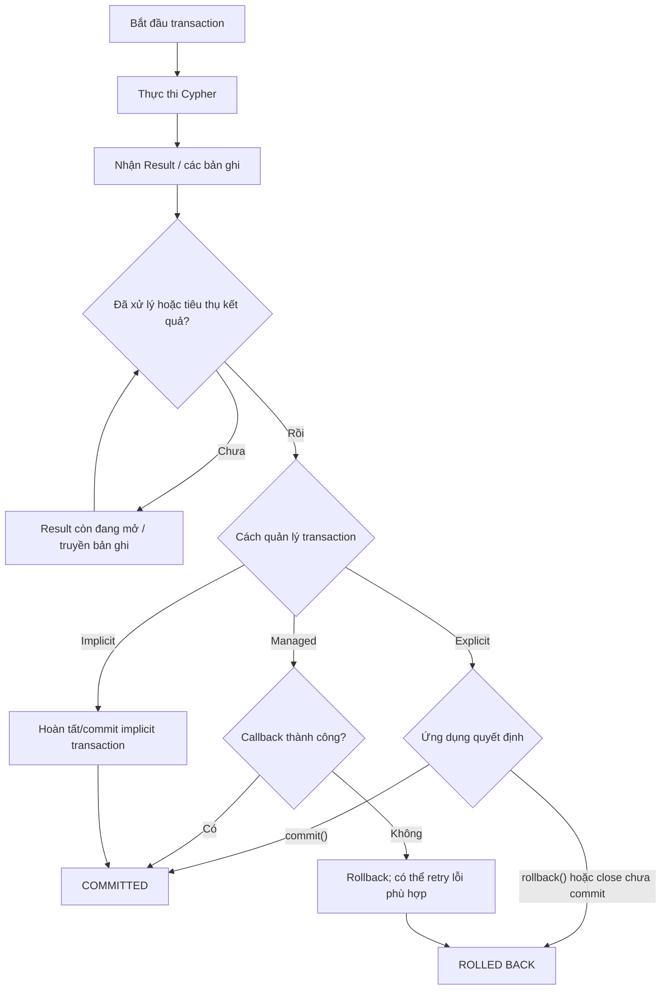
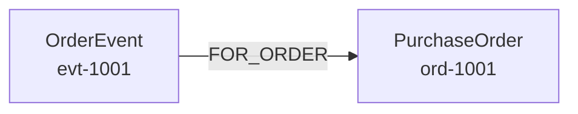
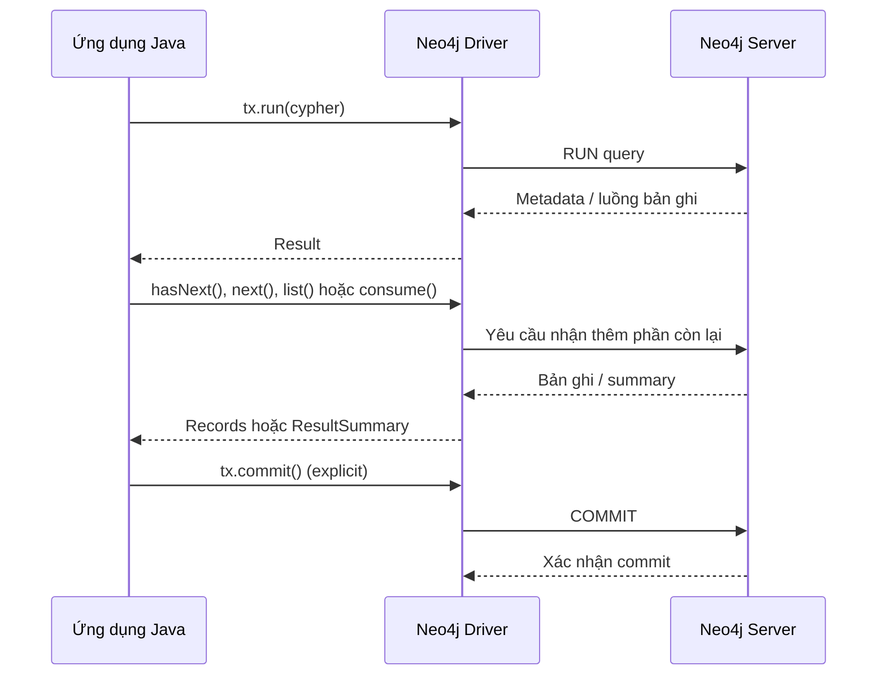

# Ranh giới commit, rollback và vòng đời kết quả truy vấn trong Neo4j

Khi ứng dụng gọi một câu Cypher, có ba câu hỏi phải trả lời rõ: **thao tác thuộc transaction nào**, **khi nào thay đổi thực sự được commit hoặc rollback**, và **khi nào kết quả truy vấn đã được đọc xong**. Nhầm lẫn ba thời điểm này dễ dẫn đến trạng thái dữ liệu dở dang, trả về `Result` không còn hợp lệ, ghi trùng khi retry hoặc thông báo thành công trước khi giao dịch hoàn tất.

Bài học thuộc chương **Giao dịch** của Neo4j, trong phạm vi mô hình **property graph**, Cypher, Neo4j Java Driver và Spring Data Neo4j. Ta sẽ đi từ ngữ nghĩa transaction đến ví dụ Java, tập trung vào ranh giới **commit/rollback** và vòng đời **kết quả truy vấn**.

## 1. Ranh giới transaction là gì?

**Transaction** là đơn vị thực thi gồm một hoặc nhiều thao tác đọc/ghi mà hệ quản trị cơ sở dữ liệu xử lý theo ranh giới chung.

- **Bắt đầu transaction**: mở một phạm vi thao tác; các câu lệnh trong phạm vi đó chưa mặc nhiên được xác nhận bền vững.
- **Commit**: yêu cầu Neo4j xác nhận các thay đổi của transaction thành một đơn vị thành công.
- **Rollback**: hủy các thay đổi **chưa commit** do transaction đó thực hiện.
- **Kết thúc transaction**: sau commit hoặc rollback, không thể tiếp tục chạy câu lệnh trong cùng transaction.
- **Đọc kết quả**: xử lý những bản ghi trả về từ một câu Cypher; hành vi này có liên quan đến thời điểm hoàn tất transaction ở chế độ **implicit transaction**, nhưng không thay thế `commit()` trong **explicit transaction**.

Trong transaction có nhiều câu lệnh, tính **atomicity** có nghĩa là toàn bộ thay đổi thuộc transaction được commit cùng nhau hoặc bị rollback cùng nhau nếu chưa commit. Neo4j không biến những thao tác bên ngoài cơ sở dữ liệu như gửi email hay gọi HTTP thành một phần của transaction chỉ vì chúng nằm trong cùng phương thức Java.

Ví dụ:

1. Tạo một node `(:PurchaseOrder)`.
2. Tạo một node `(:OrderEvent)` và quan hệ `:FOR_ORDER`.
3. Chỉ coi đơn hàng được tạo thành công khi **cả hai** thao tác hợp lệ.

Nếu bước 2 lỗi trước commit, có thể rollback cả bước 1. Nếu hai câu lệnh chạy thành hai transaction riêng và bước 1 đã commit, rollback của bước 2 **không** tự hoàn tác bước 1.

## 2. Ba cách thực thi transaction thường gặp

Trong **Neo4j Java Driver**, cách gọi API quyết định ai quản lý ranh giới giao dịch:

| Cách gọi | Loại transaction | Ai quyết định commit/rollback? | Dùng khi nào? |
| --- | --- | --- | --- |
| `session.run(cypher, parameters)` | **Implicit/auto-commit** | Driver/server hoàn tất transaction của câu lệnh khi kết quả được xử lý xong; cần `Result.consume()` để chủ động chờ hoàn tất | Một câu Cypher độc lập |
| `session.beginTransaction()` → `tx.run(...)` | **Explicit/unmanaged** | Ứng dụng gọi `tx.commit()` hoặc `tx.rollback()`; đóng transaction chưa commit sẽ rollback | Nhiều câu lệnh cần chung một ranh giới, điều khiển thủ công |
| `session.executeWrite(work)` / `executeRead(work)` | **Managed** | Driver quản lý transaction quanh callback; thành công thì commit, lỗi thì rollback và có thể retry nếu lỗi retryable | Phần lớn thao tác nghiệp vụ dùng Java Driver |

Với ứng dụng **Spring Data Neo4j**, một phương thức `@Transactional` có thể xác định ranh giới ở tầng service khi dùng Spring transaction manager phù hợp. Cần tránh trộn những thao tác dùng transaction do Spring quản lý với `driver.session()` tạo riêng mà vẫn mặc định chúng thuộc cùng transaction.

> **Phân biệt quan trọng:** `session.run()` tạo transaction implicit cho câu lệnh, không phải transaction tường minh dùng chung cho nhiều lệnh `session.run()` liên tiếp. Chúng không tự động gom thành một transaction nghiệp vụ.

## 3. Sơ đồ vòng đời giao dịch và kết quả



Sơ đồ minh họa **đường đi thành công**. Lỗi truy vấn, lỗi mạng hoặc thất bại khi commit có thể xảy ra ở nhiều điểm; đặc biệt, mất kết nối khi đang chờ phản hồi commit có thể khiến ứng dụng **chưa biết chắc** transaction đã commit hay chưa.

Ở explicit transaction, **đọc hết kết quả không tự commit**. Ở implicit transaction, **chỉ có đối tượng `Result` trong tay không chứng minh commit đã xong**.

## 4. Chuẩn bị mô hình property graph thực hành

Dùng hai loại node:

- `(:PurchaseOrder {id, status})`: đơn hàng.
- `(:OrderEvent {id, kind, createdAt})`: sự kiện nghiệp vụ, nối tới đơn hàng qua `(:OrderEvent)-[:FOR_ORDER]->(:PurchaseOrder)`.

Sơ đồ:



Trên một cơ sở dữ liệu **thử nghiệm**, tạo constraint để giúp ngăn trùng định danh:

```cypher
CREATE CONSTRAINT purchase_order_id_unique IF NOT EXISTS
FOR (o:PurchaseOrder)
REQUIRE o.id IS UNIQUE;
```

```cypher
CREATE CONSTRAINT order_event_id_unique IF NOT EXISTS
FOR (e:OrderEvent)
REQUIRE e.id IS UNIQUE;
```

Hai câu `CREATE CONSTRAINT` là các thao tác chuẩn bị riêng. Chúng không cần chạy chung transaction với thao tác đặt đơn hàng. Phần sau minh họa cách ứng dụng chủ động gom **hai câu ghi dữ liệu** vào cùng transaction.

## 5. Explicit transaction: commit sau khi các câu lệnh hoàn tất

Dùng Neo4j Java Driver, giả sử `driver` đã được cấu hình và kết nối hợp lệ.

```java
import org.neo4j.driver.Driver;
import org.neo4j.driver.Session;
import org.neo4j.driver.SessionConfig;
import org.neo4j.driver.Transaction;

import static org.neo4j.driver.Values.parameters;

public void placeOrder(Driver driver, String orderId, String eventId) {
    try (Session session =
             driver.session(SessionConfig.forDatabase("neo4j"))) {

        try (Transaction tx = session.beginTransaction()) {
            tx.run("""
                MERGE (o:PurchaseOrder {id: $orderId})
                SET o.status = 'CREATED'
                """, parameters("orderId", orderId)
            ).consume();

            tx.run("""
                MATCH (o:PurchaseOrder {id: $orderId})
                MERGE (e:OrderEvent {id: $eventId})
                ON CREATE SET
                    e.kind = 'CREATED',
                    e.createdAt = datetime()
                MERGE (e)-[:FOR_ORDER]->(o)
                """, parameters(
                    "orderId", orderId,
                    "eventId", eventId)
            ).consume();

            // Chỉ xác nhận khi cả hai câu lệnh đã hoàn tất thành công.
            tx.commit();
        }
    }
}
```

Ý nghĩa của các mốc:

1. `session.beginTransaction()` mở một transaction có ranh giới do ứng dụng điều khiển.
2. Mỗi `tx.run(...)` chạy một câu Cypher trong **cùng transaction**.
3. `consume()` đọc/hoàn tất luồng kết quả của câu lệnh đó; **không commit** transaction explicit.
4. `tx.commit()` là ranh giới xác nhận toàn bộ thay đổi của cả hai câu lệnh.
5. `try-with-resources` bảo đảm giải phóng tài nguyên. Nếu transaction kết thúc phạm vi mà **chưa commit**, việc đóng nó sẽ rollback các thay đổi chưa xác nhận.

Nếu câu lệnh thứ hai ném ngoại lệ trước khi `tx.commit()` được gọi, luồng Java rời khỏi khối và transaction chưa commit được đóng/rollback; node đơn hàng tạo trong cùng transaction không trở thành thay đổi đã commit.

**Cẩn trọng:** `MERGE` và index/constraint giúp xử lý các bản ghi lặp ở ví dụ, nhưng **không thay thế** kiểm tra toàn vẹn nghiệp vụ. Chẳng hạn, nếu `eventId` đã gắn với một đơn hàng khác, code thực tế phải xác minh quan hệ đó có hợp lệ hay không. Một câu lệnh Cypher trả về **0 bản ghi** không nhất thiết là lỗi; ứng dụng phải tự kiểm tra điều kiện nghiệp vụ cần thiết trước commit.

### Chủ động rollback khi nghiệp vụ không cho phép commit

Nếu ứng dụng phát hiện điều kiện cần hủy trước khi commit, có thể gọi `rollback()` tường minh:

```java
try (Session session = driver.session();
     Transaction tx = session.beginTransaction()) {

    tx.run("""
        MERGE (o:PurchaseOrder {id: $orderId})
        SET o.status = 'DRAFT'
        """, parameters("orderId", "ord-cancel-demo")
    ).consume();

    boolean approved = false; // Minh họa quyết định nghiệp vụ.
    if (!approved) {
        tx.rollback();
    } else {
        tx.commit();
    }
}
```

Sau `rollback()`, node mới hoặc cập nhật trạng thái từ transaction này **không được commit**. Rollback ở ví dụ không có nghĩa xóa vĩnh viễn mọi dữ liệu `PurchaseOrder` cũ: nó chỉ hoàn tác **các thay đổi do transaction đó tạo ra**.

Đừng cố sử dụng `tx` sau khi `commit()` hoặc `rollback()`. Nếu thao tác commit gửi lên server nhưng kết nối mất trước khi nhận được xác nhận, có thể chưa biết chắc commit đã thành công; không được mặc định rollback có thể cứu vãn một transaction đã có khả năng commit.

## 6. Implicit transaction: vòng đời `session.run()`

Đây là tình huống dễ nhầm nhất:

```java
try (Session session = driver.session()) {
    var result = session.run("""
        CREATE (t:Task {id: $id})
        RETURN t.id AS id
        """, parameters("id", "task-1001")
    );

    // Có Result chưa đồng nghĩa phía server đã hoàn tất commit.
    String id = result.single().get("id").asString();

    // Tiêu thụ phần kết quả còn lại và nhận summary hoàn tất.
    result.consume();

    System.out.println(id);
}
```

`session.run()` sử dụng **implicit transaction**. Phần kết quả được driver trả về theo cơ chế streaming/buffering; `session.run()` hoàn tất lời gọi Java không bảo đảm mọi bản ghi đã được đọc và transaction đã được commit.

`Result.consume()` yêu cầu driver lấy hoặc bỏ qua phần kết quả còn lại và đợi thông tin hoàn tất truy vấn. Trong trường hợp implicit transaction thông thường, đây là cách chủ động bảo đảm query đã hoàn tất và commit được xác nhận trước khi ứng dụng dựa vào nó.

Nếu không chủ động tiêu thụ kết quả, implicit transaction được driver quản lý và sẽ được hoàn tất muộn nhất khi đóng session; việc không kiểm tra kết quả/summary làm vị trí phát hiện lỗi và thời điểm xác nhận commit kém rõ ràng. Với thao tác ghi quan trọng, nên `consume()` trước khi báo thành công cho người dùng.

> **Không đồng nhất:** `Result.consume()` giúp hoàn tất **implicit transaction**, nhưng trong **explicit transaction** nó chỉ hoàn tất **luồng kết quả**. Lệnh xác nhận explicit transaction vẫn là `tx.commit()`.

### Khi không cần bản ghi trả về

Câu lệnh ghi dữ liệu có thể dùng `consume()` để hoàn tất và lấy thống kê:

```java
try (Session session = driver.session()) {
    var summary = session.run("""
        CREATE (:AuditMark {id: $id})
        """, parameters("id", "mark-1001")
    ).consume();

    System.out.println(
        "Nodes created: " + summary.counters().nodesCreated()
    );
}
```

`summary.counters()` cho biết thống kê của truy vấn. Nó **không phải** thay thế cho kiểm tra kết quả nghiệp vụ hoặc cơ chế chống ghi trùng trong hệ thống thực.

## 7. Vòng đời `Result`: streaming, materialization và summary

Một `Result` trả về từ Java Driver đại diện cho **luồng kết quả** của một câu query, không nhất thiết là danh sách bản ghi đã có sẵn đầy đủ trong bộ nhớ Java.

Có thể hình dung:



Driver có thể **prefetch/buffer** một số bản ghi, vì vậy chuỗi lời gọi mạng thực tế có thể khác sơ đồ. Điều quan trọng là ứng dụng phải xác định thời điểm nó **đã lấy đủ dữ liệu cần thiết** và thời điểm **transaction đã kết thúc**.

| API/kỹ thuật | Mục đích | Lưu ý |
| --- | --- | --- |
| `result.hasNext()` / `result.next()` | Đọc tuần tự từng bản ghi | Có thể phát sinh thêm truy cập mạng khi cần |
| `result.single()` | Lấy đúng một bản ghi | Sẽ báo lỗi nếu số bản ghi không đúng một |
| `result.list()` | Nạp các bản ghi vào danh sách | Thuận tiện nhưng có thể tốn nhiều bộ nhớ |
| `result.consume()` | Tiêu thụ/bỏ qua phần chưa đọc, nhận `ResultSummary` | Sau đó **không** tiếp tục đọc bản ghi từ cùng `Result` |
| `tx.commit()` | Xác nhận explicit transaction | Khác `consume()` |
| `tx.rollback()` | Hoàn tác các thay đổi chưa commit | Không dùng lại `tx` sau rollback |

### Ví dụ đọc kết quả theo luồng

```java
try (Session session = driver.session()) {
    var result = session.run("""
        MATCH (t:Task)
        RETURN t.id AS taskId
        ORDER BY taskId
        LIMIT 100
        """);

    while (result.hasNext()) {
        var record = result.next();
        System.out.println(record.get("taskId").asString());
    }

    var summary = result.consume();
    // Tại đây luồng Result đã hoàn tất.
}
```

Với dữ liệu lớn, đọc tuần tự thường tránh việc nạp **toàn bộ** tập kết quả vào một `List`. Tuy nhiên, cách này không có nghĩa bộ nhớ sử dụng luôn bằng không: driver có buffer và ứng dụng còn có chi phí xử lý từng bản ghi.

### Không trả về `Result` ra ngoài transaction đã đóng

Ví dụ **sai**:

```java
public org.neo4j.driver.Result findTasksBad(Driver driver) {
    try (Session session = driver.session()) {
        return session.run("MATCH (t:Task) RETURN t.id AS taskId");
    } // session đóng, Result không còn phạm vi sử dụng an toàn.
}
```

Ví dụ **đúng**: chuyển bản ghi thành dữ liệu thuần khi session/transaction còn mở.

```java
public java.util.List<String> findTaskIds(Driver driver) {
    try (Session session = driver.session()) {
        return session.executeRead(tx -> {
            var result = tx.run("""
                MATCH (t:Task)
                RETURN t.id AS taskId
                ORDER BY taskId
                """);

            return result.list(
                record -> record.get("taskId").asString()
            );
        });
    }
}
```

Callback trả về `List<String>` đã materialize trong transaction. Nếu kết quả rất lớn, nên thêm điều kiện lọc/phân trang hoặc xử lý theo từng lô phù hợp, tránh tích lũy cả tập kết quả.

## 8. Managed transaction: callback thành công mới commit

API `executeWrite` và `executeRead` của Java Driver quản lý transaction thay cho ứng dụng:

```java
try (Session session =
         driver.session(SessionConfig.forDatabase("neo4j"))) {

    String createdId = session.executeWrite(tx -> {
        var result = tx.run("""
            MERGE (o:PurchaseOrder {id: $orderId})
            SET o.status = 'READY'
            RETURN o.id AS id
            """, parameters("orderId", "ord-2001")
        );

        // Trả về dữ liệu đã materialize, không trả về Result.
        return result.single().get("id").asString();
    });

    System.out.println("Order: " + createdId);
}
```

Trong đường đi bình thường:

1. Driver mở transaction.
2. Callback chạy và trả về kết quả Java thông thường.
3. Driver commit transaction.
4. `executeWrite(...)` trả kết quả cho code gọi khi transaction đã hoàn tất thành công.

Nếu callback ném ngoại lệ, driver xử lý rollback. Với một số lỗi **retryable/transient**, driver có thể **chạy lại callback** theo chính sách retry. Vì vậy, callback nên được thiết kế an toàn khi thực thi lại.

**Không đặt tác dụng phụ ngoài Neo4j trong callback có thể retry** nếu không có cơ chế bảo đảm thực thi một lần, ví dụ:

```java
// Tránh:
// session.executeWrite(tx -> {
//     tx.run("CREATE ...");
//     emailService.sendConfirmation(); // Có thể bị gọi nhiều lần khi retry.
//     return null;
// });
```

Thay vào đó, lưu **ý định phát sự kiện** vào database trong cùng transaction (ví dụ outbox/event node), rồi để tác vụ khác phát thông điệp sau khi commit và hỗ trợ khử trùng lặp theo định danh. Thiết kế này không tự động bảo đảm “exactly once” cho hệ thống ngoài; vẫn cần quy tắc xử lý lặp.

### Khi nào chọn explicit hoặc managed?

- **Managed:** lựa chọn mặc định hợp lý cho phần lớn thao tác ứng dụng; driver xử lý commit/rollback và retry các lỗi phù hợp.
- **Explicit:** dùng khi cần điều khiển tường minh thời điểm commit/rollback hoặc tổ chức nhiều thao tác theo logic điều khiển phức tạp.
- **Implicit:** dùng cho một câu lệnh độc lập; nên đọc hết/`consume()` để biết lúc nào truy vấn và transaction hoàn tất.

## 9. Phân biệt ba tình huống lỗi

| Tình huống | Điều có thể xác nhận | Hành động hợp lý |
| --- | --- | --- |
| Lỗi ở câu lệnh thứ hai **trước commit** trong explicit transaction | Transaction chưa commit; rollback có thể hủy thay đổi của các câu trước trong transaction đó | Đóng/rollback transaction, trả lỗi |
| Callback `executeWrite` nhận lỗi retryable | Driver có thể rollback và chạy lại toàn bộ callback | Viết callback an toàn khi retry, dùng khóa nghiệp vụ/idempotency |
| Mất kết nối **khi đang chờ xác nhận commit** | Có thể **không biết chắc** Neo4j đã commit hay chưa | Đối chiếu trạng thái bằng định danh nghiệp vụ trước khi retry tạo mới |

Một câu Cypher trả về rỗng cũng là **kết quả thành công về mặt kỹ thuật**, ví dụ:

```cypher
MATCH (o:PurchaseOrder {id: 'does-not-exist'})
SET o.status = 'PAID'
RETURN o.id;
```

Câu này có thể trả về **0 bản ghi** và không sửa node nào, nhưng bản thân việc không khớp node không mặc định ném lỗi. Ứng dụng cần kiểm tra số bản ghi hoặc điều kiện nghiệp vụ nếu bắt buộc node phải tồn tại trước khi commit.

## 10. Ranh giới commit đặc biệt: `CALL { ... } IN TRANSACTIONS`

Neo4j có cú pháp thực thi subquery theo **nhiều transaction nội bộ** để xử lý dữ liệu lớn. Ví dụ:

```cypher
UNWIND range(1, 1000) AS i
CALL (i) {
    CREATE (:ImportItem {itemNo: i})
} IN TRANSACTIONS OF 100 ROWS;
```

Tư duy đúng ở đây khác với explicit transaction thông thường:

- Mỗi lô 100 dòng được xử lý trong một **transaction nội bộ**.
- Những lô đã commit có thể vẫn tồn tại nếu lô sau lỗi, tùy chế độ xử lý lỗi được sử dụng.
- Đây **không phải** một thao tác “toàn bộ 1.000 dòng hoặc không có gì” trên cùng một transaction.
- `CALL { ... } IN TRANSACTIONS` phải được chạy trong **implicit transaction**; không đặt nó bên trong explicit/managed transaction do ứng dụng mở.

Nếu ứng dụng gửi truy vấn này qua Java Driver, nên dùng `session.run(...)` và `consume()` để xác nhận kết quả cuối. Nếu chạy trong Neo4j Browser, cách giao diện bao bọc transaction có thể ảnh hưởng việc câu lệnh được chấp nhận; cần dùng chế độ chạy phù hợp với implicit transaction.

> **Cú pháp theo phiên bản:** Ví dụ `CALL (i) { ... }` sử dụng variable scope clause của các bản Neo4j Cypher mới. Trong môi trường cũ, cú pháp truyền biến vào subquery có thể khác; tham chiếu tài liệu đúng phiên bản đang dùng.

## 11. Tích hợp Spring Data Neo4j: phạm vi `@Transactional`

Với Spring Data Neo4j và transaction manager được cấu hình đúng, một phương thức service có `@Transactional` có thể làm ranh giới nghiệp vụ cho nhiều thao tác repository/`Neo4jClient`.

```java
import org.springframework.stereotype.Service;
import org.springframework.transaction.annotation.Transactional;

@Service
public class OrderApplicationService {

    private final OrderRepository orderRepository;
    private final OrderEventRepository eventRepository;

    public OrderApplicationService(
            OrderRepository orderRepository,
            OrderEventRepository eventRepository) {
        this.orderRepository = orderRepository;
        this.eventRepository = eventRepository;
    }

    @Transactional
    public void placeOrder(PurchaseOrder order, OrderEvent event) {
        orderRepository.save(order);
        eventRepository.save(event);
        // Spring commit khi phương thức hoàn tất theo quy tắc của
        // transaction manager; lỗi phù hợp sẽ dẫn tới rollback.
    }
}
```

Đây là ví dụ về **ranh giới service**, không phải toàn bộ phần định nghĩa repository/entity. Trong dự án thật, mapping giữa `OrderEvent` và `PurchaseOrder` phải được khai báo phù hợp để lưu đúng relationship.

Cần nhớ:

- `@Transactional` được Spring áp dụng khi lời gọi đi qua cơ chế quản lý transaction phù hợp; ví dụ **self-invocation** trong cùng class có thể không kích hoạt proxy transaction như mong đợi.
- Quy tắc rollback mặc định của Spring thường áp dụng cho `RuntimeException` và `Error`; muốn rollback cho checked exception cần cấu hình, chẳng hạn `rollbackFor`.
- Nếu trả về kết quả streaming/lazy ra ngoài phạm vi transaction rồi mới đọc, có thể truy cập dữ liệu sau khi transaction đã đóng. Hãy xử lý/materialize trong phạm vi phù hợp hoặc thiết kế streaming với thời gian sống transaction được quản lý rõ.
- Nếu tạo một `Driver Session` riêng trong phương thức đang `@Transactional`, session đó không mặc nhiên tham gia transaction do Spring quản lý. Tránh giả định mọi thao tác sẽ rollback cùng nhau khi chúng dùng hai cơ chế giao dịch khác nhau.

## 12. Checklist thiết kế giao dịch cho hệ thống đồ thị

Trước khi triển khai một luồng tạo/sửa node, relationship bằng Cypher từ Java, tự trả lời:

1. **Đơn vị nghiệp vụ là gì?** Một query, nhiều query hay nhiều lô nhập dữ liệu?
2. **Ai sở hữu transaction?** `session.run`, `beginTransaction`, `executeWrite` hay Spring `@Transactional`?
3. **Mốc thành công là gì?** Đã đọc đủ `Result`, nhận `ResultSummary`, hay đã nhận xác nhận `commit`?
4. **Có kết quả bị dùng sau khi đóng session/transaction không?** Nếu có, materialize thành DTO/bản ghi giá trị trước khi kết thúc.
5. **Có câu query trả 0 hàng nhưng nghiệp vụ cần báo lỗi không?** Nếu có, kiểm tra số bản ghi, counters hoặc điều kiện rõ ràng.
6. **Có retry không?** Nếu có, bảo vệ bằng constraint, khóa nghiệp vụ, idempotency key và kiểm tra trạng thái trước khi tạo lại.
7. **Có thao tác ngoài Neo4j không?** Đừng kỳ vọng `rollback` hoàn tác email, HTTP request hoặc message đã gửi.
8. **Có ghi theo lô bằng `CALL { ... } IN TRANSACTIONS` không?** Chấp nhận và xử lý khả năng một số lô đã commit trước khi phần còn lại thất bại.
9. **Có đọc quá nhiều bản ghi vào `list()` không?** Hạn chế kích thước kết quả và tránh kéo dài transaction không cần thiết.

Đối với điều tra hiệu năng, bổ sung số liệu truy vấn, log lỗi và telemetry của ứng dụng. Transaction giữ tài nguyên và khóa khi hoạt động, nên không nên mở giao dịch quá sớm hoặc kéo dài nó qua xử lý ngoài database.

## 13. Bài tập tự kiểm tra

**Câu 1.** Hai lời gọi `session.run()` lần lượt tạo `PurchaseOrder` và `OrderEvent`. Nếu câu thứ hai thất bại, câu đầu tiên có luôn rollback không?

<details>
<summary>Đáp án gợi ý</summary>

Không. Mỗi lời gọi `session.run()` thông thường chạy trong implicit transaction riêng. Nếu câu đầu đã được tiêu thụ/commit, lỗi của câu thứ hai không hoàn tác transaction trước đó. Muốn toàn bộ cùng commit hoặc rollback, cần đặt các thao tác trong cùng explicit hoặc managed transaction.

</details>

**Câu 2.** Trong `beginTransaction()`, lập trình viên gọi `tx.run(...).consume()` rồi thoát khỏi khối mà không gọi `tx.commit()`. Có thể xem dữ liệu đã lưu thành công không?

<details>
<summary>Đáp án gợi ý</summary>

Không. `consume()` chỉ hoàn tất kết quả câu query. Transaction explicit chưa commit; khi đóng mà chưa commit, các thay đổi của transaction sẽ rollback.

</details>

**Câu 3.** Vì sao không nên trả `Result` từ `executeRead(tx -> tx.run(...))` rồi duyệt sau khi callback kết thúc?

<details>
<summary>Đáp án gợi ý</summary>

Transaction do callback quản lý có thể đã đóng khi code bên ngoài bắt đầu duyệt `Result`. Kết quả là một luồng gắn với phạm vi truy vấn/transaction; nên chuyển thành dữ liệu cần dùng (ví dụ `List<String>` hoặc DTO) ngay trong callback.

</details>

**Câu 4.** Driver tự retry callback `executeWrite`. Vì sao gửi email ngay trong callback có nguy cơ gửi trùng?

<details>
<summary>Đáp án gợi ý</summary>

Callback có thể được gọi nhiều lần nếu gặp lỗi retryable; email đã gửi ở lần đầu không được rollback cùng Neo4j. Nên tách side effect ngoài database ra khỏi callback và xử lý idempotency/outbox phù hợp.

</details>

**Câu 5.** Truy vấn `CALL { ... } IN TRANSACTIONS OF 100 ROWS` xử lý 1.000 dòng nhưng lỗi ở lô thứ tám. Có được giả định toàn bộ những lô trước đã rollback không?

<details>
<summary>Đáp án gợi ý</summary>

Không. Cơ chế này dùng nhiều transaction nội bộ. Những lô đã commit có thể vẫn tồn tại khi lô sau lỗi. Quy trình nhập dữ liệu cần khả năng chạy lại an toàn hoặc xử lý các lô đã commit.

</details>

## Ghi nhớ

- **Ranh giới commit/rollback** quyết định phạm vi thay đổi được xác nhận hoặc hoàn tác; nó không đồng nhất với ranh giới của một câu query hoặc một object `Result`.
- **Implicit `session.run()`:** chủ động `consume()` để hoàn tất luồng và nhận tín hiệu kết thúc/commit của câu lệnh.
- **Explicit `beginTransaction()`:** `consume()` không commit; phải gọi `tx.commit()`, hoặc rollback/đóng transaction chưa commit.
- **Managed `executeWrite`/`executeRead`:** driver quản lý commit/rollback và có thể retry callback; không để side effect không idempotent trong callback.
- **Result gắn với vòng đời transaction/session:** đọc hoặc materialize trong phạm vi còn hiệu lực; đừng trả về luồng lazy sau khi transaction đã đóng.
- **Transaction theo lô** như `CALL { ... } IN TRANSACTIONS` có nhiều điểm commit; thiết kế phải tính đến thành công một phần.

### Tài liệu tham khảo

- [Neo4j Java Driver Manual — Transactions](https://neo4j.com/docs/java-manual/current/transactions/)
- [Neo4j Java Driver Manual — Run your own transactions](https://neo4j.com/docs/java-manual/current/transactions/#java-manual-transactions-explicit)
- [Neo4j Cypher Manual — CALL subqueries in transactions](https://neo4j.com/docs/cypher-manual/current/subqueries/subqueries-in-transactions/)
- [Spring Data Neo4j Reference](https://docs.spring.io/spring-data/neo4j/reference/)
