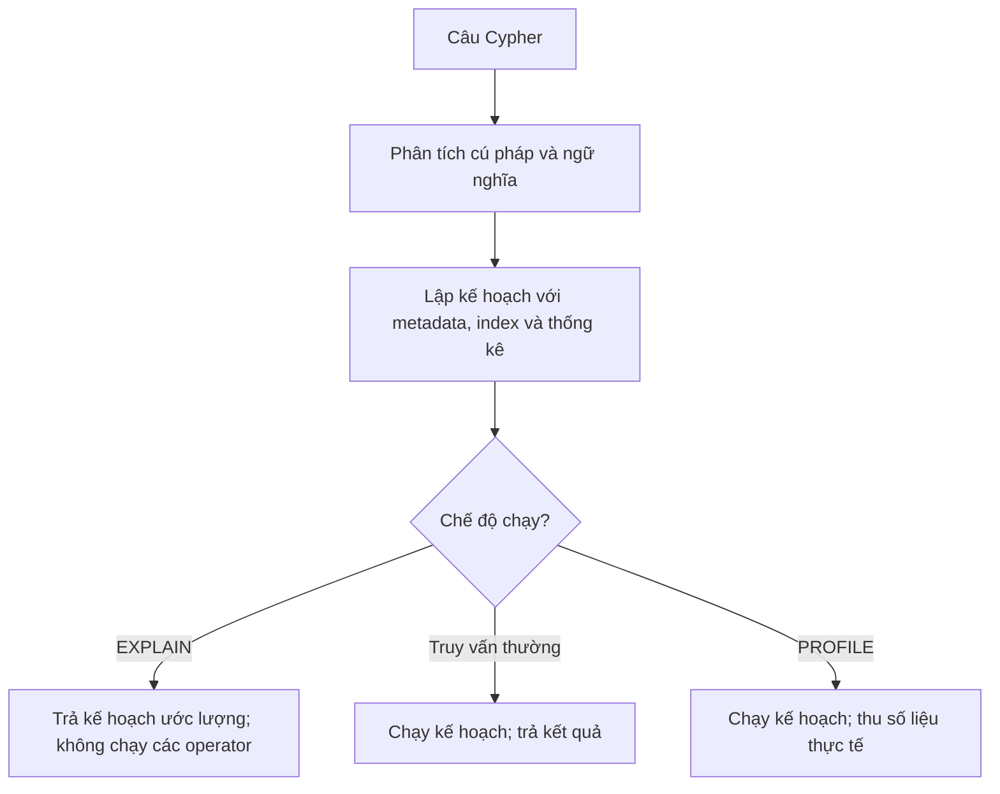

# EXPLAIN để xem kế hoạch mà không thực thi truy vấn trong Neo4j

Khi một câu Cypher có nhiều `MATCH`, lọc bằng `WHERE`, mở rộng relationship và sắp xếp kết quả, Neo4j phải chọn **cách tìm và kết hợp dữ liệu** trước khi thực thi. Cùng một câu hỏi có thể được xử lý bằng cách quét tất cả node, tra cứu index, duyệt các relationship theo nhiều hướng, rồi lọc hoặc tổng hợp. Cách chọn này được mô tả trong **execution plan** (kế hoạch thực thi).

Trong Neo4j, đặt từ khóa **`EXPLAIN` ở đầu câu truy vấn** để yêu cầu hệ thống **lập và hiển thị kế hoạch nhưng không thực thi các thao tác của truy vấn**:

```cypher
EXPLAIN
MATCH (p:Person)
WHERE p.email = 'an@example.com'
RETURN p.name;
```

`EXPLAIN` giúp trả lời “Neo4j **dự định** làm gì để chạy câu này?”; nó không thể tự trả lời “Truy vấn **đã** tốn bao nhiêu thời gian, đọc bao nhiêu bản ghi hoặc trả bao nhiêu kết quả?”. Những con số thực tế cần `PROFILE` hoặc phép đo riêng.

Bài học thuộc chương **Kế hoạch thực thi** trong module `DATABASE_ENGINE_GRAPH_NEO4J`, kết nối kiến thức về property graph, node/relationship, index, Cypher, tối ưu truy vấn và cách gọi truy vấn từ Neo4j Java Driver hoặc Spring Data Neo4j.

## 1. EXPLAIN nằm ở đâu trong vòng đời một câu Cypher?

Khi nhận một câu Cypher, Neo4j kiểm tra cú pháp, phân tích ngữ nghĩa, xem schema/index và thống kê liên quan, sau đó lập kế hoạch gồm nhiều **operator** (toán tử thực thi). Chỉ khi bước thực thi diễn ra, các operator mới thực sự đọc, lọc, ghép hoặc ghi dữ liệu.



Những điểm cần hiểu đúng:

- `EXPLAIN` **vẫn phải phân tích và lập kế hoạch**. Câu Cypher phải hợp lệ và được phân tích trong ngữ cảnh database hiện tại.
- Nó **không duyệt các hàng dữ liệu bằng kế hoạch đó**, không trả những bản ghi lẽ ra có từ `RETURN`, và không áp dụng các thay đổi từ `CREATE`, `SET` hoặc `DELETE` trong câu được giải thích.
- Kế hoạch được xây dựng theo **lược đồ, index, thống kê, phiên bản Neo4j, cấu hình và điều kiện truy vấn** ở thời điểm lập kế hoạch. Chạy lại sau khi tạo index hoặc cập nhật dữ liệu có thể có phương án khác.
- `EXPLAIN` đưa ra **ước lượng**, không phải bằng chứng một nhánh thực sự có bao nhiêu hàng hoặc đã đạt tốc độ nào.

> **Tóm ý:** `EXPLAIN` là “xem trước cách thực hiện”, `PROFILE` là “thực hiện và đo”. Cả hai giúp nghiên cứu execution plan, nhưng chỉ `PROFILE` chạy truy vấn được chỉ định.

## 2. Cú pháp và cách lấy kế hoạch

Cú pháp tổng quát:

```cypher
EXPLAIN
<cypher-query>
```

Ví dụ truy vấn đọc:

```cypher
EXPLAIN
MATCH (p:Person)-[:FRIEND_OF]->(friend:Person)
WHERE p.email = 'an@example.com'
RETURN friend.name AS friendName
ORDER BY friendName
LIMIT 10;
```

Trong Neo4j Browser, kết quả `EXPLAIN` thường được xem ở chế độ **Plan**, cho phép mở rộng từng operator và các thống kê ước tính. Trong Neo4j Java Driver, phần kế hoạch nằm trong **result summary**, nên không nên cố đọc nó như danh sách bản ghi từ `RETURN`. Hình thức trình bày khác nhau giữa Browser, Desktop, CLI và driver; mục đích của `EXPLAIN` vẫn như nhau.

`EXPLAIN` đặt trước **toàn bộ câu truy vấn**, không phải trước từng `MATCH`:

```cypher
// Đúng: chỉ một EXPLAIN cho toàn bộ truy vấn
EXPLAIN
MATCH (p:Person)
WHERE p.active = true
WITH p
MATCH (p)-[:ENROLLED_IN]->(c:Course)
RETURN p.name, c.code;
```

Để truy vấn có parameter như `$email` được lập kế hoạch, hãy truyền parameter phù hợp qua công cụ chạy Cypher hoặc Driver. Một số biểu thức hoặc chiến lược tối ưu có thể phụ thuộc kiểu dữ liệu đầu vào.

## 3. Chuẩn bị đồ thị nhỏ để đọc plan

Chạy phần tạo dữ liệu sau **một lần trên database thử nghiệm**. Các label/relationship type có tiền tố `PlanDemo` tách ví dụ khỏi dữ liệu ứng dụng. Nếu cơ sở dữ liệu đã chứa những bản ghi này, hãy dùng một database thử mới thay vì chạy lại `CREATE`.

```cypher
CREATE
  (an:PlanDemoPerson {
    code: 'P01', name: 'An', email: 'an@example.com', active: true
  }),
  (binh:PlanDemoPerson {
    code: 'P02', name: 'Bình', email: 'binh@example.com', active: true
  }),
  (chi:PlanDemoPerson {
    code: 'P03', name: 'Chi', email: 'chi@example.com', active: false
  }),
  (cypher:PlanDemoCourse {code: 'CYP-101', title: 'Cypher cơ bản'}),
  (graph:PlanDemoCourse {code: 'GRA-201', title: 'Graph Modeling'}),
  (an)-[:PLAN_DEMO_ENROLLED_IN]->(cypher),
  (an)-[:PLAN_DEMO_ENROLLED_IN]->(graph),
  (binh)-[:PLAN_DEMO_ENROLLED_IN]->(cypher);
```

Sơ đồ dữ liệu:

```text
An   ──ENROLLED_IN──► CYP-101
 └───ENROLLED_IN──► GRA-201
Bình ─ENROLLED_IN──► CYP-101
Chi  (chưa đăng ký khóa học)
```

Có **3 người**, **2 khóa học** và **3 relationship đăng ký**. Các số này chỉ dùng để hiểu ngữ nghĩa kết quả khi chạy truy vấn thường; **`EXPLAIN` sẽ không trả các hàng ấy**.

### 3.1. Lần đầu dùng EXPLAIN

```cypher
EXPLAIN
MATCH (p:PlanDemoPerson)
WHERE p.active = true
RETURN p.code AS code, p.name AS name
ORDER BY name;
```

Một execution plan có thể chứa các operator tương đương với:

```text
ProduceResults
└── Sort
    └── Projection
        └── Filter (p.active = true)
            └── NodeByLabelScan (p:PlanDemoPerson)
```

Đây là **sơ đồ khái niệm**, không phải đầu ra cam kết của Neo4j. Tên và cách ghép operator phụ thuộc phiên bản, planner, runtime, index và thống kê. Ví dụ, `Filter` hoặc `Projection` có thể được ghép vào một operator khác. Không nên coi việc plan hiển thị khác hình minh họa là lỗi.

Đọc theo luồng dữ liệu từ **operator tạo đầu vào** (thường ở đáy/các lá cây) tới **operator xuất kết quả**. Một `NodeByLabelScan` tìm node theo label, `Filter` giữ những hàng thỏa điều kiện, `Sort` sắp xếp, rồi `ProduceResults` đưa kết quả ra ngoài. Khi kế hoạch có nhiều nhánh hoặc các operator dạng apply/join, cần lần theo từng nhánh thay vì đọc chỉ một đường thẳng.

## 4. Các trường trong kế hoạch: những gì là ước lượng?

Giao diện Neo4j thường hiển thị một số thông tin sau (tùy phiên bản và công cụ):

| Trường/thông tin | Khi dùng `EXPLAIN` | Cách diễn giải |
| --- | --- | --- |
| **Operator** | Có | Thao tác dự kiến, như quét label, tra index, mở rộng relationship, lọc |
| **Estimated Rows** | Có | **Ước lượng** số hàng đi qua/đầu ra của operator; không phải dữ liệu đã đếm |
| **Identifiers** / biến | Có thể có | Biến nào sẵn có tại operator, chẳng hạn `p`, `c` |
| **Details** | Có | Index, điều kiện lọc, loại relationship, khóa sắp xếp... |
| **Order** / ordered by | Có thể có | Thứ tự đầu ra được bảo đảm hoặc đã biết tại một phần kế hoạch |
| **Actual Rows** | Không đo được | Chỉ khi chạy bằng `PROFILE` mới có số hàng thực tế |
| **DB Hits**, **Time**, **Memory** thực tế | Không đo được qua thực thi | Các chỉ số thực thi xuất hiện trong `PROFILE` tùy runtime/giao diện |

Đừng nhầm **`Estimated Rows`** với `Rows` của `PROFILE`. Chẳng hạn plan dự đoán một thao tác mở rộng tạo 100 hàng, nhưng khi chạy thật có thể là 2, 500 hoặc 0 vì thống kê chỉ phản ánh phân bố ở mức ước lượng.

Thông thường, planner suy cardinality từ số node theo label, số relationship theo type, đặc tính index và thống kê selectivity. Nếu dữ liệu bị lệch mạnh (một người có hàng triệu quan hệ, hầu hết người khác chỉ có vài quan hệ), ước lượng trung bình có thể khác xa trường hợp cụ thể.

## 5. Kiểm tra liệu điều kiện lọc có thể tận dụng index

Giả sử phần mềm tìm người bằng `email`. Chạy `EXPLAIN` trước khi tạo index để xem chiến lược hiện tại:

```cypher
EXPLAIN
MATCH (p:PlanDemoPerson)
WHERE p.email = 'an@example.com'
RETURN p.code AS code, p.name AS name;
```

Nếu chưa có index hữu ích, kế hoạch có thể chứa thao tác quét `PlanDemoPerson` và lọc email. Bây giờ tạo **range index** trong môi trường thử nghiệm:

```cypher
CREATE RANGE INDEX plan_demo_person_email IF NOT EXISTS
FOR (p:PlanDemoPerson)
ON (p.email);
```

Lưu ý: **lệnh `CREATE RANGE INDEX` này thực sự làm thay đổi schema**. Nó là bước chuẩn bị thử nghiệm, không phải truy vấn `EXPLAIN`. Hãy đợi chỉ mục sẵn sàng trước khi đối chiếu:

```cypher
SHOW INDEXES
YIELD name, type, state, labelsOrTypes, properties
WHERE name = 'plan_demo_person_email'
RETURN name, type, state, labelsOrTypes, properties;
```

Chỉ khi trạng thái là `ONLINE` mới kỳ vọng chỉ mục được dùng trong truy vấn. Sau đó chạy lại **cùng câu `EXPLAIN`**.

Một hướng thực thi phù hợp khi dùng index là `NodeIndexSeek` trên `PlanDemoPerson(email)` thay vì quét toàn label. Tuy nhiên, **Neo4j không bắt buộc chọn index chỉ vì nó tồn tại**: với tập ba người cực nhỏ, planner có thể quyết định quét label rẻ hơn; lựa chọn còn chịu ảnh hưởng bởi selectivity, thống kê và tính hợp lệ của predicate. Vì vậy:

- Xem **operator và tên index thực sự xuất hiện trong plan**, không kết luận chỉ dựa vào câu lệnh `CREATE INDEX`.
- Với dữ liệu lớn, nếu truy vấn thường xuyên lọc theo email thì index phù hợp thường giảm lượng dữ liệu cần xét.
- Nếu không thấy index, hãy kiểm tra **trạng thái ONLINE**, label, tên property, kiểu dữ liệu, biểu thức `WHERE`, rồi mới xem đến planner và thống kê.

### 5.1. Biểu thức có thể khiến index không được sử dụng

So sánh:

```cypher
// Có khả năng dùng range index trên email
EXPLAIN
MATCH (p:PlanDemoPerson)
WHERE p.email = 'an@example.com'
RETURN p.code;
```

```cypher
// Biến đổi property trong điều kiện: có thể ngăn index seek trực tiếp
EXPLAIN
MATCH (p:PlanDemoPerson)
WHERE toLower(p.email) = 'an@example.com'
RETURN p.code;
```

Hai truy vấn có **ngữ nghĩa so khớp khác nhau**. Truy vấn thứ hai áp dụng hàm lên từng giá trị email, nên chỉ mục trên giá trị `p.email` gốc không nhất thiết hỗ trợ trực tiếp cho cách lọc đó. Nếu cần so khớp chuẩn hóa thường xuyên, nên cân nhắc lưu khóa đã chuẩn hóa với index riêng hoặc chọn giải pháp tìm kiếm thích hợp.

Không nên sửa câu Cypher chỉ để ép dùng index nếu điều đó làm đổi ý nghĩa nghiệp vụ của kết quả.

## 6. Những operator đáng chú ý khi đọc EXPLAIN

Tên operator có thể khác giữa các phiên bản hoặc runtime; bảng sau tóm tắt vai trò thường gặp:

| Nhóm | Operator ví dụ | Câu hỏi cần đặt ra |
| --- | --- | --- |
| Bắt đầu từ node | `AllNodesScan`, `NodeByLabelScan` | Đang quét bao nhiêu node? Có thể thu hẹp label hoặc dùng index không? |
| Tra index | `NodeIndexSeek`, `NodeIndexScan`, `NodeUniqueIndexSeek` | Index nào? Predicate có chọn lọc cao không? |
| Duyệt đồ thị | `Expand(All)`, `Expand(Into)`, `VarLengthExpand(All)` | Mỗi hàng đầu vào có thể mở rộng thành bao nhiêu relationship/path? |
| Lọc | `Filter` | Điều kiện được áp dụng sớm hay sau khi tạo nhiều hàng? |
| Kết hợp nhánh | `Apply`, `CartesianProduct`, các dạng join | Các nhánh có điều kiện liên kết thật sự không? Có nhân tổ hợp không? |
| Gom nhóm | `Aggregation`, `OrderedAggregation`, `Distinct` | Có tạo nhiều hàng chỉ để gom lại không? |
| Sắp xếp/cắt | `Sort`, `Top`, `Limit` | Kết quả có phải sắp xếp một tập lớn trước khi trả ít hàng? |
| Ranh giới đọc/ghi | `Eager`, các operator ghi | Có phải vật hóa hàng trước khi ghi/đọc tiếp không? |
| Xuất kết quả | `ProduceResults` | Luồng dữ liệu cuối cùng gồm những biểu thức nào? |

Một operator `NodeByLabelScan` **không mặc nhiên là xấu**: quét 20 node trong một label nhỏ có thể là lựa chọn tốt. Ngược lại, một `NodeIndexSeek` cũng không bảo đảm truy vấn nhanh nếu nó trả về hàng triệu node rồi phải mở rộng nhiều quan hệ. Hãy đánh giá **cả chuỗi operator**, lượng dữ liệu dự kiến đi qua và mục tiêu thực tế của truy vấn.

## 7. Nhận diện sự tăng số hàng khi ghép nhiều mẫu

Neo4j là property graph. Từ một người có thể đi tới nhiều khóa học; mỗi kết quả mở rộng tạo thêm một tổ hợp biến. `EXPLAIN` giúp thấy nơi planner dự định mở rộng quan hệ.

```cypher
EXPLAIN
MATCH (p:PlanDemoPerson)-[:PLAN_DEMO_ENROLLED_IN]->(c:PlanDemoCourse)
WHERE p.active = true
RETURN p.name AS person, c.code AS course
ORDER BY person, course;
```

Nếu chạy truy vấn bình thường trên dữ liệu mẫu, sẽ có ba cặp đăng ký: An–CYP-101, An–GRA-201, Bình–CYP-101. Nhưng **khi dùng `EXPLAIN`, không có ba hàng dữ liệu đó được sinh ra**; người đọc chỉ thấy cách planner dự định tìm các cặp.

Một plan có thể chọn xuất phát từ `PlanDemoPerson`, lọc người đang active, rồi `Expand(All)` theo `PLAN_DEMO_ENROLLED_IN` tới khóa học. Cũng có thể xuất phát từ phía khóa học nếu planner đánh giá rẻ hơn. Thứ tự logic trong câu Cypher **không đảm bảo** trật tự vật lý mà planner chọn.

### 7.1. Phát hiện Cartesian product

Hai mẫu không liên kết với nhau có thể tạo mọi cặp:

```cypher
EXPLAIN
MATCH (p:PlanDemoPerson), (c:PlanDemoCourse)
RETURN p.code AS person, c.code AS course;
```

Về ngữ nghĩa, nếu chạy thật với dữ liệu mẫu, truy vấn tạo `3 × 2 = 6` hàng. Vì hai mẫu độc lập, execution plan có thể có `CartesianProduct` hoặc cách kết hợp tương đương. Đây có thể là điều **cố ý** nếu bạn thật sự cần mọi tổ hợp; nếu không, hãy nối bằng relationship hoặc điều kiện phù hợp:

```cypher
EXPLAIN
MATCH (p:PlanDemoPerson)-[:PLAN_DEMO_ENROLLED_IN]->(c:PlanDemoCourse)
RETURN p.code AS person, c.code AS course;
```

Câu sau chỉ xét các quan hệ đăng ký tồn tại. Từ `EXPLAIN`, ta biết được dạng đường thực thi dự tính, nhưng để kết luận **đã** tạo bao nhiêu hàng và mất bao nhiêu công phải chuyển sang `PROFILE` trên câu truy vấn đọc khi phù hợp.

### 7.2. Đường đi biến độ dài

```cypher
EXPLAIN
MATCH path = (start:PlanDemoPerson)-[:PLAN_DEMO_ENROLLED_IN*1..3]->(end)
RETURN path
LIMIT 10;
```

Phần mở rộng `*1..3` có thể cần khám phá nhiều nhánh. Số đường đi trung gian có thể tăng mạnh khi đồ thị dày, ngay cả khi `LIMIT 10` giới hạn số kết quả cuối. `EXPLAIN` có thể hiện các operator mở rộng đường đi và ước lượng hàng, nhưng không thể dùng nó làm bằng chứng đã duyệt chính xác bao nhiêu relationship.

**Lưu ý phiên bản:** cú pháp relationship biến độ dài `*1..3` là dạng Cypher quen thuộc trong Neo4j 5; trong Cypher 25, các dạng quantified path pattern/quantified relationships là hướng cú pháp hiện hành. Nếu môi trường yêu cầu Cypher 25 thuần, kiểm tra cú pháp path pattern phù hợp trước khi chạy ví dụ.

## 8. EXPLAIN truy vấn ghi: xem trước mà không làm thay đổi graph

Một lợi ích lớn của `EXPLAIN` là **có thể lập kế hoạch cho truy vấn chứa thao tác ghi** mà chưa tạo/sửa/xóa dữ liệu.

```cypher
EXPLAIN
CREATE (probe:PlanDemoProbe {code: 'EXPLAIN-ONLY'})
RETURN probe.code AS code;
```

Nếu đây là truy vấn được chạy với `EXPLAIN`, node `PlanDemoProbe` **không được tạo**. Có thể quan sát riêng bằng câu truy vấn đọc sau:

```cypher
MATCH (probe:PlanDemoProbe {code: 'EXPLAIN-ONLY'})
RETURN count(probe) AS createdCount;
```

Trên database mẫu chưa có node nào như vậy, `createdCount = 0`. Đoạn kiểm tra `MATCH` này **thực sự chạy** và chỉ nhằm xác nhận hiệu ứng trên đồ thị thử nghiệm. Nó không phải kết quả do `EXPLAIN` trả ra.

Tương tự, các câu sau chỉ được **lập kế hoạch**, không cập nhật dữ liệu nếu có `EXPLAIN` ở đầu:

```cypher
EXPLAIN
MATCH (p:PlanDemoPerson {code: 'P01'})
SET p.active = false
RETURN p.code, p.active;
```

```cypher
EXPLAIN
MATCH (p:PlanDemoPerson {code: 'P03'})
DELETE p;
```

Ở truy vấn ghi phức tạp, plan có thể bộc lộ thao tác `Eager`, tìm kiếm node, mở rộng relationship rồi mới cập nhật. Nó hữu ích để dự đoán nơi có thể tốn tài nguyên hoặc bị mở rộng quá nhiều. Tuy nhiên, `EXPLAIN` **không chứng minh lệnh ghi sẽ thành công**: nó chưa thực sự kiểm tra tất cả dữ liệu hiện có, xung đột constraint, tranh chấp khóa hay lỗi chỉ phát sinh lúc chạy.

Hãy phân biệt:

- `EXPLAIN CREATE ...`: xem kế hoạch tạo node, **không tạo node**.
- `CREATE ...`: thực thi thật, **có thể tạo node**.
- `PROFILE CREATE ...`: **vẫn thực thi và tạo node**, đồng thời thu số liệu.

Vì vậy, trước truy vấn cập nhật hoặc xóa trên production, `EXPLAIN` là bước phân tích hữu ích, nhưng cần kiểm thử có kiểm soát và quy trình triển khai phù hợp.

## 9. EXPLAIN, PROFILE và chạy bình thường khác nhau thế nào?

| Chế độ | Thực thi các thao tác truy vấn? | Trả bản ghi từ `RETURN`? | Có kế hoạch? | Có số liệu thực tế? | Có thể sửa dữ liệu nếu câu có ghi? |
| --- | --- | --- | --- | --- | --- |
| `EXPLAIN` | **Không** | Không | Có | Không | **Không** |
| `PROFILE` | **Có** | Có | Có, kèm đo đạc | Có | **Có** |
| Không có tiền tố | **Có** | Có | Có thể xem thông tin tóm tắt qua công cụ | Tùy công cụ đo | **Có** |

Ví dụ cùng một câu truy vấn đọc:

```cypher
// 1. Lập kế hoạch, không đọc các hàng kết quả
EXPLAIN
MATCH (p:PlanDemoPerson)
WHERE p.active = true
RETURN p.name;
```

```cypher
// 2. Thực thi và đo DB Hits / Rows (tùy runtime)
PROFILE
MATCH (p:PlanDemoPerson)
WHERE p.active = true
RETURN p.name;
```

```cypher
// 3. Chỉ chạy và trả dữ liệu ứng dụng cần
MATCH (p:PlanDemoPerson)
WHERE p.active = true
RETURN p.name;
```

Dùng `EXPLAIN` trước để tìm những điểm khả nghi về **hình dạng kế hoạch** như full scan, Cartesian product, mở rộng quan hệ trên quá nhiều hàng hoặc sắp xếp sớm. Dùng `PROFILE` với truy vấn đọc đã được phép thực thi khi cần biết **Rows**, **DB Hits** và các số liệu đo; sau đó mới đánh giá có cần thêm index, viết lại điều kiện hoặc thay hướng duyệt đồ thị.

### Vì sao EXPLAIN không đủ để khẳng định nhanh/chậm?

Giả sử một plan dự tính quét 1.000 node. Hai môi trường có cùng số node vẫn có thể khác nhau về tỷ lệ cache, I/O, cấu hình runtime, thời gian mạng và mức độ đồng thời. `EXPLAIN` không thực hiện các thao tác này nên không có độ trễ đo thật. Hơn nữa, **Estimated Rows** có thể sai khi dữ liệu thay đổi hoặc thống kê chưa phản ánh tốt phân bố.

Do đó, `EXPLAIN` thích hợp để **chẩn đoán cấu trúc truy vấn** và thử các phương án mà chưa chạy tác vụ tốn kém. Để kết luận một tối ưu đã cải thiện hiệu năng, cần đo bằng dữ liệu đại diện và nhiều lần chạy có kiểm soát khi cần thiết.

## 10. Phân tích một truy vấn từ lúc viết tới lúc quyết định tối ưu

Giả sử người dùng muốn tìm **khóa học mà người tên An đang tham gia**.

Truy vấn ban đầu:

```cypher
EXPLAIN
MATCH (p:PlanDemoPerson)-[:PLAN_DEMO_ENROLLED_IN]->(c:PlanDemoCourse)
WHERE p.name = 'An'
RETURN c.code AS courseCode, c.title AS courseTitle
ORDER BY courseCode;
```

Các bước quan sát:

1. **Nguồn bắt đầu:** Neo4j dự định quét `PlanDemoPerson` hay dùng index trên `name`? Tìm tên có thể không duy nhất; trong hệ thống thực nên ưu tiên khóa nghiệp vụ nếu có.
2. **Điều kiện lọc:** `p.name = 'An'` được áp dụng ở đâu? Có thể lọc sớm trước khi mở rộng relationship không?
3. **Mở rộng relationship:** operator nào đi theo `PLAN_DEMO_ENROLLED_IN`? Số hàng ước tính tăng như thế nào?
4. **Sắp xếp:** có `Sort`/`Top` không? Có thể tránh việc sắp xếp một tập lớn nếu yêu cầu nghiệp vụ thay đổi?
5. **Kết quả:** các trường được trả ra có thực sự cần thiết hay đang kéo theo dữ liệu không dùng?

Một phương án theo khóa nghiệp vụ:

```cypher
EXPLAIN
MATCH (p:PlanDemoPerson {code: 'P01'})
      -[:PLAN_DEMO_ENROLLED_IN]->
      (c:PlanDemoCourse)
RETURN c.code AS courseCode, c.title AS courseTitle
ORDER BY courseCode;
```

Nếu `code` là định danh duy nhất của người dùng trong hệ thống, tạo uniqueness constraint/index phù hợp sẽ giúp planner có chiến lược tra cứu chọn lọc và bảo đảm dữ liệu. **Không tự thêm constraint chỉ vì plan có scan**: cần xem mô hình dữ liệu, tính duy nhất thật sự và quy trình làm sạch dữ liệu trước khi thay đổi schema.

Sau khi thay điều kiện hoặc tạo index trong môi trường thử, chạy lại `EXPLAIN` để so sánh **operator được chọn**, **Estimated Rows** và cách thực hiện. Nếu kết quả dự tính đã hợp lý, có thể chạy `PROFILE` của truy vấn đọc để đo thực tế.

## 11. Đọc EXPLAIN từ Neo4j Java Driver

Với Neo4j Java Driver, câu Cypher có thể đặt `EXPLAIN` ở đầu như khi dùng Browser. Kế hoạch nằm ở **`ResultSummary.plan()`**, không phải ở bản ghi `RETURN`.

Ví dụ Java (đã có `Driver driver` được cấu hình kết nối):

```java
import java.util.Map;
import org.neo4j.driver.Result;
import org.neo4j.driver.Session;
import org.neo4j.driver.summary.Plan;
import org.neo4j.driver.summary.ResultSummary;

// driver đã được tạo và sẽ được đóng ở vòng đời ứng dụng
try (Session session = driver.session()) {
    Result result = session.run(
        "EXPLAIN MATCH (p:PlanDemoPerson) " +
        "WHERE p.email = $email " +
        "RETURN p.code AS code",
        Map.of("email", "an@example.com")
    );

    ResultSummary summary = result.consume();
    Plan plan = summary.plan();
    System.out.println(plan.operatorType());
}
```

Nếu cần hiểu sâu hơn, duyệt `plan.children()` và đọc `arguments()`, `identifiers()` của từng operator theo API Driver tương ứng. Kiểm tra `plan` có tồn tại trước khi truy cập nếu phương thức chung của ứng dụng cũng được dùng để chạy truy vấn bình thường.

Ở **Spring Data Neo4j**, có thể dùng Cypher qua `@Query` khi truy vấn nghiệp vụ, nhưng một câu `EXPLAIN` không trả entity/projection như truy vấn đọc thông thường. Vì vậy nên xử lý nó như **thao tác chẩn đoán** qua API nhận plan/summary, không ánh xạ kỳ vọng về danh sách entity.

Ở cả hai môi trường, dùng **parameter binding** (`$email`) cho giá trị đầu vào; không nối trực tiếp chuỗi do người dùng nhập vào câu Cypher. Một kế hoạch được kiểm tra trong Java Driver nên được đánh giá trên cùng database, schema và phiên bản Cypher với ứng dụng cần tối ưu.

## 12. Những sai lầm thường gặp khi chỉ nhìn EXPLAIN

| Nhận định sai | Cách hiểu đúng |
| --- | --- |
| “EXPLAIN trả 0 hàng, vậy dữ liệu không khớp.” | `EXPLAIN` không chạy câu truy vấn để trả các hàng dữ liệu. |
| “Estimated Rows = 100 nghĩa là đã đọc chính xác 100 hàng.” | Đây là con số ước lượng của planner; cần `PROFILE` để xem số hàng thực tế. |
| “Có index rồi chắc chắn Neo4j sử dụng.” | Planner còn dựa vào predicate, thống kê, chi phí và trạng thái index; phải xem operator thực tế. |
| “Plan có scan nên truy vấn chắc chắn chậm.” | Scan có thể rẻ với tập dữ liệu nhỏ hoặc phạm vi phù hợp. |
| “EXPLAIN CREATE chạy thành công, vậy CREATE thật không thể lỗi.” | `EXPLAIN` chưa thực hiện thao tác ghi hay tất cả kiểm tra phát sinh lúc thực thi. |
| “PROFILE DELETE an toàn như EXPLAIN DELETE.” | `PROFILE` thực thi và có thể xóa dữ liệu. |
| “Cypher viết MATCH nào trước thì phải đọc node đó trước.” | Planner có thể sắp xếp lại hoặc chọn đường thực thi khác theo chi phí. |
| “Kế hoạch thử nghiệm trên 3 node áp dụng nguyên cho production.” | Kế hoạch phụ thuộc schema, thống kê, dữ liệu và phiên bản; môi trường lớn có thể chọn khác. |

## 13. Quy trình dùng EXPLAIN trong công việc thực tế

Khi tối ưu một truy vấn trên hệ thống đồ thị, nên đi theo trình tự:

1. **Ghi lại câu Cypher và mục tiêu đầu ra:** cần node, relationship, một hàng trên đối tượng hay tất cả đường đi? Tách yêu cầu đúng dữ liệu khỏi yêu cầu tốc độ.
2. **Chạy `EXPLAIN` trên database đúng phạm vi:** xác minh cú pháp và kiểm tra các operator, Estimated Rows, index, hướng mở rộng quan hệ, sự xuất hiện của Cartesian product/Sort/Eager.
3. **Khoanh vùng chi phí có thể phát sinh:** dự đoán nơi số hàng bùng nổ, lọc muộn, chọn index sai hoặc nối mẫu không cần thiết.
4. **Thử một thay đổi có chủ đích:** viết lại predicate, nối các mẫu qua relationship, dùng khóa nghiệp vụ, thêm index hợp lệ hoặc giảm khối lượng dữ liệu cần trả.
5. **So sánh lại `EXPLAIN`:** kế hoạch mới thay đổi ra sao? Có khác biệt về operator và cardinality ước lượng phù hợp với giả thuyết không?
6. **Đo khi được phép:** chạy `PROFILE` đối với truy vấn đọc trong môi trường có dữ liệu đại diện. Với truy vấn ghi, kiểm thử trong môi trường kiểm soát và quy trình giao dịch phù hợp; không dùng `PROFILE` trên production chỉ để “xem thử”.
7. **Kiểm tra tính đúng:** tối ưu chỉ được coi là thành công khi kết quả nghiệp vụ không bị đổi và cải thiện được xác nhận qua số liệu phù hợp.

### Câu hỏi tự kiểm tra

1. Nếu viết `EXPLAIN MATCH (p:Person) RETURN p`, có thể dùng kết quả để đếm số người hiện có không?
2. Khi gặp `Estimated Rows` rất lớn ở `Expand(All)`, nên xem xét vấn đề gì?
3. Sau khi thêm index, tại sao plan vẫn có thể dùng `NodeByLabelScan`?
4. `PROFILE CREATE (n:Temp)` có sinh node không?
5. Khi ứng dụng Java nhận `EXPLAIN`, kế hoạch nằm ở bản ghi `RETURN` hay trong summary?
6. Vì sao không nên dùng `EXPLAIN` như phép đo thời gian chạy thực tế?

**Đáp án gợi ý:** (1) Không, vì không có truy vấn dữ liệu được thực thi. (2) Số nhánh quan hệ, cardinality, điều kiện lọc và mẫu nối. (3) Index có thể chưa online, predicate không phù hợp hoặc scan được planner đánh giá rẻ hơn. (4) Có, vì `PROFILE` chạy truy vấn. (5) Trong result summary. (6) `EXPLAIN` chỉ lập kế hoạch, không đo I/O, DB Hits và thời gian chạy thực.

## 14. Tài liệu tham khảo

- [Neo4j Cypher Manual — Execution plans](https://neo4j.com/docs/cypher-manual/current/planning-and-tuning/execution-plans/): cách đọc operator và khác biệt giữa `EXPLAIN`, `PROFILE`.
- [Neo4j Cypher Manual — The impact of indexes on query performance](https://neo4j.com/docs/cypher-manual/current/indexes/performance-indexes/using-indexes/): index ảnh hưởng lựa chọn execution plan thế nào.
- [Neo4j Java Driver Manual](https://neo4j.com/docs/java-manual/current/): cách thực thi Cypher, dùng parameter và đọc result summary.

**Ghi nhớ:** `EXPLAIN` giúp hiểu **kế hoạch Neo4j dự định chạy** mà **không thực thi câu truy vấn**. Nó là bước an toàn và hữu ích để nhận diện truy vấn có nguy cơ quét nhiều node, nhân hàng hoặc bỏ lỡ index; kết luận về hiệu năng thật cần thêm `PROFILE` và phép đo phù hợp.
