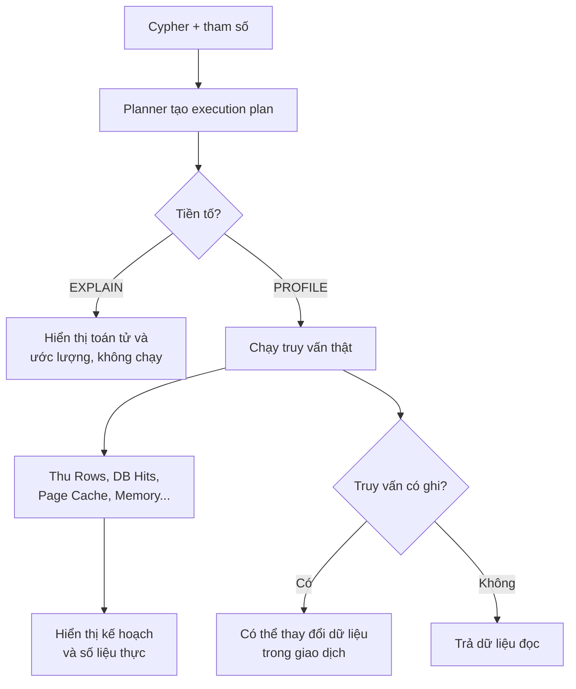
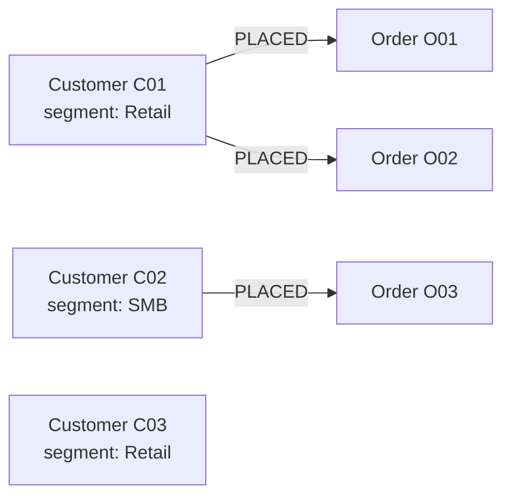

# PROFILE để đo thực thi và lưu ý với truy vấn ghi

Khi một truy vấn Cypher chậm, việc nhìn vào câu lệnh không đủ để biết Neo4j dành thời gian cho bước nào. Truy vấn có thể mất chi phí khi tìm nút bắt đầu, duyệt các quan hệ có bậc lớn, tạo quá nhiều dòng trung gian, sắp xếp kết quả hoặc cập nhật dữ liệu. **`PROFILE`** cho phép thực thi truy vấn và xem các chỉ số gắn với từng toán tử trong **kế hoạch thực thi** (*execution plan*).

Trong module **DATABASE_ENGINE_GRAPH_NEO4J**, thuộc chương **Kế hoạch thực thi**, bài này tập trung vào cách sử dụng `PROFILE` để đo truy vấn Cypher trên mô hình *property graph*, diễn giải các chỉ số thực tế, so sánh trước/sau tối ưu và đặc biệt là **cảnh báo khi áp dụng `PROFILE` lên truy vấn ghi**. Kiến thức có thể áp dụng khi làm việc trong Neo4j Browser, Java Driver hoặc Spring Data Neo4j; tên toán tử và bộ chỉ số hiển thị có thể khác nhau theo phiên bản Neo4j và query runtime.

> **Quy tắc cần nhớ ngay:** `EXPLAIN` lập kế hoạch **mà không thực thi truy vấn**. `PROFILE` **thực thi truy vấn** để thu thập số liệu. Nếu Cypher chứa `CREATE`, `MERGE`, `SET`, `DELETE` hoặc `REMOVE`, việc đặt `PROFILE` phía trước vẫn **thực sự tạo, cập nhật hoặc xóa dữ liệu**.

## 1. Phân biệt EXPLAIN và PROFILE

Cả hai tiền tố được đặt trước câu Cypher cần phân tích:

```cypher
EXPLAIN
MATCH (c:Customer)-[:PLACED]->(o:Order)
WHERE c.customerId = 'C01'
RETURN o.orderId AS orderId;
```

```cypher
PROFILE
MATCH (c:Customer)-[:PLACED]->(o:Order)
WHERE c.customerId = 'C01'
RETURN o.orderId AS orderId;
```

| Tiêu chí | `EXPLAIN` | `PROFILE` |
| --- | --- | --- |
| Có chạy truy vấn không? | Không thực thi phần đọc/ghi dữ liệu của truy vấn | Có, chạy truy vấn để đo |
| Có kết quả dữ liệu thực? | Không | Có thể trả kết quả như truy vấn bình thường |
| Có sơ đồ/toán tử kế hoạch? | Có | Có |
| Có ước lượng số dòng (*Estimated Rows*)? | Có khi kế hoạch cung cấp | Có thể có để so với số dòng thực |
| Có số dòng thực tế (*Rows*) và `DB Hits`? | Không có số liệu thực thi của truy vấn | Có thông tin thực thi khi runtime hỗ trợ |
| Có gây tác động ghi khi câu Cypher ghi dữ liệu? | Không | **Có** |
| Dùng khi nào? | Xem planner định làm gì mà chưa chạy | Kiểm chứng planner thực sự xử lý bao nhiêu dữ liệu |

Không nên xem `EXPLAIN` là phép đo tốc độ. Nó dựa trên các ước lượng do planner tạo ra. Ngược lại, `PROFILE` cung cấp thông tin đã đo từ **lần thực thi cụ thể**, không phải cam kết mọi lần chạy sau sẽ có cùng độ trễ.

### 1.1. Sơ đồ thực thi tổng quát



Ở truy vấn đọc, `PROFILE` chủ yếu tạo thêm chi phí đo lường. Ở truy vấn ghi, nó còn ảnh hưởng tới bản ghi, index, transaction log, khóa và những tác vụ ghi liên quan. Cần tách **mục tiêu phân tích** khỏi **cách kiểm soát tác động của lần đo**.

## 2. Chuẩn bị bộ dữ liệu thử nghiệm

Hãy thực hành trong **database thử nghiệm**. Phần này tạo khách hàng, đơn hàng và quan hệ `PLACED` để đọc và quan sát một kế hoạch thực thi nhất quán.

### 2.1. Mô hình dữ liệu



`Customer` có thuộc tính `customerId`, `name` và `segment`. `Order` có `orderId` và `createdAt`. Quan hệ `PLACED` có hướng từ khách hàng đến đơn hàng.

### 2.2. Khởi tạo

Các câu lệnh sau thay đổi schema và dữ liệu; chỉ chạy trong môi trường đã dành cho thực hành.

```cypher
CREATE CONSTRAINT customer_id_unique IF NOT EXISTS
FOR (c:Customer) REQUIRE c.customerId IS UNIQUE;

CREATE CONSTRAINT order_id_unique IF NOT EXISTS
FOR (o:Order) REQUIRE o.orderId IS UNIQUE;
```

```cypher
MERGE (c1:Customer {customerId: 'C01'})
SET c1.name = 'An', c1.segment = 'Retail'
MERGE (c2:Customer {customerId: 'C02'})
SET c2.name = 'Bình', c2.segment = 'SMB'
MERGE (c3:Customer {customerId: 'C03'})
SET c3.name = 'Chi', c3.segment = 'Retail'

MERGE (o1:Order {orderId: 'O01'})
SET o1.createdAt = date('2026-10-01')
MERGE (o2:Order {orderId: 'O02'})
SET o2.createdAt = date('2026-11-05')
MERGE (o3:Order {orderId: 'O03'})
SET o3.createdAt = date('2026-11-10')

MERGE (c1)-[:PLACED]->(o1)
MERGE (c1)-[:PLACED]->(o2)
MERGE (c2)-[:PLACED]->(o3);
```

Trong database chỉ có bộ mẫu này, truy vấn:

```cypher
MATCH (c:Customer)
RETURN c.customerId AS customerId
ORDER BY customerId;
```

trả ba khách hàng `C01`, `C02` và `C03`. Nếu dùng database có dữ liệu khác, kết quả tổng thể sẽ khác. Khi đánh giá hiệu năng thực tế, nên sử dụng bộ dữ liệu phản ánh quy mô, bậc nút và phân bố thuộc tính của workload dự kiến.

## 3. Đọc một kế hoạch PROFILE từ dưới lên

Chạy:

```cypher
PROFILE
MATCH (c:Customer {customerId: 'C01'})
      -[:PLACED]->(o:Order)
RETURN o.orderId AS orderId
ORDER BY orderId;
```

Kết quả dữ liệu mẫu là `O01` và `O02`. Trong giao diện kế hoạch, Neo4j hiển thị một **cây toán tử**. Có thể có những toán tử mang ý nghĩa như sau:

| Toán tử thường gặp | Công việc thực hiện |
| --- | --- |
| `NodeUniqueIndexSeek` | Tra nút theo chỉ mục hỗ trợ ràng buộc duy nhất |
| `NodeIndexSeek` | Tra nút theo chỉ mục thuộc tính nếu planner chọn |
| `NodeByLabelScan` | Lấy các nút theo nhãn, sau đó có thể lọc tiếp |
| `Expand(All)` | Mở rộng từ nút đang có sang quan hệ và nút kế tiếp |
| `Expand(Into)` | Kiểm tra mối nối quan hệ giữa hai nút đã biết |
| `Filter` | Loại bỏ dòng không thỏa điều kiện |
| `Sort` | Sắp xếp theo `ORDER BY` |
| `ProduceResults` | Tạo các cột trả về phía người dùng |

Với ràng buộc duy nhất trên `Customer.customerId`, một kế hoạch **khả dĩ** là: tìm `C01` bằng `NodeUniqueIndexSeek`, duyệt `PLACED` để lấy đơn hàng, đọc `orderId`, sắp xếp rồi trả hai dòng. Trên hệ thống khác hoặc phiên bản khác, planner có thể chọn các biến thể toán tử khác.

**Cách đọc:** lần theo những toán tử cung cấp dữ liệu cho toán tử phía trên. Nhiều giao diện hiển thị kết quả ở phía trên và nguồn dữ liệu ở phía dưới; một cây kế hoạch không phải lúc nào cũng chạy theo thứ tự một danh sách tuyến tính. Với toán tử có nhiều đầu vào, cần xem cả hai nhánh để hiểu số dòng sinh ra.

### 3.1. Rows là số dòng trung gian, không phải số nút của database

`Rows` trên từng toán tử biểu thị **số dòng dữ liệu được toán tử tạo ra trong lần thực thi**. Một dòng có thể gồm một hoặc nhiều biến Cypher.

Ví dụ ở truy vấn trên:

- Truy vấn tìm một khách hàng `C01` ở điểm bắt đầu.
- Mở rộng quan hệ `PLACED` sinh hai dòng tương ứng với `O01` và `O02`.
- `ProduceResults` trả hai dòng cuối cùng.

Không nên suy rằng `Rows = 2` nghĩa là database có đúng hai nút. Đây chỉ là hai dòng mà **toán tử cụ thể** xử lý hoặc tạo ra.

### 3.2. Estimated Rows khác Actual Rows

`Estimated Rows` là **ước lượng** của planner trước khi thực thi dựa trên thống kê và mô hình chi phí. `Rows` là kết quả quan sát khi query chạy.

| Tình huống | Cách hiểu |
| --- | --- |
| Ước lượng và thực tế tương đối gần | Planner dự đoán số dòng khá sát tại bước đó |
| Ước lượng 10, thực tế 10.000 | Có thể đang đánh giá thấp độ mở rộng, tính tương quan hoặc phân bố dữ liệu |
| Ước lượng 100.000, thực tế 2 | Có thể đang đánh giá quá cao số dòng ở bộ lọc hoặc nhánh duyệt |
| Số dòng tăng hàng trăm lần sau `Expand` | Quan hệ có bậc lớn hoặc đường đi sinh nhiều tổ hợp |
| Số dòng tăng do `CartesianProduct` | Có thể có hai mẫu không được nối, cần kiểm tra ý đồ truy vấn |

Không phải mọi chênh lệch đều là lỗi; số ước lượng chỉ là gần đúng. Nhưng chênh lệch rất lớn có thể giải thích vì sao planner chọn thứ tự thực thi chưa hiệu quả.

## 4. Những chỉ số quan trọng của PROFILE

Tùy query runtime và phiên bản, màn hình profile có thể hiển thị `Rows`, `Estimated Rows`, `DB Hits`, `Page Cache Hits`, `Page Cache Misses`, `Memory (Bytes)`, `Time (ms)` hoặc những cột khác.

### 4.1. DB Hits: đo truy cập nội bộ

`DB Hits` biểu thị lượng thao tác truy cập dữ liệu nội bộ Neo4j thống kê cho các toán tử. Nó thường giúp nhận diện:

- Toán tử phải xem xét quá nhiều nút hoặc quan hệ.
- Bộ lọc thuộc tính xuất hiện sau khi đã lấy tập nút lớn.
- Một bước mở rộng quan hệ được lặp nhiều lần.
- Việc đọc thuộc tính, sử dụng index và duyệt đồ thị tạo chi phí đáng kể.

**Không đồng nhất `DB Hits` với số lần đọc ổ đĩa vật lý.** Một DB hit có thể được phục vụ từ bộ nhớ hoặc page cache; không thể quy đổi một hit thành một mili giây. Khi so sánh hai phương án tương đương, giảm rõ rệt `DB Hits` ở phần xử lý thừa thường là tín hiệu tốt, nhưng vẫn phải đo thời gian và kiểm tra kết quả trả về.

### 4.2. Page Cache Hits và Page Cache Misses

Neo4j sử dụng **page cache** để quản lý các trang dữ liệu. Khi trang cần thiết đã có trong cache, công cụ có thể ghi nhận cache hit; khi chưa có, có thể ghi nhận miss. Các chỉ số này giúp nhận biết phần nào chi phí đến từ làm nóng bộ nhớ đệm.

Ví dụ:

- Lần chạy đầu trên dữ liệu chưa nằm trong cache có thể ghi nhận nhiều miss.
- Lần chạy tiếp theo có thể có nhiều hit hơn và thời gian giảm.
- Khi hệ thống chịu tải khác, cache và bộ nhớ của các truy vấn cạnh tranh có thể làm kết quả thay đổi.

**Không so sánh hai truy vấn trong điều kiện cache quá khác nhau rồi kết luận rằng index A chắc chắn tốt hơn index B.** Cần chú ý workload, dữ liệu đã được tải vào cache hay chưa và việc có chạy song song các tác vụ khác.

### 4.3. Memory và các toán tử lưu trung gian

Một số toán tử như `Sort`, `Aggregation`, `Distinct` hoặc `Eager` có thể cần lưu nhiều dữ liệu trung gian. Nếu profile có chỉ số bộ nhớ, hãy dùng nó để phát hiện những bước gây áp lực tài nguyên.

`Memory (Bytes)` không nhất thiết thể hiện toàn bộ bộ nhớ đã dùng bởi server hoặc JVM. Nó phản ánh phạm vi bộ nhớ mà runtime có thể báo cáo cho kế hoạch. Kết hợp số dòng và đặc điểm toán tử để diễn giải.

### 4.4. Time không bằng toàn bộ thời gian người dùng cảm nhận

Nếu runtime cung cấp thời gian thực thi hoặc thời gian theo toán tử, đó là một góc nhìn hữu ích. Nhưng độ trễ từ góc độ người dùng còn bao gồm:

- Lấy kết nối và truyền request qua mạng.
- Biên dịch/lập kế hoạch câu truy vấn.
- Thực thi trên server.
- Truyền và giải mã kết quả.
- Hiển thị hàng nghìn dòng trong Neo4j Browser hoặc xây dựng object trong ứng dụng.

Vì thế, nên đo **server execution** và **thời gian end-to-end** riêng khi tối ưu sản phẩm.

## 5. Một ví dụ: lọc nhiều nút rồi mới trả kết quả

Truy vấn tìm khách hàng thuộc phân khúc Retail:

```cypher
PROFILE
MATCH (c:Customer)
WHERE c.segment = 'Retail'
RETURN c.customerId AS customerId
ORDER BY customerId;
```

Kết quả trong bộ dữ liệu mẫu là `C01` và `C03`.

Khi không có index phù hợp trên `Customer.segment`, planner có thể sử dụng `NodeByLabelScan` để lấy các nút mang nhãn `Customer`, sau đó dùng `Filter` để giữ những dòng có `segment = 'Retail'`. Trong database lớn, số dòng đi qua `Filter` và lượng DB hits có thể cao nếu phải xem nhiều khách hàng trước khi chọn ra nhóm nhỏ.

### 5.1. Thử với range index

Trong database thử nghiệm, có thể tạo:

```cypher
CREATE RANGE INDEX customer_segment_idx IF NOT EXISTS
FOR (c:Customer) ON (c.segment);
```

Kiểm tra index đã sẵn sàng:

```cypher
SHOW INDEXES
YIELD name, type, state
WHERE name = 'customer_segment_idx'
RETURN name, type, state;
```

Khi `state = 'ONLINE'`, chạy lại `EXPLAIN` và `PROFILE` cho truy vấn đọc tương tự. Planner **có thể** dùng `NodeIndexSeek` nếu điều kiện đủ chọn lọc, thay vì lấy rất nhiều nút rồi lọc thuộc tính.

Trên bộ mẫu có ba khách hàng, index có thể **không được chọn** do số dòng nhỏ và chi phí thiết lập/tra index có thể không đáng. Không nên dùng tên toán tử làm mục tiêu tối ưu tuyệt đối: mục tiêu là giảm công việc và độ trễ trên workload thực tế.

### 5.2. So sánh có căn cứ

Dùng cùng bộ tham số và dữ liệu, ghi nhận:

| Yếu tố | Trước điều chỉnh | Sau điều chỉnh |
| --- | --- | --- |
| Kết quả nghiệp vụ | Mã khách hàng và số dòng | Phải giữ nguyên theo yêu cầu |
| Toán tử tìm điểm bắt đầu | Label scan hoặc phương án planner chọn | Kiểm tra lại bằng `EXPLAIN` |
| Số dòng trước bộ lọc | Từ profile thực tế | Từ profile thực tế |
| `DB Hits` | Ghi số đo thực tế | Ghi số đo thực tế |
| Page cache / bộ nhớ | Ghi theo lần chạy | Ghi theo lần chạy |
| Độ trễ ứng dụng | Đo end-to-end | Đo end-to-end |

Không tự bịa số liệu `DB Hits` hay thời gian cho bài toán. Chúng phụ thuộc phiên bản Neo4j, dữ liệu, index, page cache và query runtime. Bảng là **mẫu ghi nhận** dành cho môi trường thật.

## 6. Kiểm tra sự bùng nổ số dòng khi duyệt quan hệ

Ngay cả khi bước tìm khách hàng rất hiệu quả, số quan hệ xuất phát từ khách hàng có thể rất lớn. Ví dụ:

```cypher
PROFILE
MATCH (c:Customer {customerId: 'C01'})
      -[:PLACED]->(o:Order)
RETURN o.orderId AS orderId;
```

Điểm bắt đầu có thể chỉ là **một khách hàng**, nhưng `Expand(All)` phải đi qua mọi quan hệ `PLACED` phù hợp từ khách hàng đó. Trên bộ dữ liệu mẫu có hai đơn; trong hệ thống thật, một khách hàng/doanh nghiệp có thể có số quan hệ lớn hơn nhiều.

Khi theo dõi nhiều bước, số dòng có thể tăng nhanh:

```cypher
PROFILE
MATCH (c:Customer {customerId: 'C01'})
      -[:PLACED]->(o:Order)
      -[:INCLUDES]->(p:Product)
RETURN c.customerId AS customerId,
       o.orderId AS orderId,
       p.productId AS productId;
```

Truy vấn này chỉ có kết quả nếu database có quan hệ `INCLUDES` và nút `Product` tương ứng; bộ dữ liệu thử nghiệm ở phần 2 chưa tạo những quan hệ đó. Kế hoạch vẫn giúp quan sát quá trình mở rộng. Nếu một đơn có nhiều dòng sản phẩm, mỗi đơn có thể sinh nhiều dòng kết quả. **Index tốt ở điểm bắt đầu không loại bỏ chi phí fan-out của việc duyệt quan hệ.**

Một lỗi khác là ghép hai mẫu không có đường nối:

```cypher
PROFILE
MATCH (c:Customer), (o:Order)
RETURN c.customerId AS customerId,
       o.orderId AS orderId;
```

Với 3 khách hàng và 3 đơn hàng, truy vấn tạo ra **9 cặp** (tích Descartes), không phải danh sách đơn hàng do từng khách hàng đặt. Hãy nối bằng mẫu nghiệp vụ:

```cypher
PROFILE
MATCH (c:Customer)-[:PLACED]->(o:Order)
RETURN c.customerId AS customerId,
       o.orderId AS orderId;
```

Trên bộ dữ liệu mẫu, truy vấn này trả **3 cặp đúng quan hệ**. Trong profile, chú ý toán tử `CartesianProduct` ngoài dự kiến hoặc mức tăng đột biến của `Rows`; đó thường là dấu hiệu cần xem lại cấu trúc mẫu.

## 7. Điểm then chốt: PROFILE đối với truy vấn ghi

### 7.1. PROFILE không biến lệnh ghi thành lệnh đọc

Xem hai truy vấn sau:

```cypher
EXPLAIN
MATCH (c:Customer {customerId: 'C01'})
SET c.reviewCount = coalesce(c.reviewCount, 0) + 1
RETURN c.customerId AS customerId;
```

```cypher
PROFILE
MATCH (c:Customer {customerId: 'C01'})
SET c.reviewCount = coalesce(c.reviewCount, 0) + 1
RETURN c.customerId AS customerId;
```

- `EXPLAIN` trả kế hoạch dự kiến **không tăng** `reviewCount`.
- `PROFILE` **thực sự tăng** `reviewCount` của `C01` trong giao dịch. Nếu chạy theo cơ chế tự động commit và truy vấn hoàn thành thành công, thay đổi sẽ được lưu.
- Chạy lại `PROFILE` lần thứ hai có thể tăng `reviewCount` thêm lần nữa. Kết quả và chi phí ghi cũng có thể khác vì trạng thái dữ liệu đã thay đổi.

Đây là một khác biệt nghiêm trọng khi phân tích các lệnh `MERGE`, `CREATE`, `SET`, `DELETE`, `DETACH DELETE`, thay đổi nhãn hoặc cập nhật quan hệ. **Không thử `PROFILE` trên truy vấn ghi trong database sản xuất chỉ để xem kế hoạch nếu chưa có chiến lược kiểm soát tác động.**

### 7.2. Với truy vấn ghi, cần đo cả nội dung cập nhật

Một kế hoạch ghi có thể chứa toán tử như `Create`, `Merge`, `SetProperty`, `Delete` hoặc `Eager` tùy Cypher và runtime. Ngoài `Rows` và `DB Hits`, hãy quan sát thống kê cập nhật của truy vấn, chẳng hạn:

| Nhóm thống kê cập nhật | Câu hỏi cần trả lời |
| --- | --- |
| Nodes created | Có bao nhiêu nút thực sự được tạo? |
| Relationships created | Có bao nhiêu cạnh mới? |
| Properties set | Bao nhiêu thuộc tính được đặt/cập nhật? |
| Labels added / removed | Có thay đổi nhãn ngoài dự kiến không? |
| Nodes / relationships deleted | Có xóa đúng đối tượng mục tiêu không? |
| DB Hits và Rows ở nhánh tìm kiếm | Việc tìm thực thể để ghi có phải quét quá rộng không? |
| `Eager`, `Sort`, `Aggregation` và Memory | Có bước lưu toàn bộ hoặc nhiều dòng trung gian không? |

**Lưu ý:** Thống kê cập nhật (*query update counters*) và số liệu từng toán tử trong `PROFILE` là hai góc nhìn khác nhau. Số nút/quan hệ được cập nhật không thể suy trực tiếp từ `Rows` ở `ProduceResults`. Có truy vấn ghi không trả dòng nào nhưng vẫn tạo hoặc sửa dữ liệu.

### 7.3. Cẩn thận với MERGE và trạng thái dữ liệu

`MERGE` tìm mẫu đã tồn tại hoặc tạo phần chưa tồn tại, nên chi phí và số lượng cập nhật phụ thuộc vào trạng thái database:

```cypher
PROFILE
MERGE (c:Customer {customerId: 'C99'})
ON CREATE SET c.name = 'Hà', c.segment = 'Retail'
RETURN c.customerId AS customerId;
```

Lần đầu trong bộ dữ liệu mẫu, `C99` chưa tồn tại và `MERGE` có thể tạo nút mới. Lần sau, `C99` đã tồn tại; cùng một câu lệnh lại đi theo nhánh khớp dữ liệu có sẵn. Hai lần `PROFILE` vì thế **không đo cùng điều kiện**.

Nếu mục tiêu là so sánh hiệu năng nhánh “tạo mới” và “khớp sẵn”, hãy tạo các kịch bản độc lập với dữ liệu đầu vào tương đương. Dùng khóa nghiệp vụ cùng ràng buộc duy nhất thích hợp để tránh tạo trùng trong môi trường có ghi đồng thời.

### 7.4. LIMIT trong truy vấn ghi phải đặt đúng vị trí

Xét hai mẫu sau:

```cypher
// Lấy tối đa 2 khách hàng trước khi cập nhật
MATCH (c:Customer)
WITH c ORDER BY c.customerId LIMIT 2
SET c.reviewedAt = datetime()
RETURN c.customerId;
```

```cypher
// Không dùng RETURN LIMIT làm hàng rào giới hạn số nút bị SET
MATCH (c:Customer)
SET c.reviewedAt = datetime()
RETURN c.customerId
LIMIT 2;
```

Ở mẫu đầu, `LIMIT 2` được áp dụng **trước** `SET` nên chỉ tối đa hai dòng `c` được đưa vào bước cập nhật (giả sử mỗi khách hàng khớp một dòng). Ở mẫu sau, `SET` xuất hiện **trước** `RETURN ... LIMIT 2`, nên việc chỉ xem hai dòng kết quả **không đảm bảo** giới hạn việc cập nhật vào hai nút. Neo4j có thể phải xử lý các cập nhật theo ngữ nghĩa toàn bộ phần ghi trước đó.

Kể cả khi giới hạn đúng vị trí, đây vẫn là **truy vấn ghi thực sự**. Một phép `PROFILE` cũng sẽ thực thi các cập nhật đó.

## 8. Cách đo truy vấn ghi có kiểm soát

### 8.1. Quy trình an toàn và có thể lặp lại

Đối với write query, thực hành theo thứ tự:

1. **Sao chép dữ liệu cần thiết vào môi trường test/staging** hoặc chuẩn bị một dataset nhỏ có các ràng buộc và cấu trúc quan hệ tương tự.
2. **Chạy `EXPLAIN` trước** để kiểm tra nơi tìm dữ liệu, các bước mở rộng và toán tử ghi dự kiến.
3. **Kiểm tra tập bản ghi mục tiêu bằng truy vấn chỉ đọc** tương đương, bao gồm số lượng, điều kiện lọc, nhãn/loại quan hệ và khả năng có nhiều đường khớp.
4. **Thực thi `PROFILE` trong giao dịch tường minh có thể rollback**, nếu loại truy vấn và công cụ chạy hỗ trợ, để thu số liệu mà không lưu thay đổi cuối cùng.
5. **Đọc đầy đủ kết quả/summary** để bảo đảm truy vấn đã chạy và profile được thu thập trước khi rollback.
6. **So sánh kết quả với kỳ vọng và đo lại trên dữ liệu có trạng thái tương đương**. Nếu muốn đo chi phí commit, index update, transaction log hoặc khóa ở tải thật, dùng môi trường thử nghiệm và quy trình benchmark được thiết kế riêng.

Rollback giúp phục hồi thay đổi dữ liệu **thuộc giao dịch Neo4j đó**, nhưng không miễn phí: lần chạy vẫn có thể thực hiện đọc/ghi nội bộ, lấy khóa, dùng bộ nhớ và tác động tới tài nguyên. Nó cũng không bảo đảm đảo ngược mọi hiệu ứng **bên ngoài database** do procedure hoặc tích hợp có side effect. Các truy vấn có giao dịch con/batching đặc biệt như `CALL { ... } IN TRANSACTIONS` có ràng buộc riêng và **không thể coi là một lệnh ghi thông thường có thể bao bởi mọi giao dịch tường minh rồi rollback toàn bộ**.

### 8.2. Ví dụ với Neo4j Java Driver: PROFILE và rollback

Đoạn sau giả định có `org.neo4j.driver.Driver driver` đã kết nối với database thử nghiệm và dùng Neo4j Java Driver 5.x. Code bắt đầu **giao dịch ghi tường minh**, chạy truy vấn `PROFILE`, lấy `ResultSummary` và gọi `rollback()`.

```java
import java.util.Map;
import org.neo4j.driver.Driver;
import org.neo4j.driver.Session;
import org.neo4j.driver.Transaction;
import org.neo4j.driver.summary.ResultSummary;

public class WriteQueryProfiling {
    public static void inspectAndRollback(Driver driver) {
        try (Session session = driver.session();
             Transaction tx = session.beginTransaction()) {

            ResultSummary summary = tx.run("""
                PROFILE
                MATCH (c:Customer {customerId: $id})
                SET c.reviewCount = coalesce(c.reviewCount, 0) + 1
                RETURN c.customerId AS customerId
                """, Map.of("id", "C01")).consume();

            if (summary.hasProfile()) {
                var profile = summary.profile();
                System.out.println("DB hits (root): " + profile.dbHits());
                System.out.println("Rows (root): " + profile.records());
            }

            System.out.println(
                "Properties set: " + summary.counters().propertiesSet()
            );

            // Giao dịch thử nghiệm: không lưu thay đổi.
            tx.rollback();
        }
    }
}
```

`ResultSummary` là nơi lấy kế hoạch `PROFILE` và bộ đếm cập nhật ở phía driver. `consume()` bảo đảm driver đọc hết kết quả của truy vấn và nhận summary trước khi rollback. Số `dbHits()` và `records()` của **nút gốc trong cây profile** không thay thế việc xem số liệu của từng toán tử con khi tìm điểm nghẽn. Việc đóng giao dịch chưa commit cũng là cơ chế bảo vệ thông thường; gọi `rollback()` tường minh giúp thể hiện ý định của phép đo.

**Không dùng code này cho procedure có tác động bên ngoài hoặc các truy vấn batching có giao dịch con** mà chưa hiểu rõ ranh giới transaction. Trong môi trường Spring Data Neo4j, có thể dựa vào quản lý transaction của Spring, nhưng phải bảo đảm Cypher thực tế có `PROFILE` và có xử lý summary/rollback đúng với client API đang sử dụng.

### 8.3. Dữ liệu thử nghiệm và trạng thái phải tương đương

Nếu vừa thêm index, vừa tăng số lượng bản ghi, vừa thay `MERGE` thành `CREATE` và rồi so thời gian, bạn không biết yếu tố nào tạo khác biệt. Khi benchmark truy vấn ghi:

- Giữ số lượng và phân bố nút/quan hệ gần nhau giữa các lần thử.
- Phân biệt kịch bản tạo mới, cập nhật bản ghi đã có và no-op.
- Giữ tương đương trạng thái index, constraint, cache và tải ghi đồng thời.
- Ghi riêng chi phí xác định bản ghi cần ghi và chi phí thay đổi dữ liệu.
- Đo nhiều lần trên môi trường thích hợp; so sánh phân vị độ trễ, không chỉ một số đo.
- Kiểm chứng số bản ghi bị ảnh hưởng và nội dung sau ghi nếu đó là một phép benchmark có commit trong môi trường test.

## 9. Toán tử Eager và các vấn đề đặc thù khi ghi

Neo4j có thể đưa toán tử **`Eager`** vào kế hoạch để vật hóa dữ liệu trung gian trước khi những thao tác tiếp theo đọc/ghi vào một vùng dữ liệu có khả năng ảnh hưởng nhau. Đây là một cơ chế bảo toàn ngữ nghĩa truy vấn khi cần thiết, không tự động là dấu hiệu lỗi.

Ví dụ minh họa ý tưởng có thể phát sinh tương tác giữa đọc và ghi:

```cypher
EXPLAIN
MATCH (c:Customer)
WHERE c.segment = 'Retail'
SET c.segment = 'Preferred'
RETURN c.customerId AS customerId;
```

Truy vấn thay đổi chính thuộc tính `segment` đang dùng trong điều kiện tìm. Tùy kế hoạch, chỉ mục và runtime, planner có thể cần cơ chế ngăn việc thay đổi dữ liệu làm ảnh hưởng quá trình đang quét hoặc tìm kiếm. `Eager` là một toán tử có thể gặp trong một số kiểu kế hoạch để xử lý xung đột đọc/ghi hoặc giữ tính đúng đắn.

Đừng kết luận rằng chỉ cần “xóa `Eager`” là truy vấn sẽ nhanh. Thay vào đó, hãy xác định:

- Có phải truy vấn đang tìm dữ liệu và sửa chính vùng dữ liệu đó?
- Có nhiều dòng trung gian không cần thiết trước khi ghi?
- Có nên tách công đoạn xác định mục tiêu khỏi công đoạn cập nhật trong một thiết kế có kiểm soát?
- Có thể dùng batch theo khóa định danh để giảm bộ nhớ và thời gian giữ khóa không?
- Có chỉ mục thuộc tính phù hợp để tìm nút cần ghi không?

Khi cập nhật hàng triệu nút, chi phí index maintenance, transaction log, locks và page cache cũng có thể chiếm tỷ trọng lớn. `PROFILE` chỉ là một nguồn bằng chứng; hãy kết hợp metric của database và ứng dụng để đánh giá tải ghi.

## 10. Những sai lầm khiến số đo PROFILE bị hiểu sai

| Sai lầm | Vì sao sai | Cách xử lý |
| --- | --- | --- |
| “`PROFILE` chỉ xem kế hoạch” | Nó thực thi cả truy vấn đọc lẫn ghi | Dùng `EXPLAIN` nếu chỉ cần dự đoán kế hoạch |
| “`DB Hits = số lần đọc ổ cứng`” | DB hits là thống kê truy cập nội bộ; cache có ảnh hưởng | Xem thêm page cache và thời gian |
| “`Rows` của plan là số nút trong database” | Rows là dòng trung gian của từng toán tử | Theo dõi biến đầu vào, đầu ra và phép mở rộng |
| “Kế hoạch có `IndexSeek` luôn nhanh hơn `Scan`” | Độ chọn lọc, chi phí index và kích thước dữ liệu khác nhau | So hiệu năng thật với dữ liệu đại diện |
| “`RETURN ... LIMIT 10` giới hạn chắc chắn số bản ghi đã cập nhật” | `LIMIT` áp dụng tại vị trí của nó trong query pipeline | Giới hạn tập đầu vào trước `SET` |
| “Chạy lại `PROFILE MERGE` sẽ đo đúng cùng workload” | Lần đầu có thể tạo, lần sau khớp bản ghi tồn tại | Reset/chuẩn bị trạng thái test tương đương |
| “Rollback giúp phép thử hoàn toàn không ảnh hưởng hệ thống” | Đã dùng tài nguyên, khóa, thao tác nội bộ; side effect ngoài Neo4j có thể không rollback | Đo write trên môi trường cô lập |
| “Một lần đo là đủ” | Cache, đồng thời, tham số, planner và môi trường thay đổi | Đo có kiểm soát, lặp lại với cùng dataset |
| “Chỉ nhìn thời gian tổng” | Không biết toán tử nào gây chậm và kết quả có đúng không | Xem `Rows`, `DB Hits`, plan và kết quả nghiệp vụ |

## 11. Thực hành theo tình huống nghiệp vụ

### Bài tập 1 — So sánh EXPLAIN và PROFILE

Dùng bộ dữ liệu thử nghiệm ở phần 2. Chạy `EXPLAIN` và `PROFILE` cho truy vấn:

```cypher
MATCH (c:Customer {customerId: 'C01'})-[:PLACED]->(o:Order)
RETURN o.orderId AS orderId
ORDER BY orderId;
```

Hãy giải thích vì sao cả hai có thể hiển thị cây kế hoạch nhưng chỉ `PROFILE` có chỉ số thực thi. Kết quả dữ liệu khi chạy thật phải gồm `O01` và `O02`.

### Bài tập 2 — Đọc số dòng bị nhân

So sánh:

```cypher
PROFILE
MATCH (c:Customer), (o:Order)
RETURN count(*) AS pairs;
```

và:

```cypher
PROFILE
MATCH (c:Customer)-[:PLACED]->(o:Order)
RETURN count(*) AS pairs;
```

Trong database chỉ có bộ dữ liệu mẫu, câu thứ nhất cho `pairs = 9`, câu thứ hai cho `pairs = 3`. Hãy tìm toán tử tạo tích Descartes và đối chiếu số `Rows` ở các nhánh. `count(*)` cuối truy vấn tạo **một dòng tổng hợp**, vì vậy không dùng riêng `Rows` của `ProduceResults` để đánh giá độ phình dữ liệu phía trước.

### Bài tập 3 — Phân tích tình huống có điều kiện lọc

Chạy `PROFILE` trên truy vấn lấy khách hàng `segment = 'Retail'`, lưu các cột toán tử, `Estimated Rows`, `Rows`, `DB Hits`. Sau đó tạo range index trên `Customer.segment` và chạy lại khi index `ONLINE`. Giải thích vì sao số liệu trên ba khách hàng không đủ để kết luận về hiệu năng trên một triệu khách hàng.

### Bài tập 4 — Điều gì xảy ra khi PROFILE truy vấn ghi?

Trong môi trường test, suy luận kết quả sau **hai lần** chạy:

```cypher
PROFILE
MATCH (c:Customer {customerId: 'C01'})
SET c.reviewCount = coalesce(c.reviewCount, 0) + 1
RETURN c.reviewCount AS reviewCount;
```

Nếu `reviewCount` ban đầu chưa tồn tại, sau lần thứ nhất nó là `1` và sau lần thứ hai là `2` (khi mỗi lần được commit thành công). Sau đó, trình bày cách dùng explicit transaction và rollback để xem profile mà không giữ lại thay đổi của phép đo.

### Bài tập 5 — Giải thích vị trí LIMIT

Hai đoạn Cypher ở phần 7.4 khác nhau thế nào về số nút bị cập nhật? Hãy viết truy vấn đọc xác nhận số khách hàng mục tiêu và chỉ sử dụng `EXPLAIN` nếu đang ở môi trường không thể chấp nhận thay đổi dữ liệu.

### Bài tập 6 — Chẩn đoán kế hoạch ghi

Giả sử `PROFILE` cho một `MERGE` trên database lớn cho thấy `NodeByLabelScan` với `Rows` rất cao, sau đó xuất hiện `Merge` và `SetProperty`. Hãy đưa ra kế hoạch cải thiện: kiểm tra khóa nghiệp vụ, ràng buộc duy nhất/index, độ chọn lọc điều kiện tìm, tính trùng lặp của dữ liệu đầu vào và số lượng update thực sự. Nêu rõ cách đo lại an toàn.

## 12. Checklist khi sử dụng PROFILE

Trước khi chạy `PROFILE`, hãy trả lời:

1. **Truy vấn chỉ đọc hay có ghi?** Có `CREATE`/`MERGE`/`SET`/`DELETE`, procedure ghi hoặc giao dịch con không?
2. **Database nào đang được kết nối?** Đây có phải môi trường phù hợp để thực thi truy vấn thật không?
3. **Kết quả nghiệp vụ kỳ vọng là gì?** Số nút, quan hệ, dòng và phạm vi cập nhật đã được xác định chưa?
4. **Điểm nghẽn được nghi ngờ ở đâu?** Tìm đầu vào, duyệt quan hệ, lọc, sắp xếp, aggregation hay ghi?
5. **Chỉ số nào sẽ so sánh?** `Rows`, `Estimated Rows`, `DB Hits`, cache, memory và độ trễ đầu cuối.
6. **Môi trường đo có ổn định không?** Index `ONLINE`, tham số, dữ liệu, cache và tải đồng thời có tương đương không?
7. **Nếu có ghi, có thể rollback không?** Giao dịch tường minh và công cụ hiện tại có phù hợp; có side effect hay batching độc lập nào không?

### Ghi nhớ

**`EXPLAIN` dự đoán; `PROFILE` đo bằng cách thực thi.** Hãy đọc plan theo các bước tìm điểm bắt đầu, duyệt quan hệ và xử lý kết quả; dùng `Rows` để phát hiện sự tăng đột biến của dữ liệu trung gian, `DB Hits` để quan sát chi phí truy cập nội bộ và các chỉ số cache/bộ nhớ để bổ sung bối cảnh. Một toán tử có tên “Seek” không đủ để kết luận toàn truy vấn đã tối ưu.

Với **truy vấn ghi**, `PROFILE` sẽ thực hiện thay đổi dữ liệu thật. Cần xem cả bộ đếm cập nhật và các toán tử đọc/ghi, thử trên dữ liệu có kiểm soát, sử dụng `EXPLAIN` khi chỉ cần xem kế hoạch, và dùng giao dịch tường minh có rollback khi cần đo một phép ghi thông thường mà không lưu thay đổi. Điều này giúp tối ưu truy vấn Cypher trên Neo4j mà vẫn giữ đúng ý nghĩa nghiệp vụ và hạn chế tác động ngoài ý muốn.
