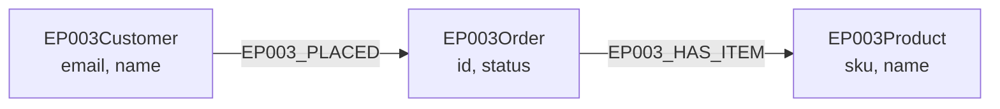

# Đọc cây toán tử, hướng luồng dữ liệu và điểm bắt đầu truy vấn

## 1. Vì sao phải biết đọc cây kế hoạch thực thi?

Cypher mô tả **mẫu đồ thị và kết quả cần lấy**, không ấn định Neo4j phải thăm node nào đầu tiên. Với cùng một câu `MATCH`, bộ lập kế hoạch truy vấn (*planner*) có thể chọn tìm node bằng index, quét theo nhãn, duyệt relationship từ trái sang phải hoặc từ phải sang trái, rồi mới lọc và tổng hợp. Quyết định đó tạo ra **execution plan** gồm các toán tử kết nối thành một cây.

Trong mô hình **property graph** của Neo4j, mỗi node và relationship có thể mang thuộc tính; một bước mở rộng quan hệ có thể biến một dòng đầu vào thành hàng trăm dòng. Vì vậy biết đọc plan giúp trả lời những câu hỏi quan trọng:

- Neo4j **bắt đầu tìm dữ liệu ở đâu**: index seek, node scan hay relationship scan?
- Từ điểm bắt đầu, các dòng dữ liệu đi qua những toán tử nào để tạo ra kết quả?
- Tại toán tử nào số dòng tăng vọt, bị lọc mạnh, bị sắp xếp hoặc bị giữ trong bộ nhớ?
- Kế hoạch thực tế có phù hợp với giả định về index, độ chọn lọc và hướng duyệt đồ thị không?

Chủ đề này thuộc chương **Kế hoạch thực thi** của module `DATABASE_ENGINE_GRAPH_NEO4J`. Kiến thức áp dụng cho truy vấn Cypher dùng index/constraint, truy vấn đường đi và quan hệ, cũng như các câu truy vấn gọi từ Java Driver hoặc Spring Data Neo4j.

**Sau bài học, bạn có thể**:

1. Đọc một cây plan **từ lá lên gốc**, phân biệt root, leaf, toán tử một đầu vào và hai đầu vào.
2. Đọc các cột `Operator`, `Details`, `Estimated Rows`, `Rows`, `DB Hits` và dấu hiệu pipeline.
3. Xác định điểm bắt đầu thực tế bằng `NodeIndexSeek`/`NodeUniqueIndexSeek`/`NodeByLabelScan`, thay vì suy từ thứ tự viết `MATCH`.
4. Diễn giải hướng luồng dòng qua `Expand(All)`, `Filter`, `Apply`, `Sort`, `ProduceResults`.
5. Dùng `EXPLAIN` và `PROFILE` để kiểm chứng giả thuyết về số dòng, điểm nghẽn và chi phí.

## 2. Mô hình tư duy: cây toán tử và những dòng dữ liệu

Mỗi toán tử nhận **không, một hoặc hai luồng dòng đầu vào** và phát ra các dòng kết quả. Một dòng có thể chứa các biến đã gán, ví dụ `{c, o, p}` với `c` là khách hàng, `o` là đơn hàng, `p` là sản phẩm.

Một cây **minh họa**, không phải bản chụp của một phiên bản Neo4j cụ thể:

```text
                  +------------------+
                  | ProduceResults   |  (root: trả kết quả)
                  +------------------+
                           ^
                       +--------+
                       | Sort   |       (sắp xếp)
                       +--------+
                           ^
                   +----------------+
                   | Expand(All)    |   (đơn -> sản phẩm)
                   +----------------+
                           ^
                     +----------+
                     | Filter   |     (chỉ đơn PAID)
                     +----------+
                           ^
                   +----------------+
                   | Expand(All)    |   (khách -> đơn)
                   +----------------+
                           ^
                +---------------------+
                | NodeUniqueIndexSeek | (leaf: tìm khách)
                +---------------------+
```

**Quy tắc quan trọng:** Trong bảng plan do `EXPLAIN`/`PROFILE` hiển thị, **root ở trên, các lá ở dưới; đọc luồng dữ liệu từ các lá đi lên root**. Hãy tìm toán tử ở dưới cùng trước để hiểu tập node/relationship đầu tiên, rồi lần theo các toán tử cha để xem nó biến đổi dòng ra sao. `ProduceResults` nằm gần hoặc ở root và chịu trách nhiệm phát kết quả cuối.

| Loại toán tử | Số nhánh con | Vai trò |
|---|---:|---|
| **Leaf** | 0 | Khởi tạo dữ liệu từ index, scan, tham số/ngữ cảnh; có thể là điểm bắt đầu truy cập đồ thị |
| **Unary** | 1 | Lọc, chiếu cột, mở rộng quan hệ, sắp xếp hoặc tổng hợp một luồng |
| **Binary** | 2 | Kết hợp hai luồng, ví dụ `Apply`, `NodeHashJoin`, `CartesianProduct` |
| **Root** | Thường 1 | Hoàn thành và đưa kết quả cho ứng dụng, thường là `ProduceResults` |

**Đọc từ dưới lên** là cách hiểu phụ thuộc dữ liệu, **không phải khẳng định mọi toán tử luôn chạy xong từng cái theo thời gian**. Neo4j có các runtime theo pipeline/parallel; nhiều toán tử có thể xử lý xen kẽ hoặc được hợp nhất thành pipeline. Toán tử chặn (*blocking*) như `Sort` có thể phải nhận nhiều dòng trước khi phát kết quả.

## 3. Chuẩn bị một đồ thị nhỏ để đối chiếu plan

Ta dùng ba kiểu node và hai kiểu relationship:



Để tránh đụng vào dữ liệu khác, các nhãn và quan hệ trong bài được đặt tiền tố `EP003`. Chỉ thực hành trên database thử nghiệm.

### 3.1. Tạo node

```cypher
UNWIND [
  {id: 'an', name: 'An', email: 'an@example.test'},
  {id: 'binh', name: 'Bình', email: 'binh@example.test'},
  {id: 'chi', name: 'Chi', email: 'chi@example.test'}
] AS row
MERGE (c:EP003Customer {id: row.id})
SET c.name = row.name, c.email = row.email;
```

```cypher
UNWIND [
  {id: 'o101', status: 'PAID'},
  {id: 'o102', status: 'PENDING'},
  {id: 'o103', status: 'PAID'}
] AS row
MERGE (o:EP003Order {id: row.id})
SET o.status = row.status;
```

```cypher
UNWIND [
  {sku: 'KB', name: 'Keyboard'},
  {sku: 'MOUSE', name: 'Mouse'},
  {sku: 'BOOK', name: 'Book'}
] AS row
MERGE (p:EP003Product {sku: row.sku})
SET p.name = row.name;
```

### 3.2. Tạo relationship có hướng

```cypher
MATCH (an:EP003Customer {id: 'an'})
MATCH (a:EP003Order {id: 'o101'})
MATCH (b:EP003Order {id: 'o102'})
MERGE (an)-[:EP003_PLACED]->(a)
MERGE (an)-[:EP003_PLACED]->(b);
```

```cypher
MATCH (binh:EP003Customer {id: 'binh'})
MATCH (o:EP003Order {id: 'o103'})
MERGE (binh)-[:EP003_PLACED]->(o);
```

```cypher
MATCH (o1:EP003Order {id: 'o101'})
MATCH (o2:EP003Order {id: 'o102'})
MATCH (o3:EP003Order {id: 'o103'})
MATCH (keyboard:EP003Product {sku: 'KB'})
MATCH (mouse:EP003Product {sku: 'MOUSE'})
MATCH (book:EP003Product {sku: 'BOOK'})
MERGE (o1)-[:EP003_HAS_ITEM]->(keyboard)
MERGE (o1)-[:EP003_HAS_ITEM]->(mouse)
MERGE (o2)-[:EP003_HAS_ITEM]->(book)
MERGE (o3)-[:EP003_HAS_ITEM]->(mouse)
MERGE (o3)-[:EP003_HAS_ITEM]->(book);
```

Kiểm tra các liên kết:

```cypher
MATCH (c:EP003Customer)-[:EP003_PLACED]->(o:EP003Order)
      -[:EP003_HAS_ITEM]->(p:EP003Product)
RETURN c.id AS customer, o.id AS orderId,
       o.status AS status, p.sku AS sku
ORDER BY customer, orderId, sku;
```

Kỳ vọng nhận **5 dòng**: An có hai mặt hàng trong `o101` và một mặt hàng trong `o102`; Bình có hai mặt hàng trong `o103`; Chi không có đơn nên không xuất hiện trong `MATCH` bắt buộc.

### 3.3. Khai báo index để có một điểm bắt đầu chọn lọc

```cypher
CREATE CONSTRAINT ep003_customer_email IF NOT EXISTS
FOR (c:EP003Customer)
REQUIRE c.email IS UNIQUE;
```

```cypher
CREATE CONSTRAINT ep003_product_sku IF NOT EXISTS
FOR (p:EP003Product)
REQUIRE p.sku IS UNIQUE;
```

Hai uniqueness constraint trên Neo4j tạo các index phục vụ tìm kiếm chính xác. Khi kế hoạch sử dụng index duy nhất, toán tử có thể là `NodeUniqueIndexSeek`. Kiểm tra trạng thái:

```cypher
SHOW INDEXES
YIELD name, type, state, labelsOrTypes, properties
WHERE name IN ['ep003_customer_email', 'ep003_product_sku']
RETURN name, type, state, labelsOrTypes, properties
ORDER BY name;
```

Trước khi so sánh plan, các index cần đạt trạng thái `ONLINE`. Bộ dữ liệu rất nhỏ nên planner **có thể chọn scan dù index đã tồn tại**; bản chất ví dụ là luyện đọc plan, không chứng minh benchmark hiệu năng sản xuất.

## 4. Đọc một kế hoạch thực thi theo từng toán tử

Truy vấn nghiệp vụ: tìm các mặt hàng thuộc **đơn đã thanh toán của An**.

```cypher
MATCH (c:EP003Customer {email: 'an@example.test'})
      -[:EP003_PLACED]->(o:EP003Order)
      -[:EP003_HAS_ITEM]->(p:EP003Product)
WHERE o.status = 'PAID'
RETURN c.name AS customer, o.id AS orderId,
       p.sku AS sku, p.name AS product
ORDER BY sku;
```

Kết quả dữ liệu đúng:

| customer | orderId | sku | product |
|---|---|---|---|
| An | o101 | KB | Keyboard |
| An | o101 | MOUSE | Mouse |

### 4.1. Xem plan nhưng chưa chạy truy vấn

```cypher
EXPLAIN
MATCH (c:EP003Customer {email: 'an@example.test'})
      -[:EP003_PLACED]->(o:EP003Order)
      -[:EP003_HAS_ITEM]->(p:EP003Product)
WHERE o.status = 'PAID'
RETURN c.name AS customer, o.id AS orderId,
       p.sku AS sku, p.name AS product
ORDER BY sku;
```

`EXPLAIN` cho thấy **kế hoạch dự kiến**; nó không chạy phần truy vấn đọc và chưa có `Rows` hoặc `DB Hits` thực tế. Một chuỗi toán tử **có thể** xuất hiện là:

```text
ProduceResults
  ↑
Sort / Projection         sắp xếp và chọn cột trả về
  ↑
Expand(All)               từ đơn hàng sang các sản phẩm
  ↑
Filter                    chỉ giữ đơn có status = 'PAID'
  ↑
Expand(All)               từ khách hàng sang các đơn hàng
  ↑
NodeUniqueIndexSeek       tìm c.email = 'an@example.test'
```

Đây là **sơ đồ khái niệm**, không phải ảnh chụp đầu ra bảo đảm. Neo4j có thể đảo hướng duyệt, hợp nhất `Filter` với toán tử khác, thay `Sort` bằng `Top` khi có `LIMIT`, hoặc tổ chức các toán tử khác theo thống kê của dữ liệu và runtime.

### 4.2. Chạy PROFILE để xem dòng và công việc thực tế

```cypher
PROFILE
MATCH (c:EP003Customer {email: 'an@example.test'})
      -[:EP003_PLACED]->(o:EP003Order)
      -[:EP003_HAS_ITEM]->(p:EP003Product)
WHERE o.status = 'PAID'
RETURN c.name AS customer, o.id AS orderId,
       p.sku AS sku, p.name AS product
ORDER BY sku;
```

Nếu planner đi theo nhánh từ khách hàng như sơ đồ minh họa, các **mốc số dòng có thể suy từ fixture** là:

| Khối logic | Dòng nhận được | Giải thích |
|---|---:|---|
| Tìm khách theo email | 1 | An là một khách hàng |
| Mở rộng `EP003_PLACED` | 2 | An có hai đơn `o101`, `o102` |
| Lọc đơn `PAID` | 1 | Chỉ `o101` được giữ |
| Mở rộng `EP003_HAS_ITEM` | 2 | `o101` có hai sản phẩm |
| Chiếu và sắp xếp | 2 | Hai dòng kết quả cuối |

Các số trong bảng thể hiện **cardinality kỳ vọng của phương án duyệt này**, không phải `Rows` bắt buộc cho từng toán tử Neo4j vì optimizer có thể chọn phương án khác. Quan trọng là diễn giải được quan hệ nhân quả: **một khách → hai đơn → một đơn hợp lệ → hai sản phẩm**.

### 4.3. Các cột cần đọc trong plan

| Cột | Ý nghĩa | Cách đọc hữu ích |
|---|---|---|
| `Operator` | Tên toán tử trong cây | Xem index/scan, mở rộng quan hệ, join, sort... |
| `Id` | Định danh toán tử trong plan hiện tại | Đối chiếu tham chiếu nội bộ, không phải thứ tự chạy |
| `Details` | Biến, nhãn, loại quan hệ, predicate, index | Biết đang tìm/lọc/mở rộng phần nào |
| `Estimated Rows` | Planner **ước lượng** số dòng sẽ phát | Dùng phân tích lựa chọn plan; có thể lệch thực tế |
| `Rows` | Số dòng **thực tế** toán tử phát | Chỉ có khi `PROFILE`; tìm nơi dòng tăng hoặc rơi |
| `DB Hits` | Lượt công việc truy cập storage engine | Chỉ có khi `PROFILE`; **không** đồng nghĩa số đĩa đọc |
| `Memory (Bytes)` | Đỉnh bộ nhớ toán tử nếu có thống kê | Cần chú ý `Sort`, join, aggregation |
| `Time (ms)` / `Pipeline` | Thời gian hoặc nhóm toán tử runtime | Có thể đo ở mức pipeline hợp nhất, không phải từng toán tử |

Tùy phiên bản, runtime và edition, còn có `Ordered by`, `Page Cache Hits/Misses` và `Indexes Used`. Một số dòng không có thông tin riêng, hoặc thông số được gộp theo pipeline. `EXPLAIN` chủ yếu giúp hiểu **dự kiến**, còn `PROFILE` giúp so sánh **ước lượng với số liệu thực**.

## 5. Nhận diện các toán tử thường gặp

### 5.1. Lá truy cập dữ liệu: điểm bắt đầu

| Toán tử thường gặp | Ý nghĩa | Khi nào cần chú ý |
|---|---|---|
| `NodeIndexSeek` | Tra cứu node bằng index với predicate phù hợp | Có index và điều kiện chọn lọc |
| `NodeUniqueIndexSeek` | Tra cứu qua index duy nhất | Khóa như email/sku có uniqueness constraint |
| `NodeIndexScan` | Đọc các mục phù hợp theo kiểu scan index | Kiểm tra selectivity và index đang dùng |
| `NodeByLabelScan` | Quét node theo nhãn | Có thể phù hợp với tập nhỏ, tốn kém nếu quá nhiều node |
| `AllNodesScan` | Quét tất cả node | Tín hiệu cần điều tra với truy vấn vốn có nhãn/định danh |
| `Argument` | Mang biến đã có vào nhánh truy vấn phụ thuộc | Là lá trong nhánh `Apply`, **không tự tìm node trong kho dữ liệu** |

**Đừng đồng nhất mọi leaf với điểm truy cập storage**: `Argument` có thể là lá của một nhánh con nhưng chỉ chuyển các giá trị đã được gán ở nhánh khác. Khi tìm "điểm bắt đầu", hãy chỉ ra cụ thể **leaf đang tìm node/relationship** cùng predicate và index (nếu có).

### 5.2. Toán tử biến đổi và kết hợp luồng

| Toán tử | Hoạt động | Tác động có thể xảy ra lên `Rows` |
|---|---|---|
| `Expand(All)` | Từ node đã biết, duyệt quan hệ sang node mới | Một dòng có thể nhân thành nhiều dòng |
| `Expand(Into)` | Kiểm tra quan hệ giữa **hai đầu node đã biết** | Có thể kiểm tra nối thay vì tìm đầu node mới |
| `Filter` | Giữ dòng thỏa điều kiện | Số dòng không tăng |
| `Projection` | Tính hoặc chọn các cột trả về | Thường giữ số dòng |
| `Aggregation` / `EagerAggregation` | Gộp dòng theo khóa nhóm, tính `count/sum/avg` | Thường giảm dòng; có thể phải giữ trạng thái |
| `Sort` / `Top` | Sắp xếp hoặc chọn kết quả theo thứ tự | Tốn CPU/bộ nhớ, tùy kích thước và `LIMIT` |
| `Apply` | Với mỗi dòng từ nhánh trái, chạy nhánh phải phụ thuộc biến | Chi phí nhánh phải có thể lặp lại nhiều lần |
| `NodeHashJoin` | Ghép hai luồng theo khóa node | Phát dòng khớp, có chi phí xây bảng băm |
| `CartesianProduct` | Ghép mỗi dòng nhánh trái với mọi dòng nhánh phải | Có thể nổ số dòng nếu hai nhánh lớn |
| `Eager` | Thu gom dòng trước khi cho phần sau xử lý | Điểm chặn pipeline và sử dụng bộ nhớ |
| `ProduceResults` | Đưa các dòng cuối cho client | Root thường gặp của truy vấn đọc |

Tên toán tử có thể khác ở từng phiên bản hoặc cách planner biểu diễn pattern. **Đọc `Details` cùng với `Rows`** quan trọng hơn học thuộc một danh sách tên.

## 6. Cây hai nhánh: thứ tự hiển thị và nhánh Apply

Kế hoạch không phải lúc nào cũng là chuỗi một cột. Chẳng hạn khi có truy vấn con tương quan, planner có thể dùng `Apply` để cấp biến từ một phần của cây cho phần còn lại.

Một hình **minh họa quan hệ nhánh**, không đại diện cố định cho mọi truy vấn con:

```text
+ProduceResults
|
+Projection
|
+Apply                     nhận đầu ra từ LHS và RHS
|\
| +Expand(All)             RHS: dùng biến c để duyệt đơn
| |
| +Argument                RHS: nhận biến c đã được gán
|
+NodeUniqueIndexSeek       LHS: tìm c bằng email
```

Trong dạng bảng plan của Neo4j, **nhánh phải (RHS) được hiển thị trước và thụt vào sâu hơn**, còn **nhánh trái (LHS) được hiển thị sau, cùng mức thụt với toán tử cha**. Đối với `Apply` kiểu vòng lặp lồng, diễn giải logic như sau:

1. Nhánh trái phát một dòng mang biến `c`.
2. Nhánh phải nhận `c` thông qua `Argument` và được đánh giá cho dòng đó.
3. `Apply` kết hợp các dòng từ hai nhánh cho toán tử ở trên.
4. Nếu LHS phát nhiều dòng, nhánh RHS có thể phải xử lý **lặp lại** tương ứng.

Đừng hiểu "RHS hiển thị phía trên" nghĩa là toàn bộ RHS tự chạy trước LHS. Với `Apply`, **LHS cung cấp dữ liệu trước**, rồi RHS được kích hoạt theo từng dòng LHS. Với `NodeHashJoin` hoặc `CartesianProduct`, quy tắc kết hợp hai đầu vào khác; không áp đặt mô hình nested loop cho mọi toán tử nhị phân.

**Cảnh báo hiệu năng:** Khi LHS có 100.000 dòng và RHS thực hiện một phép duyệt đắt tiền trên mỗi dòng, tổng chi phí có thể rất lớn ngay cả khi nhánh RHS nhìn riêng có vẻ nhỏ. Đọc `Rows` và `DB Hits` của cả cây, không chỉ dòng đầu tiên hoặc index seek.

## 7. Điểm bắt đầu không nhất thiết là node viết trước trong MATCH

Truy vấn Cypher là khai báo. Trong pattern:

```cypher
MATCH (c:EP003Customer)-[:EP003_PLACED]->(o:EP003Order)
      -[:EP003_HAS_ITEM]->(p:EP003Product)
WHERE p.sku = 'MOUSE' AND o.status = 'PAID'
RETURN c.id AS customerId, o.id AS orderId, p.sku AS sku
ORDER BY customerId;
```

Người đọc thường hình dung Neo4j đi `c → o → p` vì viết `c` ở đầu câu. Tuy nhiên, `p.sku = 'MOUSE'` có **index duy nhất** và có thể chọn lọc hơn quét tất cả khách hàng. Planner **có thể bắt đầu từ `p`**, rồi duyệt các relationship **ngược chiều mũi tên** trong pattern để tìm `o` và `c`.

**Mũi tên trong Cypher biểu diễn hướng relationship được phép khớp, không áp đặt hướng thuật toán duyệt từ điểm bắt đầu.** Một relationship lưu là `(o)-[:EP003_HAS_ITEM]->(p)` vẫn có thể được tìm từ `p` đi ngược về `o` khi planner chọn.

Kết quả hợp lệ trên fixture là:

| customerId | orderId | sku |
|---|---|---|
| an | o101 | MOUSE |
| binh | o103 | MOUSE |

So sánh kế hoạch của cùng truy vấn:

```cypher
EXPLAIN
MATCH (c:EP003Customer)-[:EP003_PLACED]->(o:EP003Order)
      -[:EP003_HAS_ITEM]->(p:EP003Product)
WHERE p.sku = 'MOUSE' AND o.status = 'PAID'
RETURN c.id AS customerId, o.id AS orderId, p.sku AS sku
ORDER BY customerId;
```

Trong `Details`, nếu lá dùng `p:EP003Product(sku)`, đó là bằng chứng planner bắt đầu từ sản phẩm. Nếu lá là `NodeByLabelScan` hoặc tìm từ khách hàng, hãy ghi nhận kế hoạch **thực tế**: bộ dữ liệu thử rất nhỏ, thống kê và runtime có thể dẫn đến quyết định khác.

### 7.1. Hai điểm truy cập dữ liệu và một phép nối

Ví dụ cần đồng thời tìm **khách bằng email** và **sản phẩm bằng SKU**:

```cypher
MATCH (c:EP003Customer {email: 'an@example.test'})
MATCH (p:EP003Product {sku: 'MOUSE'})
MATCH (c)-[:EP003_PLACED]->(o:EP003Order)
      -[:EP003_HAS_ITEM]->(p)
WHERE o.status = 'PAID'
RETURN c.id AS customerId, o.id AS orderId, p.sku AS sku;
```

Kết quả là một dòng `an, o101, MOUSE`. Planner có thể tận dụng một hoặc **cả hai index seek**, rồi nối/kiểm tra quan hệ giữa các node được gán. Khi thấy nhiều lá, cần nhận ra **mỗi lá cung cấp tập ứng viên gì**, rồi lần tới toán tử nhị phân hoặc mở rộng nơi các luồng gặp nhau.

**Không diễn giải kế hoạch từ vị trí văn bản của `MATCH`.** Cách chắc chắn là xem `Details` của các toán tử lá và đường dẫn từ lá lên root trong kết quả `EXPLAIN`/`PROFILE`.

### 7.2. Cardinality quyết định chi phí mở rộng

Đặt `N` là số dòng trước khi duyệt một quan hệ, `d` là số quan hệ trung bình khớp trên mỗi node đầu. Trước khi lọc, số dòng **có thể xấp xỉ** `N × d` nếu mỗi quan hệ phát một dòng; đó là mô hình đơn giản để suy luận, không phải công thức dự đoán chính xác cho mọi plan.

Với fixture: bắt đầu tại An (`N = 1`), `EP003_PLACED` tạo 2 dòng, lọc `PAID` còn 1, `EP003_HAS_ITEM` tạo 2. Nếu mở rộng sản phẩm **trước** rồi mới lọc trạng thái, các dòng trung gian có thể lớn hơn: 2 đơn tạo 3 dòng mặt hàng, sau lọc còn 2. Ở dữ liệu lớn với nhiều relationship, chênh lệch có thể đáng kể.

Một `CartesianProduct` nối hai phần pattern **không liên hệ** có thể làm số dòng bằng tích kích thước hai tập. Nó không luôn sai, nhưng thường là dấu hiệu cần kiểm tra khi truy vấn nghiệp vụ vốn đòi hỏi hai tập phải có relationship.

## 8. Ước lượng của planner và số liệu thực tế của PROFILE

Đọc hai cột cạnh nhau:

```text
Estimated Rows = dự báo của planner trước khi chạy
Rows           = số dòng quan sát được khi PROFILE chạy
```

Ví dụ một toán tử `Expand(All)` được ước lượng `10` dòng nhưng thực tế phát `10.000` dòng: đây là một **sai lệch cardinality lớn**. Planner có thể đã chọn thứ tự join/expand chưa phù hợp với dữ liệu thật; hãy xét độ phân bố relationship, giá trị phổ biến, thống kê index và cách predicate được áp dụng.

Tuy nhiên:

- `Rows` của một toán tử là **số dòng nó phát**, không phải số node duy nhất. Một node có thể xuất hiện ở nhiều dòng do nhiều đường đi hoặc relationship.
- `DB Hits` là đơn vị **công việc truy cập storage engine**, không phải số lần đọc đĩa, thời gian CPU hay số dòng.
- `Memory (Bytes)` tại hai toán tử là **đỉnh bộ nhớ riêng của toán tử**, không cộng trực tiếp thành peak toàn truy vấn. Tham chiếu thống kê bộ nhớ tổng ở footer nếu có.
- `Time (ms)` có thể được báo cáo ở **mức pipeline hợp nhất**, đặc biệt trong pipelined/parallel runtime, nên không suy rằng mọi thời gian hiển thị cạnh một operator là thời gian riêng độc lập của nó.
- `PROFILE` có thêm công việc thu thập thống kê; thời gian hiển thị không nên được coi là độ trễ đầu cuối từ ứng dụng Java hay trình duyệt.

### 8.1. Tác động của lọc và thứ tự

Thử thay đổi đầu ra của cùng truy vấn:

```cypher
PROFILE
MATCH (c:EP003Customer {email: 'an@example.test'})
      -[:EP003_PLACED]->(o:EP003Order)
      -[:EP003_HAS_ITEM]->(p:EP003Product)
WHERE o.status = 'PAID'
RETURN p.sku AS sku
ORDER BY sku
LIMIT 1;
```

Kỳ vọng chỉ một dòng `KB`. Để giữ thứ tự với `LIMIT`, planner có thể dùng `Top` hoặc toán tử tương đương thay vì materialize/sắp xếp toàn bộ đầu ra. **Kết quả cuối một dòng không có nghĩa các toán tử bên dưới chỉ xử lý một dòng**. Đọc `Rows` theo từng operator để xem `LIMIT` có thực sự giới hạn công việc ở nhánh truy cập đồ thị hay không.

### 8.2. Khi nào index không phải đáp án duy nhất?

Index seek có thể giảm số ứng viên ban đầu, nhưng toàn bộ truy vấn vẫn tốn kém nếu:

1. Sau seek, một node nối tới **rất nhiều relationship** và `Expand(All)` phát dòng khổng lồ.
2. Có `Sort`/aggregation trên số dòng lớn trước khi `LIMIT`.
3. `Apply` thực hiện nhánh tốn kém lặp lại cho mỗi dòng đầu vào.
4. Dữ liệu nóng/lạnh trong page cache khác nhau khi đo.
5. Truy vấn trả hàng trăm nghìn cột/record qua mạng dù phần tìm node rất nhanh.

Do đó phải đọc **toàn bộ cây từ leaf tới root**, không kết luận "có `NodeIndexSeek` = truy vấn đã tối ưu".

## 9. Một quy trình đọc plan có thể lặp lại

| Bước | Thao tác | Câu hỏi cần trả lời |
|---|---|---|
| 1 | Xác nhận truy vấn và kết quả kỳ vọng | Mỗi dòng kết quả đại diện cho điều gì? |
| 2 | Chạy `EXPLAIN` | Planner chọn những leaf/index/scan nào? |
| 3 | Tìm **lá truy cập dữ liệu** và `Details` | Node/relationship nào là điểm bắt đầu? Predicate nào đã được áp dụng? |
| 4 | Theo nhánh **từ dưới lên** | Tại đâu `Expand`, `Filter`, `Join`, `Sort` làm đổi số dòng? |
| 5 | Với cây hai nhánh, phân biệt LHS/RHS | Có `Apply` lặp nhánh phụ thuộc hay `Join`/`CartesianProduct`? |
| 6 | Chạy `PROFILE` cho truy vấn đọc trên dữ liệu đại diện | `Rows`, `DB Hits`, memory, cache thay đổi thế nào? |
| 7 | So `Estimated Rows` với `Rows` | Planner đánh giá sai độ chọn lọc tại chỗ nào? |
| 8 | Sửa đúng nguyên nhân và đo lại | Chất lượng kết quả, chi phí và thời gian đã tốt hơn chưa? |

**Không dùng `PROFILE` bừa bãi với truy vấn ghi:** nó **thực thi** `CREATE`, `SET`, `DELETE` khi truy vấn chứa thao tác ghi. Ví dụ trong bài chỉ `PROFILE` các lệnh đọc. `EXPLAIN` phù hợp hơn để xem plan trước khi quyết định chạy truy vấn cập nhật có tác động dữ liệu.

### 9.1. Ví dụ sai lầm: bỏ quan hệ nối hai tập node

```cypher
EXPLAIN
MATCH (c:EP003Customer), (p:EP003Product)
RETURN c.id AS customerId, p.sku AS sku;
```

Trên dữ liệu mẫu có 3 khách hàng và 3 sản phẩm, truy vấn trả **9 cặp** nếu thực thi. `CartesianProduct` có thể xuất hiện vì hai pattern không gắn bằng relationship hoặc điều kiện nối. Nếu nghiệp vụ thực ra là "khách hàng đã mua sản phẩm nào", cần viết quan hệ đúng:

```cypher
MATCH (c:EP003Customer)-[:EP003_PLACED]->(:EP003Order)
      -[:EP003_HAS_ITEM]->(p:EP003Product)
RETURN DISTINCT c.id AS customerId, p.sku AS sku
ORDER BY customerId, sku;
```

Kết quả đúng theo quan hệ là năm cặp: An – KB, MOUSE, BOOK; Bình – MOUSE, BOOK; Chi không có đơn. **`DISTINCT` chỉ khử dòng trùng**, không tự khôi phục quan hệ đã quên.

### 9.2. Ví dụ giữ người không có quan hệ

```cypher
MATCH (c:EP003Customer)
OPTIONAL MATCH (c)-[:EP003_PLACED]->(o:EP003Order)
RETURN c.id AS customerId, count(o) AS orderCount
ORDER BY customerId;
```

Kỳ vọng: `an = 2`, `binh = 1`, `chi = 0`. `OPTIONAL MATCH` có thể đưa null vào cột chưa khớp; `count(o)` bỏ qua null nên Chi vẫn được giữ, thay vì bị loại như `MATCH` bắt buộc. Đây cũng là bài tập đọc `Rows` khi có nhánh không khớp, khác với đếm số node có quan hệ.

## 10. Bài tập thực hành theo cây toán tử

1. **Vẽ cây bằng tay.** Với truy vấn tìm đơn PAID của An, đánh dấu các mốc 1 → 2 → 1 → 2 dòng và vẽ mũi tên từ leaf đến root.
2. **Tìm điểm bắt đầu.** Chạy `EXPLAIN` cho hai câu truy vấn: tìm theo email An và tìm theo SKU MOUSE. Ghi lại tên và `Details` của leaf mà planner dùng; giải thích trường hợp scan thay cho index seek.
3. **Đổi thứ tự câu MATCH.** Viết lại truy vấn tìm MOUSE để `p` đứng đầu pattern. So sánh kế hoạch và kết quả; rút ra vì sao thứ tự viết biến **không bảo đảm** thứ tự truy cập.
4. **Chẩn đoán số dòng.** Chạy `PROFILE` với và không có `WHERE o.status = 'PAID'`. So sánh `Rows` trước `ProduceResults` và các bước `Expand(All)`; xác định nơi cần lọc để giảm dòng trung gian.
5. **Phân tích sort và limit.** So sánh `ORDER BY sku` với `ORDER BY sku LIMIT 1`. Neo4j chọn `Sort` hay `Top`? Chỗ nào vẫn phải xử lý hơn một dòng?
6. **Nhận diện CartesianProduct.** So sánh truy vấn ghép mọi khách–sản phẩm (9 cặp) với truy vấn đi qua relationship (5 cặp). Chỉ ra node gốc, toán tử kết hợp và lý do cardinality khác nhau.
7. **Phân tích Apply.** Với một kế hoạch có `Apply` (có thể phát sinh từ một subquery có tương quan), xác định nhánh trái, nhánh phải và biến `Argument`; ước tính số lượt lặp của RHS từ `Rows` của LHS.

**Tiêu chí tự kiểm tra:** bạn chỉ ra được leaf truy cập đồ thị và root `ProduceResults`; giải thích đúng mũi tên lên trong cây; không nhầm thứ tự viết `MATCH` với điểm bắt đầu; phân biệt `Estimated Rows` và `Rows`; nhận ra lý do tốn kém khi có `Expand`, `Apply` hoặc `CartesianProduct`.

### Dọn dữ liệu của bài

Chỉ dọn trên database thử nghiệm chứa đúng các nhãn mẫu `EP003`:

```cypher
DROP CONSTRAINT ep003_customer_email IF EXISTS;
```

```cypher
DROP CONSTRAINT ep003_product_sku IF EXISTS;
```

```cypher
MATCH (n)
WHERE n:EP003Customer OR n:EP003Order OR n:EP003Product
DETACH DELETE n;
```

## 11. Tài liệu tham khảo

- [Neo4j Cypher Manual — Understanding query plans](https://neo4j.com/docs/cypher-manual/current/planning-and-tuning/execution-plans/): cấu trúc cây, thứ tự đọc từ lá lên gốc, các cột trong `EXPLAIN`/`PROFILE`, quy ước hai nhánh.
- [Neo4j Cypher Manual — Operators](https://neo4j.com/docs/cypher-manual/current/planning-and-tuning/operators/): ý nghĩa `NodeIndexSeek`, `Expand`, `Apply`, `CartesianProduct` và các loại toán tử.
- [Neo4j Cypher Manual — Indexes](https://neo4j.com/docs/cypher-manual/current/indexes/): các dạng index và tác động lên kế hoạch.
- [Neo4j Java Driver Manual](https://neo4j.com/docs/java-manual/current/): đưa Cypher vào ứng dụng và đánh giá thời gian end-to-end.
