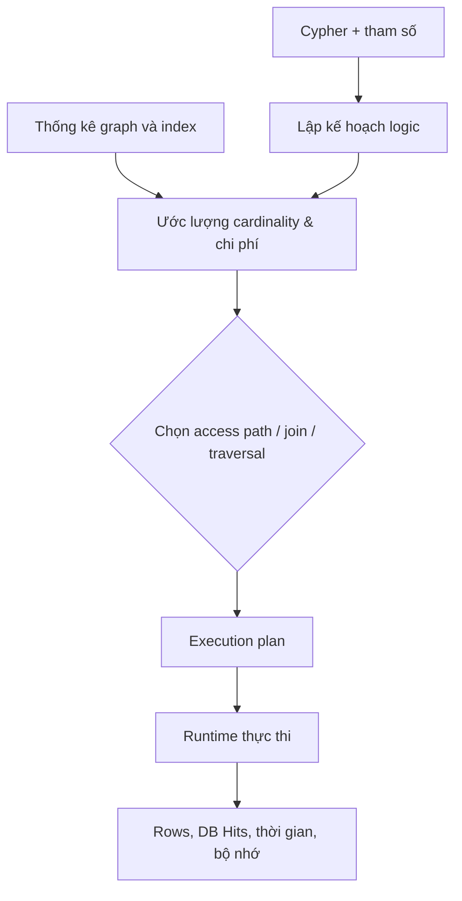
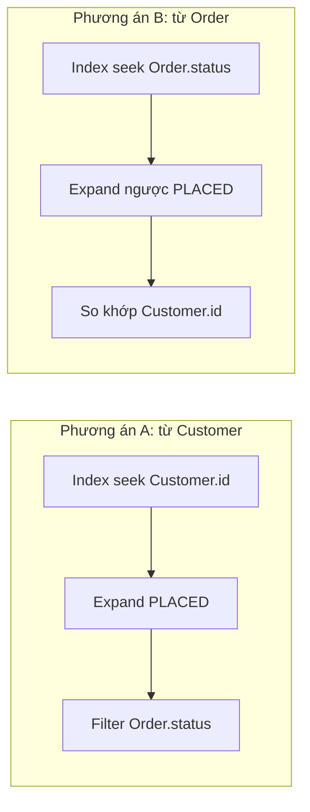
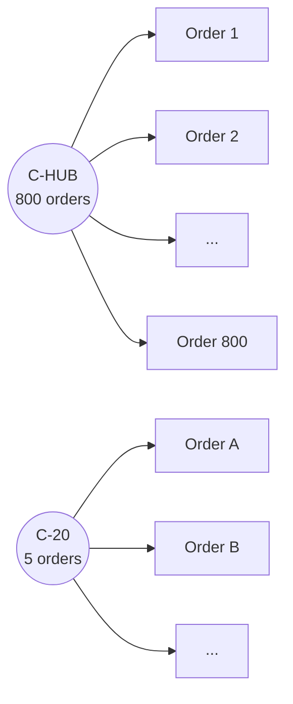

# Thống kê dữ liệu, lựa chọn kế hoạch và tác động của phân bố lệch trong Neo4j

Một câu Cypher có thể cho kết quả đúng nhưng mất hàng giây vì Neo4j chọn cách truy cập dữ liệu không phù hợp. **Query planner** phải ước lượng có bao nhiêu node, relationship và bản ghi trung gian cần xử lý **trước khi chạy truy vấn**. Nó dựa vào thống kê dữ liệu, thông tin chỉ mục, cấu trúc Cypher và mô hình chi phí để lựa chọn **execution plan**. Nếu dữ liệu phân bố không đều — chẳng hạn một khách hàng có hàng trăm nghìn quan hệ trong khi phần lớn khách hàng chỉ có vài quan hệ — ước lượng dựa trên mức trung bình có thể lệch xa thực tế.

Bài học thuộc chương **Kế hoạch thực thi** trong module **DATABASE_ENGINE_GRAPH_NEO4J**. Kiến thức được áp dụng khi truy vấn property graph bằng **Cypher**, chọn index và constraint, tối ưu duyệt quan hệ cũng như xử lý truy vấn trong **Neo4j Java Driver** hoặc **Spring Data Neo4j**.

Sau bài học, bạn có thể giải thích:

- Thống kê nào giúp Neo4j ước lượng **cardinality** (số hàng ở mỗi bước).
- Vì sao hai kế hoạch trả cùng kết quả nhưng chi phí truy cập khác nhau.
- Cách đọc chênh lệch giữa **Estimated Rows** và **Rows** khi dùng `EXPLAIN`/`PROFILE`.
- Tác động của **phân bố lệch (data skew)** theo giá trị thuộc tính, số relationship và tương quan dữ liệu.
- Cách đo và điều chỉnh kế hoạch trên những nhóm dữ liệu đại diện.

## 1. Từ câu Cypher đến kế hoạch thực thi

Xét truy vấn:

```cypher
MATCH (c:Customer {id: $customerId})-[:PLACED]->(o:Order)
WHERE o.status = $status
RETURN o.id AS orderId;
```

Neo4j có thể cân nhắc các cách thực hiện về mặt logic:

1. **Bắt đầu từ Customer**: tìm node có `id = $customerId`, duyệt các `:PLACED` đi ra, rồi lọc `o.status`.
2. **Bắt đầu từ Order**: tìm các node `Order` có `status = $status`, duyệt `:PLACED` theo chiều ngược lại để kiểm tra customer.
3. Trong truy vấn phức tạp hơn, planner còn phải chọn thứ tự các mẫu `MATCH`, phép nối, cách lọc, sắp xếp và xử lý tập kết quả trung gian.

Cú pháp `(c)-[:PLACED]->(o)` xác định **hướng quan hệ cần khớp**, nhưng không bắt buộc engine luôn bắt đầu thực thi từ `c`. Planner có thể tìm node `o` trước và truy ngược theo quan hệ có hướng đó nếu cách ấy rẻ hơn.



**Execution plan** là cây các **operator**. Mỗi operator thực hiện một việc như tìm node qua index, quét nhãn, duyệt quan hệ, lọc kết quả, nối hoặc sắp xếp. Một kế hoạch được chọn dựa trên **ước lượng**; chỉ khi chạy mới biết chi phí và số hàng thực tế.

## 2. Neo4j thống kê những gì và dùng để làm gì?

Planner cần thông tin về quy mô và độ chọn lọc của dữ liệu để so sánh các kế hoạch. Tùy phiên bản Neo4j, loại index và hình dạng truy vấn, đầu vào ước lượng có thể bao gồm:

| Nhóm thông tin | Ví dụ | Tác dụng với planner |
| --- | --- | --- |
| Số lượng node theo nhãn | Có bao nhiêu node `:Customer`, `:Order` | Ước lượng chi phí quét nhãn hoặc lọc node |
| Số lượng relationship theo loại/mẫu | Bao nhiêu quan hệ `:PLACED`, quan hệ giữa các nhãn nào | Ước lượng độ lớn phép mở rộng quan hệ |
| Thông tin thống kê chỉ mục | Index nào tồn tại, khả năng chọn lọc của các giá trị được index | Ước lượng giá thành index seek/scan |
| Đặc điểm điều kiện truy vấn | `=`, điều kiện khoảng, kết hợp `AND`/`OR`, `LIMIT`, `ORDER BY` | Ước lượng số hàng lọc còn lại và chi phí các phép toán |
| Ràng buộc dữ liệu | `id` có `UNIQUE` constraint hay không | Giới hạn cardinality kỳ vọng của phép tìm theo định danh |

Các thống kê này được Neo4j duy trì phục vụ lập kế hoạch. **Không giả định cơ chế hay độ chi tiết thống kê giống PostgreSQL/Oracle**; Neo4j không nhất thiết có một bảng histogram riêng cho mọi tổ hợp thuộc tính hoặc cho từng node có bậc cao. Tên trường, khả năng quan sát thống kê và quy tắc tái lập kế hoạch còn phụ thuộc phiên bản Neo4j.

### Cardinality và selectivity

- **Cardinality**: số bản ghi/hàng đi qua một operator. Một node kết hợp với nhiều relationship có thể tạo ra nhiều hàng.
- **Estimated Rows**: cardinality planner **dự đoán** trước khi thực thi.
- **Rows** trong `PROFILE`: số hàng operator **xử lý hoặc xuất ra trong lần thực thi**, theo cách hiển thị của plan.
- **Selectivity**: tỷ lệ dữ liệu thỏa một predicate. Ví dụ 10 trong 1.000 `Order` có `status = 'FAILED'` → selectivity thực tế là 1%.

Một phép lọc có thể thay đổi số hàng theo trực giác:

```text
1.000 Order
    │ WHERE status = 'FAILED'  (10 đơn)
    ▼
10 Order                       → selectivity = 10 / 1.000 = 1%
```

Nhưng **ước lượng** 1% ở mức toàn graph chưa chắc đúng cho từng khách hàng, từng vùng hoặc từng loại tài khoản. Đây là nguyên nhân quan trọng gây chọn kế hoạch kém hiệu quả.

## 3. Planner so sánh kế hoạch bằng ước lượng chi phí

Cho truy vấn `Customer → PLACED → Order`, giả sử:

- Tìm một `Customer` bằng index/constraint mất ít công.
- Một customer thông thường có 5 order.
- Một customer đặc biệt có 800 order.
- Trên toàn graph chỉ 10/1.000 order có trạng thái `FAILED`.

Hai phương án có hình dạng khác nhau:



Nếu customer có **5** order, phương án A có thể rất rẻ. Nếu customer có **800** order nhưng chỉ tìm `FAILED` (rất hiếm trên toàn graph), phương án B có thể xét ít ứng viên hơn. Planner sẽ cân nhắc các thông tin nó biết; không có quy tắc rằng phương án A hay B **luôn** nhanh hơn.

### Vì sao trung bình có thể đánh lừa?

Nếu có 41 customer và 1.000 order, **bậc trung bình** của customer theo quan hệ `PLACED` là khoảng:

```text
1.000 / 41 ≈ 24,4 order/customer
```

Con số này khác rất nhiều so với:

- Customer `C-HUB`: **800** order.
- Mỗi customer `C-1` đến `C-40`: **5** order.

Khi phải đi từ một customer sang order, ước lượng gần mức trung bình có thể thấp hơn thực tế của `C-HUB` khoảng **33 lần**. Đây là ví dụ minh họa cách thống kê tổng hợp có thể che khuất một **high-degree hub**; không khẳng định Neo4j luôn sử dụng chính xác phép chia trung bình nêu trên trong mọi execution plan.

## 4. Thực hành: tạo graph có phân bố lệch rõ ràng

Các ví dụ sau chỉ nên chạy trong **cơ sở dữ liệu thực hành**. Ta dùng nhãn `PlanCustomer` và `PlanOrder` để nhận biết bộ dữ liệu. Có 41 customer và 1.000 order; một customer sở hữu 80% số order.

### 4.1. Tạo constraint và index

```cypher
CREATE CONSTRAINT plan_customer_id_unique IF NOT EXISTS
FOR (c:PlanCustomer)
REQUIRE c.id IS UNIQUE;
```

```cypher
CREATE CONSTRAINT plan_order_id_unique IF NOT EXISTS
FOR (o:PlanOrder)
REQUIRE o.id IS UNIQUE;
```

```cypher
CREATE RANGE INDEX plan_order_status IF NOT EXISTS
FOR (o:PlanOrder)
ON (o.status);
```

Constraint uniqueness trên `PlanCustomer.id` tạo khả năng tra cứu định danh duy nhất; index `plan_order_status` tạo một cách truy cập riêng qua trạng thái order. Chính sự tồn tại của hai cách truy cập này làm ví dụ so sánh hướng bắt đầu trở nên có ý nghĩa.

Để kiểm tra trạng thái index:

```cypher
SHOW INDEXES
YIELD name, type, labelsOrTypes, properties, state
WHERE 'PlanCustomer' IN labelsOrTypes
   OR 'PlanOrder' IN labelsOrTypes
RETURN name, type, properties, state
ORDER BY name;
```

Nếu index mới đang `POPULATING`, hãy đợi đến khi `ONLINE` rồi mới đánh giá hiệu quả của nó.

### 4.2. Tạo 1.000 order gắn với 41 customer

```cypher
UNWIND range(1, 1000) AS i
WITH i,
     CASE
       WHEN i <= 800 THEN 'C-HUB'
       ELSE 'C-' + toString(toInteger((i - 801) / 5) + 1)
     END AS customerId
MERGE (c:PlanCustomer {id: customerId})
MERGE (o:PlanOrder {id: 'O-' + toString(i)})
SET o.status =
    CASE WHEN i % 100 = 0 THEN 'FAILED'
         ELSE 'OPEN'
    END
MERGE (c)-[:PLACED_ORDER]->(o);
```

Đặc điểm dữ liệu sau khi tạo:

| Nhóm | Số customer | Tổng order | Order trên mỗi customer |
| --- | ---: | ---: | ---: |
| `C-HUB` | 1 | 800 | 800 |
| `C-1` đến `C-40` | 40 | 200 | 5 |
| **Tổng** | **41** | **1.000** | **Trung bình khoảng 24,4** |

Trong 1.000 order, cứ 100 order có một `FAILED`, nên số liệu theo status là **990 OPEN, 10 FAILED**. Trong `C-HUB` có **792 OPEN, 8 FAILED**; trong `C-20` (các order số 896–900) có **4 OPEN, 1 FAILED**.

`MERGE` giúp các lần chạy lại ví dụ với cùng định danh không tự tạo lại node/relationship tương ứng. Nếu đã có dữ liệu thực hành cũ với cùng nhãn nhưng cấu trúc khác, kết quả thống kê có thể khác bảng trên; nên dùng cơ sở dữ liệu thử nghiệm riêng để nhận đúng các số liệu.

### 4.3. Đo phân bố thực tế

Đếm số order trên từng customer:

```cypher
MATCH (c:PlanCustomer)-[:PLACED_ORDER]->(o:PlanOrder)
RETURN c.id AS customerId, count(o) AS orderCount
ORDER BY orderCount DESC, customerId
LIMIT 10;
```

Kết quả đầu tiên là `C-HUB` với **800**. Các customer còn lại có **5**.

Đếm theo trạng thái:

```cypher
MATCH (o:PlanOrder)
RETURN o.status AS status, count(*) AS orderCount
ORDER BY orderCount DESC;
```

Kết quả kỳ vọng:

| status | orderCount |
| --- | ---: |
| `OPEN` | 990 |
| `FAILED` | 10 |

Hai thống kê trên cho thấy hai dạng skew:

1. **Skew theo bậc (degree skew):** phần lớn relationship tập trung ở `C-HUB`.
2. **Skew theo giá trị property:** `OPEN` phổ biến, `FAILED` hiếm.

## 5. So sánh kế hoạch của cùng một mẫu truy vấn

### 5.1. Query lọc theo khách hàng và trạng thái

```cypher
EXPLAIN
MATCH (c:PlanCustomer {id: 'C-HUB'})
      -[:PLACED_ORDER]->(o:PlanOrder)
WHERE o.status = 'OPEN'
RETURN o.id AS orderId;
```

`EXPLAIN` chỉ lập kế hoạch, **không thực thi truy vấn**. Để xem số hàng thật:

```cypher
PROFILE
MATCH (c:PlanCustomer {id: 'C-HUB'})
      -[:PLACED_ORDER]->(o:PlanOrder)
WHERE o.status = 'OPEN'
RETURN o.id AS orderId;
```

Kết quả logic là **792 order**. Thử thêm câu query có bộ lọc hiếm:

```cypher
PROFILE
MATCH (c:PlanCustomer {id: 'C-HUB'})
      -[:PLACED_ORDER]->(o:PlanOrder)
WHERE o.status = 'FAILED'
RETURN o.id AS orderId;
```

Kết quả logic là **8 order**. Sau đó thử customer nhỏ:

```cypher
PROFILE
MATCH (c:PlanCustomer {id: 'C-20'})
      -[:PLACED_ORDER]->(o:PlanOrder)
WHERE o.status = 'FAILED'
RETURN o.id AS orderId;
```

Kết quả logic là **1 order**.

Bốn yếu tố đáng quan sát khi so sánh các lần chạy là **điểm bắt đầu**, **hướng mở rộng quan hệ**, **số hàng trung gian** và **thao tác lọc/sắp xếp**. Có thể Neo4j chọn cùng một kế hoạch cho cả ba truy vấn trên bộ dữ liệu nhỏ; đó không phải lỗi. Mục tiêu là hiểu vì sao hiệu quả **thực tế** có thể khác nhau dù hình dạng truy vấn tương tự.

### 5.2. Đọc các operator thường gặp

| Operator hoặc nhóm operator | Cách hiểu | Dấu hiệu cần kiểm tra |
| --- | --- | --- |
| `NodeIndexSeek`, `NodeUniqueIndexSeek` | Tra cứu node bằng index/constraint | Số ứng viên có ít không, có bắt đầu từ phía phù hợp không |
| `NodeByLabelScan` | Duyệt node theo nhãn | Có quét quá nhiều node trước khi lọc không |
| `Expand(All)` / `Expand(Into)` | Duyệt relationship theo mẫu | Một hub có tạo ra số hàng lớn ngoài dự đoán không |
| `Filter` | Loại các hàng không đạt điều kiện | Có phải xử lý hàng nghìn hàng rồi mới loại hầu hết không |
| `NodeHashJoin`, `Apply` | Kết hợp các nhánh/đoạn của plan | Dữ liệu trung gian và chi phí nối có lớn không |
| `Sort`, `Top`, `EagerAggregation` | Sắp xếp, giới hạn theo thứ tự hoặc gom nhóm | Có phải giữ nhiều hàng trong bộ nhớ không |
| `Eager` | Vật hóa dữ liệu trung gian tại một ranh giới phụ thuộc | Có phát sinh chi phí bộ nhớ đáng kể không |

Không phải mọi phiên bản Neo4j đều hiển thị đúng cùng tên operator, cột hay thứ tự thực thi. Cần đọc **cây plan thực tế** trong Neo4j Browser hoặc kết quả `PROFILE` đang dùng.

### 5.3. Đọc `Estimated Rows` và `Rows` tại điểm bắt đầu lệch

Giả sử một plan bắt đầu ở customer và mở rộng các quan hệ. Một bảng **minh họa giả định**, không phải kết quả cố định của Neo4j, có thể trông như sau:

| Operator | Estimated Rows | Rows thực tế | Diễn giải |
| --- | ---: | ---: | --- |
| `NodeUniqueIndexSeek` — tìm `C-HUB` | 1 | 1 | Nhận đúng một customer |
| `Expand(All)` — duyệt `PLACED_ORDER` | 25 | 800 | Ước lượng bậc customer thấp hơn thực tế rất nhiều |
| `Filter` — `status = 'FAILED'` | 1 | 8 | Kết quả sau lọc nhỏ nhưng đã duyệt 800 relationship |

Chênh lệch đầu tiên xuất hiện ở **Expand**. Nếu chỉ nhìn số hàng trả về cuối cùng (8), bạn có thể bỏ lỡ phần chi phí duyệt **800** relationship. Đây là cách tiếp cận quan trọng khi điều tra query chậm: tìm **operator đầu tiên** mà số hàng thực tế khác xa ước lượng, rồi lần theo nguyên nhân.

**Không có ngưỡng tuyệt đối** như “lệch trên 10 lần luôn là lỗi”. Một operator lệch 100 lần nhưng chỉ xử lý 100 hàng vẫn có thể rẻ. Ngược lại, lệch hai lần ở vị trí đang xử lý hàng chục triệu hàng có thể gây vấn đề lớn.

## 6. Dùng `DB Hits`, bộ nhớ và thời gian đúng cách

Trong `PROFILE`, thường có thể quan sát:

- **Rows**: khối lượng kết quả tại operator.
- **Estimated Rows**: khối lượng được dự đoán khi lập kế hoạch.
- **DB Hits**: số lần operator truy cập dữ liệu theo phép đếm nội bộ của engine; không đồng nhất với số lần đọc đĩa hay số truy vấn mạng.
- **Memory**: một số operator và runtime có thông tin mức sử dụng bộ nhớ.
- **Page cache hits/misses**, **thời gian** hoặc thông tin runtime: tùy công cụ, phiên bản và kiểu kế hoạch.

Ví dụ, `Filter` nhận 800 hàng rồi trả ra 8 có thể tạo nhiều công việc hơn trường hợp index chỉ tạo sẵn 10 ứng viên rồi kiểm tra customer. Tuy nhiên, không được kết luận chỉ từ tổng `DB Hits` trong một lần chạy: hệ thống có cache, kích thước dữ liệu nhỏ và chi phí operator khác nhau.

Khi so sánh hai plan, nên giữ ổn định:

1. Cùng dữ liệu, cùng phiên bản và cùng cấu hình runtime.
2. Cùng mục tiêu truy vấn; **không** bỏ điều kiện cần thiết chỉ để plan trông nhanh hơn.
3. Cùng cách cung cấp tham số, kích thước kết quả và tình trạng cache gần tương đương.
4. Đo nhiều lần trên dữ liệu đủ lớn, đồng thời quan sát cả độ trễ và mức tiêu thụ tài nguyên.

`PROFILE` **thực thi** truy vấn. Với câu ghi dữ liệu, điều này có thể thực sự tạo/sửa/xóa graph; cần dùng cơ sở dữ liệu thử nghiệm hoặc query chỉ đọc khi khám phá plan.

## 7. Ba kiểu phân bố lệch thường gây sai ước lượng

### 7.1. Skew theo tần suất giá trị

Giả sử `Order.status` phân bố:

```text
OPEN    ████████████████████████████████████ 99%
FAILED  ▏                                      1%
```

Một index trên `status` không tự động làm truy vấn `status = 'OPEN'` nhanh. Với giá trị phổ biến, index vẫn có thể trả gần như toàn bộ dữ liệu; quét nhãn hoặc kế hoạch khác có thể rẻ hơn. Với `FAILED`, index seek có thể cực kỳ có ích nếu giá trị hiếm.

Tương tự, thuộc tính `country` có thể chứa 95% bản ghi ở một quốc gia và 5% chia cho hàng chục quốc gia còn lại. Đừng dùng chỉ số “có bao nhiêu giá trị khác nhau” làm đại diện duy nhất cho chi phí truy vấn.

### 7.2. Skew theo bậc relationship

Graph thường có **hub**: node nhiều quan hệ hơn hẳn phần còn lại, chẳng hạn người dùng nổi tiếng, tài khoản doanh nghiệp lớn hoặc sản phẩm có hàng triệu lượt tương tác.



Dù `Customer.id` là duy nhất, tìm đúng một customer **không có nghĩa toàn bộ truy vấn chỉ sinh một hàng**. Phép `Expand` có thể nhân số hàng lên theo bậc node đó. Ở truy vấn nhiều chặng, sai lệch còn có thể khuếch đại qua nhiều lần mở rộng.

### 7.3. Skew do tương quan giữa thuộc tính hoặc nhóm dữ liệu

Giả sử `status = 'FAILED'` hiếm trên toàn hệ thống nhưng lại tập trung ở một số tenant, hoặc node `:Order` của khách hàng VIP chủ yếu rơi vào một khoảng ngày đặc biệt. Tỷ lệ toàn cục không mô tả được tỷ lệ **bên trong nhóm**.

Ví dụ minh họa:

| Nhóm | Tổng order | FAILED | Tỷ lệ FAILED |
| --- | ---: | ---: | ---: |
| Tenant A | 1.000 | 1 | 0,1% |
| Tenant B | 1.000 | 400 | 40% |
| **Toàn hệ thống** | **2.000** | **401** | **20,05%** |

Nếu một ước lượng đơn giản giả định điều kiện `tenantId` và `status` gần độc lập, dự đoán cho từng tenant có thể rất sai. Đây chỉ là **minh họa về thống kê biên và tương quan**; Neo4j không được khẳng định là luôn áp dụng chính xác công thức độc lập đó. Trường hợp này thường xuất hiện trong hệ thống nhiều tenant, dữ liệu theo vùng địa lý, thời gian hoặc mức độ hoạt động của người dùng.

## 8. Tại sao thống kê và kế hoạch có thể thay đổi?

Một plan tốt ở tuần trước chưa chắc tốt hôm nay khi:

- Một tenant tăng từ vài nghìn lên hàng triệu relationship.
- Tỷ lệ `OPEN`/`FAILED` thay đổi sau một đợt sự kiện.
- Dữ liệu mới dồn vào một tháng, khu vực hoặc cộng đồng.
- Thêm/xóa index hoặc constraint, thay đổi phân bố thuộc tính.
- Nâng phiên bản Neo4j, đổi cấu hình runtime hoặc thay mẫu truy vấn.

Neo4j có cơ chế quản lý thống kê và cache kế hoạch. Việc cập nhật thống kê, quyết định tái lập kế hoạch và thời điểm cache bị làm mới **không nên được giả định là tức thời cho mọi lần ghi**. Không nên coi mọi chênh lệch `Estimated Rows`/`Rows` là do “thống kê lỗi thời”; nó còn có thể do bản thân dữ liệu khó biểu diễn bằng ước lượng tổng hợp, đặc biệt ở các hub và giá trị có tương quan.

### Truy vấn có tham số và dữ liệu lệch

Trong Java Driver, hai lần gọi có thể dùng cùng mẫu Cypher:

```cypher
MATCH (c:PlanCustomer {id: $customerId})
      -[:PLACED_ORDER]->(o:PlanOrder)
WHERE o.status = $status
RETURN o.id AS orderId;
```

Nhưng các bộ tham số có thể khác mạnh:

| Tham số | Số ứng viên sau lọc ở dữ liệu mẫu |
| --- | ---: |
| `C-HUB` + `OPEN` | 792 |
| `C-HUB` + `FAILED` | 8 |
| `C-20` + `OPEN` | 4 |
| `C-20` + `FAILED` | 1 |

Cùng **cấu trúc truy vấn** không có nghĩa cùng khối lượng công việc. Query plan có thể được tái sử dụng qua các lần chạy tham số khác nhau; không nên mặc định planner sẽ tự chuyên biệt hóa plan cho **mọi** giá trị tham số. Hãy đo cả những giá trị phổ biến, hiếm và các hub khi thử hiệu năng ứng dụng.

## 9. Quy trình thực tế để điều tra một plan kém hiệu quả

### Bước 1 — Xác nhận câu truy vấn và nhóm tham số gây chậm

Thu thập mẫu Cypher, tên nhãn/relationship, điều kiện `WHERE`, thứ tự `ORDER BY`, giới hạn `LIMIT` và các nhóm tham số. Trong hệ thống nhiều tenant, kiểm tra riêng tenant lớn, tenant nhỏ, trạng thái thường gặp và trạng thái hiếm.

Không chỉ dựa vào một phép đo với dữ liệu ít hoặc tham số dễ.

### Bước 2 — Kiểm tra dữ liệu và chỉ mục

Dùng `SHOW INDEXES` để biết index đã `ONLINE` chưa, có đúng nhãn/thuộc tính không. Đo phân bố thực bằng các câu `count()` có phạm vi hợp lý như phần thực hành; trên dữ liệu lớn, các câu đếm toàn graph có thể tốn tài nguyên, nên thực hiện ở môi trường phù hợp.

Đặc biệt kiểm tra:

- Độ chọn lọc của predicate trước và sau khi lọc theo nhóm.
- Mức chênh lệch giữa bậc trung bình và bậc node nóng.
- Tương quan giữa `tenantId`, `status`, `createdAt` và các trường khác.
- Các trường có `NULL`/không tồn tại hoặc kiểu dữ liệu không nhất quán.

### Bước 3 — Dùng `EXPLAIN` rồi `PROFILE`

```cypher
EXPLAIN
MATCH (c:PlanCustomer {id: 'C-HUB'})
      -[:PLACED_ORDER]->(o:PlanOrder)
WHERE o.status = 'FAILED'
RETURN o.id AS orderId;
```

```cypher
PROFILE
MATCH (c:PlanCustomer {id: 'C-HUB'})
      -[:PLACED_ORDER]->(o:PlanOrder)
WHERE o.status = 'FAILED'
RETURN o.id AS orderId;
```

Đọc plan **từ các operator cung cấp dữ liệu đầu tiên** tới đầu ra. Ghi lại nơi `Rows` bắt đầu lệch `Estimated Rows`, rồi kiểm tra hậu quả của nó lên `Expand`, `Filter`, join, sort và bộ nhớ.

### Bước 4 — Đề xuất thay đổi có lý do

Tùy nguyên nhân, có thể:

- Tạo index phù hợp với **điểm bắt đầu chọn lọc** của query, ví dụ index trên `Order.status` nếu trạng thái hiếm là bộ lọc quan trọng.
- Tạo **composite index** phù hợp với điều kiện equality/range thường gặp; tránh tạo vô số index chồng lấn không cần thiết.
- Làm rõ nhãn và loại relationship trong mẫu `MATCH` để tránh duyệt nhiều loại quan hệ hơn nhu cầu.
- Đưa các điều kiện lọc có thể áp dụng sớm vào query và kiểm tra liệu planner đã đẩy predicate xuống hay chưa.
- Giảm số hàng trung gian khi nghiệp vụ cho phép; `LIMIT` ở cuối không bảo đảm tránh phải duyệt hoặc sắp xếp lượng lớn dữ liệu.
- Với hub quá lớn, cân nhắc thay đổi mô hình hoặc cách chia truy vấn theo **phạm vi nghiệp vụ thật**, không chia graph tùy tiện chỉ để có benchmark đẹp.

Không có một “mẹo” `WHERE` hay `ORDER BY` bảo đảm Neo4j chọn đúng plan. Mọi đề xuất cần được xác nhận bằng kế hoạch và số liệu.

### Bước 5 — Chỉ cân nhắc index hint khi đã đo

Nếu planner không chọn index mà thực nghiệm cho thấy index thích hợp tốt hơn, có thể thử hint:

```cypher
PROFILE
MATCH (c:PlanCustomer {id: 'C-HUB'})
      -[:PLACED_ORDER]->(o:PlanOrder)
USING INDEX o:PlanOrder(status)
WHERE o.status = 'FAILED'
RETURN o.id AS orderId;
```

`USING INDEX` là tín hiệu định hướng planner khi index phù hợp tồn tại. Nó **không** làm sai logic kết quả, cũng không bảo đảm hiệu năng tốt hơn. So sánh với plan không hint bằng cùng tham số và dữ liệu; cần cân nhắc rủi ro cứng hóa một lựa chọn không còn phù hợp khi phân bố dữ liệu thay đổi.

### Bước 6 — Kiểm tra lại các trường hợp đối lập

Sau khi cải thiện cho `C-HUB + FAILED`, phải kiểm tra cả `C-20 + OPEN`, `C-HUB + OPEN` và các nhóm tương ứng. Một index hoặc hint tốt cho giá trị hiếm có thể không tốt cho giá trị phổ biến.

Đánh giá chi phí duy trì index khi ghi, độ trễ ở nhiều percentile (nếu có), lượng dữ liệu trả về và độ ổn định kế hoạch theo thời gian.

## 10. Kết nối kiến thức với Java Driver và Spring Data Neo4j

Ứng dụng Java thường dùng **tham số** để tái sử dụng câu Cypher và tránh ghép chuỗi dữ liệu đầu vào. Ví dụ với Neo4j Java Driver:

```java
import org.neo4j.driver.Driver;
import org.neo4j.driver.Session;
import org.neo4j.driver.Values;

import java.util.List;

public List<String> findOrderIds(
        Driver driver, String customerId, String status) {
    try (Session session = driver.session()) {
        return session.executeRead(tx -> tx.run("""
            MATCH (c:PlanCustomer {id: $customerId})
                  -[:PLACED_ORDER]->(o:PlanOrder)
            WHERE o.status = $status
            RETURN o.id AS orderId
            ORDER BY orderId
            LIMIT 50
            """, Values.parameters(
                "customerId", customerId,
                "status", status
            )).list(record ->
                record.get("orderId").asString()
            )
        );
    }
}
```

`LIMIT 50` hạn chế số hàng **trả về cho Java**; nếu engine vẫn cần duyệt hàng trăm nghìn quan hệ hoặc sắp xếp nhiều bản ghi trước đó, thời gian truy vấn có thể vẫn cao. `ORDER BY orderId` tạo thứ tự ổn định cho ví dụ nhưng cũng có thể phát sinh operator sắp xếp. Khi áp dụng vào ứng dụng thật, thiết kế truy vấn và index theo mẫu đọc dữ liệu cụ thể.

Với **Spring Data Neo4j**, việc gọi repository hoặc `Neo4jClient` vẫn thực thi Cypher và chịu ảnh hưởng của planner. Tên phương thức repository không quyết định một truy vấn có được index seek hay tránh traversal của hub. Khi chậm, truy xuất query được phát sinh và phân tích nó bằng `EXPLAIN`/`PROFILE` trên môi trường phù hợp.

Đối với dashboard hoặc API có nhiều tenant, nên theo dõi độ trễ theo **nhóm tenant/kích thước graph và giá trị điều kiện**, bởi một trung bình toàn hệ thống có thể che khuất các request rất chậm của những tenant đặc biệt.

## 11. Bảng nhận diện nhanh triệu chứng

| Triệu chứng quan sát | Nguyên nhân có thể | Hướng kiểm chứng |
| --- | --- | --- |
| `Estimated Rows = 25` nhưng `Expand` trả 800 | Node hub, bậc cao hơn phân bố trung bình | Đếm degree của node, xem operator duyệt quan hệ |
| Có `NodeIndexSeek` nhưng query vẫn chậm | Index seek trả quá nhiều ứng viên hoặc bước sau tốn kém | Kiểm tra `Rows`/`DB Hits` sau seek, filter, sort |
| `status = FAILED` nhanh, `status = OPEN` chậm | Skew theo giá trị property | Đếm theo từng status, so sánh plan hai trường hợp |
| Tenant nhỏ nhanh, tenant lớn chậm cùng query | Skew theo tenant hoặc bậc relationship | So sánh các nhóm tham số và số hàng trung gian |
| Sau import lớn, plan khác trước | Quy mô, phân bố, thống kê hoặc index đã thay đổi | Kiểm tra dữ liệu hiện tại, index, `EXPLAIN`/`PROFILE` |
| Query có `LIMIT 20` vẫn tốn nhiều công | Đã duyệt/sắp xếp khối lớn trước khi giới hạn | Xem `Expand`, `Sort`/`Top` và thứ tự operator |

Đây là **giả thuyết để điều tra**, không phải cách chẩn đoán tự động chỉ từ một dấu hiệu.

## 12. Câu hỏi tự kiểm tra

**Câu 1.** Trong bộ dữ liệu thực hành, tại sao tra cứu một `PlanCustomer` bằng `id` duy nhất vẫn có thể tạo ra 800 hàng trung gian?

<details>
<summary>Đáp án gợi ý</summary>

Vì index/constraint giúp tìm đúng **một node customer**, còn `Expand` từ node đó qua `:PLACED_ORDER` tạo ra một hàng cho mỗi relationship phù hợp. `C-HUB` có 800 order nên cardinality tăng mạnh ở bước traversal.

</details>

**Câu 2.** `PROFILE` báo `Estimated Rows = 25`, `Rows = 800` tại `Expand(All)`. Chỉ báo nào cần xem tiếp?

<details>
<summary>Đáp án gợi ý</summary>

Đo bậc node nguồn và kiểm tra sau `Expand` có `Filter`/join/sort nào phải xử lý 800 hàng không. Quan sát `DB Hits`, mức chênh lệch ở các operator kế tiếp và thời gian với dữ liệu đại diện. Chênh lệch là dấu hiệu cần phân tích, chưa đủ kết luận lỗi planner.

</details>

**Câu 3.** Tại sao index `PlanOrder(status)` có thể giúp truy vấn `FAILED` nhưng không chắc giúp `OPEN`?

<details>
<summary>Đáp án gợi ý</summary>

Chỉ 10/1.000 order là `FAILED`, trong khi 990/1.000 là `OPEN`. Index có thể giới hạn rất ít ứng viên với giá trị hiếm, nhưng với giá trị phổ biến nó vẫn có thể trả gần hết dữ liệu, làm index seek không chắc tốt hơn cách truy cập khác.

</details>

**Câu 4.** Một lập trình viên chỉ đo câu query với customer có 5 order rồi kết luận độ trễ luôn thấp. Vấn đề trong phép đo là gì?

<details>
<summary>Đáp án gợi ý</summary>

Mẫu tham số không đại diện cho phân bố dữ liệu. Cần thêm customer hub, điều kiện phổ biến và hiếm; đo `PROFILE` và độ trễ tương ứng. Plan và cache có thể được dùng lại, nhưng khối lượng xử lý thay đổi mạnh theo nhóm dữ liệu.

</details>

**Câu 5.** Vì sao không nên áp dụng `USING INDEX` cho mọi query chậm ngay từ đầu?

<details>
<summary>Đáp án gợi ý</summary>

Index có thể kém hiệu quả nếu predicate quá phổ biến hoặc phần chi phí chính nằm ở traversal, sort, join phía sau. Hint cần có index hợp lệ và được kiểm chứng tốt hơn plan mặc định; nó cũng có thể trở nên kém phù hợp khi dữ liệu thay đổi.

</details>

## Ghi nhớ

- **Planner chọn execution plan trước khi thực thi**, dựa trên thống kê và ước lượng chi phí; kết quả cuối cùng đúng không đồng nghĩa kế hoạch hiệu quả.
- **Cardinality** là số hàng trung gian. Chênh lệch **Estimated Rows** so với **Rows** cho biết nơi ước lượng khác dữ liệu thật.
- **Data skew** có thể đến từ property có giá trị rất phổ biến/hiếm, node hub có bậc cao hoặc điều kiện phụ thuộc vào tenant/vùng/thời gian.
- **Index seek không bảo đảm query nhanh** nếu nó trả quá nhiều ứng viên hoặc bước `Expand`/`Filter`/`Sort` phía sau phải xử lý tập lớn.
- **EXPLAIN** giúp xem kế hoạch dự kiến; **PROFILE** thực thi query và cho số liệu quan sát để so sánh.
- **Kiểm thử bằng tham số đại diện**, gồm các trường hợp lệch phân bố; tối ưu theo workload và theo dõi khi dữ liệu tăng trưởng.

### Tài liệu tham khảo

- [Neo4j Cypher Manual — Query tuning](https://neo4j.com/docs/cypher-manual/current/planning-and-tuning/query-tuning/)
- [Neo4j Cypher Manual — Execution plans](https://neo4j.com/docs/cypher-manual/current/planning-and-tuning/execution-plans/)
- [Neo4j Cypher Manual — Search-performance indexes](https://neo4j.com/docs/cypher-manual/current/indexes/search-performance-indexes/overview/)
- [Neo4j Java Driver Manual — Run your queries](https://neo4j.com/docs/java-manual/current/query-simple/)
