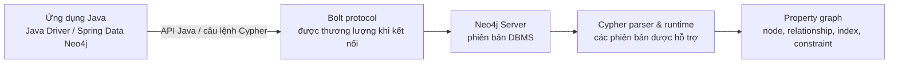

# Phân biệt phiên bản máy chủ Neo4j, ngôn ngữ Cypher và trình điều khiển Java

## 1. Ba phiên bản thường xuất hiện trong cùng một ứng dụng

Khi xây dựng ứng dụng Java lưu trữ và truy vấn dữ liệu liên kết theo mô hình **property graph**, chúng ta thường gặp ba thông tin có vẻ giống nhau: phiên bản máy chủ Neo4j, phiên bản ngôn ngữ Cypher và phiên bản Neo4j Java Driver. Chúng liên quan đến nhau nhưng **không phải ba cách gọi của cùng một phiên bản**.

Ví dụ, một ứng dụng có thể đang:

- Kết nối đến **Neo4j Server 5.x**, nơi lưu các node, relationship, property, index và constraint.
- Gửi câu truy vấn theo **Cypher 5**, tức một phiên bản cú pháp và ngữ nghĩa mà máy chủ hiểu.
- Dùng thư viện **Neo4j Java Driver 5.x hoặc một phiên bản khác được xác nhận tương thích**, tức mã Java phía ứng dụng dùng để thiết lập kết nối, chạy giao dịch và nhận kết quả.

Ba con số không bắt buộc bằng nhau. Đổi phiên bản Java Driver không tự nâng cấp cơ sở dữ liệu; nâng cấp Neo4j Server không tự sửa cú pháp Cypher trong mã nguồn; chọn một phiên bản Cypher không thay đổi phiên bản thư viện Java đang được đóng gói.

| Thành phần | Nằm ở đâu? | Quyết định điều gì? | Cách xác định |
|---|---|---|---|
| **Neo4j Server / DBMS** | Máy chủ hoặc container chạy Neo4j | Khả năng của hệ quản trị đồ thị, bộ máy truy vấn, lưu trữ, quản trị database, chức năng index/constraint và các giao thức được hỗ trợ | Truy vấn `CALL dbms.components()` trên máy chủ đích |
| **Cypher language version** | Bộ phân tích và thực thi truy vấn phía máy chủ | Cú pháp, tính năng và ngữ nghĩa Cypher có thể dùng trong một câu truy vấn | Tài liệu phiên bản server; thử câu truy vấn có chỉ định `CYPHER 5` hoặc `CYPHER 25` khi server hỗ trợ |
| **Neo4j Java Driver version** | Dependency chạy trong ứng dụng Java | API Java, xử lý kết nối, session, transaction, cơ chế giao tiếp Bolt và yêu cầu đối với môi trường Java | Maven/Gradle dependency tree, dependency lockfile hoặc thông tin package đã build |

**Đích học tập:** Sau bài này, bạn có thể đọc đúng từng loại phiên bản, xác định thành phần cần nâng cấp khi gặp lỗi và lựa chọn tổ hợp tương thích khi dùng Java Driver hoặc Spring Data Neo4j.

## 2. Phiên bản Neo4j Server: hệ quản trị đồ thị đang thực sự chạy

Neo4j Server là nơi dữ liệu được lưu và các truy vấn Cypher được biên dịch, lập kế hoạch, thực thi. Phiên bản server chi phối các chức năng về dữ liệu đồ thị, bảo mật, vận hành và phạm vi phiên bản Cypher có thể sử dụng.

Bạn có thể gặp các cách đặt tên bản phát hành Neo4j như **5.x** và các bản phát hành theo lịch dạng **2025.xx**. Đây là **phiên bản sản phẩm Neo4j**, không phải phiên bản Java Driver hay một câu lệnh Cypher. Cần xem release notes và tài liệu tương ứng với bản phát hành cụ thể khi xác định chức năng nào có sẵn; không suy ra từ một con số lớn/nhỏ đơn thuần.

### 2.1. Kiểm tra trực tiếp phiên bản server

Kết nối vào chính instance mà ứng dụng sẽ sử dụng (Neo4j Browser, Cypher Shell hoặc client tương đương), rồi chạy:

```cypher
CALL dbms.components()
YIELD name, versions, edition
RETURN name, versions, edition;
```

Một kết quả **minh họa** có thể trông như sau:

| name | versions | edition |
|---|---|---|
| Neo4j Kernel | ["5.26.0"] | community |

Ở đây `versions` thể hiện phiên bản thành phần phía **server**. Kết quả thực tế phụ thuộc máy chủ đang kết nối; một môi trường có thể trả về nhiều thành phần hoặc có giới hạn quyền xem thông tin quản trị.

Nếu dùng Cypher Shell, bạn có thể kết nối tương tác, sau đó chạy câu lệnh trên:

```bash
cypher-shell -a bolt://localhost:7687 -u neo4j
```

Cypher Shell sẽ yêu cầu thông tin đăng nhập phù hợp với cấu hình. Địa chỉ `localhost:7687` chỉ là ví dụ: trong Docker, Kubernetes hoặc hệ thống triển khai từ xa, cần dùng đúng endpoint mà ứng dụng thực tế truy cập.

**Phân biệt một bẫy thường gặp:** Lệnh `cypher-shell --version` cho biết **phiên bản công cụ dòng lệnh Cypher Shell**, không phải bằng chứng trực tiếp về phiên bản DBMS ở đầu bên kia kết nối. Tương tự, tag Docker thể hiện image đã chỉ định; nên đối chiếu với instance đang thực sự chạy.

### 2.2. Vì sao cần biết đúng server đích?

Giả sử máy phát triển dùng server 5.x, còn staging chạy một bản phát hành 2025.xx. Cùng một project Java và cùng một câu truy vấn có thể cho hành vi khác nhau nếu cấu hình ngôn ngữ, các chức năng được hỗ trợ hoặc cách lập kế hoạch truy vấn khác nhau. Khi điều tra, cần ghi lại **môi trường + endpoint/database + phiên bản server** thay vì chỉ nói “ứng dụng đang dùng Neo4j 5”.

## 3. Phiên bản Cypher: cú pháp và ngữ nghĩa của câu truy vấn

**Cypher** là ngôn ngữ khai báo dùng để mô tả mẫu đồ thị, tìm node/relationship, lọc, tổng hợp, tạo hoặc cập nhật dữ liệu. Ví dụ:

```cypher
MATCH (person:Person)-[:WORKS_AT]->(company:Company)
WHERE company.name = 'Acme'
RETURN person.name AS employee
ORDER BY employee;
```

Phiên bản Cypher quyết định câu truy vấn được phân tích và thực thi theo bộ quy tắc ngôn ngữ nào. Bạn có thể thấy tên **Cypher 5** và **Cypher 25** trong tài liệu của các thế hệ Neo4j tương ứng. Số **25** ở đây thuộc tên **phiên bản ngôn ngữ**, không có nghĩa Java Driver phải là 25.x, và cũng không có nghĩa mọi server mang nhãn 2025 đều mặc nhiên hỗ trợ mọi tính năng Cypher 25.

### 3.1. Chỉ định ngôn ngữ cho từng truy vấn

Trên server có hỗ trợ phiên bản tương ứng, có thể đặt chỉ thị ngôn ngữ ở đầu truy vấn:

```cypher
CYPHER 5
MATCH (person:Person)
RETURN person.name AS name
LIMIT 10;
```

Khi **máy chủ đích có hỗ trợ Cypher 25**, có thể kiểm tra:

```cypher
CYPHER 25
RETURN 1 AS language_check;
```

Nếu câu lệnh thứ hai bị từ chối vì server không nhận biết phiên bản ngôn ngữ, điều đó phản ánh **năng lực server**, không tự chứng minh Java Driver quá cũ. Ngược lại, nếu muốn kiểm tra một tính năng Cypher cụ thể, việc `RETURN 1` thành công mới chỉ xác nhận một câu lệnh đơn giản, chưa xác nhận cú pháp/tính năng đó.

Khi không có tiền tố `CYPHER ...`, câu truy vấn được xử lý theo phiên bản ngôn ngữ **mặc định do máy chủ và cấu hình của bản phát hành đó xác định**. Không nên đoán giá trị mặc định khi chuyển môi trường hoặc nâng cấp; hãy đối chiếu tài liệu và cấu hình của đúng server.

### 3.2. Những gì Cypher version không quyết định

- Nó **không** cho biết máy chủ đã nâng cấp từ bản nào sang bản nào, hay dữ liệu đang ở định dạng lưu trữ nào.
- Nó **không** cài đặt hoặc cập nhật thư viện `org.neo4j.driver` trong dự án Java.
- Nó **không** bảo đảm một truy vấn chạy nhanh: hiệu năng còn phụ thuộc dữ liệu, index, thống kê và execution plan. Cần dùng `EXPLAIN`/`PROFILE` để kiểm chứng trên server và bộ dữ liệu phù hợp.

Chỉ định ngôn ngữ rõ ràng giúp kiểm soát quá trình chuyển đổi cú pháp, nhưng chỉ có tác dụng nếu phiên bản Neo4j đang chạy hỗ trợ chỉ định đó.

## 4. Phiên bản Neo4j Java Driver: thư viện phía ứng dụng

Neo4j Java Driver là thư viện client mà ứng dụng dùng để giao tiếp với Neo4j qua **Bolt**. Dependency thường có tọa độ Maven/Gradle:

```text
org.neo4j.driver:neo4j-java-driver
```

Java Driver cung cấp các API như `GraphDatabase.driver(...)`, `Driver`, `Session`, `Transaction`, `Result`. Phiên bản thư viện ảnh hưởng đến chữ ký API, tính năng kết nối, cách thực hiện giao dịch, yêu cầu phiên bản Java và khả năng tương thích với Bolt của server.

**Bolt protocol** là tầng giao tiếp giữa client và server, có cơ chế thương lượng phiên bản giao thức khi tạo kết nối. Phiên bản Bolt cũng **khác** phiên bản DBMS, Cypher và Java Driver. Driver không cần có cùng số phiên bản với server, nhưng **cặp driver–server phải nằm trong phạm vi hỗ trợ thực tế**.

### 4.1. Xác định phiên bản driver thực sự được nạp

Đối với dự án **Gradle**, xem dependency được resolve ở runtime:

```bash
./gradlew dependencyInsight --dependency neo4j-java-driver --configuration runtimeClasspath
```

Trên Windows PowerShell, dùng wrapper tương ứng:

```powershell
.\gradlew.bat dependencyInsight --dependency neo4j-java-driver --configuration runtimeClasspath
```

Đối với **Maven**:

```bash
mvn dependency:tree -Dincludes=org.neo4j.driver:neo4j-java-driver
```

Lưu ý: Dependency khai báo trực tiếp chưa chắc là bản được sử dụng thực tế nếu có dependency management, BOM, phiên bản transitively resolved hoặc dependency override. Vì vậy, khi gỡ lỗi nên xem **resolved runtime dependency** và nội dung artifact đã triển khai.

### 4.2. Chạy một phép kiểm tra kết nối bằng Java

Ví dụ sau minh họa luồng kiểm tra với các API Java Driver thông dụng. Chương trình dùng biến môi trường thay vì đặt mật khẩu vào mã nguồn:

```java
import org.neo4j.driver.AuthTokens;
import org.neo4j.driver.Driver;
import org.neo4j.driver.GraphDatabase;
import org.neo4j.driver.Record;
import org.neo4j.driver.Session;
import org.neo4j.driver.SessionConfig;

public class Neo4jVersionCheck {
    public static void main(String[] args) {
        String uri = System.getenv().getOrDefault(
                "NEO4J_URI", "bolt://localhost:7687");
        String username = System.getenv().getOrDefault(
                "NEO4J_USER", "neo4j");
        String password = System.getenv("NEO4J_PASSWORD");
        String database = System.getenv().getOrDefault(
                "NEO4J_DATABASE", "neo4j");

        if (password == null || password.isBlank()) {
            throw new IllegalArgumentException(
                    "Thieu bien moi truong NEO4J_PASSWORD");
        }

        try (Driver driver = GraphDatabase.driver(
                uri, AuthTokens.basic(username, password))) {
            // Kiem tra kha nang ket noi den Neo4j.
            driver.verifyConnectivity();

            try (Session session = driver.session(
                    SessionConfig.forDatabase(database))) {
                // Phien ban tra ve la cua server, khong phai Java Driver.
                for (Record record : session.run(
                        "CALL dbms.components() " +
                        "YIELD name, versions, edition " +
                        "RETURN name, versions, edition").list()) {
                    System.out.println(record.asMap());
                }

                int result = session.run(
                        "CYPHER 5 RETURN 1 AS ok")
                        .single()
                        .get("ok")
                        .asInt();
                System.out.println("Cypher 5 smoke test: " + result);
            }
        }
    }
}
```

Chương trình cần được biên dịch với phiên bản Java Driver phù hợp với dự án; việc kiểm tra classpath ở mục 4.1 vẫn là cách xác định **driver version**. `verifyConnectivity()` chủ yếu xác nhận kết nối; phép thử Cypher còn kiểm tra khả năng server chấp nhận câu lệnh. Nếu tài khoản không có quyền gọi `dbms.components()`, bước đọc metadata có thể lỗi dù kết nối và một truy vấn thông thường vẫn hoạt động.

**Không suy luận quá mức:** một lần `verifyConnectivity()` hoặc `RETURN 1` thành công không bảo đảm toàn bộ tính năng Cypher, transaction, routing, TLS, performance và plugin đều tương thích.

### 4.3. Khi dùng Spring Data Neo4j

Với **Spring Data Neo4j**, thông thường ứng dụng còn có thêm các phiên bản:

- **Spring Boot** và **Spring Data Neo4j**: cung cấp cấu hình tự động, repository, mapping node/relationship và tích hợp transaction.
- **Neo4j Java Driver**: vẫn là tầng kết nối xuống database; phiên bản có thể được quản lý bởi BOM/dependency management của Spring Boot.
- **Neo4j Server**: chạy độc lập với ứng dụng và thực thi Cypher.

Do đó không thể nhìn vào “Spring Boot 3.x” để khẳng định đang dùng Java Driver 5.x hay 6.x; cũng không thể nhìn dependency của Spring Data Neo4j để biết Neo4j Server thực tế đang chạy bản nào. Hãy kiểm tra dependency đã resolve và truy vấn metadata trên server.

Tránh tự ý ép phiên bản Java Driver khác với BOM khi chưa kiểm tra phạm vi hỗ trợ của Spring Data Neo4j và Spring Boot tương ứng. API của driver, SDN và JDK cũng có thể thay đổi qua các major version.

## 5. Mối quan hệ tương thích: các lớp kết nối với nhau ra sao?



Sơ đồ trên cho thấy hai ràng buộc khác nhau cần kiểm tra:

1. **Driver ↔ Server:** Hai thành phần phải giao tiếp được qua một phiên bản Bolt chung, đáp ứng các yêu cầu bảo mật, runtime và API. Phải đối chiếu ma trận tương thích của **đúng phiên bản** Java Driver và Neo4j Server.
2. **Cypher ↔ Server:** Server phải nhận biết phiên bản ngôn ngữ và các tính năng/cú pháp được dùng. Một driver gửi được chuỗi truy vấn không có nghĩa server có thể phân tích mọi câu Cypher trong chuỗi đó.

Một ràng buộc thứ ba thường phát sinh trong dự án Spring: **Spring Boot / Spring Data Neo4j ↔ Java Driver ↔ JDK**. Việc nâng cấp một dependency riêng lẻ phải xét cả đường tương thích này.

| Tình huống | Kết luận đúng |
|---|---|
| Server 5.x, truy vấn dùng Cypher 5, Java Driver 5.x | Ba số cùng chứa chữ “5” nhưng biểu thị ba lớp độc lập; vẫn cần kiểm tra các bản phát hành cụ thể. |
| Nâng Java Driver từ một bản lên bản khác | Có thể thay đổi API hoặc khả năng giao tiếp; **không** tự đổi phiên bản server hay ngôn ngữ mặc định. |
| Nâng server và giữ nguyên Java Driver | Có thể chạy được hoặc không, tùy ma trận hỗ trợ và Bolt; cần thử nghiệm thực tế. |
| Gửi `CYPHER 25` tới server không hỗ trợ Cypher 25 | Server từ chối chỉ định ngôn ngữ; đổi driver đơn thuần không bổ sung parser Cypher 25 cho server. |
| Cập nhật Spring Data Neo4j | Có thể kéo theo driver/mapping/API khác; **không** chứng minh phiên bản server đã được cập nhật. |

Đừng tự tạo quy tắc kiểu “server major = driver major” hoặc “server 2025.xx = mọi bản Cypher 25”. Các quy tắc đó bỏ qua sự khác biệt giữa **sản phẩm, ngôn ngữ và thư viện giao tiếp**.

## 6. Quy trình kiểm tra môi trường trước khi phát triển hoặc nâng cấp

Đối với một ứng dụng Java kết nối Neo4j, hãy lập một bảng kiểm kê phiên bản thực tế:

| Thông tin cần ghi | Nguồn xác minh | Ví dụ cách ghi |
|---|---|---|
| Đích kết nối | Biến cấu hình ứng dụng, URI, database name | `bolt://localhost:7687` / `neo4j` (chỉ là môi trường ví dụ) |
| Neo4j Server | `CALL dbms.components()` trên đích kết nối | `5.x` hoặc `2025.xx`, kèm phiên bản đầy đủ |
| Cypher được sử dụng | Chỉ thị `CYPHER ...`, cấu hình mặc định và tài liệu server | `Cypher 5`; `Cypher 25` nếu server hỗ trợ |
| Java Driver | Dependency tree hoặc artifact đã build | `org.neo4j.driver:neo4j-java-driver:<phiên-bản-đã-resolve>` |
| Spring stack (nếu có) | BOM và dependency tree | Spring Boot / Spring Data Neo4j đã resolve |
| Java runtime | `java -version` ở nơi ứng dụng chạy | JDK đang sử dụng |
| Kiểm tra kết nối & nghiệp vụ | Integration test, log, `EXPLAIN`/`PROFILE` | Connection, transaction, query, index/constraint |

Trình tự đề xuất:

1. **Xác định đúng nơi ứng dụng kết nối.** Nhiều sự cố chỉ do code chạy tới staging trong khi người kiểm tra đang mở local Neo4j Browser.
2. **Lấy phiên bản server đang chạy** bằng câu truy vấn metadata, đồng thời ghi lại edition và database đích.
3. **Xem phiên bản Java Driver đã resolve**, và nếu dùng Spring Boot, kiểm tra thêm Spring Data Neo4j cùng JDK.
4. **Đối chiếu tài liệu tương thích chính thức** của các phiên bản định triển khai: Neo4j Server, Java Driver, Spring Data Neo4j và Java runtime. Kiểm tra release notes khi có thay đổi lớn hoặc những tính năng mới.
5. **Chọn phiên bản Cypher dựa trên server đích**, kiểm thử những câu truy vấn có cú pháp liên quan đến thay đổi, thay vì chỉ kiểm tra `RETURN 1`.
6. **Chạy integration test với server tương đương môi trường đích**: tạo dữ liệu mẫu, đọc/ghi, transaction, constraint/index, path query, session và các chức năng Bolt/TLS/routing mà ứng dụng thực sự sử dụng.
7. **Đo lại query plan và hiệu năng** bằng `EXPLAIN` hoặc `PROFILE` trên dữ liệu phù hợp nếu nâng cấp có ảnh hưởng đến bộ tối ưu truy vấn. Chuẩn bị sao lưu, kế hoạch migration và rollback trước khi cập nhật môi trường chứa dữ liệu quan trọng.

Trong kiểm thử, nên có ít nhất một truy vấn đồ thị đặc trưng của nghiệp vụ, chẳng hạn:

```cypher
MATCH (customer:Customer)-[purchase:PURCHASED]->(product:Product)
WHERE customer.id = $customerId
RETURN product.id AS productId, purchase.createdAt AS purchasedAt
ORDER BY purchasedAt DESC
LIMIT 20;
```

Ở đây `$customerId` là tham số do Java Driver truyền vào. Truy vấn giúp kiểm thử tính đúng đắn của traversal và mapping kết quả trên dữ liệu đã chuẩn bị; nó không tự tạo node hay relationship để chạy độc lập trên database trống.

## 7. Chẩn đoán lỗi theo đúng lớp phiên bản

| Hiện tượng | Lớp nên kiểm tra trước | Hướng xử lý |
|---|---|---|
| Không bắt tay Bolt, lỗi protocol hoặc mất kết nối | Driver ↔ server ↔ endpoint/network/TLS | Kiểm tra URI, cổng, chứng chỉ và ma trận Driver–Server; xác thực endpoint được dùng thực tế |
| Lỗi cú pháp khi sử dụng `CYPHER 25` | Cypher ↔ server | Xem server có hỗ trợ Cypher 25 hay không; kiểm tra câu truy vấn trên chính server đó |
| Biên dịch Java thất bại do thiếu/thay đổi method của driver | Java Driver / code ứng dụng | Kiểm tra dependency đã resolve; cập nhật mã theo API của phiên bản driver được chọn |
| Repository/mapping của Spring Data Neo4j lỗi sau nâng cấp | Spring Data Neo4j / Spring Boot / driver | Kiểm tra bộ phiên bản framework và dependency quản lý, cùng cách mapping node/relationship |
| Truy vấn chạy được nhưng chậm sau nâng cấp | Server, query planner, index, dữ liệu | So sánh `EXPLAIN`/`PROFILE`, index và thống kê trên cùng bộ dữ liệu |
| Neo4j Browser báo server A, ứng dụng log server B | Endpoint / môi trường | Đối chiếu URI, cấu hình profile, Kubernetes service/container và database name |
| `CALL dbms.components()` bị từ chối | Quyền truy cập hoặc sự khác biệt triển khai | Kiểm tra role/quyền và dùng cách quan sát phiên bản được quản trị viên hỗ trợ; không kết luận driver hỏng |

Một phương pháp hữu ích là tách **kiểm tra kết nối** (`verifyConnectivity()`), **kiểm tra server** (`CALL dbms.components()`), **kiểm tra ngôn ngữ** (một câu Cypher có chỉ thị phiên bản) và **kiểm tra nghiệp vụ** (truy vấn đọc/ghi thật) thành các bước rõ ràng. Nhờ vậy, thông báo lỗi cho biết nên điều tra lớp nào.

## 8. Bài tập áp dụng

**Bài tập 1.** Một dự án Gradle đã đổi dependency Neo4j Java Driver, nhưng `CALL dbms.components()` vẫn trả về cùng phiên bản server. Có bất thường không?

**Gợi ý đáp án:** Không. Driver là thư viện ở tiến trình Java; lệnh metadata đọc server thực tế ở endpoint đang kết nối. Đổi thư viện client không nâng cấp DBMS.

**Bài tập 2.** Ứng dụng kết nối thành công và chạy `RETURN 1`, nhưng câu `CYPHER 25 RETURN 1 AS ok` thất bại. Có thể kết luận “Bolt không tương thích” ngay không?

**Gợi ý đáp án:** Không. Thành công của truy vấn thứ nhất cho thấy đã giao tiếp và xử lý được một câu Cypher cơ bản. Cần kiểm tra trước xem server có hỗ trợ **ngôn ngữ Cypher 25** hay không; khi đó mới tiếp tục xem xét nguyên nhân khác nếu cần.

**Bài tập 3.** Nhóm sử dụng Spring Boot và Spring Data Neo4j. Một thành viên đề xuất nâng riêng `neo4j-java-driver` lên major mới mà không kiểm tra BOM. Bạn sẽ kiểm tra gì?

**Gợi ý đáp án:** Xác định bản driver đã resolve, phiên bản Spring Boot/SDN, JDK, server đích và ma trận tương thích; sau đó thử integration test cho kết nối, repository mapping và transaction. Không suy đoán tương thích dựa vào major version trùng tên.

## 9. Ghi nhớ

**Neo4j Server là phiên bản hệ quản trị chạy ở máy chủ; Cypher là phiên bản ngôn ngữ mà máy chủ hiểu; Java Driver là phiên bản thư viện client được ứng dụng Java nạp.** Bolt là giao thức kết nối giữa driver và server, còn Spring Data Neo4j là một lớp tích hợp khác nếu sử dụng Spring.

Để chọn cấu hình đúng, luôn xác minh **phiên bản thực tế ở cả hai đầu kết nối**, kiểm tra **ngôn ngữ Cypher được server hỗ trợ**, đối chiếu **ma trận tương thích cho bản phát hành cụ thể** và xác nhận bằng các truy vấn nghiệp vụ thực tế.
