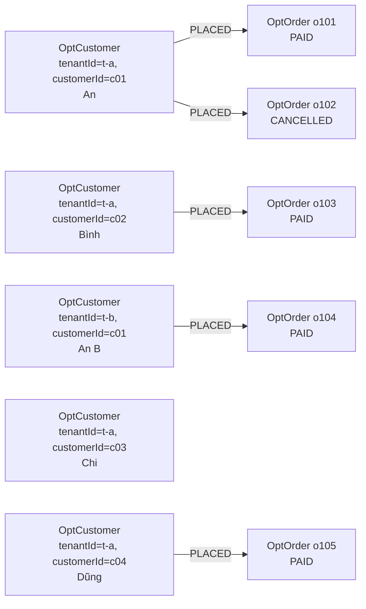

# Thu hẹp điểm bắt đầu bằng nhãn, thuộc tính và chỉ mục thích hợp trong Neo4j

## 1. Vì sao điểm bắt đầu quan trọng khi tối ưu Cypher?

Trong **Neo4j**, mô hình **property graph** biểu diễn thực thể bằng *node*, liên kết bằng *relationship*, và dữ liệu mô tả bằng *property*. Một truy vấn **Cypher** thường phải tìm một hoặc nhiều node phù hợp trước khi duyệt các relationship. Nếu bắt đầu từ một tập node quá rộng, cùng một mẫu đồ thị có thể tạo ra rất nhiều dòng trung gian, kéo theo nhiều lần đọc dữ liệu, sử dụng bộ nhớ và thời gian xử lý.

Chương **Tối ưu truy vấn** của module `DATABASE_ENGINE_GRAPH_NEO4J` tập trung trước tiên vào một kỹ thuật có tác động lớn: **thu hẹp tập ứng viên ban đầu bằng nhãn, thuộc tính có độ chọn lọc tốt và chỉ mục phù hợp**. Kỹ thuật này áp dụng cho truy vấn đọc thông thường, truy vấn nhiều hop, tra cứu quan hệ trong ứng dụng và các câu Cypher được thực thi qua **Neo4j Java Driver** hoặc **Spring Data Neo4j**.

Sau bài này, bạn có thể:

1. Phân biệt mẫu truy vấn logic với **điểm bắt đầu thực tế** do bộ lập kế hoạch Cypher lựa chọn.
2. Dùng nhãn và điều kiện thuộc tính để giảm số node cần kiểm tra trước khi mở rộng quan hệ.
3. Chọn **range index**, **unique constraint** hoặc **composite index** cho nhu cầu tra cứu cụ thể.
4. Nhận biết những biểu thức khó dùng property index hiệu quả và sửa cách lưu/truy vấn dữ liệu.
5. Dùng `EXPLAIN`, `PROFILE` và `SHOW INDEXES` để kiểm chứng quyết định tối ưu bằng bằng chứng.

> **Phạm vi cú pháp:** Các lệnh `CREATE RANGE INDEX`, `CREATE CONSTRAINT ... REQUIRE ... IS UNIQUE` và `SHOW INDEXES` dưới đây dùng cú pháp Neo4j 5.x trở lên. Ở Neo4j 4.4 hoặc phiên bản cũ hơn, cách đặt tên loại chỉ mục và cú pháp constraint có thể khác. Việc chọn **plan** cụ thể còn phụ thuộc phiên bản Neo4j, thống kê, khối lượng dữ liệu và các chỉ mục đang tồn tại.

## 2. Điểm bắt đầu, độ chọn lọc và số dòng trung gian

### 2.1. «Điểm bắt đầu» là gì?

Xét yêu cầu: «Tìm các đơn hàng của một khách hàng theo mã định danh».

```cypher
MATCH (c:Customer)-[:PLACED]->(o:Order)
WHERE c.customerId = $customerId
RETURN o.orderId;
```

Truy vấn phải xác định node `c`, sau đó lần theo relationship `PLACED` để lấy `o`. Nếu graph có một triệu khách hàng nhưng chỉ một người có `customerId` được hỏi, việc **định vị ngay khách hàng đó** rất có lợi so với kiểm tra từng khách hàng hoặc duyệt mọi quan hệ.

Trong đồ thị nhiều nhánh, số phép mở rộng thô có thể tăng theo biểu thức minh họa:

\[
\text{số ứng viên cần xét} \;\propto\; S \times F^d
\]

Ở đây `S` là số node bắt đầu, `F` là số nhánh trung bình trên mỗi bước và `d` là độ sâu duyệt. Đây **không phải công thức chi phí thực thi chính xác của Neo4j**; nó chỉ cho thấy vì sao giảm `S` từ hàng trăm nghìn node xuống một node có thể làm giảm rất mạnh phạm vi tìm kiếm.

### 2.2. Cypher có bộ tối ưu, không nhất thiết chạy từ trái sang phải

Thứ tự viết `MATCH (a)-[r]->(b)` **không buộc** Neo4j luôn tìm `a` trước `b`. Cypher là ngôn ngữ khai báo; bộ lập kế hoạch (*planner*) dựa trên điều kiện, chỉ mục, thống kê và ước lượng số dòng để chọn cách thực thi.

Ví dụ:

```cypher
MATCH (c:Customer)-[:PLACED]->(o:Order)
WHERE o.orderId = $orderId
RETURN c.name;
```

Nếu `Order.orderId` có unique constraint và xác định đúng một node, planner có thể định vị **`o` trước**, rồi duyệt ngược `PLACED` đến `c`, dù `c` nằm bên trái trong pattern.

Vì vậy, «thu hẹp điểm bắt đầu» thực chất là **cung cấp cho planner một tập node đầu vào nhỏ có thể tra cứu hiệu quả**. Đừng chỉ đổi thứ tự biến trong pattern rồi giả định truy vấn sẽ nhanh hơn.

### 2.3. Độ chọn lọc của điều kiện

Một predicate có **độ chọn lọc cao** nếu chỉ một tỷ lệ nhỏ node thỏa nó:

| Điều kiện | Tính chọn lọc điển hình | Gợi ý |
| --- | --- | --- |
| `c.customerId = 'c01'` kết hợp tenant, khi có unique constraint | Rất cao; thường tối đa một node | Anchor tốt cho truy vấn theo khách hàng |
| `o.orderId = 'o101'` với unique constraint | Rất cao | Anchor tốt khi tìm bằng đơn cụ thể |
| `o.status = 'PAID'` khi đa số đơn đã thanh toán | Thấp | Có index vẫn chưa chắc giúp nhiều |
| `o.createdAt >= $from` trong 1 giờ gần nhất | Có thể cao nếu khoảng thời gian rất hẹp | Range index và kế hoạch thực tế quyết định |
| `c.name CONTAINS 'a'` | Thay đổi theo dữ liệu, có thể rất rộng | Cân nhắc text index nếu thật sự truy vấn chuỗi con |

**Không có trường nào tự động là «chọn lọc cao» chỉ vì tên của nó.** Phải xem phân bố giá trị thật. Một index phù hợp với loại predicate là điều kiện cần để tra cứu tốt, nhưng không bảo đảm planner luôn chọn index thay vì quét trong mọi trường hợp.

## 3. Đồ thị thực hành: khách hàng và đơn hàng theo tenant

Ta dùng nhãn riêng `OptCustomer` và `OptOrder` để tách dữ liệu bài học khỏi các thực thể thật. Mỗi khách hàng thuộc một tenant; cùng `customerId` có thể xuất hiện ở hai tenant khác nhau, nên khóa nghiệp vụ của khách hàng là cặp **`(tenantId, customerId)`**.



### 3.1. Ràng buộc và chỉ mục dùng trong bài

Lệnh đầu là **composite uniqueness constraint** cho khách hàng. Trong Neo4j 5.x, ràng buộc duy nhất được hỗ trợ bằng một range index tương ứng; **không cần tạo thêm một range index giống hệt** trên cùng tổ hợp thuộc tính.

```cypher
CREATE CONSTRAINT opt_customer_tenant_customer_unique IF NOT EXISTS
FOR (c:OptCustomer)
REQUIRE (c.tenantId, c.customerId) IS UNIQUE;

CREATE CONSTRAINT opt_order_id_unique IF NOT EXISTS
FOR (o:OptOrder)
REQUIRE o.orderId IS UNIQUE;

CREATE RANGE INDEX opt_order_status_created IF NOT EXISTS
FOR (o:OptOrder)
ON (o.status, o.createdAt);
```

`IF NOT EXISTS` hữu ích cho thực hành lặp lại, nhưng **không xác minh rằng một index/constraint có sẵn mang đúng schema và loại bạn mong muốn** nếu tồn tại xung đột tên. Cần xem `SHOW INDEXES` và `SHOW CONSTRAINTS`. Unique constraint bảo vệ tính duy nhất khi đầy đủ khóa; nếu nghiệp vụ yêu cầu mọi node bắt buộc có cả hai property, phải bảo đảm dữ liệu đầu vào hoặc cân nhắc ràng buộc tồn tại property theo phiên bản và edition.

### 3.2. Nạp dữ liệu

```cypher
UNWIND [
  {tenantId: 't-a', customerId: 'c01', name: 'An'},
  {tenantId: 't-a', customerId: 'c02', name: 'Bình'},
  {tenantId: 't-a', customerId: 'c03', name: 'Chi'},
  {tenantId: 't-a', customerId: 'c04', name: 'Dũng'},
  {tenantId: 't-b', customerId: 'c01', name: 'An B'}
] AS row
MERGE (c:OptCustomer {
  tenantId: row.tenantId,
  customerId: row.customerId
})
SET c.name = row.name;
```

```cypher
UNWIND [
  {tenantId: 't-a', customerId: 'c01', orderId: 'o101',
   status: 'PAID', createdAt: '2026-10-05'},
  {tenantId: 't-a', customerId: 'c01', orderId: 'o102',
   status: 'CANCELLED', createdAt: '2026-10-07'},
  {tenantId: 't-a', customerId: 'c02', orderId: 'o103',
   status: 'PAID', createdAt: '2026-10-10'},
  {tenantId: 't-b', customerId: 'c01', orderId: 'o104',
   status: 'PAID', createdAt: '2026-09-30'},
  {tenantId: 't-a', customerId: 'c04', orderId: 'o105',
   status: 'PAID', createdAt: '2026-11-01'}
] AS row
MATCH (c:OptCustomer {
  tenantId: row.tenantId,
  customerId: row.customerId
})
MERGE (o:OptOrder {orderId: row.orderId})
SET o.status = row.status,
    o.createdAt = date(row.createdAt)
MERGE (c)-[:PLACED]->(o);
```

Lệnh `MERGE` giúp chạy lại ví dụ với cùng khóa. Các câu kiểm tra sau chỉ kỳ vọng đúng số dòng đã mô tả khi không có dữ liệu `OptCustomer`/`OptOrder` cũ ngoài ví dụ. Trong hệ thống thật, không nên đặt unique constraint hoặc chèn dữ liệu thực hành vào nhãn dùng cho nghiệp vụ đang hoạt động.

## 4. Thu hẹp bằng nhãn: tránh tìm trên toàn bộ đồ thị

### 4.1. Quét node không nhãn và quét theo nhãn

Truy vấn sau phải tìm mọi node có property phù hợp mà **không khai báo nhãn**:

```cypher
MATCH (n)
WHERE n.customerId = 'c01'
RETURN labels(n), n.customerId;
```

Planner không có điều kiện nhãn để áp dụng property index gắn với `OptCustomer`; cách thực hiện thường phải xét tập node rất rộng. Kết quả cũng có thể bao gồm các loại node khác trùng tên property.

Khi xác định đúng loại thực thể:

```cypher
MATCH (c:OptCustomer)
WHERE c.customerId = 'c01'
RETURN c.tenantId, c.customerId, c.name;
```

Planner ít nhất có thể giới hạn vào các node `OptCustomer`. Trong Neo4j, **lookup index** cho nhãn/relationship type hỗ trợ tra cứu token, khác với property index. Nhưng điều kiện `customerId` ở đây chưa đủ để bảo đảm một **seek hiệu quả trên composite index `(tenantId, customerId)`**, bởi không chỉ rõ thành phần tenant.

Khi có cả hai thành phần khóa:

```cypher
MATCH (c:OptCustomer {
  tenantId: 't-a',
  customerId: 'c01'
})
RETURN c.name AS ten;
```

Kết quả mong đợi chỉ có **An**. Với unique constraint phù hợp, kế hoạch thường có thể thực hiện **unique index seek** để định vị đúng một node.

### 4.2. Nhãn trong pattern khác với kiểm tra nhãn bằng hàm

Khi biết nhãn cố định, ưu tiên:

```cypher
MATCH (c:OptCustomer)
RETURN count(c) AS soKhachHang;
```

thay vì:

```cypher
MATCH (c)
WHERE 'OptCustomer' IN labels(c)
RETURN count(c) AS soKhachHang;
```

Hai câu có thể trả cùng kết quả trong dữ liệu mẫu, nhưng dạng `(c:OptCustomer)` cung cấp thông tin về nhãn trực tiếp cho planner. Câu dùng `labels(c)` hữu ích khi cần khám phá nhãn động, nhưng không nên là lựa chọn đầu tiên cho truy vấn với nhãn cố định.

### 4.3. Nhiều nhãn có thể tăng độ chọn lọc, nhưng phải đúng mô hình

Ví dụ, nếu ứng dụng thật có cả `:Customer` và `:ActiveAccount` trên cùng node:

```cypher
MATCH (c:Customer:ActiveAccount)
WHERE c.tenantId = $tenantId
RETURN c.customerId;
```

Node phải mang **cả hai nhãn**. Điều này có thể giảm tập ứng viên nếu nhãn phụ có ý nghĩa và được dùng hợp lý. Tuy nhiên, **không tạo nhãn cho mọi giá trị thuộc tính** (như một nhãn riêng cho mỗi tenant hay mỗi khách hàng) chỉ để cố giảm quét; điều đó có thể làm mô hình khó quản lý. Hãy dùng property và index khi đó là dữ liệu có tính đa dạng cao.

## 5. Thu hẹp bằng thuộc tính: chọn predicate thích hợp

### 5.1. Đẳng thức theo khóa nghiệp vụ

Trường hợp hiệu quả thường gặp nhất là **so sánh bằng** trên trường có index/unique constraint:

```cypher
MATCH (c:OptCustomer)
WHERE c.tenantId = $tenantId
  AND c.customerId = $customerId
RETURN c.name AS customerName;
```

Đây là mẫu tốt cho endpoint `GET /tenants/{tenantId}/customers/{customerId}` vì:

- Có nhãn `OptCustomer`.
- Lọc theo đầy đủ **khóa tổng hợp** của khách hàng.
- Có constraint hỗ trợ tra cứu.
- Dùng **parameter**, không ghép chuỗi đầu vào của người dùng vào Cypher.

Với ví dụ, `tenantId = 't-a'` và `customerId = 'c01'` chọn An; `tenantId = 't-b'` và `customerId = 'c01'` chọn An B. Việc **bỏ tenant** sẽ làm câu hỏi nghiệp vụ không còn phân biệt hai khách hàng.

### 5.2. Lọc theo khoảng thời gian

Khi tìm đơn từ một ngày:

```cypher
MATCH (o:OptOrder)
WHERE o.status = 'PAID'
  AND o.createdAt >= date('2026-10-01')
RETURN o.orderId AS orderId,
       o.createdAt AS ngayTao
ORDER BY ngayTao;
```

Trong bộ dữ liệu mẫu, kết quả kỳ vọng gồm `o101`, `o103` và `o105`. Composite range index `(status, createdAt)` hỗ trợ mẫu lọc **đẳng thức ở trường đầu, khoảng ở trường sau**. Planner vẫn có thể chọn cách khác khi dữ liệu nhỏ hoặc phân bố giá trị khiến việc dùng index không có lợi.

Đừng biến giá trị ngày lưu trong graph thành chuỗi để rồi phải gọi hàm chuyển đổi trên từng bản ghi lúc lọc; nếu nghiệp vụ cần so sánh thời gian, hãy lưu giá trị ở kiểu `date`/`datetime` thích hợp và truyền parameter đúng kiểu.

### 5.3. Tránh bọc hàm quanh property được đánh chỉ mục

Ví dụ, với một trường email đã được index:

```cypher
// Dễ làm mất cơ hội seek theo index trên property email nguyên gốc:
MATCH (c:Customer)
WHERE toLower(c.email) = toLower($email)
RETURN c;
```

Phần `toLower(c.email)` là biểu thức được tính từ property; index thông thường trên `c.email` không tương đương với index trên kết quả biến đổi đó. Với hệ thống cần tra cứu email không phân biệt hoa/thường, một cách thiết kế là **lưu riêng trường chuẩn hóa**:

```cypher
MATCH (c:Customer)
WHERE c.emailNormalized = $emailNormalized
RETURN c;
```

Ứng dụng chuẩn hóa đầu vào trước khi truyền `$emailNormalized` và cập nhật trường chuẩn hóa nhất quán khi dữ liệu thay đổi. Cần tạo index hoặc unique constraint cho `Customer.emailNormalized` nếu nghiệp vụ yêu cầu. Quy tắc chuẩn hóa phải tính tới dữ liệu Unicode và yêu cầu nghiệp vụ thực tế; không tự giả định `toLower` đáp ứng mọi quy tắc so sánh email.

### 5.4. Không nhầm `LIMIT` với thu hẹp điểm bắt đầu

```cypher
MATCH (c:OptCustomer)-[:PLACED]->(o:OptOrder)
RETURN c.customerId, o.orderId
LIMIT 5;
```

`LIMIT 5` chỉ khống chế số dòng trả về tại vị trí nó được áp dụng; không tạo ra predicate định vị khách hàng. Neo4j **có thể** dừng sớm nếu kế hoạch cho phép, nhưng không nên dùng `LIMIT` làm giải pháp thay thế nhãn, chỉ mục và điều kiện lọc. Nếu có `ORDER BY`/`DISTINCT` trước `LIMIT`, hệ thống có thể cần xử lý lượng dữ liệu trung gian đáng kể trước khi chọn dòng cuối.

## 6. Chọn đúng loại chỉ mục

Neo4j có nhiều loại index, mỗi loại phục vụ nhóm phép truy vấn khác nhau. Bảng sau tập trung vào trường hợp phổ biến của các dòng Neo4j hiện đại:

| Loại index | Sử dụng chính | Ví dụ phù hợp | Lưu ý |
| --- | --- | --- | --- |
| **Lookup index** | Tra cứu node theo label hoặc relationship theo type | `MATCH (c:OptCustomer)` | Không thay cho property index trên `customerId` |
| **Range index** | Đẳng thức, so sánh khoảng, thứ tự/kiểu dữ liệu được hỗ trợ | `customerId = $id`, `createdAt >= $from` | Loại nền tảng cho phần lớn lọc thuộc tính |
| **Composite range index** | Nhiều property của cùng node/relationship | `(tenantId, customerId)`, `(status, createdAt)` | Hiệu quả phụ thuộc thứ tự trường và dạng predicate |
| **Text index** | Tìm chuỗi theo pattern như `CONTAINS` hoặc `ENDS WITH` | `name CONTAINS $fragment` | Kiểu tìm kiếm chuỗi con khác với tra cứu định danh chính xác |
| **Point index** | Các phép tìm kiếm không gian trên giá trị point | Tìm địa điểm trong vùng/tọa độ | Không dùng cho trường ID thông thường |
| **Full-text index** | Tìm từ khóa văn bản, chấm điểm liên quan | Tìm mô tả tài liệu | Thường được gọi qua procedure/chức năng tìm kiếm riêng, không thay thế tự động `MATCH ... WHERE` thông thường |
| **Vector index** | Tìm gần đúng theo độ tương tự vector | Gợi ý nội dung theo embedding | Khác bài toán anchor theo ID/property thông thường |

Chỉ mục có **chi phí duy trì khi ghi** và tiêu tốn tài nguyên lưu trữ, do đó không nên tạo index cho mọi property. Xác định dạng truy vấn và tần suất sử dụng trước khi quyết định.

### 6.1. Range index đơn và composite

Ví dụ index đơn cho các truy vấn chỉ lọc ngày tạo đơn:

```cypher
CREATE RANGE INDEX opt_order_created_single IF NOT EXISTS
FOR (o:OptOrder)
ON (o.createdAt);
```

Trong ứng dụng thật, **không nhất thiết phải có cả index đơn và composite** trên các trường tương tự. Đặt hai lựa chọn cạnh nhau để so sánh workload:

- Chủ yếu tìm theo `status = ... AND createdAt >= ...`: composite `(status, createdAt)` có thể hữu ích.
- Chủ yếu tìm mọi đơn sau một mốc ngày **không có điều kiện status**: index đơn `(createdAt)` có thể thích hợp hơn.
- Chủ yếu tìm một `orderId`: unique constraint trên `orderId` là anchor trực tiếp và có tính bảo vệ dữ liệu.

Nếu đã tạo index thử nghiệm `opt_order_created_single`, hãy đánh giá plan và chi phí ghi trước khi quyết định giữ nó trên dữ liệu thật.

### 6.2. Thứ tự thuộc tính của composite index

Với index `(status, createdAt)`, một truy vấn thường phù hợp là:

```cypher
MATCH (o:OptOrder)
WHERE o.status = $status
  AND o.createdAt >= date($fromDate)
RETURN o.orderId;
```

Truy vấn chỉ có `o.createdAt >= date($fromDate)` nhưng **không có điều kiện `status`** không nhất thiết có đường **seek hiệu quả** tương đương khi dùng index composite. Thứ tự các trường và điều kiện trên **trường dẫn đầu** rất quan trọng; cũng cần kiểm chứng trên phiên bản Neo4j thực tế.

Tương tự, index độc nhất `(tenantId, customerId)` phù hợp với truy vấn chỉ rõ **cả hai** giá trị. Nếu ứng dụng thường xuyên tìm khách hàng **chỉ theo `customerId`** xuyên tenant, đó là một nhu cầu truy vấn khác; cần xem lại mô hình và chỉ mục, đồng thời không bỏ điều kiện tenant ở các API phải tách biệt dữ liệu giữa khách hàng tổ chức.

### 6.3. Kiểm tra trạng thái chỉ mục

```cypher
SHOW INDEXES
YIELD name, type, entityType, labelsOrTypes, properties, state
RETURN name, type, entityType, labelsOrTypes, properties, state
ORDER BY name;
```

Kiểm tra index đúng **loại**, đúng **nhãn/relationship type**, đúng **tập property** và có trạng thái **`ONLINE`** trước khi kỳ vọng nó được planner sử dụng. Index mới tạo có thể cần thời gian để hoàn tất xây dựng trên dữ liệu lớn.

```cypher
SHOW CONSTRAINTS
YIELD name, type, entityType, labelsOrTypes, properties
RETURN name, type, entityType, labelsOrTypes, properties
ORDER BY name;
```

Quyền chạy lệnh quản trị và các cột có sẵn có thể khác nhau theo phiên bản/edition. Không dựa vào riêng tên index để suy ra nó đã hoạt động hoặc phù hợp với truy vấn.

## 7. Thu hẹp trước khi mở rộng relationship

### 7.1. Truy vấn rộng và truy vấn có anchor rõ ràng

**Dạng quá rộng** cho API «đơn hàng của An tại tenant t-a»:

```cypher
MATCH (c)-[:PLACED]->(o)
WHERE c.customerId = 'c01'
RETURN o.orderId, o.status;
```

Câu này không khai báo nhãn, không phân biệt tenant và có thể trả đơn của nhiều khách hàng tên ID giống nhau trong các loại node khác.

**Dạng theo đúng mô hình:**

```cypher
MATCH (c:OptCustomer {
  tenantId: 't-a',
  customerId: 'c01'
})-[:PLACED]->(o:OptOrder)
RETURN o.orderId AS orderId,
       o.status AS status
ORDER BY orderId;
```

Kết quả kỳ vọng là `o101` và `o102`. Query có đầy đủ điều kiện anchor và chỉ duyệt quan hệ `PLACED` xuất phát từ node khách hàng đã định vị.

### 7.2. Thêm điều kiện trên node đích khi có ích

```cypher
MATCH (c:OptCustomer {
  tenantId: 't-a',
  customerId: 'c01'
})-[:PLACED]->(o:OptOrder)
WHERE o.status = 'PAID'
RETURN o.orderId AS paidOrder;
```

Với dữ liệu ví dụ, chỉ trả về `o101`. Lưu ý: dù điều kiện `o.status` nằm ở cuối pattern, planner có thể chọn thứ tự hoạt động thích hợp dựa trên chi phí; không nên kết luận «Cypher duyệt trước rồi mới lọc» chỉ từ vị trí viết `WHERE`. Dùng `PROFILE` để xem **số dòng thực tế tại từng toán tử**.

### 7.3. Tìm từ phía chọn lọc hơn khi có cả hai đầu

Trong yêu cầu «Tìm khách hàng đã đặt đơn `o101`»:

```cypher
MATCH (c:OptCustomer)-[:PLACED]->(o:OptOrder {orderId: 'o101'})
RETURN c.tenantId, c.customerId, c.name;
```

Unique constraint trên `OptOrder.orderId` cho phép định vị rất ít node `o` trước khi đi theo quan hệ vào `c`. Đây là minh họa cho việc **bộ lập kế hoạch chọn đầu rẻ hơn**, không có yêu cầu người lập trình phải đảo pattern thành `(o)<-[:PLACED]-(c)`.

### 7.4. Đường đi nhiều hop: anchor hẹp trước là điều kiện cần, chưa đủ

```cypher
MATCH (c:OptCustomer {
  tenantId: $tenantId,
  customerId: $customerId
})
MATCH p = (c)-[:PLACED|REFERS_TO*1..3]->(target)
RETURN target, length(p) AS hops
LIMIT 20;
```

Đây chỉ là **mẫu minh họa** cho đồ thị có thêm loại quan hệ `REFERS_TO`; bộ dữ liệu thực hành không tạo loại đó. Anchor tốt sẽ giảm điểm xuất phát, nhưng nếu mỗi node có rất nhiều quan hệ thì duyệt độ sâu ba vẫn có thể nở ra nhiều path. Hãy đồng thời **giới hạn số hop, loại và hướng relationship**, và chỉ trả về dữ liệu thực sự cần.

Nếu nghiệp vụ chỉ cần biết có đường đi hay không, một truy vấn tồn tại thường phù hợp hơn việc liệt kê toàn bộ path:

```cypher
MATCH (c:OptCustomer {
  tenantId: $tenantId,
  customerId: $customerId
})
MATCH (target:OptOrder {orderId: $orderId})
RETURN EXISTS {
  MATCH (c)-[:PLACED]->(target)
} AS coDonHang;
```

## 8. Đọc `EXPLAIN` và `PROFILE`: tối ưu phải có bằng chứng

### 8.1. Bắt đầu từ kế hoạch dự kiến

`EXPLAIN` cho biết **kế hoạch thực thi dự kiến**, không chạy phần truy vấn cần đo:

```cypher
EXPLAIN
MATCH (c:OptCustomer {
  tenantId: 't-a',
  customerId: 'c01'
})-[:PLACED]->(o:OptOrder)
RETURN o.orderId;
```

Nếu planner tận dụng được constraint/index tổng hợp, thường sẽ xuất hiện toán tử thuộc nhóm **`NodeUniqueIndexSeek`** hoặc **`NodeIndexSeek`** cho `c`. Tùy bản phát hành và plan, tên toán tử có thể khác; điều quan trọng là xem liệu công cụ đã **định vị node bằng index** hay vẫn đang quét.

### 8.2. Đo trên dữ liệu thật

`PROFILE` **thực thi truy vấn** và bổ sung số liệu:

```cypher
PROFILE
MATCH (c:OptCustomer {
  tenantId: 't-a',
  customerId: 'c01'
})-[:PLACED]->(o:OptOrder)
RETURN o.orderId
ORDER BY o.orderId;
```

Các dấu hiệu cần quan sát:

| Chỉ số / toán tử thường gặp | Đọc như thế nào |
| --- | --- |
| `AllNodesScan` | Có thể đang xét mọi node; xem có thiếu nhãn/predicate không |
| `NodeByLabelScan` | Đã thu hẹp vào nhãn, nhưng vẫn cần xét nhiều node nếu nhãn rộng |
| `NodeIndexSeek` / `NodeUniqueIndexSeek` | Có thể định vị node theo điều kiện property và index |
| `Expand(All)` / `Expand(Into)` | Chỉ ra bước duyệt relationship; xem đầu vào và số dòng đầu ra |
| `Filter` | Xem bao nhiêu dòng bị loại và predicate có thể đẩy vào index hay không |
| `Rows` và `Estimated Rows` | So sánh dòng thực tế với ước lượng, tìm điểm tăng đột biến |
| `DB Hits` | Lượng truy cập dữ liệu trong các toán tử; hữu ích khi so sánh kế hoạch |
| `Sort`, `Distinct`, `Eager` | Có thể cần giữ hoặc xử lý nhiều dòng; xem có tạo nhiều hàng trung gian không |

**Không đánh giá chỉ bằng «có index seek hay không».** Một query có index seek nhưng sau đó duyệt một node siêu kết nối (*supernode*) và phát sinh hàng triệu path vẫn có thể chậm. Cần xem **toàn bộ plan**, lượng kết quả, độ sâu duyệt và thời gian thực thi trên tập dữ liệu đại diện.

### 8.3. Quy trình so sánh trước và sau

1. Xác định một câu truy vấn và **parameter đại diện** cho tải thực tế.
2. Chạy `EXPLAIN` để biết kế hoạch ban đầu và tìm các bước quét/mở rộng lớn.
3. Bổ sung nhãn, predicate hoặc index thực sự phục vụ điều kiện truy vấn.
4. Kiểm tra index đã `ONLINE`, sau đó chạy `PROFILE` trên **cùng phạm vi dữ liệu** và so sánh `Rows`, `DB Hits`, thời gian và số hàng trả về.
5. Xác minh **kết quả nghiệp vụ không đổi**; sau đó đo lại với nhiều giá trị parameter khác nhau, gồm trường hợp rất phổ biến và rất hiếm.

Ví dụ, trong cơ sở dữ liệu mẫu chỉ có mười node và năm quan hệ, planner có thể ưu tiên quét do chi phí thấp hơn. Vì vậy, đừng cố ép một index chỉ vì muốn thấy tên toán tử `IndexSeek`; lợi ích phải được kiểm chứng trên **quy mô mục tiêu**.

## 9. Những tình huống khiến index không giúp như mong đợi

### 9.1. Không có nhãn hoặc thiếu predicate phù hợp

Property index gắn với `:OptCustomer(tenantId, customerId)` không thể tự dùng một cách trực tiếp nếu truy vấn chỉ có `MATCH (n)` mà không có nhãn, hoặc không cung cấp điều kiện tương thích với index. Hãy khai báo **nhãn đúng thực thể** và điều kiện **đủ chọn lọc**.

### 9.2. Chỉ lọc bằng property quá phổ biến

Nếu 98% đơn có `status = 'PAID'`, điều kiện đó có độ chọn lọc thấp. Một lần quét có thể phù hợp hơn một index seek tạo ra gần như toàn bộ tập node. Có index không đồng nghĩa với giảm chi phí.

### 9.3. Chuyển đổi property ngay trong `WHERE`

`toLower(n.email)`, `toString(n.orderId)`, `date(n.dateString)` hoặc các biểu thức khác áp dụng lên property có thể khiến planner khó dùng index vốn được xây trên giá trị gốc. Cân nhắc chuẩn hóa giá trị khi ghi, lưu đúng kiểu dữ liệu, hoặc thiết kế trường tra cứu riêng.

### 9.4. Tham số sai kiểu dữ liệu

Nếu `createdAt` được lưu bằng kiểu `date` nhưng ứng dụng truyền một string không chuyển đổi phù hợp, điều kiện so sánh có thể sai nghĩa hoặc thất bại. Hãy thống nhất kiểu giữa dữ liệu, tham số và truy vấn. Ví dụ:

```cypher
MATCH (o:OptOrder)
WHERE o.createdAt >= date($fromDate)
RETURN o.orderId;
```

Ở đây `$fromDate` dự kiến là chuỗi ngày ISO mà hàm `date()` có thể chuyển đổi; nếu Java Driver truyền sẵn giá trị `LocalDate` tương thích, có thể so sánh trực tiếp với `$fromDate`.

### 9.5. Dùng `OR` trên nhiều thuộc tính độc lập

```cypher
MATCH (c:Customer)
WHERE c.emailNormalized = $key
   OR c.phoneNormalized = $key
RETURN c;
```

Việc dùng nhiều nhánh `OR` có thể tạo plan khác với một predicate đẳng thức đơn giản. Nếu đây là luồng tra cứu quan trọng, hãy thử các phương án index cho từng trường, hoặc tách thành hai nhánh truy vấn có mục tiêu rõ ràng và hợp nhất kết quả phù hợp; **không mặc định mọi biểu thức `OR` luôn làm hỏng index**.

### 9.6. Index hint quá sớm

Cypher hỗ trợ **index hint** để định hướng planner trong một số trường hợp:

```cypher
MATCH (c:OptCustomer)
USING INDEX c:OptCustomer(tenantId, customerId)
WHERE c.tenantId = $tenantId
  AND c.customerId = $customerId
RETURN c.name;
```

Hint yêu cầu một index tương thích và không tự tạo index. Vì nó có thể làm kế hoạch kém hiệu quả khi dữ liệu hoặc thống kê thay đổi, **chỉ cân nhắc khi đã đọc `PROFILE`, hiểu lý do planner chọn plan khác và có phép đo chứng minh lợi ích**. Thường không cần hint cho truy vấn với unique constraint và điều kiện rõ ràng.

### 9.7. Quá nhiều index và đọc một–một trong ứng dụng

Mỗi index bổ sung chi phí cập nhật khi ghi node/relationship; số lượng index lớn làm tăng dung lượng và thời gian bảo trì. Đồng thời, nếu ứng dụng lặp qua hàng nghìn khách hàng rồi chạy riêng một query cho từng người, chi phí network round-trip có thể lấn át lợi ích của anchor. Hãy thiết kế câu truy vấn theo **nhóm khóa đầu vào** khi cần và đo tổng thời gian xử lý từ ứng dụng.

## 10. Tích hợp Java Driver và Spring Data Neo4j

Trong ứng dụng, nơi phù hợp để thực hiện anchor thường nằm ngay trong **câu Cypher** của tầng repository hoặc service. Không nên đọc một tập lớn từ Neo4j rồi mới lọc `tenantId`/`customerId` bằng Java, vì như vậy vẫn phát sinh quét và truyền dữ liệu rộng.

Ví dụ Java Driver dùng **managed read transaction** và parameter:

```java
import java.util.List;
import java.util.Map;
import org.neo4j.driver.Driver;
import org.neo4j.driver.SessionConfig;

public final class OrderLookup {
    private final Driver driver;

    public OrderLookup(Driver driver) {
        this.driver = driver;
    }

    public List<String> findOrderIds(String tenantId, String customerId) {
        try (var session = driver.session(
                SessionConfig.forDatabase("neo4j"))) {
            return session.executeRead(tx -> tx.run(
                """
                MATCH (c:OptCustomer {
                  tenantId: $tenantId,
                  customerId: $customerId
                })-[:PLACED]->(o:OptOrder)
                RETURN o.orderId AS orderId
                ORDER BY orderId
                """,
                Map.of("tenantId", tenantId,
                       "customerId", customerId)
            ).list(record -> record.get("orderId").asString()));
        }
    }
}
```

Câu query chỉ trả về trường cần dùng. `executeRead` là API phổ biến của Java Driver 5.x; với bản driver khác, cần đối chiếu tên API và chính sách retry tương ứng. `Driver` có thể chia sẻ giữa các request, nhưng `Session` không nên chia sẻ giữa các luồng. Mọi đầu vào vẫn phải được **xác thực và phân quyền ở tầng ứng dụng**; predicate tenant là một phần của truy vấn đúng nghiệp vụ, không tự thay thế cơ chế kiểm soát truy cập.

Khi dùng **Spring Data Neo4j**, có thể đặt cùng pattern lọc bằng nhãn, tenant và khóa trong câu `@Query` của repository hoặc phương thức truy vấn phù hợp. Cần kiểm tra ánh xạ node/DTO, phạm vi transaction và số Cypher được framework sinh ra, vì một phương thức tên đơn giản không bảo đảm query cuối cùng có đúng anchor mong muốn.

## 11. Bài thực hành có đáp án

### Bài 1. Tìm đúng khách hàng khi mã khách hàng lặp giữa các tenant

Yêu cầu: trả tên khách hàng có `customerId = 'c01'` tại tenant `t-b`.

**Đáp án:**

```cypher
MATCH (c:OptCustomer {
  tenantId: 't-b',
  customerId: 'c01'
})
RETURN c.name AS ten;
```

Kết quả trên dữ liệu mẫu: **An B**. Nếu bỏ `tenantId`, có thể trả cả An và An B; trường hợp đó còn có thể làm mất tính đúng đắn nghiệp vụ.

### Bài 2. Tìm đơn đã thanh toán sau ngày xác định

Yêu cầu: dùng index `opt_order_status_created` để tìm những đơn `PAID` từ `2026-10-01` và sắp xếp theo ngày tăng dần.

**Đáp án:**

```cypher
MATCH (o:OptOrder)
WHERE o.status = 'PAID'
  AND o.createdAt >= date('2026-10-01')
RETURN o.orderId AS orderId, o.createdAt AS createdAt
ORDER BY createdAt, orderId;
```

Kết quả mẫu: `o101`, `o103`, `o105`. Hãy dùng `EXPLAIN` để xem planner có chọn composite index hay không.

### Bài 3. Tìm khách hàng của một đơn

Yêu cầu: tìm tenant, mã và tên khách hàng của đơn `o104`. Đầu nào của pattern có điểm tra cứu chọn lọc hơn?

**Đáp án:**

```cypher
MATCH (c:OptCustomer)-[:PLACED]->(o:OptOrder {
  orderId: 'o104'
})
RETURN c.tenantId, c.customerId, c.name;
```

Đầu `o` có unique constraint trên `orderId` nên là một **anchor rất chọn lọc**. Kết quả: tenant `t-b`, khách hàng `c01`, tên An B.

### Bài 4. Chẩn đoán kế hoạch thiếu index seek

Bạn có index `(tenantId, customerId)` nhưng query sau không thấy `NodeUniqueIndexSeek`:

```cypher
MATCH (c:OptCustomer)
WHERE c.customerId = $customerId
RETURN c;
```

**Gợi ý:** Query thiếu điều kiện trên **`tenantId`** là thành phần của khóa tổng hợp. Hãy xác nhận yêu cầu nghiệp vụ và bổ sung `c.tenantId = $tenantId` khi đúng. Sau đó kiểm tra trạng thái index và so sánh plan. Trên dữ liệu rất nhỏ, ngay cả khi predicate phù hợp, planner vẫn có thể chọn một kế hoạch quét vì ước lượng chi phí.

### Bài 5. Đánh giá hai cách lọc email

Hãy so sánh `toLower(c.email) = toLower($email)` và `c.emailNormalized = $emailNormalized` khi cả hai trả cùng kết quả. Vì sao cách thứ hai thường có lợi nếu có index trên `emailNormalized`?

**Đáp án gợi ý:** Cách thứ hai so sánh trực tiếp property có index với tham số đã chuẩn hóa, nên dễ tạo điều kiện tra cứu theo index. Cách thứ nhất phải tính biểu thức trên giá trị property, không tương ứng trực tiếp với index của `email`. Phải bảo đảm dữ liệu chuẩn hóa và kết quả nghiệp vụ tương đương trước khi thay đổi truy vấn.

## 12. Checklist trước khi chốt tối ưu

| Câu hỏi kiểm tra | Cần thấy ở truy vấn/plan |
| --- | --- |
| Tập thực thể có nhãn cụ thể? | `MATCH (n:Label)` hoặc pattern với label phù hợp |
| Có property đủ chọn lọc? | Định danh duy nhất, tenant + ID, khoảng thời gian đủ hẹp |
| Property được tra bằng cách tương thích với index? | Predicate đẳng thức/khoảng hoặc toán tử phù hợp với loại index |
| Composite index có đúng thứ tự trường? | Có điều kiện tương thích với các trường dẫn đầu |
| Index đã sẵn sàng? | `SHOW INDEXES` có `ONLINE` và schema đúng |
| Plan có dùng anchor tốt? | `EXPLAIN`/`PROFILE` cho thấy seek hoặc phương án khác có lý do |
| Sau anchor có mở rộng quá nhiều? | Kiểm tra Rows và DB Hits ở bước mở rộng quan hệ |
| Kết quả có đúng mọi tenant/trạng thái? | Chạy so sánh dữ liệu và test với parameter phổ biến, hiếm |
| Index thêm vào có hợp lý? | Đo cả chi phí truy vấn đọc, ghi và bảo trì |

## 13. Kết luận

Muốn Cypher truy vấn nhanh trên property graph, hãy bắt đầu bằng **định vị đúng tập node nhỏ nhất có ý nghĩa nghiệp vụ**. Nhãn giúp planner giới hạn loại thực thể; thuộc tính chọn lọc giúp xác định những node cần duyệt; **index hoặc unique constraint phù hợp** giúp biến điều kiện tìm kiếm thành phép tra cứu hiệu quả. Với khóa tổng hợp, phải xét **thứ tự các thuộc tính** và đầy đủ predicate. Khi truy vấn mở rộng qua nhiều relationship, anchor hẹp là nền tảng nhưng vẫn cần kiểm soát fan-out và số hop.

Cuối cùng, mọi quyết định tối ưu đều cần được **xác minh bằng `SHOW INDEXES`, `EXPLAIN` và `PROFILE`** trên dữ liệu đại diện. Tên index hoặc việc thêm `LIMIT` không phải bằng chứng rằng truy vấn đã giảm công việc thực tế.

### Tài liệu tham khảo

- [Neo4j Cypher Manual – Indexes for search performance](https://neo4j.com/docs/cypher-manual/current/indexes/search-performance-indexes/)
- [Neo4j Cypher Manual – Query tuning](https://neo4j.com/docs/cypher-manual/current/planning-and-tuning/)
- [Neo4j Cypher Manual – Execution plans](https://neo4j.com/docs/cypher-manual/current/planning-and-tuning/execution-plans/)
- [Neo4j Cypher Manual – Index hints](https://neo4j.com/docs/cypher-manual/current/indexes/search-performance-indexes/index-hints/)
- [Neo4j Java Driver Manual](https://neo4j.com/docs/java-manual/current/)
