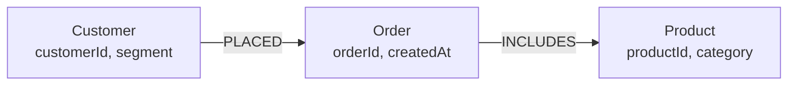
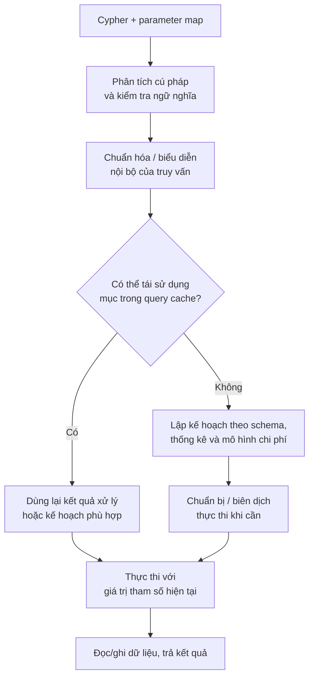

# Tham số hóa để tái sử dụng kế hoạch và giảm chi phí biên dịch

Trong ứng dụng kết nối Neo4j, nhiều request chỉ khác nhau ở **giá trị cần tìm**: khách hàng `C01` hay `C02`, ngày bắt đầu báo cáo, danh sách sản phẩm hoặc phân khúc khách hàng. Nếu ứng dụng liên tục ghép giá trị trực tiếp thành các câu Cypher khác nhau, việc quản lý truy vấn trở nên khó hơn và có thể làm giảm cơ hội **tái sử dụng kế hoạch thực thi**.

**Tham số hóa** (*parameterization*) giữ phần cấu trúc của câu Cypher ổn định và truyền dữ liệu thay đổi qua các biến tham số dạng `$name`. Neo4j có cơ chế bộ nhớ đệm cho những giai đoạn xử lý truy vấn, trong đó có kế hoạch thực thi; một truy vấn có cấu trúc ổn định có cơ hội tận dụng những kết quả đã được phân tích và biên dịch từ lần chạy trước. Trong môi trường có nhiều request, điều này có thể giảm lượng CPU dành cho lập kế hoạch, đồng thời giúp mã nguồn dễ duy trì và hạn chế nguy cơ chèn cú pháp Cypher qua dữ liệu đầu vào.

Bài thuộc chương **Tối ưu truy vấn** của module **DATABASE_ENGINE_GRAPH_NEO4J**. Nội dung tập trung vào tham số Cypher, cách hiểu **query planning / plan caching**, ứng dụng qua **Neo4j Java Driver** và **Spring Data Neo4j**, các phép kiểm tra với `EXPLAIN` / `PROFILE` và những trường hợp tham số hóa **không** tự cải thiện hiệu năng.

## 1. Vấn đề: cùng một truy vấn, nhiều giá trị đầu vào

Giả sử ứng dụng thương mại lưu khách hàng và đơn hàng trong mô hình property graph:



Một màn hình “Đơn hàng của khách hàng” có thể chạy các truy vấn sau:

```cypher
MATCH (c:Customer {customerId: 'C01'})-[:PLACED]->(o:Order)
RETURN o.orderId AS orderId
ORDER BY orderId;
```

```cypher
MATCH (c:Customer {customerId: 'C02'})-[:PLACED]->(o:Order)
RETURN o.orderId AS orderId
ORDER BY orderId;
```

Chúng khác nhau về mã khách hàng nhưng **cùng một ý nghĩa và hình dạng truy vấn**. Ta có thể viết một mẫu:

```cypher
MATCH (c:Customer {customerId: $customerId})-[:PLACED]->(o:Order)
RETURN o.orderId AS orderId
ORDER BY orderId;
```

Ứng dụng gửi câu Cypher đó cùng một tập tham số ở mỗi lần gọi:

```json
{"customerId": "C01"}
```

Lần sau, phần văn bản Cypher không đổi; chỉ tham số khác:

```json
{"customerId": "C02"}
```

Cách này có ba lợi ích chính:

1. **Tái sử dụng logic truy vấn:** cùng một câu Cypher phục vụ nhiều request, dễ sửa và kiểm thử.
2. **Tăng cơ hội dùng lại công việc lập kế hoạch đã lưu trong cache:** Neo4j không cần đối xử với từng giá trị đầu vào như một câu lệnh riêng ở phía ứng dụng.
3. **Tách dữ liệu khỏi cú pháp:** các chuỗi từ người dùng được truyền như giá trị, giảm nguy cơ dữ liệu bị diễn giải thành cấu trúc lệnh.

> **Điểm cần hiểu đúng:** Neo4j có cơ chế *auto-parameterization* cho nhiều literal trong Cypher. Vì vậy, **không phải** mọi truy vấn chứa literal khác nhau đều bắt buộc tạo plan mới. Tham số hóa tường minh vẫn là cách nhất quán để xây dựng ứng dụng, nhưng lợi ích thực tế về chi phí biên dịch phải được kiểm chứng theo phiên bản Neo4j và workload.

## 2. Neo4j xử lý và lập kế hoạch truy vấn như thế nào?

Khi nhận Cypher, Neo4j phải hiểu cấu trúc truy vấn, kiểm tra ý nghĩa, lựa chọn các toán tử thực thi và chạy những toán tử đó trên dữ liệu. Đơn giản hóa luồng xử lý:



Đây là mô hình **khái niệm**, không phải sơ đồ chi tiết của từng phiên bản Neo4j. Neo4j sử dụng nhiều tầng xử lý và cache; việc cache lưu gì, khóa cache được tính ra sao và lúc nào tái lập kế hoạch có thể thay đổi theo phiên bản và cấu hình.

### 2.1. Parsing, planning và execution

| Giai đoạn | Vai trò | Ví dụ |
| --- | --- | --- |
| **Parsing** | Hiểu cú pháp `MATCH`, `WHERE`, `RETURN`, biểu thức và tham số | Xác định `$customerId` là một tham số |
| **Semantic analysis** | Kiểm tra biến, kiểu và cấu trúc hợp lệ | Biến `c` có được khai báo trước khi dùng không? |
| **Planning** | Chọn cách tìm nút, duyệt quan hệ, lọc, sắp xếp | `NodeUniqueIndexSeek` hay `NodeByLabelScan` |
| **Runtime / execution** | Chạy plan với dữ liệu và tham số thật | Lấy đơn hàng của `C01` |
| **Result consumption** | Trả bản ghi/summary về client | Java Driver đọc `Record` hoặc cursor |

Khi thay `customerId = 'C01'` bằng `'C02'`, cấu trúc xử lý vẫn là: tìm khách hàng theo mã, duyệt `PLACED` rồi trả đơn. Nếu có index thích hợp, plan có thể dùng phép tra chỉ mục với **giá trị tham số thực tế được cung cấp lúc chạy**.

### 2.2. Query cache khác data cache và result cache

Ba khái niệm này thường bị nhầm:

- **Query/plan cache:** giữ một phần kết quả phân tích, lập kế hoạch hoặc chuẩn bị thực thi cho truy vấn; mục tiêu là giảm chi phí xử lý **câu lệnh**.
- **Page cache:** giữ những trang dữ liệu/index được truy cập gần đây; mục tiêu là giảm số lần truy cập lưu trữ chậm khi **đọc/ghi dữ liệu**.
- **Result caching do ứng dụng thiết kế:** lưu **dữ liệu kết quả** cho những đầu vào cụ thể nếu nghiệp vụ cho phép; không phải hệ quả mặc định của việc Cypher có tham số.

Tái sử dụng một plan **không** đồng nghĩa trả lại kết quả của lần chạy trước. Truy vấn với `$customerId = 'C01'` và `$customerId = 'C02'` có thể dùng một dạng kế hoạch nhưng phải đọc đúng những đơn hàng thuộc từng khách hàng.

### 2.3. Cache hit không được bảo đảm tuyệt đối

Ngay cả khi câu lệnh có cấu trúc ổn định, Neo4j có thể tái lập kế hoạch vì:

- Entry trong cache bị loại bỏ theo chính sách quản lý bộ nhớ.
- Schema thay đổi, ví dụ tạo hoặc xóa index/constraint liên quan.
- Thống kê và phân bố dữ liệu thay đổi đủ lớn để cân nhắc plan khác.
- Cấu hình, runtime, phiên bản Neo4j hoặc ngữ cảnh thực thi thay đổi.
- Các truy vấn có cấu trúc thực sự khác nhau, dù cùng nằm trong một màn hình ứng dụng.

Do đó, **“parameterized” không có nghĩa “plan sẽ tồn tại mãi mãi”**. Mục tiêu là làm cho cấu trúc truy vấn ổn định và tạo điều kiện thuận lợi để Neo4j quản lý cache hiệu quả.

## 3. Dữ liệu mẫu và điểm bắt đầu có index

Thử nghiệm trong **database học tập** vì các câu lệnh sau thêm constraint, node và relationship. Dùng `MERGE` để hạn chế tạo trùng khi chạy lại ví dụ trên tập mẫu không bị thay đổi.

### 3.1. Tạo ràng buộc theo khóa nghiệp vụ

```cypher
CREATE CONSTRAINT customer_id_unique IF NOT EXISTS
FOR (c:Customer) REQUIRE c.customerId IS UNIQUE;

CREATE CONSTRAINT order_id_unique IF NOT EXISTS
FOR (o:Order) REQUIRE o.orderId IS UNIQUE;
```

Ràng buộc duy nhất cho `Customer.customerId` hỗ trợ tìm một khách hàng theo mã và ngăn hai khách hàng dùng cùng mã. Trên phiên bản Neo4j phù hợp, ràng buộc này có index hỗ trợ tra cứu. **Index giúp truy cập dữ liệu hiệu quả; tham số giúp thay giá trị đầu vào mà giữ cấu trúc truy vấn.** Đây là hai tối ưu khác nhau nhưng có thể kết hợp.

### 3.2. Tạo nút và quan hệ

```cypher
MERGE (an:Customer {customerId: 'C01'})
SET an.name = 'An', an.segment = 'Retail'
MERGE (binh:Customer {customerId: 'C02'})
SET binh.name = 'Bình', binh.segment = 'SMB'
MERGE (chi:Customer {customerId: 'C03'})
SET chi.name = 'Chi', chi.segment = 'Retail'

MERGE (o1:Order {orderId: 'O01'})
SET o1.createdAt = date('2026-10-10')
MERGE (o2:Order {orderId: 'O02'})
SET o2.createdAt = date('2026-11-03')
MERGE (o3:Order {orderId: 'O03'})
SET o3.createdAt = date('2026-11-08')

MERGE (an)-[:PLACED]->(o1)
MERGE (an)-[:PLACED]->(o2)
MERGE (binh)-[:PLACED]->(o3);
```

Trong database chỉ có dữ liệu này: `C01` đặt hai đơn, `C02` đặt một đơn và `C03` không đặt đơn. Ví dụ về tham số hóa phía dưới có thể chạy độc lập sau khi tạo dữ liệu.

## 4. Viết và thực thi Cypher có tham số

### 4.1. Tham số là giá trị tại thời điểm chạy

Cú pháp tham số là dấu `$` theo sau tên, ví dụ `$customerId`, `$segment`, `$startDate` và `$topK`:

```cypher
MATCH (c:Customer)
WHERE c.customerId = $customerId
RETURN c.customerId AS customerId, c.name AS name;
```

Trong Neo4j Browser, có thể đặt tham số ở giao diện lệnh Browser trước khi chạy Cypher:

```text
:param customerId => 'C01'
```

Đây là **lệnh của Neo4j Browser**, không phải một mệnh đề Cypher thông thường gửi qua Java Driver. Sau khi đặt tham số, chạy câu `MATCH` ở trên để lấy `C01`.

Thay tham số và chạy **chính câu Cypher đó**:

```text
:param customerId => 'C02'
```

Kết quả chuyển sang `C02`; phần văn bản truy vấn giữ nguyên.

### 4.2. Tham số trong mẫu node và phép lọc

Hai dạng sau đều sử dụng giá trị tham số:

```cypher
MATCH (c:Customer {customerId: $customerId})
RETURN c.name AS name;
```

```cypher
MATCH (c:Customer)
WHERE c.customerId = $customerId
RETURN c.name AS name;
```

Cú pháp khác nhau về cách diễn đạt nhưng đều tìm khách hàng theo một giá trị truyền vào. Bộ lập kế hoạch chọn chiến lược truy cập dựa trên schema, thống kê và cấu trúc tương đương thích hợp; không nên kết luận dạng nào nhanh hơn chỉ vì nó ngắn hơn.

### 4.3. Nhiều tham số trong một truy vấn

Khi tìm đơn hàng trong một khoảng ngày:

```cypher
MATCH (c:Customer)-[:PLACED]->(o:Order)
WHERE c.segment = $segment
  AND o.createdAt >= $startDate
  AND o.createdAt < $endDate
RETURN c.customerId AS customerId,
       o.orderId AS orderId,
       o.createdAt AS createdAt
ORDER BY createdAt, orderId
LIMIT $limit;
```

Ý nghĩa của bốn tham số:

| Tham số | Kiểu mong đợi | Vai trò |
| --- | --- | --- |
| `$segment` | String | Phân khúc khách hàng, ví dụ `Retail` |
| `$startDate` | Date | Ngày bắt đầu **bao gồm** |
| `$endDate` | Date | Ngày kết thúc **không bao gồm** |
| `$limit` | Integer không âm | Giới hạn số dòng trả về |

Ví dụ nếu truyền `segment = 'Retail'`, `startDate = date('2026-11-01')`, `endDate = date('2026-12-01')` và `limit = 10`, kết quả trên bộ mẫu là **C01 / O02 / 2026-11-03**. Giữ ranh giới ngày dạng **[bắt đầu, kết thúc)** giúp tránh chồng lấn khi lập báo cáo nhiều kỳ.

**Kiểm tra kiểu dữ liệu:** Nếu `o.createdAt` được lưu bằng kiểu `DATE` của Neo4j, hãy truyền tham số Date tương ứng. Chuỗi `'2026-11-01'` không mặc nhiên là một giá trị Date tương thích trong mọi biểu thức; nếu ứng dụng chỉ gửi chuỗi, chuyển đổi rõ ràng bằng `date($startDate)` hoặc chuyển thành kiểu ngày ngay từ Java.

### 4.4. Danh sách tham số và truy vấn hàng loạt

Khi ứng dụng cần tra một danh sách mã khách hàng:

```cypher
MATCH (c:Customer)
WHERE c.customerId IN $customerIds
RETURN c.customerId AS customerId, c.name AS name
ORDER BY customerId;
```

Với `$customerIds = ['C01', 'C03']`, truy vấn trả hai khách hàng. Đây là lựa chọn thuận tiện thay vì tạo một chuỗi `WHERE id IN ('C01', 'C03', ...)` mới mỗi lần danh sách thay đổi.

Một cách khác là `UNWIND` danh sách đầu vào thành các dòng:

```cypher
UNWIND $customerIds AS customerId
WITH DISTINCT customerId
MATCH (c:Customer {customerId: customerId})
RETURN c.customerId AS customerId, c.name AS name
ORDER BY customerId;
```

`WITH DISTINCT` tránh lặp kết quả do mã đầu vào trùng nhau. Nếu nghiệp vụ cần giữ số lần xuất hiện hoặc thứ tự ban đầu, phải thiết kế lại cách xử lý đầu vào thay vì tự động loại trùng.

**Không đưa danh sách cực lớn vào một request duy nhất** chỉ vì cú pháp có thể chấp nhận. Cần cân nhắc kích thước payload, bộ nhớ, số lần tra index, tính chọn lọc và chiến lược chia batch; đây là những chi phí runtime mà parameterization không loại bỏ.

## 5. Vì sao tham số hóa giúp tái sử dụng kế hoạch?

Hãy đặt hai cách gọi cạnh nhau.

**Cách A — Tạo chuỗi truy vấn bằng cách chèn giá trị:**

```text
Request 1: MATCH (c:Customer {customerId: 'C01'}) RETURN c
Request 2: MATCH (c:Customer {customerId: 'C02'}) RETURN c
Request 3: MATCH (c:Customer {customerId: 'C03'}) RETURN c
```

**Cách B — Giữ một template truy vấn:**

```text
Cypher:    MATCH (c:Customer {customerId: $customerId}) RETURN c
Request 1: {customerId: "C01"}
Request 2: {customerId: "C02"}
Request 3: {customerId: "C03"}
```

Trong cách B, cấu trúc mẫu, nhãn và biểu thức lọc giống nhau. Neo4j có thể xét tái sử dụng những bước đã xử lý cho query template. Query planner vẫn có thể chọn index seek phù hợp và truyền `customerId` tại thời điểm thực thi.

Có thể diễn đạt phần chi phí theo mô hình trực quan:

\[
T_{\text{request}} \approx
T_{\text{prepare/plan}} +
T_{\text{execute}} +
T_{\text{transfer}}
\]

Với kế hoạch được tái sử dụng, thành phần `T_{\text{prepare/plan}}` có thể giảm. Tuy nhiên:

- Nếu truy vấn rất nhẹ và được gọi **hàng nghìn lần**, phần chi phí chuẩn bị có thể đáng quan tâm.
- Nếu truy vấn duyệt **hàng triệu quan hệ**, chi phí `T_{\text{execute}}` có thể vượt trội; tái sử dụng plan chỉ giải quyết một phần nhỏ.
- Nếu `query cache` đã tận dụng cơ chế auto-parameterization của Neo4j cho cách A, lợi ích riêng về cache từ cách B có thể nhỏ hơn dự đoán.
- Nếu số lượng kết quả gửi về rất lớn, truyền dữ liệu và dựng object có thể là chi phí chính.

Vì thế, nên coi tham số hóa là **quy ước thiết kế mặc định** rồi đo tác động thực tế lên workload cụ thể.

### 5.1. Khi nào query cache không giúp được?

| Tình huống | Vì sao plan reuse chưa đủ |
| --- | --- |
| Khách hàng đầu vào có 500.000 quan hệ | Mở rộng quan hệ tạo nhiều dòng trong mỗi lần chạy |
| Bộ lọc thuộc tính không có index phù hợp | Query có thể phải đọc nhiều nút trước khi lọc |
| `ORDER BY` phải sắp xếp số lượng lớn | Chi phí sắp xếp vẫn xảy ra |
| Có phép nối độc lập tạo Cartesian product | Dòng trung gian bị nhân nhiều lần |
| Dữ liệu hoặc schema thay đổi mạnh | Planner có thể phải chọn lại kế hoạch |
| Từng request gửi hàng trăm nghìn phần tử trong `$ids` | Payload và xử lý danh sách vẫn tốn tài nguyên |

Sử dụng một query template là bước quan trọng nhưng **không thay thế thiết kế mô hình, index, phạm vi duyệt và phân trang**.

## 6. EXPLAIN và PROFILE: kiểm tra truy vấn tham số hóa

### 6.1. Xem kế hoạch trước khi chạy

Sau khi đặt tham số `customerId` trong Neo4j Browser:

```cypher
EXPLAIN
MATCH (c:Customer {customerId: $customerId})-[:PLACED]->(o:Order)
RETURN o.orderId AS orderId
ORDER BY orderId;
```

`EXPLAIN` không chạy phần đọc/ghi dữ liệu của truy vấn; nó cho biết kế hoạch Neo4j định dùng, ví dụ các toán tử tìm nút bằng index, mở rộng quan hệ, sắp xếp và trả kết quả.

Với ràng buộc unique ở bộ dữ liệu mẫu, planner **có thể** dùng `NodeUniqueIndexSeek` hoặc toán tử index seek phù hợp để lấy khách hàng theo mã. Không có bảo đảm mọi phiên bản hoặc bộ dữ liệu đều chọn cùng một toán tử, nên hãy đọc **plan thật** thay vì suy đoán từ cú pháp.

### 6.2. Đo thực thi cho các giá trị khác nhau

```cypher
PROFILE
MATCH (c:Customer {customerId: $customerId})-[:PLACED]->(o:Order)
RETURN o.orderId AS orderId
ORDER BY orderId;
```

Có thể lặp với:

- `$customerId = 'C01'`, trả **O01** và **O02**.
- `$customerId = 'C02'`, trả **O03**.
- `$customerId = 'C03'`, trả **0 đơn**.

Dù phần văn bản Cypher giống nhau và có thể tái sử dụng plan, **số dòng thực thi vẫn khác nhau** vì mỗi khách hàng có số đơn không giống nhau. Điều này là bình thường: *kế hoạch* là hướng dẫn cách chạy; *dữ liệu* quyết định số lần thao tác.

| Chỉ số trong profile | Cách hiểu |
| --- | --- |
| `Estimated Rows` | Ước lượng trước khi thực thi |
| `Rows` | Số dòng thực tế ở mỗi toán tử |
| `DB Hits` | Các lượt truy cập dữ liệu nội bộ theo cơ chế đo của Neo4j |
| `Page Cache Hits/Misses` | Tình trạng cache ở một số toán tử/runtime |
| `Memory` | Bộ nhớ được runtime báo cáo cho các bước liên quan |
| Toán tử `NodeIndexSeek` / `Expand` / `Sort` | Kế hoạch chọn điểm bắt đầu, mở rộng và sắp xếp ra sao |

**Giới hạn phép đo:** `PROFILE` chạy truy vấn thật và thu số liệu cho từng toán tử. Nó không phải công cụ đo độc lập, chính xác tuyệt đối cho **thời gian parse hoặc cache hit của query planner**. Muốn đánh giá tác dụng của plan cache, cần kết hợp chỉ số/log phù hợp với phiên bản Neo4j và benchmark có kiểm soát, thay vì so một lần `PROFILE` với một lần chạy thường rồi quy tất cả chênh lệch cho biên dịch.

### 6.3. Phân biệt hiệu năng plan và hiệu năng kết quả

Khi một request nhanh hơn request khác dù chúng dùng cùng template, hãy hỏi:

1. Số nút đầu vào và số quan hệ được duyệt có tương đương không?
2. Có phải một đầu vào có bậc nút rất cao hoặc nhiều đường đi hơn?
3. Điều kiện tìm kiếm có dùng index thích hợp không?
4. Cache dữ liệu đã được làm nóng như nhau chưa?
5. Có khác biệt về lượng kết quả trả về, sắp xếp hoặc phân trang không?

Nếu số dòng `Expand` tăng từ 2 lên 200.000, kế hoạch tái sử dụng hoàn toàn có thể vẫn đúng nhưng truy vấn đắt hơn rất nhiều.

## 7. Java Driver: chuẩn hóa truy vấn ở tầng ứng dụng

Neo4j Java Driver hỗ trợ gửi Cypher và map tham số riêng biệt. Ví dụ sau dùng API `Driver.executableQuery` của dòng Java Driver hỗ trợ executable query, với Java hiện đại:

```java
import java.util.List;
import java.util.Map;
import org.neo4j.driver.Driver;

public final class OrderQueryService {
    private static final String FIND_ORDERS = """
        MATCH (c:Customer {customerId: $customerId})
              -[:PLACED]->(o:Order)
        RETURN o.orderId AS orderId
        ORDER BY orderId
        """;

    private final Driver driver;

    public OrderQueryService(Driver driver) {
        this.driver = driver;
    }

    public List<String> findOrderIds(String customerId) {
        var result = driver.executableQuery(FIND_ORDERS)
            .withParameters(Map.of("customerId", customerId))
            .execute();

        return result.records().stream()
            .map(record -> record.get("orderId").asString())
            .toList();
    }
}
```

Gọi cùng một phương thức với các giá trị khác nhau:

```java
var service = new OrderQueryService(driver);

System.out.println(service.findOrderIds("C01")); // [O01, O02]
System.out.println(service.findOrderIds("C02")); // [O03]
System.out.println(service.findOrderIds("C03")); // []
```

Các điểm cần chú ý:

- `FIND_ORDERS` là **một chuỗi Cypher cố định**. Tham số được truyền bằng `withParameters`, không phải ghép chuỗi.
- Driver gửi cả Cypher và giá trị tham số đến Neo4j; **Neo4j server** chịu trách nhiệm lập kế hoạch và quản lý plan cache.
- `execute()` trong ví dụ lấy kết quả trả về, thích hợp với tập kết quả nhỏ. Với kết quả rất lớn, cân nhắc API đọc theo luồng và kiểm soát bộ nhớ.
- Ví dụ giả định `driver` đã được khởi tạo, kết nối đúng database và dữ liệu có cấu trúc đã mô tả.
- `Map.of` trong Java không chấp nhận giá trị `null`; kiểm tra tham số bắt buộc trước khi gọi hoặc dùng cơ chế biểu diễn null phù hợp của driver.

**Không viết như sau:**

```java
// Không nên ghép trực tiếp dữ liệu đầu vào vào cấu trúc Cypher.
String cypher = "MATCH (c:Customer {customerId: '" +
    customerId + "'}) RETURN c";
```

Cách ghép chuỗi khiến mã khó kiểm soát dấu nháy và ký tự đặc biệt, dễ tạo những câu lệnh khác nhau và có nguy cơ chèn cú pháp nếu input không được xử lý đúng. Thay vào đó, dùng `$customerId` và map tham số.

### 7.1. Truyền tham số thời gian

Khi thuộc tính `Order.createdAt` là kiểu `DATE`, Java Driver có thể nhận kiểu ngày Java phù hợp, chẳng hạn `java.time.LocalDate`:

```java
import java.time.LocalDate;
import java.util.Map;

var parameters = Map.of(
    "segment", "Retail",
    "startDate", LocalDate.of(2026, 11, 1),
    "endDate", LocalDate.of(2026, 12, 1),
    "limit", 10
);
```

Gửi map này với câu Cypher của phần 4.3; server sẽ so sánh giá trị ngày tương ứng. Việc dùng kiểu dữ liệu ổn định giúp giữ logic truy vấn rõ ràng và tránh phụ thuộc vào cách parse ngày từ chuỗi ở mỗi request.

### 7.2. Tránh một mẫu query cho mọi tình huống không liên quan

Không nên cố gộp mọi bộ lọc vào một câu Cypher khổng lồ chỉ để giữ “duy nhất một template”. Ví dụ:

```cypher
MATCH (c:Customer)
WHERE ($customerId IS NULL OR c.customerId = $customerId)
  AND ($segment IS NULL OR c.segment = $segment)
RETURN c.customerId AS customerId;
```

Câu này có thể đúng về mặt nghiệp vụ nhưng các biểu thức `OR` và tham số có thể làm planner khó chọn đường truy cập tối ưu hơn so với các truy vấn cụ thể. Nếu workload chủ yếu có hai kiểu “tìm theo mã duy nhất” và “tìm theo phân khúc”, thường hợp lý hơn khi duy trì **hai query template cố định**, mỗi template có tham số của riêng nó.

Tái sử dụng plan là **một yếu tố**; độ chọn lọc và khả năng dùng index mới quyết định nhiều tình huống hiệu năng lớn.

## 8. Spring Data Neo4j: dùng tham số trong repository

Trong ứng dụng Spring Data Neo4j, có thể dùng phương thức repository suy ra truy vấn hoặc khai báo `@Query` có placeholder tham số. Ví dụ minh họa cho một repository mà entity `Customer` đã được ánh xạ phù hợp:

```java
import java.util.List;
import org.springframework.data.neo4j.repository.Neo4jRepository;
import org.springframework.data.neo4j.repository.query.Query;
import org.springframework.data.repository.query.Param;

public interface CustomerRepository
        extends Neo4jRepository<Customer, String> {

    @Query("""
        MATCH (c:Customer)
        WHERE c.segment = $segment
        RETURN c
        ORDER BY c.customerId
        """)
    List<Customer> findInSegment(@Param("segment") String segment);
}
```

Với `findInSegment("Retail")`, Spring Data Neo4j truyền giá trị `segment` cho truy vấn. Cấu trúc Cypher trong `@Query` giữ nguyên giữa các lần gọi.

Cần lưu ý:

- `Customer` phải là entity được ánh xạ theo cấu trúc dự án, ví dụ dùng `@Node` và `@Id`; snippet chỉ minh họa phần repository.
- Trong repository của Spring Data Neo4j, `@Query` tự viết cần trả về các trường/thực thể phù hợp với cách framework ánh xạ kết quả.
- Dù dùng repository hay Java Driver thuần, **kiểu truy vấn thực sự gửi tới server** mới quyết định kế hoạch và khả năng sử dụng index.
- Nếu framework tạo nhiều Cypher khác nhau theo các điều kiện tùy chọn, hãy đo từng kiểu workload thực tế thay vì giả định tất cả sẽ dùng chung một plan.

## 9. Kiểu dữ liệu, null và các lỗi logic khi tham số hóa

### 9.1. Null không phải “giá trị so sánh bằng”

Truy vấn:

```cypher
MATCH (c:Customer)
WHERE c.customerId = $customerId
RETURN c;
```

nếu `$customerId = null` sẽ **không** trả tất cả khách hàng. Trong logic ba giá trị của Cypher, phép so sánh với `null` thường cho kết quả `null` (không phải `true`), nên `WHERE` loại những dòng đó. Cần kiểm tra tham số bắt buộc hoặc viết logic xử lý tùy chọn có chủ đích.

Muốn tìm trường thiếu, sử dụng:

```cypher
MATCH (c:Customer)
WHERE c.segment IS NULL
RETURN c.customerId AS customerId;
```

Không dùng `c.segment = null` để tìm thuộc tính không có giá trị.

### 9.2. String khác Date và Integer

Cypher có hệ kiểu dữ liệu; một tham số được truyền không đúng kiểu có thể gây lỗi hoặc khiến biểu thức không hoạt động như dự kiến. Ví dụ:

- `$limit` truyền chuỗi `"10"` khác với số nguyên `10`.
- `$startDate` truyền chuỗi `"2026-11-01"` khác với giá trị ngày `date('2026-11-01')`.
- `$customerIds` là danh sách chuỗi; nếu vô tình gửi một chuỗi đơn, biểu thức `IN` không nhận đúng kiểu danh sách.

Nên validate các yêu cầu đầu vào ở API, giữ kiểu dữ liệu rõ ràng và để database nhận giá trị có cấu trúc tương thích.

### 9.3. Danh sách rỗng không đồng nghĩa “không lọc”

Với:

```cypher
MATCH (c:Customer)
WHERE c.customerId IN $customerIds
RETURN c;
```

nếu `$customerIds = []`, truy vấn không trả dòng nào. Điều này hợp lý nếu “danh sách rỗng” nghĩa là không tìm bất kỳ khách hàng nào. Nếu nghiệp vụ hiểu “không truyền danh sách” là không áp bộ lọc, cần phân biệt hai trạng thái ở tầng ứng dụng hoặc dùng query template phù hợp; không nên tự suy rằng danh sách rỗng nghĩa là tất cả.

## 10. Không phải mọi thành phần Cypher đều tham số hóa như giá trị

Tham số là **giá trị**, không phải chuỗi dùng để thay thế tùy ý vào mọi vị trí trong ngữ pháp Cypher.

Ví dụ hợp lệ:

```cypher
MATCH (c:Customer)
WHERE c.customerId = $customerId
RETURN c
SKIP $skip
LIMIT $limit;
```

Trong đó `$customerId`, `$skip` và `$limit` đều xuất hiện ở vị trí biểu thức giá trị phù hợp. `SKIP` và `LIMIT` cần giá trị nguyên hợp lệ, không âm.

**Không được hiểu sai cú pháp:**

```cypher
// Cách viết sai nếu định coi $label như một nhãn tĩnh
MATCH (n:$label)
RETURN n;
```

Ở các phiên bản Neo4j mới, Cypher có thể hỗ trợ **dynamic labels/types** bằng cú pháp riêng. Tính khả dụng và hiệu năng của cú pháp này phụ thuộc phiên bản Neo4j; nó **không tương đương** với việc đặt `$label` vào vị trí của mọi tên nhãn, quan hệ, thuộc tính hay mệnh đề.

Một số phần phải được thiết kế như **cấu trúc truy vấn có kiểm soát**:

| Thành phần thay đổi | Cách xử lý được khuyến nghị |
| --- | --- |
| Giá trị mã, ngày, số lượng, text | Dùng `$parameter` |
| Danh sách mã đầu vào | Dùng `IN $ids` hoặc `UNWIND $ids` |
| Giá trị `LIMIT` / `SKIP` | Dùng tham số số nguyên hợp lệ |
| Nhãn nút / loại quan hệ động | Kiểm tra cú pháp dynamic tương ứng của phiên bản; nếu không phù hợp, chọn từ danh sách template cho phép |
| Tên thuộc tính cần trả hoặc sắp xếp | Dùng các template/biểu thức đã kiểm soát; không ghép trực tiếp input |
| Cấu trúc mệnh đề `MATCH` / `WHERE` / `ORDER BY` | Xây template rõ ràng theo từng tình huống nghiệp vụ |

### 10.1. Sắp xếp động: đừng thay tên thuộc tính bằng một value parameter

Ví dụ:

```cypher
MATCH (c:Customer)
RETURN c.customerId AS customerId, c.name AS name
ORDER BY $sortKey;
```

Nếu `$sortKey = 'name'`, `ORDER BY` không tự biến thành `ORDER BY c.name`. Đây là **giá trị chuỗi** trong biểu thức, có thể khiến các dòng được sắp theo cùng một hằng số và không đạt mục đích.

Với hai chế độ sắp xếp được sản phẩm cho phép, tầng ứng dụng có thể chọn một trong **hai template cố định**:

```cypher
// Template A: sắp theo mã
MATCH (c:Customer)
RETURN c.customerId AS customerId, c.name AS name
ORDER BY c.customerId;
```

```cypher
// Template B: sắp theo tên
MATCH (c:Customer)
RETURN c.customerId AS customerId, c.name AS name
ORDER BY c.name, c.customerId;
```

Chọn template từ **allowlist** ở server, rồi truyền các **giá trị dữ liệu** khác qua tham số. Đừng xây Cypher bằng cách nối trực tiếp trường sắp xếp do người dùng gửi.

### 10.2. Tham số hóa và chống injection

Giữ dữ liệu trong parameter map giúp tránh việc dấu nháy hay ký tự từ người dùng bị diễn giải thành cú pháp Cypher tại vị trí giá trị. Đây là lợi ích bảo mật quan trọng, nhưng **không bao phủ việc ứng dụng tự nối tên nhãn, tên property, tên procedure hoặc toàn bộ mệnh đề từ đầu vào**.

Quy tắc triển khai: tham số hóa các giá trị; với cấu trúc động, dùng cú pháp chính thức được hỗ trợ, allowlist template và kiểm soát quyền thực thi của tài khoản database.

## 11. Hiệu năng: khi nào nhiều template tốt hơn một template?

Giả sử một endpoint báo cáo có ba kiểu request:

1. Tìm khách hàng cụ thể theo `customerId` — thường rất chọn lọc.
2. Tìm toàn bộ khách hàng theo `segment` — có thể trả rất nhiều dòng.
3. Tìm đơn hàng theo ngày — có thể hiệu quả hơn khi bắt đầu từ `Order.createdAt`.

Việc cố nhét mọi tình huống vào một câu Cypher với nhiều bộ lọc tùy chọn có thể khiến query planner gặp khó khi ước lượng và chọn index phù hợp. Thay vào đó, có thể định nghĩa ba template:

```cypher
// Template 1: tra một khách hàng
MATCH (c:Customer {customerId: $customerId})
RETURN c.customerId AS customerId, c.name AS name;
```

```cypher
// Template 2: lọc theo phân khúc
MATCH (c:Customer)
WHERE c.segment = $segment
RETURN c.customerId AS customerId, c.name AS name;
```

```cypher
// Template 3: lọc theo ngày tạo đơn
MATCH (o:Order)
WHERE o.createdAt >= $startDate
  AND o.createdAt < $endDate
RETURN o.orderId AS orderId, o.createdAt AS createdAt;
```

Mỗi template ổn định và có thể được chạy với hàng nghìn tập tham số khác nhau. Khi workload lớn, cân nhắc index phù hợp cho từng kiểu truy cập:

```cypher
CREATE RANGE INDEX customer_segment_idx IF NOT EXISTS
FOR (c:Customer) ON (c.segment);

CREATE RANGE INDEX order_created_at_idx IF NOT EXISTS
FOR (o:Order) ON (o.createdAt);
```

Chỉ tạo index khi có nhu cầu thực tế: index chiếm dung lượng và làm tăng chi phí duy trì khi ghi. Khi đã có constraint hỗ trợ truy vấn theo mã duy nhất, không cần tạo thêm một range index trùng công dụng chỉ để có nhiều index hơn.

## 12. Đo tác dụng của tham số hóa và cache một cách có kiểm soát

Mục tiêu của phép đo là phân biệt **chi phí chuẩn bị truy vấn** với **chi phí thực thi trên dữ liệu**. Chúng không thể được tách hoàn toàn bằng việc quan sát tổng thời gian của một request.

### 12.1. Thiết kế phép thử

Một quy trình tham khảo:

1. Chọn một tập request thực tế có cấu trúc truy vấn giống nhau và đầu vào khác nhau; ví dụ hàng trăm mã khách hàng có số lượng đơn đa dạng.
2. Ghi nhận phiên bản Neo4j, cấu hình liên quan, schema, index, query runtime và tải hệ thống.
3. Tạo một phiên bản template tham số hóa rõ ràng và một baseline phản ánh cách gọi hiện tại của ứng dụng.
4. **Giữ đầu vào nghiệp vụ tương đương**, gồm số lượng request, tần suất, phân bố bậc nút và kích thước kết quả.
5. Quan sát các số đo về planning/compilation và cache nếu hệ thống/phiên bản cung cấp; đo riêng latency, CPU và các chỉ số `PROFILE`.
6. Chạy đủ số lần trong điều kiện cache và tải được kiểm soát; ghi nhận phân vị thay vì chỉ một request.
7. Kiểm tra hai phương án vẫn trả **cùng kết quả nghiệp vụ**.

Khi so baseline literal với parameterized query, cần ghi rõ rằng Neo4j có thể tự tham số hóa literal. Nếu baseline đã được normalized để tái sử dụng cache, khác biệt đo được không phản ánh một trường hợp “mỗi literal là một lần compile”.

### 12.2. Mẫu bảng thu thập số đo

| Chỉ tiêu | Baseline | Parameterized | Ghi chú |
| --- | --- | --- | --- |
| Số request | Ghi thực tế | Giữ tương đương | Cùng phân bố input |
| Số template Cypher | Ghi thực tế | Ghi thực tế | Không suy từ số parameter map |
| Planning/compilation time | Ghi từ metric/log phù hợp | Ghi từ metric/log phù hợp | Nếu phiên bản có hỗ trợ |
| Cache hits/misses | Ghi từ metric/log phù hợp | Ghi từ metric/log phù hợp | Xác định loại cache đang đo |
| p50/p95 latency | Đo end-to-end | Đo end-to-end | Bao gồm truyền kết quả |
| `DB Hits` / `Rows` | Từ `PROFILE` | Từ `PROFILE` | So cho cùng query và giá trị |
| CPU / tải server | Ghi thực tế | Ghi thực tế | Đặc biệt hữu ích khi QPS cao |
| Kết quả nghiệp vụ | Kiểm chứng | Phải tương đương | Không đánh đổi tính đúng |

**Không gán những con số giả định** cho lợi ích giảm chi phí biên dịch: tỷ lệ phụ thuộc lượng truy vấn, bộ nhớ đệm, sự phức tạp của plan và dữ liệu. Nếu workload nhỏ, có thể không đo được cải thiện rõ ràng bằng latency thông thường dù code đã được thiết kế tốt hơn.

### 12.3. Các nhiễu thường gặp

- **Page cache ấm/lạnh:** lần chạy đầu thường phải đọc những trang khác lần sau; đó không phải khác biệt duy nhất do plan cache.
- **Kết quả trả về khác kích thước:** khách hàng có 10 đơn so với 50.000 đơn có độ trễ khác nhau dù cùng template.
- **Đo từ client:** network, pool connection và deserialize có thể che khuất chi phí lập kế hoạch server.
- **PROFILE tạo overhead:** dùng để hiểu toán tử, không coi mọi con số thời gian trong `PROFILE` là thời gian của truy vấn production không instrument.
- **Schema/stats thay đổi:** Neo4j có thể replan ngay cả với văn bản Cypher cố định.
- **Trộn nhiều loại query:** chia theo query template; một p95 tổng có thể không nói lên template nào gây vấn đề.

## 13. Khi truy vấn có ghi: tham số hóa vẫn hữu ích nhưng phải cẩn thận

`$parameter` dùng được với cả các truy vấn cập nhật:

```cypher
MATCH (c:Customer {customerId: $customerId})
SET c.segment = $segment
RETURN c.customerId AS customerId, c.segment AS segment;
```

Hoặc tạo/khớp theo khóa nghiệp vụ:

```cypher
MERGE (c:Customer {customerId: $customerId})
ON CREATE SET c.name = $name, c.segment = $segment
ON MATCH SET c.segment = $segment
RETURN c.customerId AS customerId;
```

Cùng một template `MERGE` có thể chạy ở hai trạng thái khác nhau:

- Nếu khóa chưa có, có thể tạo nút mới.
- Nếu khóa đã có, sẽ khớp dữ liệu đang tồn tại và áp dụng `ON MATCH`.

Chi phí thực tế vì vậy thay đổi theo trạng thái dữ liệu, số index/constraint, khóa ghi và lượng cập nhật. Tái sử dụng plan **không** có nghĩa truy vấn ghi lúc nào cũng nhanh như nhau hoặc bỏ qua kiểm soát transaction.

**Đặc biệt:** `PROFILE` thực thi cả truy vấn ghi. Nếu cần xem kế hoạch mà chưa làm thay đổi dữ liệu, dùng `EXPLAIN`. Khi đo `PROFILE` cho `MERGE` / `SET`, sử dụng database thử nghiệm và chiến lược transaction/rollback phù hợp; một lần chạy để “xem profile” cũng có thể đã tạo hoặc sửa dữ liệu.

### 13.1. Batch update bằng UNWIND

Thay vì gửi hàng nghìn câu lệnh `SET` khác nhau được ghép chuỗi, có thể đưa dữ liệu dưới dạng danh sách tham số:

```cypher
UNWIND $updates AS u
MATCH (c:Customer {customerId: u.customerId})
SET c.segment = u.segment
RETURN count(c) AS matchedCustomers;
```

Ví dụ `$updates` là:

```json
[
  {"customerId": "C01", "segment": "VIP"},
  {"customerId": "C02", "segment": "Retail"}
]
```

Với dữ liệu mẫu, `matchedCustomers = 2` nếu cả hai khóa tồn tại. Truy vấn ghi được hai thay đổi. Nếu input có nhiều phần tử trùng mã, cùng nút có thể bị cập nhật nhiều lần; cần quyết định cách gộp bản ghi đầu vào và quy tắc xử lý xung đột trước khi chạy.

Batch có thể giảm overhead nhiều round-trip, nhưng một transaction quá lớn vẫn có thể gây áp lực bộ nhớ, khóa và log. Chọn kích thước batch dựa trên kết quả đo và yêu cầu nhất quán của nghiệp vụ.

## 14. Các hiểu lầm thường gặp

| Nhận định | Đánh giá chính xác |
| --- | --- |
| “Mỗi lần đổi literal, Neo4j chắc chắn biên dịch một plan mới.” | **Không chắc.** Neo4j có auto-parameterization và các cơ chế cache tùy phiên bản. |
| “Tham số hóa buộc Neo4j dùng lại duy nhất một plan mãi mãi.” | **Sai.** Plan có thể bị loại khỏi cache hoặc được lập lại khi điều kiện thay đổi. |
| “Dùng tham số giúp giảm số quan hệ phải duyệt.” | **Sai nếu không có điều kiện/index phù hợp.** Tham số không thay thế thiết kế truy vấn. |
| “Tham số hóa là một cách giảm nguy cơ Cypher injection.” | **Đúng đối với giá trị được bind**, nhưng vẫn phải kiểm soát cấu trúc truy vấn động. |
| “`$sortKey` sẽ được Neo4j hiểu là tên thuộc tính cần ORDER BY.” | **Sai.** Nó là một giá trị tham số, không phải token cú pháp. |
| “Cùng plan nghĩa là cùng số Rows và DB Hits.” | **Sai.** Mỗi giá trị tham số có thể tạo số lượng kết quả rất khác nhau. |
| “Có plan cache nên không cần index.” | **Sai.** Cache giảm chi phí lập/chuẩn bị plan, index giảm công việc tìm dữ liệu. |
| “Cứ một query template chung cho mọi trường hợp là tốt nhất.” | **Sai.** Các loại bộ lọc có độ chọn lọc khác nhau có thể cần nhiều template. |
| “Dùng PROFILE để kiểm tra MERGE không làm thay đổi database.” | **Sai.** PROFILE thực thi lệnh ghi. |
| “Driver quyết định máy chủ có dùng plan cache hay không.” | **Sai.** Driver truyền Cypher/parameters; server lập kế hoạch và quản lý cache. |

## 15. Bài tập thực hành

### Bài tập 1 — Chuyển literal thành parameter

Viết lại hai câu truy vấn sau thành **một** template:

```cypher
MATCH (c:Customer {customerId: 'C01'}) RETURN c.name;
MATCH (c:Customer {customerId: 'C02'}) RETURN c.name;
```

*Gợi ý đáp án:*

```cypher
MATCH (c:Customer {customerId: $customerId})
RETURN c.name AS name;
```

Truyền `{"customerId":"C01"}` hoặc `{"customerId":"C02"}` khi thực thi.

### Bài tập 2 — Đo sự khác biệt trong PROFILE

Chạy cùng một query template với `C01`, `C02` và `C03`. Hãy ghi lại `Rows` tại toán tử tìm khách hàng, mở rộng quan hệ `PLACED` và `ProduceResults`. Giải thích vì sao plan có thể được tái sử dụng nhưng số dòng cuối là **2**, **1** và **0**.

### Bài tập 3 — Tham số theo thời gian

Tìm đơn hàng của phân khúc `Retail` trong tháng 11/2026 bằng `$segment`, `$startDate`, `$endDate` và `$limit`. Kết quả trên dữ liệu mẫu là **O02**. Hãy giải thích vì sao dùng khoảng ngày `>= start` và `< end` thuận tiện khi báo cáo liên tiếp nhiều tháng.

### Bài tập 4 — Phân biệt template và dữ liệu

Một ứng dụng có hai chế độ sắp xếp: `ORDER BY c.name` và `ORDER BY c.customerId`. Vì sao `ORDER BY $sortKey` không thay được hai biểu thức đó? Thiết kế hai template cố định mà ứng dụng chọn qua allowlist.

### Bài tập 5 — Nhận diện rủi ro của tham số null

Một API cho phép `customerId` là tùy chọn. Nếu truyền `null` cho `c.customerId = $customerId`, truy vấn có trả mọi khách hàng không? Đề xuất hai cách thiết kế: một endpoint bắt buộc mã khách hàng, hoặc các template riêng cho tìm theo mã và danh sách chung.

### Bài tập 6 — So sánh kế hoạch và chi phí thực thi

Giả sử cùng một template dùng `NodeUniqueIndexSeek` để tìm một khách hàng nhưng khách hàng A có 2 đơn còn B có 300.000 đơn. Hãy nêu vì sao giảm chi phí planning không làm biến mất độ trễ xử lý của B; đề xuất bộ lọc ngày, phân trang và giới hạn dữ liệu trả về thích hợp.

### Bài tập 7 — Batch update và tính đúng đắn

Viết truy vấn `UNWIND $updates AS u` để cập nhật `segment` theo `customerId`. Trước khi chạy `PROFILE`, giải thích vì sao phép đo có thể làm dữ liệu thực sự thay đổi và cách thử nghiệm trên môi trường có thể rollback.

## Ghi nhớ

**Tham số hóa Cypher** giữ query template ổn định và đưa phần giá trị thay đổi vào `$parameter`. Nó giúp Java Driver và Spring Data Neo4j gửi truy vấn rõ ràng, giảm nguy cơ input bị coi là cú pháp, tạo điều kiện để Neo4j **tái sử dụng công việc phân tích/lập kế hoạch và giảm chi phí biên dịch** khi cache phù hợp. Neo4j cũng có auto-parameterization nên không thể mặc định mọi literal đều làm cache miss.

Hãy xem tham số hóa là một phần của **thiết kế truy vấn**, kết hợp với index, constraint, điều kiện chọn lọc và kiểm soát số quan hệ được duyệt. Dùng `EXPLAIN` để quan sát kế hoạch, `PROFILE` để hiểu công việc thực thi, và benchmark có kiểm soát để xác nhận hiệu quả trên workload thật.
