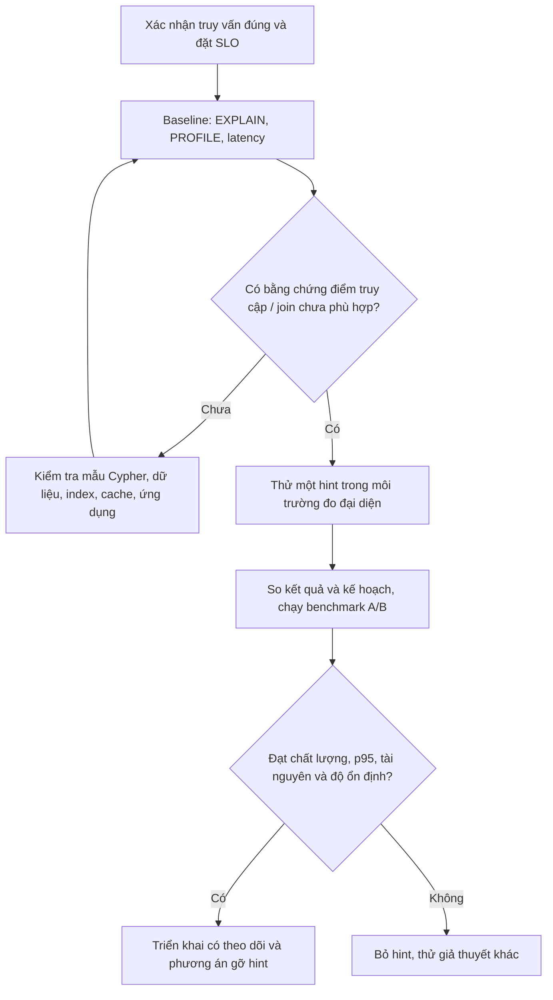

# Sử dụng gợi ý chỉ mục hoặc kế hoạch sau khi có bằng chứng đo đạc

## 1. Khi nào nên can thiệp vào bộ lập kế hoạch Cypher?

Neo4j lưu dữ liệu dưới dạng **property graph**: node, relationship và thuộc tính. Một truy vấn Cypher mô tả mẫu quan hệ cần tìm, còn bộ lập kế hoạch (*planner*) chọn điểm bắt đầu, index, thứ tự mở rộng relationship và cách nối các nhánh của đồ thị. Thông thường planner lựa chọn kế hoạch dựa trên thống kê và ước lượng chi phí; lập trình viên không cần chỉ định phải sử dụng index nào.

Đôi khi planner chọn chưa phù hợp với **phân bố dữ liệu thật**: một giá trị có rất ít bản ghi nhưng thống kê ước lượng nhiều, một node có bậc quan hệ cao bất thường, hoặc nhiều điều kiện lọc khiến việc chọn điểm bắt đầu khó dự đoán. Khi đó Neo4j cho phép sử dụng **planner hints** như `USING INDEX`, `USING SCAN` và `USING JOIN`. Tuy nhiên, một hint có thể khiến phiên bản dữ liệu khác hoặc môi trường tải khác chạy chậm hơn.

**Nguyên tắc xuyên suốt bài học:** chỉ thêm hint khi đã có số liệu cho thấy kế hoạch mặc định gây vấn đề cụ thể, đã kiểm tra những cách khắc phục cơ bản, và kết quả thử A/B chứng minh hint cải thiện mục tiêu thực tế. Hint **tác động tới cách thực thi, không được thay đổi ý nghĩa và tập kết quả của Cypher**.

Chủ đề này thuộc chương **Tối ưu truy vấn** của module `DATABASE_ENGINE_GRAPH_NEO4J`. Nó kết nối trực tiếp với index/constraint, việc đọc `EXPLAIN`/`PROFILE`, truy vấn quan hệ và đường đi, cũng như đo độ trễ của ứng dụng dùng Java Driver hoặc Spring Data Neo4j.

### Kết quả học tập

Sau bài này, bạn có thể:

1. Ghi được **baseline** của một truy vấn: tính đúng đắn, execution plan, `Rows`, `DB Hits`, độ trễ và môi trường đo.
2. Phân biệt `USING INDEX`, `USING [RANGE | TEXT | POINT] INDEX`, `USING INDEX SEEK`, `USING SCAN` và `USING JOIN ON`.
3. Giải thích vì sao một index đang tồn tại vẫn có thể **không** được planner chọn.
4. So sánh có kiểm soát truy vấn mặc định với truy vấn có hint mà **không nhầm dữ liệu ít với lợi ích hiệu năng**.
5. Đề xuất điều kiện áp dụng, theo dõi và gỡ hint khi phân bố dữ liệu hoặc phiên bản Neo4j thay đổi.

## 2. Khung ra quyết định dựa trên bằng chứng

Không nên bắt đầu bằng câu hỏi "ép index nào?". Hãy bắt đầu bằng **dấu hiệu bất thường đo được**:

| Triệu chứng | Bằng chứng cần thu thập | Giả thuyết cần kiểm chứng |
|---|---|---|
| `p95` tăng khi số lượng bản ghi lớn | Latency theo phân vị và mức tải, `PROFILE` | Điểm bắt đầu truy cập quá nhiều ứng viên |
| `Rows` tăng vọt tại `Expand(All)` | `Estimated Rows` so với `Rows`, độ bậc relationship | Duyệt quá sớm qua node có nhiều quan hệ |
| Kế hoạch chọn `NodeByLabelScan` | `SHOW INDEXES`, `EXPLAIN`, độ chọn lọc predicate | Index không khả dụng, không tương thích hoặc scan rẻ hơn |
| Planner dùng index khác kỳ vọng | `Details` của leaf index, thống kê trên giá trị cụ thể | Chọn điểm bắt đầu chưa phù hợp với dữ liệu lệch phân bố |
| `NodeHashJoin` hoặc `CartesianProduct` tốn kém | Kế hoạch hai nhánh, số dòng trước/sau join | Cách nối các mẫu quan hệ làm phình dòng |
| Chậm dù `DB Hits` thấp | CPU, page cache, GC, mạng, ứng dụng, tải đồng thời | Nút thắt nằm ngoài thao tác truy cập storage |

Quy trình đề xuất:



**Điểm chốt:** `EXPLAIN` chỉ cho **kế hoạch dự kiến**, không thực thi truy vấn; `PROFILE` **thực thi** và thu thập số liệu. Không `PROFILE` một truy vấn ghi trên dữ liệu thật chỉ để xem kế hoạch: các thao tác `CREATE`, `SET`, `DELETE` vẫn có thể có hiệu lực.

## 3. Dữ liệu thực hành: bài viết, tác giả và chủ đề

Ta dùng đồ thị học liệu để quan sát **hai điểm bắt đầu cạnh tranh**: tìm một tác giả theo `handle` hoặc tìm các bài viết theo `channel`. Tình huống khác là nối hai đầu đã lọc qua một bài viết chung.

```text
(:QO008Article {id, title, channel, published})
      |                              |
      +--[:QO008_WRITTEN_BY]------->(:QO008Author {id, handle})
      |
      +--[:QO008_ABOUT]----------->(:QO008Topic {id, slug})
```

Các nhãn và tên index bắt đầu bằng `QO008`/`qo008_` để hạn chế trùng tên. Chạy trên **database thực hành**. Số lượng 1.400 bài viết chỉ đủ minh họa việc đo; **không** đủ để suy ra kế hoạch tối ưu cho hàng triệu node.

### 3.1. Tạo tác giả và chủ đề

```cypher
UNWIND range(1, 40) AS i
MERGE (au:QO008Author {id: i})
SET au.handle = 'author-' + toString(i);
```

```cypher
WITH [
  'cypher', 'neo4j', 'java', 'search',
  'security', 'operations', 'modeling'
] AS slugs
UNWIND range(1, size(slugs)) AS i
MERGE (t:QO008Topic {id: i})
SET t.slug = slugs[i - 1];
```

### 3.2. Tạo bài viết và relationship

```cypher
UNWIND range(1, 1400) AS i
MERGE (a:QO008Article {id: i})
SET a.title = CASE WHEN i % 17 = 0
                   THEN 'Cypher optimization ' + toString(i)
                   ELSE 'Graph note ' + toString(i)
              END,
    a.channel = CASE WHEN i % 13 = 0
                     THEN 'featured' ELSE 'standard' END,
    a.published = (i % 8 <> 0)
WITH a, i
MATCH (au:QO008Author {id: (i - 1) % 40 + 1})
MATCH (t:QO008Topic {id: (i - 1) % 7 + 1})
MERGE (a)-[:QO008_WRITTEN_BY]->(au)
MERGE (a)-[:QO008_ABOUT]->(t);
```

Các thuộc tính và relationship được tạo **có quy luật** để đối chiếu: mỗi tác giả có 35 bài viết; `channel = 'featured'` chỉ xuất hiện ở những bài có `id` chia hết cho 13. Đặc biệt `author-13` có đúng **ba** bài `featured`: `id = 13, 533, 1053`. Một số query theo cặp giá trị có thể bị lệch phân bố; đây là lý do phải đo trên dữ liệu phản ánh thực tế.

Kiểm tra dữ liệu:

```cypher
MATCH (a:QO008Article)
WITH count(a) AS articleCount
MATCH (b:QO008Article)-[:QO008_WRITTEN_BY]->(:QO008Author)
RETURN articleCount, count(DISTINCT b) AS articlesWithAuthor;
```

Khi chỉ có dữ liệu mẫu của bài, kết quả là `articleCount = 1400` và `articlesWithAuthor = 1400`. Truy vấn kiểm tra quan hệ thứ hai còn có tác dụng phát hiện bài thiếu tác giả; có thể kiểm tra quan hệ chủ đề tương tự.

### 3.3. Tạo index và kiểm tra trạng thái

```cypher
CREATE RANGE INDEX qo008_author_handle IF NOT EXISTS
FOR (au:QO008Author) ON (au.handle);
```

```cypher
CREATE RANGE INDEX qo008_article_channel IF NOT EXISTS
FOR (a:QO008Article) ON (a.channel);
```

```cypher
CREATE RANGE INDEX qo008_topic_slug IF NOT EXISTS
FOR (t:QO008Topic) ON (t.slug);
```

```cypher
CREATE TEXT INDEX qo008_article_title_text IF NOT EXISTS
FOR (a:QO008Article) ON (a.title);
```

```cypher
SHOW INDEXES
YIELD name, type, state, labelsOrTypes, properties
WHERE name STARTS WITH 'qo008_'
RETURN name, type, state, labelsOrTypes, properties
ORDER BY name;
```

Trước khi đo, đợi cả bốn index có `state = 'ONLINE'`. Khi cần trong **database thực hành**, lệnh `CALL db.awaitIndexes()` có thể chờ các chỉ mục hoàn thành population. Nếu tên đã bị dùng cho schema khác, `IF NOT EXISTS` không thay thế việc kiểm tra `labelsOrTypes` và `properties`.

## 4. Bắt đầu bằng câu truy vấn không có hint

Yêu cầu: tìm các bài viết `featured` của tác giả `author-13` đã xuất bản, trả `id` và tiêu đề.

```cypher
MATCH (au:QO008Author)<-[:QO008_WRITTEN_BY]-(a:QO008Article)
WHERE au.handle = $handle
  AND a.channel = $channel
  AND a.published = true
RETURN a.id AS id, a.title AS title
ORDER BY id;
```

Với `$handle = 'author-13'` và `$channel = 'featured'`, kết quả kỳ vọng gồm `13`, `533`, `1053`. Viết câu lệnh **chưa có hint** trước; ghi nhận số dòng, `Rows`, `DB Hits`, loại leaf index/scan và độ trễ. Vì dữ liệu ít, planner có thể chọn `NodeByLabelScan` hoặc `NodeIndexSeek` tùy thống kê và runtime.

### 4.1. EXPLAIN: tìm điểm bắt đầu

```cypher
EXPLAIN
MATCH (au:QO008Author)<-[:QO008_WRITTEN_BY]-(a:QO008Article)
WHERE au.handle = 'author-13'
  AND a.channel = 'featured'
  AND a.published = true
RETURN a.id AS id, a.title AS title
ORDER BY id;
```

Đọc **từ leaf lên root**: leaf có thể là `NodeIndexSeek` trên `QO008Author(handle)` hoặc `QO008Article(channel)`; kế hoạch cũng có thể duyệt quan hệ và lọc theo nhánh còn lại. Nếu truy vấn dùng nhiều điểm bắt đầu, có thể có join. `EXPLAIN` hiển thị `Estimated Rows` nhưng **không cho biết số dòng/DB Hits đã thực thi**.

### 4.2. PROFILE: thu bằng chứng thực

```cypher
PROFILE
MATCH (au:QO008Author)<-[:QO008_WRITTEN_BY]-(a:QO008Article)
WHERE au.handle = 'author-13'
  AND a.channel = 'featured'
  AND a.published = true
RETURN a.id AS id, a.title AS title
ORDER BY id;
```

Trong plan, ghi lại:

| Thuộc tính plan | Cách đọc |
|---|---|
| `Operator` và `Details` | Leaf nào là điểm bắt đầu? Index kiểu gì? Predicate nào được đưa vào seek? |
| `Estimated Rows` và `Rows` | Sai lệch ước lượng lớn ở bước nào? Có nhân dòng do relationship không? |
| `DB Hits` | Công việc truy cập dữ liệu tương đối; **không phải số lần đọc đĩa** |
| `Memory (Bytes)`, `Page Cache Hits/Misses` | Mức dùng bộ nhớ/cache nếu runtime hiển thị |
| `Time (ms)` / `Pipeline` | Thời gian trong runtime; có thể gộp theo pipeline, **khác** độ trễ API |

Không dùng số `DB Hits` của lần `PROFILE` đơn lẻ thay cho benchmark từ ứng dụng. Một truy vấn có ít DB Hits vẫn có thể chậm do CPU, GC, network hoặc thao tác tuần tự hóa dữ liệu.

## 5. Gợi ý chỉ mục: USING INDEX và USING INDEX SEEK

Neo4j hỗ trợ khai báo hint **sau `MATCH` tương ứng** và trước `WHERE` của mẫu đó. Cú pháp thường dùng:

```cypher
MATCH (a:SomeLabel)
USING INDEX a:SomeLabel(property)
WHERE a.property = $value
RETURN a;
```

`USING INDEX` yêu cầu planner chọn một index phù hợp làm điểm bắt đầu. `USING INDEX SEEK` nghiêm ngặt hơn: yêu cầu **index seek** và không thỏa bằng index scan. Nếu không có index đúng label, property, kiểu hoặc predicate tương thích, hint có thể không thực hiện được và truy vấn báo cảnh báo/lỗi tùy cấu hình/phiên bản. Cần kiểm tra kết quả lập kế hoạch, không giả định hint luôn thành công.

### 5.1. Ép bắt đầu từ tác giả

```cypher
PROFILE
MATCH (au:QO008Author)<-[:QO008_WRITTEN_BY]-(a:QO008Article)
USING RANGE INDEX au:QO008Author(handle)
WHERE au.handle = 'author-13'
  AND a.channel = 'featured'
  AND a.published = true
RETURN a.id AS id, a.title AS title
ORDER BY id;
```

Truy vấn này yêu cầu index `QO008Author(handle)`, từ một tác giả duyệt khoảng 35 bài rồi lọc. Đây là **giả thuyết chi phí**, không phải cam kết plan hiển thị chính xác 35 dòng ở mọi toán tử. Hãy xem `PROFILE` để xác nhận.

### 5.2. Ép bắt đầu từ bài viết

```cypher
PROFILE
MATCH (au:QO008Author)<-[:QO008_WRITTEN_BY]-(a:QO008Article)
USING RANGE INDEX a:QO008Article(channel)
WHERE au.handle = 'author-13'
  AND a.channel = 'featured'
  AND a.published = true
RETURN a.id AS id, a.title AS title
ORDER BY id;
```

Index trên `channel` trả ứng viên `featured` trong toàn bộ tập bài viết trước khi đối chiếu tác giả. Ở fixture này có hơn 100 bài `featured`, nên điểm bắt đầu ấy **có thể** phải xử lý nhiều dòng hơn phương án tìm một tác giả trước. Tuy nhiên, planner có thể dùng thêm chiến lược khác; quyết định dựa trên `PROFILE` và benchmark.

### 5.3. Ép Index Seek khi cần kiểm chứng

```cypher
EXPLAIN
MATCH (au:QO008Author)
USING RANGE INDEX SEEK au:QO008Author(handle)
WHERE au.handle = 'author-13'
RETURN au.id, au.handle;
```

`USING RANGE INDEX SEEK` yêu cầu kế hoạch thỏa bằng range index seek. Nó hữu ích để phân biệt giả thuyết "index scan" với "seek"; chỉ nên giữ hint trong mã ứng dụng nếu đã đo được lợi ích và biết khi nào cần gỡ bỏ.

| Hint index | Ý nghĩa | Ví dụ predicate |
|---|---|---|
| `USING INDEX a:Label(prop)` | Planner dùng một index phù hợp | `=`, `STARTS WITH`… tùy index |
| `USING RANGE INDEX a:Label(prop)` | Yêu cầu RANGE index | `a.prop = $value` |
| `USING TEXT INDEX a:Label(prop)` | Yêu cầu TEXT index | `a.prop CONTAINS $fragment` |
| `USING POINT INDEX a:Label(prop)` | Yêu cầu POINT index | Predicate không gian phù hợp |
| `USING INDEX SEEK a:Label(prop)` | Bắt buộc dùng index seek | Predicate có thể giải bằng seek |

**Quan trọng:** RANGE, TEXT và POINT có tập predicate hỗ trợ khác nhau. Index có tồn tại chưa đủ; planner còn phải chứng minh **kiểu dữ liệu và điều kiện lọc tương thích** để hint không đổi kết quả. Tên index đặt trong `CREATE INDEX` không xuất hiện trong cú pháp `USING INDEX`: hint chỉ định **biến, nhãn/loại quan hệ và thuộc tính**, không phải tên index.

### 5.4. TEXT index và predicate tìm chuỗi con

Với `qo008_article_title_text` đã tạo, ta có thể kiểm tra:

```cypher
EXPLAIN
MATCH (a:QO008Article)
USING TEXT INDEX a:QO008Article(title)
WHERE a.title CONTAINS 'Cypher'
RETURN a.id AS id, a.title AS title
ORDER BY id;
```

TEXT index đặc biệt phù hợp với `CONTAINS` và `ENDS WITH`. Với `=` hoặc `STARTS WITH`, RANGE index có thể phù hợp hơn khi có cả hai kiểu. Không dùng TEXT hint cho `toLower(a.title) CONTAINS ...` rồi mặc định planner sẽ tận dụng index trên giá trị gốc `title`; phép biến đổi thuộc tính có thể cản việc sử dụng index.

## 6. USING SCAN: đôi khi quét rẻ hơn dùng index

Không phải mọi điều kiện đều có tính chọn lọc cao. Nếu truy vấn trả phần lớn node của một nhãn, việc quét theo nhãn rồi lọc có thể rẻ hơn đi qua index và truy cập node cho gần như toàn bộ kết quả. Hint `USING SCAN` yêu cầu điểm bắt đầu bằng label scan (hoặc relationship type scan) thay cho index.

```cypher
EXPLAIN
MATCH (a:QO008Article)
USING SCAN a:QO008Article
WHERE a.published = true
RETURN count(a) AS publishedCount;
```

Đây là truy vấn thử nghiệm hợp lệ dù thuộc tính `published` **không có** index trong fixture. Có thể so với bản không hint:

```cypher
EXPLAIN
MATCH (a:QO008Article)
WHERE a.published = true
RETURN count(a) AS publishedCount;
```

Hai câu phải có cùng kết quả nếu chạy. Trong tập dữ liệu này, phần lớn bài viết được đánh dấu `published = true` nên scan là ứng viên tự nhiên. **Không suy ra scan luôn nhanh:** dùng `PROFILE` và tải đại diện. Nếu planner đã chọn scan, thêm `USING SCAN` không có lợi và khiến mã khó thích nghi hơn khi dữ liệu tăng.

## 7. USING JOIN ON: ép điểm nối khi có bằng chứng rõ ràng

`USING JOIN ON variable` là hint nâng cao: yêu cầu planner thực hiện phép **join tại node** được chỉ định. Nó không chỉ định một index bắt đầu đơn lẻ, mà có thể khiến planner tạo **nhiều điểm bắt đầu** và kết hợp kết quả bằng `NodeHashJoin` hoặc phép nối thích hợp. Nếu không có hai nhánh chọn lọc, ép join có thể làm truy vấn chậm hơn nhiều.

Ví dụ tìm bài viết của một tác giả thuộc một chủ đề cụ thể:

```cypher
MATCH (au:QO008Author)<-[:QO008_WRITTEN_BY]-
      (a:QO008Article)-[:QO008_ABOUT]->(t:QO008Topic)
WHERE au.handle = 'author-13' AND t.slug = 'cypher'
RETURN a.id AS id, a.title AS title
ORDER BY id;
```

Trên dữ liệu mẫu, tác giả `author-13` có **năm** bài thuộc chủ đề `cypher`. Trước tiên đo bản **không hint** để xem planner xử lý hai điểm lọc và bước nối ra sao.

Chỉ khi có bằng chứng rằng hai nhánh truy cập độc lập rồi nối tại `a` là tốt hơn, mới thử:

```cypher
EXPLAIN
MATCH (au:QO008Author)<-[:QO008_WRITTEN_BY]-
      (a:QO008Article)-[:QO008_ABOUT]->(t:QO008Topic)
USING RANGE INDEX au:QO008Author(handle)
USING RANGE INDEX t:QO008Topic(slug)
USING JOIN ON a
WHERE au.handle = 'author-13' AND t.slug = 'cypher'
RETURN a.id AS id, a.title AS title
ORDER BY id;
```

Kiểm tra các leaf `QO008Author(handle)` và `QO008Topic(slug)` và điểm nối trên `a`. **Chạy lại dưới `PROFILE` chỉ trong môi trường đọc thử nghiệm** để kiểm tra `Rows`, `DB Hits` và bộ nhớ join. Việc dùng **nhiều** index hints có thể buộc planner tìm hai điểm bắt đầu, tạo join tốn kém; `USING JOIN ON` không nên là gợi ý mặc định cho mọi đường đi.

### 7.1. Phân biệt "gợi ý kế hoạch" và "chọn runtime"

- `USING INDEX`/`SCAN` điều khiển **chiến lược truy cập** ở một phần `MATCH`.
- `USING JOIN ON` ảnh hưởng **điểm nối** trong kế hoạch nhiều nhánh.
- `CYPHER replan=force` yêu cầu **lập kế hoạch lại** thay vì sử dụng một kế hoạch cache còn hiệu lực; nó **không** bảo đảm planner sẽ chọn kế hoạch khác hoặc tốt hơn.
- Các tùy chọn `CYPHER runtime=...` điều khiển **runtime thực thi**, không phải cùng một khái niệm với index/join hint; hỗ trợ tùy phiên bản và edition.

Ví dụ xem kế hoạch mới mà không thực thi phần truy vấn:

```cypher
CYPHER replan=force
EXPLAIN
MATCH (au:QO008Author)
WHERE au.handle = 'author-13'
RETURN au.id;
```

Khi thống kê và kích thước dữ liệu đổi, một kế hoạch cache có thể không còn tối ưu. Tuy nhiên, **không liên tục ép replan trên mỗi yêu cầu** vì lập kế hoạch có chi phí riêng; hãy kiểm tra cơ chế tự replan và query cache của phiên bản Neo4j đang vận hành.

## 8. Đo đạc đúng cách trước khi chọn hoặc bỏ hint

### 8.1. Đảm bảo kết quả tương đương

Mọi biến thể phải cùng ngữ nghĩa `MATCH`, `WHERE`, `RETURN` và `ORDER BY`. Chỉ khác dòng `USING ...`. Kết quả của cả hai biến thể cần được đối chiếu, đặc biệt:

- **Tập dòng và số lượng**: so các khóa nghiệp vụ thay vì tin rằng hai plan tương đương chỉ vì đều chạy được.
- **Trùng lặp dòng**: traversal nhiều relationship có thể tạo nhiều đường đến cùng node; xem yêu cầu có cần `DISTINCT` không.
- **Trường hợp biên**: truy vấn không có kết quả, giá trị rất phổ biến, rất hiếm, `null`/thuộc tính thiếu, biến đầu vào không có kiểu mong đợi.
- **Thứ tự**: nếu đầu ra có phân trang hoặc Top K, dùng `ORDER BY` ổn định và khóa phụ khi có giá trị đồng hạng. Không dựa vào thứ tự ngẫu nhiên của kết quả không sắp xếp.

Để đối chiếu fixture một cách độc lập:

```cypher
MATCH (au:QO008Author)<-[:QO008_WRITTEN_BY]-(a:QO008Article)
WHERE au.handle = 'author-13'
  AND a.channel = 'featured'
  AND a.published = true
WITH collect(DISTINCT a.id) AS ids
RETURN size(ids) = 3
   AND 13 IN ids
   AND 533 IN ids
   AND 1053 IN ids AS passed;
```

Kỳ vọng `passed = true` nếu dùng đúng fixture và không có dữ liệu khác mang các nhãn/tham số mẫu. Kiểm tra trên chỉ xác nhận **dữ liệu và câu hỏi nghiệp vụ của mẫu**, không chứng minh hiệu năng hint.

### 8.2. Đo cả độ trễ ứng dụng và tài nguyên database

`PROFILE` cho số liệu công việc bên trong Neo4j; người dùng cuối cảm nhận **độ trễ từ API đến khi tiêu thụ hết record**. Với Java Driver, đo quanh phiên đọc và vật hóa kết quả:

```java
String cypher = """
    MATCH (au:QO008Author)<-[:QO008_WRITTEN_BY]-
          (a:QO008Article)
    WHERE au.handle = $handle
      AND a.channel = $channel
      AND a.published = true
    RETURN a.id AS id, a.title AS title
    ORDER BY id
    """;

long started = System.nanoTime();
try (var session = driver.session()) {
    var results = session.executeRead(tx ->
        tx.run(cypher, java.util.Map.of(
            "handle", "author-13", "channel", "featured"
        )).list()
    );
    double elapsedMs = (System.nanoTime() - started) / 1_000_000.0;
    System.out.printf("rows=%d elapsedMs=%.3f%n",
        results.size(), elapsedMs);
}
```

`driver` là một `org.neo4j.driver.Driver` đã cấu hình. Đoạn code ở trên là **ví dụ một lượt đo**: cần dùng chương trình benchmark nhiều lượt, ghi được phân vị và có tập truy vấn đủ đại diện. Trong ứng dụng Spring Data Neo4j, đo thêm thời gian mapping entity/DTO, giao tiếp HTTP, chuyển trang, serialization và pool kết nối.

Một lần chạy `PROFILE` trong Neo4j Browser **không** thay cho latency cuối đến cuối. Hai biến thể A/B nên chạy theo thứ tự luân phiên trên **cùng snapshot dữ liệu**, trạng thái index `ONLINE`, cùng phiên bản và cấu hình:

| Khía cạnh | Cách đo | Vì sao cần |
|---|---|---|
| Kết quả | So row count, khóa/id, thứ tự ổn định | Hint không được đổi ngữ nghĩa |
| `Rows`/`DB Hits` | `PROFILE`, kế hoạch của từng biến thể | Định vị nơi thay đổi công việc |
| `p50/p95/p99` | Nhiều yêu cầu end-to-end | Xem tail latency và sự ổn định |
| QPS và tỷ lệ lỗi | Benchmark ở tải cố định, nhiều concurrency | Tăng tốc một truy vấn có thể làm giảm năng lực toàn hệ thống |
| CPU, heap, GC, page cache, I/O | Monitoring theo cửa sổ tải | Tính tác động ngoài DB Hits |
| Chi phí ghi/index | Tải có cập nhật bài viết và index | Thêm index hoặc thay query có chi phí vận hành |

**Thực hành benchmark:** warm-up trước, đo riêng trạng thái cache lạnh/nóng nếu thực sự cần, chạy A/B đảo thứ tự, gồm giá trị phổ biến/hiếm/không khớp, lưu truy vấn và phân vị theo từng nhóm. Đánh giá thêm ảnh hưởng lên workload khác khi chạy đồng thời, vì cải thiện riêng một query chưa chắc cải thiện throughput toàn dịch vụ.

### 8.3. Ví dụ đọc một báo cáo A/B

Bảng sau là **số liệu giả định để luyện quyết định**, không phải kết quả đo Neo4j từ fixture:

| Biến thể | `Rows` sau điểm bắt đầu | Tổng `DB Hits` | `p95` API (ms) | QPS ở cùng tải | Tỷ lệ lỗi |
|---|---:|---:|---:|---:|---:|
| Mặc định | 120 | 420 | 155 | 270 | 0% |
| Hint theo `author.handle` | 35 | 130 | 108 | 285 | 0% |
| Hint theo `article.channel` | 107 | 470 | 172 | 261 | 0% |
| Ép label scan | 1.400 | 1.650 | 365 | 150 | 0,2% |

Nếu đo lặp lại đủ lượt trên dữ liệu đại diện và **tập kết quả giống nhau**, phương án ép bắt đầu từ tác giả có thể là ứng viên triển khai thử; ép index bài viết hay scan chưa có lý do giữ lại. Tuy vậy, cần xem p95 với **những tác giả có nhiều bài bất thường**: ở nhóm đó, index tác giả có thể phát quá nhiều ứng viên và khiến lựa chọn đảo chiều.

## 9. Những lỗi thường gặp khi sử dụng hints

### 9.1. Ép index vì nó tồn tại, không vì predicate

`qo008_article_title_text` có thể giải `CONTAINS` trên `a.title` nhưng không thay thế `qo008_article_channel` cho điều kiện `a.channel = 'featured'`. Index không thể tự tối ưu những thuộc tính hoặc loại relationship không nằm trong schema được lập chỉ mục. Hãy đọc `Details` của leaf để xác nhận planner sử dụng **đúng index, đúng thuộc tính và đúng điều kiện**.

### 9.2. Nhiều index hints làm tăng chi phí join

Hai điểm bắt đầu không nhất thiết nhanh hơn một. Nếu mỗi nhánh trả hàng nghìn ứng viên, việc tạo `NodeHashJoin` có thể tốn bộ nhớ, CPU và dẫn tới nhiều dòng trước khi lọc. Chỉ dùng nhiều index hints/`USING JOIN ON` khi đã đo rõ lợi ích của hai điểm bắt đầu.

### 9.3. Nhầm chi phí `PROFILE` với thời gian ứng dụng

`DB Hits` không phải số lần đọc đĩa và `Time (ms)` có thể được gộp theo runtime pipeline. Một query trả nhiều record qua mạng có thể có `DB Hits` ít nhưng latency cao. Hãy đo ở Java Driver/Spring Data Neo4j và quan sát cả DB, mạng, máy ứng dụng.

### 9.4. Cố định hint theo thống kê cũ

Khi số lượng node, bậc relationship, phân bố giá trị hoặc phiên bản Neo4j thay đổi, hint phù hợp hôm nay có thể làm chậm ngày mai. Query có hint vẫn phải được chạy benchmark định kỳ theo workload thực. Tối ưu nên có **điều kiện gỡ** và một phiên bản truy vấn không hint để rollback.

### 9.5. Dùng hint để che lỗi về mô hình hoặc tính đúng đắn

Nếu `MATCH` tạo `CartesianProduct` ngoài ý muốn, `OPTIONAL MATCH` làm mất/nhân dòng khi kết hợp nhiều nhánh, hay `toLower(a.title)` che thuộc tính index, hãy xem lại **câu truy vấn và mô hình** trước. Hint không chữa được logic sai, không tự tạo constraint, không khắc phục dữ liệu không nhất quán.

## 10. Quy trình đưa một hint vào ứng dụng

1. **Ghi nhận yêu cầu nghiệp vụ và ngưỡng chấp nhận.** Ví dụ truy vấn tìm bài viết đúng, `p95 < 180 ms`, lỗi `< 0,1%` ở tải đã định; không chỉ đặt mục tiêu giảm DB Hits.
2. **Lưu baseline.** Ghi query không hint, tham số mẫu, phiên bản Neo4j, index `ONLINE`, dữ liệu và `EXPLAIN`/`PROFILE`, độ trễ phân vị.
3. **Nêu giả thuyết cụ thể.** Chẳng hạn "planner bắt đầu từ 140.000 bài `featured`, trong khi tác giả được tìm chỉ có 20 bài"; đo số dòng thực trước khi kết luận.
4. **Kiểm tra cách khác trước.** Index thiếu? Kiểu predicate không tương thích? Có thể lọc sớm hơn, tránh nhân dòng, chuyển đổi dữ liệu chuẩn hóa hoặc cải thiện thống kê mà không cần hint?
5. **Tạo đúng một biến thể.** Thêm hint phù hợp, giữ nguyên `WHERE`/`RETURN`; so kết quả đầu ra, `EXPLAIN` và `PROFILE`.
6. **Benchmark A/B ở tải đại diện.** Bao phủ giá trị thường/hiếm, dữ liệu lớn/nhỏ, cache lạnh/nóng, đồng thời đọc/ghi; đo phân vị độ trễ, throughput, lỗi, CPU, memory.
7. **Triển khai có kiểm soát.** Đưa truy vấn hint thành phiên bản có thể bật/tắt, theo dõi thay đổi plan và p95 sau khi lên môi trường thật.
8. **Đặt điều kiện gỡ bỏ.** Nếu tăng lỗi/timeout, p95 xấu hơn, RAM tăng, hoặc phát sinh plan failure sau nâng cấp, quay về bản mặc định và điều tra lại.

### Checklist review trước khi chấp nhận hint

- [ ] Có bằng chứng đo được **vấn đề ở plan mặc định**, gồm `PROFILE` và độ trễ người dùng.
- [ ] Có index phù hợp, `ONLINE`, predicate và kiểu dữ liệu thỏa điều kiện của hint.
- [ ] Hai biến thể trả **cùng tập kết quả** trên bộ kiểm thử có ca biên.
- [ ] Đã đo latency p50/p95/p99, throughput, tỷ lệ lỗi và tài nguyên trên dữ liệu đại diện.
- [ ] Có phương án **bật/tắt hoặc xóa hint**, theo dõi sau triển khai và tái đánh giá khi dữ liệu tăng.

## 11. Bài tập tự luyện

1. **Baseline.** Dùng fixture, chạy `EXPLAIN` và `PROFILE` truy vấn của `author-13` + `featured`. Điền vào bảng: leaf truy cập, `Rows`, `DB Hits`, kết quả các `id`.
2. **So hai index hints.** Thử `USING RANGE INDEX au:QO008Author(handle)` và `USING RANGE INDEX a:QO008Article(channel)`. Đối chiếu kết quả, kế hoạch, tài nguyên. Trình bày kết luận dựa trên số liệu của bạn.
3. **Thử giá trị lệch phân bố.** Chọn `author-1` và `author-13`, rồi chọn cả `channel = 'featured'` và `'standard'`. Một hint có còn phù hợp cho tất cả tham số không?
4. **So hint và scan.** Với điều kiện `a.published = true`, so bản mặc định và `USING SCAN a:QO008Article`. Khi tăng số node, hãy đo lại và giải thích hướng thay đổi.
5. **Đọc join.** So kế hoạch truy vấn tác giả + chủ đề có và không có `USING JOIN ON a`. Đánh dấu hai điểm bắt đầu, toán tử join, số dòng các nhánh.
6. **Điều tra predicate khác.** Thử `a.title CONTAINS 'Cypher'` với `USING TEXT INDEX` và không hint; kiểm tra index `ONLINE` và xem có thực sự cải thiện trên tập nhỏ không.
7. **Lập báo cáo quyết định.** Viết một trang gồm baseline, giả thuyết, số liệu trước/sau, xác nhận tập kết quả, rủi ro khi dữ liệu đổi và điều kiện rollback. Nếu số liệu không chứng minh lợi ích, đề xuất **không đưa hint vào sản xuất**.

### Dọn dữ liệu thực hành

Chỉ chạy trên database học tập có dữ liệu `QO008` của bài; thao tác `DETACH DELETE` cũng xóa các relationship gắn với node mẫu.

```cypher
DROP INDEX qo008_author_handle IF EXISTS;
```

```cypher
DROP INDEX qo008_article_channel IF EXISTS;
```

```cypher
DROP INDEX qo008_topic_slug IF EXISTS;
```

```cypher
DROP INDEX qo008_article_title_text IF EXISTS;
```

```cypher
MATCH (a:QO008Article)
DETACH DELETE a;
```

```cypher
MATCH (au:QO008Author)
DETACH DELETE au;
```

```cypher
MATCH (t:QO008Topic)
DETACH DELETE t;
```

## 12. Tài liệu tham khảo

- [Neo4j Cypher Manual — Index hints for the Cypher planner](https://neo4j.com/docs/cypher-manual/current/indexes/performance-indexes/index-hints/): cú pháp, điều kiện thỏa hints và các ví dụ `USING INDEX`, `SCAN`, `JOIN`.
- [Neo4j Cypher Manual — The impact of indexes on query performance](https://neo4j.com/docs/cypher-manual/current/indexes/performance-indexes/using-indexes/): chọn index cho predicate và lý do một index có thể không được ưu tiên.
- [Neo4j Cypher Manual — Understanding query plans](https://neo4j.com/docs/cypher-manual/current/planning-and-tuning/execution-plans/): `EXPLAIN`/`PROFILE`, `Estimated Rows`, `Rows`, `DB Hits`.
- [Neo4j Cypher Manual — Query tuning](https://neo4j.com/docs/cypher-manual/current/planning-and-tuning/query-tuning/): planner, runtime và `replan=force`.
- [Neo4j Java Driver Manual](https://neo4j.com/docs/java-manual/current/): truy vấn có tham số, giao dịch và đo thời gian trên đường đi ứng dụng.
