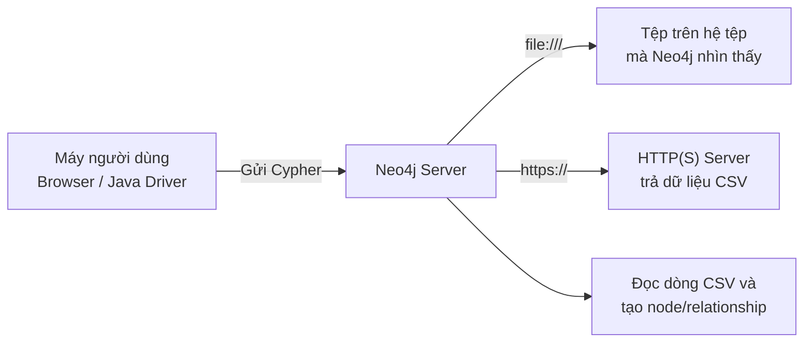
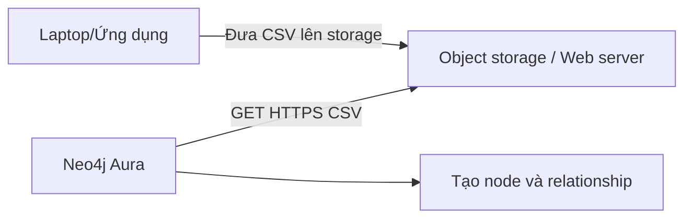

# Quyền truy cập tệp, URL và thư mục nhập dữ liệu trong Neo4j

Khi nhập dữ liệu CSV vào **Neo4j**, câu lệnh `LOAD CSV` chỉ thành công nếu **máy chủ Neo4j** thực sự đọc được nguồn dữ liệu. Một tệp có sẵn trên laptop của lập trình viên chưa chắc hiện diện trên máy chạy Neo4j; một URL mở được trong trình duyệt chưa chắc truy cập được từ server; và một tệp nằm đúng thư mục vẫn có thể bị từ chối vì quyền hệ điều hành hoặc cấu hình bảo mật.

Bài học thuộc chương **Nhập dữ liệu** của module **DATABASE_ENGINE_GRAPH_NEO4J**. Trong hệ thống property graph, dữ liệu CSV có thể được chuyển thành **node**, **relationship** và **property** thông qua Cypher. Để làm được việc đó an toàn và ổn định, cần phân biệt **đường dẫn tệp**, **nguồn URL**, **thư mục import**, **quyền của tiến trình Neo4j** và **quyền của tài khoản chạy Cypher**.

## 1. Ai thực sự đọc dữ liệu khi thực thi `LOAD CSV`?

Trong trường hợp phổ biến, bạn mở Neo4j Browser hoặc ứng dụng Java, gửi Cypher tới Neo4j qua mạng:



Điểm cốt lõi: **`LOAD CSV` được xử lý ở phía Neo4j Server**. Đường dẫn trong `FROM` không tự động trỏ tới máy chạy Neo4j Browser, IntelliJ, ứng dụng Spring Boot hoặc Neo4j Java Driver.

Ví dụ:

```cypher
LOAD CSV WITH HEADERS FROM 'file:///customers.csv' AS row
RETURN row
LIMIT 3;
```

Trong một bản cài Neo4j tự quản lý dùng thư mục import mặc định, câu lệnh này tìm `customers.csv` trong **thư mục import trên hệ tệp của tiến trình Neo4j**. Nếu bạn lưu `customers.csv` trong thư mục Downloads của laptop, Neo4j ở server khác sẽ không tự nhìn thấy tệp đó.

### Ba lớp kiểm soát cần tách biệt

| Lớp | Câu hỏi | Ví dụ |
| --- | --- | --- |
| **Vị trí nguồn dữ liệu** | File/URL có tồn tại và Neo4j có nhìn thấy không? | File được mount vào container hay chỉ có trên host? |
| **Cấu hình & quyền hệ thống** | Neo4j được phép mở nguồn này không? | `server.directories.import`, `dbms.security.allow_csv_import_from_file_urls`, quyền đọc của OS |
| **Quyền tài khoản Neo4j** | Người chạy Cypher có được phép `LOAD CSV` và ghi graph không? | Quyền `LOAD`; quyền tạo/sửa node, relationship cần thiết |

Ba lớp là **độc lập**. Chỉnh cấu hình import không sửa được một URL trả HTTP 403; cấp quyền `LOAD` không tự tạo tệp còn thiếu trong Docker; cấp quyền đọc tệp cho hệ điều hành không thay thế các quyền graph của Neo4j.

## 2. Hai dạng nguồn `LOAD CSV`: tệp cục bộ và URL từ xa

```cypher
// Đọc file được Neo4j nhìn thấy trên hệ tệp.
LOAD CSV WITH HEADERS FROM 'file:///customers.csv' AS row
RETURN row
LIMIT 3;
```

```cypher
// Đọc CSV từ một endpoint HTTP(S) trả nội dung CSV.
LOAD CSV WITH HEADERS
FROM 'https://data.neo4j.com/importing-cypher/people.csv' AS row
RETURN row
LIMIT 3;
```

| Tiêu chí | `file:///...` | `https://...` |
| --- | --- | --- |
| Dữ liệu nằm ở đâu? | Hệ tệp của **server/container Neo4j** | Máy chủ HTTP(S) từ xa |
| Điều kiện truy cập | Đường dẫn nằm trong phạm vi cho phép, quyền OS, quyền `LOAD` | Neo4j có đường mạng/DNS/TLS đến URL, nguồn trả dữ liệu, quyền `LOAD` |
| Phụ thuộc thư mục import? | **Có** khi được cấu hình giới hạn | **Không**, vì không đọc tệp qua `file:///` |
| Dùng được trên Neo4j Aura? | **Không** | **Có**, nếu URL truy cập được từ Aura và được cho phép |
| Rủi ro tiêu biểu | Trỏ nhầm filesystem, quyền đọc quá rộng | URL hết hạn, HTTP 403, timeout, truy cập đích không đáng tin |

Trong ví dụ HTTPS, máy chủ trả về **nội dung CSV thực**. Một URL dẫn tới trang đăng nhập, trang HTML hiển thị tệp hoặc giao diện tải xuống đòi cookie trong trình duyệt **không tương đương** URL CSV trực tiếp. Ưu tiên HTTPS; HTTP không mã hóa dữ liệu trên đường truyền.

## 3. Thư mục import và cách diễn giải `file:///`

Trên Neo4j self-managed, cấu hình `server.directories.import` kiểm soát **thư mục gốc** cho đường dẫn tệp khi dùng `LOAD CSV`. Với cấu hình điển hình:

```properties
# neo4j.conf (minh họa, do người quản trị cấu hình)
server.directories.import=import
dbms.security.allow_csv_import_from_file_urls=true
```

Giả sử thư mục gốc Neo4j là `/opt/neo4j` và import được đặt tại `/opt/neo4j/import`:

```text
/opt/neo4j/
└── import/
    ├── customers.csv
    └── 2026/
        └── orders.csv
```

Câu lệnh tương ứng:

```cypher
LOAD CSV WITH HEADERS FROM 'file:///customers.csv' AS row
RETURN row LIMIT 2;
```

```cypher
LOAD CSV WITH HEADERS FROM 'file:///2026/orders.csv' AS row
RETURN row LIMIT 2;
```

**Diễn giải đường dẫn:** trong cơ chế import bị giới hạn vào thư mục này, `file:///customers.csv` được ánh xạ tới tệp `customers.csv` **bên dưới root import**. Không cần viết `file:///opt/neo4j/import/customers.csv`, và cách viết đường dẫn hệ điều hành đầy đủ có thể gây lỗi hoặc khiến Neo4j tìm sai tệp.

### Quy tắc thực hành

1. Đặt tệp trong **đúng thư mục import thực tế** mà tiến trình Neo4j sử dụng.
2. Với thư mục con, dùng đường dẫn tương đối bên trong import như `file:///2026/orders.csv`.
3. Dùng dấu `/` trong URL, kể cả khi máy chủ chạy Windows; URL không phải chuỗi đường dẫn Windows tùy ý.
4. Ký tự đặc biệt và dấu cách trong URL phải được **URL-encode** phù hợp, ví dụ tên `my customers.csv` tham chiếu là `file:///my%20customers.csv`.
5. Tên tệp có thể phân biệt chữ hoa/chữ thường trên Linux; `Customers.csv` và `customers.csv` có thể là hai tệp khác nhau.
6. Không dựa vào chuỗi `../` để vượt thư mục import; cấu hình giới hạn tồn tại để ngăn truy cập tệp ngoài phạm vi.

**Không mở rộng root import ra toàn bộ filesystem chỉ để xử lý một lỗi đường dẫn.** Nếu bỏ hoặc nới lỏng cấu hình `server.directories.import`, phạm vi tệp Neo4j có khả năng truy cập có thể tăng đáng kể. Cách an toàn hơn là chuyển tệp vào một thư mục import riêng được quản trị rõ ràng.

### Cấu hình có thể khác nhau theo bản cài đặt

`server.directories.import` thuộc nhóm cấu hình của Neo4j hiện hành. Những tài liệu rất cũ có thể gọi tham số bằng tên `dbms.directories.import`; nên đối chiếu đúng phiên bản Neo4j đang chạy, không sao chép nguyên cấu hình cũ sang bản mới.

Trong môi trường được cấp quyền xem cấu hình, có thể kiểm tra:

```cypher
SHOW SETTINGS
YIELD name, value
WHERE name IN [
  'server.directories.import',
  'dbms.security.allow_csv_import_from_file_urls'
]
RETURN name, value
ORDER BY name;
```

`SHOW SETTINGS` cần quyền phù hợp và có thể bị hạn chế bởi dịch vụ quản lý. Kết quả giúp xác định cấu hình **đang có hiệu lực**; việc thay đổi `neo4j.conf` của hệ tự quản lý có thể cần khởi động lại tùy setting. Với Neo4j Aura, không được giả định có quyền tùy chỉnh các setting hệ thống như self-managed.

## 4. Quyền đọc của hệ điều hành không giống quyền Cypher

Ở máy chủ self-managed, tiến trình Neo4j chạy bằng một **OS user/service account**. Tệp nhập và các thư mục cha cần cho phép tài khoản đó truy cập.

Ví dụ Linux:

```text
/var/lib/neo4j/import/customers.csv
             └────┬─────┘
     Neo4j process phải đi qua được các thư mục
     và đọc được file này.
```

Điều kiện thường gặp:

- **Tệp CSV**: tài khoản chạy Neo4j có **quyền đọc**.
- **Các thư mục cha**: tài khoản đó có quyền **traverse/search** qua các thư mục cần thiết.
- **Docker bind mount**: quyền bên trong container phải phù hợp với UID/GID của tiến trình Neo4j; đừng chỉ nhìn quyền từ máy host.
- **Windows service**: kiểm tra quyền NTFS/ACL của tài khoản Windows chạy dịch vụ Neo4j.
- **Tệp đang ghi dở**: dù quyền đúng, đọc giữa lúc tệp được tạo hoặc sao chép dở có thể cho kết quả không đầy đủ.

Nguyên tắc tối thiểu: **Neo4j chỉ cần quyền đọc nguồn CSV** để `LOAD CSV` nhập dữ liệu; không cần cấp quyền ghi vào toàn bộ thư mục import. Quyền ghi graph là một quyền **khác** của tài khoản Neo4j, được kiểm soát ở tầng database.

> Một lỗi `Permission denied` của hệ điều hành phải xử lý ở quyền file và thư mục. Thêm `GRANT WRITE` trong Cypher không sửa được quyền đọc tệp ở OS.

## 5. Quyền `LOAD` và quyền tạo dữ liệu trong Neo4j

Ngoài quyền OS, Neo4j áp dụng các **privilege** cho người dùng chạy `LOAD CSV`. Trong những phiên bản/edition hỗ trợ quản trị quyền chi tiết, **`LOAD`** điều khiển khả năng nạp nguồn dữ liệu; quyền ghi graph điều khiển việc tạo/sửa node và relationship.

Ví dụ chỉ đọc dữ liệu CSV:

```cypher
LOAD CSV WITH HEADERS FROM 'file:///customers.csv' AS row
RETURN row
LIMIT 5;
```

Nếu quyền `LOAD` hợp lệ nhưng người dùng không có quyền tạo node `:Customer`, câu sau vẫn có thể thất bại:

```cypher
LOAD CSV WITH HEADERS FROM 'file:///customers.csv' AS row
MERGE (c:Customer {id: row.customerId})
SET c.name = row.name;
```

Khi sử dụng Neo4j Enterprise với quyền quản trị phù hợp, ví dụ lệnh:

```cypher
// Ví dụ dành cho người quản trị, chỉ áp dụng khi edition hỗ trợ.
GRANT LOAD ON ALL DATA TO csv_importer;
```

Lệnh trên cấp phạm vi `LOAD` **rộng** cho role `csv_importer`, không đồng nghĩa role đó tự được cấp mọi quyền ghi dữ liệu. Mô hình bảo mật nên tuân thủ nguyên tắc **least privilege**; chỉ cấp quyền cần thiết theo cách tổ chức đang quản trị. Có thể kiểm tra quyền bằng lệnh dạng:

```cypher
SHOW ROLE csv_importer PRIVILEGES AS COMMANDS;
```

Thực tế quyền mặc định, edition hỗ trợ, cách cấp và thu hồi quyền có thể khác theo phiên bản/loại dịch vụ. Không nên giả định mọi deployment đều cho phép chạy các câu lệnh quản trị nêu trên.

### Các lớp lỗi truy cập cần nhận diện

| Triệu chứng | Khả năng chính |
| --- | --- |
| Không được phép thực hiện `LOAD CSV` | Quyền `LOAD` chưa có hoặc bị deny |
| Có thể `RETURN row` nhưng `MERGE`/`CREATE` thất bại | Quyền ghi graph, constraint hoặc lỗi dữ liệu |
| Không mở được `file:///...` | Cấu hình file URLs, sai import root, tệp thiếu hoặc OS permission |
| `https://...` trả 403/404 | Server nguồn từ chối hoặc URL không tồn tại |
| HTTPS timeout/SSL | DNS, firewall, egress, proxy, chứng chỉ hoặc endpoint nguồn |

Dùng thông báo lỗi cụ thể để phân loại thay vì cấp thêm quyền một cách tùy tiện.

## 6. Thực hành: nhập một CSV đơn giản vào property graph

Tạo tệp `customers.csv` trong thư mục import của server Neo4j:

```csv
customerId,name,city
C001,An,Ha Noi
C002,Binh,Da Nang
C003,Chi,Ho Chi Minh
```

### Bước 1 — Xác nhận Neo4j đọc được nguồn

```cypher
LOAD CSV WITH HEADERS FROM 'file:///customers.csv' AS row
RETURN row.customerId AS customerId,
       row.name AS name,
       row.city AS city
LIMIT 3;
```

Nếu câu lệnh này không trả ba dòng như mong đợi, **chưa chạy bước ghi**. Kiểm tra thư mục, tên tệp, quyền và cấu hình trước. `WITH HEADERS` coi hàng đầu tiên là tên cột; các tên `customerId`, `name`, `city` phải khớp chính xác với header của CSV.

### Bước 2 — Tạo constraint phù hợp cho định danh

Chạy trên database thực hành với quyền quản trị schema:

```cypher
CREATE CONSTRAINT customer_import_id_unique IF NOT EXISTS
FOR (c:ImportCustomer)
REQUIRE c.customerId IS UNIQUE;
```

Constraint giúp bảo đảm định danh duy nhất và hỗ trợ `MERGE` theo khóa của khách hàng. Nó **không** cấp thêm quyền mở file hay truy cập mạng.

### Bước 3 — Ghi dữ liệu bằng Cypher

```cypher
LOAD CSV WITH HEADERS FROM 'file:///customers.csv' AS row
WITH row
WHERE row.customerId IS NOT NULL
  AND trim(row.customerId) <> ''
MERGE (c:ImportCustomer {customerId: trim(row.customerId)})
SET c.name = trim(row.name),
    c.city = trim(row.city);
```

Kiểm tra kết quả:

```cypher
MATCH (c:ImportCustomer)
RETURN c.customerId AS id, c.name AS name, c.city AS city
ORDER BY id;
```

Kết quả mong đợi là ba node `:ImportCustomer`, mỗi node chứa `customerId`, `name`, `city`. Cần có quyền ghi graph phù hợp để câu lệnh `MERGE`/`SET` thành công. Trên dữ liệu thật, cần xác minh chất lượng CSV, cột trống, kiểu dữ liệu và chính sách xử lý bản ghi không hợp lệ.

### Bước 4 — Tệp nằm trong thư mục con

Nếu bạn chuyển tệp sang `import/2026/customers.csv`, sửa **URL**:

```cypher
LOAD CSV WITH HEADERS FROM 'file:///2026/customers.csv' AS row
RETURN row
LIMIT 3;
```

Việc chuyển tệp không yêu cầu thay đổi phạm vi thư mục import gốc khi đường dẫn vẫn ở bên dưới nó.

## 7. Khi chạy Neo4j bằng Docker

Trong Docker, Neo4j nhìn thấy **filesystem trong container**, không mặc nhiên thấy các thư mục trên host. Vì vậy, tệp nằm tại:

```text
Host:      /srv/neo4j-import/customers.csv
Container: /import/customers.csv
Cypher:    file:///customers.csv
```

cần được **mount** vào container ở đúng vị trí. Ví dụ phần khai báo volume của một Compose service (các cấu hình chạy Neo4j khác được lược bỏ):

```yaml
services:
  neo4j:
    image: neo4j:5
    volumes:
      - ./import:/import:ro
```

- `./import`: thư mục tương ứng trên **host** chạy Docker Compose.
- `/import`: thư mục **bên trong container** để Neo4j đọc.
- `:ro`: mount chỉ đọc, phù hợp nguồn CSV nạp qua `LOAD CSV`.
- `file:///customers.csv`: URL tham chiếu tệp dưới root import cấu hình trong container, **không** tham chiếu trực tiếp `./import` của host.

Tag image `neo4j:5` chỉ mang tính minh họa; khi triển khai thật cần chọn tag phiên bản được quản lý và cấu hình đúng với môi trường. Nếu hệ thống đổi `server.directories.import`, hãy đối chiếu lại thư mục root thực tế.

**Lưu ý về quyền:** mount tồn tại chưa đủ; user chạy Neo4j trong container vẫn phải đọc được file. Nếu file ở host không có quyền cho user/container tương ứng, Neo4j có thể báo lỗi truy cập dù `docker compose` khởi động thành công.

## 8. Khi chạy Neo4j Aura hoặc máy chủ từ xa

**Neo4j Aura không hỗ trợ `file:///` trong `LOAD CSV`.** File trong laptop, container ứng dụng hoặc máy backend sẽ không trở thành file cục bộ của Aura. Muốn dùng `LOAD CSV`, dữ liệu phải có tại **URL mà máy chủ Aura có thể truy cập**, thường là HTTPS.



Một số cách cung cấp tệp:

- Host CSV qua HTTPS ở nguồn đã được tổ chức cho phép.
- Dùng object storage như S3 hoặc dịch vụ tương đương, với URL có thể truy cập từ Aura; nếu dùng **signed URL**, cần đủ thời hạn cho toàn bộ quá trình nhập.
- Sử dụng công cụ nhập liệu/API phù hợp, hoặc đọc/parse CSV trong ứng dụng rồi gửi **dữ liệu đã phân tích** bằng Neo4j Driver.

Ví dụ thử nguồn công khai theo tài liệu Neo4j:

```cypher
LOAD CSV WITH HEADERS
FROM 'https://data.neo4j.com/importing-cypher/people.csv' AS row
RETURN row
LIMIT 3;
```

Đây là ví dụ nguồn từ xa; khả năng chạy phụ thuộc kết nối và chính sách của môi trường thực tế. Một URL private chỉ có thể mở qua VPN/cookie trình duyệt sẽ không hoạt động từ Aura nếu Aura không có quyền truy cập tương ứng.

**Không tải dữ liệu nhạy cảm lên URL công khai chỉ để thử nhanh.** Dùng giải pháp có kiểm soát truy cập và vòng đời URL phù hợp; tránh đưa signed URL có token vào log, thông báo lỗi hoặc tài liệu lưu trữ lâu dài.

## 9. Tích hợp Java Driver và Spring Data Neo4j

Cần phân biệt hai cách ứng dụng Java đưa CSV vào Neo4j.

### Cách A — Java gửi Cypher `LOAD CSV`

```java
import org.neo4j.driver.Driver;
import org.neo4j.driver.Session;
import org.neo4j.driver.Values;

public void importCustomers(Driver driver, String sourceUrl) {
    try (Session session = driver.session()) {
        var summary = session.run("""
            LOAD CSV WITH HEADERS FROM $url AS row
            WITH row
            WHERE row.customerId IS NOT NULL
              AND trim(row.customerId) <> ''
            MERGE (c:ImportCustomer {customerId: trim(row.customerId)})
            SET c.name = row.name
            """, Values.parameters("url", sourceUrl)
        ).consume();

        System.out.println(
            "Nodes created: " + summary.counters().nodesCreated()
        );
    }
}
```

`sourceUrl` là **URL server Neo4j đọc**, không phải đường dẫn từ máy Java. `Result.consume()` giúp hoàn tất kết quả của implicit transaction trước khi ứng dụng báo thành công.

Vì cho phép giá trị URL động, ứng dụng cần **kiểm tra nguồn được phép**; không truyền nguyên một URL tùy ý từ người dùng vào `LOAD CSV`. Dù đã dùng parameter để tránh chèn Cypher, parameterization **không tự giải quyết quyền truy cập URL hoặc nguy cơ đọc nguồn ngoài ý muốn**.

### Cách B — Java đọc CSV, rồi gửi bản ghi qua Driver

Ứng dụng có thể dùng thư viện CSV phù hợp để đọc một tệp **trên máy ứng dụng**, sau đó gửi các batch dữ liệu đã parse bằng tham số `UNWIND`:

```java
import org.neo4j.driver.Driver;
import org.neo4j.driver.Session;
import org.neo4j.driver.Values;

import java.util.List;
import java.util.Map;

public void writeParsedRows(
        Driver driver, List<Map<String, Object>> batch) {

    try (Session session = driver.session()) {
        session.executeWrite(tx -> {
            tx.run("""
                UNWIND $rows AS row
                MERGE (c:ImportCustomer {customerId: row.customerId})
                SET c.name = row.name,
                    c.city = row.city
                """, Values.parameters("rows", batch)
            ).consume();

            return null;
        });
    }
}
```

Ở cách B:

- Java **chịu trách nhiệm đọc/parse CSV**; Neo4j không cần mở tệp đó bằng `file:///`.
- `batch` là các map dữ liệu đã được validate, với key `customerId`, `name`, `city`.
- Ứng dụng vẫn cần **kết nối tới Neo4j**, quyền ghi graph và cơ chế retry/idempotency phù hợp.
- Không nạp toàn bộ một CSV cực lớn vào bộ nhớ Java; chia thành các batch có kích thước hợp lý và dùng thư viện parser xử lý dấu phẩy trong chuỗi trích dẫn, encoding, BOM và dòng thiếu cột.

Trong **Spring Data Neo4j**, lưu entity qua repository/`Neo4jClient` cũng đưa dữ liệu qua kết nối tới Neo4j. Nếu ứng dụng tự đọc CSV rồi lưu entity, quyền đọc file là của **tiến trình ứng dụng**; nó khác hoàn toàn việc Neo4j Server thực thi `LOAD CSV FROM 'file:///'`.

## 10. Chẩn đoán lỗi theo triệu chứng

| Lỗi hoặc dấu hiệu | Kiểm tra đầu tiên | Cách xử lý đúng hướng |
| --- | --- | --- |
| File không tồn tại / không mở được `file:///...` | Vị trí file trong import root, đúng tên/chữ hoa thường, đường dẫn URL | Chuyển đúng file vào root import hoặc sửa URL tương đối |
| `Access denied` / `Permission denied` cho file | OS user, quyền đọc file và traverse thư mục, Docker UID/mount | Sửa ACL/quyền tối thiểu cho tiến trình Neo4j |
| File URL bị cấm | `dbms.security.allow_csv_import_from_file_urls`, loại dịch vụ Aura | Dùng remote HTTPS khi phù hợp; self-managed chỉ bật khi được phép |
| Không có quyền `LOAD` | Role và load privileges | Nhờ quản trị viên cấp đúng phạm vi được phép |
| Không được `CREATE`/`MERGE` dù đọc CSV thành công | Quyền graph/constraint, kiểu dữ liệu đầu vào | Kiểm tra quyền ghi, schema và dữ liệu |
| HTTPS trả 404 | URL, đường dẫn object/storage | Dùng URL trỏ đúng tài nguyên CSV |
| HTTPS trả 401/403 | Chính sách endpoint, signed URL/token, thời hạn | Cấp đường truy cập hợp lệ, giới hạn quyền và thời gian |
| HTTPS timeout / không phân giải DNS | Egress, firewall, DNS, proxy, TLS | Kiểm tra kết nối **từ môi trường chạy Neo4j** |
| Đọc được nhưng cột sai/`NULL` | Header, delimiter, encoding, BOM, nội dung response | Kiểm tra `RETURN row LIMIT 3`; sửa định dạng CSV |
| Docker host có file nhưng container không thấy | Mount `/import` và thư mục thực trong container | Khai báo bind mount/volume đúng và kiểm tra quyền |
| Neo4j Aura không đọc `file:///` | Loại deployment | Chuyển sang HTTPS hoặc gửi batch qua Driver |

### Quy trình kiểm tra không ghi dữ liệu

Trước khi nhập thật:

1. Xác định **Neo4j chạy ở đâu**: máy cục bộ, server từ xa, Docker hay Aura.
2. Xác định **nguồn nằm ở đâu**: host, container, ổ đĩa server hay HTTPS.
3. Nếu là file: kiểm tra root import, quyền OS, trạng thái cho phép file URL và quyền `LOAD`.
4. Nếu là HTTPS: kiểm tra endpoint trả **CSV**, quyền nguồn và khả năng đi mạng từ phía Neo4j.
5. Chạy `LOAD CSV ... RETURN row LIMIT 3` để xác minh cột và nội dung.
6. Chỉ khi đọc nguồn đúng mới chạy `MERGE`/`CREATE` trên cơ sở dữ liệu phù hợp, kèm constraint và logic xử lý dữ liệu trùng.

`EXPLAIN` cho truy vấn có `LOAD CSV` không thay thế được việc thử **đọc nguồn thật**; nó lập kế hoạch query chứ không bảo đảm đường dẫn, quyền OS hoặc HTTP endpoint sẽ truy cập thành công khi thực thi.

## 11. Bảo mật nguồn nhập: giữ phạm vi đọc nhỏ nhất

Khả năng đọc CSV qua URL là một quyền truy cập dữ liệu đáng được kiểm soát:

- **Giới hạn thư mục import** vào khu vực riêng; không biến Neo4j thành tiến trình có thể đọc mọi file hệ thống.
- **Giữ file ở chế độ chỉ đọc** nếu tác vụ chỉ nhập; giới hạn quyền của service account và những người có thể đặt tệp vào thư mục.
- **Áp dụng quyền Neo4j thích hợp**, chỉ cấp `LOAD` và quyền ghi dữ liệu cho các tài khoản thực sự cần.
- **Ưu tiên HTTPS**, kiểm soát domain/đích mạng được phép và hạn chế truy cập các endpoint nội bộ không cần thiết; một URL do người dùng tự do nhập có thể là nguy cơ truy cập ngoài ý muốn tới dịch vụ mà server nhìn thấy.
- **Không ghi log bí mật trong URL** như presigned query parameters, token hoặc dữ liệu nhận diện khách hàng.
- **Xác thực nội dung CSV**: kiểm tra header, encoding, kích thước, kiểu giá trị và định danh trước khi tạo node/relationship.
- **Dọn tệp sau nhập** theo chính sách lưu trữ của tổ chức, nhất là khi có dữ liệu cá nhân.
- **Tách quyền import và quyền quản trị hệ thống**; một người được phép nhập node không mặc nhiên cần chỉnh cấu hình Neo4j hoặc đọc tệp hệ điều hành nhạy cảm.

### Phân biệt `LOAD CSV` với `neo4j-admin database import`

`LOAD CSV` chạy bằng Cypher trên **database đang hoạt động**, có phạm vi file URL và quyền như đã mô tả. Trong khi đó, `neo4j-admin database import` là **công cụ dòng lệnh nhập dữ liệu theo cơ chế riêng**, với định dạng tham số, vị trí file, quyền chạy và điều kiện vận hành khác.

Đừng suy rằng cấu hình `server.directories.import` hoặc đường dẫn `file:///...` trong `LOAD CSV` là quy tắc chung của mọi công cụ nhập. Khi cần nhập khối lượng rất lớn bằng `neo4j-admin`, hãy làm theo tài liệu đúng lệnh và môi trường triển khai.

## 12. Bài tập tự kiểm tra

**Câu 1.** Ứng dụng Java chạy trên laptop có tệp `D:\data\customers.csv`, nhưng Neo4j chạy trên một máy Linux trong trung tâm dữ liệu. Vì sao `LOAD CSV FROM 'file:///customers.csv'` không tìm thấy tệp của laptop?

<details>
<summary>Đáp án gợi ý</summary>

Vì `LOAD CSV` đọc nguồn từ hệ tệp mà **server Neo4j** nhìn thấy, không từ máy chạy Java. Cần đưa tệp vào thư mục import của Neo4j server, cung cấp nguồn HTTPS truy cập được, hoặc để Java đọc tệp rồi gửi dữ liệu bằng Driver.

</details>

**Câu 2.** Trong Docker, host có `./import/customers.csv` nhưng Neo4j báo tệp không tồn tại. Kiểm tra gì trước?

<details>
<summary>Đáp án gợi ý</summary>

Xác minh host directory đã bind-mount vào đúng `/import` trong container chưa, Neo4j đang dùng root import nào, file có xuất hiện với đúng tên trong container không và OS user chạy Neo4j có quyền đọc file không. Thư mục host không tự hiện ra trong container nếu chưa mount.

</details>

**Câu 3.** Tại sao cấp `GRANT LOAD ON ALL DATA` chưa đủ để bảo đảm một câu `MERGE` thành công?

<details>
<summary>Đáp án gợi ý</summary>

`LOAD` điều khiển quyền nạp nguồn; `MERGE` còn cần quyền ghi graph, dữ liệu đúng kiểu và không vi phạm constraint. Ngoài ra, file/URL vẫn phải tồn tại và được server truy cập được.

</details>

**Câu 4.** Khi kết nối Neo4j Aura, có nên bật `dbms.security.allow_csv_import_from_file_urls=true` để dùng tệp `file:///customers.csv` từ máy cá nhân không?

<details>
<summary>Đáp án gợi ý</summary>

Không. Aura không cho nhập bằng local `file:///`. Cần đưa CSV lên nguồn HTTPS mà Aura truy cập được hoặc đọc file trong ứng dụng và gửi bản ghi qua Driver. Không giả định được quyền chỉnh cấu hình hệ thống của Aura.

</details>

**Câu 5.** Câu `LOAD CSV ... FROM 'https://example.org/private.csv'` trả HTTP 403. Chỉnh `server.directories.import` có giải quyết không?

<details>
<summary>Đáp án gợi ý</summary>

Không. `server.directories.import` kiểm soát nguồn **file URL cục bộ**, còn HTTP 403 là phản hồi từ máy chủ web từ xa (hoặc tầng kiểm soát truy cập của nguồn). Cần xác minh quyền của URL/endpoint, signed URL hoặc kết nối từ môi trường Neo4j.

</details>

## Ghi nhớ

- **`LOAD CSV` đọc tệp/URL từ phía Neo4j Server.** Tệp ở máy lập trình viên không tự xuất hiện trên máy chủ.
- Với Neo4j self-managed, `file:///customers.csv` thường trỏ tới tệp bên dưới thư mục import được cấu hình bằng **`server.directories.import`**.
- Khả năng đọc file còn phụ thuộc **`dbms.security.allow_csv_import_from_file_urls`**, quyền OS và quyền **`LOAD`** của tài khoản Neo4j.
- **Neo4j Aura không hỗ trợ file URL cục bộ**; dùng HTTPS truy cập được hoặc đưa dữ liệu qua Driver.
- **Docker cần mount đúng thư mục và quyền đọc**; path trên host và path trong container không đồng nhất.
- Tách lỗi **đường dẫn**, **OS permission**, **LOAD privilege**, **quyền ghi graph** và **HTTP/network** để xử lý đúng nguyên nhân.
- Chỉ cấp phạm vi đọc và quyền cần thiết; kiểm tra **`RETURN row LIMIT 3`** trước khi nhập thật.

### Tài liệu tham khảo

- [Neo4j Cypher Manual — LOAD CSV](https://neo4j.com/docs/cypher-manual/current/clauses/load-csv/)
- [Neo4j Operations Manual — Configuration settings](https://neo4j.com/docs/operations-manual/current/configuration/configuration-settings/)
- [Neo4j Operations Manual — Default file locations](https://neo4j.com/docs/operations-manual/current/configuration/file-locations/)
- [Neo4j Operations Manual — Load privileges](https://neo4j.com/docs/operations-manual/current/authentication-authorization/load-privileges/)
- [Neo4j Data Ingestion Guide — LOAD CSV](https://neo4j.com/docs/data-ingestion-guide/ingestion-methods/load-csv/)
- [Neo4j Operations Manual — Docker volumes](https://neo4j.com/docs/operations-manual/current/docker/mounting-volumes/)
