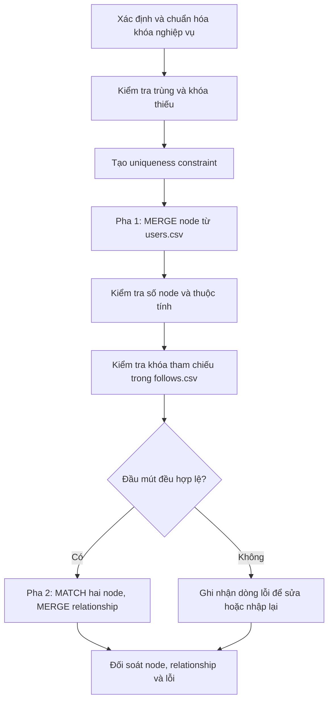

# Nhập nút trước quan hệ bằng khóa nghiệp vụ ổn định

Khi nhập dữ liệu vào Neo4j, thứ tự thao tác quyết định tính nhất quán của property graph. Một tệp chứa người dùng, khách hàng hoặc sản phẩm thường đi kèm tệp chứa **liên kết giữa các thực thể đó**. Nếu tạo quan hệ trước khi xác định đúng hai node đầu mút, hệ thống có thể sinh ra node thiếu thông tin, ghép nhầm thực thể hoặc làm mất những liên kết không tìm được đích.

Giải pháp nền tảng là **nhập node trước, nhập relationship sau, và dùng khóa nghiệp vụ ổn định để đối chiếu thực thể giữa các tệp**. Đây là nội dung của chương **Nhập dữ liệu** trong module **DATABASE_ENGINE_GRAPH_NEO4J**, nơi Neo4j được dùng để mô hình hóa node/relationship, truy vấn Cypher, áp dụng index/constraint, tối ưu hiệu năng và tích hợp Java Driver hoặc Spring Data Neo4j.

Sau bài này, bạn có thể:

- Thiết kế khóa nghiệp vụ dùng để nhận diện node qua nhiều lần nhập dữ liệu.
- Tạo uniqueness constraint, nhập node bằng `MERGE` và sau đó nối quan hệ bằng `MATCH` + `MERGE`.
- Phát hiện khóa rỗng, bản ghi trùng, tham chiếu mồ côi (*orphan reference*) và dữ liệu không đồng nhất.
- Phân biệt thao tác nhập lại an toàn với việc vô tình tạo bản sao hoặc ghi đè dữ liệu.
- Chia batch, kiểm tra kết quả và hiểu giới hạn giao dịch khi dùng `LOAD CSV`, Java Driver và Spring Data Neo4j.

## 1. Vì sao phải quyết định thứ tự nhập?

Giả sử hệ thống mạng xã hội có ba người dùng và các mối quan hệ theo dõi. Dữ liệu xuất từ hệ thống nguồn gồm hai tệp:

**`users.csv`**

```csv
userId,displayName
U-001,An
U-002,Bình
U-003,Chi
```

**`follows.csv`**

```csv
fromUserId,toUserId,since
U-001,U-002,2025-01-10
U-002,U-003,2025-01-15
U-001,U-003,2025-02-01
```

Đồ thị mong muốn:

```text
(:User {userId: "U-001", displayName: "An"})
     |                              \
     | :FOLLOWS                      \ :FOLLOWS
     v                                v
(:User {userId: "U-002"}) -----> (:User {userId: "U-003"})
                             :FOLLOWS
```

Ở đây `userId` là **khóa nghiệp vụ**: mã định danh của người dùng trong hệ thống nguồn. `fromUserId` và `toUserId` trong tệp quan hệ là **khóa tham chiếu** tới hai user đã được nhập.

Quy trình chuẩn:



**Không phải Neo4j cấm tạo node và quan hệ trong cùng một câu lệnh.** Bạn có thể tạo cả hai đồng thời bằng Cypher. Tuy nhiên, với dữ liệu nhập từ nhiều nguồn/tệp, tách hai pha giúp bảo đảm danh tính node, phát hiện quan hệ thiếu đầu mút và chạy lại một cách có kiểm soát.

## 2. Khóa nghiệp vụ ổn định là gì?

Khóa nghiệp vụ (*business key*) là giá trị xác định **cùng một thực thể trong nghiệp vụ**, không phụ thuộc vào số thứ tự dòng CSV hoặc cách Neo4j lưu dữ liệu nội bộ.

Một khóa tốt cần đáp ứng:

| Tiêu chí | Cách áp dụng |
| --- | --- |
| **Duy nhất trong phạm vi xác định** | Một `userId` đại diện cho một user trong một hệ thống nguồn |
| **Ổn định theo thời gian** | Không đổi khi user sửa tên, email hiển thị hay địa chỉ |
| **Có mặt khi nhập** | Bản ghi không có khóa được đưa vào luồng xử lý lỗi |
| **Có kiểu và định dạng nhất quán** | Cùng quy tắc viết hoa, khoảng trắng, tiền tố, mã hóa |
| **Được dùng lại trong tệp quan hệ** | `fromUserId`, `toUserId` trỏ đúng `User.userId` |
| **Tương thích với import lại** | Chạy lại tệp không tạo node mới với khóa tương đương |

Ví dụ `U-001` ổn định hơn `displayName = "An"` vì tên hiển thị có thể đổi và nhiều người có cùng tên.

### Không dùng ID nội bộ làm khóa liên hệ lâu dài

Neo4j có `id()` (ID nội bộ kiểu số trên một số phiên bản) và `elementId()` (định danh phần tử dạng chuỗi). Chúng tiện cho một số thao tác trong phạm vi database/transaction, nhưng **không phải khóa nghiệp vụ bền vững để lưu trong CSV hoặc trao đổi giữa hệ thống**. Không nên kỳ vọng chúng giữ nguyên qua xóa/tạo lại thực thể, tái nhập, di chuyển dữ liệu hoặc thay đổi vòng đời lưu trữ.

Sai lầm phổ biến:

```text
users.csv:    neo4jNodeId=123, name=An
follows.csv:  fromNodeId=123, toNodeId=456
```

Nếu các node được tạo lại và nhận định danh nội bộ khác, các số tham chiếu này không còn chỉ đúng thực thể cũ. Thay vào đó:

```text
users.csv:    userId=U-001, name=An
follows.csv:  fromUserId=U-001, toUserId=U-002
```

### Khóa tự nhiên và khóa do ứng dụng cấp

- **Khóa tự nhiên:** mã sản phẩm, số hồ sơ do hệ thống nguồn cấp, mã đơn hàng có chính sách duy nhất rõ ràng.
- **Khóa do ứng dụng cấp:** UUID hoặc mã ổn định được sinh một lần, lưu cùng thực thể và tái sử dụng trên các lần xuất/nhập.
- **Không nên chọn thuộc tính có thể thay đổi** như tên, số điện thoại, email cá nhân chỉ vì hiện tại nó có vẻ duy nhất.

Nếu khóa nguồn có thể đổi, cần cơ chế ánh xạ **mã cũ → mã mới** hoặc danh tính ổn định của ứng dụng. Không coi mỗi giá trị khóa mới là một thực thể mới khi nghiệp vụ thực ra chỉ thay đổi mã.

### Khóa cần phạm vi: đa tenant hoặc nhiều nguồn

Hai hệ thống có thể cùng có khách hàng mang mã `C-001`. Khi đó mã đơn lẻ không còn duy nhất toàn cục. Mô hình phù hợp có thể là:

```cypher
CREATE CONSTRAINT customer_source_key IF NOT EXISTS
FOR (c:Customer)
REQUIRE (c.sourceSystem, c.customerCode) IS UNIQUE;
```

Node được đối chiếu bằng **cặp** `(sourceSystem, customerCode)`:

```cypher
MERGE (c:Customer {
  sourceSystem: $sourceSystem,
  customerCode: $customerCode
});
```

Các tệp quan hệ cũng phải chứa đủ thành phần để xác định đầu mút. Không nên ghép một mã `C-001` từ nguồn A với một mã `C-001` của nguồn B.

## 3. Chuẩn bị dữ liệu trước khi gọi Neo4j

`LOAD CSV WITH HEADERS` đọc các cột theo tên header. Những giá trị đọc từ CSV về cơ bản được xử lý như **chuỗi**; nếu cần số, ngày hoặc boolean, phải chuyển kiểu có kiểm soát.

Trước khi nhập, xác nhận:

1. **Tên cột:** `userId` trong `users.csv` phải tương ứng với `fromUserId`/`toUserId` trong `follows.csv`.
2. **Khóa không thiếu:** không chấp nhận `null`, chuỗi rỗng hoặc chỉ có khoảng trắng làm mã định danh.
3. **Không trùng sau chuẩn hóa:** `"U-001"` và `" U-001 "` sẽ thành cùng khóa nếu quy tắc dùng `trim()`.
4. **Quy tắc chữ hoa/thường:** chỉ dùng `toUpper()` / `toLower()` nếu nguồn xác nhận mã không phân biệt hoa thường.
5. **Giữ số 0 đầu:** mã `"00057"` khác số nguyên `57`; không gọi `toInteger()` trên khóa định danh dạng văn bản.
6. **Mã hóa và định dạng CSV:** dùng UTF-8, escape dấu phẩy/dấu nháy đúng chuẩn CSV, thống nhất header và cách biểu diễn ô trống.
7. **Loại quan hệ và chiều:** `U-001 FOLLOWS U-002` không tương đương `U-002 FOLLOWS U-001`.
8. **Chính sách bản ghi trùng:** chọn báo lỗi, giữ bản mới nhất theo timestamp nguồn hay quy tắc hợp nhất rõ ràng.

Neo4j không thể tự suy ra `"u-001"` và `"U-001"` có phải cùng user hay không. Đó là quy tắc của hệ thống nguồn.

### Vì sao không âm thầm bỏ qua dòng sai?

Câu lệnh lọc `WHERE userId <> ''` có thể khiến bản ghi lỗi biến mất khỏi kết quả nhập mà không ai biết. Trong môi trường thực tế, nên có **báo cáo đối soát** gồm số dòng đầu vào, số dòng hợp lệ, số khóa thiếu, số trùng, số đầu mút không tìm thấy và số quan hệ đã tạo.

Các câu truy vấn dưới đây cố ý minh họa phép lọc cơ bản; **phải kết hợp bước kiểm tra và ghi nhận lỗi**, nhất là khi xử lý dữ liệu tài chính, định danh hay vận hành.

## 4. Pha 0: tạo uniqueness constraint cho khóa

Trước khi nhập dữ liệu, xác định label và khóa định danh.

```cypher
CREATE CONSTRAINT user_business_key IF NOT EXISTS
FOR (u:User)
REQUIRE u.userId IS UNIQUE;
```

Constraint này bảo đảm **không có hai node `:User` cùng giá trị `userId` khác null** trong phạm vi database. Neo4j tạo index phục vụ tra cứu khóa và thực thi constraint. Nếu dữ liệu hiện có đã trùng `userId`, việc tạo constraint có thể thất bại: cần sửa bản ghi trùng trước.

**Lưu ý:** uniqueness constraint thông thường không tự bảo đảm mọi `:User` đều có `userId`. Yêu cầu bắt buộc phải có khóa cần được kiểm soát khi nhập, hoặc dùng ràng buộc tồn tại/node key phù hợp với edition và phiên bản Neo4j.

Kiểm tra index/constraint trước khi chạy import trên môi trường có dữ liệu:

```cypher
SHOW CONSTRAINTS
YIELD name, type, labelsOrTypes, properties
RETURN name, type, labelsOrTypes, properties
ORDER BY name;
```

`IF NOT EXISTS` tránh lỗi tạo lại khi đã có schema object đáp ứng yêu cầu, nhưng **không tự sửa** một constraint cũ có cấu hình khác. Nên quản lý thay đổi schema bằng migration có kiểm soát.

## 5. Pha 1: nhập node trước bằng `MERGE`

Giả sử `users.csv` đặt trong thư mục import mà Neo4j server được phép đọc. Câu lệnh cơ bản:

```cypher
LOAD CSV WITH HEADERS FROM 'file:///users.csv' AS row
WITH row, trim(row.userId) AS userId
WHERE userId IS NOT NULL AND userId <> ''
MERGE (u:User {userId: userId})
SET u.displayName = trim(row.displayName);
```

Ý nghĩa:

- `LOAD CSV WITH HEADERS` đọc từng bản ghi với các khóa `row.userId` và `row.displayName`.
- `trim()` làm sạch khoảng trắng hai đầu nếu quy tắc mã của nguồn cho phép.
- `WHERE` ngăn tạo node với khóa rỗng; các dòng bị loại phải được đếm và báo cáo riêng.
- `MERGE (u:User {userId: userId})` tìm user theo **khóa nghiệp vụ**; nếu chưa có thì tạo node.
- `SET u.displayName = ...` cập nhật tên theo dữ liệu nhập hiện tại, cả trên node vừa tạo lẫn node đã tồn tại.

Khi chạy lại đúng tệp, `MERGE` giúp tái sử dụng các node `:User` hiện có cùng khóa, thay vì tạo thêm bản sao. Tuy nhiên, `MERGE` **không bảo đảm cả quy trình đều idempotent**: các phép cộng số, tạo relationship không định danh hoặc hiệu ứng bên ngoài vẫn có thể gây thay đổi lặp khi chạy lại.

### Tách dữ liệu định danh và dữ liệu có thể sửa

Không nên đưa tên hiển thị vào `MERGE`:

```cypher
// Tránh dùng tên hiển thị làm một phần mẫu nhận diện user.
MERGE (u:User {userId: row.userId, displayName: row.displayName});
```

Nếu một user thay tên, mẫu `MERGE` với cả mã và tên không còn khớp node cũ. Kết quả có thể tạo node trùng `userId`, hoặc vấp uniqueness constraint nếu đã đặt đúng. Đây là dấu hiệu rõ ràng rằng **khóa định danh đã bị trộn với thuộc tính có thể cập nhật**.

Nên dùng:

```cypher
MERGE (u:User {userId: row.userId})
SET u.displayName = row.displayName;
```

Nếu thuộc tính cần **chỉ ghi khi tạo mới**, dùng `ON CREATE SET`:

```cypher
MERGE (u:User {userId: row.userId})
ON CREATE SET u.importedAt = datetime()
SET u.displayName = row.displayName;
```

`importedAt` ghi lúc node được tạo lần đầu; việc chạy lại tệp không làm đổi timestamp này. Trái lại `displayName` sẽ được đồng bộ lại theo nội dung của tệp. Cần lựa chọn có chủ đích: dữ liệu từ nguồn có được quyền ghi đè thay đổi thủ công trên Neo4j không?

## 6. Kiểm tra node trước khi nhập quan hệ

Trong database thực hành chỉ chứa bộ dữ liệu mẫu, kết quả mong đợi là **3 node `:User`**.

```cypher
MATCH (u:User)
RETURN count(u) AS userCount;
```

Với database chứa sẵn nhiều user, số đếm này không đồng nghĩa số node do **lần nhập hiện tại** tạo ra. Có thể dùng `batchId` hoặc bảng đối soát phía ứng dụng để ghi nhận phạm vi nhập; tránh gắn metadata chỉ để lọc rồi quên dọn/duy trì.

Kiểm tra khóa rỗng:

```cypher
MATCH (u:User)
WHERE u.userId IS NULL OR trim(u.userId) = ''
RETURN u, labels(u) AS labels
LIMIT 20;
```

Kiểm tra bản ghi trùng trước khi có constraint, hoặc để rà soát dữ liệu từ nguồn cũ:

```cypher
MATCH (u:User)
WHERE u.userId IS NOT NULL
WITH u.userId AS key, count(*) AS n
WHERE n > 1
RETURN key, n
ORDER BY n DESC;
```

Nếu uniqueness constraint đã hoạt động, Neo4j sẽ ngăn tạo **hai node cùng khóa khác null**. Tuy nhiên, việc kiểm tra dữ liệu nhập trước khi đụng tới database vẫn cần thiết để phát hiện các **dòng CSV trùng khóa** có thể ghi đè thuộc tính theo thứ tự không mong muốn.

## 7. Pha 2: nhập relationship bằng `MATCH` hai đầu mút và `MERGE`

Khi node đã tồn tại, đọc `follows.csv` và dùng **khóa nghiệp vụ** để tìm hai đầu:

```cypher
LOAD CSV WITH HEADERS FROM 'file:///follows.csv' AS row
WITH row,
     trim(row.fromUserId) AS fromId,
     trim(row.toUserId) AS toId
WHERE fromId IS NOT NULL AND fromId <> ''
  AND toId IS NOT NULL AND toId <> ''
MATCH (src:User {userId: fromId})
MATCH (dst:User {userId: toId})
MERGE (src)-[r:FOLLOWS]->(dst)
ON CREATE SET r.since = date(row.since);
```

Phân tích:

1. `fromId` và `toId` được chuẩn hóa bằng cùng quy tắc đã dùng lúc nhập `User.userId`.
2. `MATCH (src:User {userId: fromId})` chỉ tìm **node đã có**; nó không tự tạo user mới.
3. `MATCH (dst:User {userId: toId})` cũng phải tìm được node đầu mút thứ hai.
4. `MERGE (src)-[r:FOLLOWS]->(dst)` tạo quan hệ có hướng nếu chưa có quan hệ khớp mẫu giữa hai node.
5. `ON CREATE SET` đặt ngày bắt đầu theo dõi khi relationship vừa được tạo. Nếu chạy lại, dữ liệu ngày hiện có không bị ghi đè.

Dữ liệu ví dụ cho ra ba quan hệ:

```text
U-001 -> U-002 (since=2025-01-10)
U-002 -> U-003 (since=2025-01-15)
U-001 -> U-003 (since=2025-02-01)
```

Cần quyết định **định nghĩa duy nhất của quan hệ**. Ở đây mô hình ngầm hiểu “một người chỉ có tối đa một quan hệ `:FOLLOWS` tới cùng một người khác”. Nếu nghiệp vụ lưu *nhiều sự kiện follow/unfollow* giữa cùng hai người, một relationship `:FOLLOWS` không đại diện được đầy đủ lịch sử. Khi đó nên có khóa sự kiện ổn định và mô hình như `:FollowEvent` hoặc một loại relationship sự kiện có chiến lược định danh riêng.

**Về đồng thời:** `MERGE` giúp tái nhập theo mẫu, nhưng không nên coi nó là cơ chế ràng buộc duy nhất bảo đảm không có relationship trùng trong mọi tình huống nhiều writer đồng thời. Nếu hệ thống có import song song, cần thiết kế khóa/ràng buộc cho sự kiện hoặc cơ chế điều phối tương ứng và đối soát sau import.

### Cảnh báo: không dùng `MERGE` để âm thầm sinh node mồ côi

Truy vấn dưới đây có vẻ tiện nhưng dễ che giấu lỗi dữ liệu nguồn:

```cypher
// Mẫu rủi ro khi chưa kiểm tra hai đầu mút:
LOAD CSV WITH HEADERS FROM 'file:///follows.csv' AS row
MERGE (src:User {userId: row.fromUserId})
MERGE (dst:User {userId: row.toUserId})
MERGE (src)-[:FOLLOWS]->(dst);
```

Nếu `toUserId = 'U-999'` không có trong `users.csv`, truy vấn sẽ tự tạo `(:User {userId:'U-999'})` thiếu tên, trạng thái và các thuộc tính cần thiết. Sau import, graph trông có liên kết nhưng không phản ánh đủ dữ liệu người dùng.

Nếu mục tiêu là **chỉ nhập quan hệ giữa node đã xác thực**, hãy dùng `MATCH` hai đầu mút và ghi nhận tham chiếu không tìm thấy. Chỉ tạo node “placeholder” nếu đặc tả nghiệp vụ **quy định rõ** loại placeholder, trạng thái và quy trình bổ sung dữ liệu về sau.

## 8. Phát hiện quan hệ tham chiếu tới khóa chưa tồn tại

Với `MATCH` hai đầu mút, một dòng trong `follows.csv` không tìm thấy node sẽ không sinh relationship. Tính chất này an toàn hơn tạo node ngầm, nhưng việc **bỏ qua lặng lẽ** cũng nguy hiểm.

Trước khi nhập quan hệ, có thể chạy truy vấn đối soát:

```cypher
LOAD CSV WITH HEADERS FROM 'file:///follows.csv' AS row
WITH row,
     trim(row.fromUserId) AS fromId,
     trim(row.toUserId) AS toId
OPTIONAL MATCH (src:User {userId: fromId})
OPTIONAL MATCH (dst:User {userId: toId})
WITH row, fromId, toId, src, dst
WHERE fromId IS NULL OR fromId = ''
   OR toId IS NULL OR toId = ''
   OR src IS NULL OR dst IS NULL
RETURN row.fromUserId AS sourceKey,
       row.toUserId AS targetKey,
       CASE
         WHEN fromId IS NULL OR fromId = '' THEN 'THIEU_SOURCE_KEY'
         WHEN src IS NULL THEN 'SOURCE_NOT_FOUND'
         ELSE 'SOURCE_OK'
       END AS sourceStatus,
       CASE
         WHEN toId IS NULL OR toId = '' THEN 'THIEU_TARGET_KEY'
         WHEN dst IS NULL THEN 'TARGET_NOT_FOUND'
         ELSE 'TARGET_OK'
       END AS targetStatus
LIMIT 100;
```

Nếu thêm một dòng `U-001,U-999,2025-03-01`, truy vấn này cho biết `TARGET_NOT_FOUND`, giúp phát hiện lỗi nhập thiếu node hoặc sai khóa ở tệp nguồn.

Tùy yêu cầu nghiệp vụ, chọn một chính sách rõ ràng:

| Tình huống | Quyết định hợp lý |
| --- | --- |
| Khóa đầu mút rỗng | Từ chối dòng, yêu cầu sửa |
| Khóa có mặt nhưng không tìm được node | Ghi lỗi và chờ nguồn gửi node; hoặc yêu cầu import lại pha 1 |
| Hai khóa thuộc hai tenant khác nhau | Không ghép nếu nghiệp vụ không cho phép quan hệ xuyên tenant |
| Quan hệ lặp cùng cặp đầu mút | Xác định idempotency và có cần nhiều sự kiện hay không |
| Quan hệ trỏ về cùng một node | Chấp nhận hoặc từ chối self-loop theo quy tắc |
| Ngày `since` sai định dạng | Báo lỗi hoặc đưa vào luồng làm sạch trước khi gọi `date()` |

Một hệ thống nhập dữ liệu tốt cần **đếm và giữ lại các dòng lỗi** bên ngoài graph hoặc trong vùng staging có quản lý. Không biến giá trị sai thành node thật chỉ để làm cho một câu Cypher chạy hết.

## 9. Kiểm chứng quan hệ sau khi nhập

Kiểm tra dữ liệu mẫu:

```cypher
MATCH (src:User)-[r:FOLLOWS]->(dst:User)
RETURN src.userId AS fromUserId,
       dst.userId AS toUserId,
       r.since AS since
ORDER BY fromUserId, toUserId;
```

Kiểm tra tổng số quan hệ:

```cypher
MATCH (:User)-[r:FOLLOWS]->(:User)
RETURN count(r) AS followCount;
```

Với database thực hành chỉ có bộ ví dụ, kỳ vọng là 3 quan hệ. Nếu database có dữ liệu sẵn, cần giới hạn theo nguồn/batch hoặc đối chiếu danh sách khóa quan hệ thuộc lần nhập.

Để tìm cặp đầu mút đang có nhiều relationship `:FOLLOWS`:

```cypher
MATCH (src:User)-[r:FOLLOWS]->(dst:User)
WITH src, dst, count(r) AS n
WHERE n > 1
RETURN src.userId AS fromUserId,
       dst.userId AS toUserId,
       n
ORDER BY n DESC;
```

Cần đối chiếu kết quả này với quy tắc mô hình. Nếu `FOLLOWS` chỉ biểu thị trạng thái hiện tại, nhiều quan hệ cùng chiều giữa một cặp thường là dữ liệu cần sửa. Nếu loại relationship đại diện cho nhiều sự kiện, việc trùng cặp có thể hợp lệ và phải phân biệt bằng khóa sự kiện.

### Không đo thành công chỉ bằng số dòng trả về

Một lần `MERGE` có thể **khớp node cũ**, **tạo node mới** hoặc **cập nhật thuộc tính**. Số hàng CSV hợp lệ không mặc nhiên bằng số node mới tạo. Tương tự, dòng quan hệ không có đầu mút bị `MATCH` loại đi, và một quan hệ đã tồn tại có thể được tái sử dụng khi chạy lại.

Báo cáo import nên có các nhóm số liệu riêng: số dòng đầu vào, số dòng hợp lệ, số khóa sai/trùng, số node hiện có hoặc tạo mới, số quan hệ khớp/được tạo và số tham chiếu không giải quyết được.

## 10. Nhập lớn theo batch và giới hạn giao dịch

Một transaction nhập vài triệu node hoặc relationship có thể tiêu tốn nhiều bộ nhớ và giữ lock lâu. Neo4j hỗ trợ chia công việc Cypher thành các transaction nhỏ bằng `CALL { ... } IN TRANSACTIONS`.

Ví dụ cú pháp **Neo4j 5.23 trở lên** dùng biến nhập trong `CALL (row)`:

```cypher
LOAD CSV WITH HEADERS FROM 'file:///users.csv' AS row
CALL (row) {
  WITH row, trim(row.userId) AS userId
  WHERE userId IS NOT NULL AND userId <> ''
  MERGE (u:User {userId: userId})
  SET u.displayName = trim(row.displayName)
} IN TRANSACTIONS OF 1000 ROWS;
```

Sau khi **pha 1 hoàn thành và đối soát**, nhập quan hệ theo batch:

```cypher
LOAD CSV WITH HEADERS FROM 'file:///follows.csv' AS row
CALL (row) {
  WITH row,
       trim(row.fromUserId) AS fromId,
       trim(row.toUserId) AS toId
  WHERE fromId IS NOT NULL AND fromId <> ''
    AND toId IS NOT NULL AND toId <> ''
  MATCH (src:User {userId: fromId})
  MATCH (dst:User {userId: toId})
  MERGE (src)-[r:FOLLOWS]->(dst)
  ON CREATE SET r.since = date(row.since)
} IN TRANSACTIONS OF 1000 ROWS;
```

Điểm vận hành cần hiểu:

1. `CALL { ... } IN TRANSACTIONS` phải chạy dưới **implicit transaction** của Cypher/driver; không lồng trực tiếp vào explicit/managed transaction đã mở.
2. Mỗi batch **commit độc lập**. Nếu batch sau lỗi, các batch trước đã commit không tự rollback.
3. Kích thước `1000 ROWS` chỉ là ví dụ. Cần thử theo số thuộc tính, kích cỡ relationship, mức cạnh tranh lock và tài nguyên máy.
4. Những dòng bị lọc ở trong subquery vẫn cần ghi nhận riêng; không coi “lệnh đã chạy” là “mọi dòng đã nhập”.
5. Khi chạy lại sau lỗi, uniqueness constraint và `MERGE` giúp đối chiếu thực thể cũ; nhưng chỉ an toàn đầy đủ khi logic cập nhật và dữ liệu trùng có chính sách rõ ràng.
6. Với phiên bản Neo4j trước khi hỗ trợ cú pháp `CALL (row)`, dùng biến thể `CALL { WITH row ... } IN TRANSACTIONS` tương ứng với phiên bản đó.

Không nên bắt đầu import rất lớn bằng nhiều worker song song khi chưa kiểm tra cách chia khóa, khả năng tranh chấp và ràng buộc duy nhất. Tăng concurrency có thể làm tăng deadlock và chi phí thay vì tăng throughput.

## 11. Nếu dùng Java Driver thay cho `LOAD CSV`

Không phải môi trường nào cũng cho phép dùng `file:///...`. Đường dẫn này chỉ tới tập tin mà **Neo4j server** đọc được theo cấu hình import và quyền truy cập, chứ không phải đường dẫn trên máy khách đang chạy ứng dụng Java. Trong môi trường dịch vụ managed/cloud, cần dùng nguồn URL được hỗ trợ hoặc đẩy dữ liệu qua Driver.

Với Java Driver, ứng dụng có thể parse CSV, kiểm tra dữ liệu và gửi **các batch tham số** sang Neo4j theo hai pha.

Câu Cypher để nhập **node** từ batch `$rows`:

```cypher
UNWIND $rows AS row
WITH row, trim(row.userId) AS userId
WHERE userId IS NOT NULL AND userId <> ''
MERGE (u:User {userId: userId})
SET u.displayName = row.displayName;
```

Câu Cypher để nhập **relationship** từ batch `$rows`:

```cypher
UNWIND $rows AS row
WITH row,
     trim(row.fromUserId) AS fromId,
     trim(row.toUserId) AS toId
WHERE fromId IS NOT NULL AND fromId <> ''
  AND toId IS NOT NULL AND toId <> ''
MATCH (src:User {userId: fromId})
MATCH (dst:User {userId: toId})
MERGE (src)-[r:FOLLOWS]->(dst)
ON CREATE SET r.since = date(row.since);
```

Ví dụ phương thức Java gửi một batch (giả định `driver` đã được quản lý theo vòng đời ứng dụng):

```java
import java.util.List;
import java.util.Map;
import org.neo4j.driver.Driver;
import org.neo4j.driver.Session;

public final class UserBatchImporter {
    private final Driver driver;

    public UserBatchImporter(Driver driver) {
        this.driver = driver;
    }

    public void importUsers(List<Map<String, Object>> rows) {
        String cypher = """
            UNWIND $rows AS row
            WITH row, trim(row.userId) AS userId
            WHERE userId IS NOT NULL AND userId <> ''
            MERGE (u:User {userId: userId})
            SET u.displayName = row.displayName
            """;

        try (Session session = driver.session()) {
            session.executeWrite(tx -> {
                tx.run(cypher, Map.of("rows", rows)).consume();
                return null;
            });
        }
    }
}
```

Đây là **một batch**, không phải chương trình CSV reader hoàn chỉnh. Ứng dụng phải tách dữ liệu thành danh sách có kích thước phù hợp, đảm bảo kiểu các trường được gửi, phân biệt trường thiếu với chuỗi rỗng, đối soát lỗi, và **chạy hết batch node trước khi chạy batch relationship**.

Java Driver có thể retry managed transaction khi gặp lỗi transient. Vì vậy callback `executeWrite` nên thực thi những thay đổi DB có ngữ nghĩa chạy lại rõ ràng; không gửi email hay gọi dịch vụ ngoài ngay trong callback. Nếu phải nhập các batch lớn và hỗ trợ khôi phục sau lỗi, hãy lưu checkpoint, mã batch hoặc bảng trạng thái import ở tầng ứng dụng.

### Tích hợp Spring Data Neo4j

Trong Spring Data Neo4j, entity `User` thường có thuộc tính định danh nghiệp vụ như `userId`; repository có thể tìm user theo mã đó. Với **batch import lớn**, một câu Cypher `UNWIND $rows` qua repository query tùy biến, `Neo4jClient` hoặc Java Driver thường dễ kiểm soát kích thước batch và số lệnh hơn việc lưu từng entity riêng lẻ.

Cần tránh hai sai lầm:

- Gọi `save()` cho hàng chục nghìn node rồi truy vấn từng relationship theo mã từng dòng, tạo lượng round trip rất lớn.
- Giữ một phương thức `@Transactional` bao toàn bộ nhiều triệu bản ghi, làm transaction quá lớn. Nếu dùng batch transaction, mỗi batch cần ranh giới transaction rõ ràng.

## 12. Các biến thể khó hơn trong dữ liệu thực tế

### 12.1. Relationship nối hai loại node khác nhau

Ví dụ đơn hàng thuộc về khách hàng:

```text
customers.csv  -> (:Customer {customerId})
orders.csv     -> (:Order {orderId, customerId})
relationship   -> (:Customer)-[:PLACED]->(:Order)
```

Nhập hai label trước, rồi tạo quan hệ:

```cypher
LOAD CSV WITH HEADERS FROM 'file:///orders.csv' AS row
WITH row
MATCH (c:Customer {customerId: trim(row.customerId)})
MATCH (o:Order {orderId: trim(row.orderId)})
MERGE (c)-[:PLACED]->(o);
```

Ở đây tệp `orders.csv` phải được dùng **ở pha tạo Order trước đó**. Câu lệnh trên chỉ minh họa pha tạo liên kết sau khi cả `Customer` lẫn `Order` đã tồn tại.

### 12.2. Một node có nhiều label

Một node có thể vừa là `:Person` vừa là `:Customer`, nhưng mọi quan hệ liên quan cần được tìm theo bộ label và khóa nhất quán. Không tạo một `:Person` và một `:Customer` riêng chỉ vì hai tệp nguồn gọi cùng thực thể bằng hai cách khác nhau, trừ khi mô hình nghiệp vụ thực sự yêu cầu hai node tách biệt.

### 12.3. Thuộc tính ngày, số và boolean

CSV chứa chuỗi `"2025-01-10"`, `"12"` hoặc `"true"`. Trong Cypher có thể dùng `date()`, `toIntegerOrNull()`, `toBooleanOrNull()`, nhưng phải phân biệt **dữ liệu thiếu** và **giá trị sai kiểu** trước khi quyết định ghi giá trị mặc định.

Ví dụ ngày `since` phải có định dạng được chấp nhận trước khi gọi `date(row.since)`. Nếu ngày không hợp lệ, câu lệnh có thể thất bại và ảnh hưởng transaction hiện tại. Nên validate đầu vào trong bước staging hoặc ứng dụng.

Đừng biến khóa như `"00123"` thành số `123` khi mã định danh cho phép số 0 đầu.

### 12.4. Quan hệ có nhiều sự kiện hoặc phiên bản

Nếu mỗi cặp user có nhiều lần theo dõi/bỏ theo dõi, mô hình một `:FOLLOWS` duy nhất chỉ biểu thị trạng thái hiện tại. Để lưu lịch sử, có thể thêm node `:FollowEvent {eventId}` với `eventId` duy nhất, sau đó liên kết user với sự kiện. Khi nhập, `eventId` lại đóng vai trò khóa nghiệp vụ ổn định cho **sự kiện**, và quan hệ tới `User` được tạo sau khi cả hai loại node đã tồn tại.

### 12.5. Liên kết xuyên tenant

Trong hệ nhiều khách hàng tổ chức, `customerCode = 'C-001'` không đủ để tìm một node nếu nhiều tenant cùng dùng mã đó. Cả pha node và relationship cần dùng **đủ bộ khóa**:

```cypher
MATCH (c:Customer {
  tenantId: row.tenantId,
  customerCode: row.customerCode
})
```

Không được bỏ `tenantId` khỏi truy vấn nối quan hệ, vì khi đó một dòng có thể khớp nhiều khách hàng khác tenant và dẫn tới quan hệ sai.

## 13. Lỗi phổ biến và cách phòng tránh

| Sai lầm | Hậu quả | Cách khắc phục |
| --- | --- | --- |
| Dùng tên hoặc email có thể đổi làm khóa `MERGE` | Một người thành nhiều node | Chọn khóa bất biến hoặc mã do ứng dụng cấp |
| Dùng `id()` / `elementId()` làm mã xuất/nhập lâu dài | Tham chiếu sai sau khi tái tạo hoặc di chuyển dữ liệu | Lưu khóa nghiệp vụ trong thuộc tính |
| Chưa tạo constraint nhưng nhập nhiều worker | Có thể xuất hiện node trùng cùng khóa | Tạo uniqueness constraint trước khi import |
| `MERGE` cả mã và tên hiển thị | Đổi tên gây tạo trùng hoặc lỗi constraint | `MERGE` theo khóa, `SET` thuộc tính có thể đổi |
| Nhập relationship bằng `MERGE` cả hai node đầu mút | Tạo node “mồ côi thông tin” khi khóa tham chiếu sai | Nhập node trước; dùng `MATCH` khi tạo relationship |
| Bỏ qua dòng thiếu đầu mút mà không báo cáo | Dữ liệu liên kết thiếu âm thầm | Đối soát orphan reference, lưu dòng lỗi |
| Chuyển mã `"00042"` thành số | Mất số 0 đầu, ghép nhầm mã | Giữ kiểu chuỗi cho mã định danh |
| Không xác định chiều relationship | `A → B` bị hiểu nhầm thành `B → A` | Quy định và kiểm tra chiều quan hệ |
| Nhập lại bằng `CREATE` không có điều kiện | Tạo thêm node/relationship trùng | Dùng khóa, constraint và `MERGE` đúng phạm vi |
| Cho rằng mọi lần chạy `MERGE` đều hoàn toàn idempotent | Các cập nhật khác vẫn có thể lặp hoặc ghi đè | Rà soát toàn bộ biểu thức `SET` và hiệu ứng bên ngoài |
| Nhập cả triệu dòng trong một transaction | Vượt bộ nhớ, timeout, giữ khóa lâu | Chia batch, đánh giá kích thước, theo dõi tài nguyên |
| Giả định tất cả batch rollback khi có lỗi | Báo cáo sai tình trạng dữ liệu | Ghi checkpoint và đối soát từng batch đã commit |
| Tin rằng `count(*)` node mới bằng số dòng CSV | Bỏ qua bản ghi trùng, cập nhật node cũ | Phân biệt số dòng nguồn, số khóa duy nhất và số node tạo mới |

## 14. Quy trình triển khai có thể kiểm tra lại

Một quy trình thực tế nên có các pha và điểm kiểm tra rõ ràng:

| Pha | Thao tác | Điều kiện đi tiếp |
| --- | --- | --- |
| **Khảo sát** | Xác định label, relationship type, khóa và phạm vi duy nhất | Có mô hình và sơ đồ trường đầu vào |
| **Làm sạch** | Validate khóa, chuẩn hóa kiểu, phân loại dòng lỗi | Báo cáo số dòng hợp lệ/trùng/thiếu |
| **Schema** | Tạo index/constraint thích hợp | Schema đã sẵn sàng, không có dữ liệu vi phạm |
| **Node import** | `MERGE` node bằng khóa nghiệp vụ | Đối soát số node, khóa và thuộc tính |
| **Reference check** | Kiểm tra mọi khóa đầu mút từ tệp quan hệ | Không còn tham chiếu chưa giải quyết hoặc có danh sách lỗi chấp nhận được |
| **Relationship import** | `MATCH` hai đầu mút, `MERGE` quan hệ đúng chiều | Đối soát số quan hệ và tính duy nhất |
| **Khôi phục** | Chạy lại batch lỗi, không phá dữ liệu đã commit | Có checkpoint, quy tắc idempotency |
| **Vận hành** | Ghi log, thống kê lỗi, latency, transaction memory | Có báo cáo nhập và cảnh báo bất thường |

### Khi nào nên xử lý bằng cách khác?

- **Graph mới, dữ liệu rất lớn, cần bulk load ngoại tuyến:** cân nhắc công cụ nhập khối lượng lớn phù hợp phiên bản Neo4j (như `neo4j-admin database import`), vốn có định dạng ánh xạ ID của dữ liệu nguồn và relationship riêng.
- **Dữ liệu đến liên tục:** dùng các batch qua Java Driver hoặc pipeline đồng bộ, nhưng vẫn phải kiểm soát khóa, thứ tự tạo node và xử lý sự kiện đến trước node.
- **Quan hệ tạm thời tới thực thể chưa có:** chỉ dùng placeholder nếu nghiệp vụ xác định rõ loại placeholder và chính sách hoàn thiện.
- **Muốn giữ lịch sử chỉnh sửa:** đừng chỉ `SET` ghi đè toàn bộ; thiết kế version/event node và khóa sự kiện phù hợp.

Dù dùng công cụ nhập nào, **khóa nghiệp vụ ổn định vẫn là cơ chế nối bản ghi nguồn với thực thể graph**.

## 15. Bài tập tự kiểm tra

**Bài 1 — Nhận diện khóa.** Vì sao `displayName` không nên nằm trong mẫu `MERGE` của `User`? Nếu user đổi tên từ “An” thành “An Nguyễn”, điều gì xảy ra khi chạy lại nhập liệu?

**Bài 2 — Xử lý thiếu đầu mút.** Trong `follows.csv` có dòng `U-001,U-999,2025-03-01` nhưng `users.csv` không có `U-999`. Viết Cypher kiểm tra đầu mút bị thiếu và giải thích khác biệt giữa `MATCH` với `MERGE` khi tạo node.

**Bài 3 — Định danh nhiều tenant.** Hai tenant đều có khách hàng mã `C-001`. Đề xuất constraint và câu `MATCH` tạo quan hệ `:PLACED` mà không ghép nhầm giữa các tenant.

**Bài 4 — Chạy lại an toàn.** Một lần nhập dừng sau khi đã hoàn thành 6/10 batch node. Vì sao không được giả định cả 10 batch đều rollback? Thiết kế cách chạy lại để không tạo node trùng.

**Bài 5 — Sự kiện lặp.** Một người follow, unfollow rồi follow lại một người khác. Mô hình một `:FOLLOWS` có đủ để lưu cả ba sự kiện không? Nếu không, hãy đề xuất thực thể có `eventId` ổn định.

**Bài 6 — Java Driver.** Viết thứ tự gọi hai batch `UNWIND $rows` để nhập user và follow, nêu cách truyền tham số, phân biệt khóa rỗng với khóa hợp lệ và xử lý callback có thể retry.

## 16. Tài liệu tham khảo

Đối chiếu cú pháp với phiên bản Neo4j được triển khai:

- [Neo4j Cypher Manual — LOAD CSV](https://neo4j.com/docs/cypher-manual/current/clauses/load-csv/): cú pháp, xử lý dữ liệu CSV và nhập bằng Cypher.
- [Neo4j Cypher Manual — MERGE](https://neo4j.com/docs/cypher-manual/current/clauses/merge/): tạo hoặc khớp node/relationship theo mẫu, `ON CREATE SET`, `ON MATCH SET`.
- [Neo4j Cypher Manual — Constraints](https://neo4j.com/docs/cypher-manual/current/constraints/): uniqueness constraint và các ràng buộc schema.
- [Neo4j Cypher Manual — CALL subqueries in transactions](https://neo4j.com/docs/cypher-manual/current/subqueries/subqueries-in-transactions/): nhập theo batch và ngữ nghĩa commit độc lập.
- [Neo4j Java Driver Manual](https://neo4j.com/docs/java-manual/current/): tham số, transaction và quản lý session.
- [Neo4j Operations Manual — Import](https://neo4j.com/docs/operations-manual/current/import/): các phương thức nhập dữ liệu và công cụ vận hành.

**Ghi nhớ:** nhập node trước giúp có **một danh tính rõ ràng cho mỗi thực thể**, còn nhập relationship sau bằng `MATCH` hai khóa bảo đảm liên kết trỏ tới những node được xác nhận. Khóa nghiệp vụ ổn định, uniqueness constraint, chuẩn hóa nhất quán, báo cáo tham chiếu lỗi và chiến lược batch là nền tảng để dữ liệu đồ thị Neo4j có thể nhập lại, kiểm chứng và vận hành lâu dài.
