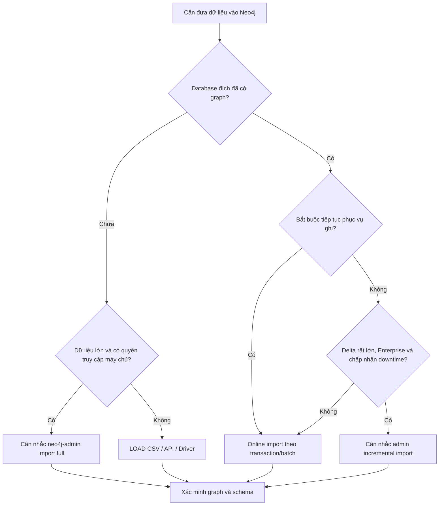

# Phân biệt nhập ban đầu, nhập tăng dần và cập nhật trên cơ sở dữ liệu đang chạy trong Neo4j

## 1. Ba nhu cầu giống nhau về dữ liệu nhưng khác cách vận hành

Ứng dụng sử dụng **Neo4j** để biểu diễn dữ liệu liên kết dưới dạng *property graph*: mỗi `AppUser`, `Project` là một node, quan hệ `MEMBER_OF` nối thành viên với dự án, còn `userId`, `projectId`, `name` và `role` là property. Dù cùng xuất phát từ các tệp CSV hoặc một hệ thống nguồn, việc đưa dữ liệu vào Neo4j có thể thuộc **ba tình huống khác nhau**:

1. **Nhập ban đầu (initial/full import):** xây dựng graph lần đầu từ dữ liệu nguồn, thường ở một database chưa tồn tại hoặc chưa có dữ liệu.
2. **Nhập tăng dần (incremental import):** bổ sung từng đợt dữ liệu lớn vào database đã có graph; riêng lệnh `neo4j-admin database import incremental` có ranh giới vận hành và giới hạn phiên bản/edition.
3. **Cập nhật trên database đang chạy (online/transactional update):** ứng dụng tiếp tục đọc/ghi trong khi dữ liệu mới được nhập, bằng Cypher, Java Driver, Spring Data Neo4j hoặc pipeline đồng bộ sự kiện.

**Phân biệt quan trọng:** “tăng dần” mô tả **phần dữ liệu được đưa vào** so với dữ liệu đã có, còn “trực tuyến” mô tả **khả năng database tiếp tục phục vụ truy vấn trong lúc cập nhật**. Một đợt dữ liệu tăng dần có thể được nhập **offline** bằng công cụ quản trị hoặc **online** bằng transaction. Hai khái niệm không đồng nghĩa.

### Ma trận lựa chọn nhanh

| Phương án | Đích dữ liệu | Database có thể phục vụ ghi liên tục? | Công cụ tiêu biểu | Phạm vi bảo đảm |
| --- | --- | --- | --- | --- |
| Nhập ban đầu tốc độ cao | Database mới/chưa có dữ liệu, tải hàng triệu node và relationship | Database đích chưa phục vụ ứng dụng; công cụ ghi store trực tiếp | `neo4j-admin database import full` | Công đoạn tạo store và kích hoạt database; không phải transaction Cypher thông thường |
| Nhập tăng dần khối lượng lớn | Database **đã tồn tại**, bổ sung dữ liệu theo đợt; một số bản còn hỗ trợ sửa/xóa qua định dạng thích hợp | **Không hoàn toàn**: cần giai đoạn dừng database, có thể cho đọc ở giai đoạn build | `neo4j-admin database import incremental` (Enterprise) | Các stage `prepare/build/merge`; có cửa sổ offline và yêu cầu sao lưu |
| Nhập/cập nhật trực tuyến | Database đang phục vụ người dùng | Có, nhưng tiêu tốn tài nguyên và chịu cạnh tranh transaction | `LOAD CSV`, `UNWIND`, Java Driver, Spring Data Neo4j, connector | Tính nguyên tử theo từng transaction/batch; nhiều batch có thể commit độc lập |

Chọn phương án dựa trên **trạng thái database**, **khối lượng**, **SLA dừng hệ thống**, **edition/phiên bản** và **mức phức tạp của thay đổi**, không chỉ dựa vào việc nguồn dữ liệu là CSV.

## 2. Thiết kế định danh trước khi nhập

Dù chọn phương án nào, điều kiện quan trọng nhất để nối đúng node và tránh tạo trùng là một **khóa nghiệp vụ ổn định**.

Ví dụ schema logic:

```text
(:AppUser {userId: "u-101", name: "Lan"})
        |
        +--[:MEMBER_OF {role: "DEV"}]-->
                                      (:Project {
                                          projectId: "p-01",
                                          title: "Graph API"
                                      })
```

Ở đây:

- `userId` nhận diện user; `projectId` nhận diện project, kể cả khi load lại dữ liệu.
- Relationship có **hướng** từ `AppUser` tới `Project`, type là `MEMBER_OF`.
- Không dùng `id(n)` hoặc `elementId(n)` làm khóa dài hạn để đối chiếu dữ liệu giữa các lần import, môi trường hoặc database.
- Phải xác định ý nghĩa “trùng” của relationship. Nếu một user chỉ có một quan hệ `MEMBER_OF` tới một project, dùng cặp khóa đầu-cuối và type; nếu được phép nhiều lần tham gia, cần một ID hoặc thuộc tính định danh sự kiện riêng.

Đối với cập nhật transactional, tạo uniqueness constraint trước khi load:

```cypher
CREATE CONSTRAINT app_user_user_id_unique IF NOT EXISTS
FOR (u:AppUser)
REQUIRE u.userId IS UNIQUE;

CREATE CONSTRAINT project_project_id_unique IF NOT EXISTS
FOR (p:Project)
REQUIRE p.projectId IS UNIQUE;
```

Các constraint này giúp `MERGE` theo khóa nghiệp vụ hiệu quả và bảo vệ định danh dưới các transaction cạnh tranh. Với **incremental admin import**, Neo4j yêu cầu uniqueness constraint khớp label/property được dùng để xác định node; thiếu constraint cần thiết có thể khiến quá trình nhập bị từ chối. Với **full admin import** vào database mới, có thể thiết lập schema sau khi tạo/khởi động database, hoặc dùng cách nhập schema được phiên bản hỗ trợ.

Nên kiểm tra và làm sạch dữ liệu nguồn trước khi nhập:

| Hạng mục | Ví dụ lỗi | Cách xử lý |
| --- | --- | --- |
| Khóa nghiệp vụ | Hai dòng cùng `userId = u-101` | Định nghĩa trùng là lỗi, cập nhật hay hợp nhất; loại trùng theo quy tắc |
| Đầu-cuối quan hệ | Membership trỏ tới `projectId` không tồn tại | Quyết định từ chối, tạo đối tượng đích, hoặc đưa vào hàng chờ |
| Kiểu dữ liệu | `joinedAt` là chuỗi, `amount` không phải số | Chuẩn hóa format và chuyển kiểu rõ ràng |
| Giá trị rỗng | `userId` hoặc `projectId` rỗng | Loại bỏ/sửa trước `MERGE`, tránh khóa null |
| Thứ tự thay đổi | Update cũ đến sau update mới | Có version hoặc timestamp nguồn để tránh ghi đè ngược |
| Retry | Batch được gửi hai lần | Chọn khóa idempotent, checkpoint và đối soát kết quả |

## 3. Nhập ban đầu: `neo4j-admin database import full`

### 3.1. Bản chất và điều kiện sử dụng

Lệnh `neo4j-admin database import full` là công cụ **bulk import tốc độ cao** ghi dữ liệu vào định dạng store của Neo4j thay vì thực hiện từng câu `CREATE` qua transaction Bolt. Nó phù hợp khi cần dựng graph lớn từ nguồn CSV/Parquet có chất lượng dữ liệu tốt.

Các điểm vận hành:

- Database **đích** phải chưa tồn tại hoặc ở trạng thái phù hợp cho full import; không dùng lệnh này để “thêm vài dòng” vào một graph đang phục vụ.
- Có thể DBMS tiếp tục chạy để phục vụ database **khác**, nhưng database đích cần tuân thủ điều kiện offline/không tồn tại theo quy trình import.
- Lệnh import full tạo **các tệp dữ liệu cho database**; khi nhập vào tên database chưa tồn tại, cần chạy `CREATE DATABASE` sau đó để đăng ký/kích hoạt database (theo edition hỗ trợ nhiều database).
- Tùy chọn `--overwrite-destination` có thể thay thế **toàn bộ** dữ liệu đích đang tồn tại. Đây không phải cách upsert; tuyệt đối không dùng như lựa chọn mặc định khi chỉ muốn thêm dữ liệu.
- Cú pháp và tùy chọn phụ thuộc phiên bản Neo4j; công cụ chạy ở máy chủ có quyền truy cập store và cần tương thích với DBMS đích.

### 3.2. Tạo bộ CSV đầu vào có ID liên kết

Giả sử ba tệp có sẵn trên máy chủ Neo4j:

**`import/users.csv`**

```csv
userId:ID(AppUser),name
u-101,Lan
u-102,Minh
```

**`import/projects.csv`**

```csv
projectId:ID(Project),title
p-01,Graph API
p-02,Data Platform
```

**`import/memberships.csv`**

```csv
:START_ID(AppUser),:END_ID(Project),role
u-101,p-01,DEV
u-102,p-02,LEAD
```

Trong cú pháp CSV của admin importer:

- `:ID(AppUser)` và `:ID(Project)` khai báo ID space để nối đúng node. `userId:ID(AppUser)` còn giữ giá trị `userId` thành property; tương tự `projectId`.
- `:START_ID(AppUser)` và `:END_ID(Project)` chỉ đầu và cuối relationship, **không phải property**.
- Label node và type relationship có thể được truyền qua tham số dòng lệnh như `--nodes=AppUser=...` và `--relationships=MEMBER_OF=...`.
- Định dạng này **khác** CSV nhập qua `LOAD CSV`: header như `:ID` là quy ước của admin importer, không tự biến thành biến Cypher thông thường.

### 3.3. Quy trình full import minh họa

Trên **môi trường thử nghiệm được phép tạo database**, sau khi xác nhận tên `training_graph` chưa tồn tại:

```bash
bin/neo4j-admin database import full \
  --nodes=AppUser=import/users.csv \
  --nodes=Project=import/projects.csv \
  --relationships=MEMBER_OF=import/memberships.csv \
  training_graph
```

Lệnh trên chạy từ **terminal hệ điều hành của máy Neo4j**, không phải query Cypher trong Neo4j Browser. Đây là ví dụ cú pháp cho Unix/Linux; đường dẫn executable/CSV cần điều chỉnh theo hệ điều hành và cách cài đặt.

Sau khi công cụ báo thành công, ở database `system` có thể đăng ký database mới nếu phiên bản/edition hỗ trợ:

```cypher
CREATE DATABASE training_graph;
```

Sau khi database `training_graph` sẵn sàng, chuyển client tới database đó và xác minh bằng Cypher:

```cypher
MATCH (u:AppUser)
RETURN count(u) AS users;

MATCH (p:Project)
RETURN count(p) AS projects;

MATCH (:AppUser)-[r:MEMBER_OF]->(:Project)
RETURN count(r) AS memberships;
```

Với ba tệp ví dụ sạch, kỳ vọng có **2 users, 2 projects, 2 memberships**. Đồng thời kiểm tra mẫu quan hệ cụ thể:

```cypher
MATCH (u:AppUser {userId: 'u-101'})-[r:MEMBER_OF]->
      (p:Project {projectId: 'p-01'})
RETURN u.name AS user, r.role AS role, p.title AS project;
```

Nếu đang dùng bản Neo4j Community có giới hạn tên database hay dịch vụ cloud được quản trị, phải áp dụng **quy trình khởi tạo được môi trường đó hỗ trợ**, không sao chép nguyên lệnh `CREATE DATABASE training_graph`. Với Neo4j Aura, không thể truy cập trực tiếp store bằng công cụ `neo4j-admin` như trên.

### 3.4. Khi nào full import không phù hợp?

Không dùng full import để xử lý một sự kiện “đổi tên user `u-101`” trong graph đang chạy. Để áp dụng full import vào dữ liệu cũ thường phải thao tác trên database đích offline và có thể **ghi đè cả database**; điều đó khác hoàn toàn với việc sửa một property trong transaction.

Nhập ban đầu lớn có thể theo cách **dựng database mới → xác minh → chuyển luồng ứng dụng sang database mới** để giảm ảnh hưởng vận hành, nếu hạ tầng, edition, routing và migration cho phép. Việc chuyển không tự động bảo toàn các thay đổi mới tiếp tục phát sinh trên database cũ: cần một chiến lược đồng bộ/cutover rõ ràng.

## 4. Nhập tăng dần bằng admin importer: có bổ sung nhưng vẫn có giai đoạn offline

### 4.1. Khái niệm

Lệnh `neo4j-admin database import incremental` nhắm tới **database đang có dữ liệu** và các đợt thay đổi khối lượng lớn. Đây là tính năng của **Neo4j Enterprise Edition**; phải kiểm tra phiên bản server và format store tương ứng.

Ví dụ sau full import, hệ thống nhận thêm 300.000 người dùng và nhiều quan hệ thành viên. Tải từng hàng bằng transaction có thể tốn thời gian; incremental admin import có thể phù hợp hơn nếu chấp nhận được **cửa sổ dừng database**, quyền vận hành và yêu cầu sao lưu.

Theo tài liệu Neo4j hiện hành:

- Có thể thêm node mới, relationship mới nối node mới hoặc node đã tồn tại.
- Từ **Neo4j 2025.01**, một số cập nhật/xóa property, label, node hoặc relationship qua incremental import được hỗ trợ **chỉ với định dạng store `block`** và quy ước action của tệp đầu vào. Không mặc định mọi phiên bản hay format đều có thể cập nhật/xóa.
- Phải có **uniqueness constraint** phù hợp để đối chiếu khóa node.
- Tùy chọn xác nhận `--force` được yêu cầu theo hướng dẫn hiện hành.
- Neo4j đặc biệt khuyến nghị **backup trước khi chạy**, vì lỗi trong giai đoạn merge có thể làm hỏng database.

### 4.2. Một lệnh với `--stage=all`

Ví dụ tệp bổ sung có cùng quy tắc ID:

**`import/users-delta.csv`**

```csv
userId:ID(AppUser),name
u-103,Hoa
```

Khi database `training_graph` đã tồn tại và được thiết lập đúng constraint, quy trình khái niệm:

1. Chốt phạm vi delta và kiểm tra khóa, ID của các đầu-cuối relationship.
2. Backup database và kiểm tra khả năng phục hồi.
3. **Dừng database đích**, chờ trạng thái dừng hoàn tất.
4. Chạy importer trên máy chủ với nguồn delta.
5. Khởi động lại, kiểm tra trạng thái cùng dữ liệu.

Ở database `system`:

```cypher
STOP DATABASE training_graph WAIT;
```

Ở terminal Neo4j (tham số và yêu cầu thực tế phải đối chiếu với `--help` của phiên bản sử dụng):

```bash
bin/neo4j-admin database import incremental \
  --stage=all \
  --force \
  --nodes=AppUser=import/users-delta.csv \
  training_graph
```

Sau khi công cụ nhập báo thành công, khởi động database:

```cypher
START DATABASE training_graph WAIT;
```

Kiểm tra lại `u-103` cùng tổng số node/relationship. Ví dụ không làm thay đổi `u-101` và `u-102`, trừ khi tệp nhập có action cập nhật hợp lệ và phương án vận hành hỗ trợ.

**Không thực hiện chuỗi lệnh này trên database production chỉ để thử cú pháp**: nó dừng dịch vụ, đòi hỏi quyền admin và một bản sao lưu có thể phục hồi.

### 4.3. Nhập theo ba giai đoạn để rút ngắn thời gian dừng

Neo4j hỗ trợ chia incremental import thành ba stage:

| Stage | Database đích khi thực hiện | Mục đích |
| --- | --- | --- |
| `prepare` | **Offline (dừng)** | Phân tích header/chuẩn bị phần increment |
| `build` | Có thể tiếp tục chạy ở chế độ **READ ONLY**, hoặc offline | Xây dựng, kiểm tra và xử lý dữ liệu increment; thường là bước dài |
| `merge` | **Offline (dừng)** | Hợp nhất increment với database đích, cập nhật các index và constraint liên quan |

Cú pháp stage minh họa:

```bash
bin/neo4j-admin database import incremental \
  --stage=prepare --force \
  --nodes=AppUser=import/users-delta.csv \
  training_graph
```

```bash
bin/neo4j-admin database import incremental \
  --stage=build --force \
  --nodes=AppUser=import/users-delta.csv \
  training_graph
```

```bash
bin/neo4j-admin database import incremental \
  --stage=merge --force \
  training_graph
```

Đây là **các lệnh riêng biệt**, không chạy đồng thời. Trước mỗi stage phải đáp ứng trạng thái phù hợp: `prepare` và `merge` chỉ khi database đã dừng; trong `build`, nếu cho database phục vụ truy vấn thì cần chuyển sang **read-only** theo quy trình của Neo4j. Giữa các stage cần quản lý trạng thái dừng/chạy và quyền truy cập tại DBMS. Sau `merge` thành công, khởi động database và trả quyền truy cập như thiết kế.

**“Bán trực tuyến” không có nghĩa là ghi liên tục.** Đọc có thể tiếp tục trong giai đoạn build, nhưng các giai đoạn prepare/merge vẫn yêu cầu downtime. Nếu SLA **không cho phép dừng database**, chọn giải pháp transactional/streaming hoặc kiến trúc chuyển đổi database thích hợp.

### 4.4. Incremental import không đồng nghĩa `MERGE` từng dòng

Admin incremental import thao tác bằng các stage trên dữ liệu store và yêu cầu schema/format riêng; nó **không có tính năng, API và ranh giới commit giống** câu Cypher `MERGE` chạy trên database online.

Trong các phiên bản/formats cho phép hành động update/delete qua CSV, cần hiểu đúng `:ACTION`, quy tắc định danh node/relationship và giới hạn cụ thể theo tài liệu phiên bản. Không dùng `MERGE` hay logic Java như một cách mô tả lại chi tiết nội bộ của công cụ admin import.

## 5. Cập nhật trực tuyến: `LOAD CSV` và transaction Cypher

Khi người dùng vẫn đang truy cập graph và ứng dụng cần cập nhật hàng ngày, thường dùng **Cypher transactional import**. Có thể dùng CSV, dữ liệu trả về từ API, Java Driver, Spring Data Neo4j, hoặc connector từ message broker. Khi đó database vẫn online, còn từng transaction áp dụng các thay đổi lên graph và index hiện có.

### 5.1. `LOAD CSV` để tạo mới hoặc cập nhật theo khóa

Ví dụ nguồn `users-updates.csv`:

```csv
userId,name
u-101,Lan Anh
u-104,Phuong
```

Trên server Neo4j tự quản lý, đặt tệp vào import directory được cấu hình và thực thi:

```cypher
LOAD CSV WITH HEADERS FROM 'file:///users-updates.csv' AS row
WITH row
WHERE row.userId IS NOT NULL AND trim(row.userId) <> ''
MERGE (u:AppUser {userId: trim(row.userId)})
SET u.name = row.name;
```

Kết quả nghiệp vụ:

- Nếu `u-101` đã tồn tại, `MERGE` khớp node đó và cập nhật `name`.
- Nếu `u-104` chưa tồn tại, tạo node mới rồi gán `name`.
- Với khóa và logic phù hợp, chạy lại không sinh thêm bản sao user. Đây là **upsert**.

**Lưu ý:** URL `file:///...` được đọc **từ phía Neo4j server**, theo import directory/quyền đã cấu hình, không phải tự động từ ổ đĩa máy đang mở Neo4j Browser. Neo4j Aura không hỗ trợ URL file cục bộ kiểu này; có thể dùng nguồn `HTTPS` phù hợp và quyền tải tài nguyên. `LOAD CSV` đọc giá trị CSV thành chuỗi, cần chuyển kiểu rõ ràng nếu nhập số, ngày, datetime hoặc boolean.

### 5.2. Chia batch để không tạo transaction khổng lồ

Đối với CSV lớn, tạo nhiều transaction nhỏ:

```cypher
LOAD CSV WITH HEADERS FROM 'file:///users-updates.csv' AS row
CALL (row) {
  WITH row
  WHERE row.userId IS NOT NULL AND trim(row.userId) <> ''
  MERGE (u:AppUser {userId: trim(row.userId)})
  SET u.name = row.name
} IN TRANSACTIONS OF 1000 ROWS;
```

Mẫu `CALL (row) { ... }` là cú pháp import biến vào subquery trong các bản Cypher mới; những bản Neo4j 5 cũ hơn dùng cú pháp `CALL { WITH row ... }`. Luôn kiểm tra phiên bản. Kích thước `1000` chỉ là điểm bắt đầu để thử nghiệm, không phải hằng số tối ưu cho mọi graph.

Điểm rất quan trọng:

- `CALL { ... } IN TRANSACTIONS` **phải chạy trong implicit transaction** của client (chẳng hạn qua `session.run(...).consume()` của Java Driver), **không đặt** trong callback `executeWrite(...)` hoặc bên trong `beginTransaction()`.
- **Mỗi batch commit riêng**. Nếu batch 4 lỗi, ba batch đầu có thể đã commit. Không thể rollback toàn bộ file như một transaction duy nhất.
- Cần source ID, uniqueness constraint, cơ chế checkpoint, bản ghi lỗi và khả năng chạy lại an toàn.
- `MERGE` theo khóa node giúp tránh duplicate **node**; quan hệ hoặc nghiệp vụ tạo event vẫn cần quy tắc idempotent riêng.

Đối với tập dữ liệu nhỏ cần bảo đảm **tất cả hoặc không có gì**, có thể dùng một transaction Cypher thay vì batching. Đối với tập lớn, phải chấp nhận và thiết kế rõ ranh giới batch hoặc chọn phương án staging/cutover khác.

### 5.3. Tạo quan hệ sau khi đã bảo đảm các node tồn tại

Với một CSV đầu vào gồm `userId,projectId,role`:

```cypher
LOAD CSV WITH HEADERS FROM 'file:///memberships-updates.csv' AS row
CALL (row) {
  MATCH (u:AppUser {userId: row.userId})
  MATCH (p:Project {projectId: row.projectId})
  MERGE (u)-[r:MEMBER_OF]->(p)
  SET r.role = row.role
} IN TRANSACTIONS OF 1000 ROWS;
```

`MATCH` không tìm được một đầu-cuối thì **không tạo relationship và cũng có thể không báo lỗi**. Phải đối chiếu tổng số dòng nguồn, số quan hệ mong đợi và các ID không tìm thấy. Nếu chính sách yêu cầu từ chối quan hệ mồ côi, cần bước kiểm tra/đưa lỗi ra bảng staging hoặc import report trước khi chạy cập nhật.

Với mô hình một user có thể có nhiều membership có cùng hai đầu-cuối, `MERGE (u)-[:MEMBER_OF]->(p)` không đủ mô tả định danh sự kiện. Khi đó cần mô hình hóa ID quan hệ/entry riêng hoặc node trung gian để tránh hợp nhất sai.

## 6. Cập nhật trực tuyến qua Java Driver và Spring Data Neo4j

### 6.1. Java Driver: gửi batch có tham số

Khi dữ liệu đến từ API hoặc hệ thống sự kiện, ứng dụng Java thường gửi các nhóm record bằng `UNWIND $rows`. Ví dụ nhận một batch nhỏ đã được chuẩn hóa:

```java
import java.util.List;
import java.util.Map;
import org.neo4j.driver.AuthTokens;
import org.neo4j.driver.Driver;
import org.neo4j.driver.GraphDatabase;
import org.neo4j.driver.Session;
import org.neo4j.driver.SessionConfig;

public class OnlineUserImport {
    public static void main(String[] args) {
        List<Map<String, Object>> batch = List.of(
            Map.of("userId", "u-101", "name", "Lan Anh"),
            Map.of("userId", "u-104", "name", "Phuong")
        );

        try (
            Driver driver = GraphDatabase.driver(
                "neo4j://localhost:7687",
                AuthTokens.basic("neo4j", "change-me")
            );
            Session session = driver.session(
                SessionConfig.forDatabase("neo4j")
            )
        ) {
            session.executeWrite(tx -> {
                tx.run("""
                    UNWIND $rows AS row
                    MERGE (u:AppUser {userId: row.userId})
                    SET u.name = row.name
                    """, Map.of("rows", batch)
                ).consume();
                return null;
            });
        }
    }
}
```

Ý nghĩa:

- `UNWIND` biến một danh sách tham số thành các dòng xử lý mà không phải nối chuỗi tạo Cypher cho từng user.
- `executeWrite(...)` đặt **batch hiện tại trong một managed transaction**; thành công mới commit. Các batch sau có thể là transaction khác.
- Callback của managed transaction có thể được Driver thử lại khi gặp lỗi tạm thời, nên logic bên trong phải **idempotent**, không gửi email/thanh toán hay thực hiện side effect bên ngoài Neo4j.
- Trong ứng dụng thật, tạo batch từ luồng nguồn theo kích thước và khả năng chịu tải, validate null/kiểu dữ liệu trước khi ghi, cấu hình secret và timeout; không gom toàn bộ nhiều triệu row vào RAM.

Khi cần thứ tự theo version nguồn, chỉ chạy `SET` khi bản ghi đến có version mới hơn. Ví dụ cho node **đã tồn tại**:

```cypher
MATCH (u:AppUser {userId: $userId})
WHERE u.sourceVersion IS NULL
   OR u.sourceVersion < $incomingVersion
SET u.name = $incomingName,
    u.sourceVersion = $incomingVersion
RETURN count(u) AS updated;
```

Kết quả 0 có thể là không có user hoặc update cũ/bằng version đã xử lý; cần phân biệt theo yêu cầu nghiệp vụ. Với event upsert tạo mới, thiết kế nhánh tạo lần đầu có version và nhánh update hợp lệ một cách nhất quán, tránh ghi đè dữ liệu mới bằng sự kiện đến muộn.

### 6.2. Spring Data Neo4j

Trong ứng dụng Spring Boot, có thể đặt `@Transactional` ở service để lưu một nhóm entity/relationship bằng repository hoặc `Neo4jClient`:

```java
import org.springframework.stereotype.Service;
import org.springframework.transaction.annotation.Transactional;

@Service
public class UserSyncService {
    private final UserRepository userRepository;

    public UserSyncService(UserRepository userRepository) {
        this.userRepository = userRepository;
    }

    @Transactional
    public void saveBatch(Iterable<AppUser> users) {
        userRepository.saveAll(users);
    }
}
```

Đoạn mã giả định dự án đã định nghĩa entity `AppUser` và `UserRepository` tương ứng. Mỗi lần gọi service qua Spring proxy có transaction riêng theo cấu hình; lưu nhiều entity trong một transaction lớn không tự bảo đảm hiệu năng tốt.

Đặc biệt với Spring Data Neo4j, `saveAll` phụ thuộc **mapping entity**, trạng thái entity, ID và phiên bản của Spring; nó không hoàn toàn tương đương câu Cypher `MERGE` theo khóa nghiệp vụ. Cần kiểm tra mapping `@Id`/`@Version`, các relationship được lưu kèm và semantics create/update. Với bulk nhập dữ liệu quá lớn, `Neo4jClient` hoặc Java Driver thực thi Cypher `UNWIND` theo batch thường cho khả năng kiểm soát rõ ràng hơn.

## 7. Cách chọn phương án trong hệ thống thật

### 7.1. Cây quyết định



Quy tắc thực tế:

- **Full import** cho đợt khởi tạo graph lớn khi có thể tạo database đích riêng và có quyền truy cập máy chủ.
- **Admin incremental import** cho delta lớn trên database đã có, khi có Enterprise/format/phạm vi tính năng phù hợp, uniqueness constraints và cửa sổ downtime/đọc hạn chế.
- **Online transactional update** cho dữ liệu phát sinh đều đặn, hệ thống không được dừng, cần upsert hay xử lý business rule trong transaction.
- **Đổi graph lớn không downtime** có thể cần dựng database mới và chuyển luồng, kèm cơ chế đồng bộ delta trong lúc chuẩn bị; đây là bài toán triển khai hệ thống, không tự động giải quyết chỉ bằng một lệnh import.

### 7.2. Bảng so sánh các đặc tính dễ nhầm

| Đặc tính | Admin full | Admin incremental | Transactional online |
| --- | --- | --- | --- |
| Bắt đầu từ database không tồn tại | **Mạnh nhất** cho import đầu tiên | Không; cần database đã tồn tại | Có thể nhập vào database rỗng đang chạy |
| Thêm dữ liệu vào graph đã có | Không theo nghĩa upsert; có tùy chọn thay thế toàn bộ đích | Có, theo giới hạn phiên bản/store | Có |
| Cập nhật property thường xuyên | Không phù hợp | Chỉ một số phiên bản/store/action hỗ trợ; có vận hành offline | Phù hợp qua `SET`/`MERGE` |
| Database đích liên tục nhận ghi trong khi nhập | Không | Không bảo đảm; prepare/merge offline, build có thể read-only | Có, song phải quản lý tải và transaction |
| Quản lý schema/uniqueness | Kiểm tra sau tạo database hoặc cấu hình importer phù hợp | Cần constraint để xác định node | Nên có constraint trước `MERGE` |
| Rollback một lần toàn bộ import | Không xem như một transaction Cypher | Không xem như một transaction Cypher duy nhất | Có thể rollback **từng transaction**, không tự rollback các batch đã commit |
| Dữ liệu nguồn lỗi | Cần xử lý trước hoặc kiểm tra report importer | Cần kiểm tra kỹ; backup trước merge | Có thể validate, cô lập lỗi theo batch và ghi nhật ký |
| Có mặt trên Aura như lệnh máy chủ | Không | Không | Dùng Cypher/API/connector được Aura hỗ trợ |

## 8. Rủi ro chung, khả năng chạy lại và đối soát

### 8.1. Đừng dùng đếm tổng là bằng chứng duy nhất

Sau một đợt nhập, một kết quả kiểu `count(n) = 500000` chưa chứng minh mọi node mang đúng label/property và các relationship đúng hướng. Nên kiểm tra theo từng lớp:

1. **Nguồn:** số row hợp lệ, khóa duy nhất, số dòng bị loại, phiên bản/cutoff của delta.
2. **Node:** kiểm tra từng loại label, khóa nghiệp vụ, một số giá trị tiêu biểu.
3. **Relationship:** đúng type, hướng, số cạnh và các đầu-cuối hợp lệ; đặc biệt quan hệ nhiều-nhiều.
4. **Schema và plan:** uniqueness constraints còn tồn tại/đúng, index có trạng thái `ONLINE` nếu ứng dụng phụ thuộc.
5. **Vận hành:** database `ONLINE`, ứng dụng đọc/ghi bình thường, độ trễ và bộ nhớ trong giới hạn.

Ví dụ truy vấn xác minh:

```cypher
MATCH (u:AppUser)
RETURN count(u) AS users;

MATCH (p:Project)
RETURN count(p) AS projects;

MATCH (:AppUser)-[r:MEMBER_OF]->(:Project)
RETURN count(r) AS memberships;

MATCH (u:AppUser {userId: 'u-101'})-[r:MEMBER_OF]->
      (p:Project {projectId: 'p-01'})
RETURN u.userId AS userId, r.role AS role, p.projectId AS projectId;
```

Nếu cần xác minh trùng khóa trong một graph thử nghiệm chưa có constraint:

```cypher
MATCH (u:AppUser)
WITH u.userId AS userId, count(*) AS copies
WHERE userId IS NOT NULL AND copies > 1
RETURN userId, copies
ORDER BY copies DESC
LIMIT 20;
```

Ở database thật với uniqueness constraint hợp lệ, duplicate cùng label/khóa sẽ bị chặn, nhưng vẫn cần xem log lỗi nguồn và khác biệt giữa những ID dự kiến với ID thực có.

### 8.2. Batch, retry và watermark

Một pipeline online có thể xử lý nhiều lô:

```text
Source snapshot + events
       |
       v
Validate / normalize / deduplicate
       |
       v
Batch n  --> commit n --> checkpoint/watermark n
       |
       v
Batch n+1 --> commit n+1 --> checkpoint/watermark n+1
       |
       v
Reconcile IDs, versions, relationships
```

Checkpoint chỉ nên được xác nhận sau khi **transaction tương ứng đã commit**. Nếu batch đã commit nhưng worker chết trước khi ghi checkpoint, lần chạy lại có thể xử lý lại batch đó: idempotent key và version giúp tránh tạo trùng hoặc ghi lùi dữ liệu.

Với event dạng xóa, cần định nghĩa rõ “xóa vật lý” hay “đánh dấu không hoạt động”, cách xử lý relationship liên quan và thứ tự của event. Không dùng `DETACH DELETE` chỉ vì nguồn không trả một node trong một lần đồng bộ thiếu dữ liệu.

### 8.3. Không trộn “import” với “CDC”

Change Data Capture (CDC) có thể được dùng để đồng bộ thay đổi giữa các hệ thống, nhưng **thao tác cập nhật store bằng `neo4j-admin database import` không được CDC của Neo4j ghi nhận như các thay đổi transaction thường**. Nếu kiến trúc dựa vào CDC để phát lại dữ liệu, phải có chiến lược snapshot/baseline và cutover tương ứng. Cập nhật qua Cypher/Driver thì nằm trong luồng transaction, nhưng vẫn cần kiểm tra điều kiện hỗ trợ CDC của edition/phiên bản và cấu hình cụ thể.

## 9. Bài tập tình huống

Xét cùng một hệ thống graph quản lý người dùng và dự án, hãy lựa chọn phương án và giải thích:

1. **Ngày triển khai đầu tiên:** có 80 triệu user, 5 triệu project, 300 triệu quan hệ; chưa có database đích và có quyền máy chủ. Phương án nào đáng thử trước, chuẩn bị dữ liệu/khóa ra sao?
2. **Mỗi đêm thêm 20 triệu quan hệ:** database có sẵn, doanh nghiệp chấp nhận dừng trong một cửa sổ bảo trì. Khi nào cân nhắc incremental admin import và cần chuẩn bị backup, constraint, stage nào?
3. **Trong giờ làm việc, mỗi giây có vài trăm thay đổi:** ứng dụng vẫn phải phục vụ ghi. Vì sao `neo4j-admin incremental` không phù hợp với yêu cầu online liên tục? Thiết kế batch transaction bằng `UNWIND`/Driver ra sao?
4. **Người dùng đổi tên:** bản tin sửa `u-101` đến hai lần do retry. Làm gì để không tạo bản sao? Nếu bản tin cũ đến sau bản tin mới, bổ sung điều kiện gì?
5. **Batch 6 lỗi:** năm batch `CALL { ... } IN TRANSACTIONS` trước đó đã commit. Có thể rollback cả file không? Chọn checkpoint và cách chạy lại như thế nào?
6. **Nhập xong nhưng thiếu 2% quan hệ:** số node đúng. Những giả thiết nào cần kiểm tra ở đầu-cuối relationship, ID space, dữ liệu nguồn và báo cáo lỗi?

**Tiêu chí hoàn thành:** phân biệt rõ *initial* (khởi tạo đích), *incremental* (nạp delta) và *online* (tiếp tục phục vụ ghi); không nhầm admin incremental import với `MERGE`; chọn đúng công cụ theo edition, downtime và khối lượng; thiết kế khóa, transaction, retry, backup và đối soát phù hợp.

## Tài liệu tham khảo chính thức

- [Neo4j Operations Manual — Import](https://neo4j.com/docs/operations-manual/current/import/): tổng quan công cụ import, định dạng và trường hợp sử dụng.
- [Neo4j Operations Manual — Full import](https://neo4j.com/docs/operations-manual/current/import/full-import/): cú pháp, các tùy chọn và điều kiện full import.
- [Neo4j Operations Manual — Full data import tutorial](https://neo4j.com/docs/operations-manual/current/tutorial/neo4j-admin-import/): định dạng CSV `:ID`/`:START_ID`/`:END_ID`, import và kích hoạt database.
- [Neo4j Operations Manual — Incremental import](https://neo4j.com/docs/operations-manual/current/import/incremental-import/): Enterprise Edition, `--force`, stages, uniqueness constraints, cập nhật theo version/store và yêu cầu downtime.
- [Neo4j Cypher Manual — LOAD CSV](https://neo4j.com/docs/cypher-manual/current/clauses/load-csv/): nhập CSV vào database đang chạy, chuyển kiểu và batch bằng subquery.
- [Neo4j Cypher Manual — CALL subqueries in transactions](https://neo4j.com/docs/cypher-manual/current/subqueries/subqueries-in-transactions/): cách commit theo batch và giới hạn rollback.
- [Neo4j Java Driver Manual — Transactions](https://neo4j.com/docs/java-manual/current/transactions/): `session.run`, managed transaction và callback retry.
