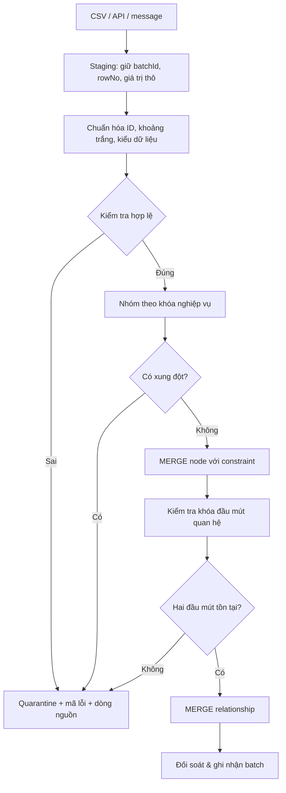

# Chuẩn hóa dữ liệu trùng, dữ liệu lỗi và quan hệ thiếu đầu mút khi nhập Neo4j

## 1. Bài toán: file hợp lệ không có nghĩa là đồ thị đúng

Neo4j lưu dữ liệu dưới dạng **property graph**: node mô tả thực thể, relationship nối các thực thể và property chứa giá trị thuộc tính. Khi nhập dữ liệu từ CSV, API hoặc hệ thống khác, dữ liệu nguồn thường không đạt ngay những quy tắc mà đồ thị đích cần:

- Hai dòng có cùng mã người dùng nhưng khác chữ hoa, chữ thường hoặc khoảng trắng.
- Cùng một định danh xuất hiện nhiều lần với nội dung giống nhau, hoặc **mâu thuẫn** nhau.
- Mã định danh rỗng, giá trị tuổi không chuyển được sang số, ngày không hợp lệ.
- Một dòng quan hệ chỉ tới người hoặc phòng ban chưa được nhập, không tồn tại trong dữ liệu nguồn, hoặc đã bị loại vì sai dữ liệu.
- Chạy lại cùng đợt nhập làm tạo node hay relationship trùng.

Trong chương **Nhập dữ liệu** của module `DATABASE_ENGINE_GRAPH_NEO4J`, bài này trình bày quy trình làm sạch và đối soát trước khi ghi đồ thị. Kỹ thuật dùng các biểu thức, `UNWIND`, `LOAD CSV`, `MERGE`, `OPTIONAL MATCH`, **index/constraint**, đồng thời liên hệ cách chạy đợt nhập bằng **Neo4j Java Driver** hoặc **Spring Data Neo4j**.

### Mục tiêu

Sau bài học, bạn có thể:

1. Phân biệt **dòng trùng**, **thực thể trùng** và **dòng trùng khóa nhưng mâu thuẫn thuộc tính**.
2. Thiết lập quy tắc chuẩn hóa định danh và kiểm tra kiểu dữ liệu trước khi `MERGE`.
3. Đưa dữ liệu lỗi vào **quarantine** (tập cần xử lý) thay vì bỏ qua âm thầm.
4. Phát hiện đầu mút chưa tồn tại, quyết định chờ bổ sung, loại bỏ hay tạo node placeholder theo quy tắc nghiệp vụ.
5. Viết luồng nhập **có thể chạy lại**, kiểm tra số lượng sau từng bước và quản lý import theo batch.

> **Lưu ý quan trọng:** Trong Neo4j, một relationship hợp lệ **luôn nối hai node tồn tại**. «Quan hệ thiếu đầu mút» trong bài là **dòng quan hệ ở nguồn** có khóa tham chiếu không tìm thấy node đích tương ứng; đó chưa phải một relationship treo trong graph.

## 2. Phân loại lỗi trước khi thiết kế cách xử lý

| Nhóm vấn đề | Ví dụ | Rủi ro nếu nạp trực tiếp | Cách xử lý |
| --- | --- | --- | --- |
| Trùng bản ghi giống hệt | Hai dòng `p001, An, 29` | Xử lý dư; có thể sinh quan hệ trùng | Chuẩn hóa rồi gộp theo khóa |
| Trùng khóa nhưng khác dữ liệu | Cùng `P003` nhưng tên «Dũng» và «Dũng Nguyễn» | Dòng chạy sau âm thầm ghi đè dòng trước | Gắn cờ **CONFLICT**, yêu cầu quy tắc giải quyết |
| Khác định dạng khóa | ` p001 `, `P001`, `p001` | Tạo nhiều node cho một thực thể | Chuẩn hóa định danh trước khi so khớp |
| Thiếu khóa bắt buộc | `personId` rỗng | `MERGE` có khóa `null` lỗi, hoặc tạo node không định danh | Gắn cờ **MISSING_ID**; không nạp |
| Sai kiểu / miền giá trị | `age = "abc"`, `age = -3` | Lỗi chuyển kiểu hoặc dữ liệu vô nghĩa | Gắn cờ **BAD_AGE** |
| Quan hệ thiếu nguồn | `P999 -> T01` | Không tìm thấy node người | Gắn cờ **MISSING_PERSON** |
| Quan hệ thiếu đích | `P004 -> T99` | Không tìm thấy phòng ban | Gắn cờ **MISSING_TEAM** |
| Quan hệ lặp | Hai dòng `P001 -> T01` | Có thể tạo nhiều cạnh cùng ý nghĩa | Đặt quy tắc khóa quan hệ và gộp |
| Xung đột quan hệ | Cùng cặp người–nhóm nhưng role khác nhau | Trạng thái không xác định | Gắn cờ, không chọn tùy tiện |

**Khóa định danh và tiêu chí trùng phải do nghiệp vụ quyết định.** Hai người trùng tên không nhất thiết là một người; hai đơn hàng giống giá trị vẫn có thể là hai giao dịch riêng. Đừng dùng mọi thuộc tính trong `MERGE` để «tự khử trùng».

## 3. Kiến trúc nhập dữ liệu an toàn

Luồng thực hành dưới đây tách dữ liệu thô khỏi node/relationship nghiệp vụ:



Các bước cần tách bạch:

- **Staging** giữ dữ liệu gốc và dòng nguồn để có thể giải thích hoặc chạy lại, không mất dấu vết của lỗi.
- **Normalization** tạo khóa chuẩn hóa để so sánh, không phá hủy khóa thô.
- **Validation** kiểm tra các quy tắc bắt buộc; chỉ những dòng hợp lệ mới được chuyển tiếp.
- **Deduplication/conflict detection** được thực hiện **trước** khi cập nhật các property chính thức.
- **Endpoint resolution** chỉ thực hiện sau khi các node đã được nhập thành công.
- **Reconciliation** so sánh tổng số dòng, số dòng được chấp nhận, số dòng lỗi và số thực thể/cạnh thực tạo.

Không nhất thiết phải lưu staging thành node trong mọi hệ thống: dịch vụ ETL hoặc hàng đợi có thể giữ dữ liệu thô. Bài này dùng node staging để có thể thực hành toàn bộ quy trình với Cypher.

## 4. Dữ liệu mẫu: nhân viên, nhóm và quan hệ thành viên

Giả sử ứng dụng quản lý người tham gia nhóm chuyên môn:

```text
(:ImportPerson {personId, fullName, age})
       |
       +--[:MEMBER_OF {membershipKey, role}]-->
                       (:ImportTeam {teamId, teamName})
```

Chúng ta nhận ba bộ dữ liệu nguồn. `rowNo` là số thứ tự dòng theo từng nguồn; tất cả đều thuộc `batchId = 'neo4j-import-demo-01'`.

### 4.1. Nguồn person

| rowNo | person_id thô | full_name thô | age thô | Vấn đề |
| ---: | --- | --- | --- | --- |
| 1 | `" p001 "` | `"An"` | `"29"` | Hợp lệ sau trim/uppercase ID |
| 2 | `"P001"` | `"An"` | `"29"` | Trùng thực thể/dữ liệu với dòng 1 |
| 3 | `"P002"` | `"Bình"` | `"abc"` | Sai kiểu tuổi |
| 4 | `""` | `"Chi"` | `"25"` | Thiếu định danh |
| 5 | `"P003"` | `"Dũng"` | `"31"` | Xung đột với dòng 7 |
| 6 | `"P004"` | `"Em"` | `"28"` | Hợp lệ |
| 7 | `"p003 "` | `"Dũng Nguyễn"` | `"31"` | Trùng khóa với dòng 5, khác tên |

### 4.2. Nguồn team

| rowNo | team_id thô | team_name thô | Vấn đề |
| ---: | --- | --- | --- |
| 1 | `" t01 "` | `"Graph"` | Hợp lệ |
| 2 | `"T01"` | `"Graph"` | Trùng dòng 1 sau chuẩn hóa |
| 3 | `"T02"` | `"Data"` | Hợp lệ |

### 4.3. Nguồn membership

| rowNo | person_id | team_id | role | Vấn đề |
| ---: | --- | --- | --- | --- |
| 1 | `p001` | `t01` | `member` | Hợp lệ |
| 2 | `P001` | `T01` | `MEMBER` | Trùng quan hệ dòng 1 |
| 3 | `P003` | `T02` | `MEMBER` | Người P003 đang bị quarantine vì xung đột |
| 4 | `P004` | `T99` | `MEMBER` | Đích T99 không tồn tại |
| 5 | `P004` | `T02` | `UNKNOWN` | Role ngoài tập cho phép |
| 6 | `P004` | `T02` | `LEAD` | Hợp lệ |

**Chính sách của bài:** ID người và nhóm chỉ gồm chữ cái Latin/số, không phân biệt hoa thường, khoảng trắng đầu/cuối không có ý nghĩa; tên riêng chỉ bỏ khoảng trắng dư ở hai đầu. Các role hợp lệ là `MEMBER` và `LEAD`. Nếu cùng khóa mà các thuộc tính đã chuẩn hóa xung đột, **không tự chọn dòng cuối cùng**.

## 5. Tạo staging và nạp dữ liệu thô có thể chạy lại

Đầu tiên tạo constraint cho các khóa đích. Unique constraint bảo vệ dữ liệu khi có nhiều phiên nhập đồng thời và cung cấp index để tìm node theo khóa:

```cypher
CREATE CONSTRAINT import_person_id_unique IF NOT EXISTS
FOR (p:ImportPerson)
REQUIRE p.personId IS UNIQUE;

CREATE CONSTRAINT import_team_id_unique IF NOT EXISTS
FOR (t:ImportTeam)
REQUIRE t.teamId IS UNIQUE;
```

Với Neo4j 5.x hỗ trợ unique constraint trên **relationship property**, có thể ràng buộc một mã quan hệ ổn định:

```cypher
CREATE CONSTRAINT import_membership_key_unique IF NOT EXISTS
FOR ()-[m:MEMBER_OF]-()
REQUIRE m.membershipKey IS UNIQUE;
```

Một membership có khóa nghiệp vụ `personId + '|' + teamId` nếu mỗi người chỉ có **một quan hệ thành viên hiện hành** với một nhóm. Điều kiện này **không đúng** với mô hình lịch sử có nhiều lần vào/ra nhóm; trong trường hợp đó, cần khóa sự kiện riêng (ví dụ nguồn + mã lần tham gia) và mô hình lịch sử phù hợp.

### 5.1. Staging người

```cypher
UNWIND [
  {rowNo: 1, id: ' p001 ', name: 'An', age: '29'},
  {rowNo: 2, id: 'P001', name: 'An', age: '29'},
  {rowNo: 3, id: 'P002', name: 'Bình', age: 'abc'},
  {rowNo: 4, id: '', name: 'Chi', age: '25'},
  {rowNo: 5, id: 'P003', name: 'Dũng', age: '31'},
  {rowNo: 6, id: 'P004', name: 'Em', age: '28'},
  {rowNo: 7, id: 'p003 ', name: 'Dũng Nguyễn', age: '31'}
] AS raw
MERGE (r:ImportPersonRow {
  batchId: 'neo4j-import-demo-01',
  rowNo: raw.rowNo
})
SET r.personIdRaw = raw.id,
    r.nameRaw = raw.name,
    r.ageRaw = raw.age;
```

### 5.2. Staging nhóm

```cypher
UNWIND [
  {rowNo: 1, id: ' t01 ', name: 'Graph'},
  {rowNo: 2, id: 'T01', name: 'Graph'},
  {rowNo: 3, id: 'T02', name: 'Data'}
] AS raw
MERGE (r:ImportTeamRow {
  batchId: 'neo4j-import-demo-01',
  rowNo: raw.rowNo
})
SET r.teamIdRaw = raw.id,
    r.nameRaw = raw.name;
```

### 5.3. Staging quan hệ

```cypher
UNWIND [
  {rowNo: 1, person: 'p001', team: 't01', role: 'member'},
  {rowNo: 2, person: 'P001', team: 'T01', role: 'MEMBER'},
  {rowNo: 3, person: 'P003', team: 'T02', role: 'MEMBER'},
  {rowNo: 4, person: 'P004', team: 'T99', role: 'MEMBER'},
  {rowNo: 5, person: 'P004', team: 'T02', role: 'UNKNOWN'},
  {rowNo: 6, person: 'P004', team: 'T02', role: 'LEAD'}
] AS raw
MERGE (r:ImportMembershipRow {
  batchId: 'neo4j-import-demo-01',
  rowNo: raw.rowNo
})
SET r.personIdRaw = raw.person,
    r.teamIdRaw = raw.team,
    r.roleRaw = raw.role;
```

Trong môi trường nhiều job ghi vào cùng staging, nên thêm constraint tổng hợp trên `(batchId, rowNo)` **cho từng nhãn staging** hoặc dùng mã nguồn duy nhất ổn định. `MERGE` không thay thế unique constraint khi có concurrent writers.

## 6. Chuẩn hóa và xác định dữ liệu lỗi trước khi `MERGE`

### 6.1. Chuẩn hóa khóa và kiểu

Đối với ID, ví dụ dùng:

```cypher
MATCH (r:ImportPersonRow {batchId: 'neo4j-import-demo-01'})
RETURN r.rowNo AS dong,
       r.personIdRaw AS idGoc,
       toUpper(trim(coalesce(r.personIdRaw, ''))) AS idChuan,
       trim(coalesce(r.nameRaw, '')) AS tenChuan,
       toIntegerOrNull(trim(coalesce(r.ageRaw, ''))) AS tuoiChuyenDoi
ORDER BY dong;
```

Ở đây:

- `coalesce(x, '')` xử lý giá trị thiếu khi tính khóa kiểm tra.
- `trim()` bỏ khoảng trắng ở hai đầu.
- `toUpper()` là **quy tắc chuẩn hóa định danh theo hợp đồng dữ liệu của ví dụ**, không phải quy tắc đúng với mọi mã nghiệp vụ.
- `toIntegerOrNull()` trả về `null` khi chuỗi không chuyển thành số nguyên, giúp **phát hiện lỗi** mà không làm hỏng toàn bộ truy vấn chỉ vì giá trị `"abc"`.

Không chuẩn hóa tên người thành chữ hoa, không tự xóa dấu tiếng Việt và không tự thay các chuỗi trông gần giống nhau thành cùng một người. Nếu ID thực tế **phân biệt hoa/thường** thì cũng không được dùng `toUpper()` cho ID.

### 6.2. Phân loại dòng lỗi

```cypher
MATCH (r:ImportPersonRow {batchId: 'neo4j-import-demo-01'})
WITH r,
     toUpper(trim(coalesce(r.personIdRaw, ''))) AS personId,
     trim(coalesce(r.nameRaw, '')) AS fullName,
     toIntegerOrNull(trim(coalesce(r.ageRaw, ''))) AS age
RETURN r.rowNo AS dong,
       personId,
       fullName,
       age,
       CASE
         WHEN personId = '' THEN 'MISSING_ID'
         WHEN fullName = '' THEN 'MISSING_NAME'
         WHEN age IS NULL OR age < 0 OR age > 120 THEN 'BAD_AGE'
         ELSE 'VALID'
       END AS validationStatus
ORDER BY dong;
```

Kỳ vọng: dòng 3 `BAD_AGE`, dòng 4 `MISSING_ID`; các dòng khác `VALID` ở bước **kiểm tra từng dòng**. Dòng 5/7 chưa bị đánh dấu ở đây vì xung đột chỉ bộc lộ khi **gom theo khóa chuẩn hóa**.

Lý do phải lọc lỗi trước khi viết:

```cypher
// Không chạy với dữ liệu có id rỗng/null:
// MERGE (p:ImportPerson {personId: null})
```

`MERGE` trên property có giá trị `null` có thể gây lỗi; một mã rỗng `''` tuy không phải `null` cũng không nên được coi là định danh hợp lệ. Ngoài ra, gán property thành `null` trong Neo4j tương đương xóa property đó, nên không thể dùng `null` như dấu «đã ghi một giá trị rỗng hợp lệ» cho node.

### 6.3. Kiểm tra giá trị ngày và dữ liệu khó chuyển đổi

Với trường thời gian, `date('2026-02-30')` có thể ném lỗi thay vì trả `null`. Kiểm tra biểu thức chính quy chỉ xác minh **định dạng**, không bảo đảm ngày có thật:

```cypher
WITH '2026-02-30' AS rawDate
RETURN rawDate =~ '^[0-9]{4}-[0-9]{2}-[0-9]{2}$'
       AS dungDinhDang;
```

Kết quả là `true` về định dạng, nhưng ngày 30/2 không hợp lệ. Với dòng nguồn không tin cậy, nên thực hiện parse ngày với xử lý exception tại **ETL/Java** hoặc một giai đoạn kiểm tra riêng trước khi gọi `date()` trong câu ghi vào graph. Kiểm tra đồng thời tính hợp lệ, múi giờ, đơn vị số tiền, mã hóa ký tự và miền giá trị theo nghiệp vụ.

## 7. Phân biệt dòng trùng và xung đột cùng khóa

### 7.1. Vì sao `DISTINCT` trên toàn dòng chưa đủ?

Hai dòng với `' p001 '` và `'P001'` không giống hệt ở dạng thô. Vì vậy, `DISTINCT r.personIdRaw` vẫn coi là hai giá trị khác nhau. Để phát hiện **thực thể trùng**, phải chuẩn hóa trước rồi nhóm theo **khóa đã chuẩn hóa**.

Một cách dễ sai khác:

```cypher
// Dễ bị "last write wins" theo thứ tự thực thi:
MATCH (r:ImportPersonRow {batchId: 'neo4j-import-demo-01'})
WITH toUpper(trim(r.personIdRaw)) AS id,
     trim(r.nameRaw) AS name
WHERE id <> ''
MERGE (p:ImportPerson {personId: id})
SET p.fullName = name;
```

Đoạn trên **chỉ để minh họa lỗi thiết kế**: nó bỏ qua kiểm tra tuổi và có thể âm thầm ghi `fullName` từ một dòng mâu thuẫn. Không dùng nó làm luồng nhập chuẩn.

### 7.2. Gom theo ID và đếm biến thể thuộc tính

```cypher
MATCH (r:ImportPersonRow {batchId: 'neo4j-import-demo-01'})
WITH r,
     toUpper(trim(coalesce(r.personIdRaw, ''))) AS personId,
     trim(coalesce(r.nameRaw, '')) AS fullName,
     toIntegerOrNull(trim(coalesce(r.ageRaw, ''))) AS age
WHERE personId <> ''
  AND fullName <> ''
  AND age IS NOT NULL AND age >= 0 AND age <= 120
WITH personId,
     count(*) AS soDongNguon,
     collect(r.rowNo) AS cacDongNguon,
     collect(DISTINCT {fullName: fullName, age: age}) AS variants
RETURN personId,
       soDongNguon,
       cacDongNguon,
       size(variants) AS soBienThe,
       CASE
         WHEN size(variants) = 1 AND soDongNguon > 1 THEN 'DUPLICATE_IDENTICAL'
         WHEN size(variants) > 1 THEN 'CONFLICT'
         ELSE 'UNIQUE'
       END AS classification
ORDER BY personId;
```

Kết quả đáng chú ý:

| personId | Số dòng hợp lệ | Số biến thể dữ liệu | Phân loại |
| --- | ---: | ---: | --- |
| `P001` | 2 | 1 | `DUPLICATE_IDENTICAL` |
| `P003` | 2 | 2 | `CONFLICT` |
| `P004` | 1 | 1 | `UNIQUE` |

`P002` bị loại ở bước validate tuổi, và dòng không có ID không được gom thành một thực thể. Tình huống `P003` cần quyết định từ nguồn thẩm quyền, thời điểm hiệu lực, thứ tự ưu tiên nguồn hoặc xác nhận thủ công; **không tự chọn record sau chỉ vì nó ở hàng cuối**.

### 7.3. Các chính sách xử lý xung đột thường dùng

| Chính sách | Khi nào phù hợp | Điểm cần kiểm soát |
| --- | --- | --- |
| **Reject/quarantine** cả nhóm trùng khóa mâu thuẫn | Không có nguồn ưu tiên rõ ràng; dữ liệu quan trọng | Ghi ID, rowNo, giá trị xung đột và lý do |
| Nguồn thẩm quyền (*source of truth*) | Một hệ thống được chỉ định giữ dữ liệu chuẩn | Có bằng chứng quyền ưu tiên, version dữ liệu |
| Bản ghi mới nhất theo `updatedAt` tin cậy | Dữ liệu có timestamp do nguồn cấp | Xử lý timestamp bằng nhau, đồng hồ lệch và sửa lùi |
| Hợp nhất theo từng trường | Các nguồn chịu trách nhiệm trường khác nhau | Quy tắc rõ ràng cho từng property, không làm mất dữ liệu |
| Review thủ công | Trùng thực thể chưa chắc là một người | Giữ lịch sử quyết định và người phê duyệt |

Mỗi lựa chọn phải **xác định được kết quả khi chạy lại**, không phụ thuộc thứ tự ngẫu nhiên của `UNWIND`, `MATCH` hoặc tải đồng thời.

## 8. Chỉ ghi những node đã hợp lệ và không xung đột

### 8.1. Nhập người theo khóa chuẩn hóa

```cypher
MATCH (r:ImportPersonRow {batchId: 'neo4j-import-demo-01'})
WITH r,
     toUpper(trim(coalesce(r.personIdRaw, ''))) AS personId,
     trim(coalesce(r.nameRaw, '')) AS fullName,
     toIntegerOrNull(trim(coalesce(r.ageRaw, ''))) AS age
WHERE personId <> ''
  AND fullName <> ''
  AND age IS NOT NULL AND age >= 0 AND age <= 120
WITH personId,
     collect(DISTINCT {fullName: fullName, age: age}) AS variants
WHERE size(variants) = 1
WITH personId, variants[0] AS value
MERGE (p:ImportPerson {personId: personId})
SET p.fullName = value.fullName,
    p.age = value.age
RETURN count(p) AS soPersonDaXuLy;
```

Kết quả sau đợt đầu với đồ thị đích trống: **2 người**, `P001` và `P004`. Dòng trùng giống nhau chỉ tạo một node; `P003` có nhiều biến thể nên không ghi; `P002` sai tuổi và dòng thiếu ID cũng không ghi.

Trong hệ thống thật, câu `SET` khi chạy lại hoặc chạy batch mới có thể cập nhật property của node đã tồn tại. Nếu **không cho phép overwrite** từ nguồn hiện tại, dùng `ON CREATE SET` hoặc xây cơ chế kiểm tra xung đột **với dữ liệu đang lưu** trước khi cập nhật. Việc không có xung đột **trong batch** không tự bảo đảm không có xung đột **với các batch trước**.

### 8.2. Nhập nhóm theo khóa chuẩn hóa

```cypher
MATCH (r:ImportTeamRow {batchId: 'neo4j-import-demo-01'})
WITH toUpper(trim(coalesce(r.teamIdRaw, ''))) AS teamId,
     trim(coalesce(r.nameRaw, '')) AS teamName
WHERE teamId <> '' AND teamName <> ''
WITH teamId, collect(DISTINCT teamName) AS names
WHERE size(names) = 1
MERGE (t:ImportTeam {teamId: teamId})
SET t.teamName = names[0]
RETURN count(t) AS soTeamDaXuLy;
```

Kết quả dự kiến: **2 nhóm**, `T01` và `T02`. Cả hai dòng nguồn `t01`/`T01` cùng chỉ đến một node sau chuẩn hóa.

### 8.3. Tại sao không nên `MERGE` mọi property?

Sai ý định trong nhiều bài toán:

```cypher
// name đổi có thể khiến MERGE không khớp node hiện có:
MERGE (p:ImportPerson {personId: 'P001', fullName: 'An Mới'});
```

Nếu `P001` đã tồn tại với `fullName = 'An'`, toàn bộ mẫu property ở câu trên không khớp. Khi có unique constraint trên `personId`, lệnh có thể **báo xung đột constraint**; không có constraint, nó có thể tạo node khác. Cách đúng với định danh nghiệp vụ ổn định là:

```cypher
MERGE (p:ImportPerson {personId: 'P001'})
SET p.fullName = 'An Mới';
```

Tất nhiên, **chỉ cập nhật tên khi đã xác nhận chính sách nguồn**. Cú pháp đúng không tự bảo đảm quyết định ghi đè là đúng nghiệp vụ.

## 9. Kiểm tra hai đầu mút trước khi tạo relationship

### 9.1. Phát hiện orphan row bằng `OPTIONAL MATCH`

Chỉ sau khi các node được chuẩn hóa và nhập, mới tra quan hệ nguồn:

```cypher
MATCH (r:ImportMembershipRow {batchId: 'neo4j-import-demo-01'})
WITH r,
     toUpper(trim(coalesce(r.personIdRaw, ''))) AS personId,
     toUpper(trim(coalesce(r.teamIdRaw, ''))) AS teamId,
     toUpper(trim(coalesce(r.roleRaw, ''))) AS role
OPTIONAL MATCH (p:ImportPerson {personId: personId})
OPTIONAL MATCH (t:ImportTeam {teamId: teamId})
RETURN r.rowNo AS dong,
       personId, teamId, role,
       CASE
         WHEN personId = '' THEN 'MISSING_PERSON_ID'
         WHEN teamId = '' THEN 'MISSING_TEAM_ID'
         WHEN role NOT IN ['MEMBER', 'LEAD'] THEN 'BAD_ROLE'
         WHEN p IS NULL AND t IS NULL THEN 'MISSING_BOTH_ENDPOINTS'
         WHEN p IS NULL THEN 'MISSING_PERSON'
         WHEN t IS NULL THEN 'MISSING_TEAM'
         ELSE 'READY'
       END AS validationStatus
ORDER BY dong;
```

Tình huống dự kiến:

| rowNo | Trạng thái | Nguyên nhân |
| ---: | --- | --- |
| 1, 2 | `READY` | Hai đầu mút tồn tại, role hợp lệ |
| 3 | `MISSING_PERSON` | `P003` chưa được nhập vì xung đột |
| 4 | `MISSING_TEAM` | Không có `T99` |
| 5 | `BAD_ROLE` | `UNKNOWN` không hợp lệ |
| 6 | `READY` | `P004` và `T02` tồn tại, role `LEAD` |

**Thứ tự các nhánh trong `CASE` là chính sách ưu tiên lỗi.** Một dòng có thể đồng thời sai role và thiếu endpoint; trong báo cáo chi tiết nên giữ **tất cả mã lỗi**, thay vì chỉ mã đầu tiên, để người vận hành biết cần sửa những gì.

### 9.2. Tại sao dùng `MATCH` trực tiếp có thể làm mất lỗi?

```cypher
MATCH (r:ImportMembershipRow {batchId: 'neo4j-import-demo-01'})
WITH r,
     toUpper(trim(r.personIdRaw)) AS personId,
     toUpper(trim(r.teamIdRaw)) AS teamId
MATCH (p:ImportPerson {personId: personId})
MATCH (t:ImportTeam {teamId: teamId})
RETURN r.rowNo, p.personId, t.teamId;
```

Nếu một đầu mút không tồn tại, `MATCH` không khớp và **dòng nguồn biến mất khỏi tập kết quả**. Đó không phải là một lỗi có thể nhìn thấy trong bảng kết quả; nếu không đối soát, các liên kết thiếu sẽ bị bỏ qua âm thầm.

Trong bước **kiểm kê dữ liệu lỗi**, dùng `OPTIONAL MATCH` để giữ dòng nguồn và kiểm tra `p IS NULL`, `t IS NULL`. Trong bước **ghi dữ liệu chỉ sau khi đã kiểm tra**, dùng `MATCH` để yêu cầu cả hai đầu mút phải tồn tại.

### 9.3. Ba chính sách cho đầu mút chưa tồn tại

| Lựa chọn | Dùng khi | Rủi ro |
| --- | --- | --- |
| **Quarantine + retry** sau khi sửa nguồn | Dữ liệu chỉ quan hệ hợp lệ khi hai đầu mút có hồ sơ chuẩn | Cần quy trình đối soát và chạy bù |
| **Giữ pending** theo khóa thô trong staging | Đầu mút sẽ đến ở batch khác hoặc message đến sai thứ tự | Cần hạn xử lý, số lần retry và cảnh báo |
| **Tạo placeholder node** có cờ chưa xác minh | Nghiệp vụ cho phép tồn tại thực thể tạm | Phải có cách phân biệt, xác minh, hợp nhất placeholder sau này |

Không tự làm:

```cypher
// NGUY HIỂM khi nguồn sai: tự tạo person/team không xác thực
// MERGE (:ImportPerson {personId: 'P999'})
// MERGE (:ImportTeam {teamId: 'T99'})
```

Tạo placeholder có thể che mất lỗi từ nguồn và khiến truy vấn nghiệp vụ xem node thiếu dữ liệu như người/nhóm có thật. Chỉ thực hiện nếu mô hình thiết kế rõ `isPlaceholder`/`verificationStatus`, quyền truy cập, và quy trình bổ sung dữ liệu.

## 10. Khử trùng dòng quan hệ và ghi cạnh có thể chạy lại

Ở mô hình thực hành, **một người có tối đa một membership hiện hành với một nhóm**. Trước khi `MERGE`, nhóm các dòng quan hệ theo cặp ID đã chuẩn hóa và xác minh role.

```cypher
MATCH (r:ImportMembershipRow {batchId: 'neo4j-import-demo-01'})
WITH toUpper(trim(coalesce(r.personIdRaw, ''))) AS personId,
     toUpper(trim(coalesce(r.teamIdRaw, ''))) AS teamId,
     toUpper(trim(coalesce(r.roleRaw, ''))) AS role
WHERE personId <> ''
  AND teamId <> ''
  AND role IN ['MEMBER', 'LEAD']
WITH personId, teamId, collect(DISTINCT role) AS roles
WHERE size(roles) = 1
MATCH (p:ImportPerson {personId: personId})
MATCH (t:ImportTeam {teamId: teamId})
WITH p, t, personId, teamId, roles[0] AS role,
     personId + '|' + teamId AS membershipKey
MERGE (p)-[m:MEMBER_OF {membershipKey: membershipKey}]->(t)
SET m.role = role
RETURN count(m) AS soMembershipDaXuLy;
```

Kết quả dự kiến: **2 quan hệ**:

```text
(P001)-[:MEMBER_OF {membershipKey:'P001|T01', role:'MEMBER'}]->(T01)
(P004)-[:MEMBER_OF {membershipKey:'P004|T02', role:'LEAD'}]->(T02)
```

- Dòng 1 và 2 có **cùng cặp đầu mút + role**, nên gom thành một relationship.
- Dòng 3 không qua `MATCH` vì người `P003` chưa được chấp nhận.
- Dòng 4 không qua `MATCH` vì nhóm `T99` không tồn tại.
- Dòng 5 bị loại do role không hợp lệ; dòng 6 tạo quan hệ `P004 -> T02`.

Không được suy ra «không có lỗi» chỉ vì query trả về hai quan hệ. **Hai quan hệ được tạo và các dòng nguồn còn lại phải được đối soát** theo số dòng trùng, lỗi role, lỗi endpoint và xung đột.

### Khóa của relationship cần gắn với nghiệp vụ

`membershipKey = personId + '|' + teamId` chỉ an toàn khi dấu phân cách `|` không thể xuất hiện trong chính các ID, hoặc ID đã có quy tắc escape/encoding chắc chắn. Nếu nhiều lần tham gia là các sự kiện riêng, khóa cần bao gồm **mã sự kiện** hoặc thời điểm hiệu lực được nguồn xác nhận, thay vì gộp mọi lịch sử thành một cạnh.

Khi sử dụng uniqueness constraint cho `MEMBER_OF.membershipKey`, một quan hệ tồn tại với cùng key nhưng **đầu mút khác** có thể gây lỗi constraint lúc `MERGE`. Đây là tín hiệu cần điều tra dữ liệu sai hoặc dữ liệu cũ bị gắn sai, không nên tự xóa constraint để tiếp tục nhập.

## 11. Quarantine: giữ lỗi để có thể giải thích và nhập bù

### 11.1. Quarantine có thể là bảng báo cáo, file hay staging node

Với hệ thống sản xuất, mỗi dòng lỗi nên có:

| Trường | Công dụng |
| --- | --- |
| `batchId`, `sourceFile`, `rowNo` | Xác định nguồn và dòng cần sửa |
| `rawPayload` hoặc các cột thô | Giữ dữ liệu đầu vào nguyên gốc trong kho phù hợp |
| `canonicalKey` | Cho biết khóa sau chuẩn hóa |
| `errorCodes` | Một hoặc nhiều lỗi như `BAD_AGE`, `CONFLICT`, `MISSING_TEAM` |
| `status` | `NEW`, `REVIEWED`, `FIXED`, `RETRIED`... |
| `detectedAt`, `resolvedAt` | Phục vụ vận hành, báo cáo SLA |
| `decisionSource` / `ruleVersion` | Truy vết quy tắc và nguồn nào thắng khi xung đột |

Trong bài, dữ liệu thô đã nằm ở các node `Import*Row`. Kết quả của những truy vấn phân loại ở mục 6, 7 và 9 có thể được **xuất ra báo cáo quarantine** hoặc dùng bởi job kiểm tra để đặt trạng thái lên staging. Không nên xóa dòng staging ngay sau khi tạo node đích vì sẽ mất khả năng xác định nguồn lỗi.

### 11.2. Ví dụ gắn nhãn trạng thái cho dòng person sai cơ bản

Đoạn này chỉ gắn lỗi **theo từng dòng**; bước đánh dấu `CONFLICT` phải thực hiện riêng theo nhóm khóa:

```cypher
MATCH (r:ImportPersonRow {batchId: 'neo4j-import-demo-01'})
WITH r,
     toUpper(trim(coalesce(r.personIdRaw, ''))) AS personId,
     trim(coalesce(r.nameRaw, '')) AS fullName,
     toIntegerOrNull(trim(coalesce(r.ageRaw, ''))) AS age
SET r.validationStatus =
  CASE
    WHEN personId = '' THEN 'MISSING_ID'
    WHEN fullName = '' THEN 'MISSING_NAME'
    WHEN age IS NULL OR age < 0 OR age > 120 THEN 'BAD_AGE'
    ELSE 'VALID_ROW'
  END
RETURN r.rowNo AS dong, r.validationStatus AS ketQua
ORDER BY dong;
```

Chú ý: `VALID_ROW` **chưa đồng nghĩa với «được nhập»**. Sau đó phải xét nhóm trùng khóa và trạng thái endpoint trước khi ghi graph đích. Trên dữ liệu nhạy cảm, cơ chế quarantine phải tuân thủ quyền truy cập và chính sách lưu giữ dữ liệu của ứng dụng.

## 12. Nạp từ CSV thật, tách batch và xử lý chạy lại

### 12.1. `LOAD CSV` tạo staging từ file thật

Đối với file CSV có header `rowNo,person_id,full_name,age` và mã hóa UTF-8:

```cypher
LOAD CSV WITH HEADERS FROM 'file:///people.csv' AS row
CALL (row) {
  MERGE (r:ImportPersonRow {
    batchId: 'neo4j-import-demo-01',
    rowNo: toInteger(row.rowNo)
  })
  SET r.personIdRaw = row.person_id,
      r.nameRaw = row.full_name,
      r.ageRaw = row.age
} IN TRANSACTIONS OF 1000 ROWS;
```

**Điều kiện của ví dụ:** `row.rowNo` đã được nguồn bảo đảm là **số nguyên không rỗng, không trùng trong file**. Nếu nguồn không có số dòng đáng tin cậy, phải sinh **sourceRowId** ổn định ở ETL hoặc bước tiền xử lý; không dùng `null` làm một phần của `MERGE`. Đừng giả định `LOAD CSV` tự tạo ID dòng phù hợp nghiệp vụ.

`CALL (row) { ... } IN TRANSACTIONS` là cú pháp biến phạm vi kiểu mới của Neo4j 5.23+; ở phiên bản trước, phải dùng dạng subquery tương ứng với tài liệu bản đó. Lệnh `IN TRANSACTIONS` cần chạy trong **implicit transaction** (ví dụ query auto-commit), không đặt trong một explicit/managed transaction bao ngoài. Nếu job gọi qua Java Driver, phải chọn API thực thi phù hợp; không đơn giản bọc nó trong `executeWrite`.

Đối với `file:///people.csv`, file phải được server Neo4j cho phép truy cập theo cấu hình import, **không phải đường dẫn trên máy chạy Java Driver**. Trong Neo4j Aura hoặc môi trường dịch vụ quản lý, cơ chế đọc file cục bộ có thể khác; khi đó cần URL được phép, tải qua Driver hoặc công cụ import phù hợp.

### 12.2. Nhập theo lô không có nghĩa toàn bộ file là một transaction

`IN TRANSACTIONS OF 1000 ROWS` chia công việc thành nhiều transaction nhỏ để giới hạn tài nguyên. Nếu một batch sau gặp lỗi, các batch đã commit trước đó **có thể đã tồn tại**. Vì vậy cần:

1. Giữ định danh batch/source row ổn định để phát hiện trùng khi retry.
2. Đặt unique constraint cho **khóa nghiệp vụ** và những định danh staging cần bảo vệ đồng thời.
3. Ghi trạng thái batch, đếm các dòng thành công/thất bại và cho phép xử lý lại phần lỗi.
4. Dùng `MERGE`/cập nhật có quy tắc để lần chạy lại không làm nhân node hoặc relationship.
5. Không giả định truy vấn viết được bao nhiêu dòng là đã nhập hợp lệ bấy nhiêu **thực thể duy nhất**.

Với dữ liệu ban đầu rất lớn, các công cụ nhập offline như `neo4j-admin database import` có thể phù hợp hơn `LOAD CSV` vào database đang chạy. Công cụ này có ràng buộc riêng về trạng thái database, định dạng CSV, chính sách ID và xử lý lỗi; cần đối chiếu tài liệu theo bản Neo4j sử dụng.

### 12.3. Java Driver và Spring Data Neo4j

Ứng dụng Java có thể thực hiện validate/normalize trước ở tầng ETL, lưu lỗi riêng, sau đó truyền các khóa đã chuẩn hóa qua parameter:

```cypher
UNWIND $acceptedPeople AS item
MERGE (p:ImportPerson {personId: item.personId})
SET p.fullName = item.fullName,
    p.age = item.age;
```

`$acceptedPeople` phải là danh sách đã được kiểm tra khóa không rỗng, kiểu và xung đột **trong cả batch và với dữ liệu đã có**. Trong Java Driver, managed transaction có thể retry khi gặp transient error; phần validate/gửi dữ liệu ra hệ thống khác phải có cơ chế idempotency hoặc bố trí ngoài callback nếu side effect không thể rollback.

Trong **Spring Data Neo4j**, các phép `save()` không tự xử lý bài toán hợp nhất khóa nghiệp vụ, giải quyết xung đột nguồn hay nhận diện relationship thiếu đầu mút. Với import lớn, có thể cần câu Cypher `@Query` hoặc quy trình import chuyên dụng, kiểm tra transaction boundary và lượng truy vấn framework phát sinh.

## 13. Đối soát dữ liệu sau khi nhập

### 13.1. Kiểm tra thực thể đích

Sau khi chạy đúng các ví dụ của bài trên database thử nghiệm trống đối với các nhãn `ImportPerson`/`ImportTeam`:

```cypher
MATCH (p:ImportPerson)
RETURN p.personId AS personId, p.fullName AS name, p.age AS age
ORDER BY personId;
```

Kỳ vọng:

| personId | name | age |
| --- | --- | ---: |
| `P001` | An | 29 |
| `P004` | Em | 28 |

```cypher
MATCH (t:ImportTeam)
RETURN t.teamId AS teamId, t.teamName AS teamName
ORDER BY teamId;
```

Kỳ vọng: `T01 / Graph` và `T02 / Data`.

### 13.2. Kiểm tra relationship đích

```cypher
MATCH (p:ImportPerson)-[r:MEMBER_OF]->(t:ImportTeam)
RETURN p.personId AS personId,
       t.teamId AS teamId,
       r.membershipKey AS membershipKey,
       r.role AS role
ORDER BY personId, teamId;
```

Kỳ vọng:

| personId | teamId | membershipKey | role |
| --- | --- | --- | --- |
| `P001` | `T01` | `P001|T01` | `MEMBER` |
| `P004` | `T02` | `P004|T02` | `LEAD` |

### 13.3. Đếm dòng nguồn khác với đếm thực thể

```cypher
MATCH (r:ImportPersonRow {batchId: 'neo4j-import-demo-01'})
RETURN count(r) AS soDongPersonNguon;
```

```cypher
MATCH (p:ImportPerson)
RETURN count(p) AS soPersonDich;
```

Với bộ mẫu, `soDongPersonNguon = 7` và `soPersonDich = 2`. Chênh lệch **không tự nó là mất dữ liệu**: gồm hai dòng hợp lệ nhưng trùng nhau, hai dòng xung đột phải quarantine, một dòng tuổi lỗi, một dòng thiếu ID; chỉ có hai personId được chấp nhận sau khi chuẩn hóa.

Đối với relationship, sáu dòng nguồn thành hai cạnh; bốn dòng còn lại gồm **một trùng**, **một thiếu người**, **một thiếu nhóm** và **một role lỗi**. Báo cáo batch nên tách những lý do này, thay vì chỉ nêu «4 dòng không nhập».

### 13.4. Kiểm tra schema và dấu hiệu nhập lặp

```cypher
SHOW CONSTRAINTS
YIELD name, type, labelsOrTypes, properties
RETURN name, type, labelsOrTypes, properties
ORDER BY name;
```

Unique constraint trên `personId`/`teamId` ngăn hai node có cùng khóa trong một nhãn khi schema đã được áp dụng. Đối với các node có **định danh khác nhau nhưng cùng thực thể ngoài đời**, unique constraint không tự nhận ra đó là trùng; vẫn cần thuật toán hoặc quy trình identity resolution được kiểm soát.

Đừng dùng truy vấn «tìm mọi relationship trùng rồi xóa tất cả trừ một» trên hệ thống thật khi chưa biết lịch sử, hướng và quy tắc định danh quan hệ. Hai cạnh cùng đầu mút/type **có thể** là hai sự kiện hợp lệ ở một mô hình khác.

## 14. Những lỗi thường gặp

| Cách làm sai | Tác động | Cách làm phù hợp |
| --- | --- | --- |
| `MERGE` với khóa chưa chuẩn hóa | `p001` và `P001` thành hai thực thể | Chuẩn hóa khóa trước khi nhóm và ghi |
| `MERGE` mọi property | Thay đổi tên có thể tạo node mới hoặc lỗi uniqueness | `MERGE` theo khóa nghiệp vụ; cập nhật property theo chính sách |
| `SET` mỗi dòng trùng khóa theo thứ tự file | «Last write wins» không có quyết định rõ | Nhóm theo khóa và kiểm tra biến thể trước |
| Ghi node dù thiếu định danh | Node không liên kết/khó đối soát | Quarantine, yêu cầu sửa nguồn |
| Dùng `toInteger()`/`date()` trên nguồn chưa kiểm tra | Cả batch có thể thất bại | Kiểm tra/parse an toàn trước khi ghi |
| `MATCH` hai đầu mút rồi mặc định mọi dòng đã nhập | Dòng thiếu đầu mút biến mất âm thầm | Audit bằng `OPTIONAL MATCH`, so sánh số dòng |
| Tự `MERGE` placeholder cho mọi ID lạ | Che lỗi nguồn, tạo thực thể không tin cậy | Chỉ khi có chính sách placeholder và vòng đời xác minh |
| `CREATE` relationship từ mỗi dòng | Sinh cạnh lặp khi retry | Gom theo khóa cạnh và `MERGE` với constraint thích hợp |
| Coi `MERGE` đủ chống race condition mọi lúc | Có thể trùng trong các writer đồng thời khi thiếu constraint | Dùng unique constraint và quản trị xung đột |
| Giả định `IN TRANSACTIONS` là all-or-nothing cho toàn file | Batch trước vẫn có thể đã commit khi batch sau lỗi | Thiết kế checkpoint, quarantine, retry và reconciliation |

## 15. Bài tập thực hành

### Bài 1. Tìm tất cả khóa personId có xung đột

Hãy nhóm các dòng person đã hợp lệ về khóa/tuổi, và trả các ID có nhiều hơn một biến thể `(fullName, age)`. Kết quả mẫu phải có `P003`.

**Đáp án tham khảo:**

```cypher
MATCH (r:ImportPersonRow {batchId: 'neo4j-import-demo-01'})
WITH toUpper(trim(coalesce(r.personIdRaw, ''))) AS id,
     trim(coalesce(r.nameRaw, '')) AS name,
     toIntegerOrNull(trim(coalesce(r.ageRaw, ''))) AS age
WHERE id <> '' AND name <> '' AND age IS NOT NULL
WITH id, collect(DISTINCT {name: name, age: age}) AS variants
WHERE size(variants) > 1
RETURN id, variants
ORDER BY id;
```

### Bài 2. Phân biệt lỗi đầu mút với lỗi role

Chạy truy vấn mục 9.1 và giải thích vì sao dòng 3 bị `MISSING_PERSON` mặc dù có dòng nguồn person mang ID `P003`.

**Đáp án gợi ý:** Hai dòng `P003` mâu thuẫn tên, nên nhóm đó chưa được nhập thành node nghiệp vụ. Một ID **tồn tại trong file** không đồng nghĩa với một **node hợp lệ đã được nhập**.

### Bài 3. Lựa chọn khóa cạnh

Nếu một người có thể rời nhóm rồi quay lại nhiều lần, `personId + '|' + teamId` có còn là khóa chính xác cho mọi quan hệ `MEMBER_OF` trong lịch sử?

**Đáp án gợi ý:** Không. Khóa này chỉ đại diện một membership duy nhất cho mỗi cặp người–nhóm. Cần bổ sung ID sự kiện/lần tham gia hoặc một thực thể `Membership` có khóa ổn định và khoảng hiệu lực, thay vì gộp mất lịch sử.

### Bài 4. Tại sao chưa được xóa staging?

Sau import, số người đích bằng hai và số cạnh bằng hai. Có thể xóa ngay toàn bộ staging mà vẫn dễ giải thích lý do không nhập các dòng khác không?

**Đáp án gợi ý:** Chưa. Cần đối soát các dòng trùng, dòng sai, xung đột và quan hệ thiếu đầu mút; xuất quarantine hoặc lưu audit trail và bảo đảm có khả năng chạy bù trước khi dọn staging theo chính sách lưu giữ.

### Bài 5. Thiết kế retry sau khi import CSV bị gián đoạn

Một job `IN TRANSACTIONS OF 1000 ROWS` đã commit ba lô rồi lỗi ở lô thứ tư. Thiết kế cách chạy lại để không nhân node/cạnh, và cách báo cáo những dòng còn lỗi.

**Đáp án gợi ý:** Dùng `batchId`/`sourceRowId` ổn định, constraint cho khóa đích và staging, lệnh `MERGE` idempotent, checkpoint/metric theo lô, cùng trạng thái quarantine chi tiết. Không cho rằng ba lô đã commit được rollback cùng lô lỗi.

## 16. Tổng kết

Để nhập graph đúng, phải xử lý ba vấn đề **trước khi tạo dữ liệu nghiệp vụ**: chuẩn hóa khóa và kiểm tra kiểu; tách dòng trùng hợp lệ khỏi **xung đột cùng khóa**; rồi xác minh cả hai **đầu mút** trước khi tạo relationship. `MERGE` và unique constraint là nền tảng để tránh nhân bản khi chạy lại, nhưng **không thay thế quy tắc nghiệp vụ** để chọn record thắng, xử lý giá trị thiếu hay quyết định tạo placeholder.

Một pipeline nhập đáng tin cậy luôn đi kèm **staging, quarantine, checkpoint và đối soát số liệu**. Với ứng dụng dùng Java Driver hoặc Spring Data Neo4j, các phép kiểm tra vẫn cần được thực hiện rõ ràng ở tầng ETL/repository; thao tác save hoặc retry một transaction không tự sửa dữ liệu nguồn sai.

### Tài liệu tra cứu

- [Neo4j Cypher Manual – LOAD CSV](https://neo4j.com/docs/cypher-manual/current/clauses/load-csv/)
- [Neo4j Cypher Manual – MERGE](https://neo4j.com/docs/cypher-manual/current/clauses/merge/)
- [Neo4j Cypher Manual – Subqueries in transactions](https://neo4j.com/docs/cypher-manual/current/subqueries/subqueries-in-transactions/)
- [Neo4j Cypher Manual – Constraints](https://neo4j.com/docs/cypher-manual/current/constraints/)
- [Neo4j Java Driver Manual](https://neo4j.com/docs/java-manual/current/)
