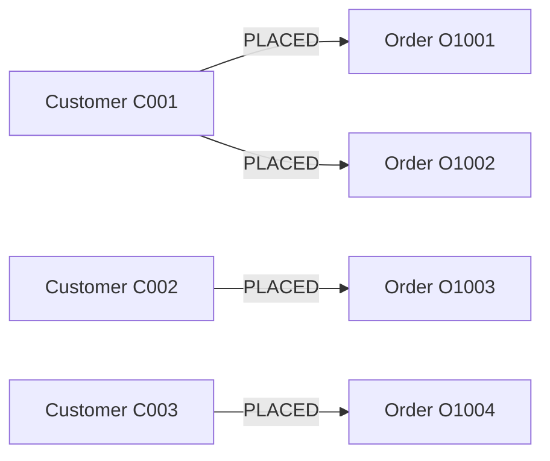
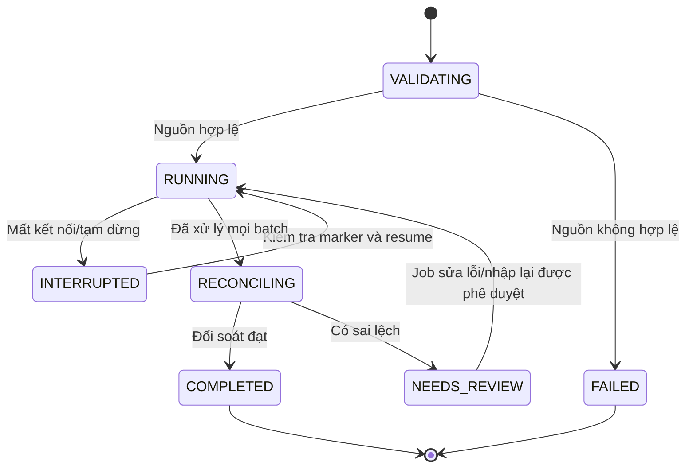

# Thiết kế nhập lại an toàn, tiếp tục sau lỗi và đối soát kết quả trong Neo4j

## Mục tiêu học tập

Trong Neo4j, một lần nhập dữ liệu có thể tạo **node**, **relationship** và các **property** trên đồ thị. Với dữ liệu lớn, tác vụ nhập thường được chia thành nhiều giao dịch: mỗi giao dịch có thể commit độc lập, kết nối có thể đứt giữa chừng, một số bản ghi có thể sai định dạng hoặc khóa nghiệp vụ có thể trùng.

Vì vậy, yêu cầu “nhập lại an toàn” không chỉ là chạy lại cùng câu lệnh `LOAD CSV` hoặc `MERGE`. Ta cần thiết kế đồng thời ba khả năng:

1. **Nhập lại an toàn (idempotent replay):** chạy lại cùng một nguồn và cùng phiên bản dữ liệu không nhân đôi thực thể hoặc áp dụng tác động nghiệp vụ thêm lần nữa.
2. **Tiếp tục sau lỗi (resume/recovery):** biết những lô nào đã commit, lô nào phải thực hiện lại, kể cả khi ứng dụng không nhận được phản hồi cuối cùng.
3. **Đối soát (reconciliation):** chứng minh dữ liệu đích khớp với nguồn về định danh, thuộc tính, quan hệ và các bất biến nghiệp vụ, thay vì chỉ dựa trên thông báo “thực thi thành công”.

Bài thuộc chương **Nhập dữ liệu** của mô-đun `DATABASE_ENGINE_GRAPH_NEO4J`, kết hợp mô hình **property graph**, Cypher, constraint/index, Neo4j Java Driver, Spring Data Neo4j và vận hành. Sau bài này, bạn có thể thiết kế một pipeline nhập có checkpoint, phát lại an toàn và báo cáo sai lệch có thể kiểm tra.

> **Phạm vi:** Cú pháp Cypher chính phù hợp Neo4j 5. Ví dụ `CALL (row) { ... }` sử dụng *variable scope clause* có từ Neo4j 5.23; phiên bản cũ có cách nhập biến khác. Ví dụ Java sử dụng Java 17+ và Neo4j Java Driver 5.x. Số liệu hiệu năng và cách xử lý retry cần xác minh trong môi trường thực tế.

## 1. Một kịch bản nhập có thể thất bại

Giả sử hệ thống nhận CSV đơn hàng với các trường:

```csv
tenantId,orderId,customerId,placedAt,total
T1,O1001,C001,2026-11-20T09:00:00Z,120.50
T1,O1002,C001,2026-11-20T09:05:00Z,80.00
T1,O1003,C002,2026-11-20T10:00:00Z,200.00
T1,O1004,C003,2026-11-21T08:30:00Z,50.00
```

Đồ thị đích:



Mỗi đơn hàng thuộc **đúng một** khách hàng của cùng tenant. Định danh khách hàng và đơn hàng chỉ duy nhất **trong phạm vi tenant**, nên phải dùng khóa kết hợp `(tenantId, customerId)` và `(tenantId, orderId)`.

Giả sử pipeline xử lý bốn batch:

| Batch | Diễn biến | Điều gì thực sự xảy ra? |
| --- | --- | --- |
| 1 | Neo4j commit và trả thành công | Dữ liệu đã được ghi |
| 2 | Neo4j commit nhưng mạng đứt trước khi client nhận phản hồi | Trạng thái **client chưa rõ**, không được đoán là thất bại |
| 3 | Một dòng có `total` không hợp lệ, giao dịch rollback | Batch chưa commit; dữ liệu sai cần xử lý |
| 4 | Ứng dụng dừng trước khi chạy | Chưa gửi batch |

Nếu gọi lại toàn bộ tác vụ bằng `CREATE`, có thể tạo trùng node/relationship. Nếu bỏ qua batch 2 vì nghĩ đã chạy, không thể chứng minh nó đã commit. Nếu chỉ nhìn log “đã gửi 4 batch”, không biết số thực thể có đúng hay không.

## 2. Xác định hợp đồng nhập trước khi viết Cypher

Một pipeline đáng tin cậy phải có **hợp đồng dữ liệu** nhất quán giữa nguồn, thao tác ghi và đối soát:

| Thành phần | Quyết định cần chốt |
| --- | --- |
| Khóa nghiệp vụ | Tenant + ID bất biến của khách hàng và đơn hàng |
| Quan hệ | Mỗi `Order` có đúng một `PLACED` từ `Customer` kỳ vọng |
| Quy tắc trùng trong nguồn | Cùng khóa xuất hiện hai lần thì từ chối, hoặc áp dụng quy tắc phiên bản/ưu tiên xác định |
| Ý nghĩa chạy lại | Cùng snapshot đầu vào và mapping tạo cùng trạng thái đích |
| Chính sách cập nhật | Ghi đè bản ghi nguồn mới nhất, chỉ thêm mới, hay kiểm tra version |
| Ranh giới transaction | Một batch là một đơn vị commit; marker/checkpoint gắn với commit đó |
| Điểm khôi phục | Mã nguồn, mã batch, fingerprint và trạng thái commit |
| Tiêu chí đối soát | Số bản ghi nguồn hợp lệ, định danh tồn tại, property đúng, relationship đúng |

**Cần phân biệt ba khái niệm:** một **dòng nguồn** không nhất thiết tạo một **node mới**; một node đã tồn tại có thể chỉ được cập nhật; nhiều dòng nguồn có thể cùng tham chiếu một khách hàng. Vì vậy `rowsProcessed`, `nodesCreated` và `relationshipsCreated` là những số đo **khác nhau**.

## 3. Khóa ổn định và ràng buộc duy nhất

Trước khi nhập, tạo constraint trong cơ sở dữ liệu thực hành (chạy riêng từng câu lệnh):

```cypher
CREATE CONSTRAINT customer_key_unique IF NOT EXISTS
FOR (c:Customer)
REQUIRE (c.tenantId, c.customerId) IS UNIQUE;
```

```cypher
CREATE CONSTRAINT order_key_unique IF NOT EXISTS
FOR (o:Order)
REQUIRE (o.tenantId, o.orderId) IS UNIQUE;
```

Để ghi nhận mỗi batch đã commit, tạo thêm khóa của marker:

```cypher
CREATE CONSTRAINT import_batch_key_unique IF NOT EXISTS
FOR (b:ImportBatch)
REQUIRE (b.jobId, b.batchNo) IS UNIQUE;
```

Các unique constraint bảo vệ khóa khỏi trùng lặp ngay cả khi có nhiều writer. Chúng cũng tạo index phục vụ truy vấn tìm theo khóa tương ứng. Tuy nhiên chúng **không tự bảo đảm** rằng mỗi đơn hàng chỉ có đúng một relationship `PLACED`, hay rằng tên/mã khách hàng trong nguồn là chính xác. Những bất biến này cần được thiết kế trong thao tác ghi và kiểm tra đối soát.

### 3.1. Dữ liệu cần được kiểm tra trước khi MERGE

Ví dụ các lỗi cần loại hoặc đưa vào hàng chờ xử lý:

- `tenantId`, `orderId` hoặc `customerId` thiếu, rỗng hoặc không hợp lệ.
- `total` không chuyển được thành số hoặc vi phạm ràng buộc nghiệp vụ (chẳng hạn âm khi không hỗ trợ hoàn tiền).
- `placedAt` không phải thời điểm hợp lệ, thiếu timezone hoặc không theo chuẩn quy định.
- Hai dòng cùng `(tenantId, orderId)` nhưng khác `customerId` hay khác nội dung, trong khi pipeline chưa có quy tắc giải quyết xung đột.
- Dòng quá lớn hoặc bị sai định dạng khiến một batch không thể ghi an toàn.

`MERGE (o:Order {orderId: row.orderId})` sẽ sai trong bài toán nhiều tenant vì khóa thiếu `tenantId`. `MERGE` với property khóa `null` cũng gây lỗi; kiểm tra dữ liệu trước khi gửi đến Neo4j.

## 4. Thiết kế phép ghi có thể chạy lại

Với một batch đã chuẩn hóa từ nguồn, gửi danh sách bằng tham số `$rows` thay vì nối nội dung CSV vào chuỗi Cypher:

```cypher
UNWIND $rows AS row
MERGE (c:Customer {
  tenantId: row.tenantId,
  customerId: row.customerId
})
MERGE (o:Order {
  tenantId: row.tenantId,
  orderId: row.orderId
})
SET o.placedAt = datetime(row.placedAt),
    o.total = toFloat(row.total)
MERGE (c)-[:PLACED]->(o);
```

Giả sử `$rows` đã được xác minh là hợp lệ và không có hai bản cập nhật mâu thuẫn cho cùng một đơn hàng:

1. `MERGE (c)` tìm khách hàng hiện có hoặc tạo khách hàng mới theo khóa.
2. `MERGE (o)` tìm hoặc tạo đơn hàng theo khóa.
3. `SET` cập nhật property thành giá trị từ snapshot, không tăng giảm dựa trên giá trị hiện tại.
4. `MERGE (c)-[:PLACED]->(o)` tìm hoặc tạo relationship giữa **hai node đã được ràng buộc**. Chạy lại cùng batch sẽ không chủ động tạo thêm một relationship cùng mẫu nếu một relationship phù hợp đã tồn tại.

Đây là kiểu **upsert đặt trạng thái** có thể chạy lại với cùng dữ liệu. Một số kiểu ghi khác không có tính chất đó:

| Cách ghi | Rủi ro khi replay |
| --- | --- |
| `CREATE (o:Order {...})` | Tạo trùng hoặc gặp lỗi unique constraint |
| `CREATE (c)-[:PLACED]->(o)` | Có thể tạo relationship trùng |
| `SET o.total = row.total` | Giá trị cuối giống nhau nếu đầu vào và quy tắc ghi không đổi |
| `SET o.total = o.total + row.delta` | Có thể cộng thêm lần nữa khi chạy lại |
| `SET o.importedAt = datetime()` | Mỗi lần phát lại cho giá trị mới, không còn trạng thái hoàn toàn giống nhau |

**Lưu ý nghiệp vụ:** `MERGE` không tự xóa một quan hệ cũ từ khách hàng khác đến cùng đơn hàng. Nếu nguồn sau đổi `customerId` của `O1001`, câu lệnh sẽ có thể tạo thêm `PLACED` mới, khiến đơn hàng có hai khách hàng. Pipeline phải chọn một chính sách: **từ chối thay đổi chủ đơn hàng**, hoặc xóa/chuyển quan hệ cũ trong transaction theo quy tắc kiểm soát. Không giả định `MERGE` đã tự bảo vệ bất biến “đúng một khách hàng”.

### 4.1. Bản cập nhật mới hơn và ghi đồng thời

Nếu nguồn có trường `sourceVersion` hoặc `eventSequence` tăng đơn điệu theo đơn hàng, có thể thiết kế chính sách chỉ áp dụng phiên bản mới hơn. Nếu không, việc replay bản cũ sau khi đã nhập bản mới có thể ghi đè giá trị vừa cập nhật.

Một cách triển khai là kiểm tra version hiện tại và áp dụng cập nhật có điều kiện bên trong **transaction** có quản lý xung đột, kèm unique constraint. Cần đánh giá trường hợp nhiều writer chạm cùng node, khóa transaction và retry. Chỉ thêm điều kiện `WHERE row.version > o.version` vào một truy vấn phức tạp không tự bảo đảm đúng dưới mọi cuộc đua ghi.

Khi bài toán mang tính **sự kiện** (ví dụ tăng tồn kho 5 đơn vị), cần mã sự kiện duy nhất và marker ngăn áp dụng trùng trong cùng transaction; không thể thay cơ chế này bằng `MERGE` node đơn thuần.

## 5. Định danh job, snapshot nguồn và batch

Để biết **chính xác đang chạy lại cái gì**, metadata của lần nhập nên chứa:

```json
{
  "jobId": "orders-T1-2026-11-25-v1",
  "sourceHash": "sha256-of-immutable-source",
  "mappingVersion": "orders-to-graph-v1",
  "expectedRows": 4,
  "batchSize": 500,
  "createdAt": "2026-11-25T08:00:00Z"
}
```

`sourceHash` trong ví dụ là **ký hiệu mô tả**, không phải giá trị SHA-256 thật. Trong ứng dụng, tính fingerprint trên **bytes nguồn bất biến** hoặc trên chuỗi bản ghi đã chuẩn hóa theo quy tắc được thống nhất. Thay đổi nguồn hay mapping phải tạo một phiên bản job mới hoặc bị chặn bởi kiểm tra phiên bản.

Thiết kế các lô có danh tính ổn định:

```text
Job: orders-T1-2026-11-25-v1
  Batch 0000: source rows 00001..00500, batchHash H0
  Batch 0001: source rows 00501..01000, batchHash H1
  Batch 0002: source rows 01001..01500, batchHash H2
  ...
```

Một batch có thể lưu `jobId`, `batchNo`, `batchHash`, `rowCount`, `committedAt` và thông tin quan sát được sau commit. Hash phải tính theo **cùng thứ tự và cùng quy tắc chuẩn hóa**; nếu thứ tự nguồn có thể thay đổi, hãy cố định một thứ tự bằng khóa hoặc một offset trên snapshot bất biến.

### 5.1. Tránh checkpoint chỉ dựa trên số dòng đã đọc

Đọc được 1.000 dòng từ CSV không có nghĩa đã commit 1.000 dòng. Với nguồn đang thay đổi, `OFFSET 1000` hoặc “dòng 1.001 trong danh sách hiện tại” có thể chỉ đến bản ghi khác sau khi thêm/xóa dữ liệu.

Một cursor phù hợp cần:

- Trỏ vào **snapshot hoặc phiên bản nguồn cố định**.
- Có thứ tự bền vững (mã dòng/số thứ tự trong file đã đóng băng hoặc khóa tăng đơn điệu).
- Được lưu là **đã commit** chỉ sau khi batch tương ứng được xác nhận.
- Có thể tái dựng chính xác batch từ `jobId`, `batchNo` và nguồn tương ứng.

Nếu checkpoint được lưu ngoài Neo4j, ứng dụng có thể dừng sau khi Neo4j đã commit nhưng trước khi ghi checkpoint ngoài. Vì vậy vẫn phải hỗ trợ **replay an toàn**.

## 6. Chia lô phía Neo4j bằng CALL ... IN TRANSACTIONS

Đối với CSV máy chủ truy cập được, có thể xử lý theo lô ngay trong Cypher. Ví dụ dưới đây **giả định dữ liệu đầu vào đã được kiểm tra** và file nằm trong nơi Neo4j được phép đọc:

```cypher
LOAD CSV WITH HEADERS FROM 'file:///orders.csv' AS row
CALL (row) {
  MERGE (c:Customer {
    tenantId: row.tenantId,
    customerId: row.customerId
  })
  MERGE (o:Order {
    tenantId: row.tenantId,
    orderId: row.orderId
  })
  SET o.placedAt = datetime(row.placedAt),
      o.total = toFloat(row.total)
  MERGE (c)-[:PLACED]->(o)
} IN TRANSACTIONS OF 500 ROWS;
```

`IN TRANSACTIONS OF 500 ROWS` chia các dòng đầu vào thành nhiều giao dịch. Nếu batch thứ ba lỗi, các batch trước đã commit **không tự rollback**. Neo4j không biến toàn bộ lần nhập thành một giao dịch nguyên tử chỉ vì có một câu lệnh Cypher bên ngoài.

Ba giới hạn vận hành:

1. Câu lệnh `CALL { ... } IN TRANSACTIONS` phải chạy trong **implicit transaction**, không đặt trong `session.executeWrite(...)` hoặc một explicit transaction khác. Trong Neo4j Browser, có trường hợp cần tiền tố `:auto` theo phiên bản.
2. `file:///orders.csv` là vị trí file **máy chủ Neo4j** được phép truy cập, không nhất thiết là file ở máy chạy Java Driver; kiểm tra cấu hình import và quyền truy cập.
3. Batching này kiểm soát **số dòng mỗi transaction** nhưng chưa tạo checkpoint nguyên tử theo từng batch trong ví dụ. Với pipeline cần theo dõi từng batch chính xác, mô hình điều phối từ ứng dụng có thể dễ triển khai và đối soát hơn.

Với Neo4j 5 trước 5.23, một số truy vấn dùng lối nhập biến subquery `CALL { WITH row ... }`. Hãy chọn đúng cú pháp được phiên bản sử dụng hỗ trợ.

### 6.1. Có nên bỏ qua dòng lỗi để nhập tiếp?

Không nên tự động chuyển lỗi kiểu dữ liệu, thiếu khóa hoặc xung đột nghiệp vụ thành “thành công”. Nếu muốn nhập tiếp các dòng hợp lệ, pipeline cần **vùng cách ly lỗi (quarantine/dead-letter)** có vị trí nguồn, mã lỗi và dữ liệu cần sửa, rồi đối soát:

```text
Tổng dòng nguồn
  = dòng được chấp nhận
  + dòng bị loại có giải thích
  + dòng chưa được phân loại
```

Trong trạng thái kết thúc sạch, **dòng chưa phân loại phải bằng 0**. Các dòng bị loại có thể là hợp lệ theo chính sách nghiệp vụ, nhưng phải được thống kê và báo cáo minh bạch.

## 7. Java Driver: ghi dữ liệu và marker trong cùng transaction

Một cách phục hồi rõ ràng là để **mỗi batch có một transaction** gồm hai phần:

1. Upsert các node và relationship từ batch.
2. Ghi marker `:ImportBatch` mang `(jobId, batchNo)` và fingerprint của batch **trong chính transaction ấy**.

Hai phần cùng commit hoặc cùng rollback trong Neo4j. Nếu tiến trình bị ngắt sau commit nhưng trước khi nhận phản hồi, lần retry có thể kiểm tra marker để biết batch đó đã ghi.

Ví dụ Java 17+ với Neo4j Java Driver 5.x (giả định đã có `Driver` và các `rows` đã chuẩn hóa, hợp lệ):

```java
import java.util.List;
import java.util.Map;
import org.neo4j.driver.Driver;
import org.neo4j.driver.Record;
import org.neo4j.driver.Session;
import org.neo4j.driver.SessionConfig;

public final class OrderImporter {
    private static final String UPSERT = """
        UNWIND $rows AS row
        MERGE (c:Customer {
          tenantId: row.tenantId,
          customerId: row.customerId
        })
        MERGE (o:Order {
          tenantId: row.tenantId,
          orderId: row.orderId
        })
        SET o.placedAt = datetime(row.placedAt),
            o.total = toFloat(row.total)
        MERGE (c)-[:PLACED]->(o)
        """;

    public static boolean writeOneBatch(
        Driver driver,
        String jobId,
        long batchNo,
        String batchHash,
        List<Map<String, Object>> sourceRows
    ) {
        if (jobId == null || jobId.isBlank()
            || batchHash == null || batchHash.isBlank()
            || batchNo < 0 || sourceRows == null || sourceRows.isEmpty()) {
            throw new IllegalArgumentException("Invalid import batch");
        }

        // Snapshot của tham số được giữ cố định khi driver retry callback.
        List<Map<String, Object>> rows = List.copyOf(sourceRows);
        Map<String, Object> key = Map.of(
            "jobId", jobId,
            "batchNo", batchNo
        );
        Map<String, Object> marker = Map.of(
            "jobId", jobId,
            "batchNo", batchNo,
            "batchHash", batchHash,
            "rowCount", rows.size()
        );

        try (Session session =
                 driver.session(SessionConfig.forDatabase("neo4j"))) {
            return session.executeWrite(tx -> {
                List<Record> committed = tx.run("""
                    MATCH (b:ImportBatch {
                      jobId: $jobId,
                      batchNo: $batchNo
                    })
                    RETURN b.batchHash AS digest
                    """, key).list();

                if (!committed.isEmpty()) {
                    String existingHash =
                        committed.get(0).get("digest").asString();
                    if (!existingHash.equals(batchHash)) {
                        throw new IllegalStateException(
                            "Batch identity reused with different content"
                        );
                    }
                    return false; // Đã commit: không ghi lại.
                }

                tx.run(UPSERT, Map.of("rows", rows)).consume();
                tx.run("""
                    CREATE (:ImportBatch {
                      jobId: $jobId,
                      batchNo: $batchNo,
                      batchHash: $batchHash,
                      rowCount: $rowCount,
                      committedAt: datetime()
                    })
                    """, marker).consume();
                return true; // Transaction sẽ commit khi callback kết thúc.
            });
        }
    }
}
```

**Giải thích ý nghĩa giá trị trả về:** `true` nghĩa là callback đã thực hiện một batch mới và `executeWrite` trả về sau khi transaction thành công; `false` nghĩa là marker cùng hash đã tồn tại, nên batch được xem là đã ghi và được bỏ qua. Không dùng giá trị này như một số đo “node mới được tạo”.

Mẫu trên yêu cầu unique constraint của `ImportBatch(jobId, batchNo)`. Nếu hai worker cùng xử lý một batch, cả hai có thể đọc thấy chưa có marker, nhưng chỉ một transaction được phép tạo marker cùng khóa. Transaction còn lại có thể bị rollback do tranh chấp hoặc lỗi unique constraint; bộ điều phối cần đọc lại marker và retry an toàn. Không giả định mọi lỗi constraint đều được driver tự retry.

`executeWrite` có thể **thực thi lại callback** với lỗi tạm thời. Vì vậy:

- Không gửi email, gọi API thanh toán hay ghi side effect vào hệ ngoài ngay trong callback; callback cần chỉ làm công việc database an toàn khi chạy lại.
- Không tính lại hash từ dữ liệu biến động hay thay đổi danh sách `rows` giữa những lần thử.
- Với lỗi đã commit nhưng ứng dụng mất phản hồi, chạy lại cùng `jobId`, `batchNo` và `batchHash` để phát hiện marker.
- Nếu marker tồn tại nhưng hash khác, **dừng và báo xung đột**; không âm thầm ghi đè marker.
- Nếu `sourceRows` chứa các map có thể sửa, lớp gọi phải tạo một snapshot dữ liệu thực sự bất biến; `List.copyOf` cố định cấu trúc danh sách nhưng **không deep-copy** từng map.

### 7.1. Ranh giới giao dịch với Spring Data Neo4j

Trong Spring Data Neo4j, một phương thức `@Transactional` có thể bao bọc cả vòng lặp batch thành **một transaction**. Để mỗi batch commit độc lập, đặt ranh giới transaction **trên từng batch**, chẳng hạn ở service riêng hoặc `TransactionTemplate`, và ghi marker trong cùng transaction với dữ liệu.

Lưu ý cơ chế proxy của Spring: gọi một phương thức `@Transactional` khác **trong cùng instance** có thể không qua proxy, dẫn đến ranh giới transaction khác dự tính. Mã Java Driver ở trên là ví dụ tự quản lý transaction của driver; không nên đặt một transaction driver độc lập tùy tiện bên trong một unit of work đã được Spring Transaction Manager quản lý mà chưa xác định rõ cơ chế phối hợp.

## 8. Thuật toán resume sau khi ứng dụng dừng

Một luồng điều phối có thể thực hiện:

```text
1. Mở job bằng jobId + sourceHash + mappingVersion đã lưu.
2. Xác minh snapshot nguồn chưa thay đổi.
3. Tạo lại các batch cùng thứ tự và cùng hash.
4. Với mỗi batch:
   a. Kiểm tra marker (jobId, batchNo) nếu cần tối ưu.
   b. Nếu marker trùng hash: ghi nhận đã commit, chuyển batch tiếp.
   c. Nếu chưa có marker: chạy transaction data + marker.
   d. Nếu gặp lỗi tạm thời: retry có backoff và giới hạn.
   e. Nếu gặp lỗi dữ liệu: cách ly batch/dòng lỗi; không báo thành công.
   f. Nếu hash khác: dừng vì đầu vào/logic đã thay đổi.
5. Sau khi tất cả batch ở trạng thái xác định: chạy đối soát.
6. Chỉ đánh dấu job COMPLETED khi đối soát đạt yêu cầu.
```

Batch marker và checkpoint có thể là hai lớp khác nhau. **Marker trong Neo4j** là bằng chứng transaction batch đã commit cùng dữ liệu; **cursor đọc nguồn** giúp biết vị trí đang phát. Khi cursor lưu ở hệ thống khác, có thể cập nhật cursor sau khi kiểm tra marker, nhưng phải chịu được trường hợp cursor chậm hơn dữ liệu thực đã commit.

### 8.1. Phân loại lỗi để quyết định hành động

| Nhóm lỗi | Ví dụ | Xử lý |
| --- | --- | --- |
| Tạm thời | Mất kết nối ngắn, lỗi tranh chấp, transient error | Retry có backoff; kiểm tra marker khi kết quả commit chưa rõ |
| Dữ liệu không hợp lệ | Thiếu `orderId`, `total` sai kiểu, timestamp lỗi | Quarantine, xác định dòng hỏng, sửa nguồn hoặc loại có lý do |
| Xung đột nghiệp vụ | Cùng order khác customer, version cũ ghi đè mới | Từ chối hoặc áp dụng chính sách giải quyết xung đột rõ ràng |
| Sai hợp đồng job | Cùng `jobId` và `batchNo` nhưng hash khác | Dừng; không coi là cùng batch |
| Tài nguyên/hiệu năng | Transaction quá lớn, timeout, bộ nhớ cao | Giảm kích thước batch, kiểm tra kế hoạch và giới hạn đồng thời |

Với một batch chứa dòng hỏng, có thể chia nhỏ để định vị bản ghi lỗi **nếu việc chia nhỏ không làm thay đổi định danh batch/checkpoint mà hệ thống dùng để resume**. Một cách là cách ly các dòng đó ở bước staging trước khi chạy job chính; cách khác là tạo một job sửa lỗi mới. Không “tách lại” batch 3 thành các batch mới nhưng vẫn giữ `batchHash` của batch cũ.

### 8.2. Tình huống commit không chắc chắn

Nếu driver mất kết nối đúng lúc gửi commit, ứng dụng có thể không biết server đã commit hay chưa. Quy trình an toàn:

1. Không lập tức ghi “FAILED AND NOT COMMITTED” như một sự thật.
2. Kết nối lại và đọc marker theo khóa `(jobId, batchNo)`.
3. Nếu marker cùng hash tồn tại, batch đã commit trong thiết kế dùng **data + marker cùng transaction**.
4. Nếu không có marker, chạy lại bằng cùng dữ liệu và cùng khóa; unique constraint cùng phép ghi idempotent giúp tránh trùng khi có retry hoặc cạnh tranh.
5. Nếu marker hash khác hoặc dữ liệu không đối soát, báo lỗi và điều tra.

Cách này cho hiệu quả **không áp dụng trùng trong phạm vi các thao tác được phối hợp đúng trong Neo4j**, chứ không hứa “exactly once” trên mọi hệ ngoài hoặc với side effect nằm ngoài transaction.

## 9. Đối soát: từ số lượng đến trạng thái đồ thị

Không chỉ nhìn thống kê `nodesCreated` hoặc `relationshipsCreated`: với `MERGE`, batch phát lại hợp lệ có thể tạo **0 node mới** nhưng vẫn đã xử lý đủ bản ghi.

Thiết kế đối soát theo nhiều tầng:

1. **Nguồn:** tổng dòng vật lý, dòng hợp lệ, dòng bị loại có lý do, số khóa phân biệt, fingerprint của snapshot.
2. **Giao dịch:** số marker batch, tổng số `rowCount` đã xác nhận commit, các batch còn thiếu hoặc bị xung đột hash.
3. **Định danh:** mọi khóa đơn hàng kỳ vọng đều có node tương ứng và không có bản ghi ngoài phạm vi mà job đã tạo sai.
4. **Thuộc tính:** giá trị `total`, `placedAt` và các trường nghiệp vụ khớp sau chuẩn hóa/kiểu dữ liệu.
5. **Quan hệ:** mỗi đơn hàng nối đúng khách hàng và đúng số relationship, không có quan hệ trùng hoặc nối nhầm tenant.

### 9.1. Kiểm tra marker các batch đã ghi

```cypher
MATCH (b:ImportBatch {jobId: $jobId})
RETURN count(b) AS committedBatches,
       coalesce(sum(b.rowCount), 0) AS acknowledgedRows;
```

So sánh với danh sách batch của manifest. Nếu các batch có `rowCount` lần lượt 500, 500 và 200, tổng được xác nhận phải bằng 1.200. **Nhưng chưa thể kết luận** có đúng 1.200 node mới, vì nhiều dòng có thể cùng khách hàng hoặc cập nhật node đã tồn tại.

Muốn phát hiện **batch thiếu**, nên so sánh từng `batchNo` và `batchHash` với manifest nguồn trong ứng dụng hoặc dữ liệu staging; chỉ so sánh tổng là chưa đủ vì hai batch khác nhau có thể có cùng `rowCount`.

### 9.2. Đối soát từng order và quan hệ kỳ vọng

Ví dụ ứng dụng truyền tham số `$expectedRows` là danh sách bản ghi đã được chuẩn hóa của một batch hoặc một phần của manifest:

```cypher
UNWIND $expectedRows AS row
OPTIONAL MATCH (c:Customer {
  tenantId: row.tenantId,
  customerId: row.customerId
})
OPTIONAL MATCH (o:Order {
  tenantId: row.tenantId,
  orderId: row.orderId
})
OPTIONAL MATCH (c)-[r:PLACED]->(o)
WITH row, c, o, count(r) AS expectedLinks
WHERE c IS NULL
   OR o IS NULL
   OR expectedLinks <> 1
   OR o.total IS NULL
   OR o.total <> toFloat(row.total)
   OR o.placedAt IS NULL
   OR o.placedAt <> datetime(row.placedAt)
RETURN row.tenantId AS tenantId,
       row.orderId AS orderId,
       row.customerId AS expectedCustomerId,
       expectedLinks
ORDER BY tenantId, orderId;
```

**Kết quả rỗng** nghĩa là các kiểm tra được liệt kê không tìm thấy sai lệch cho tập `$expectedRows` tại thời điểm truy vấn. Nó không kiểm tra những bản ghi nằm **ngoài** danh sách kỳ vọng hoặc quan hệ thừa từ khách hàng khác. Với hàng triệu dòng, chạy đối soát theo batch/khóa và tổng hợp kết quả, thay vì nạp toàn bộ manifest vào một list khổng lồ.

Kiểm tra thêm bất biến “mỗi order có đúng một khách hàng” trong phạm vi những `orderId` vừa nhập:

```cypher
UNWIND $expectedOrderIds AS orderId
OPTIONAL MATCH (o:Order {tenantId: $tenantId, orderId: orderId})
OPTIONAL MATCH (:Customer)-[r:PLACED]->(o)
WITH orderId, o, count(r) AS incomingPlaced
WHERE o IS NULL OR incomingPlaced <> 1
RETURN orderId, incomingPlaced
ORDER BY orderId;
```

Truy vấn thứ hai phát hiện đơn hàng **không có** hoặc có **nhiều** relationship `PLACED`, kể cả khi quan hệ thừa đến từ khách hàng không nằm trong manifest. Để xác nhận quan hệ duy nhất là từ đúng khách hàng và đúng tenant, vẫn cần kiểm tra theo bản ghi kỳ vọng như truy vấn đầu tiên.

### 9.3. Chênh lệch số lượng không đủ để kết luận đúng

Hai tập có cùng 1.000 node vẫn có thể khác 100 ID. Hai graph có cùng 5.000 relationship vẫn có thể nối nhầm các cặp node. Một báo cáo đối soát tốt bao gồm:

| Chỉ số | Điều nên so sánh |
| --- | --- |
| `sourceRows` | Số dòng nguồn theo snapshot |
| `acceptedRows` / `rejectedRows` | Tổng bằng số dòng đã phân loại, có lý do loại |
| `distinctOrderKeys` | Số ID đơn hàng phân biệt trong nguồn |
| `committedBatches` | Đủ từng số batch, đúng từng hash |
| `acknowledgedRows` | Tổng `rowCount` marker theo manifest |
| `missingOrders` | ID nguồn không tìm thấy ở Neo4j |
| `propertyMismatches` | ID có giá trị sai sau chuẩn hóa |
| `missingOrExtraRelationships` | Sai chủ đơn hàng, thiếu hoặc thừa `PLACED` |

Với dữ liệu nguồn lớn, có thể dùng manifest theo phân vùng, checksum chuẩn hóa và kiểm tra chi tiết các khóa bị lệch. Hash chỉ có ý nghĩa khi cả hai phía dùng **cùng encoding, thứ tự, định dạng thời gian, quy tắc số và canonicalization**; không so sánh một file CSV thô với dữ liệu property graph đã chuyển kiểu mà không thống nhất cách biểu diễn.

## 10. Quan sát và điều kiện kết thúc job

Một job có thể có các trạng thái vận hành:



Nên theo dõi `jobId`, `batchNo`, số dòng, số lỗi, thời gian transaction, retry, lock contention, bộ nhớ, tốc độ xử lý, dấu hiệu nhập thiếu và chênh lệch đối soát. `EXPLAIN`/`PROFILE` có thể giúp xác định thao tác `MERGE` có dùng index phù hợp; `PROFILE` thực sự thực thi query, vì vậy chạy trong môi trường thử nghiệm khi có phép ghi.

Chỉ chuyển job sang `COMPLETED` khi:

- Nguồn và mapping đúng phiên bản đã ghi trong manifest.
- Mọi batch hợp lệ đều được xác nhận bằng marker đúng hash.
- Các dòng bị loại có lý do và chính sách xử lý được chấp nhận.
- Đối soát khóa, property, relationship và các bất biến nghiệp vụ đạt yêu cầu.
- Không còn batch trạng thái chưa rõ hoặc sai lệch chưa được phân loại.

**Đừng dùng “không có exception” như tiêu chí duy nhất để đánh dấu nhập thành công.**

## 11. Các sai lầm thường gặp

| Sai lầm | Hậu quả | Cách xử lý |
| --- | --- | --- |
| Chạy lại bằng `CREATE` | Trùng node, trùng relationship | Dùng khóa nghiệp vụ + `MERGE` phù hợp |
| Chỉ dùng `MERGE` node mà bỏ qua quan hệ | Có thể đúng số node nhưng sai graph | Đối soát đầu mút và số relationship |
| Dùng batchNo nhưng không kiểm tra hash | Batch mới có thể ghi đè danh tính batch cũ | Khóa `(jobId,batchNo)` và fingerprint bất biến |
| Lưu checkpoint trước commit | Có thể đánh dấu hoàn tất khi data chưa ghi | Ghi marker cùng transaction data |
| Coi timeout/mất kết nối là rollback chắc chắn | Có thể chạy lại sai hoặc báo trạng thái sai | Đọc marker khi trạng thái commit chưa rõ |
| Cộng dồn thuộc tính khi retry | Áp dụng delta hai lần | Dùng idempotency key hoặc thao tác đặt trạng thái |
| Thay đổi file nguồn nhưng giữ jobId | Resume sai vị trí, sai batch | Cố định sourceHash + mappingVersion |
| Nhìn `nodesCreated` để suy ra số dòng xử lý | Sai khi `MERGE` khớp node có sẵn | Dùng marker rowCount + đối soát khóa |
| Tổng số node/edge đúng nên cho rằng dữ liệu đúng | Có thể sai khóa, property hoặc đầu mút | So sánh danh sách ID và quan hệ kỳ vọng |
| Retry mọi lỗi liên tục | Lỗi dữ liệu trở thành vòng lặp vô hạn | Phân loại transient/permanent, có retry budget |
| Nhiều worker cùng nhập khóa mà không có constraint | Race tạo trùng hoặc xung đột khó xử lý | Unique constraint, transaction, backoff và kiểm tra lại |

## 12. Bài tập thực hành

### Bài 1: Phân biệt thành công và commit chưa rõ

Một job có 3 batch, lần lượt 400, 400 và 200 dòng. Batch 1 thành công. Batch 2 mất phản hồi sau lệnh commit. Batch 3 chưa chạy. Hãy cho biết có thể tuyên bố đã commit bao nhiêu dòng và bước tiếp theo.

**Gợi ý:** có thể xác nhận **400 dòng** của batch 1 từ phản hồi/marker. Batch 2 cần đọc marker cùng `jobId`/`batchNo`/`batchHash` để xác định; không tự suy đoán. Sau khi trạng thái batch 2 rõ ràng, xử lý batch 3, rồi đối soát toàn bộ.

### Bài 2: Sửa thao tác không an toàn khi replay

Cho câu lệnh:

```cypher
UNWIND $rows AS row
CREATE (o:Order {orderId: row.orderId})
SET o.total = o.total + row.delta;
```

Hãy nêu ít nhất ba vấn đề và thiết kế cách thay thế.

**Gợi ý:** thiếu tenant, tạo mới mỗi lần, `o.total` ban đầu có thể `null`, phép cộng không idempotent. Nếu dữ liệu là snapshot tổng cuối, dùng `MERGE` theo khóa cùng `SET o.total = row.total`. Nếu là sự kiện delta, dùng mã sự kiện duy nhất và marker bảo vệ phép cộng trong transaction.

### Bài 3: Viết câu lệnh đối soát

Nguồn hợp lệ chứa 4 đơn hàng nhưng 3 khách hàng. Trong Neo4j có đủ 4 `Order`, 3 `Customer` nhưng chỉ có 3 relationship `PLACED`. Vì sao số node đúng chưa chứng minh nhập đủ? Hãy dùng `UNWIND $expectedRows` và `OPTIONAL MATCH` để liệt kê đơn hàng thiếu quan hệ.

**Gợi ý:** đối chiếu trên khóa đơn hàng, customer kỳ vọng và `count(r)`; kết quả phải chỉ ra đơn hàng có `0` relationship phù hợp.

### Bài 4: Thiết kế resume từ source thay đổi

Một job dùng `OFFSET` trên API nguồn trả danh sách theo “mới nhất”. Khi đã nhập 2.000 dòng thì nguồn thêm 100 dòng đầu danh sách. Nếu tiếp tục bằng `OFFSET 2000`, chuyện gì có thể xảy ra?

**Gợi ý:** các vị trí bị dịch nên một số dòng đã nhập có thể xuất hiện lại, một số dòng khác bị bỏ qua. Giải pháp là snapshot nguồn bất biến, khóa/keyset cursor ổn định kèm version nguồn hoặc manifest ID cố định; kết hợp replay idempotent và đối soát.

### Bài 5: Chọn điều kiện hoàn thành

Một job đã có đầy đủ marker 10 batch và `acknowledgedRows = 5.000` nhưng đối soát phát hiện 3 đơn hàng nối sai khách hàng. Có được đánh dấu `COMPLETED` không?

**Gợi ý:** không. Marker chứng minh batch đã commit cùng dữ liệu được xử lý, nhưng **bất biến nghiệp vụ của graph** chưa đạt. Job cần `NEEDS_REVIEW` hoặc trạng thái tương đương, và phải sửa/đối soát lại.

## 13. Checklist khi thiết kế pipeline nhập

- [ ] Nguồn có `jobId`, hash, phiên bản mapping và quy tắc chuẩn hóa rõ ràng.
- [ ] Dữ liệu được kiểm tra, phân loại lỗi và xử lý trùng trước khi ghi.
- [ ] Node có khóa nghiệp vụ và unique constraint, kể cả tenant khi cần.
- [ ] Relationship được tạo giữa các node đã match/merge đúng khóa và có bất biến đầu mút.
- [ ] Mọi thao tác phát lại đều idempotent hoặc có marker ngăn áp dụng trùng.
- [ ] Có quy tắc cho bản ghi cũ, cập nhật mới, sự kiện delta và ghi đồng thời.
- [ ] Batch có ID, hash, thứ tự cố định; dấu commit được ghi cùng transaction data.
- [ ] Mất phản hồi commit không khiến hệ thống suy diễn sai trạng thái.
- [ ] Resume từ checkpoint của snapshot bất biến, có retry budget và quarantine.
- [ ] Đối soát cả số dòng, số khóa, property, relationship và invariant.
- [ ] Job chỉ thành công khi marker đủ và kết quả đối soát đạt.
- [ ] Đã thử crash ở trước commit, sau commit, khi mất kết nối, khi dữ liệu lỗi và khi có hai worker.

## Kết luận

Thiết kế nhập lại an toàn trong Neo4j cần nhiều hơn việc chia lô. **Khóa nghiệp vụ + unique constraint + thao tác ghi idempotent** giúp phát lại mà không nhân đôi dữ liệu. **Marker batch và dữ liệu cùng transaction** giúp nhận diện điều gì đã commit, kể cả khi phản hồi bị mất. **Manifest nguồn bất biến và cơ chế resume** giúp tiếp tục đúng vị trí. Cuối cùng, **đối soát node, property, relationship và bất biến nghiệp vụ** cho biết đồ thị đích đã thực sự đúng hay chưa. Ba lớp này tạo thành nền tảng cho nhập liệu quy mô lớn qua Cypher, Java Driver và Spring Data Neo4j.

### Tài liệu tham khảo

- [Neo4j Cypher Manual — MERGE](https://neo4j.com/docs/cypher-manual/current/clauses/merge/)
- [Neo4j Cypher Manual — Constraints](https://neo4j.com/docs/cypher-manual/current/constraints/)
- [Neo4j Cypher Manual — LOAD CSV](https://neo4j.com/docs/cypher-manual/current/clauses/load-csv/)
- [Neo4j Cypher Manual — CALL subqueries in transactions](https://neo4j.com/docs/cypher-manual/current/subqueries/subqueries-in-transactions/)
- [Neo4j Java Driver Manual — Transactions](https://neo4j.com/docs/java-manual/current/transactions/)
