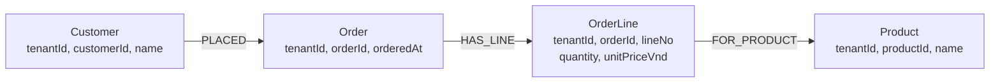
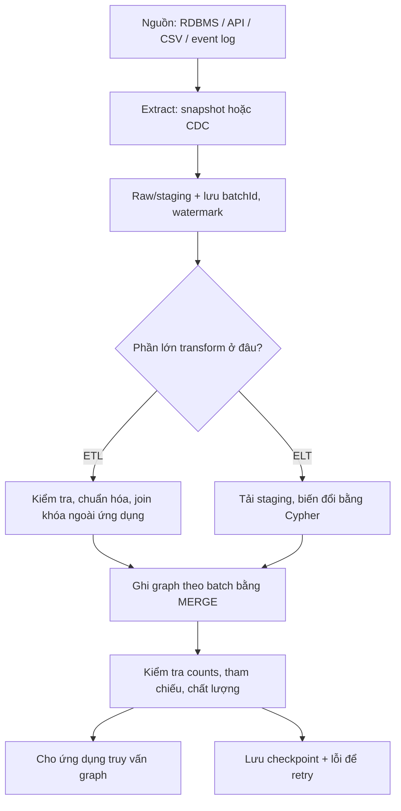

# Thiết kế luồng ETL hoặc ELT đưa dữ liệu nghiệp vụ vào đồ thị Neo4j

Một cơ sở dữ liệu nghiệp vụ thường lưu thông tin trong nhiều bảng hoặc sự kiện: khách hàng, đơn hàng, sản phẩm, dòng hàng, lần thanh toán và trạng thái giao vận. Khi đưa dữ liệu đó vào Neo4j, mục tiêu không phải sao chép từng bảng thành một label một cách máy móc. Cần quyết định **thực thể nào trở thành node, quan hệ nghiệp vụ nào trở thành relationship, khóa nào dùng để nhận diện bản ghi, và dữ liệu thay đổi sẽ được đồng bộ ra sao**.

Bài học thuộc chương **Tích hợp dữ liệu** của module `DATABASE_ENGINE_GRAPH_NEO4J`. Trọng tâm là **thiết kế luồng ETL hoặc ELT** từ nguồn nghiệp vụ đến property graph, sử dụng Cypher, ràng buộc dữ liệu, quy trình nhập theo lô và cập nhật gia tăng. Các nguyên tắc áp dụng khi xây dựng dịch vụ bằng Neo4j Java Driver hoặc Spring Data Neo4j, cũng như khi vận hành một hệ thống đồ thị thực tế.

Kết quả mong muốn của một pipeline tốt là: **đúng mô hình, đúng khóa, có thể chạy lại mà không sinh bản sao, phát hiện được bản ghi lỗi, mở rộng được theo dữ liệu, và chứng minh được tính đầy đủ sau mỗi lần đồng bộ**.

## 1. ETL và ELT khác nhau tại đâu?

Cả ETL lẫn ELT đều có ba hoạt động cốt lõi:

- **Extract (E):** đọc dữ liệu từ cơ sở dữ liệu quan hệ, tệp CSV/JSON, API hoặc luồng sự kiện.
- **Transform (T):** làm sạch, chuyển kiểu, chuẩn hóa khóa, xác định node/relationship, kiểm tra bản ghi và quy tắc nghiệp vụ.
- **Load (L):** ghi kết quả đến Neo4j bằng Cypher, công cụ nhập dữ liệu, connector hoặc ứng dụng sử dụng Driver.

Sự khác biệt là **vị trí và thời điểm thực hiện phần lớn biến đổi**.

| Tiêu chí | ETL | ELT |
| --- | --- | --- |
| Thứ tự chính | Extract → Transform → Load | Extract → Load → Transform |
| Nơi biến đổi | Ứng dụng ETL, Spark, SQL staging, dịch vụ tích hợp... | Trong nền tảng dữ liệu sau bước tải, ví dụ dùng Cypher trên dữ liệu staging trong Neo4j |
| Dữ liệu đi vào graph đích | Thường đã được kiểm tra và chuẩn hóa | Có thể tải dữ liệu nguồn vào vùng staging trước, rồi chuyển thành graph nghiệp vụ |
| Kiểm soát chất lượng | Chặn bản ghi sai trước khi ghi vào graph đích | Phải phân biệt rõ staging với graph đã được xác thực |
| Trường hợp phù hợp | Hệ thống cần ràng buộc chặt, dữ liệu đến từ nhiều nguồn không đồng nhất | Muốn lưu dấu dữ liệu gốc và biến đổi lặp lại ngay trong môi trường đích |
| Đổi lại | Cần duy trì logic biến đổi bên ngoài Neo4j | Cần quản lý tài nguyên và vòng đời staging, tránh để dữ liệu thô ảnh hưởng truy vấn nghiệp vụ |

Ví dụ: hệ thống quản lý đơn hàng có giá trị tiền dạng chuỗi, email chứa khoảng trắng và một số mã khách hàng không tồn tại. Trong **ETL**, ứng dụng xử lý và loại lỗi trước khi tạo `:Customer`, `:Order`, `:Product`. Trong một biến thể **ELT**, pipeline có thể tải bản ghi vào các node `:StageOrder` có định danh đợt nhập, kiểm tra bằng Cypher, rồi mới tạo graph nghiệp vụ.

**Không có lựa chọn tuyệt đối:** cả hai cách đều có thể hiệu quả. Chọn theo nơi dữ liệu được kiểm soát tốt nhất, quy mô, thời gian cập nhật, khả năng truy vết và mức cô lập giữa staging với graph phục vụ người dùng.

## 2. Bắt đầu từ câu hỏi nghiệp vụ, rồi mới thiết kế graph

Giả sử cần trả lời:

1. Khách hàng nào đã đặt những đơn hàng nào?
2. Đơn hàng gồm sản phẩm gì, số lượng và đơn giá **tại thời điểm mua**?
3. Sản phẩm nào thường xuất hiện chung trong giỏ hàng?
4. Trong từng tenant, có bao nhiêu đơn hàng, tổng doanh thu theo khách hàng là bao nhiêu?

Dữ liệu nguồn có thể gồm:

| Tập nguồn | Khóa chính nguồn | Thuộc tính ví dụ | Khóa tham chiếu |
| --- | --- | --- | --- |
| `customers` | `(tenant_id, customer_id)` | `customer_name` | — |
| `products` | `(tenant_id, product_id)` | `product_name` | — |
| `orders` | `(tenant_id, order_id)` | `ordered_at` | `customer_id` |
| `order_lines` | `(tenant_id, order_id, line_no)` | `quantity, unit_price_vnd` | `order_id, product_id` |

Một mô hình graph phù hợp:



Lý do chọn `OrderLine` là **node riêng**:

- Một đơn có thể chứa cùng một sản phẩm nhiều lần, ví dụ cùng SKU ở các dòng có chương trình khuyến mãi khác nhau. Nếu gộp trực tiếp thành một relationship `Order-[:CONTAINS]->Product`, cần tự quyết định cách phân biệt từng dòng hàng.
- `quantity`, `unitPriceVnd` là giá trị của **lần mua**, không phải thuộc tính bất biến của `Product`. Giá niêm yết có thể đổi nhưng dữ liệu đơn hàng quá khứ phải giữ nguyên.
- `OrderLine` có khóa nguồn ổn định `(tenantId, orderId, lineNo)`, thuận tiện cho cập nhật, đối soát và sự kiện thay đổi.

Không phải mọi bảng đều cần node riêng: bảng nối thuần túy không có vòng đời, thuộc tính hoặc định danh độc lập có thể trở thành relationship. Quyết định dựa vào ngữ nghĩa, không chỉ cấu trúc SQL.

## 3. Quy ước khóa, quan hệ và thuộc tính trước khi viết pipeline

### 3.1. Khóa nghiệp vụ phải có tính ổn định

Neo4j có `elementId()` dùng để xác định phần tử trong các thao tác truy vấn, nhưng **không dùng element ID làm khóa đồng bộ lâu dài giữa các hệ thống**. Khi xóa/tái nhập dữ liệu hoặc đổi môi trường, ID nội bộ không phải hợp đồng nhận diện nghiệp vụ.

Trong ví dụ, hai khách hàng cùng mã `C001` nhưng thuộc tenant khác nhau là hai đối tượng khác nhau. Vì vậy, khóa phải gồm cả `tenantId` và `customerId`:

```text
Customer:  tenantId + customerId
Product:   tenantId + productId
Order:     tenantId + orderId
OrderLine: tenantId + orderId + lineNo
```

Nếu một nguồn có khóa chỉ duy nhất **trong từng chi nhánh**, không được tự bỏ mã chi nhánh khi hợp nhất dữ liệu. Ngược lại, thêm trường vào khóa khi trường đó có thể thay đổi (ví dụ tên khách hàng) sẽ khiến cùng đối tượng bị tạo thành nhiều node.

### 3.2. Đặt quy tắc thay đổi dữ liệu

Cần thống nhất:

- **Thuộc tính bắt buộc:** `tenantId`, `customerId`, `orderId`, `productId` và `lineNo` phải hợp lệ trước khi `MERGE`.
- **Định dạng:** ngày là ISO `YYYY-MM-DD`, số lượng và giá tiền là số nguyên không âm theo quy định nghiệp vụ, mã được chuẩn hóa nhất quán.
- **Tính lịch sử:** `unitPriceVnd` nằm trên `OrderLine` để phản ánh giá tại thời điểm bán.
- **Cập nhật:** tên khách hàng, tên sản phẩm có thể ghi đè bằng phiên bản mới; mã khóa đã dùng để `MERGE` không nên được thay đổi tùy tiện.
- **Xóa:** xóa khách hàng ở nguồn có dẫn tới xóa node cùng các đơn hàng hay chỉ đánh dấu không còn hoạt động? Đây là quyết định nghiệp vụ cần làm rõ ngay từ đầu.

### 3.3. Ràng buộc chống trùng khóa

Trước khi nhập, tạo uniqueness constraint cho khóa nghiệp vụ. Ví dụ cú pháp Cypher trên Neo4j 5:

```cypher
CREATE CONSTRAINT biz_customer_unique IF NOT EXISTS
FOR (c:BizCustomer)
REQUIRE (c.tenantId, c.customerId) IS UNIQUE;
```

```cypher
CREATE CONSTRAINT biz_product_unique IF NOT EXISTS
FOR (p:BizProduct)
REQUIRE (p.tenantId, p.productId) IS UNIQUE;
```

```cypher
CREATE CONSTRAINT biz_order_unique IF NOT EXISTS
FOR (o:BizOrder)
REQUIRE (o.tenantId, o.orderId) IS UNIQUE;
```

```cypher
CREATE CONSTRAINT biz_order_line_unique IF NOT EXISTS
FOR (l:BizOrderLine)
REQUIRE (l.tenantId, l.orderId, l.lineNo) IS UNIQUE;
```

Composite uniqueness đảm bảo không có hai node cùng **bộ khóa hiện diện**. Nó không thay thế kiểm tra property bắt buộc: nếu khóa thiếu hoặc `null`, cần phát hiện trước khi ghi. Khi edition và phiên bản hỗ trợ, **node key** có thể bổ sung yêu cầu tồn tại và duy nhất; nếu dùng uniqueness cơ bản, pipeline vẫn phải kiểm tra thiếu khóa. Ngoài ra, uniqueness cho node **không tự đảm bảo** mọi order có customer hợp lệ hoặc mọi OrderLine có product hợp lệ.

> **Lưu ý:** tạo constraint trên graph cũ sẽ thất bại nếu dữ liệu đang vi phạm. Với lần tải đầu tiên nên tạo trước khi nạp; với migration cần audit và sửa dữ liệu tồn tại trước.

## 4. Hợp đồng dữ liệu nguồn và kiểm tra chất lượng

Không nên đưa thẳng mọi hàng từ `orders` vào `MERGE`. Hãy định nghĩa một **hợp đồng đầu vào** rõ ràng:

| Kiểm tra | Ví dụ điều kiện | Xử lý khi lỗi |
| --- | --- | --- |
| Khóa bắt buộc | `tenant_id`, `order_id` không rỗng | Loại khỏi lô hợp lệ, đưa vào bảng/quầy lỗi |
| Khóa duy nhất trong snapshot | Không có hai hàng cùng `tenant_id + order_id` gây xung đột | Phân tích source hoặc chọn quy tắc bản ghi thắng |
| Tham chiếu | `orders.customer_id` tồn tại trong cùng tenant | Hoãn tạo edge hoặc đưa vào danh sách lỗi tham chiếu |
| Kiểu dữ liệu | `quantity` là số nguyên dương | Không ép kiểu mù quáng |
| Thời gian | `ordered_at` parse được thành ngày hợp lệ | Gắn lỗi chuyển đổi |
| Tiền tệ | `unit_price_vnd` theo VND, không trộn đơn vị | Chuẩn hóa đơn vị hoặc loại lỗi |
| Chuẩn hóa | Mã bỏ khoảng trắng thừa, thống nhất hoa/thường theo hợp đồng | Áp cùng quy tắc ở snapshot và delta |

Một cách tổ chức bản ghi:

```json
{
  "source": "order-service",
  "batchId": "orders-2026-11-25-001",
  "tenantId": "T1",
  "orderId": "O100",
  "customerId": "C001",
  "orderedAt": "2026-11-05",
  "sourceVersion": 7
}
```

`batchId` giúp truy vết quá trình nhập; `sourceVersion` (nếu hệ thống nguồn cung cấp phiên bản tăng đơn điệu cho từng đối tượng) giúp xử lý sự kiện đến trễ. Những trường này là **metadata tích hợp**, không mặc nhiên trở thành một phần khóa nghiệp vụ.

Với dữ liệu CSV, có thể dùng `trim()` cho mã chuỗi trong bước biến đổi, nhưng phải xác định liệu mã `ABC` và `abc` có cùng đối tượng hay không. Đừng tự áp `toLower()` cho mọi khóa nếu nguồn phân biệt chữ hoa/thường.

## 5. Kiến trúc luồng ETL/ELT cho Neo4j

Một pipeline điển hình gồm các thành phần:



Một số quyết định vận hành cần có:

1. **Tải lần đầu (initial snapshot):** đưa toàn bộ thực thể và quan hệ theo một mốc dữ liệu nhất quán.
2. **Tải gia tăng:** đọc các thay đổi sau mốc snapshot bằng `updated_at` hoặc CDC (Change Data Capture).
3. **Thứ tự tạo graph:** tạo node được tham chiếu trước, sau đó tạo node và relationship phụ thuộc.
4. **Cách chia lô:** giới hạn số hàng mỗi transaction theo kích thước bản ghi và tải của database; không đặt một transaction cho toàn bộ dữ liệu.
5. **Theo dõi và retry:** lưu batch ID, offset/watermark đã commit, số dòng hợp lệ, số lỗi và nguyên nhân.

Đối với ELT, nếu lưu nguồn thô trong Neo4j bằng các node như `:StageOrder {batchId, payload, ...}`, hãy xác định quy tắc bảo vệ vùng staging, trạng thái đã xử lý và chính sách dọn dẹp. Không để ứng dụng nghiệp vụ vô tình truy vấn chung node staging chưa xác thực.

## 6. Ví dụ nhập dữ liệu chuẩn hóa bằng Cypher và MERGE

Các ví dụ ở phần này dùng **dữ liệu mẫu nội tuyến** để có thể học độc lập. Chỉ chạy trên **database thử nghiệm**, mỗi tập một lần khi dựng dữ liệu ban đầu. Khi triển khai thật, thay danh sách nội tuyến bằng tham số `$rows` do pipeline cung cấp.

### 6.1. Nạp khách hàng

```cypher
UNWIND [
  {tenantId: 'T1', customerId: 'C001', name: 'An'},
  {tenantId: 'T1', customerId: 'C002', name: 'Bình'}
] AS row
MERGE (c:BizCustomer {
  tenantId: row.tenantId,
  customerId: row.customerId
})
SET c.name = row.name;
```

**Chỉ đưa thuộc tính khóa vào `MERGE`.** Nếu viết `MERGE (c:BizCustomer {tenantId:..., customerId:..., name:...})`, việc đổi `name` có thể khiến toàn bộ mẫu không khớp và cố tạo node mới. Khi có uniqueness constraint trên khóa, thao tác có thể thất bại; khi không có constraint, graph có thể bị trùng đối tượng.

### 6.2. Nạp sản phẩm

```cypher
UNWIND [
  {tenantId: 'T1', productId: 'P01', name: 'Sách Neo4j'},
  {tenantId: 'T1', productId: 'P02', name: 'Khóa học Cypher'}
] AS row
MERGE (p:BizProduct {
  tenantId: row.tenantId,
  productId: row.productId
})
SET p.name = row.name;
```

Hai bước đầu tạo **2 Customer** và **2 Product**. Chạy lại các câu trên với cùng khóa sẽ khớp node sẵn có và cập nhật tên, không tạo thêm node mới trong trường hợp không có dữ liệu trùng trước đó.

### 6.3. Nạp đơn hàng và nối tới khách hàng

```cypher
UNWIND [
  {
    tenantId: 'T1', orderId: 'O100',
    customerId: 'C001', orderedAt: '2026-11-05'
  },
  {
    tenantId: 'T1', orderId: 'O101',
    customerId: 'C002', orderedAt: '2026-11-06'
  }
] AS row
MATCH (c:BizCustomer {
  tenantId: row.tenantId,
  customerId: row.customerId
})
MERGE (o:BizOrder {
  tenantId: row.tenantId,
  orderId: row.orderId
})
SET o.orderedAt = date(row.orderedAt)
MERGE (c)-[:BIZ_PLACED]->(o);
```

`MATCH` tìm khách hàng **trong cùng tenant**. `MERGE` tạo hoặc tìm order và relationship `BIZ_PLACED`. Với các khóa hợp lệ và constraint đã áp dụng, chạy lại lô không tạo thêm một customer/order/quan hệ cùng mẫu.

**Bẫy quan trọng:** nếu một `customerId` chưa tồn tại, `MATCH` trả **0 hàng** cho bản ghi đó. Truy vấn không tự báo một hàng bị bỏ qua; vì vậy phải kiểm tra tham chiếu trước khi nạp hoặc đối soát số hàng đã thực sự xử lý sau mỗi batch (mục 7).

### 6.4. Nạp dòng hàng và hai relationship phụ thuộc

```cypher
UNWIND [
  {
    tenantId: 'T1', orderId: 'O100', lineNo: 1,
    productId: 'P01', quantity: 2, unitPriceVnd: 120000
  },
  {
    tenantId: 'T1', orderId: 'O100', lineNo: 2,
    productId: 'P02', quantity: 1, unitPriceVnd: 50000
  },
  {
    tenantId: 'T1', orderId: 'O101', lineNo: 1,
    productId: 'P01', quantity: 1, unitPriceVnd: 120000
  }
] AS row
MATCH (o:BizOrder {
  tenantId: row.tenantId,
  orderId: row.orderId
})
MATCH (p:BizProduct {
  tenantId: row.tenantId,
  productId: row.productId
})
MERGE (l:BizOrderLine {
  tenantId: row.tenantId,
  orderId: row.orderId,
  lineNo: row.lineNo
})
SET l.quantity = toInteger(row.quantity),
    l.unitPriceVnd = toInteger(row.unitPriceVnd)
MERGE (o)-[:BIZ_HAS_LINE]->(l)
MERGE (l)-[:BIZ_FOR_PRODUCT]->(p);
```

Đồ thị có **2 Order, 3 OrderLine**, cùng các relationship nối đúng khóa. Đơn giá VND được lưu dưới dạng số nguyên vì ví dụ này không có đơn vị tiền lẻ. Trong ứng dụng đa tiền tệ, cần thêm `currency` và quy tắc quy đổi; không cộng tiền của các đơn vị khác nhau như một tổng duy nhất.

**`MERGE` không đồng nghĩa với chức năng đồng bộ toàn bộ trạng thái:** nếu nguồn đổi khách hàng của đơn, hoặc đổi sản phẩm của dòng hàng, `MERGE` quan hệ mới có thể **giữ lại quan hệ cũ**. Đó là thay đổi quan hệ nghiệp vụ cần có quy tắc reconciliation riêng, không nên lặng lẽ thêm một đường nối nữa.

### 6.5. Truy vấn kiểm tra kết quả nghiệp vụ

```cypher
MATCH (c:BizCustomer)-[:BIZ_PLACED]->(o:BizOrder)
      -[:BIZ_HAS_LINE]->(l:BizOrderLine)
      -[:BIZ_FOR_PRODUCT]->(p:BizProduct)
RETURN c.tenantId AS tenantId,
       c.customerId AS customerId,
       o.orderId AS orderId,
       sum(l.quantity * l.unitPriceVnd) AS totalVnd,
       collect({
         productId: p.productId,
         quantity: l.quantity,
         unitPriceVnd: l.unitPriceVnd
       }) AS lines
ORDER BY tenantId, orderId;
```

Kết quả tổng tiền mong đợi:

| tenantId | customerId | orderId | totalVnd |
| --- | --- | --- | ---: |
| T1 | C001 | O100 | 290000 |
| T1 | C002 | O101 | 120000 |

Thứ tự các phần tử trong `collect()` không tự bảo đảm nếu không sắp xếp trước bước tổng hợp. Tổng tiền chỉ đúng khi không có quan hệ dòng hàng trùng; ngoài uniqueness constraint cho `BizOrderLine`, pipeline cần bảo đảm mỗi dòng hàng nối tới đúng một order và một product.

## 7. Phát hiện bản ghi bị bỏ qua hoặc tham chiếu không tồn tại

Trong luồng nhập, `MATCH` không tìm thấy node đích sẽ làm rơi hàng đang xử lý. Điều này nguy hiểm khi dashboard chỉ báo “lệnh Cypher hoàn tất” mà không so sánh số bản ghi nguồn với số bản ghi đích.

Giả sử một batch đơn hàng từ API có thể chứa tham chiếu sai. Kiểm tra **trước khi ghi**:

```cypher
UNWIND $orderRows AS row
OPTIONAL MATCH (c:BizCustomer {
  tenantId: row.tenantId,
  customerId: row.customerId
})
WITH row, c
WHERE c IS NULL
RETURN row.tenantId AS tenantId,
       row.orderId AS orderId,
       row.customerId AS missingCustomerId;
```

Tương tự, trước khi tạo OrderLine, kiểm tra đồng thời order và product:

```cypher
UNWIND $lineRows AS row
OPTIONAL MATCH (o:BizOrder {
  tenantId: row.tenantId,
  orderId: row.orderId
})
OPTIONAL MATCH (p:BizProduct {
  tenantId: row.tenantId,
  productId: row.productId
})
WITH row, o, p
WHERE o IS NULL OR p IS NULL
RETURN row.tenantId AS tenantId,
       row.orderId AS orderId,
       row.lineNo AS lineNo,
       o IS NULL AS missingOrder,
       p IS NULL AS missingProduct;
```

Nếu có hàng lỗi, đưa chúng vào **error queue/dead-letter queue** cùng metadata nguồn thay vì coi lô đã đồng bộ hoàn toàn. Sau khi dữ liệu tham chiếu xuất hiện, có thể retry các hàng này bằng cùng khóa nghiệp vụ.

Kiểm tra dữ liệu thiếu khóa **trước `MERGE`**, vì `MERGE` với property khóa `null` có thể gây lỗi. Việc dùng `toInteger()`/`date()` cũng phải đi sau xác thực: đầu vào không chuyển đổi được cần được ghi nhận thay vì âm thầm cho `null` vào dữ liệu đích.

Một số truy vấn audit sau khi nhập:

```cypher
// Order chưa có customer đặt hàng
MATCH (o:BizOrder)
WHERE NOT EXISTS {
  MATCH (:BizCustomer)-[:BIZ_PLACED]->(o)
}
RETURN o.tenantId AS tenantId, o.orderId AS orderId;
```

```cypher
// OrderLine không có đúng một sản phẩm
MATCH (l:BizOrderLine)
OPTIONAL MATCH (l)-[:BIZ_FOR_PRODUCT]->(p:BizProduct)
WITH l, count(p) AS productLinks
WHERE productLinks <> 1
RETURN l.tenantId AS tenantId,
       l.orderId AS orderId,
       l.lineNo AS lineNo,
       productLinks;
```

Các ví dụ audit kiểm tra **tính hoàn chỉnh của các cạnh**, một loại yêu cầu mà node uniqueness constraint riêng lẻ không thay thế được. Tùy mô hình, cũng cần kiểm tra order có đúng một `BIZ_PLACED` từ một customer, line có đúng một `BIZ_HAS_LINE` từ một order và các đầu mút có cùng tenant.

## 8. Nạp theo lô: UNWIND parameter, LOAD CSV và transaction

### 8.1. Ưu tiên tham số hóa thay vì tạo một câu Cypher cho mỗi hàng

Với pipeline Java, truyền một danh sách đã được xác thực và chuẩn hóa:

```cypher
UNWIND $rows AS row
MERGE (c:BizCustomer {
  tenantId: row.tenantId,
  customerId: row.customerId
})
SET c.name = row.name;
```

`$rows` là parameter, ví dụ một list các map. Pipeline chia dữ liệu thành nhiều batch, mỗi batch chạy trong transaction phù hợp. Cách này giảm chi phí gọi một truy vấn cho mỗi bản ghi và tránh nối chuỗi Cypher từ input của người dùng.

Ví dụ ý tưởng trong Neo4j Java Driver:

```java
import java.util.List;
import java.util.Map;
import org.neo4j.driver.Driver;
import org.neo4j.driver.Session;

// Giả sử driver đã được tạo; batch đã qua kiểm tra dữ liệu.
List<Map<String, Object>> batch = List.of(
    Map.of("tenantId", "T1", "customerId", "C001", "name", "An"),
    Map.of("tenantId", "T1", "customerId", "C002", "name", "Bình")
);

try (Session session = driver.session()) {
    session.executeWrite(tx -> {
        tx.run("""
            UNWIND $rows AS row
            MERGE (c:BizCustomer {
              tenantId: row.tenantId,
              customerId: row.customerId
            })
            SET c.name = row.name
            """, Map.of("rows", batch)).consume();
        return null;
    });
}
```

`executeWrite` chạy transaction chức năng ghi và Driver có thể retry một số lỗi tạm thời. Vì vậy các thao tác trong transaction nên được thiết kế **idempotent**; không đặt side effect bên ngoài Neo4j (như gửi email, tính phí) trong callback có thể bị gọi lại khi retry.

**Chọn kích thước batch bằng phép đo.** Lô quá nhỏ tăng overhead mạng/giao dịch; lô quá lớn làm transaction tốn bộ nhớ và khó retry. Thử từ vài trăm đến vài nghìn hàng tùy độ rộng mỗi bản ghi, số relationship và tài nguyên của môi trường, rồi kiểm tra DB Hits, latency, heap/page cache và tỉ lệ lỗi.

### 8.2. LOAD CSV cho nhập dữ liệu từ tệp

Khi dữ liệu đã ở dạng CSV có header, có thể dùng `LOAD CSV`:

```cypher
LOAD CSV WITH HEADERS FROM 'file:///customers.csv' AS row
CALL {
  WITH row
  MERGE (c:BizCustomer {
    tenantId: trim(row.tenant_id),
    customerId: trim(row.customer_id)
  })
  SET c.name = trim(row.customer_name)
} IN TRANSACTIONS OF 1000 ROWS;
```

Đây là **ví dụ cú pháp**, không thể chạy nếu chưa có tệp `customers.csv` trong thư mục import được Neo4j cho phép truy cập. Với môi trường khác, cần điều chỉnh URI, quyền truy cập, cấu hình import hoặc chuyển sang cách nạp qua Driver. `CALL { ... } IN TRANSACTIONS` nên chạy trong ngữ cảnh giao dịch **implicit/autocommit** phù hợp, không đặt bên trong explicit transaction của ứng dụng.

Trong ví dụ, `trim()` giúp chuẩn hóa chuỗi nhưng **chưa đủ làm khâu kiểm tra chất lượng**: CSV chứa mã trống, số lỗi hoặc khóa trùng vẫn cần được xử lý ở bước staging/validation. Mỗi phương thức nhập đều cần cùng quy tắc khóa và tham chiếu, nếu không snapshot nhập qua CSV và delta qua Driver có thể tạo kết quả khác nhau.

### 8.3. Không nhầm LOAD CSV với import ban đầu ngoại tuyến

Neo4j còn có công cụ **neo4j-admin database import** cho khối lượng dữ liệu rất lớn khi xây dựng database mới theo quy trình phù hợp. Nó khác `LOAD CSV`/Cypher ghi vào database đang hoạt động; cần lựa chọn theo yêu cầu downtime, cấu trúc đầu vào và quy trình triển khai. APOC, Kafka connector hoặc Spark connector cũng có thể tham gia tích hợp, nhưng khả năng dùng phụ thuộc phiên bản, plugin và hạ tầng đang triển khai.

## 9. Idempotency: chạy lại cùng lô không tạo bản sao

**Idempotent** có nghĩa là đưa cùng một sự kiện/lô đã xử lý vào lại không làm thay đổi kết quả nghiệp vụ ngoài các cập nhật dự kiến. Để thiết kế:

1. **Khóa ổn định:** dùng `(tenantId, customerId)`, `(tenantId, orderId)`, `(tenantId, orderId, lineNo)` thay vì các thuộc tính có thể thay đổi.
2. **Uniqueness constraint:** giúp ngăn hai worker đồng thời tạo hai node cùng khóa, và cho phép phát hiện xung đột thay vì ghi đè âm thầm.
3. **`MERGE` trên khóa:** tìm hoặc tạo node, sau đó `SET` các thuộc tính có thể cập nhật.
4. **`MERGE` relationship có định danh hợp lý:** chỉ khi muốn bảo đảm có một cạnh đúng loại giữa các đầu mút. Nếu relationship có vòng đời/định danh riêng, cần mô hình khóa phù hợp.
5. **Không cộng dồn thiếu kiểm soát:** `SET c.totalSpent = c.totalSpent + row.amount` sẽ tăng hai lần nếu batch được replay. Muốn duy trì tổng, tính từ các OrderLine, dùng sự kiện đã dedup theo `eventId`, hoặc áp dụng cơ chế xử lý phiên bản.
6. **Checkpoint sau commit:** chỉ đánh dấu lô/offset đã xử lý thành công khi giao dịch graph tương ứng đã commit.

`MERGE` **không tự bảo đảm** nghiệp vụ idempotent nếu điều kiện khớp chứa thuộc tính thay đổi, dữ liệu có khóa thiếu, hoặc nhiều sự kiện có thứ tự chưa được kiểm soát.

### 9.1. Khi sự kiện đến sai thứ tự

Giả sử customer có hai cập nhật: phiên bản `8` đổi tên thành “An Nguyễn”, phiên bản `7` đến muộn. Nếu cứ `SET c.name = row.name`, phiên bản cũ có thể ghi đè dữ liệu mới.

Nếu nguồn cung cấp `version` tăng đơn điệu **trên từng customer**, có thể áp dụng điều kiện:

```cypher
UNWIND $rows AS row
MERGE (c:BizCustomer {
  tenantId: row.tenantId,
  customerId: row.customerId
})
WITH c, row
WHERE c.sourceVersion IS NULL
   OR toInteger(row.version) > c.sourceVersion
SET c.name = row.name,
    c.sourceVersion = toInteger(row.version);
```

Chỉ áp dụng công thức này nếu `version` đã được kiểm tra và thực sự có ý nghĩa tăng đơn điệu cho đúng phạm vi khóa. Timestamp từ các hệ thống khác đồng hồ hoặc thứ tự broker không tự bảo đảm cùng tính chất. Trong môi trường có nhiều nguồn đồng thời ghi một thực thể, cần thêm quy tắc ưu tiên nguồn/xung đột.

### 9.2. Sự kiện xóa và thay đổi quan hệ

Không nên tự động `DETACH DELETE` customer khi nguồn gửi sự kiện xóa nếu graph vẫn cần đơn hàng lịch sử hoặc phục vụ báo cáo. Có thể dùng `isDeleted`/`deletedAt`, hoặc thực hiện xóa có kiểm soát theo chính sách retention.

Khi `Order.customerId` chuyển từ C001 sang C002, thêm `(C002)-[:BIZ_PLACED]->(O100)` mà không xử lý cạnh C001 cũ sẽ khiến order có **hai người đặt hàng**. Pipeline phải phát hiện thay đổi khóa ngoại, xác định cạnh cũ và thay thế quan hệ trong một transaction thích hợp, đồng thời bảo đảm các quy tắc về lịch sử sở hữu.

## 10. Snapshot, CDC và watermark để đồng bộ dài hạn

Tải dữ liệu một lần chỉ là bước khởi đầu. Khi hệ thống nguồn liên tục tạo đơn hàng, cập nhật sản phẩm hoặc hủy đơn, graph phải có chiến lược duy trì đồng bộ.

### 10.1. Initial snapshot

- Xác định một **mốc nhất quán** ở hệ thống nguồn, ví dụ snapshot transaction hoặc vị trí log CDC.
- Nạp entity gốc và dữ liệu tham chiếu; sau đó nạp orders, lines, edges theo thứ tự.
- Chạy đối soát, phân loại lỗi có thể retry và lỗi cần sửa tại nguồn.
- Chuyển sang đọc sự kiện thay đổi **sau mốc snapshot**, tránh bỏ sót giao đoạn snapshot kéo dài.

### 10.2. CDC (Change Data Capture)

Một luồng có thể dùng CDC của hệ quản trị nguồn → Kafka hoặc log sự kiện → worker tích hợp → Neo4j. Thông tin quan trọng gồm:

| Trường CDC | Tác dụng |
| --- | --- |
| Source table/entity | Chọn mapper tương ứng |
| Operation: insert/update/delete | Chọn tạo, cập nhật hay chính sách xóa |
| Business key | Tìm node/relationship hiện có |
| Before/after (nếu có) | Phát hiện thay đổi khóa ngoại và quan hệ |
| Offset/LSN/version | Tiếp tục từ đúng mốc, chống replay/đảo thứ tự theo cơ chế nguồn |
| Event ID, event time | Truy vết, dedup và giám sát độ trễ |

Nhiều pipeline thực tế vận hành theo kiểu **at-least-once delivery**: một sự kiện có thể được gửi lại sau lỗi mạng hoặc worker khởi động lại. Vì vậy idempotency tại Neo4j và checkpoint hợp lý thường quan trọng hơn giả định “mỗi sự kiện chắc chắn chỉ tới một lần”.

**Thứ tự phụ thuộc dữ liệu:** sự kiện tạo OrderLine có thể đến trước sự kiện tạo Order/Product ở graph. Hãy dùng queue retry với backoff, bộ đệm phụ thuộc hoặc chiến lược staged edge; không coi hàng bị `MATCH` loại là thành công.

### 10.3. ELT với vùng staging

Nếu chọn ELT, luồng có thể:

1. Tải raw record có `batchId` vào vùng staging đã kiểm soát.
2. Kiểm tra trùng khóa, tham chiếu, kiểu dữ liệu và số lượng.
3. Chạy Cypher để chuyển các record hợp lệ thành `BizCustomer`, `BizOrder`, `BizOrderLine`, `BizProduct`.
4. Đánh dấu batch đã xử lý sau khi ghi graph thành công, ghi nhận hàng thất bại riêng.
5. Đối soát và dọn dữ liệu staging theo retention.

Nếu dùng staging node trong cùng database, đặt label và index rõ ràng, giới hạn quyền truy cập và xem xét chi phí bộ nhớ/lưu trữ. Nếu staging nằm ở data lake/warehouse, bước T có thể chạy ở đó trước khi ghi các node vào Neo4j; cách phân loại ETL/ELT phụ thuộc **nơi phép biến đổi thực sự diễn ra**.

## 11. Đo chất lượng và đối soát sau khi nạp

Một batch “chạy không lỗi” chưa đủ chứng minh graph đúng. Cần đo cả **số bản ghi**, **liên kết** và **giá trị nghiệp vụ**.

Bảng kiểm có thể gồm:

| Chỉ số | Ý nghĩa |
| --- | --- |
| `extractedRows` | Số hàng/sự kiện đọc từ nguồn trong batch |
| `validatedRows` | Số hàng vượt qua kiểm tra dữ liệu |
| `rejectedRows` | Số hàng lỗi, kèm nguyên nhân và nguồn |
| `matched/created/updated` | Số thao tác đối với node/relationship (phân biệt theo loại) |
| `missingReferences` | Số hàng không nối được endpoint |
| `duplicateKeys` | Số khóa nguồn bị trùng hoặc xung đột |
| `lagSeconds` | Độ trễ từ thay đổi nguồn tới graph |
| `lastCommittedOffset` | Mốc xử lý đã được commit và có thể phục hồi |

**Không so sánh nhầm đơn vị:** 100 dòng source có thể tạo 80 node và 120 relationship; 100 event cập nhật có thể không tạo node mới. Đối soát cần dựa vào **đơn vị và kỳ vọng của từng nguồn**, không bắt buộc mọi số đếm phải bằng nhau.

Ví dụ kiểm kê số node và relationship trên bộ dữ liệu mẫu:

```cypher
MATCH (c:BizCustomer)
RETURN count(c) AS customers;
```

```cypher
MATCH (o:BizOrder)
RETURN count(o) AS orders;
```

```cypher
MATCH (l:BizOrderLine)
RETURN count(l) AS orderLines;
```

```cypher
MATCH ()-[r:BIZ_HAS_LINE]->()
RETURN count(r) AS orderLineLinks;
```

Với ví dụ `T1`, kỳ vọng là **2 customers, 2 orders, 3 order lines, 3 BIZ_HAS_LINE relationships**. Kiểm tra thêm **2 BIZ_PLACED** và **3 BIZ_FOR_PRODUCT**, rồi đối chiếu giá trị tổng đơn hàng ở mục 6.5.

Nếu dữ liệu có nhiều tenant, tránh chỉ xem tổng toàn graph. Nên đối soát theo `tenantId`, nguồn và khoảng thời gian để phát hiện sai lệch nằm trong một nhóm nhỏ mà tổng số lớn che lấp.

## 12. Hiệu năng: thứ tự tải, kích thước lô và chỉ mục

Một pipeline nhập thành công trên vài trăm bản ghi chưa chắc phù hợp với hàng chục triệu node. Các nguyên tắc cần kiểm chứng:

- **Tạo ràng buộc khóa trước khi nạp vào database trống:** tránh trùng và hỗ trợ tra cứu `MERGE`. Kiểm tra index/constraint đã `ONLINE` trước khi chạy tải lớn.
- **Nạp node trước các relationship phụ thuộc:** giảm tình trạng `MATCH` endpoint thất bại hoặc phải retry quá nhiều.
- **Truyền nhiều hàng qua `UNWIND $rows`:** giảm số lượt gọi từ ứng dụng; chia batch để kiểm soát transaction và khả năng khôi phục.
- **Không trả tất cả node sau `MERGE`:** lệnh ghi thường chỉ cần summary/counters và kết quả kiểm tra cần thiết, tránh tăng payload.
- **Tránh `collect()` trên toàn tập dữ liệu:** đếm và đánh dấu tiến độ theo batch thay vì gom hàng triệu ID trong một list.
- **Kiểm tra `EXPLAIN`/`PROFILE` trên truy vấn đọc hoặc ghi trong môi trường thử có kiểm soát:** quan sát `NodeIndexSeek`, `NodeByLabelScan`, `Expand`, `Rows` và `DB Hits`. `PROFILE` thực sự thực thi lệnh ghi.
- **Giới hạn song song theo khóa và năng lực DB:** hai batch cùng sửa một customer/order có thể tranh chấp lock; shard theo tenant hoặc khóa nghiệp vụ khi cần.
- **Đo throughput và lỗi:** bản ghi/giây, thời gian mỗi batch, retry, lock contention, heap/page cache, độ trễ truy vấn ứng dụng.

Đối với batch nhập khổng lồ trên database mới và yêu cầu downtime phù hợp, công cụ import offline có thể thích hợp hơn chạy hàng triệu câu `MERGE` online. Với tích hợp liên tục từ ứng dụng, Driver/connector cùng constraint và retry có kiểm soát thường phù hợp hơn.

## 13. Kế hoạch triển khai và khả năng phục hồi

Một quy trình triển khai có thể gồm:

1. **Thiết kế schema:** thống nhất label, relationship type, direction, khóa, property và ngữ nghĩa thay đổi/xóa.
2. **Khảo sát nguồn:** profiling số lượng, bản ghi thiếu/trùng, kiểu dữ liệu, tham chiếu và yêu cầu bảo mật.
3. **Tạo môi trường thử:** dựng constraint/index, dùng snapshot nhỏ và kiểm tra câu truy vấn nghiệp vụ.
4. **Chạy backfill:** nạp theo thứ tự phụ thuộc, phân lô, ghi checkpoint và đưa bản ghi lỗi vào queue để xử lý.
5. **Đối soát:** đếm node/edge, phát hiện orphan, so doanh thu/tổng số theo tenant và ngày.
6. **Đồng bộ gia tăng:** bật CDC hoặc delta theo watermark sau mốc snapshot; bảo đảm không có khoảng trống dữ liệu.
7. **Chạy song song đọc/so sánh:** so kết quả nguồn với graph cho các use case quan trọng trước khi chuyển ứng dụng sang graph.
8. **Giám sát và hồi phục:** cảnh báo lag, lỗi chuyển đổi, duplicate, missing reference; có thể replay từ checkpoint mà không nhân đôi.

Không dùng việc xóa toàn bộ graph và nạp lại như “cách sửa nhanh” mặc định: nó có thể phá các relationship do ứng dụng tạo, ID tham chiếu, downtime và dữ liệu phát sinh ngoài nguồn nhập. Hãy xây dựng kế hoạch rollback/migration theo phạm vi batch, schema, backup và chính sách sở hữu dữ liệu.

Đối với dữ liệu nhạy cảm như thông tin nhận diện hoặc thanh toán, chỉ đưa vào graph những trường được phép và thật sự cần cho use case. Kiểm soát quyền đọc, thời hạn lưu trữ và cách xử lý dữ liệu khi xóa ở nguồn.

## 14. Sai lầm điển hình khi đưa dữ liệu quan hệ vào Neo4j

| Sai lầm | Hậu quả | Cách sửa |
| --- | --- | --- |
| Dùng `CREATE` cho mọi lần đồng bộ | Sinh node/relationship trùng khi replay | Khóa nghiệp vụ + constraint + `MERGE` |
| `MERGE` cả tên, trạng thái, giá | Đổi thuộc tính có thể tạo node mới hoặc lỗi uniqueness | `MERGE` khóa ổn định, `SET` thuộc tính thay đổi |
| Bỏ `tenantId` khỏi khóa | Hai tenant có cùng ID bị gộp nhầm | Dùng khóa tổ hợp đúng phạm vi |
| Tạo OrderLine dưới dạng cạnh không có khóa rõ | Khó biểu diễn và cập nhật nhiều dòng cùng sản phẩm | Node OrderLine có lineNo/ID ổn định khi cần |
| Nạp relationship trước endpoint | `MATCH` rơi hàng hoặc tạo dữ liệu mồ côi do workaround | Nạp theo phụ thuộc, retry record thiếu tham chiếu |
| Xem lệnh Cypher không lỗi là đủ | Có thể đã bỏ qua hàng do `MATCH` | Đối soát số hàng và kiểm tra orphan |
| Cộng dồn giá trị sau mỗi event | Replay làm tổng tiền tăng hai lần | Event dedup hoặc tính lại từ dữ liệu nền |
| Chỉ tải snapshot, không có delta | Graph nhanh chóng lỗi thời | CDC/watermark, quản lý offset và độ trễ |
| Xóa node theo sự kiện xóa mà không xem quan hệ | Mất dữ liệu lịch sử hoặc liên kết nghiệp vụ | Chính sách xóa, soft delete, reconciliation |
| Gộp nhiều nguồn không có hợp đồng khóa | Dữ liệu khác nghĩa bị ghép thành cùng đối tượng | Source namespace, mapping và quy tắc ưu tiên |

## 15. Bài tập thực hành

**Bài 1 — Nhận diện node và relationship.** Từ dữ liệu `customers`, `orders`, `order_lines`, `products`, giải thích vì sao mô hình có node `OrderLine` phù hợp khi một đơn có thể chứa cùng sản phẩm ở nhiều dòng.

**Bài 2 — Phát hiện tham chiếu sai.** Giả sử xuất hiện dòng hàng `{tenantId:'T1', orderId:'O999', lineNo:1, productId:'P01'}`. Hãy dùng `OPTIONAL MATCH` phát hiện `O999` không tồn tại trước khi nạp.

**Bài 3 — Chống trùng khi replay.** Chạy lại các đoạn `UNWIND...MERGE` ở mục 6 và kiểm tra số node, relationship không tăng. Giải thích vai trò của uniqueness constraint nếu hai worker nạp đồng thời.

**Bài 4 — Cập nhật quan hệ.** Giả sử nguồn sửa đơn `O100` từ khách hàng `C001` sang `C002`. Hãy mô tả các bước kiểm tra và thay thế relationship sao cho một order vẫn chỉ thuộc đúng một khách hàng theo nghiệp vụ.

**Bài 5 — CDC đến trễ.** Customer `C001` đã nhận `sourceVersion = 8`, sau đó đến sự kiện version 7. Viết điều kiện để bỏ qua sự kiện cũ và giải thích vì sao không được thay `version` bằng thời gian máy nhận sự kiện.

**Bài 6 — Đối soát.** Với dữ liệu mẫu, kiểm tra số node/relationship và tổng `O100 = 290000 VND`, `O101 = 120000 VND`. Nếu số dòng hàng đúng nhưng tổng tiền sai, những thuộc tính hoặc liên kết nào cần kiểm tra?

## Tài liệu tham khảo

- [Neo4j Cypher Manual — MERGE](https://neo4j.com/docs/cypher-manual/current/clauses/merge/): cơ chế tìm hoặc tạo mẫu, xử lý khóa và relationship.
- [Neo4j Cypher Manual — LOAD CSV](https://neo4j.com/docs/cypher-manual/current/clauses/load-csv/): đọc tệp nguồn và chuyển đổi từng hàng.
- [Neo4j Cypher Manual — Transactions and CALL subqueries](https://neo4j.com/docs/cypher-manual/current/subqueries/subqueries-in-transactions/): tổ chức thao tác theo batch/transaction.
- [Neo4j Cypher Manual — Constraints](https://neo4j.com/docs/cypher-manual/current/constraints/): bảo đảm dữ liệu hợp lệ và duy nhất theo khả năng edition.
- [Neo4j Java Driver Manual](https://neo4j.com/docs/java-manual/current/): parameter binding, transactions và retry.

**Ghi nhớ:** thiết kế ETL/ELT cho Neo4j phải bắt đầu bằng **khóa nghiệp vụ, quan hệ có ý nghĩa và quy tắc đồng bộ**, sau đó mới chọn công cụ. Một pipeline đáng tin cậy cần **chạy lại được, phát hiện dữ liệu bị bỏ sót, xử lý thay đổi đúng thứ tự và đối soát được kết quả trên property graph**.
