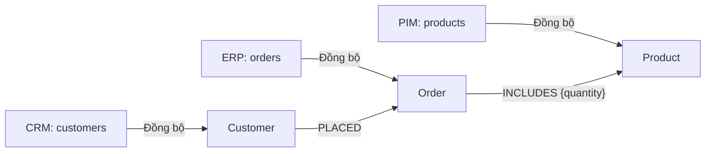
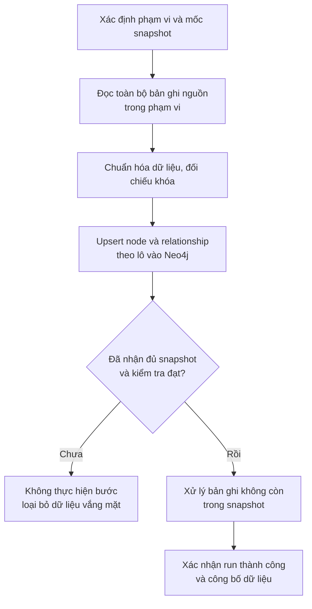
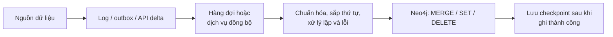
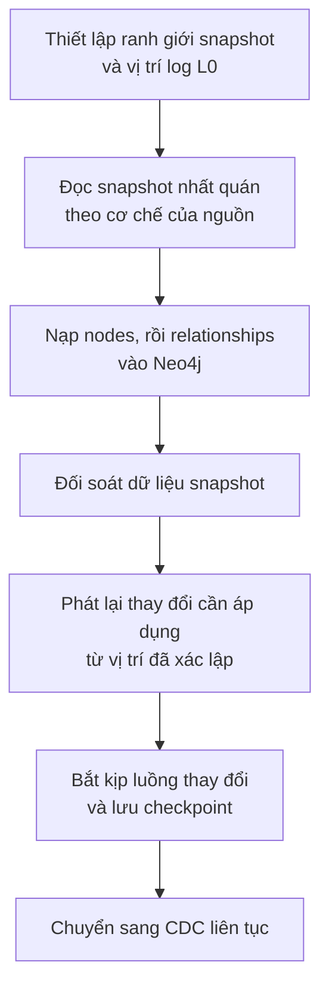

# Đồng bộ toàn phần so với đồng bộ thay đổi

Khi đưa dữ liệu từ hệ thống nghiệp vụ vào **Neo4j**, vấn đề không dừng ở việc nhập các nút (*node*) và quan hệ (*relationship*) một lần. Khách hàng đổi phân khúc, đơn hàng mới được tạo, sản phẩm bị ngừng bán và một số bản ghi có thể bị xóa ở hệ thống nguồn. Đồ thị phục vụ tìm kiếm, phân tích đường đi hoặc ứng dụng Java cần phản ánh các thay đổi ấy đủ chính xác và đủ kịp thời.

Hai chiến lược phổ biến trong chương **Tích hợp dữ liệu** của module **DATABASE_ENGINE_GRAPH_NEO4J** là:

- **Đồng bộ toàn phần** (*full synchronization / full refresh*): đọc lại toàn bộ tập dữ liệu thuộc phạm vi quản lý, rồi làm cho đồ thị đích tương ứng với ảnh chụp dữ liệu nguồn.
- **Đồng bộ thay đổi** (*incremental synchronization / delta sync*): chỉ chuyển những thay đổi mới kể từ một mốc đã xử lý, thường qua cột cập nhật, bản ghi thay đổi hoặc *change data capture* (CDC).

Cả hai có thể dùng **Cypher** để cập nhật property graph, **constraint/index** để giữ khóa nghiệp vụ, và **Neo4j Java Driver** để điều phối ghi dữ liệu theo lô. Khác biệt quan trọng nằm ở **cách xác định dữ liệu cần chuyển, xử lý bản ghi biến mất, theo dõi tiến độ và bảo đảm tính nhất quán**.

## 1. Một tình huống xuyên suốt: từ hệ thống nguồn vào đồ thị

Giả sử doanh nghiệp có ba nguồn:

| Nguồn | Thực thể quản lý | Khóa nghiệp vụ | Dữ liệu cần đưa vào Neo4j |
| --- | --- | --- | --- |
| CRM | Khách hàng | `customerId` | Tên, phân khúc, trạng thái |
| ERP | Đơn hàng | `orderId` | Ngày đặt, tổng tiền, khách hàng đặt |
| PIM | Sản phẩm | `productId` | Tên, nhóm hàng, trạng thái |
  
Đồ thị mục tiêu:



Những câu Cypher như sau sử dụng đồ thị sau khi được đồng bộ:

```cypher
MATCH (c:Customer {customerId: $customerId})
      -[:PLACED]->(o:Order)
RETURN o.orderId AS orderId, o.createdAt AS createdAt
ORDER BY createdAt DESC;
```

Ở đây **CRM/ERP/PIM mới là nguồn sự thật** (*source of truth*) đối với các thuộc tính mà chúng sở hữu. Neo4j là nơi tích hợp để truy vấn quan hệ. Nếu ứng dụng cho phép chỉnh sửa trực tiếp dữ liệu trong Neo4j, cần có quy tắc sở hữu và chiều đồng bộ rõ ràng, tránh hai hệ thống cập nhật qua lại rồi ghi đè lẫn nhau.

### 1.1. Trạng thái nguồn thay đổi ra sao?

Ví dụ CRM và ERP ban đầu có:

| Bảng nguồn | Khóa | Giá trị |
| --- | --- | --- |
| Customer | C01 | An, phân khúc Retail |
| Customer | C02 | Bình, phân khúc SMB |
| Order | O01 | Thuộc C01, ngày 2026-11-01 |
| Order | O02 | Thuộc C02, ngày 2026-11-03 |

Ngày hôm sau:

- C01 đổi từ `Retail` sang `VIP`.
- C03 là khách hàng mới.
- O03 là đơn mới của C03.
- C02 bị vô hiệu hóa hoặc bị xóa theo quy tắc nghiệp vụ.

**Đồng bộ toàn phần** tìm lại cả bức tranh dữ liệu được xác định bởi phạm vi snapshot. **Đồng bộ thay đổi** chỉ xử lý các sự kiện như “C01 cập nhật”, “C03 tạo mới”, “O03 tạo mới” và “C02 xóa/vô hiệu hóa”.

## 2. Đồng bộ toàn phần là gì?

Đồng bộ toàn phần đọc lại **toàn bộ tập dữ liệu trong một phạm vi xác định**, ví dụ mọi khách hàng thuộc tenant A, toàn bộ danh mục sản phẩm hoặc tất cả đơn hàng của một kỳ. “Toàn phần” không nhất thiết có nghĩa quét **cả database**: phạm vi phải được định nghĩa rõ ràng.

Một chu kỳ điển hình:



Có nhiều cách triển khai:

1. **Xây lại ở môi trường riêng rồi chuyển hướng đọc** sau khi kiểm tra. Cách này phù hợp khi có yêu cầu tránh hiển thị đồ thị đang dựng dở, nhưng cần tài nguyên và cơ chế chuyển đổi theo môi trường.
2. **Upsert theo lô + đánh dấu lần thấy gần nhất** (*mark and sweep*) trong đồ thị đang phục vụ. Chỉ dọn các bản ghi vắng mặt khi toàn bộ snapshot đã tải xong và vượt qua bước đối chiếu.
3. **Xóa rồi nạp lại phần dữ liệu thuộc phạm vi sở hữu**. Cách này dễ hiểu nhưng gây gián đoạn, có thể làm mất quan hệ từ các miền dữ liệu khác và không nên áp dụng tùy tiện.

### 2.1. Điểm mạnh

- **Dễ xây dựng ban đầu:** có thể xuất bảng/CSV/JSON và nạp theo khóa nghiệp vụ; không cần hạ tầng CDC.
- **Phát hiện chênh lệch tích lũy:** dữ liệu đã bị bỏ sót hoặc sai lệch trong các lần trước có cơ hội được sửa khi đọc lại toàn bộ nguồn.
- **Có thể nhận diện bản ghi biến mất:** nếu snapshot đầy đủ, đối chiếu tập khóa giúp phát hiện bản ghi đã bị xóa ở nguồn.
- **Hữu ích khi khởi tạo/rebuild:** lần tải đầu thường cần chuyển nhiều dữ liệu lịch sử vào Neo4j.

### 2.2. Hạn chế

- **Tốn băng thông và I/O:** mỗi lần đều đọc nhiều dữ liệu dù chỉ một phần nhỏ thay đổi.
- **Thời gian chu kỳ dài:** đồ thị có thể trễ so với nguồn khi khối lượng dữ liệu lớn.
- **Tăng tải ghi, index và log:** việc cập nhật liên tục có thể tốn CPU, bộ nhớ, lưu trữ, khóa và transaction log.
- **Khó bảo đảm tính nhất quán của snapshot khi nguồn vẫn ghi:** nếu đọc các trang dữ liệu ở những thời điểm khác nhau, những thay đổi diễn ra giữa chừng có thể làm tập dữ liệu tự mâu thuẫn.
- **Nguy cơ loại bỏ nhầm bản ghi:** snapshot thiếu trang hoặc bị lỗi mà vẫn chạy bước “xóa những gì không thấy” sẽ gây mất dữ liệu.

**Không đồng nhất “đọc lại tất cả” với “xóa toàn bộ đồ thị rồi dựng lại”.** Trong property graph, một nút thuộc miền dữ liệu khác có thể tham chiếu đến nút đang đồng bộ. Lệnh xóa rộng có thể phá vỡ nhiều quan hệ quan trọng.

## 3. Đồng bộ thay đổi là gì?

Đồng bộ thay đổi chỉ lấy những thao tác hoặc bản ghi **mới hơn mốc đã xử lý**. Dữ liệu đi vào có thể xuất phát từ:

- **Cột `updated_at` / `version`:** định kỳ truy vấn những bản ghi được sửa sau checkpoint.
- **Bảng sự kiện/outbox hoặc bảng audit:** hệ thống ứng dụng ghi lại thay đổi để bên tích hợp đọc.
- **CDC từ transaction log của nguồn:** công cụ chuyên dụng chuyển các thay đổi INSERT, UPDATE, DELETE trong nhật ký giao dịch thành sự kiện.
- **API cung cấp delta/cursor:** hệ thống ngoài chỉ trả những thay đổi kể từ cursor đã cấp.

Luồng cơ bản:



Thay vì đọc một triệu khách hàng mỗi giờ, hệ thống có thể chỉ chuyển vài nghìn thay đổi phát sinh trong giờ đó. Đây là ưu điểm lớn khi **tỷ lệ thay đổi nhỏ hơn nhiều so với tổng dữ liệu**.

### 3.1. Điểm mạnh

- Giảm dữ liệu cần đọc/chuyển và lượng ghi lặp nếu số thay đổi ít.
- Có thể giảm **độ trễ đồng bộ** xuống mức phút hoặc giây tùy nguồn và kiến trúc.
- Hữu ích khi ứng dụng cần đồ thị tương đối mới để cá nhân hóa, gợi ý, phát hiện gian lận hoặc vận hành.
- Có thể mở rộng bằng phân vùng, xử lý lô nhỏ và checkpoint.

### 3.2. Điểm khó

- **Độ phức tạp cao hơn:** phải theo dõi offset/watermark, idempotency, thứ tự và sự kiện bị lặp.
- **Xóa dữ liệu:** chỉ đọc các bản ghi hiện còn sẽ không thấy bản ghi đã biến mất; cần tombstone, soft delete hoặc CDC có DELETE.
- **Lệch thứ tự:** sự kiện cập nhật cũ đến sau sự kiện mới có thể làm giá trị quay về trạng thái cũ.
- **Mất sự kiện hoặc mất checkpoint:** nếu không có cơ chế replay/reconciliation, đồ thị có thể sai lệch kéo dài.
- **Ràng buộc quan hệ:** sự kiện đơn hàng có thể đến trước sự kiện khách hàng, khiến nút đầu/cuối chưa sẵn sàng để tạo cạnh.

**Đồng bộ thay đổi không tự động bảo đảm chính xác.** Nó chỉ chuyển ít dữ liệu hơn; muốn có độ tin cậy cần giải quyết bài toán xử lý sự kiện.

## 4. So sánh trực tiếp hai cách

| Tiêu chí | Đồng bộ toàn phần | Đồng bộ thay đổi |
| --- | --- | --- |
| Dữ liệu chuyển mỗi chu kỳ | Hầu hết/toàn bộ dữ liệu trong phạm vi | Chỉ bản ghi, sự kiện đã thay đổi |
| Chi phí trên tập lớn thay đổi ít | Thường cao | Thường thấp |
| Độ trễ dữ liệu | Phụ thuộc chu kỳ hoàn thành snapshot | Phụ thuộc độ trễ phát hiện và xử lý delta |
| Độ phức tạp hạ tầng | Thấp đến trung bình | Trung bình đến cao |
| Xử lý bản ghi bị xóa | Đối chiếu snapshot đầy đủ | Cần DELETE event/tombstone/soft delete |
| Khôi phục khi bỏ sót dữ liệu | Chạy lại snapshot có thể sửa sai lệch | Cần replay sự kiện còn lưu hoặc làm lại snapshot |
| Áp lực đọc ở hệ thống nguồn | Có thể lớn, đặc biệt trong giờ làm việc | Thường nhỏ hơn khi delta ít |
| Tác động ghi ở Neo4j | Có thể upsert rất nhiều bản ghi | Ghi tập thay đổi |
| Tính nhất quán | Phụ thuộc snapshot nguồn và cách công bố đích | Phụ thuộc thứ tự, offset, idempotency và quan hệ phụ thuộc |
| Trường hợp phù hợp | Lần nhập đầu, dữ liệu nhỏ, rebuild, đối soát | Dữ liệu lớn, thay đổi thường xuyên, yêu cầu cập nhật gần thời gian thực |

Ví dụ định lượng **minh họa**: nguồn có 10 triệu bản ghi và trung bình 20.000 bản ghi thay đổi mỗi ngày. Một lần đồng bộ toàn phần phải xét đến 10 triệu bản ghi; một lượt đồng bộ thay đổi có thể chỉ cần xử lý khoảng 20.000 bản ghi thay đổi, nếu sự kiện đã được tổng hợp theo khóa. Khối lượng delta vì vậy có thể thấp hơn hàng trăm lần, nhưng **chi phí thực tế** vẫn phụ thuộc số quan hệ mỗi bản ghi, kích thước payload, cách cập nhật index và số sự kiện lặp. Đừng suy ra thời gian nhanh hơn cùng tỷ lệ.

## 5. Mô hình khóa nghiệp vụ: điều kiện tiên quyết cho cả hai

Khi đồng bộ vào Neo4j, phải biết **nút nào ở đích tương ứng với bản ghi nào ở nguồn**. Không nên dựa vào `elementId()` làm khóa tích hợp lâu dài giữa các hệ thống; hãy dùng mã nghiệp vụ ổn định.

Trong bài, giả định mỗi nguồn có một namespace riêng cho mã:

```cypher
CREATE CONSTRAINT customer_source_key IF NOT EXISTS
FOR (c:Customer)
REQUIRE (c.source, c.sourceId) IS UNIQUE;

CREATE CONSTRAINT order_source_key IF NOT EXISTS
FOR (o:Order)
REQUIRE (o.source, o.sourceId) IS UNIQUE;

CREATE CONSTRAINT product_source_key IF NOT EXISTS
FOR (p:Product)
REQUIRE (p.source, p.sourceId) IS UNIQUE;
```

Ví dụ node trong đồ thị:

```cypher
(:Customer {
  source: 'CRM',
  sourceId: 'C01',
  name: 'An',
  segment: 'Retail',
  active: true
})
```

Tại đây, bộ khóa `(source, sourceId)` giúp phân biệt cùng một mã ở hai hệ thống khác nhau. Nếu cần phân biệt nhiều **tenant**, có thể đưa thêm `tenantId` vào thiết kế khóa và constraint. Không thay đổi khóa sau khi đã dùng để gắn quan hệ trừ khi có quy trình di chuyển dữ liệu rõ ràng.

**`MERGE` dựa trên khóa ổn định**, sau đó `SET` cập nhật các thuộc tính thay đổi:

```cypher
MERGE (c:Customer {source: 'CRM', sourceId: $customerId})
SET c.name = $name,
    c.segment = $segment,
    c.active = true;
```

Khi chạy lại cùng khóa, `MERGE` có thể khớp nút hiện có thay vì tạo một nút mới. Constraint giúp đảm bảo tính duy nhất trong điều kiện ghi đồng thời; chỉ dùng `MERGE` mà thiếu constraint thích hợp không phải cơ chế đảm bảo duy nhất tuyệt đối khi nhiều worker cùng ghi.

## 6. Thực hành đồng bộ toàn phần theo lô

Một lần full refresh thường quá lớn để xử lý trong một transaction. Hãy **chia thành các lô** có kích thước phù hợp và ghi mỗi lô trong một transaction độc lập. Sau khi tất cả lô thành công, mới thực hiện đối soát và xử lý bản ghi vắng mặt.

### 6.1. Nạp toàn bộ khách hàng của một snapshot

Ví dụ ứng dụng gửi:

```json
{
  "runId": "CRM-20261125-01",
  "customers": [
    {"id": "C01", "name": "An", "segment": "Retail"},
    {"id": "C02", "name": "Bình", "segment": "SMB"}
  ]
}
```

Cypher dùng `UNWIND`:

```cypher
UNWIND $customers AS row
MERGE (c:Customer {source: 'CRM', sourceId: row.id})
SET c.name = row.name,
    c.segment = row.segment,
    c.active = true,
    c.lastSeenRun = $runId;
```

Khi nạp toàn bộ snapshot thành nhiều lô, **mọi lô của cùng một lần chạy phải dùng cùng `runId`**. `UNWIND` chuyển danh sách đầu vào thành từng dòng để Neo4j xử lý. `MERGE` giúp bản ghi C01 không bị tạo thêm một nút khi một lô phải retry; `SET` đưa thuộc tính về giá trị của nguồn.

Chỉ số `lastSeenRun` ở đây là một **đánh dấu theo lô snapshot**, không phải timestamp nghiệp vụ hay version để sắp xếp sự kiện CDC.

### 6.2. Đồng bộ đơn hàng và quan hệ PLACED

Giả sử ERP cung cấp:

```json
{
  "orders": [
    {"id": "O01", "customerId": "C01", "createdAt": "2026-11-01"},
    {"id": "O02", "customerId": "C02", "createdAt": "2026-11-03"}
  ]
}
```

Nạp node `Order`:

```cypher
UNWIND $orders AS row
MERGE (o:Order {source: 'ERP', sourceId: row.id})
SET o.createdAt = date(row.createdAt),
    o.lastSeenRun = $runId,
    o.active = true;
```

Sau khi đã đảm bảo các node `Customer` và `Order` tồn tại, tạo quan hệ:

```cypher
UNWIND $orders AS row
MATCH (c:Customer {source: 'CRM', sourceId: row.customerId})
MATCH (o:Order {source: 'ERP', sourceId: row.id})
MERGE (c)-[placed:PLACED]->(o)
SET placed.source = 'ERP',
    placed.lastSeenRun = $runId;
```

**Vì sao phải tách node và relationship?** Nếu order được nạp trước customer, hai câu `MATCH` có thể không tìm đủ đầu/cuối, khiến cạnh không được tạo. Một pipeline đơn giản thường nạp **nút trước, cạnh sau**; pipeline sự kiện liên tục cần cơ chế retry/dependency resolution để xử lý những bản ghi đến khác thứ tự.

Nếu nghiệp vụ cho phép nhiều cạnh `PLACED` giữa cùng một cặp nút, `MERGE (c)-[:PLACED]->(o)` có thể không biểu diễn đúng từng bản ghi quan hệ riêng. Khi đó, cần khóa của quan hệ hoặc node trung gian cho từng sự kiện/nghiệp vụ, chẳng hạn `OrderLine`.

### 6.3. Xử lý bản ghi không còn xuất hiện trong snapshot

Sau khi **đã nhận và kiểm tra đầy đủ tất cả lô khách hàng thuộc phạm vi CRM**, có thể đánh dấu những khách hàng không thấy trong `runId` mới thành không hoạt động:

```cypher
MATCH (c:Customer {source: 'CRM'})
WHERE c.lastSeenRun IS NULL
   OR c.lastSeenRun <> $runId
SET c.active = false;
```

Cách này gọi là **soft delete**: giữ lại node và các cạnh để phục vụ kiểm toán, đồng thời các truy vấn nghiệp vụ chỉ lấy đối tượng đang hoạt động khi cần:

```cypher
MATCH (c:Customer {source: 'CRM', active: true})
RETURN c.sourceId AS customerId, c.name AS name
ORDER BY customerId;
```

Nếu nghiệp vụ yêu cầu xóa vật lý, phải xác định **ai sở hữu các cạnh liên quan**, nghĩa vụ lưu trữ và quy tắc xử lý các đơn hàng còn tham chiếu. Không dùng `MATCH (n) DETACH DELETE n` hoặc xóa rộng các nút không thấy trong một snapshot chưa hoàn thành: `DETACH DELETE` còn xóa những cạnh nối đến node, kể cả cạnh do miền nghiệp vụ khác tạo.

**Điều kiện bắt buộc của bước “sweep”:** snapshot phải đầy đủ, đúng phạm vi tenant/nguồn, mọi lô đã thành công và đã xác thực được số lượng/khóa. Nếu bỏ một trang vì timeout hoặc API trả dữ liệu thiếu, chạy “sweep” sẽ làm các bản ghi hợp lệ bị đánh dấu sai.

### 6.4. Kiểm tra kết quả

Các phép kiểm tra điển hình sau khi đồng bộ:

```cypher
MATCH (c:Customer {source: 'CRM', active: true})
RETURN count(c) AS activeCustomers;
```

```cypher
MATCH (o:Order {source: 'ERP'})
WHERE o.active = true
  AND NOT EXISTS {
    MATCH (:Customer)-[:PLACED]->(o)
  }
RETURN o.sourceId AS orderWithoutCustomer;
```

Truy vấn thứ hai tìm những đơn hàng đang hoạt động chưa nối được khách hàng. Đây là một **dấu hiệu cần kiểm tra**, không mặc định phải xóa tất cả đơn này: có thể sự kiện khách hàng chưa đến, hoặc mô hình nghiệp vụ cho phép đơn hàng không gắn khách hàng đã đăng ký.

## 7. Đồng bộ thay đổi bằng cột updated_at và watermark

Một cách incremental đơn giản là lưu **mốc đã xử lý** (*watermark*), rồi truy vấn các bản ghi nguồn được cập nhật sau mốc đó.

Giả sử nguồn SQL có bảng `customers(id, name, segment, updated_at)`. Truy vấn cấp dữ liệu có thể có dạng:

```sql
SELECT id, name, segment, updated_at
FROM customers
WHERE updated_at > :last_updated_at
   OR (updated_at = :last_updated_at AND id > :last_id)
ORDER BY updated_at, id
LIMIT :batch_size;
```

Cặp `(updated_at, id)` tạo thứ tự ổn định cho phân trang: nếu hai bản ghi có cùng timestamp, điều kiện theo `id` giúp không bỏ những bản ghi phía sau trong cùng mốc. Sau khi xử lý **thành công** một lô, tiến checkpoint tới cặp `(updated_at, id)` cuối cùng của lô đó.

**Điều kiện tiên quyết:** nguồn phải bảo đảm giá trị cập nhật dùng làm watermark phản ánh đúng mọi thay đổi cần đồng bộ, có ngữ nghĩa thứ tự phù hợp và không có bản ghi “xuất hiện muộn” với mốc nhỏ hơn checkpoint. Với hệ thống có giao dịch dài, đồng hồ ứng dụng lệch hoặc bản ghi backfill, chỉ dùng `updated_at` rất dễ bỏ sót. Khi đó, cần cơ chế overlap/lookback + dedupe, version đáng tin, hoặc CDC theo thứ tự commit từ transaction log.

### 7.1. Vì sao watermark đơn thuần không biết được bản ghi bị xóa?

Nếu hệ thống nguồn thực hiện:

```sql
DELETE FROM customers WHERE id = 'C02';
```

Bản ghi `C02` không còn nằm trong kết quả `SELECT ... FROM customers`. Vì vậy, truy vấn chỉ dựa vào `updated_at` của **bảng hiện tại** không thể tự phát hiện việc xóa ấy.

Các lựa chọn:

- **Soft delete ở nguồn:** trường `deleted = true` và `updated_at` đổi khi xóa.
- **Bảng tombstone/audit/outbox:** ghi sự kiện `DELETE` để bên đồng bộ đọc.
- **CDC từ transaction log:** nhận thao tác xóa ở nguồn.
- **Đối soát snapshot định kỳ:** tìm bản ghi có ở Neo4j nhưng đã vắng ở nguồn.

Nếu không có cơ chế nào, chiến lược incremental có thể làm các nút bị xóa ở nguồn **tồn tại mãi** trong Neo4j.

## 8. Đồng bộ thay đổi bằng CDC hoặc outbox

CDC (*change data capture*) theo dõi thay đổi ở nguồn và gửi các bản ghi mang thông tin cần thiết để đích cập nhật. Một sự kiện minh họa:

```json
{
  "eventId": "evt-103",
  "entityType": "Customer",
  "entityId": "C01",
  "operation": "UPSERT",
  "version": 103,
  "payload": {
    "name": "An",
    "segment": "VIP"
  }
}
```

Trong thiết kế ví dụ này, `version` là **số tăng đơn điệu cho mỗi entityId**, không phải số thứ tự toàn cục. Thực tế CDC có thể cung cấp offset, commit log position, sequence number hoặc timestamp tùy nguồn; chỉ sử dụng làm version khi hiểu rõ tính đơn điệu và ý nghĩa của nó.

Một sự kiện xóa:

```json
{
  "eventId": "evt-104",
  "entityType": "Customer",
  "entityId": "C02",
  "operation": "DELETE",
  "version": 104
}
```

Chuỗi xử lý tiêu biểu:

1. Nhận sự kiện từ log/outbox/stream.
2. Kiểm tra khóa, kiểu sự kiện, version và payload.
3. Xác định tác động lên node/relationship Neo4j.
4. Ghi thay đổi **theo transaction**, xử lý lỗi có thể retry.
5. **Chỉ checkpoint offset sau khi transaction đã commit thành công**.
6. Theo dõi sự kiện trễ, lặp, lỗi không thể xử lý và đưa vào hàng chờ xử lý riêng nếu cần.

Ở mô hình “at-least-once”, một sự kiện có thể được phát lại. Thiết kế đích nên **idempotent**: áp dụng cùng sự kiện một hoặc nhiều lần cho kết quả nghiệp vụ tương đương.

## 9. Idempotency và tránh cập nhật sai thứ tự

### 9.1. MERGE chưa đủ để chống sự kiện cũ

`MERGE` giúp tránh tạo trùng node khi đã có khóa phù hợp, nhưng **không ngăn bản cập nhật cũ ghi đè bản mới**.

Giả sử C01 nhận hai sự kiện:

- Phiên bản `v12`: `segment = 'VIP'`.
- Phiên bản `v11` đến muộn: `segment = 'Retail'`.

Nếu chỉ chạy `SET c.segment = event.segment`, sự kiện cũ có thể đưa dữ liệu về `Retail` dù trạng thái mới nhất là `VIP`.

Một mẫu áp dụng UPSERT có kiểm tra version:

```cypher
UNWIND $events AS event
WITH event
WHERE event.operation = 'UPSERT'
MERGE (c:Customer {source: 'CRM', sourceId: event.entityId})
WITH c, event
WHERE c.sourceVersion IS NULL
   OR c.sourceVersion < event.version
SET c.name = event.payload.name,
    c.segment = event.payload.segment,
    c.sourceVersion = event.version,
    c.active = true;
```

Mẫu này giả định mọi sự kiện của **cùng một entity** có version tăng đơn điệu và payload là **trạng thái đầy đủ** của các thuộc tính đang đồng bộ. Nếu event chỉ chứa trường đã thay đổi (partial update), không được tùy tiện gán các trường vắng mặt thành `null`: Cypher có thể xóa thuộc tính khi `SET property = null`. Khi đó, cần áp dụng patch theo danh sách trường hoặc dùng cách khác phù hợp hợp đồng sự kiện.

**Lưu ý về đồng thời:** `MERGE` cùng kiểm tra `sourceVersion` không tự động bảo đảm thứ tự nếu nhiều worker ghi cạnh tranh cho cùng khóa. Hãy định tuyến event cùng entity vào cùng luồng được xử lý theo thứ tự, hoặc dùng chiến lược transaction/locking và retry đã kiểm chứng. Constraint đảm bảo **khóa duy nhất**, không đảm bảo logic version luôn được thực thi đúng khi cập nhật đồng thời.

### 9.2. Xóa mềm bằng tombstone vẫn giữ version

Có thể xử lý `DELETE` bằng cách **giữ nút như một tombstone**:

```cypher
UNWIND $events AS event
WITH event
WHERE event.operation = 'DELETE'
MERGE (c:Customer {source: 'CRM', sourceId: event.entityId})
WITH c, event
WHERE c.sourceVersion IS NULL
   OR c.sourceVersion < event.version
SET c.active = false,
    c.sourceVersion = event.version;
```

Tại sao không xóa ngay node?

- Khi xóa node, giá trị `sourceVersion` của nó cũng biến mất; một UPSERT cũ đến muộn có thể **tạo lại node**.
- Tombstone lưu version gần nhất đã xử lý, cho phép bỏ qua event có version cũ hơn.
- Các quan hệ liên quan có thể cần giữ lại vì kiểm toán hoặc lịch sử.

Nếu cần xóa vật lý vì yêu cầu dữ liệu, phải duy trì **version/tombstone ở nơi khác** đủ lâu để loại bỏ replay cũ và quyết định xử lý những quan hệ còn tham chiếu. Tombstone không tự biến mất an toàn nếu luồng sự kiện có thể trễ vô hạn.

### 9.3. Sự kiện trùng, thứ tự và tính nguyên tử

Một lần áp dụng event lý tưởng phải đảm bảo **hoặc toàn bộ thay đổi của event được commit, hoặc không có phần nào được commit**. Ví dụ event tạo `Order` rồi nối `PLACED` không nên chỉ lưu node mà đánh dấu offset đã hoàn tất trong khi cạnh còn thiếu do lỗi.

Nếu checkpoint được lưu **ngoài Neo4j** (Kafka offset, cơ sở dữ liệu trạng thái, API cursor), không thể mặc định có transaction nguyên tử xuyên hai hệ thống. Mô hình thực dụng là:

- Ghi Neo4j **idempotent**.
- Commit Neo4j thành công rồi mới xác nhận offset/cursor.
- Nếu crash ở giữa, xử lý lại event khi khởi động. Vì idempotent, không phát sinh kết quả sai.
- Nếu event lỗi lâu dài, giữ trạng thái chưa hoàn thành hoặc đưa vào luồng xử lý lỗi có quan sát; không âm thầm bỏ qua và checkpoint qua mất dữ liệu.

Đây là chiến lược phổ biến để đạt tác động nghiệp vụ đáng tin trong hệ thống có thể phát lại, thay vì tuyên bố có “exactly once” trên toàn bộ các thành phần khi chưa có cơ chế đảm bảo.

## 10. Đồng bộ relationship: vấn đề riêng của property graph

Một ứng dụng quan hệ bảng thường chỉ cần upsert hàng. Với Neo4j, ta còn phải duy trì **cạnh giữa các node**.

Ví dụ event đơn hàng O03 của C03 đến trước event tạo C03. Cypher:

```cypher
MATCH (c:Customer {source: 'CRM', sourceId: $customerId})
MERGE (o:Order {source: 'ERP', sourceId: $orderId})
MERGE (c)-[:PLACED]->(o);
```

sẽ không tạo order hoặc cạnh nếu `MATCH (c)` không khớp, vì không còn dòng đi tiếp. Điều này không nhất thiết là lỗi cú pháp, nên có thể **mất liên kết âm thầm** nếu không quan sát số bản ghi ảnh hưởng.

### 10.1. Những phương án xử lý phụ thuộc

- **Nạp các node trước rồi mới nạp relationship** trong full refresh.
- **Tạo node tối thiểu (stub)** theo khóa nghiệp vụ nếu kiến trúc cho phép, rồi điền thuộc tính khi sự kiện tới. Cần phân biệt stub với node đã đầy đủ và kiểm soát version.
- **Đưa event tạo cạnh vào hàng chờ/retry** khi đầu/cuối chưa tồn tại. Có thời hạn và cơ chế giám sát để tránh chờ vô hạn.
- **Dùng luồng xử lý có thứ tự theo khóa liên quan** khi khả thi; chú ý thứ tự giữa các entity khác nhau không được đảm bảo chỉ nhờ một partition theo orderId.

Ví dụ nạp node và cạnh với các khóa đã được xác minh:

```cypher
MERGE (o:Order {source: 'ERP', sourceId: $orderId})
SET o.createdAt = date($createdAt), o.active = true
WITH o
MATCH (c:Customer {source: 'CRM', sourceId: $customerId})
MERGE (c)-[r:PLACED]->(o)
SET r.source = 'ERP';
```

**Hạn chế của ví dụ:** Nếu customer chưa tồn tại, node order có thể đã được xử lý trong phần trước của cùng câu truy vấn nhưng vẫn thiếu relationship khi `MATCH` không trả dòng. Với quy trình yêu cầu tạo **cả node và cạnh** trong một event, ứng dụng phải kiểm tra precondition và quyết định retry, hoặc tạo stub một cách có chủ ý. Không dựa vào sự vắng mặt của lỗi Cypher để kết luận event đã được áp dụng đầy đủ.

### 10.2. Khi một quan hệ không còn hợp lệ

Nếu O03 chuyển từ C03 sang C01, việc chỉ `MERGE (C01)-[:PLACED]->(O03)` có thể để lại cạnh cũ từ C03. Cần biết quan hệ có **quyền sở hữu độc nhất** hay không.

Ví dụ với quy tắc “mỗi Order có đúng một Customer đặt đơn”, sau khi đã xác minh node đích và nguồn đúng:

```cypher
MATCH (newCustomer:Customer {source: 'CRM', sourceId: $customerId})
MATCH (o:Order {source: 'ERP', sourceId: $orderId})
OPTIONAL MATCH (:Customer)-[old:PLACED]->(o)
WITH newCustomer, o, collect(old) AS previousEdges
FOREACH (r IN previousEdges | DELETE r)
MERGE (newCustomer)-[:PLACED]->(o);
```

Đoạn mã nêu rõ quy tắc **thay thế mọi cạnh `PLACED` hiện có đến một Order** bằng cạnh mới, nên chỉ hợp lệ nếu mô hình nghiệp vụ xác định một đơn có **một người đặt** và toàn bộ các cạnh `PLACED` đó nằm trong quyền quản lý của pipeline. Nếu hệ thống có đồng sở hữu đơn hàng hoặc cạnh khác nguồn, không được dùng quy tắc này.

Trong mô hình có nhiều dòng hàng giống nhau, không thể dùng một cạnh duy nhất `INCLUDES` theo cặp `(Order, Product)` nếu nghiệp vụ yêu cầu phân biệt từng `lineId`; nên mô hình hóa `OrderLine` hoặc khóa quan hệ phù hợp.

## 11. Kết hợp snapshot ban đầu với CDC lâu dài

Trên dữ liệu lớn, phương án phổ biến là **snapshot + CDC**: đồng bộ toàn phần để có nền dữ liệu, sau đó tiếp tục áp dụng những thay đổi phát sinh.

Vấn đề tinh tế là: **nguồn vẫn thay đổi trong lúc đang đọc snapshot**. Nếu vừa đọc snapshot ở thời điểm A vừa đọc delta từ thời điểm B không có cơ chế nối tiếp, có thể bỏ sót hoặc áp dụng sai thứ tự các thay đổi.

### 11.1. Một quy trình đúng về mặt nguyên tắc



Các bước cụ thể:

1. **Xác lập ranh giới có thể tái hiện:** dùng khả năng snapshot/transaction-log của nguồn hoặc công cụ CDC để biết dữ liệu nào đã nằm trong snapshot và các thay đổi nào phải phát lại.
2. **Đảm bảo luồng thay đổi không bị mất trong lúc snapshot:** khởi động hoặc giữ log theo cơ chế phù hợp; không chỉ ghi đại một timestamp ở tầng ứng dụng rồi giả định snapshot đúng thời điểm đó.
3. **Nạp snapshot có kiểm soát:** khóa nghiệp vụ, cùng phạm vi nguồn/tenant, node trước relationship, chia batch và đối soát.
4. **Áp dụng CDC từ vị trí tương thích:** có thể cần xử lý trùng ở ranh giới; dùng version/idempotency để tránh ghi đè sai.
5. **Chỉ công bố trạng thái “đã bắt kịp” khi offset và kết quả đã được kiểm tra**, sau đó duy trì luồng incremental và cảnh báo độ trễ.

Một hệ CDC tốt có thể cung cấp quy trình snapshot tích hợp sẵn. Nếu không có, nhóm triển khai phải tự giải quyết vấn đề **consistent snapshot + log position**. Không nên xem thời điểm bắt đầu một câu `SELECT` bất kỳ là một mốc nhất quán có thể dùng để phát lại tất cả delta.

### 11.2. Full refresh trong lúc CDC đang chạy

Nếu chạy lại snapshot mà CDC vẫn cập nhật cùng các node trong Neo4j, hai luồng ghi có thể giẫm lên nhau:

- Snapshot cũ ghi `segment = 'Retail'` sau khi CDC mới vừa ghi `VIP`.
- Bước “sweep” của snapshot đánh dấu vô hiệu hóa node mới được CDC tạo nhưng không nằm trong ảnh chụp cũ.
- Một cạnh bị rebuild từ snapshot cũ sau khi CDC đã thay đổi chủ sở hữu.

Các cách kiểm soát thường là **tạm dừng/căn chỉnh CDC với mốc snapshot**, **ghi vào không gian staging rồi chuyển đổi**, hoặc **so sánh version nguồn** trước khi cho phép cập nhật. Phải xác định rõ chính sách phối hợp; chỉ gắn `lastSeenRun` không giải quyết được xung đột thời gian giữa hai luồng.

## 12. Java Driver: ghi đồng bộ theo lô có transaction

Ứng dụng Java có thể nhận các dòng từ CRM/ERP hoặc CDC, chuyển thành danh sách map rồi gửi tới Neo4j bằng **Neo4j Java Driver**. Ví dụ sau dùng `executeWrite` để mỗi lô được thực thi trong một transaction được quản lý, phù hợp với driver 5.x. Giả định `Driver` đã cấu hình đúng và khóa `(source, sourceId)` được bảo vệ bằng constraint.

```java
import java.util.List;
import java.util.Map;
import org.neo4j.driver.Driver;

public final class CustomerSyncService {
    private static final String UPSERT_BATCH = """
        UNWIND $rows AS row
        MERGE (c:Customer {source: 'CRM', sourceId: row.id})
        SET c.name = row.name,
            c.segment = row.segment,
            c.active = true,
            c.lastSeenRun = $runId
        """;

    public static void importBatch(
            Driver driver,
            List<Map<String, Object>> rows,
            String runId) {

        try (var session = driver.session()) {
            session.executeWrite(tx -> {
                tx.run(
                    UPSERT_BATCH,
                    Map.of("rows", rows, "runId", runId)
                ).consume();
                return null;
            });
        }
    }
}
```

Trong ví dụ:

- `rows` là một **lô**, không phải toàn bộ cơ sở dữ liệu.
- `runId` giữ nguyên cho tất cả lô của cùng snapshot.
- `executeWrite` quản lý transaction và có thể retry các lỗi tạm thời theo cơ chế driver; vì vậy các thao tác phải có thiết kế **idempotent**.
- `consume()` buộc driver đọc hết kết quả/summary của câu ghi trước khi transaction hoàn tất.
- **Không chạy bước “sweep” ngay sau một lô:** chỉ làm sau khi toàn bộ snapshot đã nạp và được xác minh.

Với Spring Data Neo4j, có thể dùng repository/`Neo4jClient` để thực thi Cypher có tham số và transaction do Spring quản lý. Tuy nhiên, việc triển khai từng entity bằng một lệnh riêng có thể tạo rất nhiều round-trip; cần cân nhắc query theo batch, concurrency và kích thước transaction dựa trên số đo thực tế.

### 12.1. Checkpoint phải đi sau commit thành công

Một vòng xử lý CDC trong ứng dụng có thể có dạng giả mã:

```text
event = readNextChange()
validated = validateAndNormalize(event)

begin Neo4j transaction
    applyIdempotentChange(validated)
commit Neo4j transaction

acknowledge / persist source offset
```

Nếu chương trình dừng **sau commit Neo4j nhưng trước khi xác nhận offset**, sự kiện có thể được phát lại: đó là lý do cần idempotency. Nếu chương trình xác nhận offset **trước** khi commit, sau đó ghi bị lỗi, sự kiện có thể bị mất vĩnh viễn khỏi luồng tiêu thụ. Chỉ số checkpoint cần được giám sát riêng với số liệu ghi Neo4j.

## 13. Đo lường và kiểm tra tính nhất quán

Đồng bộ “chạy không lỗi” chưa đủ để coi là đúng. Hãy xác định tiêu chí đối soát theo **phạm vi dữ liệu**:

| Nhóm chỉ số | Ý nghĩa |
| --- | --- |
| Số node theo loại/nguồn/tenant | Có đủ khách hàng, đơn hàng, sản phẩm không? |
| Số relationship theo loại | Có đủ quan hệ `PLACED`, `INCLUDES` không? |
| Khóa nghiệp vụ trùng | Constraint hoặc quy trình có ngăn trùng? |
| Node thiếu quan hệ bắt buộc | Có order không có customer hay line không có product? |
| Bản ghi vô hiệu hóa | Delete/tombstone được phản ánh đúng chưa? |
| Độ trễ từ nguồn đến đích | Dữ liệu trên Neo4j đang trễ bao lâu? |
| Offset/phiên bản đã áp dụng | Có thể tiếp tục từ đâu khi restart? |
| Tỷ lệ retry và lỗi không thể xử lý | Có event mắc kẹt hoặc bỏ qua không? |
| Dung lượng lô, thời gian commit, DB Hits | Chi phí ghi/tra cứu có tăng theo thời gian không? |

Ví dụ đếm khách hàng hoạt động được nhập từ CRM:

```cypher
MATCH (c:Customer {source: 'CRM', active: true})
RETURN count(c) AS activeCustomers;
```

Đếm quan hệ đặt đơn:

```cypher
MATCH (:Customer)-[r:PLACED]->(:Order)
RETURN count(r) AS placedEdges;
```

Tìm một số đơn chưa có quan hệ người đặt:

```cypher
MATCH (o:Order {source: 'ERP', active: true})
WHERE NOT EXISTS {
    MATCH (:Customer)-[:PLACED]->(o)
}
RETURN o.sourceId AS orderId
ORDER BY orderId
LIMIT 20;
```

So sánh **count** là kiểm tra nhanh, nhưng số lượng bằng nhau **không chứng minh nội dung hoàn toàn khớp**. Với dữ liệu quan trọng, cần so checksum/hàm băm các trường sở hữu bởi nguồn, đối soát theo phân vùng/tenant, kiểm tra khóa và chọn mẫu truy vấn liên kết.

### 13.1. Đánh giá hiệu năng đúng nơi

Dùng `EXPLAIN` để xem Neo4j định tìm node theo index hay scan; dùng `PROFILE` trên truy vấn **đọc an toàn hoặc môi trường thử nghiệm** để quan sát `Rows`, `DB Hits`, bước mở rộng quan hệ và chi phí của thao tác tương ứng.

- Constraint/index giúp `MERGE` hoặc `MATCH` tra theo khóa nhanh hơn.
- `UNWIND` theo lô giảm round-trip nhưng một lô quá lớn có thể tốn bộ nhớ và giữ khóa lâu.
- Đồng bộ full có tải ổn định theo chu kỳ; đồng bộ CDC có tải theo số event và có thể bị **burst** khi bắt kịp sau gián đoạn.
- Khi đo truy vấn ghi, nhớ rằng **`PROFILE` thực thi cả tác động ghi**; không dùng như chế độ xem kế hoạch vô hại.

Theo dõi thêm CPU, I/O, page cache, transaction latency, queue lag và mức sử dụng bộ nhớ của dịch vụ đồng bộ. Tối ưu Cypher không thể bù cho việc nguồn phát thiếu sự kiện hoặc checkpoint sai.

## 14. Nên chọn mô hình nào?

Không có một lựa chọn chung cho mọi hệ thống. Hãy xác định:

1. **Khối lượng dữ liệu và tỷ lệ thay đổi:** 1.000 bản ghi ít thay đổi khác hẳn 50 triệu bản ghi cập nhật liên tục.
2. **Độ trễ cho phép:** báo cáo hằng đêm hay gợi ý/phát hiện sự kiện trong vài giây?
3. **Khả năng của nguồn:** có CDC, outbox, version, deletion tombstone và consistent snapshot không?
4. **Nguồn dữ liệu được chỉnh sửa bởi ai:** Neo4j chỉ nhận một chiều hay có cả thao tác ghi ngược?
5. **Quy tắc xóa và lịch sử:** cần xóa vật lý, vô hiệu hóa hay lưu lịch sử thay đổi?
6. **Tính toàn vẹn của quan hệ:** các node liên quan có thể đến không cùng lúc không?
7. **Khả năng vận hành:** có giám sát, replay, hàng đợi lỗi, checkpoint và đối soát định kỳ không?

Một số chiến lược thực tế:

| Bối cảnh | Cách làm thường phù hợp |
| --- | --- |
| Bộ dữ liệu nhỏ, cập nhật hằng ngày | Full refresh có kiểm soát |
| Di chuyển dữ liệu ban đầu | Snapshot/full load |
| Nhiều triệu bản ghi, thay đổi liên tục | Snapshot ban đầu + CDC/incremental |
| Nguồn chỉ có API phân trang, không cung cấp delta | Full refresh theo phạm vi hoặc đối soát định kỳ |
| Nguồn có `updated_at` đáng tin nhưng không có DELETE event | Incremental cho cập nhật + snapshot đối soát xóa |
| Dữ liệu nghiệp vụ quan trọng, cần sửa sai lệch dài hạn | Incremental liên tục + reconciliation/full rebuild có kế hoạch |

**Kiến trúc kết hợp** thường cân bằng hiệu năng và tính đúng đắn: nạp snapshot ban đầu, áp dụng thay đổi liên tục, và chạy đối soát định kỳ. Tuy nhiên, nếu khả năng CDC không có hoặc mô hình chưa ổn định, full refresh có phạm vi rõ ràng vẫn là một giải pháp hợp lý.

## 15. Lỗi thường gặp khi triển khai

| Sai lầm | Hậu quả | Cách phòng tránh |
| --- | --- | --- |
| Dùng `CREATE` cho mọi bản ghi mỗi lần sync | Tạo trùng node và edge | Khóa nghiệp vụ ổn định, constraint và `MERGE` |
| Chạy bước “sweep” trước khi nhận đủ snapshot | Đánh dấu/xóa nhầm dữ liệu hợp lệ | Đánh dấu run hoàn tất, xác minh số lô và phạm vi |
| Chỉ dựa vào `updated_at` nhưng không có cơ chế DELETE | Không phản ánh bản ghi đã xóa | Tombstone, soft delete, CDC hoặc đối soát |
| Checkpoint offset trước khi ghi Neo4j thành công | Có thể mất thay đổi khi commit thất bại | Xác nhận offset sau commit, idempotent replay |
| Ghi UPSERT theo thứ tự đến mà không kiểm tra version | Sự kiện cũ ghi đè sự kiện mới | Version monotonic theo khóa, xử lý tuần tự và retry |
| Xóa node ngay, không giữ tombstone | UPSERT cũ có thể làm node xuất hiện lại | Giữ version/tombstone hoặc trạng thái ngoài đủ lâu |
| Nạp quan hệ trước các node đầu–cuối | Thiếu cạnh hoặc event bị áp dụng một phần | Nạp node trước, queue/retry phụ thuộc |
| Coi một `MERGE` là đủ chống tranh chấp đồng thời | Có thể phát sinh lỗi/logic sai khi worker đồng thời | Constraint + thiết kế transaction/partition theo khóa |
| Tạo index cho mọi thuộc tính không có phân tích | Tăng dung lượng và chi phí ghi | Ưu tiên index theo khóa và workload đã đo |
| Chỉ so count mà không so giá trị/quan hệ | Không phát hiện đổi nhầm thuộc tính, sai cạnh | Đối soát theo khóa, checksum và integrity query |
| Quét/xóa toàn bộ Neo4j để “refresh” một nguồn | Phá hủy dữ liệu/quan hệ từ miền khác | Giới hạn rõ nguồn/tenant, staging hoặc soft delete |
| Đồng bộ snapshot và CDC cùng ghi không phối hợp | Snapshot cũ có thể ghi đè thay đổi mới | Ranh giới log, version, cutover và thứ tự áp dụng |

## 16. Bài tập thực hành

### Bài tập 1 — Chọn full hay incremental

Một hệ thống có 500.000 sản phẩm, mỗi ngày 300 sản phẩm cập nhật. Trang danh mục chỉ cần đúng vào sáng hôm sau. Hãy chọn một phương án và nêu chi phí vận hành/độ phức tạp; sau đó giải thích khi nào chuyển sang CDC trở nên đáng giá.

*Gợi ý:* full refresh theo đêm có thể đủ đơn giản nếu hệ thống chấp nhận tải và thời gian xử lý. Incremental có lợi khi số bản ghi và tần suất tăng hoặc yêu cầu độ mới nghiêm ngặt hơn.

### Bài tập 2 — Phát hiện bản ghi vắng mặt

Trong full refresh, snapshot mới chỉ còn C01 và C03. Trước đó Neo4j có C01, C02 và C03. Viết Cypher dùng `lastSeenRun` để đánh dấu C02 không hoạt động **sau khi** xác minh mọi lô đã nhận đủ. Tại sao không nên dùng `DETACH DELETE` hàng loạt?

### Bài tập 3 — Viết lệnh upsert idempotent

Với danh sách đơn hàng `$orders`, dùng `UNWIND` và `MERGE` theo khóa `(source, sourceId)`. Gắn `createdAt` bằng `date(row.createdAt)` và `lastSeenRun`. Giải thích vì sao retry cùng lô không làm tạo nhiều node `Order` nếu constraint đúng.

### Bài tập 4 — Không làm mất cập nhật mới

C01 nhận `v10 = Retail` rồi `v11 = VIP`; sau đó `v10` bị replay. Hãy viết điều kiện kiểm tra `sourceVersion` để `v10` không ghi đè `VIP`. Nếu có sự kiện DELETE `v12` và UPSERT `v11` đến muộn, tại sao giữ tombstone lại quan trọng?

### Bài tập 5 — Xử lý lệch thứ tự khi tạo cạnh

Event tạo Order O10 đến trước Customer C10. Thử chạy `MATCH (c:Customer {source:'CRM',sourceId:'C10'}) ... MERGE (c)-[:PLACED]->(o)`. Quan hệ nào chưa tồn tại? Đề xuất cách retry sau khi C10 xuất hiện hoặc dùng node stub; nêu ưu/nhược điểm.

### Bài tập 6 — Kết hợp snapshot và CDC

Một snapshot kéo dài ba giờ trong khi ERP liên tục thêm đơn hàng. Hãy mô tả cách xác lập ranh giới log và phát lại những event không có trong snapshot; nêu hai tình huống gây dữ liệu sai nếu lấy một timestamp không tương ứng snapshot nhất quán.

### Bài tập 7 — Đối soát và giám sát

Thiết kế dashboard gồm tối thiểu: số node/edge theo nguồn, độ trễ CDC, offset cuối đã commit, số sự kiện retry, số đơn không có `PLACED` và trạng thái run full refresh. Chọn một cảnh báo và giải thích ngưỡng của nó cần dựa trên SLA nghiệp vụ nào.

### Ghi nhớ

**Đồng bộ toàn phần** đơn giản hơn để khởi tạo hoặc đối soát, nhưng chi phí tăng theo toàn bộ phạm vi dữ liệu và cần snapshot nhất quán. **Đồng bộ thay đổi** chuyển ít dữ liệu hơn và cập nhật nhanh hơn, nhưng phải quản lý watermark/offset, idempotency, thứ tự sự kiện, xóa dữ liệu và quan hệ phụ thuộc.

Với Neo4j, chất lượng đồng bộ được quyết định không chỉ bởi node được ghi đủ, mà còn bởi **relationship chính xác, khóa nghiệp vụ ổn định, checkpoint đáng tin và quy tắc xóa rõ ràng**. Trên hệ thống lớn, giải pháp phổ biến là **snapshot ban đầu + CDC + đối soát định kỳ**; chọn và đo từng thành phần theo khả năng của nguồn, tải thực tế và yêu cầu nghiệp vụ.
