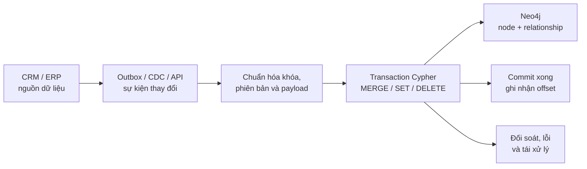

# Ánh xạ thao tác tạo, cập nhật và xóa từ hệ thống nguồn

## 1. Bài toán: đồng bộ dữ liệu nguồn vào Neo4j

Trong hệ thống dùng **Neo4j** để mô hình hóa *property graph*, node biểu diễn thực thể (khách hàng, đơn hàng, sản phẩm), relationship biểu diễn liên kết giữa các thực thể. Dữ liệu có thể được sinh tại hệ thống nghiệp vụ khác như CRM, ERP hoặc cơ sở dữ liệu quan hệ, rồi được nạp vào Neo4j để truy vấn quan hệ, đường đi và các mẫu dữ liệu bằng Cypher.

Một lần nhập dữ liệu ban đầu tương đối đơn giản; phần khó là duy trì đồ thị **đúng sau nhiều sự kiện tạo, sửa, xóa**. Nếu hệ thống nguồn đổi email khách hàng, chuyển đơn sang khách khác hoặc xóa đơn, những thay đổi đó phải có cách biểu diễn nhất quán trong Neo4j. Đồng bộ không đúng có thể tạo node trùng, giữ relationship đã hết hiệu lực, khôi phục dữ liệu đã xóa do sự kiện cũ đến muộn hoặc ghi đè thuộc tính không thuộc quyền sở hữu của nguồn.

Ví dụ một luồng dữ liệu:



**Phạm vi bài:** ánh xạ `CREATE/INSERT`, `UPDATE`, `DELETE` của hệ thống nguồn vào các thao tác Cypher tương đương. Ta sẽ dùng ví dụ CRM/ERP, kiểm tra tính lặp lại (*idempotency*), xử lý thứ tự sự kiện và cân nhắc giữa **xóa mềm** với **xóa vật lý**.

Sau khi học, bạn có thể:

1. Thiết kế **định danh ổn định** cho node và relationship đến từ nhiều nguồn.
2. Ánh xạ tạo/cập nhật/xóa qua `MERGE`, `SET`, `REMOVE`, `DELETE`, `DETACH DELETE` đúng ngữ nghĩa.
3. Phân biệt **snapshot** với **patch**, giá trị `null` với trường không xuất hiện trong sự kiện.
4. Xử lý sự kiện đến trùng, đảo thứ tự, thiếu node tham chiếu và xóa có quan hệ.
5. Tổ chức xử lý bằng Java Driver/Spring Data Neo4j, đo kiểm và đối soát sau đồng bộ.

## 2. Từ bản ghi nguồn sang property graph

Giả sử CRM là nguồn sự thật của khách hàng, ERP là nguồn sự thật của đơn hàng và liên kết đơn–khách.

| Hệ thống nguồn | Bản ghi hoặc liên kết | Mô hình Neo4j | Khóa đồng bộ |
|---|---|---|---|
| CRM | `customer(id, full_name, email)` | `(:DI003Customer)` | (`sourceSystem`, `sourceId`) |
| ERP | `order(id, status, total_amount)` | `(:DI003Order)` | (`sourceSystem`, `sourceId`) |
| ERP | `order.customer_id` | `(:DI003Customer)-[:DI003_PLACED]->(:DI003Order)` | Cặp endpoint nếu mỗi đơn có đúng một khách |

```text
(:DI003Customer {
   sourceSystem: "crm",
   sourceId:     "C-001",
   fullName:     "An Nguyễn",
   sourceVersion: 10,
   isDeleted:    false
})
  |
  +--[:DI003_PLACED]--> (:DI003Order {
                           sourceSystem: "erp",
                           sourceId:     "O-100",
                           status:       "CREATED",
                           sourceVersion: 5
                         })
```

**Khóa nghiệp vụ của nguồn** (`sourceSystem` + `sourceId`) là địa chỉ ổn định để tìm bản ghi khi nhận sự kiện tiếp theo. Không nên dùng `elementId()` hoặc ID nội bộ của Neo4j làm khóa đồng bộ giữa các hệ thống: đó là định danh kỹ thuật của graph hiện tại, không thay thế khóa nguồn lâu dài.

Một trường `customer.id = 001` ở CRM và `order.id = 001` ở ERP không phải cùng thực thể. Khóa có namespace nguồn giúp tránh trùng và cho phép tích hợp thêm hệ thống sau này.

### 2.1. Hợp đồng sự kiện đầu vào

Một sự kiện nguồn có thể được chuẩn hóa thành cấu trúc:

```json
{
  "eventId": "crm-c001-v11",
  "sourceSystem": "crm",
  "entityType": "customer",
  "sourceId": "C-001",
  "operation": "UPDATE",
  "version": 11,
  "occurredAt": "2026-10-05T09:15:00Z",
  "changed": {
    "fullName": "An Trần",
    "email": null
  }
}
```

| Trường | Mục đích | Lưu ý |
|---|---|---|
| `eventId` | Truy vết và khử trùng sự kiện | Phải ổn định khi phát lại cùng sự kiện |
| `sourceSystem`, `entityType`, `sourceId` | Chọn node/relationship đích | Không suy khóa từ tên hiển thị hoặc email |
| `operation` | Phân nhánh `CREATE / UPDATE / DELETE` | Quy định rõ xóa mềm hay vật lý |
| `version` | Loại sự kiện cũ/trùng | Phải **tăng đơn điệu theo từng entity** |
| `occurredAt` | Audit, giám sát độ trễ nguồn → đồ thị | Không dùng timestamp thay version nếu không có bảo đảm thứ tự |
| `changed` | Thuộc tính thay đổi | Phân biệt trường không gửi và trường gửi `null` |

Ví dụ này giả định upstream cung cấp **version tăng đều trên mỗi thực thể**, khởi đầu lớn hơn 0; trong hệ thống khác có thể là `sequence`, vị trí log hoặc một token thứ tự có quy tắc xác định. Nếu chỉ có timestamp không đáng tin cậy, cần bổ sung cơ chế quyết định thứ tự khi hai bản cập nhật xảy ra gần nhau.

**Phân biệt hai hướng CDC:** các công cụ đọc log nguồn như outbox/CDC tại CRM, ERP phát sự kiện **đi vào Neo4j**. Tính năng **Neo4j CDC** lại thu thay đổi **phát sinh trong Neo4j** cho hệ thống tiêu thụ khác; đó không phải cơ chế tự động đọc log của mọi database nguồn.

## 3. Thiết lập constraint trước khi đồng bộ

Trong database thực hành, tạo hai constraint định danh:

```cypher
CREATE CONSTRAINT di003_customer_identity IF NOT EXISTS
FOR (c:DI003Customer)
REQUIRE (c.sourceSystem, c.sourceId) IS UNIQUE;
```

```cypher
CREATE CONSTRAINT di003_order_identity IF NOT EXISTS
FOR (o:DI003Order)
REQUIRE (o.sourceSystem, o.sourceId) IS UNIQUE;
```

Kiểm tra schema:

```cypher
SHOW CONSTRAINTS
YIELD name, type, entityType, labelsOrTypes, properties
WHERE name STARTS WITH 'di003_'
RETURN name, type, entityType, labelsOrTypes, properties
ORDER BY name;
```

Các **uniqueness constraint** ngăn nhiều node có cùng cặp thuộc tính khác `null` và giúp tra cứu `MERGE` bằng index. Tuy nhiên, uniqueness constraint **không buộc thuộc tính phải tồn tại**; ứng dụng nhập liệu vẫn phải từ chối `sourceSystem`/`sourceId` rỗng hoặc null. Khi cần *node key* vừa duy nhất vừa bắt buộc tồn tại, cần xác nhận tính năng hỗ trợ theo Neo4j edition đang chạy.

Không nên gộp toàn bộ dữ liệu vào `MERGE`:

```cypher
// SAI VỀ MỤC ĐÍCH ĐỒNG BỘ: email là trường có thể thay đổi.
// MERGE (c:DI003Customer {
//   sourceSystem: 'crm',
//   sourceId: 'C-001',
//   email: 'an@example.test'
// })
```

Khi email đổi, mẫu `MERGE` trên không còn khớp node cũ và có thể tìm cách tạo node khác hoặc gây xung đột constraint. Mẫu bền vững là **`MERGE` chỉ theo khóa định danh, `SET` thuộc tính nghiệp vụ sau**.

## 4. Ánh xạ CREATE: tạo node bằng MERGE

Giả sử CRM phát bản ghi khách hàng `C-001` ở phiên bản `10`:

```cypher
MERGE (c:DI003Customer {
  sourceSystem: 'crm',
  sourceId: 'C-001'
})
ON CREATE SET
  c.sourceVersion = 0,
  c.isDeleted = false
WITH c
WHERE 10 > c.sourceVersion
SET c.fullName = 'An Nguyễn',
    c.email = 'an@example.test',
    c.sourceVersion = 10,
    c.isDeleted = false,
    c.deletedAt = null
RETURN c.sourceId AS id, c.fullName AS fullName,
       c.sourceVersion AS version;
```

Ý nghĩa từng phần:

1. `MERGE` tìm khách hàng theo **khóa ổn định**, tạo node nếu chưa có.
2. `ON CREATE SET` khởi tạo version 0; khi khớp node cũ, nó không reset version.
3. `WHERE 10 > c.sourceVersion` chỉ cho phép sự kiện mới hơn cập nhật dữ liệu.
4. `SET` cập nhật thuộc tính; đặt `deletedAt = null` sẽ **xóa thuộc tính** `deletedAt` nếu đã có.

Chạy lặp lại **cùng query** sau khi đã ghi version 10 sẽ không cập nhật lại node vì điều kiện `10 > 10` sai. Lần chạy lại có thể **trả 0 dòng** do `WHERE`, nhưng node vẫn tồn tại. Kiểm tra bằng câu đọc:

```cypher
MATCH (c:DI003Customer {
  sourceSystem: 'crm',
  sourceId: 'C-001'
})
RETURN c.sourceId AS id, c.fullName AS fullName,
       c.email AS email, c.sourceVersion AS version,
       c.isDeleted AS isDeleted;
```

Kỳ vọng có **đúng một** node với version `10` và `isDeleted = false`.

Để chuẩn bị ví dụ chuyển quyền sở hữu đơn hàng, tạo thêm khách hàng `C-002`:

```cypher
MERGE (c:DI003Customer {
  sourceSystem: 'crm',
  sourceId: 'C-002'
})
ON CREATE SET c.sourceVersion = 0
WITH c
WHERE 1 > c.sourceVersion
SET c.fullName = 'Bình',
    c.email = 'binh@example.test',
    c.isDeleted = false,
    c.sourceVersion = 1
RETURN c.sourceId AS id, c.sourceVersion AS version;
```

### 4.1. Ánh xạ CREATE của đơn hàng

```cypher
MERGE (o:DI003Order {
  sourceSystem: 'erp',
  sourceId: 'O-100'
})
ON CREATE SET o.sourceVersion = 0
WITH o
WHERE 5 > o.sourceVersion
SET o.status = 'CREATED',
    o.totalAmount = 250000,
    o.sourceVersion = 5,
    o.isDeleted = false
RETURN o.sourceId AS id, o.status AS status,
       o.totalAmount AS totalAmount;
```

**Lưu ý về cạnh tranh ghi:** uniqueness constraint hạn chế node trùng khi có hai worker cùng xử lý một khóa. Tuy nhiên, điều kiện `WHERE version > sourceVersion` một mình **không bảo đảm xử lý đúng khi nhiều transaction cập nhật cùng node song song**. Trong pipeline thật, nên phân vùng sự kiện theo entity key để các cập nhật cùng khóa được xử lý tuần tự, hoặc dùng cơ chế khóa/điều kiện ghi được thiết kế và kiểm thử cho concurrency.

## 5. Ánh xạ quan hệ: nối hai thực thể đã tồn tại

Giả sử ERP xác nhận đơn `O-100` thuộc khách `C-001`. Trước khi thêm relationship, yêu cầu **cả hai endpoint tồn tại**:

```cypher
MATCH (c:DI003Customer {
  sourceSystem: 'crm',
  sourceId: 'C-001'
})
MATCH (o:DI003Order {
  sourceSystem: 'erp',
  sourceId: 'O-100'
})
WHERE coalesce(c.isDeleted, false) = false
  AND coalesce(o.isDeleted, false) = false
MERGE (c)-[r:DI003_PLACED]->(o)
ON CREATE SET r.sourceSystem = 'erp'
RETURN c.sourceId AS customerId, o.sourceId AS orderId;
```

`MERGE` relationship giữa hai node **đã gán** tránh vô tình tạo node nguồn khác. Ở đây mô hình quy định **mỗi đơn chỉ thuộc một khách tại một thời điểm**, nên một cạnh `DI003_PLACED` là đủ để biểu diễn liên kết. Nếu nghiệp vụ có nhiều lần sở hữu, nhiều giao dịch hoặc nhiều quan hệ cùng loại giữa cùng hai node, cần **khóa riêng cho bản ghi quan hệ** hoặc node trung gian; không thể mặc định `MERGE (c)-[:TYPE]->(o)` biểu diễn được mọi sự kiện.

Khi endpoint chưa có vì sự kiện đến sai thứ tự, `MATCH` không tạo được liên kết. Pipeline phải chọn quy tắc rõ: **giữ ở hàng đợi retry/dead-letter** đến khi endpoint xuất hiện, hoặc tạo placeholder có cờ trạng thái rồi điền dữ liệu sau. Không âm thầm bỏ sự kiện quan hệ; cũng không tự tạo node đầy đủ từ một sự kiện chỉ mang khóa tham chiếu.

Kiểm tra liên kết:

```cypher
MATCH (c:DI003Customer)-[:DI003_PLACED]->(o:DI003Order)
RETURN c.sourceId AS customerId, o.sourceId AS orderId
ORDER BY orderId;
```

Kỳ vọng ban đầu: `C-001 → O-100`.

## 6. Ánh xạ UPDATE: patch, snapshot và trường null

Nguồn thường gửi **sự kiện cập nhật từng phần** hoặc **snapshot đầy đủ** của thực thể. Phải biết rõ loại payload trước khi chọn `SET`:

| Loại sự kiện | Ý nghĩa | Cypher phù hợp |
|---|---|---|
| Patch | Chỉ trường xuất hiện mới thay đổi | `SET n += $changed` |
| Snapshot đầy đủ | Trạng thái tất cả thuộc tính do nguồn sở hữu | Gán tường minh các trường hoặc xây map theo schema |
| Trường xuất hiện với `null` | Xóa giá trị thuộc tính | `SET n.prop = null` hoặc `SET n += {prop: null}` |
| Trường không xuất hiện | Không đổi thuộc tính trong patch | Không đặt trường đó trong map `changed` |
| Xóa thuộc tính rõ ràng | Trường không còn có giá trị trong graph | `REMOVE n.prop` |

**Đặc biệt:** `SET n += $changed` **chỉ sửa các khóa được cung cấp**, còn `SET n = $properties` **thay thế toàn bộ properties** trên node. Nếu dùng `SET n = ...` mà quên `sourceSystem`, `sourceId` hoặc `sourceVersion`, việc đồng bộ có thể mất định danh và metadata. Không dùng `SET =` với map patch.

### 6.1. UPDATE thay đổi tên và xóa email

Sự kiện CRM `C-001 / version 11` đổi `fullName` và chủ động xóa `email`:

```cypher
MATCH (c:DI003Customer {
  sourceSystem: 'crm',
  sourceId: 'C-001'
})
WHERE 11 > c.sourceVersion
SET c += {
      fullName: 'An Trần',
      email: null
    },
    c.sourceVersion = 11
RETURN c.sourceId AS id, c.fullName AS fullName,
       c.email AS email, c.sourceVersion AS version;
```

Truy vấn trên **không có thuộc tính email sau cập nhật**. Ở Neo4j, đặt property bằng `null` làm **xóa property**, khác với lưu một giá trị null như trong một số hệ CSDL quan hệ. Cũng có thể dùng `REMOVE c.email`.

Một sự kiện patch chỉ thay tên nên truyền `changed = {fullName: 'Tên mới'}` và chạy `SET c += $changed`; email hiện tại được giữ. Tránh viết `SET c.email = $email` trong khi bản tin **không gửi trường email** mà tầng tích hợp tự điền `null`: thao tác đó sẽ xóa email ngoài ý muốn.

**Bảo vệ metadata đồng bộ:** trước khi truyền `$changed` vào `SET c += $changed`, tầng tích hợp phải kiểm tra danh sách thuộc tính cho phép, loại bỏ các khóa điều khiển như `sourceSystem`, `sourceId`, `sourceVersion`, `isDeleted`. Nếu cho nguồn tùy ý ghi đè các khóa này, một patch có thể phá vỡ định danh hoặc bỏ qua cơ chế chống sự kiện cũ.

### 6.2. Chống cập nhật cũ và phát lại trùng

Sau version 11, sự kiện version 10 phải bị bỏ qua:

```cypher
MATCH (c:DI003Customer {
  sourceSystem: 'crm', sourceId: 'C-001'
})
WHERE 10 > c.sourceVersion
SET c.fullName = 'An Nguyễn',
    c.sourceVersion = 10
RETURN c.sourceVersion AS version;
```

Kỳ vọng **0 dòng**, tên vẫn là `An Trần` và version vẫn `11`. Tương tự, phát lại version 11 không áp dụng thêm thay đổi. Nếu hai sự kiện **cùng version nhưng payload khác nhau**, không nên im lặng coi là cùng một sự kiện hợp lệ: đối chiếu `eventId`/checksum và báo xung đột upstream.

Version giúp phát hiện sự kiện cũ nhưng **chưa đủ** nếu các bản cập nhật cùng entity được xử lý bởi nhiều worker cạnh tranh. Một phương án phổ biến là dùng partition theo `sourceSystem + entityType + sourceId` để giữ thứ tự, áp dụng tuần tự trong giao dịch và ghi checkpoint sau commit.

## 7. Ánh xạ cập nhật khóa ngoại: thay đổi relationship

Trường `order.customer_id` ở ERP đổi từ `C-001` sang `C-002`. Chỉ sửa `o.customerId` sẽ **không tự thay đổi cạnh trong graph**; phải thay liên kết.

Quy tắc: tìm đơn và khách mới, kiểm tra version, xóa các cạnh sở hữu cũ không đúng đích, rồi tạo cạnh mới **trong cùng transaction**.

```cypher
MATCH (newCustomer:DI003Customer {
  sourceSystem: 'crm', sourceId: 'C-002'
})
MATCH (o:DI003Order {
  sourceSystem: 'erp', sourceId: 'O-100'
})
WHERE coalesce(newCustomer.isDeleted, false) = false
  AND coalesce(o.isDeleted, false) = false
  AND 6 > o.sourceVersion
OPTIONAL MATCH (oldCustomer:DI003Customer)
               -[oldRel:DI003_PLACED]->(o)
WHERE oldCustomer <> newCustomer
FOREACH (r IN CASE
    WHEN oldRel IS NULL THEN []
    ELSE [oldRel]
  END | DELETE r)
WITH DISTINCT newCustomer, o
MERGE (newCustomer)-[:DI003_PLACED]->(o)
SET o.sourceVersion = 6
RETURN newCustomer.sourceId AS customerId,
       o.sourceId AS orderId, o.sourceVersion AS version;
```

**Kết quả kỳ vọng:** `C-002 → O-100`, quan hệ `C-001 → O-100` đã biến mất và order version là `6`. `OPTIONAL MATCH` xử lý trường hợp chưa có cạnh; `FOREACH ... DELETE` không làm gì khi `oldRel` bằng null. `WITH DISTINCT` bảo đảm còn một dòng cho cặp endpoint trước khi `MERGE`, tránh nhân dòng nếu dữ liệu cũ có nhiều relationship.

Trong hệ thống thật, chủ sở hữu quan hệ phải rõ ràng. Không xóa relationship do nguồn khác quản lý hoặc các quan hệ có ý nghĩa lịch sử nếu nghiệp vụ yêu cầu lưu lại. Nếu cần lưu lịch sử, cân nhắc node hoặc relationship theo sự kiện với `validFrom/validTo` thay vì xóa cạnh cũ.

## 8. Ánh xạ DELETE: chọn đúng chính sách

Sự kiện `DELETE` có ít nhất ba nghĩa khác nhau:

| Chính sách | Cách thể hiện trong Neo4j | Khi dùng |
|---|---|---|
| **Soft delete (tombstone)** | Giữ node, đặt `isDeleted = true` và version | Cần ngăn sự kiện cũ hồi sinh dữ liệu, phục vụ kiểm toán/khôi phục |
| **Xóa cạnh** | `MATCH ...-[r:TYPE]->... DELETE r` | Bản ghi liên kết bị xóa nhưng endpoint còn tồn tại |
| **Hard delete** | `DELETE n` nếu không còn relationship, hoặc `DETACH DELETE n` | Có chính sách xóa vật lý và cơ chế lưu trạng thái đồng bộ bên ngoài |

### 8.1. Xóa mềm khách hàng với version

CRM phát `DELETE(C-001, version=12)`:

```cypher
MATCH (c:DI003Customer {
  sourceSystem: 'crm', sourceId: 'C-001'
})
WHERE 12 > c.sourceVersion
SET c.isDeleted = true,
    c.sourceVersion = 12,
    c.deletedAt = datetime('2026-10-06T00:00:00Z'),
    c.fullName = null,
    c.email = null
RETURN c.sourceId AS id, c.isDeleted AS deleted,
       c.sourceVersion AS version;
```

Node vẫn giữ **khóa nguồn và version 12** nhưng không còn tên/email, nên sự kiện cũ version 10 hoặc 11 không được áp dụng. Query nghiệp vụ phải chủ động lọc node đã xóa, ví dụ:

```cypher
MATCH (c:DI003Customer)
WHERE coalesce(c.isDeleted, false) = false
RETURN c.sourceId AS id, c.fullName AS fullName
ORDER BY id;
```

Kỳ vọng chỉ thấy `C-002` sau khi đã thực hiện đầy đủ các bước trước. Với hệ thống có yêu cầu xóa dữ liệu cá nhân, tombstone không nên giữ các thuộc tính nhạy cảm; thời hạn lưu và nội dung audit phải tuân theo chính sách xử lý dữ liệu của tổ chức.

### 8.2. Xóa một relationship mà không xóa endpoint

Giả sử nguồn xóa liên kết `C-002` với `O-100`:

```cypher
MATCH (c:DI003Customer {
  sourceSystem: 'crm', sourceId: 'C-002'
})-[r:DI003_PLACED]->
(o:DI003Order {
  sourceSystem: 'erp', sourceId: 'O-100'
})
DELETE r;
```

Lặp lại lệnh khi cạnh đã xóa sẽ không khớp dòng nào và không tạo thêm thay đổi. Tuy nhiên, **xóa quan hệ theo sự kiện cũ** có thể vô tình xóa một liên kết mới được tạo lại nếu không có `relationshipId`/`version` hoặc checkpoint phù hợp. Khi đồng bộ thật, quy tắc version phải áp dụng cả sự kiện quan hệ, không chỉ node.

### 8.3. Khi nào dùng DELETE và DETACH DELETE?

```cypher
// Chỉ chạy trong database học tập, khi node không còn cạnh.
MATCH (o:DI003Order {
  sourceSystem: 'erp', sourceId: 'O-100'
})
DELETE o;
```

`DELETE o` không thể xóa node vẫn còn relationship. `DETACH DELETE o` xóa cả node **và mọi relationship liên quan**, kể cả cạnh do nhóm khác tạo. Vì vậy không được sử dụng `DETACH DELETE` như phương án mặc định khi cần giữ liên kết hoặc lịch sử nguồn khác.

Nếu xóa vật lý node, ta mất `sourceVersion` lưu ngay trên node. Sự kiện `CREATE` cũ có thể tạo lại bản ghi. Muốn hard delete an toàn trong hệ thống nhận sự kiện *at-least-once*, cần một **ledger/tombstone bên ngoài node bị xóa** (ví dụ bảng ingest offset và version theo khóa nguồn), hoặc bằng chứng upstream bảo đảm những sự kiện cũ không còn đến. Chỉ xóa node không đồng nghĩa đã xử lý xong trạng thái đồng bộ.

## 9. Từ snapshot đến luồng CDC: tránh mất dữ liệu và ghi trùng

Một pipeline thường gồm hai pha:

1. **Snapshot:** nhập hiện trạng ban đầu, dùng `UNWIND` và `MERGE` theo khóa nguồn. Ghi nhận một watermark/offset tại ranh giới snapshot theo cơ chế của hệ thống phát sự kiện.
2. **Streaming:** đọc thay đổi sau watermark từ log/outbox/API, xử lý theo đúng thứ tự trong phạm vi từng entity. Chỉ lưu offset đã tiêu thụ **sau khi transaction Neo4j commit thành công**.

Nếu snapshot và CDC **không có ranh giới nhất quán**, có thể bỏ sót update trong lúc snapshot đang đọc. Phải áp dụng quy trình snapshot/CDC do nền tảng nguồn cung cấp, dùng offset có thể khôi phục; không tự suy một timestamp tường minh tương đương transaction log sequence.

### 9.1. Batch nhiều bản ghi với UNWIND

Giả sử nhận một batch **snapshot hoàn chỉnh** của các khách hàng với version dương, đã được sắp thứ tự theo mỗi khóa. Có thể truyền tham số `$rows`:

```json
[
  {
    "sourceId": "C-010",
    "version": 2,
    "fullName": "Lan",
    "email": "lan@example.test"
  },
  {
    "sourceId": "C-011",
    "version": 3,
    "fullName": "Minh",
    "email": "minh@example.test"
  }
]
```

```cypher
UNWIND $rows AS row
WITH row
WHERE row.sourceId IS NOT NULL AND row.version IS NOT NULL
MERGE (c:DI003Customer {
  sourceSystem: 'crm', sourceId: row.sourceId
})
ON CREATE SET c.sourceVersion = 0
WITH c, row
WHERE row.version > c.sourceVersion
SET c.fullName = row.fullName,
    c.email = row.email,
    c.isDeleted = false,
    c.sourceVersion = row.version
RETURN count(c) AS appliedCount;
```

Trong ví dụ này, `appliedCount` là **số dòng cập nhật** của batch, không chứng minh có đúng bấy nhiêu entity duy nhất nếu batch có khóa lặp. Với stream thực, cần khử trùng/đảm bảo thứ tự **trước** khi gom batch hoặc chỉ nhận một version mới nhất theo khóa trong một batch. Đặc biệt, lệnh `UNWIND` **không tự bảo đảm thứ tự**; không được dùng thứ tự phần tử đầu vào để giả định chính sách xử lý version.

Giới hạn batch phải được đo dựa trên heap, thời gian giao dịch, lock, DB Hits và throughput. Batch rất lớn có thể giữ lock lâu, tăng bộ nhớ và gây timeout. Có thể chia batch ở tầng tiêu thụ hoặc dùng **`CALL { ... } IN TRANSACTIONS`** trong các tác vụ import thích hợp, nhưng cần chú ý ranh giới giao dịch và môi trường chạy; không trộn thao tác đó vào một managed transaction Java Driver vốn đã điều khiển transaction ngoài.

### 9.2. Idempotency và điều kiện exactly-once

Luồng phân tán thường nên thiết kế theo mô hình **at-least-once delivery + idempotent writes**:

- `MERGE` theo khóa ổn định ngăn tạo node trùng cho cùng bản ghi; uniqueness constraint bổ trợ khi cạnh tranh ghi.
- `sourceVersion` giúp bỏ qua sự kiện cũ/trùng khi thứ tự xử lý theo khóa được bảo đảm.
- `eventId` giúp phát hiện payload khác nhau dù cùng version, phục vụ audit và truy lỗi.
- Checkpoint/offset chỉ ghi nhận **sau commit**; nếu commit thành công nhưng checkpoint thất bại, sự kiện sẽ được phát lại và phải an toàn.
- Khi nguồn và Neo4j ở **hai hệ thống giao dịch khác nhau**, không tự tuyên bố exactly-once toàn tuyến nếu chưa có cơ chế phối hợp thích hợp. Thực tế thường nhắm đến hiệu ứng cuối **tương đương một lần áp dụng** bằng replay an toàn.

Nếu một sự kiện thay đổi **nhiều thực thể** cần cùng thành công hoặc cùng thất bại, hãy thực thi các câu Cypher liên quan **trong một transaction Neo4j**, nhưng đừng giả định transaction Neo4j tự bao gồm commit/ack ở Kafka, queue hoặc database nguồn.

## 10. Áp dụng trong Java Driver và Spring Data Neo4j

Java Driver cung cấp `executeWrite` để chạy transaction ghi có retry cho lỗi tạm thời. **Callback có thể được chạy lại**, do đó mọi side effect ngoài Neo4j (đẩy email, tăng biến toàn cục, ack message) không nên đặt bên trong callback. Hãy truyền tham số thay vì ghép chuỗi đầu vào vào Cypher:

```java
String cypher = """
    MERGE (c:DI003Customer {
      sourceSystem: $sourceSystem,
      sourceId: $sourceId
    })
    ON CREATE SET c.sourceVersion = 0
    WITH c
    WHERE $version > c.sourceVersion
    SET c += $changed,
        c.sourceVersion = $version,
        c.isDeleted = false
    RETURN c.sourceId AS id
    """;

var params = java.util.Map.<String, Object>of(
    "sourceSystem", "crm",
    "sourceId", "C-020",
    "version", 4L,
    "changed", java.util.Map.of("fullName", "Hà")
);

try (var session = driver.session()) {
    var result = session.executeWrite(tx ->
        tx.run(cypher, params).list()
    );
    System.out.println("Applied rows: " + result.size());
}
```

Đoạn mã giả định `driver` (`org.neo4j.driver.Driver`) đã được cấu hình đúng. Không đặt `null` vào `Map.of(...)` vì Java không cho phép phần tử null trong map này. Với payload có trường cần xóa (`email: null`), hãy dùng `HashMap` có thể chứa null, hoặc xây tham số và xử lý danh sách trường cần xóa theo hợp đồng đầu vào. Phía Neo4j, `SET c += $changed` với giá trị null sẽ **xóa** thuộc tính tương ứng.

**Lưu ý retry và kiểm soát thứ tự:** driver retry các lỗi transient trong transaction; nó không tự điều phối phiên bản sự kiện giữa nhiều consumer. Nếu nhiều worker có thể cập nhật cùng `sourceId` cùng lúc, pipeline phải có cách xử lý concurrency riêng.

Trong **Spring Data Neo4j (SDN)**, có thể ánh xạ entity với `@Node`, `@Id`, `@Relationship` và repository, nhưng cập nhật CDC dạng patch, xóa quan hệ theo event hoặc xử lý version có thể phù hợp hơn với truy vấn Cypher tường minh qua `Neo4jClient`. Cần phân biệt thao tác `save()` trên aggregate được mapping với một event chỉ cập nhật **một trường**: không tự giả định `save()` có ngữ nghĩa patch. Với tích hợp đa nguồn, lựa chọn cách lưu phải xét ownership, dirty checking và hành vi đối với relationship của phiên bản SDN thực tế.

## 11. Đối soát, quan sát và xử lý lỗi

Một pipeline tốt phải chứng minh dữ liệu đích phản ánh nguồn, không chỉ đếm số message đã xử lý.

### 11.1. Kiểm tra đồ thị sau chuỗi ví dụ

Sau khi chạy các thao tác **theo thứ tự từ mục 4 đến mục 8.1** (không chạy lệnh xóa cạnh ở 8.2 và xóa vật lý 8.3), mong đợi:

| Entity | Trạng thái cuối | Version |
|---|---|---:|
| `C-001` | `isDeleted = true`; `fullName/email` đã bị xóa | 12 |
| `C-002` | Hoạt động, vẫn có email `binh@example.test` | 1 |
| `O-100` | Hoạt động, thuộc `C-002` | 6 |

Kiểm tra nhanh:

```cypher
MATCH (c:DI003Customer)
WHERE c.sourceSystem = 'crm'
  AND c.sourceId IN ['C-001', 'C-002']
RETURN c.sourceId AS customerId, c.isDeleted AS isDeleted,
       c.fullName AS fullName, c.email AS email,
       c.sourceVersion AS version
ORDER BY customerId;
```

```cypher
MATCH (o:DI003Order {
  sourceSystem: 'erp', sourceId: 'O-100'
})
OPTIONAL MATCH (c:DI003Customer)-[:DI003_PLACED]->(o)
RETURN o.sourceId AS orderId,
       o.sourceVersion AS orderVersion,
       collect(c.sourceId) AS currentCustomerIds;
```

Kỳ vọng `orderVersion = 6` và `currentCustomerIds = ['C-002']`. Nếu câu trả về nhiều customer, quy tắc một đơn–một khách đã bị vi phạm; cần kiểm tra sự kiện chuyển quyền sở hữu hoặc các bản ghi liên kết cũ.

### 11.2. Bộ chỉ số theo dõi pipeline

| Nhóm | Chỉ số | Phát hiện |
|---|---|---|
| Luồng sự kiện | Offset hiện tại, event lag, tốc độ tiêu thụ | Trễ đồng bộ hoặc gián đoạn |
| Chất lượng dữ liệu | Key rỗng, endpoint thiếu, xung đột version | Event không hợp lệ hoặc sai thứ tự |
| Graph | Số node theo nguồn, orphan node, số cạnh loại nghiệp vụ | Lệch dữ liệu giữa nguồn và Neo4j |
| Độ tin cậy | Retry, dead-letter, poison messages, tỷ lệ duplicate | Lỗi lặp, dữ liệu không thể áp dụng |
| Hiệu năng | Transaction latency p50/p95, QPS, DB Hits, CPU, heap | Tắc nghẽn khi batch/constraint/index |

Khả năng đối soát tốt cần thêm **checkpoint theo nguồn**, thống kê số thực thể theo trạng thái, truy vấn các khóa bị thiếu, so phiên bản cuối cùng và đối chiếu mẫu ngẫu nhiên thuộc tính/relationship. `count(*)` giữa hai hệ thống không đủ để khẳng định dữ liệu giống nhau: hai tập có thể bằng số lượng nhưng khác khóa và liên kết.

### 11.3. Phân loại lỗi và hướng xử lý

| Tình huống | Nguyên nhân thường gặp | Hành động |
|---|---|---|
| `MERGE` với `sourceId = null` | Thiếu khóa upstream | Validate, đưa dead-letter, không ghi node không định danh |
| Vi phạm uniqueness constraint | Trùng key/đụng dữ liệu cũ | Đối chiếu định danh, xử lý migration/duplicate; không bỏ constraint |
| Không tìm thấy endpoint của relationship | Event đến trước CREATE tham chiếu | Retry với giới hạn hoặc tạo placeholder theo quy ước |
| Version nhỏ hơn hiện tại | Replay/sai thứ tự | Bỏ qua an toàn, tăng bộ đếm stale; đối chiếu nếu bất thường |
| Cùng version khác payload | Xung đột upstream | Ghi nhận conflict, không tùy tiện chọn bản tin đến sau |
| Transaction transient failure | Lock contention/tạm mất kết nối | Retry idempotent có backoff theo driver |
| Không thể xác định xóa vật lý an toàn | Không có tombstone/ledger hoặc ownership | Hoãn hard delete, thiết kế checkpoint/retention |

## 12. Quy trình triển khai và bài tập tự luyện

Khi triển khai tích hợp nguồn → Neo4j, có thể đi theo quy trình:

1. **Chốt ownership và khóa:** thực thể nào do hệ thống nào quản lý; khóa có duy nhất và bất biến không; quan hệ một–một, một–nhiều hay đa trị?
2. **Chọn hợp đồng sự kiện:** snapshot/patch, version, eventId, quy tắc null, delete, khóa ngoại.
3. **Tạo constraint và thử dữ liệu nhỏ:** tập có create/update/delete, replay, đảo thứ tự, relationship thiếu endpoint.
4. **Ánh xạ transaction Cypher:** `MERGE` chỉ khóa, `SET` thuộc tính, xử lý relationship theo khóa ngoại; dùng tham số.
5. **Thiết kế vận hành:** snapshot watermark, offset sau commit, retry/dead-letter, per-key ordering, chống race.
6. **Đối soát theo khóa và quan hệ:** thống kê số lượng, version cuối, kiểm tra dữ liệu bẩn và chạy benchmark theo kích thước batch.

### Bài tập

1. **Idempotency:** chạy lại câu lệnh CREATE `C-001` version 10 hai lần sau khi graph đã ở version 11. Truy vấn nào chứng minh tên và email không bị khôi phục?
2. **Snapshot và patch:** xét ba payload: `{}`, `{email: null}` và `{email: 'new@example.test'}`. Dự đoán kết quả của `SET c += $changed` cho từng trường hợp.
3. **Khóa ngoại đổi:** chuyển `O-100` từ `C-001` sang `C-002`; kiểm tra một đơn chỉ còn một cạnh `DI003_PLACED`.
4. **Xóa vật lý:** giải thích vì sao `DETACH DELETE` trên `C-001` có thể gây mất dữ liệu ngoài phạm vi nguồn; đề xuất cách ngăn replay version cũ tạo lại node.
5. **Batch CDC:** cho các event version `[4, 6, 5, 6]` của cùng một khách nhưng tới sai thứ tự. Hãy viết cách phân vùng và sắp thứ tự/khử trùng trước khi ghi; giải thích tại sao chỉ dùng `UNWIND` chưa đủ.
6. **Tình huống nghiệp vụ:** khách bị xóa khỏi CRM nhưng đơn hàng phải giữ để đối soát ERP. Bạn sẽ giữ/xóa node khách, khóa quan hệ, trường cá nhân và version như thế nào?

**Tiêu chí hoàn thành:** người học giải thích đúng ý nghĩa `MERGE` trên khóa, phân biệt `SET +=` và `SET =`, xử lý null và thiếu trường, tránh nhân node/relationship, biết lý do cần version + thứ tự theo key, và thiết kế được cách xóa phù hợp ownership.

### Dọn dữ liệu mẫu

Chỉ chạy trong database thực hành sau khi đã đối soát; các lệnh sau xóa node mẫu và mọi relationship gắn với chúng:

```cypher
MATCH (c:DI003Customer)
DETACH DELETE c;
```

```cypher
MATCH (o:DI003Order)
DETACH DELETE o;
```

```cypher
DROP CONSTRAINT di003_customer_identity IF EXISTS;
```

```cypher
DROP CONSTRAINT di003_order_identity IF EXISTS;
```

## 13. Tài liệu tham khảo

- [Neo4j Cypher Manual — MERGE](https://neo4j.com/docs/cypher-manual/current/clauses/merge/): định danh, `ON CREATE`/`ON MATCH`, constraint, `MERGE` trên pattern.
- [Neo4j Cypher Manual — SET](https://neo4j.com/docs/cypher-manual/current/clauses/set/): `SET =`, `SET +=`, thay đổi thuộc tính và giá trị null.
- [Neo4j Cypher Manual — DELETE](https://neo4j.com/docs/cypher-manual/current/clauses/delete/): xóa node, relationship, `DETACH DELETE`.
- [Neo4j Java Driver Manual — Transactions](https://neo4j.com/docs/java-manual/current/transactions/): managed write transaction, retry và idempotency.
- [Neo4j Change Data Capture — Introduction](https://neo4j.com/docs/cdc/current/): phân biệt Neo4j CDC (nguồn thay đổi là Neo4j) với pipeline nhập thay đổi từ nguồn bên ngoài.
