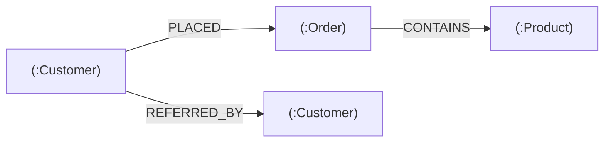
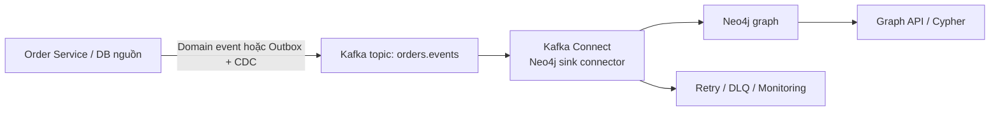
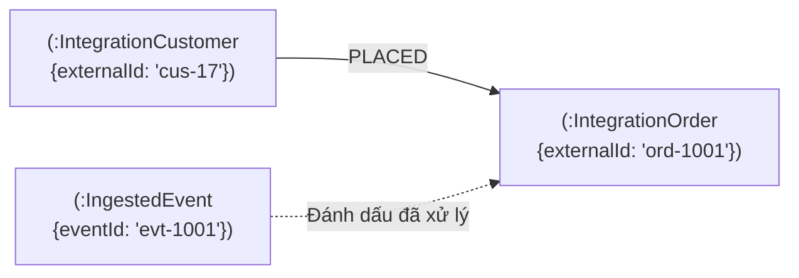

# Tích hợp luồng sự kiện và connector khi có yêu cầu nghiệp vụ

Trong hệ thống dùng **Neo4j**, dữ liệu liên kết thường đến từ nhiều nguồn: ứng dụng giao dịch, CRM, cơ sở dữ liệu quan hệ, kho dữ liệu và các dịch vụ phát sự kiện. Khi graph cần phản ánh thay đổi liên tục, thay vì nhập lại toàn bộ dữ liệu bằng CSV mỗi ngày, kiến trúc có thể dùng **event stream** và **connector** để chuyển các thay đổi thành node, relationship, property trong Neo4j.

Tuy nhiên, không phải ứng dụng nào cũng cần Kafka hay connector. Quyết định phải xuất phát từ **yêu cầu nghiệp vụ**: độ mới của dữ liệu, số nguồn, độ tin cậy, tốc độ phát sinh thay đổi, khả năng khôi phục và chi phí vận hành. Bài học thuộc chương **Tích hợp dữ liệu** trong module **DATABASE_ENGINE_GRAPH_NEO4J**: mô hình **property graph** được cập nhật bằng **Cypher**, với các lựa chọn như Neo4j Connector for Apache Kafka, Kafka Connect, **Neo4j Java Driver** và **Spring Data Neo4j**.

## 1. Khi nào bài toán thực sự cần sự kiện và connector?

Giả sử hệ thống bán hàng đang lưu giao dịch trong một dịch vụ Order Service. Neo4j lưu graph để phân tích quan hệ giữa khách hàng, đơn hàng và sản phẩm:



Nếu bảng đơn hàng thay đổi liên tục, graph có thể phục vụ truy vấn “khách hàng vừa đặt gì?”, “những sản phẩm thường được mua cùng nhau?” hoặc “ai trong mạng giới thiệu vừa phát sinh đơn mới?”. Lựa chọn đồng bộ phù hợp tùy mức độ cần dữ liệu cập nhật nhanh:

| Nhu cầu | Giải pháp nên cân nhắc | Vì sao |
| --- | --- | --- |
| Nhập lịch sử một lần, graph ít đổi | CSV, `LOAD CSV`, bulk import | Ít thành phần, đơn giản để kiểm tra |
| Cập nhật mỗi đêm hoặc vài giờ | ETL/batch theo lịch, incremental import | Độ trễ cho phép lớn, dễ tổ chức theo lô |
| Giao dịch từ một ứng dụng cần ghi graph ngay | Java Driver hoặc Spring Data Neo4j trong quy trình ứng dụng | Ít hạ tầng nếu không cần broker; phải xử lý lỗi giữa các hệ thống |
| Nhiều nguồn phát sự kiện, nhiều nơi tiêu thụ, cần cập nhật gần thời gian thực | Broker (ví dụ Kafka) + connector/consumer | Tách biệt producer/consumer, hỗ trợ lưu giữ và phát lại sự kiện |
| Muốn truyền thay đổi của database nguồn khi ứng dụng không tự phát domain event | CDC + connector, có thể đi qua broker | Chuyển thay đổi của database thành luồng |
| Dữ liệu chỉ cập nhật vài lần mỗi tháng | Batch hoặc import thủ công có kiểm soát | Streaming có thể tốn chi phí hơn lợi ích |

**Câu hỏi quyết định:** graph cần mới trong vài giây, vài phút hay cuối ngày? Nếu yêu cầu chỉ là báo cáo cuối ngày, hệ thống streaming có thể không cần thiết. Nếu graph là phần phục vụ chức năng vận hành ngay sau mỗi giao dịch và lưu lượng lớn, streaming có cơ sở rõ ràng hơn.

## 2. Phân biệt event, stream, broker và connector

- **Event (sự kiện):** thông tin rằng một việc đã xảy ra, ví dụ `OrderPlaced`, thường kèm định danh, dữ liệu và thời điểm.
- **Event stream:** chuỗi sự kiện phát sinh theo thời gian; có thể được lưu lại, đọc theo offset và phát lại.
- **Broker:** hạ tầng nhận, lưu giữ và phân phối stream cho các consumer; Apache Kafka là một ví dụ phổ biến.
- **Connector:** thành phần tích hợp đã đóng gói cho một hệ thống nguồn hoặc đích. Với Kafka, **Kafka Connect** quản lý worker/task của connector; connector có thể đọc nguồn (**source**) hoặc ghi đích (**sink**).
- **Consumer tự viết:** ứng dụng đọc message, kiểm tra dữ liệu, chuyển thành Cypher và ghi qua Neo4j Driver.

**Neo4j Connector for Apache Kafka** cung cấp khả năng tích hợp Neo4j với Kafka ở những vai trò/chiến lược do phiên bản connector hỗ trợ. Khi dùng **sink**, các bản ghi từ Kafka được chuyển thành thao tác ghi Neo4j. Khi dùng **source**, dữ liệu hoặc thay đổi từ Neo4j có thể được đưa ra Kafka theo cơ chế được connector và môi trường hỗ trợ. **Tính năng, tên cấu hình và điều kiện về phiên bản/edition khác nhau theo bản phát hành**; cần tra tài liệu của đúng connector đang triển khai.

> Tên “Neo4j Streams” thường xuất hiện trong bài viết hoặc hệ thống cũ. Không tự giả định mẫu cấu hình của Neo4j Streams tương thích với Neo4j Connector for Apache Kafka hiện tại.

## 3. Kiến trúc điển hình: ứng dụng → Kafka → Neo4j

Một phương án phổ biến cho graph phục vụ truy vấn là:



Luồng xử lý:

1. **Nguồn** ghi giao dịch và sinh sự kiện có định danh, schema rõ ràng.
2. Sự kiện vào **topic** phù hợp trên broker.
3. **Connector hoặc consumer** nhận message, chuyển đổi cấu trúc cần thiết và chạy Cypher.
4. Neo4j **commit** cập nhật graph trong transaction.
5. Consumer/connector mới xác nhận tiến độ xử lý theo cơ chế offset của hệ thống.
6. Khi lỗi, hệ thống phân biệt sự cố tạm thời cần retry với thông điệp lỗi dữ liệu cần xử lý riêng.

Mốc commit của Neo4j và mốc xác nhận offset Kafka là **hai ranh giới khác nhau**. Nếu Neo4j đã commit nhưng consumer mất kết nối trước khi xác nhận offset, sự kiện có thể được đọc lại. Vì vậy, **cần thiết kế xử lý lặp** ngay từ đầu; không được mặc định “mỗi message chỉ được áp dụng đúng một lần”.

### Domain event, outbox và CDC: nguồn phát khác nhau

| Cách phát thay đổi | Dữ liệu xuất ra | Điểm mạnh | Điều cần chú ý |
| --- | --- | --- | --- |
| **Domain event** từ ứng dụng | Ý nghĩa nghiệp vụ, ví dụ `OrderPlaced` | Dễ biểu diễn đúng ngữ nghĩa | Nếu ứng dụng ghi DB rồi publish riêng, có nguy cơ chỉ một bên thành công |
| **Transactional outbox** | Event lưu trong cùng transaction với thay đổi nghiệp vụ | Tránh lỗi “DB commit nhưng không ghi được ý định phát event” | Cần tiến trình/connector đọc outbox, gửi và quản lý lặp |
| **CDC (Change Data Capture)** của database nguồn | Thay đổi bản ghi/bảng ở tầng lưu trữ | Ít thay đổi mã nguồn ứng dụng; phù hợp đồng bộ dữ liệu | Thay đổi hàng không tự có đủ ý nghĩa domain; cần mapping và xử lý schema |
| **Ứng dụng ghi trực tiếp Neo4j** | Lệnh Cypher/đối tượng graph | Đơn giản nếu ít hệ thống | Có thể gặp lỗi dual-write nếu đồng thời ghi hệ dữ liệu khác |

**Dual-write** là khi cùng một yêu cầu cố ghi vào hai hệ thống độc lập và mong cả hai cùng thành công. Transaction của database nguồn không tự bao trùm transaction Neo4j. Với dữ liệu nghiệp vụ quan trọng, outbox và xử lý idempotent thường là cách thiết kế đáng cân nhắc hơn gửi trực tiếp sự kiện ngoài transaction.

## 4. Thiết kế hợp đồng sự kiện trước khi viết Cypher

Ví dụ một sự kiện đơn hàng mới:

```json
{
  "eventId": "evt-1001",
  "eventType": "OrderPlaced",
  "schemaVersion": 1,
  "aggregateId": "ord-1001",
  "aggregateVersion": 1,
  "occurredAt": "2026-11-25T03:10:00Z",
  "customerId": "cus-17",
  "orderId": "ord-1001",
  "amount": 259000,
  "currency": "VND"
}
```

Các trường nên có vai trò rõ ràng:

| Trường | Mục đích |
| --- | --- |
| `eventId` | Định danh sự kiện duy nhất để phát hiện phát lại/trùng |
| `eventType` | Xác định loại nghiệp vụ và logic xử lý |
| `schemaVersion` | Cho phép tiến hóa schema, nhận diện cách giải mã |
| `aggregateId` | Định danh thực thể nguồn; thường làm **Kafka message key** |
| `aggregateVersion` | Thứ tự thay đổi của cùng aggregate, nếu nguồn bảo đảm tăng đơn điệu |
| `occurredAt` | Thời điểm nghiệp vụ phát sinh; khác thời điểm consumer nhận |
| `customerId`, `orderId` | Khóa để `MERGE` node/relationship |
| `amount`, `currency` | Thuộc tính nghiệp vụ cần đúng đơn vị và kiểu |

Trong một topic Kafka, dùng `orderId` làm **message key** giúp các sự kiện của **cùng order** được đưa vào cùng partition trong cách tổ chức thông thường. Kafka giữ thứ tự của các message **trong một partition**, không tạo thứ tự toàn cục cho mọi order hoặc mọi topic. Nếu cùng một aggregate phát sự kiện từ nhiều luồng độc lập, cần cơ chế xử lý thứ tự ở tầng dữ liệu.

### Các nguyên tắc hợp đồng nên thống nhất

1. **Định danh ổn định** từ hệ thống nguồn; không tạo `randomUUID()` mới mỗi lần tiêu thụ cùng một sự kiện.
2. **Schema có version** và quy tắc tương thích khi producer thêm hoặc đổi trường.
3. **Giá trị thời gian có timezone**, hoặc quy ước UTC nhất quán.
4. **Kiểu dữ liệu chính xác**: số tiền có thể cần số nguyên theo đơn vị nhỏ nhất để tránh lỗi làm tròn; không trộn tiền tệ.
5. **Dữ liệu cần thiết cho mapping**: một event tạo relationship phải có ID của hai đầu nối, hoặc quy tắc rõ khi đầu nối chưa tồn tại.
6. **Quyền dữ liệu**: chỉ phát thông tin Neo4j thực sự cần; không đưa thông tin nhạy cảm vào topic/log nếu không có yêu cầu.

## 5. Chuẩn bị mô hình graph và constraint

Với `OrderPlaced`, ta muốn tạo:



`IngestedEvent` là node metadata của quá trình nhập, không nhất thiết là một phần domain graph. Nó giúp lưu dấu sự kiện đã xử lý trong **cùng transaction** với các thay đổi graph. Trong thực tế, có thể dùng nơi lưu idempotency khác có ranh giới giao dịch phù hợp.

Trên **database thực hành**, tạo constraint:

```cypher
CREATE CONSTRAINT integration_customer_id_unique IF NOT EXISTS
FOR (c:IntegrationCustomer)
REQUIRE c.externalId IS UNIQUE;
```

```cypher
CREATE CONSTRAINT integration_order_id_unique IF NOT EXISTS
FOR (o:IntegrationOrder)
REQUIRE o.externalId IS UNIQUE;
```

```cypher
CREATE CONSTRAINT ingested_event_id_unique IF NOT EXISTS
FOR (e:IngestedEvent)
REQUIRE e.eventId IS UNIQUE;
```

Constraint giúp tránh trùng node theo business key và hỗ trợ `MERGE`. **Không tự động bảo đảm mọi side effect ngoài Neo4j xảy ra đúng một lần**, cũng không giải quyết tất cả tranh chấp ghi đồng thời; các consumer cùng ghi một aggregate vẫn cần thiết kế partition/concurrency rõ ràng.

## 6. Viết Cypher có thể chạy lại an toàn

Câu Cypher sau giả định các trường event đã được validate và truyền qua **tham số** từ connector hoặc consumer. Xử lý một sự kiện `OrderPlaced`:

```cypher
MERGE (mark:IngestedEvent {eventId: $eventId})
ON CREATE SET
    mark.applied = false,
    mark.firstSeenAt = datetime()
WITH mark
WHERE mark.applied = false
MERGE (customer:IntegrationCustomer {externalId: $customerId})
MERGE (o:IntegrationOrder {externalId: $orderId})
ON CREATE SET o.createdAt = datetime($occurredAt)
MERGE (customer)-[:PLACED]->(o)
SET o.amount = $amount,
    o.currency = $currency,
    o.status = 'PLACED',
    o.sourceVersion = $aggregateVersion,
    mark.applied = true,
    mark.appliedAt = datetime()
RETURN o.externalId AS orderId;
```

Để chạy thủ công trên Neo4j Browser mà không cần connector, có thể dùng `:param` tùy giao diện hoặc dùng bản Cypher tự gán giá trị bằng `WITH`:

```cypher
WITH {
  eventId: 'evt-1001',
  customerId: 'cus-17',
  orderId: 'ord-1001',
  amount: 259000,
  currency: 'VND',
  aggregateVersion: 1,
  occurredAt: '2026-11-25T03:10:00Z'
} AS event
MERGE (mark:IngestedEvent {eventId: event.eventId})
ON CREATE SET mark.applied = false,
              mark.firstSeenAt = datetime()
WITH mark, event
WHERE mark.applied = false
MERGE (customer:IntegrationCustomer {externalId: event.customerId})
MERGE (o:IntegrationOrder {externalId: event.orderId})
ON CREATE SET o.createdAt = datetime(event.occurredAt)
MERGE (customer)-[:PLACED]->(o)
SET o.amount = event.amount,
    o.currency = event.currency,
    o.status = 'PLACED',
    o.sourceVersion = event.aggregateVersion,
    mark.applied = true,
    mark.appliedAt = datetime()
RETURN o.externalId AS orderId;
```

**Chạy lần đầu:** dự kiến trả `ord-1001` và tạo node/relationship. **Chạy lần hai với cùng `eventId`:** điều kiện `WHERE mark.applied = false` loại message đã áp dụng, nên không chạy lại phần tạo/cập nhật nghiệp vụ. Việc trả **0 hàng** trong lần chạy lại ở đây có thể là dấu hiệu **đã xử lý**, không mặc định là lỗi.

Có thể kiểm tra:

```cypher
MATCH (c:IntegrationCustomer {externalId: 'cus-17'})
      -[r:PLACED]->(o:IntegrationOrder {externalId: 'ord-1001'})
RETURN c.externalId AS customerId,
       o.externalId AS orderId,
       o.status AS status,
       o.sourceVersion AS sourceVersion,
       count(r) AS relationshipCount;
```

```cypher
MATCH (e:IngestedEvent {eventId: 'evt-1001'})
RETURN e.eventId AS eventId,
       e.applied AS applied,
       e.appliedAt AS appliedAt;
```

Với môi trường chỉ có một luồng xử lý cùng aggregate và dữ liệu sạch, số quan hệ `PLACED` mong đợi là **1**, marker `applied = true`. Kiểm tra số bản ghi/quan hệ thực tế vẫn cần thiết khi chạy song song, import từ nhiều nguồn hoặc khôi phục dữ liệu cũ.

### Vì sao marker phải nằm cùng transaction?

Giả sử consumer ghi order thành công rồi **mới** ghi marker trong một transaction khác. Nếu process crash giữa hai lần ghi, order đã tồn tại còn marker chưa có. Khi retry, xử lý có thể chạy lặp một thao tác không idempotent (ví dụ cộng tiền). Ngược lại, nếu marker được commit trước phần nghiệp vụ, crash có thể làm mất lần áp dụng thật.

Khi marker và cập nhật graph nằm **trong một transaction Neo4j**, hoặc chúng cùng commit, hoặc cùng rollback. Cách này xử lý lỗi cục bộ của Neo4j tốt hơn việc ghi tách rời; nhưng nếu xử lý event có các hệ thống ngoài Neo4j, vẫn cần cơ chế riêng cho những side effect đó.

### Giới hạn của ví dụ

- Ví dụ xử lý **sự kiện tạo đơn đầu tiên**. Nếu sự kiện hủy đơn đến trước hoặc order đã được cập nhật tới phiên bản mới hơn, lệnh `SET o.status = 'PLACED'` có thể gây **ghi lùi trạng thái**; cần kiểm soát phiên bản và thứ tự khi có nhiều event type.
- Các consumer song song cùng xử lý một `eventId` hoặc cùng cặp relationship có thể tranh chấp. **Unique constraint** bảo vệ định danh node, còn bảo đảm ghi đúng khi cạnh tranh cần được kiểm chứng bằng thiết kế khóa, partition, transaction/locking và kiểm thử đồng thời.
- Nếu process lưu marker mãi mãi, graph sẽ tích lũy metadata. Cần chính sách retention và hiểu rằng xóa marker làm giảm khả năng phát hiện message phát lại rất cũ.
- Ở đây `amount` được truyền dưới dạng số nguyên đơn vị VND; cần quy tắc cho `null`, số âm và currency khác trước khi áp dụng thực tế.

## 7. Thứ tự sự kiện và cập nhật phiên bản

Giả sử nguồn tạo chuỗi sự kiện của cùng đơn:

```text
OrderPlaced    version = 1
OrderPaid      version = 2
OrderCancelled version = 3
```

Trong hệ thống phân tán, consumer có thể **nhận lại** version 2 sau version 3 do retry, chuyển phân vùng hoặc nhiều nguồn khác nhau. Nếu cứ `SET o.status` theo sự kiện mới nhận, graph có thể quay từ `CANCELLED` về `PAID`.

Một quy tắc đơn giản với **aggregateVersion tăng đơn điệu** là chỉ cho phép cập nhật khi version mới cao hơn version hiện tại:

```cypher
MATCH (o:IntegrationOrder {externalId: $orderId})
WHERE coalesce(o.sourceVersion, 0) < $aggregateVersion
SET o.status = $status,
    o.sourceVersion = $aggregateVersion,
    o.updatedAt = datetime($occurredAt)
RETURN o.externalId AS orderId,
       o.sourceVersion AS appliedVersion;
```

Bảng diễn giải:

| Hiện có trong graph | Sự kiện tới | Hành động đúng về logic |
| --- | --- | --- |
| Version 1 | Version 2 | Chấp nhận cập nhật |
| Version 3 | Version 2 | Bỏ qua vì sự kiện cũ |
| Version 3 | Version 3 | Xem là trùng hoặc kiểm tra eventId |
| Chưa có Order | Version 3 | Quyết định xử lý thiếu dữ liệu nền: chờ, khôi phục hoặc dead-letter |

**Cảnh báo cạnh tranh:** kiểm tra `WHERE` rồi `SET` trong một câu Cypher **không thay thế** chiến lược đồng bộ khi nhiều consumer có thể ghi cùng aggregate đồng thời. Nên ưu tiên partition theo aggregate key, duy trì thứ tự trong một tuyến xử lý và xác minh locking/transaction phù hợp. Nếu cần kiểm soát thứ tự mạnh hơn, có thể bổ sung cơ chế đồng bộ hoặc phép so sánh có khóa được thiết kế, kiểm thử riêng.

**`occurredAt` không phải version.** Đồng hồ giữa các máy có thể lệch; thời điểm nhận message càng không phải thứ tự tuyệt đối của nghiệp vụ. Nếu nguồn không cung cấp version ổn định, hãy định nghĩa thứ tự/độ ưu tiên rõ thay vì mặc định “event đến cuối là mới nhất”.

## 8. Neo4j Kafka connector và ứng dụng consumer tự viết

### 8.1. Dùng Neo4j Connector for Apache Kafka

Một **sink connector** giúp Kafka Connect vận hành pipeline từ topic vào Neo4j. Công việc triển khai thường gồm:

1. Chọn phiên bản connector tương thích Kafka Connect và Neo4j.
2. Cấu hình **kết nối Neo4j** (URI, xác thực, TLS), tên topic, converter/schema phù hợp.
3. Chọn cách **mapping event sang Cypher** theo chiến lược mà bản connector hỗ trợ.
4. Xác định cơ chế **retry**, chính sách lỗi và **dead-letter queue (DLQ)** nếu được hỗ trợ.
5. Cấu hình số lượng task, batch, giới hạn tải để tránh làm Neo4j quá tải.
6. Kiểm tra commit, replay và xử lý trùng trước khi tăng lưu lượng.

Ví dụ các trường **logic** cần điền, không phải cấu hình copy-paste của một phiên bản cụ thể:

```text
Connector role:       Kafka Connect Sink -> Neo4j
Topics:               orders.events
Kafka record key:     orderId
Message format:       JSON / Avro / Protobuf phù hợp converter
Neo4j URI:            neo4j+s://<host>
Authentication:       tài khoản có quyền tối thiểu
Cypher mapping:       MERGE Customer/Order + quan hệ PLACED
Error handling:       retry có giới hạn + DLQ + cảnh báo
Observability:        consumer lag, failed records, latency
```

**Tên các cấu hình kỹ thuật** như `connector.class`, strategy, query template và các tham số Neo4j **khác nhau theo phiên bản**. Không tự thay thế tên trường bằng suy đoán. Hãy dùng tài liệu chính thức của phiên bản Neo4j Connector for Apache Kafka đang cài và thử môi trường staging trước khi áp dụng production.

Nếu chỉ có một nguồn và mapping quá đặc thù, connector có thể vẫn cần nhiều logic chuyển đổi. Đây là dấu hiệu nên cân nhắc ứng dụng consumer riêng.

### 8.2. Dùng consumer tự viết với Neo4j Java Driver

Khi logic nghiệp vụ gồm validate, gọi service nội bộ, phân nhánh event type hoặc chính sách retry phức tạp, một Kafka consumer do nhóm phát triển quản lý có thể phù hợp hơn. Ví dụ lớp xử lý một event **đã parse/validate**:

```java
import org.neo4j.driver.Driver;
import org.neo4j.driver.Session;

import java.util.Map;

public final class OrderEventProjector {
    private final Driver driver;

    public OrderEventProjector(Driver driver) {
        this.driver = driver;
    }

    public void onOrderPlaced(Map<String, Object> event) {
        try (Session session = driver.session()) {
            session.executeWrite(tx -> {
                tx.run("""
                    MERGE (mark:IngestedEvent {eventId: $eventId})
                    ON CREATE SET mark.applied = false,
                                  mark.firstSeenAt = datetime()
                    WITH mark
                    WHERE mark.applied = false
                    MERGE (c:IntegrationCustomer {externalId: $customerId})
                    MERGE (o:IntegrationOrder {externalId: $orderId})
                    ON CREATE SET o.createdAt = datetime($occurredAt)
                    MERGE (c)-[:PLACED]->(o)
                    SET o.amount = $amount,
                        o.currency = $currency,
                        o.status = 'PLACED',
                        o.sourceVersion = $aggregateVersion,
                        mark.applied = true,
                        mark.appliedAt = datetime()
                    """, event
                ).consume();
                return null;
            });
        }
    }
}
```

**Cách truyền tham số:** `tx.run` nhận trực tiếp `event` dưới dạng `Map<String,Object>`. Không cần biến map thành chuỗi Cypher. Các trường đầu vào phải được kiểm tra schema, kiểu số, thời gian và giá trị bắt buộc trước khi gọi phương thức.

`session.executeWrite(...)` quản lý transaction và có thể retry callback ở một số lỗi phù hợp. Vì thế callback chỉ nên làm **công việc an toàn khi lặp lại trong Neo4j**, không gửi email hoặc publish message ngoài database bên trong callback mà không có chiến lược idempotency.

**Chỉ xác nhận Kafka offset sau khi Neo4j transaction đã thành công** theo phương thức consumer bạn chọn. Với auto-commit offset, cần hiểu rõ thời điểm offset có thể được xác nhận; không coi auto-commit là bảo đảm nghiệp vụ mặc định. Cũng cần xử lý trường hợp DB đã commit nhưng bước ack offset thất bại → message được đọc lại.

### 8.3. Spring Data Neo4j dùng ở đâu?

Nếu luồng sự kiện do ứng dụng Spring nhận, có thể dùng **Spring Data Neo4j** repository/`Neo4jClient` để ghi graph trong một phạm vi `@Transactional` phù hợp. Điều quan trọng là transaction manager và dữ liệu mapping phải được cấu hình đúng.

Transaction Neo4j **không tự gộp** với offset commit Kafka hay transaction của database quan hệ. Spring có thể hỗ trợ nhiều loại transaction manager, nhưng **không được mặc định** một annotation `@Transactional` bảo đảm atomic commit trên toàn bộ broker, DB nguồn và Neo4j. Thiết kế luồng với replay/idempotency vẫn cần thiết.

## 9. Lỗi, retry và DLQ: bảo đảm hệ thống có thể hồi phục

Sự kiện có thể gặp các lỗi khác nhau:

| Nhóm lỗi | Ví dụ | Cách xử lý thường phù hợp |
| --- | --- | --- |
| **Tạm thời** | Mất kết nối Neo4j, leader chuyển, server bận | Retry có backoff và giới hạn; giám sát số lần thất bại |
| **Sai schema** | Thiếu `orderId`, sai `schemaVersion`, kiểu `amount` không hợp lệ | Đưa vào DLQ/quarantine, sửa contract hoặc dữ liệu |
| **Sai quy tắc nghiệp vụ** | Hủy đơn chưa tồn tại, tham chiếu product không hợp lệ | Hoãn xử lý, tra cứu bổ sung hoặc DLQ theo chính sách |
| **Trùng event** | Cùng `eventId` được giao lại | Bỏ qua an toàn hoặc áp dụng thao tác idempotent |
| **Sai thứ tự** | Version 2 tới sau version 3 | Kiểm tra version, không ghi lùi |
| **Bảo mật** | Connector không có quyền ghi graph, chứng chỉ TLS lỗi | Sửa quyền/cấu hình; không retry vô hạn cùng lỗi |
| **Quá tải** | Lag cao, transaction lâu, nhiều lock contention | Giảm concurrency/batch, scale có kiểm soát, tối ưu index/Cypher |

**DLQ (dead-letter queue)** chứa thông điệp không thể xử lý an toàn trong luồng chính, kèm metadata để chẩn đoán. DLQ không phải chỗ “vứt bỏ dữ liệu”: cần quy trình xem xét, sửa lỗi, phát lại có kiểm soát và quy tắc xử lý dữ liệu nhạy cảm.

### Ba điểm thường gây mất hoặc trùng dữ liệu

```mermaid
sequenceDiagram
    participant K as Kafka
    participant C as Connector/Consumer
    participant N as Neo4j
    K->>C: Deliver eventId=evt-1001
    C->>N: Cypher transaction
    N-->>C: Commit thành công
    Note over C,K: Consumer gặp lỗi trước khi xác nhận offset
    K->>C: Giao lại evt-1001
    C->>N: Kiểm tra idempotency marker
    N-->>C: Đã xử lý; không ghi lặp
    C-->>K: Xác nhận tiến độ
```

Ở đây, kiểm tra idempotency quan trọng hơn việc giả định broker hay connector bảo đảm **exactly once từ đầu đến cuối**. Các bảo đảm exactly-once của một hệ thống thành phần không tự động tạo **distributed transaction** giữa Kafka, Neo4j và nguồn khác.

## 10. Khởi tạo graph và đồng bộ tăng dần phải phối hợp

Nhiều hệ thống đã có hàng triệu đơn hàng **trước khi** bật sự kiện. Nếu chỉ tiêu thụ event mới, graph sẽ thiếu dữ liệu lịch sử. Quy trình thường cần:

1. **Initial snapshot/backfill:** nhập dữ liệu lịch sử bằng batch phù hợp (CSV/ETL/driver).
2. **Đánh dấu điểm bắt đầu luồng:** ghi nhận offset hoặc mốc CDC theo cơ chế nguồn hỗ trợ.
3. **Chạy incremental stream:** áp dụng những thay đổi sau mốc được xác định.
4. **Kiểm tra overlap/gap:** có thể tồn tại sự kiện xuất hiện trong cả snapshot và stream; cần upsert/idempotency.
5. **Reconciliation định kỳ:** so sánh tổng số, mẫu ID, checksum logic hoặc aggregate counts giữa nguồn và graph.

Không có một thứ tự “snapshot trước, bắt đầu stream sau” an toàn cho mọi công cụ: nếu thay đổi xảy ra **giữa** hai bước mà không có cơ chế phối hợp, chúng có thể bị mất. Cần chọn chiến lược snapshot + CDC/offset chính thức của công cụ nguồn hoặc thiết kế chặn khoảng trống dữ liệu. Mốc timestamp ứng dụng đơn thuần có thể không đủ.

Ví dụ kiểm tra số lượng trong Neo4j:

```cypher
MATCH (o:IntegrationOrder)
RETURN count(o) AS orderCount;
```

```cypher
MATCH (:IntegrationCustomer)-[r:PLACED]->(:IntegrationOrder)
RETURN count(r) AS placedRelationshipCount;
```

Số lượng chỉ là phép đối chiếu sơ bộ. Hai hệ thống có thể có cùng số bản ghi nhưng **khác ID, thuộc tính hoặc relationship**; cần so sánh mẫu và quy tắc nghiệp vụ quan trọng.

## 11. Quyết định mô hình cập nhật graph từ sự kiện

Một event có thể chứa thông tin quan hệ. Đôi khi cần chờ node khác xuất hiện trước khi tạo cạnh.

Ví dụ sự kiện `ProductAddedToOrder` có `orderId`, `productId`. Có ba chiến lược:

| Chiến lược | Cách làm | Phù hợp khi |
| --- | --- | --- |
| **Chờ đủ node** | Dùng `MATCH` hai đầu, nếu thiếu thì hoãn/retry có giới hạn | Chỉ được tạo relationship tới thực thể đã tồn tại |
| **Tạo placeholder** | Dùng `MERGE` node thiếu, bổ sung thuộc tính khi event sau đến | Miền dữ liệu cho phép node chưa đầy đủ tạm thời |
| **Tra cứu/tải bổ sung** | Consumer lấy thực thể qua API/query nguồn trước khi ghi | Cần đầy đủ dữ liệu ngay, chấp nhận thêm phụ thuộc và độ trễ |

Ví dụ **chỉ tạo quan hệ khi hai đầu đã có**:

```cypher
MATCH (o:IntegrationOrder {externalId: $orderId})
MATCH (p:IntegrationProduct {externalId: $productId})
MERGE (o)-[:CONTAINS]->(p)
RETURN o.externalId AS orderId,
       p.externalId AS productId;
```

Nếu thiếu một trong hai node, truy vấn có thể trả **0 hàng mà không ném ngoại lệ**. Consumer phải kiểm tra kết quả và xử lý theo chính sách nghiệp vụ. Nếu tự coi 0 hàng là thành công, message có thể bị ack và quan hệ cần thiết không bao giờ xuất hiện.

### Có nên nhúng tất cả dữ liệu vào event?

Event chứa nhiều dữ liệu giúp sink ít phải gọi sang nguồn, nhưng làm tăng kích thước message và nguy cơ dữ liệu cũ. Event chỉ chứa ID thì nhỏ hơn nhưng consumer phải tra cứu nguồn, tạo thêm phụ thuộc mạng, xử lý phiên bản và nguy cơ sai lệch thời điểm.

Chọn mức dữ liệu dựa trên **khả năng tự xử lý**, **tính bất biến của thông tin** và **giới hạn bảo mật**. Không nên sao chép thông tin cá nhân rộng rãi trong stream chỉ vì graph “có thể” sử dụng về sau.

## 12. Vận hành và quan sát pipeline

Ngoài việc Cypher chạy được, một hệ thống event integration cần theo dõi liên tục:

| Chỉ số / kiểm tra | Cho biết điều gì? |
| --- | --- |
| **Consumer lag** | Số lượng/tuổi sự kiện còn chưa xử lý |
| **End-to-end latency** | Từ lúc sự kiện phát sinh đến khi graph có dữ liệu |
| **Processed / failed / retried records** | Tỉ lệ xử lý thành công, lỗi tạm thời hoặc lỗi vĩnh viễn |
| **DLQ size và tuổi message** | Sự kiện tồn đọng cần con người hoặc pipeline xử lý |
| **Neo4j transaction time** | Chi phí ghi vào graph và mức độ lock contention |
| **Cypher query plan / index use** | Cập nhật có tìm node theo ID hiệu quả không |
| **Số event bị bỏ qua do trùng hoặc cũ** | Dấu hiệu replay/đảo thứ tự bất thường |
| **Đối chiếu với hệ thống nguồn** | Phát hiện gap, mapping sai hoặc cập nhật bị mất |

Nên thiết lập **SLO về độ mới dữ liệu**, ví dụ “95% thay đổi đơn hàng được phản ánh trong graph trong vòng 30 giây” nếu nghiệp vụ thực sự cần mức đó. SLO phải dựa trên khả năng hệ thống, không chọn con số từ công nghệ rồi áp cho mọi nghiệp vụ.

Với sự cố tăng lag, kiểm tra tách biệt:

1. Producer có phát event đúng không?
2. Topic có dữ liệu và consumer group có lag không?
3. Connector/task đang hoạt động, bị retry hay DLQ?
4. Neo4j có constraint/index theo khóa business chưa?
5. Truy vấn ghi có bị lock contention, transaction quá lớn hoặc mâu thuẫn dữ liệu không?
6. Có thay đổi schema, quyền Neo4j, TLS hoặc network gần đây không?

## 13. Những sai lầm thường gặp

1. **Tạo Kafka vì có sẵn Kafka:** nhu cầu batch đơn giản vẫn có thể giải bằng import theo lịch.
2. **Dùng `CREATE` cho mọi sự kiện:** message replay tạo node trùng nếu thiếu unique key/idempotency.
3. **Gộp xác nhận offset với commit Neo4j:** hai hệ thống không mặc nhiên có một transaction chung.
4. **Xem `MERGE` là bảo đảm exactly-once tuyệt đối:** logic tăng/giảm số lượng, phát side effect và concurrent updates vẫn có thể sai.
5. **Không có business key ổn định:** thiếu `orderId`/`customerId` đúng nghĩa khiến mapping quan hệ khó tin cậy.
6. **Không kiểm tra version:** sự kiện cũ có thể ghi đè trạng thái mới.
7. **Đọc message nhưng không kiểm tra Cypher trả 0 hàng:** đặc biệt khi thiếu node đầu mối, dữ liệu bị bỏ sót mà không báo lỗi.
8. **Bỏ qua backfill:** graph chỉ có dữ liệu từ thời điểm bật connector, không đủ lịch sử.
9. **Không có DLQ, replay và reconciliation:** hệ thống chạy được khi bình thường nhưng khó phục hồi sau sự cố.
10. **Nhồi logic nghiệp vụ phức tạp vào cấu hình connector:** khó kiểm thử và đổi version; có thể nên tách sang consumer/service riêng.

## 14. Bài tập tự kiểm tra

**Câu 1.** Một báo cáo graph chỉ cần cập nhật mỗi đêm. Có nhất thiết phải xây Kafka pipeline và Neo4j sink connector không?

<details>
<summary>Đáp án gợi ý</summary>

Không. Với yêu cầu dữ liệu cuối ngày, incremental batch hoặc ETL theo lịch thường đơn giản và đủ. Chỉ chọn streaming khi độ mới, lưu lượng, nhiều nguồn/consumer hoặc yêu cầu phát lại thực sự mang lại lợi ích vượt chi phí vận hành.

</details>

**Câu 2.** Neo4j đã commit sự kiện `evt-1001` nhưng Kafka consumer crash trước khi xác nhận offset. Điều gì có thể xảy ra khi chạy lại?

<details>
<summary>Đáp án gợi ý</summary>

Kafka có thể giao lại `evt-1001`. Nếu consumer chỉ `CREATE` hoặc cộng dồn giá trị không kiểm tra trùng, graph có thể bị ghi lặp. Cần xử lý idempotent, ví dụ marker eventId và cập nhật graph trong cùng transaction Neo4j, kèm constraint business key.

</details>

**Câu 3.** `OrderCancelled(version=3)` đã được áp dụng nhưng `OrderPaid(version=2)` đến sau. Có được cập nhật lại trạng thái `PAID` không?

<details>
<summary>Đáp án gợi ý</summary>

Không, nếu miền nghiệp vụ dùng `aggregateVersion` tăng đơn điệu trên cùng order. Phải bỏ qua sự kiện cũ hoặc đưa vào luồng điều tra theo chính sách. Khi có consumer đồng thời, vẫn cần xử lý thứ tự và cạnh tranh ghi.

</details>

**Câu 4.** Một event tạo quan hệ tới `Product` chưa có trong graph. Có thể coi việc `MATCH` trả 0 hàng là thành công không?

<details>
<summary>Đáp án gợi ý</summary>

Không tự động. Cần quy tắc nghiệp vụ: chờ và retry có giới hạn, tạo placeholder nếu được phép hoặc truy vấn/tải thông tin còn thiếu. Nếu ack mà không xử lý, quan hệ có thể bị mất vĩnh viễn.

</details>

**Câu 5.** Nguồn nghiệp vụ ghi đơn hàng và publish sự kiện bằng hai thao tác độc lập. Vì sao nên cân nhắc transactional outbox?

<details>
<summary>Đáp án gợi ý</summary>

Vì database nguồn có thể commit nhưng publish thất bại, hoặc ngược lại. Outbox lưu ý định phát event trong cùng transaction với dữ liệu nghiệp vụ; tiến trình khác chuyển outbox thành stream, còn consumer phải chịu được sự kiện trùng khi retry.

</details>

**Câu 6.** Chỉ số consumer lag bằng 0 có đủ chứng minh Neo4j có dữ liệu đúng không?

<details>
<summary>Đáp án gợi ý</summary>

Không. Event có thể được ack khi mapping sai, thiếu node, lỗi logic hoặc bị bỏ qua không đúng. Cần theo dõi DLQ, số lượng cập nhật, trạng thái graph và reconciliation theo business key giữa nguồn và Neo4j.

</details>

## Ghi nhớ

- **Nhu cầu nghiệp vụ quyết định phương án tích hợp**: batch cho độ trễ cho phép lớn; stream/connector khi cần cập nhật thường xuyên và khả năng phát lại.
- **Connector** giúp nối hệ thống nguồn/đích; **Kafka Connect** quản lý task và offset, còn **Neo4j** lưu graph bằng Cypher transaction. Cả hai không tự tạo một transaction phân tán thống nhất.
- Sự kiện nên có **`eventId`**, business key, `schemaVersion`, thời gian và version aggregate khi cần thứ tự.
- **At-least-once / replay** đòi hỏi idempotency: unique constraint, `MERGE` đúng khóa, marker hoặc quy tắc version và xử lý concurrent writes.
- **Outbox/CDC** giúp đưa thay đổi từ nguồn vào stream, nhưng cần mapping, backfill và reconciliation để có graph đầy đủ.
- **Retry, DLQ, consumer lag, latency và đối chiếu nguồn** là một phần của thiết kế, không phải bước trang trí sau khi triển khai.
- Khi chọn Neo4j Connector for Apache Kafka, **xác minh tài liệu của đúng phiên bản** cho cấu hình, chiến lược source/sink và yêu cầu bảo mật.

### Tài liệu tham khảo

- [Neo4j Connector for Apache Kafka — Documentation](https://neo4j.com/docs/kafka/)
- [Neo4j Java Driver — Transactions](https://neo4j.com/docs/java-manual/current/transactions/)
- [Neo4j Cypher — MERGE](https://neo4j.com/docs/cypher-manual/current/clauses/merge/)
- [Neo4j Cypher — Create constraints](https://neo4j.com/docs/cypher-manual/current/constraints/managing-constraints/)
- [Apache Kafka — Kafka Connect](https://kafka.apache.org/documentation/#connect)
- [Spring Data Neo4j Reference](https://docs.spring.io/spring-data/neo4j/reference/)
