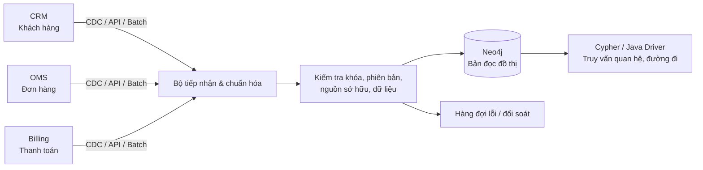
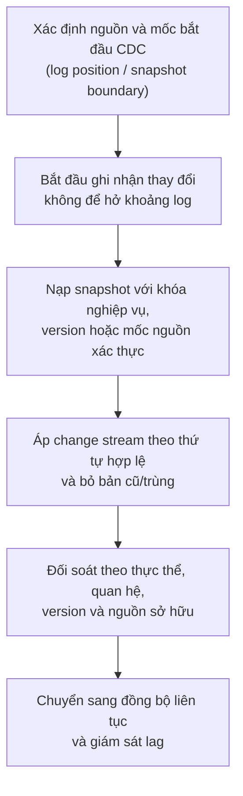

# Kiểm soát độ trễ đồng bộ và lựa chọn nguồn dữ liệu chuẩn

Một đồ thị Neo4j thường được hình thành từ **nhiều hệ thống nguồn**: CRM quản lý khách hàng, hệ thống đơn hàng (OMS) lưu giao dịch, hệ thống thanh toán ghi nhận trạng thái thanh toán và dịch vụ sản phẩm cung cấp danh mục. Các nguồn này không nhất thiết cập nhật cùng thời điểm. Một khách hàng có thể vừa đổi địa chỉ trong CRM nhưng Neo4j vẫn hiển thị địa chỉ cũ; một đơn hàng đã hủy trong OMS nhưng đồ thị vẫn còn quan hệ thể hiện trạng thái trước đó.

Hai câu hỏi thiết kế luôn đi cùng nhau:

1. **Nguồn nào có quyền quyết định giá trị đúng của từng thông tin?** Đây là vấn đề *nguồn dữ liệu chuẩn* (*source of truth* hay *system of record*).
2. **Thông tin từ nguồn đi đến Neo4j nhanh và chính xác đến mức nào?** Đây là vấn đề *độ trễ đồng bộ* (*synchronization lag*) và tính nhất quán giữa các hệ thống.

Bài thuộc chương **Tích hợp dữ liệu** của module **DATABASE_ENGINE_GRAPH_NEO4J**. Trong phạm vi sử dụng Neo4j để mô hình hóa property graph và truy vấn quan hệ, đường đi bằng Cypher, bạn sẽ kết hợp kiến thức về khóa nghiệp vụ, index/constraint, nhập dữ liệu, Java Driver, Spring Data Neo4j và vận hành hệ thống để xây dựng luồng đồng bộ có thể theo dõi, kiểm chứng và khôi phục.

## 1. Phân biệt dữ liệu nguồn và đồ thị phục vụ truy vấn

Xét một nền tảng thương mại điện tử với ba hệ thống:

| Hệ thống | Dữ liệu chính | Ví dụ |
| --- | --- | --- |
| **CRM** | Hồ sơ khách hàng, tên liên hệ, email đã xác minh | `Customer C-101` |
| **OMS** | Đơn hàng, tổng tiền, trạng thái đơn, khách hàng đặt đơn | `Order O-901` |
| **Billing** | Tình trạng thanh toán, giao dịch thanh toán | `Payment P-501` |
| **Neo4j** | Bản biểu diễn liên kết và dữ liệu phục vụ truy vấn đồ thị | `(Customer)-[:PLACED]->(Order)` |

Một đồ thị minh họa:



**Neo4j có thể là bản đọc tích hợp (*read model*)**, trong khi CRM, OMS và Billing vẫn là nơi ghi chính của từng nghiệp vụ. Khi đó, không được suy ra một giá trị trong Neo4j chính xác hơn chỉ vì nó dễ truy vấn. Ngược lại, với những quan hệ do ứng dụng quản lý trực tiếp trong Neo4j, ví dụ nhóm người dùng tự tạo bằng thao tác graph-native, **Neo4j có thể chính là nguồn chuẩn** cho các quan hệ đó.

Quyền quyết định nguồn chuẩn là **quy tắc nghiệp vụ**, không phải thuộc tính tự có của công nghệ.

## 2. Chọn nguồn dữ liệu chuẩn theo miền và theo thuộc tính

Không nhất thiết tồn tại **một cơ sở dữ liệu chuẩn cho toàn bộ thực thể**. Cùng node `:Customer` trong Neo4j có thể chứa các trường do các hệ thống khác nhau sở hữu.

| Thực thể/trường trên Neo4j | Nguồn chuẩn | Quy tắc cập nhật |
| --- | --- | --- |
| `Customer.customerId` | Danh tính từ hệ thống cấp mã khách hàng | Giữ ổn định, không đổi theo email |
| `Customer.fullName` | CRM | Chỉ sự kiện CRM hợp lệ được cập nhật |
| `Customer.verifiedEmail` | CRM hoặc dịch vụ danh tính được chỉ định | Không để một nguồn khác ghi đè |
| `Order.status` | OMS | Theo phiên bản/trình tự sự kiện OMS |
| `Order.totalAmount` | OMS | Lưu đúng đơn vị tiền và quy tắc làm tròn |
| `Payment.status` | Billing | Không suy ra hoàn toàn từ `Order.status` |
| `(Customer)-[:PLACED]->(Order)` | OMS sở hữu `Order.customerId` | Quan hệ là biểu diễn của dữ liệu đơn hàng |
| `Customer.recommendationScore` | Bộ xử lý phân tích được chỉ định | Là giá trị dẫn xuất, có thời điểm và phiên bản tính |
| Quan hệ người dùng tự tạo trực tiếp trên graph | Neo4j, nếu sản phẩm xác định như vậy | Ghi và kiểm tra quyền tại Neo4j |

Bảng trên là **ví dụ chính sách**. Một công ty khác có thể giao quyền xác minh email cho dịch vụ danh tính riêng; không nên mặc định mọi thông tin khách hàng đều do CRM làm chủ.

### 2.1. Một thuộc tính nên có một chủ sở hữu ghi rõ ràng

Nếu CRM và OMS cùng phát sự kiện chứa `Customer.fullName` nhưng không có quy tắc ưu tiên, kết quả có thể phụ thuộc sự kiện nào đến sau. Cách làm “bản ghi mới đến là đúng” dễ gây **ghi đè dữ liệu** dù nguồn đến sau thực chất đang lưu bản sao cũ.

Nên thiết lập *data ownership contract*:

- Nguồn nào được tạo và cập nhật từng nhóm thuộc tính?
- Các nguồn khác chỉ đọc, đề xuất sửa hay được phép ghi?
- Làm sao giải quyết khi có hai nguồn đưa giá trị mâu thuẫn?
- Có quy tắc ưu tiên tạm thời khi nguồn chuẩn ngừng hoạt động không?
- Ai chịu trách nhiệm sửa dữ liệu sai ở nguồn, và thao tác sửa được đồng bộ lại thế nào?

Không dùng thời điểm nhận sự kiện tại Neo4j như một cơ chế **tự động phân xử giữa hai nguồn khác nhau**. Thời điểm nhận chỉ cho biết trình tự vận chuyển, không chứng minh nguồn nào đúng.

### 2.2. Nguồn chuẩn không nhất thiết là nguồn có dữ liệu mới nhất theo đồng hồ

Ví dụ:

- CRM xác nhận email `an@example.com` ở phiên bản hồ sơ 42.
- OMS vẫn gửi email `old@example.com` trong sự kiện đơn hàng mới phát vài giây sau.
- Dù sự kiện OMS đến sau, nó **không có quyền sửa `Customer.verifiedEmail`** nếu CRM là nguồn chuẩn cho trường đó.

Đây là lý do phải tách **quyền sở hữu dữ liệu** khỏi **thứ tự đến của sự kiện**.

## 3. Thiết lập khóa nghiệp vụ thống nhất giữa các nguồn

Đồng bộ nhanh nhưng ghép sai thực thể vẫn tạo ra đồ thị sai. Neo4j cần định vị node bằng **khóa nghiệp vụ ổn định**, ví dụ `tenantId` kết hợp `customerId`.

```cypher
CREATE CONSTRAINT customer_business_key IF NOT EXISTS
FOR (c:Customer)
REQUIRE (c.tenantId, c.customerId) IS UNIQUE;

CREATE CONSTRAINT order_business_key IF NOT EXISTS
FOR (o:Order)
REQUIRE (o.tenantId, o.orderId) IS UNIQUE;
```

Khi ghi, dùng đúng phạm vi khóa:

```cypher
MERGE (c:Customer {
  tenantId: $tenantId,
  customerId: $customerId
});
```

Nếu hai tenant cùng có mã `C-101`, chỉ dùng `customerId` sẽ không đủ để tìm đúng node. Nếu CRM và OMS dùng **hai hệ mã khác nhau**, cần một bảng ánh xạ khóa có quản lý, ví dụ `crmCustomerId -> canonicalCustomerId <- omsCustomerId`. Không tự ghép người dùng theo tên, email hoặc chuỗi trông giống nhau mà chưa có quy tắc xác nhận.

### Vì sao không dùng `elementId()` làm mã đồng bộ?

`elementId()` nhận diện phần tử trong Neo4j, nhưng không phải khóa nghiệp vụ ổn định để lưu lâu dài trong sự kiện nguồn hoặc dùng khi tái nhập database. Thực thể phải được đối chiếu bằng khóa do hệ thống nghiệp vụ cấp và được bảo vệ bởi ràng buộc duy nhất phù hợp.

## 4. Các mô hình đồng bộ và đánh đổi về độ trễ

| Cơ chế | Cách hoạt động | Ưu điểm | Giới hạn |
| --- | --- | --- | --- |
| **Batch theo lịch** | Đọc và nạp dữ liệu theo giờ/ngày | Đơn giản, dễ đối soát | Độ trễ có thể gần bằng chu kỳ batch cộng thời gian xử lý |
| **Polling tăng dần** | Định kỳ hỏi bản ghi đổi từ mốc trước | Dễ áp dụng khi nguồn có API phù hợp | Cần cursor chính xác; cập nhật/xóa có thể bị bỏ sót nếu thiết kế yếu |
| **Webhook / sự kiện ứng dụng** | Ứng dụng nguồn phát thay đổi | Có thể truyền nhanh | Cần xử lý retry, trùng, mất thứ tự và sự kiện không phát đủ |
| **CDC (Change Data Capture)** | Theo dõi thay đổi đã commit ở nguồn | Có thể phản ánh thay đổi thường xuyên, bao gồm cập nhật/xóa | Cần nắm transaction log, snapshot ban đầu, offset và quyền vận hành |
| **Đồng bộ theo yêu cầu** | API đọc trực tiếp nguồn chuẩn khi cần | Phù hợp dữ liệu cần chính xác ngay thời điểm ra quyết định | Tăng độ trễ request, phụ thuộc độ sẵn sàng nguồn |

Tùy yêu cầu, có thể phối hợp: CDC để cập nhật liên tục, batch để đối soát định kỳ và truy vấn trực tiếp hệ thống chuẩn cho các quyết định cần dữ liệu giao dịch mới nhất.

**Độ trễ nhỏ không đồng nghĩa độ tin cậy cao.** Một pipeline cập nhật trong 100 ms nhưng bỏ sót sự kiện xóa vẫn có thể sai lâu dài. Ngược lại, một báo cáo được thiết kế cập nhật theo giờ có thể đáp ứng yêu cầu nếu mức độ mới dữ liệu được công bố rõ ràng.

## 5. Định nghĩa chính xác “độ trễ đồng bộ”

Một thay đổi ở nguồn có thể đi qua nhiều mốc thời gian:

```text
Nguồn xác nhận COMMIT
   t0
    |
    | CDC đọc log và phát sự kiện
    v
Broker / hàng đợi tiếp nhận
   t1
    |
    | Chờ trong queue, retry, backpressure
    v
Consumer bắt đầu xử lý
   t2
    |
    | Validate, resolve khóa, ghi Neo4j
    v
Neo4j COMMIT thành công
   t3
    |
    | Ứng dụng đọc kết quả từ database / read model
    v
Kết quả hiển thị cho người dùng
   t4
```

Phân biệt các đại lượng:

- **Độ trễ phát sự kiện (capture/publish lag):** `t1 - t0`.
- **Thời gian chờ trong hàng đợi:** `t2 - t1`.
- **Thời gian xử lý và ghi đồ thị:** `t3 - t2`.
- **Độ trễ từ nguồn đến Neo4j:** `t3 - t0`.
- **Độ trễ quan sát được của người dùng:** khoảng `t4 - t0` nếu còn lớp cache/read replica hoặc xử lý hậu kỳ.

Đây là mô hình đo. Thời gian từ nhiều máy chỉ đáng tin khi các đồng hồ được đồng bộ và mốc `t0` phản ánh đúng **thời điểm commit** ở nguồn. Thời điểm phát biểu `event.createdAt` do ứng dụng tự gán trước commit **không đồng nghĩa** `sourceCommittedAt`.

### 5.1. Chỉ số nên theo dõi

| Metric | Giải đáp | Khi tăng cần kiểm tra |
| --- | --- | --- |
| `sync_apply_lag_seconds` | Sự kiện mất bao lâu từ commit nguồn đến commit graph? | CDC, broker, consumer, DB write |
| `oldest_pending_age_seconds` | Sự kiện chưa xử lý lâu nhất đã chờ bao lâu? | Queue backlog, retry, sự kiện poison |
| `queue_depth` / khoảng cách offset | Còn bao nhiêu sự kiện đang chờ ở từng partition? | Throughput đầu vào/đầu ra, tắc nghẽn |
| `applied_events_per_second` | Consumer xử lý thành công với tốc độ nào? | Batch size, CPU, I/O, index |
| `retry_count`, `dead_letter_count` | Có lỗi tạm thời hoặc dữ liệu không xử lý được không? | Phân loại lỗi, DLQ |
| `last_source_heartbeat_at` | Connector còn nhận biết nguồn đang hoạt động không? | Luồng CDC, mạng, quyền log |
| `last_successful_apply_at` | Lần ghi thành công gần nhất là khi nào? | Consumer, DB, nguồn đang không phát sự kiện |
| `reconciliation_mismatch_count` | Trạng thái graph lệch nguồn bao nhiêu? | Mất sự kiện, lỗi ánh xạ, xóa thiếu |

Đừng kết luận pipeline lỗi chỉ vì **đã lâu không có thay đổi**: nguồn có thể thực sự không phát sự kiện. Muốn phân biệt trạng thái nhàn rỗi với trạng thái chết, cần heartbeat/cursor nguồn hoặc tín hiệu hoạt động độc lập.

### 5.2. Event time, processing time và clock skew

- **Event/source commit time:** thời điểm thay đổi được nguồn ghi nhận hoặc xác nhận.
- **Ingestion/processing time:** thời điểm consumer nhận hay xử lý sự kiện.
- **Graph commit time:** thời điểm ghi thành công vào Neo4j.

Nếu đồng hồ của nguồn lệch 3 phút so với máy xử lý, phép trừ timestamp có thể báo lag âm hoặc cao giả tạo. Hãy đồng bộ thời gian, dùng UTC, gắn thông tin nguồn của timestamp và đối chiếu thêm **log position/offset** thay vì chỉ dựa vào một biểu đồ thời gian.

**Offset/LSN không phải số giây.** Khoảng cách giữa hai offset chỉ mô tả tiến độ theo vị trí trong luồng, không quy đổi trực tiếp thành độ trễ thời gian. Offset thường chỉ có thứ tự **trong một partition/stream tương ứng**; không so sánh số offset từ các nguồn độc lập như một đồng hồ toàn cục.

### 5.3. SLO mẫu

Ví dụ sản phẩm công bố yêu cầu: “99% thay đổi hồ sơ khách hàng phải xuất hiện trên Neo4j trong vòng 30 giây từ khi nguồn commit, đo theo cửa sổ 7 ngày”. Đây là **SLO minh họa**, không phải mức mặc định của Neo4j.

Để SLO đo được, cần làm rõ:

1. Thay đổi nào được tính: tạo, sửa, xóa, và sửa quan hệ?
2. Tính từ nguồn commit hay từ khi broker nhận sự kiện?
3. Kết thúc khi Neo4j commit hay khi người dùng đọc thấy sau cache?
4. Sự kiện bị từ chối do sai dữ liệu được tính vi phạm hay báo ở metric riêng?
5. Các nguồn có cùng SLO không, hay order/payment cần nhanh hơn dữ liệu mô tả?

Một chỉ số **p95/p99** hữu ích hơn chỉ xem trung bình, vì một nhóm nhỏ sự kiện đến muộn có thể gây ra lỗi nghiệp vụ lớn.

## 6. Xác định mức nhất quán đúng cho nghiệp vụ

Không phải mọi màn hình đều cần dữ liệu cập nhật ở cùng tốc độ.

| Tình huống | Mức mới cần thiết | Cách tiếp cận |
| --- | --- | --- |
| Gợi ý sản phẩm liên quan | Có thể chấp nhận trễ ngắn | Đồng bộ bất đồng bộ vào Neo4j |
| Báo cáo mạng lưới khách hàng theo ngày | Chấp nhận thời điểm chốt dữ liệu | Batch có watermark rõ ràng |
| Hiển thị hồ sơ vừa sửa | Mong đợi thấy thay đổi sớm | CDC nhanh, cache invalidation hoặc đọc nguồn chuẩn |
| Xác nhận còn hàng khi thanh toán | Cần tính đúng tại quyết định giao dịch | Kiểm tra ở hệ thống giữ tồn kho chuẩn |
| Xác nhận trạng thái thanh toán | Cần kết quả chuẩn từ Billing | Đọc Billing/nhận trạng thái đã xác nhận, không suy ra chỉ từ graph |
| Phân tích đường đi trong mạng quan hệ | Phụ thuộc yêu cầu sản phẩm | Truy vấn graph với thông tin về độ mới |

Neo4j thường là nơi **đọc liên kết để phân tích**. Việc giao dịch thanh toán được commit trong OMS/Billing không tự tạo ra một **giao dịch ACID xuyên nhiều hệ thống** bao gồm cả Neo4j. Vì thế, khi dữ liệu chưa đồng bộ, ứng dụng phải có chính sách rõ ràng: trả kết quả có chú thích độ mới, tạm từ chối quyết định hoặc chuyển sang đọc nguồn chuẩn.

## 7. Hợp đồng sự kiện cần có những gì?

Một payload đồng bộ có thể có dạng sau; đây là **schema minh họa do ứng dụng quy định**, không phải format mặc định bắt buộc của connector Neo4j:

```json
{
  "eventId": "crm-evt-00241",
  "sourceSystem": "CRM",
  "entityType": "Customer",
  "tenantId": "T-01",
  "entityId": "C-101",
  "operation": "UPSERT",
  "sourceVersion": 42,
  "sourceCommittedAt": "2026-11-25T03:20:15Z",
  "payloadMode": "FULL_SNAPSHOT",
  "data": {
    "fullName": "Nguyễn An",
    "verifiedEmail": "an@example.com"
  }
}
```

Các trường có ý nghĩa khác nhau:

| Trường | Tác dụng |
| --- | --- |
| `eventId` | Truy vết và nhận biết sự kiện phát lặp, nếu nguồn cấp ID ổn định |
| `sourceSystem` | Xác định ai phát và phạm vi quyền ghi |
| `tenantId` + `entityId` | Định vị đúng thực thể Neo4j |
| `operation` | Phân biệt tạo/cập nhật/xóa |
| `sourceVersion` hoặc log position | Chống sự kiện cũ ghi đè sự kiện mới trong **cùng luồng sở hữu** |
| `sourceCommittedAt` | Đo độ trễ và điều tra sự cố |
| `payloadMode` | Phân biệt ảnh chụp đầy đủ với bản vá một số trường |
| `data` | Thuộc tính được cấp quyền đồng bộ |

**Không dùng thứ tự nhận ở broker hoặc timestamp của consumer thay cho version nguồn** khi cần chống out-of-order. Nếu nguồn không cung cấp version tăng đơn điệu, cần chọn cơ chế tuần tự đáng tin cậy hơn, ví dụ commit log position theo partition hoặc transaction, kèm quy tắc so sánh được xác nhận.

Khi nguồn cấp nhiều thực thể/partition, một version có thể chỉ có ý nghĩa trong phạm vi **một thực thể hoặc một aggregate**, không phải version toàn hệ thống. Hợp đồng phải nêu phạm vi này.

## 8. Chống sự kiện đến muộn và sự kiện phát lặp bằng Cypher

### 8.1. Ví dụ sai: cập nhật mọi sự kiện theo thứ tự nhận

```cypher
MERGE (c:Customer {tenantId: $tenantId, customerId: $customerId})
SET c.fullName = $fullName,
    c.verifiedEmail = $verifiedEmail;
```

Nếu CRM phát version 42 rồi version 43 nhưng mạng khiến version 43 đến trước, câu lệnh trên có thể áp version 42 **sau cùng**, ghi đè dữ liệu mới. Nếu event 43 đã cập nhật email, kết quả cuối có thể bị quay về trạng thái cũ.

### 8.2. Ví dụ có kiểm soát phiên bản

Trước tiên, thiết lập uniqueness constraint theo khóa nghiệp vụ như mục 3. Consumer chỉ đưa vào các event đã xác thực là **CRM sở hữu đúng trường** và có `sourceVersion` là số nguyên tăng dần.

```cypher
UNWIND $events AS e
WITH e
WHERE e.tenantId IS NOT NULL
  AND e.customerId IS NOT NULL
  AND e.sourceVersion IS NOT NULL
MERGE (c:Customer {
  tenantId: e.tenantId,
  customerId: e.customerId
})
ON CREATE SET c.crmVersion = -1
WITH c, e
WHERE e.sourceVersion > coalesce(c.crmVersion, -1)
SET c.fullName = e.fullName,
    c.verifiedEmail = e.verifiedEmail,
    c.crmVersion = e.sourceVersion,
    c.crmCommittedAt = datetime(e.sourceCommittedAt)
RETURN count(c) AS updatedCustomers;
```

Đọc đúng ý nghĩa:

1. `MERGE` tìm/tạo node theo khóa nghiệp vụ, không theo tên hay email.
2. `crmVersion` là phiên bản **riêng của dữ liệu CRM**. Không tái sử dụng cho trạng thái đơn hàng do OMS sở hữu.
3. `WHERE e.sourceVersion > ...` loại event trùng hoặc cũ hơn phiên bản đã áp dụng.
4. Sau khi áp bản ghi hợp lệ, node lưu version và thời điểm commit nguồn để kiểm chứng độ mới.

Nếu đã áp **version 43**, version **42** hoặc event **43** phát lặp sẽ không vượt điều kiện, nhờ vậy không ghi đè phiên bản cao hơn.

**Các điều kiện để ví dụ đúng:** `$events` chứa **ảnh chụp đầy đủ** những thuộc tính CRM cho phép cập nhật, version có thứ tự đáng tin cậy, mỗi khóa được xử lý tuần tự hoặc có cơ chế đồng bộ phù hợp và dữ liệu đã được xác thực. `SET c.fullName = null` trong Cypher **xóa thuộc tính**, nên không thể dùng truy vấn này nguyên xi cho event dạng **PATCH** mà trường bị thiếu có nghĩa là “giữ nguyên”.

Ngoài ra, phép so sánh version trong câu Cypher **không tự biến mọi writer đồng thời thành một quy trình có thứ tự an toàn**. Với nhiều consumer cùng ghi một customer, cần thiết kế phân vùng sự kiện theo khóa thực thể, một writer theo partition hoặc cơ chế điều phối/kiểm soát tranh chấp đã kiểm nghiệm. Uniqueness constraint ngăn nhân bản node, nhưng không thay thế chính sách thứ tự cập nhật thuộc tính.

### 8.3. Khi dữ liệu gồm nhiều nguồn sở hữu

Ví dụ CRM cập nhật `fullName`, OMS cập nhật `latestOrderStatus` trên cùng node `:Customer`. Không dùng một trường `version` chung nếu version 42 của CRM và version 100 của OMS **không cùng hệ quy chiếu**.

Nên có trạng thái riêng, chẳng hạn:

```text
(:Customer {
  tenantId: "T-01",
  customerId: "C-101",
  fullName: "Nguyễn An",
  crmVersion: 42,
  latestOrderStatus: "SHIPPED",
  omsVersion: 100
})
```

Hoặc tách thành node `:Order` riêng và quan hệ thể hiện nguồn OMS, tùy thiết kế graph. Mỗi nhóm thuộc tính chỉ được cập nhật theo thứ tự của **nguồn sở hữu nhóm đó**.

## 9. Không nhầm event xóa với event thiếu thuộc tính

Việc đồng bộ phải phân biệt ba trường hợp:

- **Không có trường trong event PATCH:** giữ nguyên dữ liệu.
- **Trường có giá trị `null` theo hợp đồng:** có thể nghĩa là xóa thuộc tính, hoặc nguồn chưa biết; cần quy tắc riêng.
- **Event DELETE cho thực thể:** thực thể đã bị xóa/ẩn ở nguồn và cần xử lý theo chính sách vòng đời.

Ví dụ nguồn gửi:

```json
{
  "operation": "PATCH",
  "sourceVersion": 44,
  "fieldMask": ["verifiedEmail"],
  "data": {"verifiedEmail": null}
}
```

Nếu hợp đồng khẳng định “`null` trong `fieldMask` là xóa email”, mới nên thực hiện `SET c.verifiedEmail = null` (Cypher sẽ loại bỏ thuộc tính). Không dùng `coalesce($email, c.verifiedEmail)` một cách mặc định nếu yêu cầu có thể **xóa có chủ đích**, vì `coalesce` không phân biệt được “không gửi” và “gửi null để xóa”.

### 9.1. Sự kiện xóa đến trước sự kiện tạo cũ

Giả sử nguồn đã xóa khách hàng ở version 50, nhưng event cập nhật version 49 đến Neo4j muộn hơn. Nếu xóa cứng node và xóa cả version, một câu `MERGE` sau đó có thể **tạo lại node cũ**.

Cần giữ **tombstone/phiên bản xóa** trong nơi có thể đối chiếu, hoặc dùng soft delete:

```cypher
MERGE (c:Customer {
  tenantId: $tenantId,
  customerId: $customerId
})
ON CREATE SET c.crmVersion = -1
WITH c
WHERE $sourceVersion > coalesce(c.crmVersion, -1)
SET c.crmVersion = $sourceVersion,
    c.isDeleted = true,
    c.deletedAt = datetime($sourceCommittedAt);
```

Chỉ minh họa chính sách **đánh dấu xóa**. Việc xóa/ẩn các quan hệ, cách đọc bỏ qua node đã xóa và xử lý yêu cầu xóa dữ liệu cá nhân phải có quy trình riêng. Không được coi đây là giải pháp đầy đủ cho mọi yêu cầu xóa theo quy định; việc giữ tombstone phải tuân theo chính sách dữ liệu của hệ thống.

## 10. Đồng bộ relationship khi node đầu mút đến không cùng lúc

Một event của OMS có thể cho biết `Order O-901` do `Customer C-101` đặt, nhưng node khách hàng chưa được đồng bộ từ CRM. Nếu chạy:

```cypher
MATCH (c:Customer {
  tenantId: $tenantId,
  customerId: $customerId
})
MATCH (o:Order {
  tenantId: $tenantId,
  orderId: $orderId
})
MERGE (c)-[:PLACED]->(o);
```

Khi thiếu một đầu mút, `MATCH` không trả hàng và quan hệ **không được tạo**. Hành vi này tránh tạo một node khách hàng không có dữ liệu chuẩn, nhưng cũng có nghĩa là pipeline phải **ghi nhận liên kết chưa giải quyết được**.

Một cách xử lý:

1. Xác thực `tenantId`, `customerId` và `orderId` theo hợp đồng từ OMS.
2. Upsert node `:Order` theo version OMS.
3. Tìm node `:Customer` đã đồng bộ từ CRM.
4. Nếu đủ hai đầu mút, tạo `:PLACED`; nếu thiếu, đưa quan hệ vào **pending-link queue** với nguồn, khóa và version.
5. Sau khi node thiếu xuất hiện, thử lại pending link; ghi nhận số lần và tuổi chờ.
6. Đối soát để chắc chắn không có quan hệ chờ mãi hoặc liên kết sai tenant.

**Quan trọng:** nguồn chuẩn cho quan hệ “đơn hàng thuộc khách hàng nào?” là **OMS**, không phải “bản ghi nào đến trước Neo4j”. Khi OMS sửa customer của một order, quy trình cần xử lý cả **quan hệ cũ** và **quan hệ mới**, theo version của đơn hàng. Chỉ thêm cạnh mới mà không gỡ cạnh cũ sẽ tạo một đồ thị không nhất quán.

Nếu nghiệp vụ cho phép “unknown customer”, có thể thiết kế placeholder có trạng thái rõ ràng. Không âm thầm `MERGE (c:Customer {customerId: ...})` từ sự kiện OMS rồi xem nó là hồ sơ CRM đầy đủ.

## 11. Tải dữ liệu ban đầu và nhận thay đổi liên tục

Một pipeline thường phải xử lý hai luồng:

- **Snapshot/backfill:** tải trạng thái hiện có từ nguồn vào Neo4j.
- **Change stream/CDC:** nhận các thay đổi phát sinh trong và sau thời gian snapshot.

Một lỗi nguy hiểm là: snapshot chụp dữ liệu ở thời điểm cũ nhưng hoàn thành ghi vào Neo4j **sau** khi sự kiện CDC mới hơn đã đến, khiến snapshot **ghi đè dữ liệu mới**.

Quy trình an toàn ở mức thiết kế:



Điều kiện cần:

- Phải có **mốc nhất quán** giữa snapshot và change stream, theo khả năng của hệ thống nguồn/connector.
- Mọi thay đổi từ mốc đó trở đi phải được lưu để replay; không có “khoảng trống” khi chuyển từ snapshot sang streaming.
- Một version hoặc commit position có thể so sánh được phải được dùng để ngăn snapshot cũ ghi đè event mới.
- Cần kiểm tra số lượng và nội dung sau khi backfill, không chỉ xem consumer “đã đọc hết queue”.

Không phải mọi connector có cùng khả năng snapshot hoặc định nghĩa offset. Cần xác minh bằng tài liệu đúng phiên bản triển khai và thử một tình huống “cập nhật xảy ra giữa khi snapshot đang chạy”.

## 12. At-least-once, idempotency và điểm xác nhận tiến độ

Trong hệ thống phân tán, có thể xảy ra:

1. Consumer nhận event E.
2. Consumer ghi E vào Neo4j và **commit thành công**.
3. Consumer mất kết nối trước khi xác nhận event với broker.
4. Broker gửi lại **E**.

Nếu consumer không idempotent, sự kiện phát lặp có thể tạo quan hệ trùng hoặc tăng bộ đếm hai lần.

**At-least-once delivery** cho phép phát lặp; **idempotent apply** đảm bảo lặp lại không làm thay đổi trạng thái ngoài dự kiến. Ví dụ `MERGE` theo khóa cùng với kiểm tra version nguồn giúp đạt mục tiêu này cho nhiều kiểu upsert. Nhưng không có một từ khóa Cypher duy nhất khiến toàn bộ hệ thống đa nguồn có **exactly-once end-to-end**.

### Quy tắc checkpoint

**Chỉ xác nhận tiến độ sau khi biết Neo4j đã commit thành công.** Nếu cập nhật offset/ack trước khi commit graph, consumer có thể mất sự kiện nếu tiến trình chết ở giữa. Nếu ack sau commit và chết trước ack, event có thể được phát lại; logic cần idempotent.

Nếu việc commit xảy ra nhưng client bị mất kết nối và **không biết kết quả**, nên tra trạng thái theo khóa/version nguồn hoặc phát lại an toàn, không mặc định transaction đã rollback.

Với Kafka hoặc hàng đợi phân partition, checkpoint phải theo đúng **partition và thứ tự liên tục đã xử lý**, tránh đánh dấu offset cao hơn khi còn một event cũ chưa giải quyết. Một poison message không nên bị bỏ qua âm thầm chỉ để dịch chuyển offset; cần chính sách DLQ và khả năng replay.

### Phân biệt idempotency theo loại thao tác

| Thao tác | Rủi ro khi phát lặp | Cách thiết kế |
| --- | --- | --- |
| Upsert `Customer` bằng khóa + version | Ghi lại phiên bản cũ | So version trước `SET` |
| Tạo quan hệ `:PLACED` | Tạo thêm cạnh trùng | Khớp đúng hai đầu mút, `MERGE`/khóa quan hệ theo mô hình |
| `SET c.total = c.total + $delta` | Cộng tiền hoặc đếm nhiều lần | Dùng event ID để khử trùng, hoặc đồng bộ trạng thái tuyệt đối có version |
| Xóa quan hệ | Event cũ có thể tái tạo cạnh | Giữ version/tombstone liên kết hoặc quản lý thứ tự theo aggregate |
| Gửi email khi event được xử lý | Gửi hai lần | Đưa side effect vào cơ chế outbox/idempotency riêng |

Số đếm trên graph thường nên là dữ liệu **dẫn xuất có thể tính lại** từ những thực thể được làm chủ, trừ khi yêu cầu và khả năng cập nhật khiến mô hình lưu đếm có điều kiện rõ ràng.

## 13. Dùng Java Driver để áp event có kiểm soát

Java Driver phù hợp để consumer truyền các event đã được kiểm tra vào một transaction Neo4j. Ví dụ dưới đây áp **một full-snapshot event** của CRM; giả định khóa, trường và sourceVersion đã được kiểm tra trước khi gọi.

```java
import java.util.Map;
import org.neo4j.driver.Driver;
import org.neo4j.driver.Session;
import org.neo4j.driver.SessionConfig;

public final class CrmCustomerSync {
    private final Driver driver;

    public CrmCustomerSync(Driver driver) {
        this.driver = driver;
    }

    public void applyCustomerSnapshot(Map<String, Object> event) {
        String cypher = """
            MERGE (c:Customer {
              tenantId: $tenantId,
              customerId: $customerId
            })
            ON CREATE SET c.crmVersion = -1
            WITH c
            WHERE $sourceVersion > coalesce(c.crmVersion, -1)
            SET c.fullName = $fullName,
                c.verifiedEmail = $verifiedEmail,
                c.crmVersion = $sourceVersion,
                c.crmCommittedAt = datetime($sourceCommittedAt)
            """;

        try (Session session = driver.session(
                SessionConfig.builder()
                    .withDatabase("neo4j")
                    .build())) {
            session.executeWrite(tx -> {
                tx.run(cypher, event).consume();
                return null;
            });
        }
    }
}
```

Trong code:

- `event` phải chứa `tenantId`, `customerId`, `sourceVersion`, `sourceCommittedAt`, `fullName` và `verifiedEmail` với kiểu phù hợp; ví dụ không tự xử lý event thiếu/sai định dạng.
- `executeWrite` chạy transaction được driver quản lý và **có thể retry** một callback khi gặp lỗi transient. Vì vậy callback chỉ thực hiện thao tác database phù hợp với cơ chế chạy lại; không phát email hoặc gọi hệ thống bên ngoài trong callback.
- `.consume()` yêu cầu driver tiêu thụ kết quả để công việc Cypher được xử lý trong transaction trước khi callback kết thúc.
- Consumer chỉ **ack event sau khi phương thức trở về thành công** và có thể dùng khóa/version để xác minh nếu kết quả commit bị mơ hồ do sự cố kết nối.
- `Driver` nên được quản lý theo vòng đời ứng dụng, tái sử dụng connection pool; `Session` có vòng đời ngắn và không chia sẻ đồng thời giữa các luồng.

**Giới hạn của ví dụ:** so sánh version phù hợp khi event của **một customer** được xử lý theo thứ tự hoặc có điều phối đồng thời phù hợp. Với nhiều writer cùng một node, cần kiểm thử race và thiết kế phân vùng theo khóa.

### Trong Spring Data Neo4j

Spring Data Neo4j phù hợp để ánh xạ entity và sử dụng transaction ở tầng service. Tuy vậy, pipeline sự kiện thường cần:

- Truy vấn `MERGE` hoặc query tùy biến để đối chiếu khóa và version theo ngữ nghĩa nguồn.
- Ranh giới `@Transactional` rõ cho từng nhóm event.
- Không bao một batch rất lớn vào một transaction giữ lock lâu.
- Không giả định việc gọi `save()` trên entity sẽ tự kiểm tra version CDC hoặc quyền sở hữu từng thuộc tính.
- Theo dõi retry, lag, DLQ và đối soát ở **tầng pipeline**, vì repository không thay thế hệ thống quản lý tiến độ đồng bộ.

## 14. Đối soát: làm sao biết graph vẫn đúng?

Một pipeline xử lý nhanh có thể vẫn mất sự kiện. Vì vậy cần cơ chế **reconciliation** giữa nguồn chuẩn và Neo4j theo chu kỳ.

Mỗi đợt đối soát có thể kiểm tra:

1. **Khóa:** số lượng và tập khóa nghiệp vụ theo tenant/source và phạm vi thời gian.
2. **Thuộc tính do nguồn sở hữu:** hash hoặc mẫu các giá trị quan trọng như trạng thái đơn, phiên bản hồ sơ.
3. **Quan hệ:** mỗi `Order.customerId` ở OMS tương ứng đúng một quan hệ `(:Customer)-[:PLACED]->(:Order)` theo mô hình.
4. **Xóa:** những thực thể đã bị xóa/ẩn tại nguồn có còn bị hiển thị sai trong graph không?
5. **Phiên bản:** `crmVersion`, `omsVersion` trên graph có tụt phía sau watermark nguồn hay không?
6. **Pending-link:** số lượng và tuổi của liên kết chưa giải quyết được.
7. **Lỗi:** có event bị từ chối, vào DLQ hoặc mắc lỗi schema/kiểu không?

Truy vấn Neo4j minh họa phát hiện order thiếu quan hệ khách hàng:

```cypher
MATCH (o:Order)
WHERE coalesce(o.isDeleted, false) = false
  AND NOT EXISTS {
    MATCH (:Customer)-[:PLACED]->(o)
  }
RETURN o.tenantId AS tenantId,
       o.orderId AS orderId,
       o.sourceCustomerId AS expectedCustomerId
LIMIT 100;
```

Để kiểm tra **quan hệ trỏ sai khách hàng**, cần so sánh khóa đầu mút hiện tại với khóa khách hàng chuẩn đã lưu từ OMS:

```cypher
MATCH (c:Customer)-[:PLACED]->(o:Order)
WHERE o.sourceCustomerId IS NOT NULL
  AND (
    c.tenantId <> o.tenantId
    OR c.customerId <> o.sourceCustomerId
  )
RETURN o.orderId AS orderId,
       o.sourceCustomerId AS expectedCustomer,
       c.customerId AS actualCustomer
LIMIT 100;
```

Các câu kiểm tra dùng `sourceCustomerId` làm bản ghi nguồn đã được lưu từ OMS; nếu thuộc tính này chưa có hoặc không còn mới, chính bước đối soát phải đọc dữ liệu chuẩn từ OMS. Cần tránh kết luận “mọi thứ đúng” chỉ vì hai thuộc tính **đều đã cũ nhưng trùng nhau** trong Neo4j.

### Khi nào cần backfill hoặc sửa từng event?

- **Chỉ vài event hỏng, còn đầy đủ payload/version:** sửa nguyên nhân rồi replay có kiểm soát.
- **Đứt log hoặc không biết đã bỏ sót gì:** cần snapshot/đối soát lại một phạm vi dữ liệu xác định.
- **Sai cách chuẩn hóa khóa:** phải điều tra node trùng, quan hệ nhầm và khả năng hợp nhất thực thể, không chỉ phát lại event.
- **Thay đổi chủ sở hữu một trường:** xác định thời điểm chuyển giao quyền ghi, khóa việc ghi cũ và backfill từ nguồn mới.

## 15. Tránh pipeline tự biến thành nút thắt hiệu năng

Theo dõi backlog là chưa đủ; cần hiểu vì sao tốc độ áp dụng event thấp hơn tốc độ phát sinh.

| Nguyên nhân | Triệu chứng | Hướng xử lý |
| --- | --- | --- |
| Không có uniqueness constraint hoặc index phù hợp | `MERGE` tìm node chậm, DB hits cao | Tạo constraint trên khóa nghiệp vụ |
| Quá nhiều round trip, mỗi event một request | Latency mỗi event lớn, throughput thấp | Dùng batch tham số `UNWIND` với kích thước hợp lý |
| Batch quá lớn | Transaction memory cao, lock lâu, timeout | Giảm batch size, tối ưu từng câu lệnh |
| Nhiều consumer ghi cùng node nóng | Lock contention, retry tăng | Phân vùng theo entity/aggregate key, giảm tranh chấp |
| Quan hệ đến trước node | Pending-link backlog | Ưu tiên nhập node, xây retry và đối soát |
| Event thiếu trường hoặc đổi schema | DLQ tăng, batch lỗi | Schema contract, validation và chuyển đổi có phiên bản |
| CDC nguồn phát nhanh hơn khả năng ghi | Queue depth và oldest pending age tăng | Tối ưu ghi, sizing consumer, backpressure |
| Query đồ thị phục vụ đọc quá nặng | API và ingest cạnh tranh CPU/RAM | Tối ưu Cypher, index, giới hạn workload |
| Cache ứng dụng giữ dữ liệu cũ | Neo4j đã cập nhật nhưng giao diện chưa thấy | Thiết kế TTL, invalidation, đo lag tới người dùng |

Ví dụ dùng `UNWIND` gửi một batch có kiểm tra version:

```cypher
UNWIND $events AS e
WITH e
WHERE e.tenantId IS NOT NULL
  AND e.customerId IS NOT NULL
  AND e.sourceVersion IS NOT NULL
MERGE (c:Customer {
  tenantId: e.tenantId,
  customerId: e.customerId
})
ON CREATE SET c.crmVersion = -1
WITH c, e
WHERE e.sourceVersion > coalesce(c.crmVersion, -1)
SET c.fullName = e.fullName,
    c.verifiedEmail = e.verifiedEmail,
    c.crmVersion = e.sourceVersion;
```

**Chú ý:** nếu một batch chứa **nhiều event của cùng customer với thứ tự ngẫu nhiên**, câu lệnh song song hoặc thứ tự xử lý không được bảo đảm như mong đợi có thể gây tranh chấp hoặc hành vi khó kiểm chứng. Trước khi batch, nên gom/quy hoạch event theo khóa và version, hoặc đảm bảo partition xử lý theo trình tự đã cam kết. Không được dùng `collect(DISTINCT e)` hoặc sắp xếp theo thời điểm đến để “tự động chữa” những xung đột của nguồn.

## 16. Theo dõi sự cố đồng bộ và khôi phục

Giả sử dashboard cho thấy độ trễ đồng bộ đơn hàng tăng từ vài giây lên 12 phút. Một quy trình xử lý:

1. **Xác định phạm vi:** hệ thống nguồn nào, tenant nào, loại event nào và từ thời điểm nào có lag?
2. **Kiểm tra nguồn:** thay đổi có được commit không, log CDC có hoạt động, connector có bị mất quyền/retention quá hạn không?
3. **Kiểm tra broker:** queue depth, oldest pending age, partition nào tắc, có event bị retry liên tục hay không?
4. **Kiểm tra consumer:** số worker, lỗi schema, tỷ lệ retry, khả năng gửi batch và offset đã xử lý liên tục.
5. **Kiểm tra Neo4j:** thời gian transaction, lock contention, memory, index/constraint, lỗi driver, tài nguyên hệ thống.
6. **Đánh giá ảnh hưởng nghiệp vụ:** cần tạm chuyển màn hình quan trọng sang đọc nguồn chuẩn hay hiển thị thông báo dữ liệu cũ?
7. **Khôi phục có kiểm soát:** sửa lỗi, replay từ vị trí đáng tin cậy, bỏ event cũ bằng version, xử lý pending links.
8. **Đối soát:** kiểm tra một phạm vi dữ liệu có số liệu nguồn chuẩn, không đóng sự cố chỉ vì queue đã về 0.
9. **Hậu kiểm:** xác định nguyên nhân gốc, bổ sung cảnh báo trước ngưỡng SLO và diễn tập chạy lại.

### Ví dụ phân loại một sự cố

| Quan sát | Diễn giải khả dĩ | Bước tiếp |
| --- | --- | --- |
| Queue tăng, Neo4j CPU thấp | Consumer hoặc mạng yếu, event bị kẹt | Kiểm tra poll/ack, retry và lỗi |
| Queue tăng, Neo4j lock wait cao | Nhiều writer tranh chấp node | Giảm concurrency theo khóa, tối ưu truy vấn |
| Queue về 0 nhưng đồ thị thiếu 1.000 đơn | Đã bỏ sót hoặc lọc sai event | Đối soát, truy lại checkpoint và DLQ |
| CRM có version 52, graph còn 50 | Chưa áp thay đổi mới | Kiểm tra sự kiện 51/52, queue và lỗi |
| Graph đã version 52 nhưng UI vẫn hiện 50 | Cache/read layer chưa cập nhật | Kiểm tra TTL và invalidation |
| Sự kiện DELETE version 60 bị UPSERT 59 tái tạo | Mất tombstone hoặc thiếu kiểm tra version | Sửa mô hình xóa, replay/đối soát |

## 17. Những sai lầm thường gặp

| Sai lầm | Vì sao nguy hiểm | Biện pháp |
| --- | --- | --- |
| “Nguồn đến sau là nguồn đúng” | Nguồn không sở hữu trường có thể ghi đè thông tin chuẩn | Ma trận ownership theo miền/trường |
| Dùng `updatedAt` của consumer làm version nguồn | Thứ tự nhận không phản ánh thứ tự commit | Version/commit position đáng tin từ source |
| Dùng một version chung cho CRM và OMS | Các version không cùng thang đo | Version riêng theo nguồn và aggregate |
| Chỉ theo dõi `lastSuccessfulSyncAt` | Nguồn yên lặng trông giống connector chết | Heartbeat và watermark nguồn |
| Chỉ đo lag theo offset | Không biết độ trễ theo giây | Theo dõi cả vị trí luồng và thời gian |
| Ack event trước khi Neo4j commit | Crash có thể làm mất cập nhật | Ack sau commit, replay idempotent |
| Cộng dồn số liệu mỗi lần nhận event | Event trùng làm đếm sai | Khử trùng event hoặc ghi trạng thái tuyệt đối |
| Dùng `MERGE` tạo node đầu mút từ mọi quan hệ | Có thể tạo node placeholder không được xác thực | Nhập node trước, đối soát pending link |
| Xóa cứng rồi quên version xóa | Event cũ tái tạo node | Tombstone/soft delete theo chính sách |
| Chỉ đợi queue rỗng để xác nhận đúng dữ liệu | Queue rỗng không chứng minh đủ event | Reconciliation với nguồn chuẩn |
| Coi Neo4j luôn là nguồn quyết định thanh toán | Graph có thể chưa đồng bộ | Đọc hệ thống giao dịch sở hữu trạng thái |
| Chạy nhiều consumer trên cùng khóa không điều phối | Có thể xuất hiện out-of-order và tranh chấp | Partition theo khóa, kiểm soát writer |
| Dùng snapshot cũ ghi đè stream mới | Mất cập nhật phát sinh trong backfill | Mốc CDC nhất quán và so version |
| Không phân biệt PATCH thiếu trường và null | Có thể xóa nhầm thuộc tính | Field mask và contract rõ |

## 18. Bài tập áp dụng

**Bài 1 — Chọn nguồn chuẩn.** CRM sở hữu `Customer.fullName`, OMS sở hữu `Order.status`, Billing sở hữu `Payment.status`. OMS phát event mới nhất chứa `Customer.fullName` cũ. Có nên ghi giá trị ấy vào Neo4j không? Hãy giải thích bằng ma trận quyền sở hữu.

**Bài 2 — Tính độ trễ.** Sự kiện commit ở nguồn lúc 10:00:00, vào broker lúc 10:00:02, consumer nhận lúc 10:00:12 và Neo4j commit lúc 10:00:18. Tính capture lag, queue wait, apply time và source-to-graph lag. Nếu đồng hồ nguồn chậm 40 giây, metric nào cần được xem xét lại?

**Bài 3 — Out-of-order.** Node đã nhận CRM version 27. Một consumer nhận event version 29 rồi sau đó version 28. Viết điều kiện Cypher để tránh version 28 ghi đè version 29. Nêu thêm điều kiện để truy vấn an toàn khi chạy đồng thời.

**Bài 4 — Xóa và tạo lại.** Event DELETE version 50 đến trước UPSERT version 49. Vì sao `DETACH DELETE` rồi `MERGE` bằng event 49 có thể làm node xuất hiện trở lại? Đề xuất cách giữ trạng thái phiên bản xóa.

**Bài 5 — Chọn phương án đồng bộ.** Màn hình gợi ý sản phẩm chấp nhận trễ 60 giây; màn hình xác nhận tồn kho khi thanh toán yêu cầu chính xác lúc đặt hàng. Mỗi màn hình nên đọc dữ liệu từ đâu? Lý giải sự khác biệt.

**Bài 6 — Kiểm tra quan hệ.** OMS cho biết `O-901` thuộc `C-101` nhưng graph có `(C-102)-[:PLACED]->(O-901)`. Hãy viết truy vấn Cypher phát hiện mâu thuẫn khi `Order.sourceCustomerId` chứa khóa khách hàng chuẩn.

**Bài 7 — Snapshot và stream.** Trong lúc import snapshot mất 30 phút, người dùng đổi email ở CRM hai lần. Hãy mô tả cơ chế bảo đảm snapshot không ghi đè event mới hơn, đồng thời tránh mất những thay đổi giữa snapshot và thời điểm bắt đầu streaming.

**Bài 8 — Khôi phục sau crash.** Consumer đã commit một event vào Neo4j nhưng chết trước khi ack Kafka. Điều gì xảy ra khi event được phát lại? Hãy chỉ ra phần nào của pipeline phải idempotent và khi nào được tăng offset.

### Checklist thiết kế và vận hành

- [ ] Mỗi trường/quan hệ quan trọng đã có **nguồn sở hữu được xác nhận**.
- [ ] Node được định vị bằng **khóa nghiệp vụ ổn định**, có uniqueness constraint.
- [ ] Event có khóa, operation, source, version/position và timestamp đủ để truy vết.
- [ ] Đã phân biệt **FULL_SNAPSHOT**, **PATCH**, null và DELETE.
- [ ] Có xử lý event trùng/đến muộn và kiểm soát thứ tự theo thực thể.
- [ ] Có cơ chế cho relationship thiếu đầu mút và đồng bộ thay đổi chủ sở hữu quan hệ.
- [ ] Snapshot đầu tiên có điểm chuyển tiếp CDC không bỏ sót thay đổi.
- [ ] Ack/checkpoint chỉ sau khi Neo4j commit, có cơ chế replay.
- [ ] Có metric lag theo giây, offset, backlog, heartbeat, retry, DLQ và reconciliation.
- [ ] SLO về độ mới được gắn với yêu cầu sử dụng thực tế.
- [ ] Có quy trình xử lý sự cố và đối soát trước khi tuyên bố đã phục hồi.

## 19. Tài liệu đối chiếu

Tùy phiên bản Neo4j, Java Driver và công cụ CDC/broker đang dùng, đối chiếu các nguồn sau để chọn cú pháp và đặc tính đúng môi trường:

- [Neo4j Cypher Manual — MERGE](https://neo4j.com/docs/cypher-manual/current/clauses/merge/): định vị hoặc tạo thực thể bằng mẫu.
- [Neo4j Cypher Manual — Constraints](https://neo4j.com/docs/cypher-manual/current/constraints/): uniqueness constraint, node key và điều kiện schema.
- [Neo4j Java Driver Manual — Transactions](https://neo4j.com/docs/java-manual/current/transactions/): transaction được quản lý, commit và retry.
- [Neo4j Connector for Kafka — Documentation](https://neo4j.com/docs/kafka/current/): phương thức kết nối Neo4j với hệ thống sự kiện và các phiên bản connector.
- [Neo4j CDC — Documentation](https://neo4j.com/docs/cdc/current/): khái niệm bắt thay đổi dữ liệu Neo4j khi Neo4j đóng vai trò nguồn phát thay đổi.

**Ghi nhớ:** dữ liệu đáng tin cậy không chỉ đến từ pipeline nhanh. Cần biết **hệ thống nào có quyền xác định sự thật**, **phiên bản nào đã được áp**, **sự kiện nào đang chờ**, **độ trễ được đo từ đâu đến đâu** và **cách phát hiện khi Neo4j lệch khỏi nguồn chuẩn**. Khi kết hợp ownership rõ ràng, khóa ổn định, versioning, retry idempotent và reconciliation, Neo4j có thể phục vụ truy vấn đồ thị hiệu quả ngay cả khi các nguồn nghiệp vụ cập nhật bất đồng bộ.
