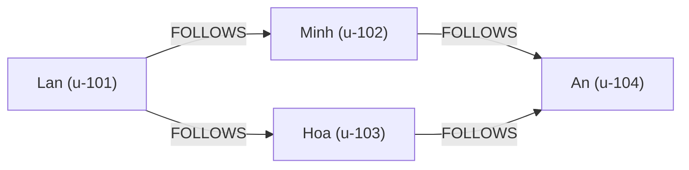

# Các nhóm tiện ích chuyển đổi, cấu trúc dữ liệu và xử lý đồ thị với APOC trong Neo4j

## 1. APOC bổ sung điều gì cho Cypher?

Neo4j lưu dữ liệu theo mô hình **property graph**: node có label và property, relationship có type, hướng và property. Ngôn ngữ **Cypher** giúp tìm node, nối quan hệ, thao tác dữ liệu, truy vấn đường đi và gọi procedure. Tuy nhiên, những hệ thống cần làm sạch dữ liệu, biến đổi JSON, xử lý danh sách/map hoặc tái cấu trúc graph thường cần các tiện ích bổ sung.

**APOC** (*Awesome Procedures On Cypher*) là thư viện các **function** và **procedure** mở rộng khả năng sử dụng Cypher. Ví dụ, một pipeline đồng bộ người dùng có thể cần:

1. Nhận JSON từ API rồi chuyển thành Cypher map.
2. Loại giá trị rỗng, chuẩn hóa text và hợp nhất các trường dữ liệu.
3. Duyệt một mạng quan hệ theo hướng, loại quan hệ và giới hạn độ sâu.
4. Trong một đợt dọn dữ liệu có kiểm soát, gộp các node trùng nhau và xử lý quan hệ liên quan.

APOC hỗ trợ các công việc này, nhưng **không phải mọi thao tác đều cần APOC**. Cypher ngày càng có nhiều chức năng tương đương. Trước khi chọn một tiện ích, cần biết **nó thuộc Core hay Extended, còn được hỗ trợ trong phiên bản Cypher đang dùng hay không, và nó có thay đổi graph hay không**.

### 1.1. Function và procedure khác nhau như thế nào?

| Đặc tính | Function | Procedure |
| --- | --- | --- |
| Cách gọi | Sử dụng trong biểu thức: `RETURN apoc.convert.toJson(...)` | `CALL apoc.path.expandConfig(...) YIELD path` |
| Đầu ra | Trả về một giá trị, ví dụ `STRING`, `MAP`, `LIST` | Có thể trả về nhiều dòng và nhiều cột |
| Tác động | Thường dùng để tính toán/chuyển đổi dữ liệu đầu vào | Có thể chỉ đọc graph **hoặc** thay đổi graph tùy procedure |
| Ví dụ | `apoc.text.clean`, `apoc.coll.frequencies` | `apoc.path.expandConfig`, `apoc.refactor.mergeNodes` |

Một procedure thay đổi graph cần được xử lý như bất kỳ thao tác ghi Neo4j nào: **transaction, quyền truy cập, constraint, backup và xác minh kết quả sau commit** đều quan trọng.

### 1.2. Các nhóm tiện ích cần nắm

| Nhóm | Mục tiêu | API tiêu biểu |
| --- | --- | --- |
| `apoc.convert.*` | Chuyển đổi JSON và biểu diễn dữ liệu | `apoc.convert.toJson`, `apoc.convert.fromJsonMap`, `apoc.convert.fromJsonList` |
| `apoc.text.*` | Làm sạch và xử lý chuỗi | `apoc.text.clean`, `apoc.text.regexGroups` |
| `apoc.map.*` | Tạo, làm sạch, ghép map, xử lý cấu trúc key-value | `apoc.map.fromPairs`, `apoc.map.clean`, `apoc.map.mergeList` |
| `apoc.coll.*` | Xử lý collection/list | `apoc.coll.frequencies`, `apoc.coll.flatten`, `apoc.coll.toSet` |
| `apoc.path.*` | Duyệt graph theo cấu hình type, hướng, label, số hop | `apoc.path.expandConfig`, `apoc.path.subgraphNodes` |
| `apoc.refactor.*` | Chỉnh sửa cấu trúc graph, gộp/clone/đổi quan hệ | `apoc.refactor.mergeNodes`, `apoc.refactor.cloneSubgraph` |

Các ví dụ dưới đây tập trung vào **APOC Core**, đồng thời chỉ ra các trường hợp Cypher 25 đã có cách viết tốt hơn.

## 2. Xác minh môi trường trước khi chạy ví dụ

### 2.1. APOC Core, APOC Extended và phiên bản Cypher

Từ Neo4j 5, APOC được tách thành:

- **APOC Core:** thư viện được Neo4j hỗ trợ chính thức; gồm nhiều function/procedure thông dụng về chuyển đổi, collection, path expansion và graph refactoring. Nhiều chức năng có sẵn trong AuraDB.
- **APOC Extended:** dự án do cộng đồng duy trì, có thêm các tích hợp và procedure cần thư viện ngoài hoặc có phạm vi thử nghiệm rộng hơn. Không mặc định chúng được cài ở mọi database, đặc biệt trên dịch vụ quản trị.

Với Neo4j Server tự quản lý, phiên bản APOC phải **tương thích** với phiên bản Neo4j. APOC Core có thể được cung cấp trong thư mục `labs` rồi kích hoạt ở `plugins`; Neo4j Desktop và Docker có cơ chế cài tương ứng. Trong cluster, plugin cần được triển khai nhất quán lên các server phù hợp. Không tự ý đặt JAR của phiên bản khác vào production.

**Một thay đổi phiên bản rất quan trọng:** từ Neo4j 2025.06, hệ thống có **Cypher 5** và **Cypher 25**. Trong Neo4j 2026.02 trở đi, Cypher 25 là ngôn ngữ mặc định cho database mới theo tài liệu hiện hành. Nhiều function APOC có bản thay thế native và đã bị *deprecated* trong Cypher 25; một số API cũ chỉ còn hoạt động nếu chạy với `CYPHER 5`. Cần xem phiên bản **database, APOC và Cypher language mode** khi tra cứu API.

### 2.2. Kiểm tra APOC thực sự có sẵn

Nếu APOC đã được cài và được phép dùng:

```cypher
RETURN apoc.version() AS apocVersion;
```

Liệt kê các function APOC đang được database công bố:

```cypher
SHOW FUNCTIONS
YIELD name
WHERE name STARTS WITH 'apoc.'
RETURN name
ORDER BY name
LIMIT 30;
```

Liệt kê procedure:

```cypher
SHOW PROCEDURES
YIELD name
WHERE name STARTS WITH 'apoc.'
RETURN name
ORDER BY name
LIMIT 30;
```

Tìm nhanh hướng dẫn API đã tải:

```cypher
CALL apoc.help('path');
```

Nếu `apoc.version()` hoặc một API không có trong catalog, cần kiểm tra plugin, phiên bản, Cypher mode và quyền. **Không** kết luận rằng mọi tên bắt đầu bằng `apoc.` đều đã được cài, hoặc procedure chỉ cần tồn tại là người dùng bất kỳ được gọi.

Đối với Neo4j tự quản lý, các thiết lập bảo mật như `dbms.security.procedures.allowlist` và `dbms.security.procedures.unrestricted` ảnh hưởng tới việc nạp/cho phép procedure. Áp dụng nguyên tắc **quyền tối thiểu**: chỉ cho phép những API cần dùng, đặc biệt là các tiện ích đọc file/network hoặc ghi graph. Trên AuraDB, quyền và danh sách hỗ trợ do dịch vụ kiểm soát; không thể giả định được cấu hình plugin theo cách một server tự quản lý.

## 3. Nhóm chuyển đổi dữ liệu: `apoc.convert.*` và `apoc.text.*`

### 3.1. Chuyển JSON string thành map

Giả sử API gửi payload:

```json
{
  "userId": "u-101",
  "profile": {
    "name": "Lan",
    "active": true
  },
  "tags": ["neo4j", "graph"]
}
```

Khi payload đang nằm ở dạng **chuỗi JSON**, dùng `apoc.convert.fromJsonMap`:

```cypher
WITH '{"userId":"u-101","profile":{"name":"Lan","active":true},"tags":["neo4j","graph"]}' AS raw
WITH apoc.convert.fromJsonMap(raw) AS payload
RETURN
  payload.userId AS userId,
  payload.profile.name AS name,
  payload.profile.active AS active,
  payload.tags AS tags;
```

Kết quả kỳ vọng:

| userId | name | active | tags |
| --- | --- | --- | --- |
| `u-101` | `Lan` | `true` | `["neo4j", "graph"]` |

Điểm phân biệt:

- `fromJsonMap` yêu cầu đầu vào JSON có **object/map** ở vị trí cần lấy. Nếu JSON gốc là mảng (ví dụ `[{"id":1},{"id":2}]`), sử dụng `apoc.convert.fromJsonList` thay thế.
- Đây là **chuyển đổi kiểu trong truy vấn**, không tự tạo node hoặc relationship.
- Giá trị nhận được vẫn cần kiểm tra cấu trúc, khóa bắt buộc, kiểu, độ dài, quyền truy cập và nguồn gốc. Parse JSON thành công không có nghĩa payload hợp lệ theo nghiệp vụ.

### 3.2. Truy xuất JSONPath theo cấu trúc lồng nhau

`apoc.convert.fromJsonMap` hỗ trợ đối số JSONPath tùy chọn:

```cypher
WITH '{"profile":{"name":"Lan","active":true},"userId":"u-101"}' AS raw
RETURN apoc.convert.fromJsonMap(raw, '$.profile') AS profile;
```

Kỳ vọng `profile = {name: 'Lan', active: true}`. Nếu đường dẫn không tồn tại, kết quả phụ thuộc *path options* của hàm; cần xác định rõ có muốn trả `null`, danh sách hay báo lỗi. Đừng dựa vào giả định mọi dữ liệu bên ngoài luôn có đủ trường.

Với danh sách JSON ở đầu vào, ví dụ độc lập:

```cypher
RETURN apoc.convert.fromJsonList('[{"id":"a"},{"id":"b"}]') AS items;
```

Kỳ vọng là một **list** gồm hai map. Khi muốn lấy mỗi phần tử thành một dòng, dùng `UNWIND` sau parse:

```cypher
WITH apoc.convert.fromJsonList('[{"id":"a"},{"id":"b"}]') AS items
UNWIND items AS item
RETURN item.id AS id
ORDER BY id;
```

### 3.3. Chuyển map thành chuỗi JSON

```cypher
WITH {
  userId: 'u-101',
  name: 'Lan',
  roles: ['DEV', 'REVIEWER']
} AS payload
RETURN apoc.convert.toJson(payload) AS jsonString;
```

Đầu ra là **STRING** có nội dung JSON. Tình huống hữu ích:

- Gửi kết quả qua một hệ thống bên ngoài cần JSON string.
- Lưu raw payload để đối chiếu/audit theo chính sách dữ liệu.
- Chuyển một cấu trúc map/list lồng nhau thành chuỗi vì property Neo4j **không cho phép lưu trực tiếp arbitrary map hoặc list chứa map**. Các property graph Neo4j thông thường lưu scalar và danh sách giá trị kiểu được hỗ trợ.

Ví dụ mô phỏng lưu JSON string vào node demo:

```cypher
MERGE (u:DemoApocUser {userId: 'u-101'})
SET u.rawProfile = apoc.convert.toJson({
  name: 'Lan',
  preferences: {theme: 'dark', language: 'vi'}
})
RETURN u.userId AS userId, u.rawProfile AS rawProfile;
```

Khi đọc lại:

```cypher
MATCH (u:DemoApocUser {userId: 'u-101'})
RETURN apoc.convert.fromJsonMap(u.rawProfile).preferences.theme AS theme;
```

**Cân nhắc thiết kế:** lưu JSON string làm mất khả năng lập index property riêng trên từng trường bên trong JSON. Nếu `preferences.theme` cần lọc thường xuyên, nên cân nhắc property riêng hoặc node/relationship phù hợp thay vì chỉ lưu blob.

### 3.4. Chuẩn hóa chuỗi với `apoc.text.*`

```cypher
RETURN apoc.text.clean(' User #101! ') AS normalized;
```

Kết quả kỳ vọng là `user101`: `apoc.text.clean` bỏ ký tự không phải chữ/số và chuyển chữ về dạng thường. Đây là tiện ích để tạo **khóa tìm kiếm tương đối đơn giản**, không phải bộ chuẩn hóa Unicode/ngôn ngữ hoàn chỉnh.

| Nhu cầu | Cách tiếp cận | Chú ý |
| --- | --- | --- |
| Cắt khoảng trắng | Native `trim(text)` | Đơn giản và không cần APOC |
| Chuyển chữ thường | Native `toLower(text)` | Không tự xử lý mọi vấn đề so khớp tiếng Việt có dấu |
| Loại dấu câu/ký tự phân cách | `apoc.text.clean(text)` | Có thể mất thông tin hữu ích; kiểm tra Unicode trước khi tạo khóa |
| Phân tích biểu thức chính quy | Một số function `apoc.text.*` hoặc regex Cypher phù hợp | Không dựa vào API đã bị loại theo phiên bản |

Với email, tên người hoặc khóa định danh, **đừng tự ý xóa dấu hoặc ký tự đặc biệt** rồi xem đó là ID duy nhất. Chẳng hạn hai chuỗi gốc khác nhau có thể cho cùng chuỗi sau khi làm sạch; phải giữ ID nguồn và sử dụng uniqueness constraint đúng nghiệp vụ.

## 4. Nhóm cấu trúc dữ liệu: `apoc.map.*`

Map là tập các cặp `key -> value`. Cypher sử dụng map để truyền tham số, tổ chức payload và biểu diễn kết quả; APOC cung cấp thêm nhiều thao tác ghép, lọc và chuyển đổi.

### 4.1. Xây dựng map từ các cặp khóa-giá trị

```cypher
WITH [
  ['userId', 'u-101'],
  ['role', 'DEV'],
  ['active', true]
] AS pairs
RETURN apoc.map.fromPairs(pairs) AS userMap;
```

Kết quả kỳ vọng:

```json
{"userId":"u-101","role":"DEV","active":true}
```

**Lưu ý phiên bản:** `apoc.map.fromPairs` đã được đánh dấu deprecated trong Cypher 25 vì có **map comprehension** tương đương:

```cypher
WITH [
  ['userId', 'u-101'],
  ['role', 'DEV'],
  ['active', true]
] AS pairs
RETURN {pair IN pairs | pair[0]: pair[1]} AS userMap;
```

Ví dụ map comprehension này dành cho môi trường hỗ trợ cú pháp **Cypher 25**; trên Neo4j 5/Cypher 5 có thể cần giữ phiên bản APOC tương ứng. Không dùng mặc định cú pháp Cypher 25 khi ứng dụng phải chạy trên server Neo4j cũ.

### 4.2. Làm sạch map nhưng giữ đúng nghiệp vụ

Ví dụ một form có trường trống:

```cypher
WITH {
  userId: 'u-101',
  name: 'Lan',
  alias: '',
  internalNote: 'for-review'
} AS input
RETURN apoc.map.clean(input, ['internalNote'], ['']) AS cleaned;
```

Kết quả sẽ có `userId` và `name`, không còn `internalNote` hoặc `alias`. Tham số thứ hai là **danh sách key cần loại**, tham số thứ ba là **danh sách value cần loại**.

Trong **Cypher 25**, function `apoc.map.clean` đã deprecated; có thể dùng map comprehension:

```cypher
WITH {
  userId: 'u-101',
  name: 'Lan',
  alias: '',
  internalNote: 'for-review'
} AS input
RETURN {
  k: v IN input
  WHERE NOT k IN ['internalNote'] AND v <> ''
  | k: v
} AS cleaned;
```

Trong dữ liệu thực tế, phân biệt rõ:

- `''`: chuỗi rỗng.
- `null`: không có giá trị.
- `0`: số không, có thể mang ý nghĩa hợp lệ.
- `false`: giá trị boolean hợp lệ, không nên lọc chỉ vì là “falsy” trong ngôn ngữ lập trình khác.

Một hàm làm sạch chọn sai danh sách value có thể xóa dữ liệu nghiệp vụ hợp lệ, đặc biệt với số đếm, cờ trạng thái và kết quả đo.

### 4.3. Ghép nhiều map

```cypher
WITH [
  {userId: 'u-101', name: 'Lan'},
  {department: 'Engineering'},
  {name: 'Lan Anh'}
] AS parts
RETURN apoc.map.mergeList(parts) AS merged;
```

Với các key trùng nhau, `apoc.map.mergeList` ghép theo thứ tự danh sách và giá trị ở **map phía sau** ghi đè giá trị trước. Kết quả có `name = 'Lan Anh'`. Đây là vấn đề **thứ tự ưu tiên nguồn**, không nên để ngầm định:

- Nguồn A là dữ liệu gốc; nguồn B là override do người dùng xác nhận.
- Nếu muốn A thắng, phải đổi thứ tự hoặc chỉ ghi khi key còn thiếu.
- Không dùng ghép map để thay thế kiểm tra version/timestamp của sự kiện cập nhật.

Ngoài ra có `apoc.map.merge(map1, map2)` cho hai map. Function này cũng được đánh dấu deprecated trong Cypher 25; ưu tiên cú pháp native khi ứng dụng ở phiên bản phù hợp. Trước khi dùng các API `apoc.map.*` khác, tra cứu signature và trạng thái deprecation cho đúng phiên bản.

## 5. Nhóm collection: `apoc.coll.*`

List xuất hiện trong JSON array, kết quả `collect()`, tham số `UNWIND` và danh sách node/relationship. APOC có các hàm biến đổi list, khử trùng và thống kê.

### 5.1. Khử trùng phần tử

```cypher
RETURN apoc.coll.toSet(['neo4j', 'cypher', 'neo4j', 'graph'])
       AS uniqueTags;
```

Kết quả có ba giá trị duy nhất. **Không dựa vào thứ tự** của tập hợp khi logic nghiệp vụ không quy định thứ tự; nếu cần thứ tự hiển thị ổn định, hãy sắp xếp.

Từ Cypher 25, `apoc.coll.toSet` đã deprecated, thay bằng hàm native:

```cypher
RETURN coll.distinct(['neo4j', 'cypher', 'neo4j', 'graph'])
       AS uniqueTags;
```

Nếu muốn khử trùng **nhiều dòng** Cypher (không phải một list đã tạo), dùng `RETURN DISTINCT`/`WITH DISTINCT` có thể trực tiếp và tiết kiệm việc giữ danh sách trung gian.

### 5.2. Làm phẳng list nhiều tầng

```cypher
RETURN apoc.coll.flatten(
  [['neo4j', 'cypher'], ['graph', ['apoc']]],
  true
) AS flattened;
```

Với `true`, hàm flatten đệ quy các list lồng nhau, tạo list gồm `neo4j`, `cypher`, `graph`, `apoc`. Nếu dùng `false`, chỉ làm phẳng một mức; list con sâu hơn có thể còn nguyên.

Trong Cypher 25, `apoc.coll.flatten` đã deprecated; có thể dùng `coll.flatten(...)` native. Cú pháp và tham số độ sâu của hàm native **khác** đối số boolean của APOC; xem tài liệu Cypher đúng phiên bản trước khi thay thế.

### 5.3. Đếm tần suất

```cypher
WITH ['neo4j', 'graph', 'neo4j', 'cypher', 'graph', 'neo4j'] AS tags
RETURN apoc.coll.frequencies(tags) AS frequencies;
```

Kết quả là list các map có trường `item` và `count`, tương ứng `neo4j: 3`, `graph: 2`, `cypher: 1`. Không nên dựa vào thứ tự các map nếu yêu cầu chỉ là tần suất.

Khi cần bảng có thứ tự:

```cypher
WITH ['neo4j', 'graph', 'neo4j', 'cypher', 'graph', 'neo4j'] AS tags
UNWIND apoc.coll.frequencies(tags) AS entry
RETURN entry.item AS tag, entry.count AS occurrences
ORDER BY occurrences DESC, tag ASC;
```

Chọn `apoc.coll.frequencies` khi đã có một list cần phân tích. Nếu dữ liệu còn ở dạng **nhiều dòng từ graph**, có thể nhóm bằng Cypher:

```cypher
UNWIND ['neo4j', 'graph', 'neo4j', 'cypher', 'graph', 'neo4j'] AS tag
RETURN tag, count(*) AS occurrences
ORDER BY occurrences DESC, tag;
```

Đây là ví dụ **native Cypher không phụ thuộc APOC**. Với dữ liệu rất lớn, ưu tiên tránh tạo `collect(...)` khổng lồ chỉ để sau đó đếm bằng một function APOC; gom nhóm bằng `count(*)` ngay trong luồng truy vấn thường hợp lý hơn.

## 6. Nhóm xử lý graph: duyệt đường đi với `apoc.path.*`

Cypher đã hỗ trợ match theo relationship và tìm path. `apoc.path.*` bổ sung cơ chế **duyệt có cấu hình**, hữu ích khi cần phối hợp nhiều type, hướng, label filter, điểm dừng hoặc chế độ uniqueness trên đường đi.

### 6.1. Tạo graph thực hành nhỏ

Trên **database thử nghiệm**, chạy:

```cypher
CREATE CONSTRAINT demo_apoc_user_id_unique IF NOT EXISTS
FOR (u:DemoApocUser)
REQUIRE u.userId IS UNIQUE;
```

```cypher
MERGE (lan:DemoApocUser {userId: 'u-101'})
  ON CREATE SET lan.name = 'Lan'
MERGE (minh:DemoApocUser {userId: 'u-102'})
  ON CREATE SET minh.name = 'Minh'
MERGE (hoa:DemoApocUser {userId: 'u-103'})
  ON CREATE SET hoa.name = 'Hoa'
MERGE (an:DemoApocUser {userId: 'u-104'})
  ON CREATE SET an.name = 'An'
MERGE (lan)-[:FOLLOWS]->(minh)
MERGE (lan)-[:FOLLOWS]->(hoa)
MERGE (minh)-[:FOLLOWS]->(an)
MERGE (hoa)-[:FOLLOWS]->(an);
```

Graph minh họa:



Đoạn `MERGE` theo ID và relationship giúp chạy lại mà không tạo node/cạnh trùng trong dữ liệu demo phù hợp; uniqueness constraint bảo vệ `userId`.

### 6.2. Duyệt path có giới hạn và lọc theo type

```cypher
MATCH (start:DemoApocUser {userId: 'u-101'})
CALL apoc.path.expandConfig(start, {
  relationshipFilter: 'FOLLOWS>',
  labelFilter: '+DemoApocUser',
  minLevel: 1,
  maxLevel: 2,
  uniqueness: 'NODE_PATH',
  bfs: true
})
YIELD path
RETURN
  [n IN nodes(path) | n.userId] AS route,
  length(path) AS hops
ORDER BY hops;
```

Giải thích:

- `relationshipFilter: 'FOLLOWS>'` chỉ duyệt relationship `FOLLOWS` theo **chiều đi ra**. Cú pháp `'<FOLLOWS'` là chiều đi vào; `'FOLLOWS'` không có ký hiệu là hai chiều.
- `labelFilter: '+DemoApocUser'` giới hạn loại node được đi qua theo quy tắc allowlist. `'-Label'` là denylist; `'/Label'` đánh dấu node kết thúc và không đi tiếp; `'>Label'` đánh dấu node được trả về nhưng vẫn có thể mở rộng tiếp tùy quy tắc.
- `minLevel` và `maxLevel` giới hạn số **hop/relationship**, không phải số node.
- `uniqueness: 'NODE_PATH'` không đi qua **cùng một node hai lần trong một path**. Điều này **không** bảo đảm một node đích chỉ xuất hiện trong một dòng kết quả: `u-104` vẫn có hai đường đi khác nhau qua `u-102` và `u-103`.
- `bfs: true` chọn hướng duyệt breadth-first. Chiến lược uniqueness và cấu hình khác có thể ảnh hưởng bộ nhớ, thứ tự trả về và số path.

Trên graph demo, dự kiến có hai path dài một hop đến `u-102`, `u-103` và hai path dài hai hop đến `u-104` qua hai nhánh. Nếu mục tiêu chỉ cần **node đích không trùng**, thay vì toàn bộ path, cần chọn `DISTINCT last(nodes(path))` hoặc dùng một procedure lấy subgraph node phù hợp.

### 6.3. Lấy node trong subgraph

```cypher
MATCH (start:DemoApocUser {userId: 'u-101'})
CALL apoc.path.subgraphNodes(start, {
  relationshipFilter: 'FOLLOWS>',
  maxLevel: 2
})
YIELD node
RETURN DISTINCT node.userId AS userId
ORDER BY userId;
```

Truy vấn duyệt tới các node có thể tới được trong phạm vi. **Tùy mặc định cấu hình, start node có thể nằm trong kết quả**; nếu chỉ muốn những node cách start ít nhất một hop, đặt `minLevel: 1` hoặc lọc `node <> start` một cách rõ ràng.

Với `apoc.path.subgraphAll(...)`, procedure trả về danh sách node và relationship của subgraph; hữu ích khi muốn dựng một góc nhìn con. Tuy nhiên, “lấy toàn bộ subgraph” trên mạng có nhiều nhánh có thể tiêu tốn bộ nhớ lớn hơn việc lấy vài node/path.

### 6.4. Kiểm soát bùng nổ đường đi

Trong graph có nhiều hub, chỉ cần vài hop đã có thể tạo **rất nhiều path**. Luôn xác định:

| Tham số / biện pháp | Vì sao cần |
| --- | --- |
| `maxLevel` | Ngăn duyệt quá sâu khi nghiệp vụ chỉ cần 2–3 hop |
| `relationshipFilter` | Loại relationship type hoặc hướng không liên quan |
| `labelFilter` | Loại các nhóm node không thuộc phạm vi |
| `uniqueness` | Kiểm soát việc lặp node/relationship theo path hoặc trên toàn lần duyệt |
| `limit` | Giới hạn **số path trả về**; không nên coi là ngưỡng cứng bảo vệ mọi công việc bên trong |
| `EXPLAIN` / `PROFILE`, phép đo tải | Tìm fan-out, DB Hits và memory để so với Cypher native |

Mặc định `uniqueness` của `apoc.path.expandConfig` là `RELATIONSHIP_PATH`. Chọn `NODE_GLOBAL` giúp mỗi node được duyệt một lần trong phạm vi traversal nhưng có thể làm mất các **đường đi thay thế** tới cùng node. Nếu bài toán cần *mọi route hợp lệ*, không thể tùy tiện thay mode để giảm số dòng.

Không dùng path expansion để thay thế mọi thuật toán graph. Các bài toán như PageRank, community detection hoặc shortest path có trọng số trên graph lớn thường cần kiểm tra Cypher hoặc **Graph Data Science (GDS)**, là sản phẩm/thư viện riêng, không đồng nghĩa với APOC.

## 7. Nhóm tái cấu trúc: `apoc.refactor.*`

Khác các hàm parse JSON hay duyệt path, nhóm `apoc.refactor.*` có thể **sửa trực tiếp cấu trúc graph**: gộp node, gộp relationship, clone subgraph, đổi hướng relationship hoặc đổi nhãn/type. Đây là các thao tác schema/data migration có tác động lâu dài.

### 7.1. Hiểu đúng `apoc.refactor.mergeNodes`

Procedure `apoc.refactor.mergeNodes(nodes, config)`:

- Nhận **danh sách các node** và giữ node **đầu tiên** làm node đích.
- Di chuyển/gộp các relationship của node còn lại về node đích theo cấu hình.
- Giải quyết giá trị property xung đột bằng các chiến lược như `discard` (giữ giá trị có trước), `overwrite` hoặc `combine`.
- Xóa những node bị gộp theo ngữ nghĩa procedure; vì vậy **không tương đương** câu `MERGE (n:Label {key: ...})` trong Cypher.

Ví dụ chuẩn bị dữ liệu **chỉ trong database demo**:

```cypher
MERGE (a:DemoDuplicateContact {sourceId: 'source-a'})
SET a.email = 'lan@example.test',
    a.name = 'Lan'
MERGE (b:DemoDuplicateContact {sourceId: 'source-b'})
SET b.email = 'lan@example.test',
    b.name = 'Lan Anh';
```

Xem trước tập sẽ gộp:

```cypher
MATCH (c:DemoDuplicateContact {email: 'lan@example.test'})
RETURN c.sourceId AS sourceId, c.name AS name
ORDER BY sourceId;
```

Nếu chắc chắn hai node là cùng một thực thể và đã có phương án khôi phục, chạy:

```cypher
MATCH (c:DemoDuplicateContact {email: 'lan@example.test'})
WITH c ORDER BY c.sourceId
WITH collect(c) AS nodes
WHERE size(nodes) > 1
CALL apoc.refactor.mergeNodes(nodes, {
  properties: 'discard',
  mergeRels: true
})
YIELD node
RETURN node.sourceId AS survivingSourceId,
       properties(node) AS mergedProperties;
```

Với `properties: 'discard'`, giá trị ở node giữ lại thường được ưu tiên khi có trùng key. Thứ tự `ORDER BY c.sourceId` ở ví dụ trên được dùng để **chọn rõ node đích**; đổi thứ tự có thể đổi kết quả property. Trên dữ liệu sản xuất, việc gộp sẽ làm thay đổi id nội bộ, cạnh, thuộc tính và có thể gặp constraint/khóa hoặc relationship semantics không tương thích.

### 7.2. Các nguy cơ và quy trình an toàn

Không gộp node chỉ vì một property trùng: hai người có thể trùng tên, hai sự kiện có thể cùng timestamp, hoặc một đối tượng cần giữ nhiều phiên bản theo thời gian. Trước khi refactor:

1. Xác định **quy tắc định danh** thực sự (ID nguồn, loại node, điều kiện nghiệp vụ), thu thập đúng nhóm duplicate.
2. Chọn rõ **node sống sót**, chính sách property/relationship và xử lý self-loop. Kiểm tra các constraint có thể cản trở hoặc bị vi phạm.
3. Backup hoặc dựng **bản sao thử nghiệm**; dùng `EXPLAIN` nếu cần kiểm tra plan nhưng nhớ rằng chỉ `CALL ...` trên transaction thực thi mới thay đổi dữ liệu.
4. Chia lô hợp lý với transaction nhất quán theo nghiệp vụ. Một refactor lớn có thể khóa dữ liệu và làm tăng bộ nhớ; không mặc nhiên dùng song song nhiều transaction trên cùng node.
5. Sau commit, kiểm tra số node, uniqueness theo khóa, hướng/type quan hệ, property và kết quả truy vấn nghiệp vụ.

Các procedure liên quan:

| Procedure | Mục tiêu | Cảnh báo |
| --- | --- | --- |
| `apoc.refactor.mergeNodes` | Gộp các node trùng | Có thể xóa node và thay đổi quan hệ; cần chọn node đích |
| `apoc.refactor.mergeRelationships` | Gộp nhiều relationship có cùng hai đầu | Relationship đầu tiên được giữ; kiểm tra loại và property nghiệp vụ |
| `apoc.refactor.cloneNodes` | Nhân bản node (có thể kèm relationship tùy config) | Có thể tạo bản sao trái uniqueness constraint |
| `apoc.refactor.cloneSubgraph` | Sao chép một subgraph | Cần kiểm tra dung lượng và cách xử lý ID/relationship |
| `apoc.refactor.invert` | Đảo hướng relationship | Thay đổi ý nghĩa các truy vấn có hướng |

Thay đổi cấu trúc graph không tự đồng bộ lại các hệ thống ngoài Neo4j. Nếu ID node đang được tham chiếu trong ứng dụng, cần kế hoạch ánh xạ sang **khóa nghiệp vụ** hoặc cập nhật tham chiếu liên quan.

## 8. Ví dụ xuyên suốt: từ JSON đến graph và đường đi

Tình huống: hệ thống nhận một payload chứa người dùng và danh sách kỹ năng. Cần đọc JSON, chuẩn hóa dữ liệu đầu vào, tạo node/relationship và duyệt graph.

Payload minh họa:

```json
{
  "userId": "u-201",
  "name": "  Mai  ",
  "skills": ["Neo4j", "Cypher", "Neo4j"]
}
```

### Bước 1: Parse và chuẩn hóa trước khi ghi

```cypher
WITH '{"userId":"u-201","name":"  Mai  ","skills":["Neo4j","Cypher","Neo4j"]}' AS raw
WITH apoc.convert.fromJsonMap(raw) AS payload
WITH
  payload.userId AS userId,
  trim(payload.name) AS displayName,
  apoc.coll.toSet(payload.skills) AS skills
RETURN userId, displayName, skills;
```

Trong Cypher 25, nên dùng `coll.distinct(payload.skills)` thay cho `apoc.coll.toSet`. Ví dụ trên cố ý cho thấy bước xử lý bằng APOC; ứng dụng cần chọn API còn được hỗ trợ trong version thực tế.

### Bước 2: Upsert node và relationship bằng Cypher

Có thể giữ dữ liệu đã chuẩn hóa để ghi trong **một transaction**:

```cypher
WITH '{"userId":"u-201","name":"  Mai  ","skills":["Neo4j","Cypher","Neo4j"]}' AS raw
WITH apoc.convert.fromJsonMap(raw) AS payload
WITH
  payload.userId AS userId,
  trim(payload.name) AS displayName,
  apoc.coll.toSet(payload.skills) AS skills
MERGE (u:DemoApocUser {userId: userId})
SET u.name = displayName
WITH u, skills
UNWIND skills AS skillName
MERGE (s:DemoApocSkill {name: skillName})
MERGE (u)-[:HAS_SKILL]->(s)
RETURN u.userId AS userId, collect(s.name) AS persistedSkills;
```

Với `DemoApocUser.userId` và `DemoApocSkill.name`, nên tạo uniqueness constraints phù hợp khi chạy trên dữ liệu thật. `MERGE` giúp chạy lại không tạo cùng một node/relationship nếu dữ liệu và điều kiện nhận dạng đúng, nhưng **không tự phát hiện hai tên kỹ năng đồng nghĩa** như `Neo4j` và `Neo 4j`.

Thực hành sản xuất cần kiểm tra `payload.userId`, `skills` không null, độ dài và chuẩn tên, thiết kế update theo source version và chỉ xác nhận thành công sau commit. Nếu một record lỗi làm transaction rollback, mọi cập nhật trong cùng transaction sẽ không được lưu.

### Bước 3: Đọc lại kết quả bằng Cypher

```cypher
MATCH (u:DemoApocUser {userId: 'u-201'})-[:HAS_SKILL]->
      (s:DemoApocSkill)
RETURN u.userId AS userId, u.name AS name,
       collect(DISTINCT s.name) AS skills;
```

Đây là thao tác đọc graph thông thường; **không cần APOC**. Kết quả mong đợi gồm một user `u-201`, tên đã trim `Mai` và hai kỹ năng `Neo4j`, `Cypher`.

Nếu muốn duyệt mối quan hệ hai bước giữa người dùng và kỹ năng hoặc các loại quan hệ khác, cân nhắc `apoc.path.expandConfig` với filter và giới hạn hop; đừng mặc nhiên thay một pattern `MATCH` đơn giản bằng procedure phức tạp.

## 9. APOC so với Cypher native: chọn phương án dài hạn

Một số tiện ích quen thuộc đã có chức năng native tương đương trong **Cypher 25**. Khi nâng cấp, ưu tiên API được hỗ trợ dài hạn:

| Tác vụ | Function APOC | Cách thay thế trên Cypher 25 | Trạng thái cần lưu ý |
| --- | --- | --- | --- |
| Loại phần tử trùng trong list | `apoc.coll.toSet` | `coll.distinct(list)` | APOC deprecated trong Cypher 25 |
| Làm phẳng list | `apoc.coll.flatten` | `coll.flatten(list)` hoặc phiên bản có tham số độ sâu | APOC deprecated trong Cypher 25; signature khác |
| Tạo map từ cặp | `apoc.map.fromPairs` | Map comprehension `{pair IN pairs \| pair[0]: pair[1]}` | APOC deprecated trong Cypher 25 |
| Lọc map | `apoc.map.clean` | Map comprehension với `WHERE` | APOC deprecated trong Cypher 25 |
| Ghép hai map | `apoc.map.merge` | Biểu thức/cú pháp native phù hợp với phiên bản | APOC deprecated trong Cypher 25 |
| Chuyển JSON string thành map | `apoc.convert.fromJsonMap` | Vẫn có trường hợp cần APOC theo bản hỗ trợ | Kiểm tra signature và phiên bản |
| Duyệt path với filter linh hoạt | `apoc.path.expandConfig` | Pattern/quantified path Cypher nếu biểu diễn được yêu cầu | Cần so kết quả và hiệu năng |
| Gộp node thật cùng relationship | `apoc.refactor.mergeNodes` | Không có một câu `MERGE` Cypher tương đương hoàn toàn | Là thao tác ghi/migration, cần kiểm tra kỹ |

Ngoài ra, một số hàm cũ đã **bị loại trong Cypher 25**, ví dụ `apoc.text.regreplace`. Không lấy ví dụ từ bài viết Neo4j 3.x/4.x rồi cho rằng gọi được nguyên vẹn trên Neo4j 2026. Với hệ thống chạy cả Cypher 5 và Cypher 25, hãy kiểm thử từng nhánh, ưu tiên thư viện/syntax native có hỗ trợ trên phiên bản đích và theo dõi trang deprecation chính thức.

## 10. Hiệu năng, transaction và bảo mật

### 10.1. Cắt giảm dữ liệu trước khi dùng procedure

```cypher
MATCH (u:DemoApocUser {userId: $userId})
CALL apoc.path.expandConfig(u, {
  relationshipFilter: 'FOLLOWS>',
  minLevel: 1,
  maxLevel: 2
})
YIELD path
RETURN path;
```

Truy vấn bắt đầu từ **một user cụ thể**, khác với quét toàn bộ `DemoApocUser` rồi thực thi path expander cho từng node. Một uniqueness constraint/range index trên `userId` thường giúp lựa chọn node gốc nhanh hơn. Với graph lớn, thêm giới hạn độ sâu, phạm vi type/label và đo số path tạo ra.

Không nên:

- Gom hàng triệu node vào `collect(n)` rồi đưa một lúc vào refactor/collection function khi không cần.
- Sử dụng `apoc.path.expandConfig` thiếu `maxLevel` trên graph có nhánh lớn rồi kỳ vọng query tự dừng sớm.
- Thực hiện nhiều refactor ghi trên cùng khu vực graph theo luồng song song nếu chưa thiết kế khóa và tính nhất quán.
- Coi `RETURN count(*)` nhỏ là bằng chứng truy vấn nhẹ: các phép duyệt và aggregation trước đó có thể đã xử lý tập trung gian lớn.

### 10.2. Transaction và retry

Hàm biến đổi như `apoc.convert.fromJsonMap` không tự tạo transaction ghi. Nhưng procedure refactor thay đổi graph phải chạy trong transaction phù hợp, chịu rollback khi transaction không commit, và có thể giữ lock trong quá trình chạy.

Khi gọi từ **Java Driver**, ví dụ:

```java
import java.util.Map;
import org.neo4j.driver.Driver;
import org.neo4j.driver.Session;
import org.neo4j.driver.SessionConfig;

public class ApocReadExample {
    public static long countReachable(Driver driver, String userId) {
        try (Session session = driver.session(
                SessionConfig.forDatabase("neo4j"))) {
            return session.executeRead(tx -> tx.run("""
                MATCH (u:DemoApocUser {userId: $userId})
                CALL apoc.path.subgraphNodes(u, {
                  relationshipFilter: 'FOLLOWS>',
                  minLevel: 1,
                  maxLevel: 2
                })
                YIELD node
                RETURN count(DISTINCT node) AS total
                """, Map.of("userId", userId))
                .single()
                .get("total")
                .asLong());
        }
    }
}
```

Đoạn mã chỉ minh họa cách dùng APOC qua Driver. Với `executeWrite`, callback có thể bị retry khi gặp lỗi tạm thời; không đặt side effect ra dịch vụ ngoài hoặc logic không idempotent trong callback. Kiểm tra quyền procedure ở database, ghi log lỗi có ngữ cảnh, và xác minh dữ liệu **sau commit** với thao tác ghi.

Trong **Spring Data Neo4j**, Cypher dùng `Neo4jClient` hoặc custom repository có thể gọi function/procedure APOC như các câu Cypher khác, nhưng vẫn phải tuân thủ cấu hình transaction của Spring, phiên bản plugin và quyền database. Entity mapping `save(...)` không tự động chạy các procedure APOC refactor cho bạn.

### 10.3. Cảnh báo về quyền và dữ liệu bên ngoài

- Function chuyển đổi JSON hoặc xử lý map không tự truy cập network/file; procedure thuộc nhóm import/export/integration có thể yêu cầu quyền/config riêng.
- Không mở rộng `dbms.security.procedures.unrestricted=apoc.*` trên production chỉ để sửa một lỗi thiếu quyền nếu chỉ cần một procedure. Thiết kế allowlist/unrestricted theo **quyền tối thiểu**.
- Khi dùng các procedure có khả năng chạy Cypher động, import file hoặc gọi URL, cần kiểm tra nguồn, tham số và đường dẫn đầu vào. Không cho dữ liệu người dùng không tin cậy quyết định câu lệnh hay đích truy cập tùy ý.
- Trong AuraDB, khả năng cài và cấu hình plugin phụ thuộc dịch vụ. Chỉ sử dụng các procedure được instance hỗ trợ thay vì dựa vào hướng dẫn cài JAR cho server tự quản lý.

## 11. Bài thực hành và cách tự đánh giá

Thực hiện trên **database thử nghiệm** có APOC Core tương thích:

1. Chạy `RETURN apoc.version()` và dùng `SHOW FUNCTIONS`/`SHOW PROCEDURES` để liệt kê chức năng sẵn có. Ghi rõ phiên bản Neo4j, APOC và Cypher mode.
2. Parse payload JSON thành map với `apoc.convert.fromJsonMap`; lấy `profile.name`; serialize map trở lại JSON string bằng `apoc.convert.toJson`.
3. Tạo map từ cặp, lọc key/value rỗng, ghép map. So kết quả với map comprehension trong Cypher 25 nếu có.
4. Dùng `apoc.coll.frequencies` đếm số lần tag xuất hiện; dùng `apoc.coll.toSet` và phiên bản native `coll.distinct` để khử trùng.
5. Tạo graph `DemoApocUser` bốn node ở mục 6. Duyệt `FOLLOWS>` trong hai hop, thay `NODE_PATH` thành `NODE_GLOBAL` rồi giải thích vì sao số path đến `u-104` có thể khác.
6. Trên dữ liệu `DemoDuplicateContact` đã sao lưu, gộp hai node bằng `apoc.refactor.mergeNodes`. Kiểm tra số node, property giữ lại, relationship và xem có constraint nào bị ảnh hưởng không.
7. Với ví dụ JSON-to-graph, chạy lại lệnh upsert và đọc kết quả sau commit. Giải thích tại sao `MERGE`, khóa nghiệp vụ và uniqueness constraint quan trọng khi pipeline retry.

Tự kiểm tra:

- `apoc.convert.fromJsonMap` khác `apoc.convert.fromJsonList` như thế nào?
- Khi nào dùng `apoc.coll.frequencies` và khi nào dùng `count(*)` trực tiếp trong Cypher?
- Vì sao `NODE_PATH` có thể trả nhiều đường đi khác nhau tới **cùng** một node đích?
- Tại sao `apoc.refactor.mergeNodes` nguy hiểm hơn `MERGE (n:Label {key: ...})`?
- Trên Neo4j mới sử dụng Cypher 25, bạn xử lý những hàm APOC đã deprecated theo chiến lược nào?

**Tiêu chí hoàn thành:** người học chọn được đúng nhóm tiện ích chuyển đổi/cấu trúc dữ liệu/graph, viết được `RETURN apoc.*` và `CALL apoc.* YIELD`, biết giới hạn path và nhận diện procedure có side effect, kiểm tra API theo version, cũng như chuyển sang Cypher native khi phù hợp.

## Tài liệu tham khảo chính thức

- [Neo4j APOC Core — Giới thiệu](https://neo4j.com/docs/apoc/current/introduction/): phân biệt APOC Core và Extended, vai trò của function và procedure.
- [Neo4j APOC Core — Danh sách procedure/function](https://neo4j.com/docs/apoc/current/overview/): danh mục API đầy đủ, kiểu và signature.
- [Neo4j APOC Core — Installation](https://neo4j.com/docs/apoc/current/installation/): phiên bản tương thích, triển khai plugin trên server/cluster.
- [Neo4j APOC — Cypher versions](https://neo4j.com/docs/apoc/current/apoc-and-cypher/cypher-versions/): tương thích Cypher 5/Cypher 25.
- [Neo4j APOC — Migrate from APOC to Cypher](https://neo4j.com/docs/apoc/current/apoc-and-cypher/cypher-migration/): các hàm đã có cách viết native.
- [Neo4j APOC — JSON conversion](https://neo4j.com/docs/apoc/current/overview/apoc.convert/): `toJson`, `fromJsonMap` và `fromJsonList`.
- [Neo4j APOC — Map](https://neo4j.com/docs/apoc/current/overview/apoc.map/): từ cặp key/value, lọc và ghép map.
- [Neo4j APOC — Collection](https://neo4j.com/docs/apoc/current/overview/apoc.coll/): khử trùng, flatten và thống kê list.
- [Neo4j APOC — Path expander](https://neo4j.com/docs/apoc/current/graph-querying/expand-paths-config/): hướng relationship, label filter, uniqueness và giới hạn duyệt.
- [Neo4j APOC — Merge nodes](https://neo4j.com/docs/apoc/current/graph-refactoring/merge-nodes/): tác động, cấu hình và quy tắc property khi gộp node.
