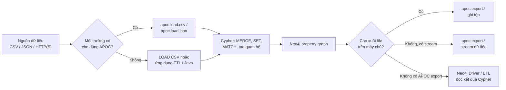
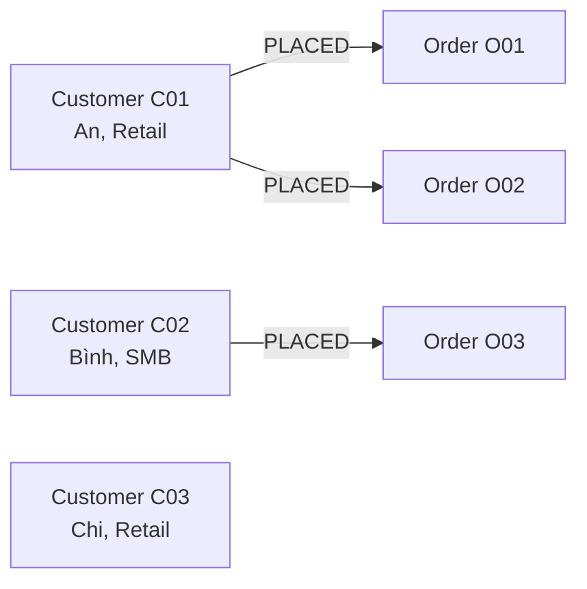

# Nhập hoặc xuất dữ liệu bằng APOC khi môi trường cho phép

Trong Neo4j, dữ liệu đồ thị gồm **nút (node)**, **quan hệ (relationship)** và thuộc tính. Nhiều hệ thống cần lấy dữ liệu từ CSV/JSON, đồng bộ dữ liệu nghiệp vụ hoặc xuất dữ liệu để trao đổi, kiểm toán, di chuyển sang môi trường khác. Ngoài các cơ chế sẵn có của Cypher như `LOAD CSV`, Neo4j có thể dùng **APOC (Awesome Procedures On Cypher)** để thực hiện một số tác vụ nhập, xuất và xử lý dữ liệu.

Bài thuộc chương **APOC và phần mở rộng** của module **DATABASE_ENGINE_GRAPH_NEO4J**. Trọng tâm là sử dụng các thủ tục như `apoc.load.csv`, `apoc.load.json` và `apoc.export.*` **khi phiên bản, môi trường triển khai và quyền truy cập cho phép**, đồng thời lựa chọn phương án thay thế khi không thể sử dụng APOC. Những ví dụ đều gắn với mô hình *property graph* và các truy vấn Cypher; một số thao tác ghi sẽ tạo dữ liệu thực, vì vậy nên chạy trên **database thực hành**.

> **Nguyên tắc đầu tiên:** Có cài Neo4j **không có nghĩa** đã cài và cấp quyền sử dụng mọi thủ tục APOC. Có APOC **không có nghĩa** được đọc hoặc ghi mọi tệp trên máy chủ. Kiểm tra khả năng thực tế trước khi thiết kế một pipeline phụ thuộc vào thủ tục cụ thể.

## 1. APOC đứng ở đâu trong luồng tích hợp dữ liệu?

APOC là tập hợp các hàm và thủ tục bổ sung cho Cypher. Với nhập/xuất, APOC có thể giúp đọc CSV/JSON, xử lý kết quả theo hàng và xuất dữ liệu thành định dạng trao đổi. Phần cấu trúc đồ thị vẫn do Cypher quyết định: dùng nhãn gì, khóa nghiệp vụ nào, loại quan hệ nào và xử lý trùng lặp ra sao.



Không nên xem APOC là giải pháp mặc định cho mọi nhu cầu. Ví dụ:

| Bài toán | Cách thường cân nhắc |
| --- | --- |
| Nạp CSV nhỏ/vừa với Cypher đơn giản | `LOAD CSV` hoặc `apoc.load.csv` |
| Nạp JSON nhiều trường lồng nhau | `apoc.load.json` nếu có và được phép; nếu không, ứng dụng giải mã JSON |
| Nạp định kỳ, cần retry, giám sát | Pipeline ETL/Java Driver, có thể gọi APOC nơi thích hợp |
| Nạp đồ thị ban đầu rất lớn | Đánh giá công cụ nhập chuyên dụng của Neo4j bên cạnh Cypher/APOC |
| Xuất một bảng báo cáo | `RETURN` qua Driver hoặc `apoc.export.csv.query` |
| Xuất đồ thị đầy đủ | Các thủ tục export của APOC nếu quyền và định dạng phù hợp |
| Môi trường managed không cho truy cập tệp | Export dạng stream nếu thủ tục hỗ trợ, hoặc xuất từ ứng dụng |

## 2. Kiểm tra khả năng APOC trước khi chạy

### 2.1. Khác biệt giữa APOC Core và Extended

Theo phiên bản và cách đóng gói, APOC có các tập tính năng thường gọi là **APOC Core** và **APOC Extended**. Không nên suy ra thủ tục có sẵn chỉ từ tên bộ plugin: một số thủ tục hoặc cấu hình có thể thay đổi vị trí, tình trạng hỗ trợ hay quyền thực thi giữa các phiên bản Neo4j.

Trước hết, kiểm tra các thủ tục liên quan trong database đang kết nối:

```cypher
SHOW PROCEDURES
YIELD name, signature
WHERE name IN [
  'apoc.load.csv',
  'apoc.load.json',
  'apoc.export.csv.query',
  'apoc.export.csv.all',
  'apoc.export.json.query',
  'apoc.export.json.all',
  'apoc.periodic.iterate',
  'apoc.import.csv'
]
RETURN name, signature
ORDER BY name;
```

Câu truy vấn giúp phân biệt:

- **Không có trong danh sách:** có thể chưa cài, tính năng không được cung cấp hoặc không hiển thị với phiên bản/cấu hình đó.
- **Có trong danh sách:** cú pháp được hệ thống công bố; vẫn phải kiểm tra **quyền EXECUTE**, chính sách truy cập file và khả năng chạy thực tế.
- **Chữ ký (`signature`) khác ví dụ:** ưu tiên chữ ký của Neo4j/APOC thực tế trong môi trường đang sử dụng.

Nếu không được phép chạy `SHOW PROCEDURES`, nhờ quản trị viên cung cấp danh sách tính năng được hỗ trợ. Trên Neo4j Aura hoặc dịch vụ quản lý khác, bộ thủ tục và khả năng truy cập filesystem có thể bị giới hạn so với Neo4j tự quản trị.

### 2.2. Cấu hình liên quan đến tệp

Các cấu hình thường gặp trong triển khai APOC tự quản trị là:

```properties
# Cấu hình APOC phía máy chủ, ví dụ trong apoc.conf
apoc.import.file.enabled=true
apoc.export.file.enabled=true
apoc.import.file.use_neo4j_config=true
```

Ý nghĩa:

| Cấu hình | Ý nghĩa cần xem xét |
| --- | --- |
| `apoc.import.file.enabled` | Cho phép những thủ tục APOC có hỗ trợ đọc tệp cục bộ |
| `apoc.export.file.enabled` | Cho phép những thủ tục APOC có hỗ trợ ghi tệp cục bộ |
| `apoc.import.file.use_neo4j_config` | Khi được hỗ trợ và bật, đường dẫn import tuân theo giới hạn thư mục import của cấu hình Neo4j |

Đây là **minh họa cấu hình phía máy chủ** để quản trị viên đánh giá; không phải câu Cypher và không có tác dụng nếu dán vào Neo4j Browser. Cách cung cấp cấu hình, cách tải lại và quyền áp dụng phụ thuộc image Docker, máy chủ, nền tảng Kubernetes hoặc dịch vụ managed. Không tự ý mở toàn bộ thư mục máy chủ cho một tiện ích nhập dữ liệu.

Các yếu tố khác cần kiểm tra trước khi dùng:

1. Phiên bản **Neo4j** và phiên bản **APOC** có tương thích không.
2. APOC đã được cài đúng cách và server đã nạp plugin chưa.
3. Role/tài khoản chạy lệnh có quyền sử dụng procedure tương ứng không.
4. Có cho phép truy cập **local file**, **HTTP(S)** hoặc ghi tệp theo chính sách không.
5. Trong môi trường nhiều máy/chạy container, tệp nằm ở **máy/chứa container thực thi truy vấn**, không phải máy của người dùng mở Browser.

### 2.3. Hiểu đúng `file:///` và đường dẫn tệp

Khi chạy:

```cypher
CALL apoc.load.csv('file:///customers.csv')
YIELD map
RETURN map
LIMIT 3;
```

`file:///customers.csv` được phân giải theo cấu hình import **trên phía Neo4j server**. Nó không tự đọc `customers.csv` trên laptop đang mở Neo4j Browser. Với Docker/Kubernetes, cần kiểm tra tệp đã được đưa/mount vào vị trí được cho phép trong container hay chưa.

Tương tự, khi export ra `customers-export.csv`, đầu ra là **tệp ở phía máy chủ hoặc vị trí mà thủ tục được cấu hình ghi**, không tự tải xuống máy khách. Nếu cơ sở dữ liệu được quản lý và không cung cấp quyền đọc/ghi file, hãy cân nhắc API streaming hoặc xuất qua ứng dụng.

## 3. Dữ liệu mẫu: khách hàng và đơn hàng

Giả sử hệ thống CRM cung cấp khách hàng và ERP cung cấp đơn hàng. Ta muốn dựng đồ thị:



Tạo hai tệp UTF-8 ở thư mục được cho phép của môi trường thực hành. **Đây là nội dung mẫu**, không phải các lệnh tự tạo tệp.

`customers.csv`:

```csv
customerId,name,segment
C01,An,Retail
C02,Bình,SMB
C03,Chi,Retail
```

`orders.csv`:

```csv
orderId,customerId,createdAt,totalAmount
O01,C01,2026-11-01,200000
O02,C01,2026-11-03,120000
O03,C02,2026-11-04,300000
```

Mô hình đích:

- `(:Customer {customerId, name, segment})`
- `(:Order {orderId, createdAt, totalAmount})`
- `(:Customer)-[:PLACED]->(:Order)`

Nếu muốn tải dữ liệu này nhiều lần, nên có **khóa duy nhất**. Chạy trong database thực hành:

```cypher
CREATE CONSTRAINT customer_id_unique IF NOT EXISTS
FOR (c:Customer) REQUIRE c.customerId IS UNIQUE;

CREATE CONSTRAINT order_id_unique IF NOT EXISTS
FOR (o:Order) REQUIRE o.orderId IS UNIQUE;
```

Các constraint giúp việc tra cứu/upsert theo mã nghiệp vụ ổn định và bảo vệ dữ liệu trước việc tạo trùng trong các giao dịch đồng thời. Khi áp dụng trong database có sẵn, kiểm tra constraint và dữ liệu trùng trước; không mặc định có thể tạo thành công nếu dữ liệu vi phạm tính duy nhất.

## 4. Nhập CSV bằng `apoc.load.csv` và Cypher

### 4.1. Kiểm tra nội dung trước khi ghi

Trước tiên đọc vài hàng và xem cột được parse:

```cypher
CALL apoc.load.csv('file:///customers.csv', {header: true})
YIELD lineNo, map
RETURN lineNo, map
ORDER BY lineNo
LIMIT 5;
```

`apoc.load.csv` đọc nội dung CSV, trả về từng hàng dưới dạng map khi dùng header. Các khóa `map.customerId`, `map.name` và `map.segment` đến từ hàng tiêu đề. Dữ liệu CSV ban đầu thường là **chuỗi**, trừ khi có cấu hình hoặc quy trình chuyển kiểu riêng.

Những việc cần kiểm tra khi xem thử:

- Cột tên có đúng như quy ước không (kể cả viết hoa/thường).
- Có dòng trống hoặc mã nghiệp vụ rỗng không.
- Dấu phân cách đúng là dấu phẩy, dấu chấm phẩy hay tab.
- Có giá trị chứa dấu phân cách hoặc dấu nháy kép cần escape đúng CSV không.
- Định dạng UTF-8 có giữ được tên tiếng Việt không.

### 4.2. Tạo/cập nhật Customer bằng MERGE

```cypher
CALL apoc.load.csv('file:///customers.csv', {header: true})
YIELD map AS row
WITH row
WHERE row.customerId IS NOT NULL
  AND trim(row.customerId) <> ''
MERGE (c:Customer {customerId: trim(row.customerId)})
SET c.name = row.name,
    c.segment = row.segment
RETURN count(c) AS processedRows;
```

Với dữ liệu mẫu, kết quả kỳ vọng là `processedRows = 3` và có ba nút `Customer`. Khi chạy lại cùng dữ liệu, `MERGE` khớp những nút đã có thay vì tạo thêm nút cùng khóa.

Cần hiểu rõ **`count(c)` là số dòng đã xử lý trong truy vấn**, không nhất thiết là số nút mới tạo. Để biết số node thực sự được tạo hay thuộc tính được cập nhật, xem **query update counters** của kết quả thực thi.

### 4.3. Chuyển kiểu thuộc tính khi đọc CSV

Tệp `orders.csv` có các số và ngày nhưng CSV lưu chúng dưới dạng văn bản. Ta cần chuyển kiểu:

```cypher
CALL apoc.load.csv('file:///orders.csv', {header: true})
YIELD map AS row
WITH row
WHERE row.orderId IS NOT NULL
  AND trim(row.orderId) <> ''
MERGE (o:Order {orderId: trim(row.orderId)})
SET o.createdAt = date(row.createdAt),
    o.totalAmount = toInteger(row.totalAmount),
    o.customerId = trim(row.customerId)
RETURN count(o) AS processedOrders;
```

Đoạn này tạo/cập nhật **nút Order trước**, đồng thời lưu `customerId` tạm để đối chiếu. Với ba hàng hợp lệ, kết quả là `processedOrders = 3`.

Nếu ngày sai định dạng hoặc `totalAmount` chứa chữ không hợp lệ, việc ép kiểu có thể lỗi hoặc trả `null` tùy biểu thức. Trong môi trường thật, hãy **kiểm tra và tách hàng lỗi** trước khi ghi; không nên âm thầm lưu `null` cho dữ liệu bắt buộc.

### 4.4. Nạp relationship sau khi có hai đầu mút

Để tạo quan hệ `PLACED`:

```cypher
CALL apoc.load.csv('file:///orders.csv', {header: true})
YIELD map AS row
MATCH (c:Customer {customerId: trim(row.customerId)})
MATCH (o:Order {orderId: trim(row.orderId)})
MERGE (c)-[:PLACED]->(o)
RETURN count(*) AS processedRelations;
```

Với dữ liệu mẫu, `processedRelations = 3`. `MERGE` trên quan hệ giúp không tạo thêm một cạnh trùng giữa cùng cặp nút trong các lần chạy lại tuần tự, nếu mô hình chỉ cần một quan hệ loại `PLACED` cho mỗi cặp.

**Lưu ý:** Nếu `Customer` hoặc `Order` chưa tồn tại, `MATCH` sẽ loại dòng; quy trình không tự tạo quan hệ thiếu đầu mút. Trong pipeline thực tế phải đối soát số dòng đầu vào, số quan hệ đã khớp và xử lý các trường hợp bị bỏ qua.

Một ví dụ đối soát:

```cypher
MATCH (o:Order)
WHERE NOT EXISTS {
  MATCH (:Customer)-[:PLACED]->(o)
}
RETURN o.orderId AS orderWithoutCustomer
ORDER BY orderWithoutCustomer;
```

Nếu chỉ có dữ liệu mẫu và cả ba quan hệ đã nạp thành công, truy vấn không trả đơn hàng nào.

## 5. Nhập JSON bằng `apoc.load.json`

JSON phù hợp khi nguồn có cấu trúc phân cấp hoặc API trả về đối tượng lồng nhau. Ví dụ tệp `customers.json` chứa **một đối tượng gốc** với mảng `customers`:

```json
{
  "customers": [
    {"customerId": "C01", "name": "An", "segment": "Retail"},
    {"customerId": "C02", "name": "Bình", "segment": "SMB"},
    {"customerId": "C03", "name": "Chi", "segment": "Retail"}
  ]
}
```

Để quan sát cấu trúc được APOC trả về:

```cypher
CALL apoc.load.json('file:///customers.json')
YIELD value
RETURN value
LIMIT 1;
```

Trong ví dụ, phần tử gốc trả về có khóa `customers` chứa danh sách. Dùng `UNWIND` để biến từng phần tử danh sách thành một dòng:

```cypher
CALL apoc.load.json('file:///customers.json')
YIELD value
UNWIND value.customers AS row
WITH row
WHERE row.customerId IS NOT NULL
MERGE (c:Customer {customerId: row.customerId})
SET c.name = row.name,
    c.segment = row.segment
RETURN count(c) AS processedRows;
```

Nếu JSON có **mảng ở cấp gốc** hoặc dùng cấu trúc lồng sâu khác, số dòng mà `apoc.load.json` tạo ra và đường truy cập `value.*` có thể khác. Hãy đọc thử `YIELD value RETURN value LIMIT ...` trước khi viết `UNWIND`.

### 5.1. Nhập JSON qua HTTP(S)

Nếu chính sách môi trường cho phép truy cập nguồn dữ liệu từ xa, tham số URI có thể là một endpoint HTTP(S) được phê duyệt:

```cypher
CALL apoc.load.json($sourceUrl)
YIELD value
RETURN value
LIMIT 3;
```

Ví dụ trên chỉ thể hiện **mẫu gọi**, không giả định máy chủ có thể truy cập Internet hoặc endpoint trả đúng định dạng. Trong thực tế:

1. Chỉ chấp nhận URL từ miền và giao thức được phép.
2. Cân nhắc timeout, xác thực và giới hạn dung lượng phản hồi.
3. Không truyền URL tùy ý từ người dùng cho server tải mà không kiểm soát; có rủi ro **SSRF** và truy cập mạng nội bộ.
4. Không đưa thông tin bí mật vào câu Cypher, log hoặc ví dụ xuất bản.
5. Nếu nguồn cần header/token, sử dụng cơ chế xác thực được môi trường hỗ trợ, hoặc để ứng dụng ETL lấy dữ liệu rồi truyền sang Neo4j.

APOC không thay thế quy trình quản lý bí mật và kiểm soát truy cập nguồn dữ liệu.

## 6. Nhập khối lượng lớn: batching và `apoc.periodic.iterate`

Lệnh nạp toàn bộ tệp bằng một transaction có thể gây tăng bộ nhớ, giữ khóa lâu và tạo transaction log lớn. Khi có quyền dùng thủ tục `apoc.periodic.iterate`, ta có thể chia các dòng đọc từ CSV thành những lô nhỏ:

```cypher
CALL apoc.periodic.iterate(
  'CALL apoc.load.csv("file:///customers.csv", {header: true})
   YIELD map AS row
   WHERE row.customerId IS NOT NULL AND trim(row.customerId) <> ""
   RETURN row',
  'MERGE (c:Customer {customerId: trim(row.customerId)})
   SET c.name = row.name, c.segment = row.segment',
  {batchSize: 500, parallel: false, retries: 1}
)
YIELD batches, total, failedBatches, errorMessages
RETURN batches, total, failedBatches, errorMessages;
```

Ý nghĩa:

- Tham số đầu là **truy vấn cung cấp dòng** để xử lý.
- Tham số thứ hai là **truy vấn áp dụng cho từng lô**.
- `batchSize: 500`: số dòng được đưa vào mỗi batch trước khi thực thi theo cơ chế batching của APOC.
- `parallel: false`: xử lý tuần tự để giảm xung đột ghi khi các bản ghi có thể trùng khóa hoặc có quan hệ phụ thuộc.
- `retries: 1`: thử lại lô lỗi theo khả năng của thủ tục; chỉ phù hợp khi hành động có khả năng chạy lại an toàn.

Với cùng ba khách hàng, thông thường chỉ cần một batch. `total` phản ánh số hàng đưa vào công đoạn xử lý, **không phải số node mới tạo**. Nếu `failedBatches` khác `0` hoặc `errorMessages` có thông tin lỗi, **không đánh dấu đồng bộ thành công** trước khi khắc phục và đối soát.

> **Lưu ý quyền:** `apoc.periodic.iterate` tạo các giao dịch con/lô để xử lý công việc. Cách quản lý transaction, mức độ song song và quyền chạy thủ tục có thể khác theo phiên bản hoặc môi trường. Không coi toàn bộ lần gọi là một transaction duy nhất có thể rollback tất cả các batch đã commit.

### 6.1. Chọn kích thước batch thế nào?

Không có số cố định cho mọi workload. Cần đo thử với các yếu tố:

| Yếu tố | Khi tăng batch quá lớn có thể xảy ra |
| --- | --- |
| Nhiều thuộc tính/dòng | Tăng bộ nhớ cho dữ liệu trong giao dịch |
| Node và relationship phức tạp | Tăng chi phí duyệt/mở rộng và khóa ghi |
| Constraint/index | Tăng chi phí cập nhật index |
| Ghi song song | Tăng khả năng tranh chấp cùng khóa |
| Nguồn CSV/HTTP(S) lớn | Tăng thời gian truyền, parse và xử lý lỗi |
| Retry | Một batch lớn bị lỗi có thể phải xử lý lại nhiều dòng |

Tốt nhất đo **throughput, thời gian mỗi batch, lỗi, sử dụng bộ nhớ và transaction latency**, sau đó điều chỉnh theo dữ liệu thực tế.

### 6.2. Một tùy chọn khác: `apoc.import.csv`

Một số phiên bản và gói APOC cung cấp thủ tục **`apoc.import.csv`** để nhập dữ liệu đồ thị từ tệp CSV theo quy ước riêng về node ID, relationship và mapping thuộc tính. Đây là một cách tiếp cận khác với `apoc.load.csv` rồi tự viết Cypher.

Không nên trộn hai khái niệm:

- `apoc.load.csv`: đọc từng dòng CSV vào Cypher để **tự kiểm soát cách MERGE/SET**.
- `apoc.import.csv`: thủ tục import chuyên biệt có **định dạng đầu vào và cấu hình riêng**, chỉ áp dụng khi procedure đang có và đã được phê duyệt.

Nếu cân nhắc `apoc.import.csv`, hãy xem chữ ký bằng `SHOW PROCEDURES` và tài liệu đúng phiên bản, chuẩn bị file theo định dạng thủ tục yêu cầu và thử trong database nhỏ trước. Đừng giả định một tệp nghiệp vụ `customers.csv` bất kỳ có thể đưa trực tiếp vào thủ tục mà không đổi schema header.

## 7. Xuất CSV bằng APOC

Xuất dữ liệu có hai mục tiêu khác nhau:

1. **Xuất bảng có chọn lọc:** lấy một tập thuộc tính để ứng dụng khác đọc hoặc đối soát.
2. **Xuất cấu trúc đồ thị:** biểu diễn nodes, relationships, IDs và thuộc tính để có thể phục dựng/liên kết ở hệ thống đích.

Với báo cáo tabular, phương án dễ kiểm soát hơn là định nghĩa một câu `MATCH ... RETURN` rõ ràng rồi dùng `apoc.export.csv.query`.

### 7.1. Xuất bảng khách hàng ra tệp

Khi server đã cho phép APOC ghi tệp:

```cypher
CALL apoc.export.csv.query(
  'MATCH (c:Customer)
   RETURN c.customerId AS customerId,
          c.name AS name,
          c.segment AS segment
   ORDER BY customerId',
  'customers-export.csv',
  {}
)
YIELD file, rows, done
RETURN file, rows, done;
```

Lệnh này yêu cầu APOC **thực thi truy vấn đọc** rồi ghi kết quả ra CSV ở vị trí mà server cho phép.

- Tham số thứ nhất: **văn bản truy vấn** xác định dữ liệu cần xuất.
- Tham số thứ hai: **tên file đích** theo quy ước của môi trường APOC.
- Tham số thứ ba: **cấu hình export**.
- `rows`: số dòng export mà thủ tục báo cáo; `done` cho biết quá trình kết thúc theo kết quả thủ tục.

Định dạng tệp và quy tắc escaping phụ thuộc thư viện xuất. Với dữ liệu tên tiếng Việt, kiểm tra encoding/CSV quoting và cách chương trình đích đọc tệp.

### 7.2. Không có quyền ghi tệp: thử xuất dạng stream

Trong một số môi trường không cho ghi tệp trên server, thủ tục export hỗ trợ **streaming** bằng cách truyền file đích `null` và `stream: true`:

```cypher
CALL apoc.export.csv.query(
  'MATCH (c:Customer)
   RETURN c.customerId AS customerId,
          c.name AS name,
          c.segment AS segment
   ORDER BY customerId',
  null,
  {stream: true}
)
YIELD data
RETURN data;
```

`data` chứa nội dung export để client nhận và tự lưu ở phía ứng dụng. Đây **không phải** lời khẳng định mọi gói APOC hoặc dịch vụ quản lý đều hỗ trợ lựa chọn này. Phải kiểm tra procedure, quyền thực thi và chữ ký/cấu hình thực tế.

**Lưu ý kích thước:** khi export stream, nội dung có thể được trả về dưới dạng chuỗi lớn; không nên mặc định thích hợp để trả hàng triệu nodes/edges qua một request. Với dữ liệu lớn, cân nhắc chia theo phạm vi (tenant, ngày, mã), phân trang ổn định hoặc sử dụng pipeline/ETL chuyên dụng.

### 7.3. Export toàn bộ đồ thị

APOC có các thủ tục dạng `apoc.export.csv.all` và `apoc.export.json.all` ở một số môi trường, dùng để xuất phạm vi rộng hơn một bảng chọn lọc. Ví dụ **chỉ để minh họa khi đã được phép**:

```cypher
CALL apoc.export.csv.all('graph-export.csv', {})
YIELD file, nodes, relationships, done
RETURN file, nodes, relationships, done;
```

Khác với `csv.query`, export toàn đồ thị có thể cần biểu diễn **nhiều loại nút, nhiều loại quan hệ, định danh và thuộc tính**. Format của thủ tục phục vụ mục tiêu export đồ thị, **không phải** một bảng nghiệp vụ đơn giản đã được chuẩn hóa theo cột.

Trước khi chạy trên dữ liệu thực, hãy kiểm tra phạm vi, dung lượng, dữ liệu nhạy cảm và có cần export toàn bộ graph hay chỉ một truy vấn chọn lọc. Một lệnh export toàn bộ không nên được dùng như cách tiện tay lấy báo cáo nhỏ.

## 8. Xuất JSON bằng APOC

JSON thuận tiện khi trao đổi đối tượng nhiều thuộc tính hoặc tích hợp HTTP API. Với một tập thuộc tính cụ thể:

```cypher
CALL apoc.export.json.query(
  'MATCH (c:Customer)
   RETURN c.customerId AS customerId,
          c.name AS name,
          c.segment AS segment
   ORDER BY customerId',
  'customers-export.json',
  {}
)
YIELD file, rows, done
RETURN file, rows, done;
```

Khi file export không được phép nhưng procedure có hỗ trợ streaming:

```cypher
CALL apoc.export.json.query(
  'MATCH (c:Customer)
   RETURN c.customerId AS customerId,
          c.name AS name,
          c.segment AS segment
   ORDER BY customerId',
  null,
  {stream: true}
)
YIELD data
RETURN data;
```

**Kiểm tra định dạng JSON thực tế** trước khi cho hệ thống khác tiêu thụ. Tùy kiểu export, kết quả có thể là JSON Lines hoặc cấu trúc tuần tự hóa riêng cho graph. Đừng giả định output luôn là một JSON array chứa các object, hoặc có thể đưa trực tiếp vào bất kỳ API nào mà không chuyển đổi.

### 8.1. Chọn CSV hay JSON?

| Yếu tố | CSV | JSON |
| --- | --- | --- |
| Dữ liệu tabular, nhiều dòng cùng schema | Rất thuận tiện | Thuận tiện |
| Trường lồng nhau, danh sách | Thường phải mã hóa/flatten | Phù hợp hơn |
| Kiểu dữ liệu ngày, số, boolean | Dễ mất kiểu vì dữ liệu là văn bản | Có cấu trúc nhưng vẫn cần quy ước kiểu đặc biệt |
| Khả năng mở bằng bảng tính | Tốt | Cần bước parse/biến đổi |
| Biểu diễn quan hệ đồ thị | Cần quy ước cột nguồn/đích | Có thể biểu diễn object/edge tùy format |
| Dung lượng và streaming | Tùy chọn xuất, có thể chia theo hàng | Tùy chọn xuất, cần kiểm tra cách stream |

Một file xuất đẹp và đọc được chưa chắc đã **đủ thông tin để khôi phục graph**. Muốn round-trip đầy đủ, cần bảo toàn định danh nghiệp vụ, loại quan hệ, điểm đầu–cuối, thuộc tính và ngữ nghĩa trùng lặp.

## 9. Xuất/nhập relationship sao cho không mất ngữ nghĩa

Với mô hình Customer–Order, xuất mỗi node chưa đủ; muốn dựng lại graph cần xuất **cạnh PLACED**. Một cách có thể kiểm soát là xuất dưới dạng bảng quan hệ:

```cypher
CALL apoc.export.csv.query(
  'MATCH (c:Customer)-[:PLACED]->(o:Order)
   RETURN c.customerId AS customerId,
          o.orderId AS orderId
   ORDER BY customerId, orderId',
  'placed-relations.csv',
  {}
)
YIELD file, rows, done
RETURN file, rows, done;
```

Tệp logic thu được có cấu trúc:

```csv
customerId,orderId
C01,O01
C01,O02
C02,O03
```

Khi nhập vào môi trường đích, cần nạp các nút trước rồi mới tạo cạnh:

```cypher
CALL apoc.load.csv('file:///placed-relations.csv', {header: true})
YIELD map AS row
MATCH (c:Customer {customerId: row.customerId})
MATCH (o:Order {orderId: row.orderId})
MERGE (c)-[:PLACED]->(o)
RETURN count(*) AS matchedRelations;
```

Ở đồ thị lớn, không nên sử dụng ID nội bộ của Neo4j làm khóa trao đổi giữa hai database. Dùng **khóa nghiệp vụ** (ví dụ `customerId`, `orderId`); một giá trị `elementId()` trong database nguồn không được mặc định mang cùng nghĩa khi khôi phục ở database khác.

Nếu cạnh có thuộc tính, ví dụ `[:INCLUDES {quantity, lineId}]`, phải xuất và nhập cả những trường đó, đồng thời quyết định mỗi cặp node có thể có **một hay nhiều cạnh cùng loại**. Một phép `MERGE` theo đầu–cuối có thể gộp nhầm nhiều dòng nghiệp vụ nếu mô hình cần phân biệt `lineId`.

## 10. Khi không thể sử dụng APOC: các đường thay thế

Trong môi trường production, managed cloud hoặc database có chính sách an toàn chặt chẽ, việc không có quyền APOC export/import file là trường hợp bình thường. Không nên tự mở quyền server chỉ để làm một lần trao đổi dữ liệu.

### 10.1. Dùng `LOAD CSV` của Cypher

Neo4j có mệnh đề `LOAD CSV` tích hợp sẵn, không phụ thuộc vào việc APOC có cài hay không:

```cypher
LOAD CSV WITH HEADERS FROM 'file:///customers.csv' AS row
WITH row
WHERE row.customerId IS NOT NULL
  AND trim(row.customerId) <> ''
MERGE (c:Customer {customerId: row.customerId})
SET c.name = row.name,
    c.segment = row.segment;
```

Ví dụ trên vẫn cần nguồn file được Neo4j cho phép truy cập; `LOAD CSV` **không tự vượt qua giới hạn filesystem**. Nếu không thể đặt file trên server, có thể dùng nguồn HTTP(S) được phê duyệt nếu cấu hình cho phép, hoặc để ứng dụng gửi dữ liệu qua Driver.

### 10.2. Để ứng dụng Java gửi batch bằng UNWIND

Java Driver có thể truyền danh sách map thành tham số để server không cần đọc tệp:

```cypher
UNWIND $customers AS row
MERGE (c:Customer {customerId: row.customerId})
SET c.name = row.name,
    c.segment = row.segment;
```

Đây là một hướng phù hợp khi file nằm trên máy của dịch vụ ETL và **Neo4j không được phép truy cập file đó**. Java đọc file, kiểm tra dữ liệu rồi gửi batch qua kết nối Bolt/driver đã có quyền ghi.

Ví dụ tối giản với Java Driver 5.x, giả định đã có `Driver` và danh sách dữ liệu hợp lệ:

```java
import java.util.List;
import java.util.Map;
import org.neo4j.driver.Driver;

public final class CustomerBatchImport {
    private static final String UPSERT = """
        UNWIND $customers AS row
        MERGE (c:Customer {customerId: row.customerId})
        SET c.name = row.name,
            c.segment = row.segment
        """;

    public static void importBatch(
            Driver driver,
            List<Map<String, Object>> customers) {
        try (var session = driver.session()) {
            session.executeWrite(tx -> {
                tx.run(UPSERT, Map.of("customers", customers)).consume();
                return null;
            });
        }
    }
}
```

Ví dụ này dành cho **một batch**. Ứng dụng thực cần chia batch, giám sát, retry và xử lý dữ liệu lỗi. `executeWrite` có thể retry lỗi tạm thời theo cơ chế driver; vì thế truy vấn phải an toàn khi được chạy lại, thường bằng `MERGE` cùng constraint phù hợp.

### 10.3. Xuất bằng Neo4j Driver

Không nhất thiết phải dùng thủ tục export để lấy dữ liệu. Ứng dụng có thể chạy truy vấn đọc rồi tạo CSV/JSON ở phía client:

```cypher
MATCH (c:Customer)
RETURN c.customerId AS customerId,
       c.name AS name,
       c.segment AS segment
ORDER BY customerId;
```

Driver trả bản ghi để ứng dụng chuyển sang định dạng mong muốn. Cách này phù hợp khi cần **phân quyền ở tầng ứng dụng, chia trang, định dạng đầu ra riêng hoặc lưu tệp trực tiếp trong hệ thống tích hợp**.

Tránh kéo một tập quá lớn vào bộ nhớ; chọn quy trình đọc theo luồng hoặc chia theo khóa/giới hạn với thứ tự ổn định khi có nhiều bản ghi.

### 10.4. Nạp ban đầu cực lớn và công cụ chuyên dụng

Khi cần tạo database mới từ một tập dữ liệu đồ thị cực lớn, công cụ `neo4j-admin database import` có thể là một lựa chọn triển khai khác. Nó có ràng buộc riêng về môi trường chạy, định dạng nguồn và trạng thái database; không phải thủ tục APOC có thể gọi ở mọi giao dịch đang phục vụ người dùng.

Chọn công cụ theo mục tiêu thực sự: **khởi tạo toàn bộ** khác với **cập nhật định kỳ** vào đồ thị đang hoạt động.

## 11. Quy tắc dữ liệu và an toàn khi nhập/xuất

### 11.1. Không đồng nhất định dạng file với schema đồ thị

CSV có thể chứa `customerId` và `orderId` nhưng không nói rõ:

- Trường nào là khóa duy nhất.
- Một khách hàng có thể có bao nhiêu quan hệ `PLACED`.
- Có cần giữ lịch sử hay chỉ trạng thái mới nhất.
- Có những thuộc tính nào bắt buộc không được `null`.
- Khi nguồn xóa bản ghi, Neo4j sẽ xóa, đánh dấu inactive hay lưu tombstone.

Những quy tắc này phải được thiết kế trong **mô hình property graph** và Cypher import; APOC chỉ hỗ trợ bước vận chuyển/biến đổi dữ liệu.

### 11.2. Bảo vệ dữ liệu nguồn và tệp xuất

Một số lưu ý cần triển khai theo chính sách tổ chức:

1. **Giới hạn quyền đọc tệp:** chỉ thư mục được phép; không mở truy cập đường dẫn tùy ý.
2. **Giới hạn quyền ghi tệp:** xác định nơi file export được tạo, tuổi thọ và quyền truy cập.
3. **Giới hạn URL từ xa:** allowlist domain/protocol, kiểm tra SSRF và payload quá lớn.
4. **Phân quyền EXECUTE thủ tục:** tài khoản ETL chỉ được phép gọi những procedure cần thiết.
5. **Không xuất toàn đồ thị tùy tiện:** `apoc.export.*.all` có thể chứa dữ liệu cá nhân, nội bộ và quan hệ nhạy cảm.
6. **Bảo vệ log:** không ghi khóa truy cập, token, dữ liệu cá nhân hoặc nội dung export không cần thiết vào application log.
7. **Kiểm soát nơi lưu bản xuất:** mã hóa, thời hạn lưu trữ và cơ chế xóa theo quy định.

### 11.3. Tính nhất quán và thao tác xuất dữ liệu sống

Một file xuất được tạo khi database đang có giao dịch ghi có thể phản ánh một **thời điểm/ranh giới transaction** tùy ngữ nghĩa thực thi, nhưng không tự động tương ứng với snapshot nhất quán **giữa nhiều file export độc lập**.

Ví dụ, nếu xuất `customers.csv` và `placed-relations.csv` ở hai transaction khác nhau trong khi có đơn hàng mới, file cạnh có thể tham chiếu đến một nút chưa nằm trong file khách hàng. Với nhu cầu migration quan trọng, cần quy trình snapshot/đồng bộ có mốc kiểm soát, hoặc ghi vào môi trường đích rồi đối soát tham chiếu.

### 11.4. Đọc trước, ghi sau, đối soát cuối

Khi import:

- Xem vài hàng bằng `RETURN` trước khi `MERGE`.
- Xác định khóa nghiệp vụ và tạo constraint phù hợp.
- Chuẩn hóa kiểu ngày, số, boolean và mã định danh.
- Nạp nodes trước, relationships sau nếu có phụ thuộc.
- Dùng transaction/batching và xử lý lỗi rõ ràng.
- Đếm số dòng đầu vào, số nút/quan hệ sau import và số record không liên kết.
- Nếu cần thực hiện lại import, kiểm tra tính **idempotent**.

Khi export:

- Chỉ định đúng tập nhãn/thuộc tính/quan hệ cần xuất.
- Kiểm tra quyền, nơi ghi, dung lượng ước tính và encoding.
- Xác thực file hoặc stream tạo ra có đủ dòng và đúng định dạng.
- Kiểm soát việc trao đổi file với hệ thống đích; không giả định export “done” là nghiệp vụ phía nhận đã nhập thành công.

## 12. Đo hiệu năng và kiểm tra lỗi

Một số dấu hiệu và cách phản ứng:

| Hiện tượng | Nguyên nhân có thể | Cách kiểm tra/khắc phục |
| --- | --- | --- |
| “Unknown procedure” | APOC chưa được cài hoặc thủ tục không có ở phiên bản này | `SHOW PROCEDURES`, kiểm tra plugin/phiên bản |
| “Not authorized” / thiếu quyền | Role không được gọi thủ tục | Nhờ quản trị viên kiểm tra quyền EXECUTE |
| Không đọc được `file:///...` | File không nằm trong vùng server cho phép hoặc file access bị tắt | Kiểm tra mount/import directory và cấu hình |
| Không ghi được file export | File export bị vô hiệu hóa hoặc đường dẫn không cho phép | Thử streaming nếu procedure hỗ trợ; nếu không dùng Driver |
| `date(...)` / `toInteger(...)` lỗi | Dữ liệu CSV không đúng kiểu | Kiểm tra và tách hàng lỗi trước khi ghi |
| Import xong vẫn thiếu cạnh | Node đầu/cuối không tồn tại hoặc `MATCH` không khớp | Nạp node trước, đối soát quan hệ mồ côi |
| Chạy lại tạo dữ liệu trùng | Dùng `CREATE` hoặc khóa không ổn định | Constraint, `MERGE` theo khóa nghiệp vụ |
| Chậm hoặc dùng nhiều bộ nhớ | Batch lớn, thiếu index, nhiều dòng liên kết | Giảm batch, tạo index cần thiết, kiểm tra plan |
| Output export quá lớn | Xuất toàn đồ thị/stream một lần | Lọc phạm vi, phân chia export, dùng pipeline chuyên dụng |
| File export không phục dựng đúng graph | Thiếu khóa và thuộc tính relationship | Thiết kế hợp đồng schema cho node/edge |

### 12.1. Kiểm tra kết quả với dữ liệu mẫu

Sau khi nhập thành công cả CSV khách hàng và đơn hàng:

```cypher
MATCH (c:Customer)
RETURN count(c) AS customers;
```

```cypher
MATCH (o:Order)
RETURN count(o) AS orders;
```

```cypher
MATCH (:Customer)-[r:PLACED]->(:Order)
RETURN count(r) AS placedRelations;
```

Nếu database chỉ có đúng dữ liệu mẫu, kết quả lần lượt là **3 khách hàng**, **3 đơn hàng** và **3 quan hệ PLACED**.

Kiểm tra topological integrity:

```cypher
MATCH (o:Order)
WHERE NOT EXISTS {
  MATCH (:Customer)-[:PLACED]->(o)
}
RETURN o.orderId AS orderWithoutCustomer;
```

Truy vấn cuối không nên trả dòng nào với bộ mẫu hoàn chỉnh.

### 12.2. Dùng EXPLAIN và PROFILE hợp lý

Đối với phần Cypher `MATCH/MERGE` phức tạp, có thể dùng `EXPLAIN` để xem kế hoạch. Dùng `PROFILE` để đo số `Rows` và `DB Hits` khi chạy thực tế. **`PROFILE` thực thi truy vấn**, kể cả tạo hoặc cập nhật dữ liệu; không dùng nó như công cụ xem trước vô hại trên pipeline import production.

Trong workload import, hiệu năng còn chịu ảnh hưởng của đọc file/HTTP, parse CSV/JSON, mạng, index maintenance, transaction log và số lượng batch. `DB Hits` của phần Cypher không tự phản ánh toàn bộ thời gian tải dữ liệu bên ngoài.

## 13. Bài tập thực hành

### Bài tập 1 — Kiểm tra khả năng của môi trường

Chạy truy vấn `SHOW PROCEDURES` ở phần 2 và cho biết những thủ tục nào có mặt: `apoc.load.csv`, `apoc.load.json`, `apoc.export.csv.query`, `apoc.export.json.query`, `apoc.periodic.iterate`. Nếu môi trường không cho ghi file, hãy trình bày hai cách xuất dữ liệu mà không cần bật `apoc.export.file.enabled`.

*Gợi ý:* thử `stream: true` nếu procedure hỗ trợ, hoặc chạy `MATCH ... RETURN` qua Java Driver và tạo file ở phía client.

### Bài tập 2 — CSV và idempotency

Với tệp `customers.csv` ở phần 3, nhập bằng `apoc.load.csv` kết hợp `MERGE`. Chạy lại hai lần; hãy giải thích vì sao số node vẫn là **3** nếu khóa đúng, còn số thao tác `SET` có thể được ghi nhận lại.

### Bài tập 3 — Chuyển kiểu và kiểm tra dữ liệu

Nạp `orders.csv` với `createdAt` là `DATE` và `totalAmount` là số nguyên. Thêm một dòng có ngày sai định dạng, xem tác động và thiết kế cách đưa dòng lỗi vào bảng báo cáo để không mất khả năng truy vết. Không nên bỏ lỗi âm thầm.

### Bài tập 4 — Phục dựng relationship

Xuất các cạnh `PLACED` bằng `apoc.export.csv.query`. Nhập file vào database thực hành khác sau khi nạp đủ Customer và Order. Tại sao không nên dùng `elementId()` từ database nguồn làm khóa liên kết ở database đích?

### Bài tập 5 — Batch và lỗi

Dùng `apoc.periodic.iterate` với `batchSize: 2` cho ba khách hàng. Ghi số `batches`, `total` và `failedBatches`. Nêu cách xử lý khi một batch thất bại, đồng thời giải thích vì sao không thể mặc định rollback toàn bộ những batch đã commit.

### Bài tập 6 — Xuất dữ liệu giới hạn

Thiết kế một truy vấn export chỉ gồm khách hàng phân khúc `Retail`, lấy `customerId` và `name`. Chọn CSV hoặc JSON và giải thích cấu trúc file/stream phía nhận cần kỳ vọng. Trong bộ mẫu, có **C01** và **C03**.

### Bài tập 7 — Không có APOC

Giả sử môi trường được quản lý không có các procedure import/export APOC. Đề xuất pipeline đọc CSV ở dịch vụ Java, truyền danh sách map qua `UNWIND` và tạo tệp CSV từ bản ghi Driver phía client. Nêu điểm kiểm soát về khóa, transaction, kích thước lô và quyền truy cập.

### Bài tập 8 — Kiểm soát an toàn

Một API cho phép người dùng truyền URL vào `apoc.load.json($sourceUrl)`. Hãy nêu các rủi ro cần đánh giá trước khi cho phép chạy và cách giới hạn nguồn URL, kích thước dữ liệu, quyền procedure và thông tin bí mật.

## 14. Ghi nhớ

**APOC giúp mở rộng khả năng nhập/xuất dữ liệu của Neo4j**, nhưng việc sử dụng phụ thuộc **phiên bản Neo4j/APOC, quyền chạy thủ tục, khả năng truy cập nguồn dữ liệu và chính sách filesystem**. `apoc.load.csv` và `apoc.load.json` thường kết hợp với Cypher `MERGE`/`SET` để đưa dữ liệu vào *property graph*. `apoc.export.csv.query` và `apoc.export.json.query` phù hợp khi muốn xuất một tập dữ liệu đã chọn; export toàn bộ graph cần cân nhắc định dạng, khối lượng và quyền truy cập.

Đối với mọi lần nhập, hãy xác định **khóa nghiệp vụ, schema, kiểu dữ liệu, quan hệ và khả năng chạy lại an toàn**. Đối với mọi lần xuất, hãy xác định **phạm vi, định dạng, vị trí lưu và cách hệ thống nhận phục dựng dữ liệu**. Nếu môi trường không cho sử dụng APOC hoặc truy cập tệp, `LOAD CSV` (khi được phép) và **Neo4j Java Driver/ETL** vẫn là các lựa chọn hữu ích để tích hợp dữ liệu có kiểm soát.
