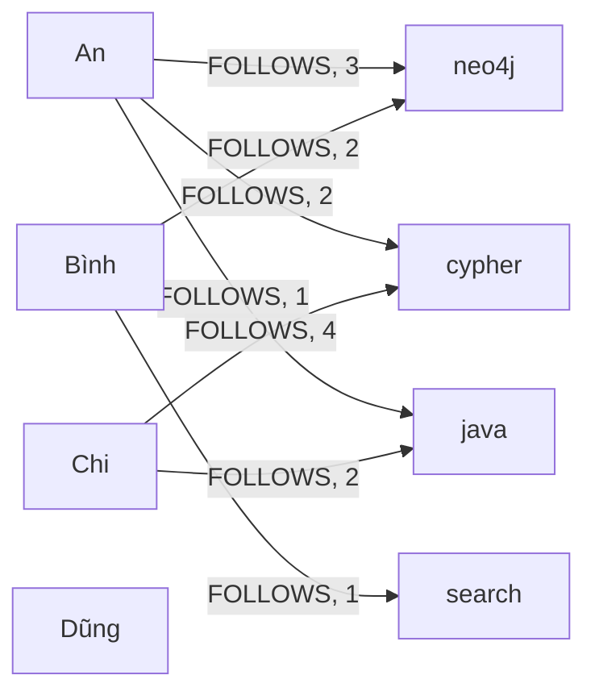

# Tiêu chí chọn APOC, Cypher thuần hoặc phần xử lý ở ứng dụng

## 1. Ba nơi có thể đặt logic xử lý dữ liệu đồ thị

Trong Neo4j, dữ liệu được tổ chức theo **property graph**: node mang nhãn và thuộc tính, relationship có loại, hướng và thuộc tính. Để giải một yêu cầu như tìm người có cùng sở thích, chuẩn hóa dữ liệu, cập nhật hàng loạt hoặc gọi hệ thống bên ngoài, nhóm phát triển thường có ba lựa chọn:

1. **Cypher thuần:** dùng `MATCH`, `WHERE`, `WITH`, `UNWIND`, `MERGE`, biểu thức, hàm và subquery do Neo4j cung cấp.
2. **APOC:** dùng các hàm (*functions*) hoặc thủ tục (*procedures*) của thư viện mở rộng *Awesome Procedures On Cypher* để thực hiện những thao tác bổ sung.
3. **Ứng dụng:** dùng Java Driver, Spring Data Neo4j hoặc một dịch vụ khác để xử lý thuật toán, tích hợp API, kiểm soát workflow, rồi gửi Cypher có tham số tới Neo4j.

**Không có lựa chọn nào mặc định tốt nhất.** Quyết định phụ thuộc ý nghĩa nghiệp vụ, nơi đặt ranh giới giao dịch, khối lượng dữ liệu cần truyền, khả năng tối ưu của planner, chi phí vận hành và những gì môi trường Neo4j cho phép.

Đây là nội dung của chương **APOC và phần mở rộng** trong module `DATABASE_ENGINE_GRAPH_NEO4J`. Nó gắn với truy vấn quan hệ/đường đi, index, constraint, nhập dữ liệu, tối ưu Cypher, Java Driver, Spring Data Neo4j và vận hành hệ thống đồ thị.

### Mục tiêu học tập

Sau bài học, bạn có thể:

- Phân biệt năng lực của Cypher, APOC Core/APOC Extended và ứng dụng.
- Chọn vị trí xử lý dựa trên **độ đúng, tính di động, khả năng quan sát, giao dịch, tải và bảo mật**.
- So sánh hai cách tìm người có chung sở thích bằng `MATCH` và `apoc.path.expandConfig`.
- Đánh giá khi nào sử dụng `CALL { ... } IN TRANSACTIONS` hoặc `apoc.periodic.iterate` cho cập nhật hàng loạt.
- Tạo một phép thử A/B và giải thích vì sao số dòng, `DB Hits`, độ trễ và chi phí tài nguyên đều quan trọng.

## 2. Những năng lực cốt lõi và giới hạn

| Khía cạnh | Cypher thuần | APOC | Phần xử lý ở ứng dụng |
|---|---|---|---|
| **Truy vấn graph** | Mạnh với pattern, lọc, đường đi và tổng hợp | Bổ sung cấu hình duyệt, thao tác cấu trúc, tiện ích chuyên dụng | Kết hợp nhiều truy vấn hoặc thuật toán riêng |
| **Tối ưu truy vấn** | Planner nhìn được pattern/index và lập kế hoạch | Một số procedure che chi tiết nội bộ khỏi plan Cypher | Ứng dụng phải tự quản số round-trip và dữ liệu trung gian |
| **Thao tác nhiều node trong giao dịch** | `MERGE`, `SET`, `DELETE` và subquery | Một số procedure hỗ trợ batch/transaction riêng | Driver quản lý transaction và retry |
| **Tích hợp HTTP/file/hệ ngoài** | Không phải mục tiêu chính của truy vấn graph | Một số thủ tục có khả năng nạp/xuất nếu môi trường cho phép | Phù hợp cho xác thực, rate limit, retry và adapter hệ thống |
| **Cài đặt/phụ thuộc** | Có sẵn theo phiên bản Neo4j/Cypher | Cần procedure/function được cài và cấp quyền | Phụ thuộc build, runtime và thư viện ứng dụng |
| **Khả năng thử nghiệm** | Dễ so kết quả bằng fixture và `PROFILE` | Cần kiểm tra behavior/config và đo thêm trong DB | Dễ unit test, contract test, mock API và trace |
| **Chi phí truyền dữ liệu** | Xử lý gần dữ liệu | Xử lý gần dữ liệu | Có thể tốn mạng khi tải nhiều dòng ra ngoài |

**Nguyên tắc đặt logic:** phần nào cần duyệt và kết hợp nhiều relationship với tính nhất quán trong cùng giao dịch thường nên được thử bằng Cypher trước. Phần tích hợp dịch vụ ngoài, quản lý chính sách nghiệp vụ phức tạp hoặc tính toán không phù hợp với query language thường dễ kiểm soát hơn tại ứng dụng. APOC hữu ích khi cung cấp một năng lực cụ thể, đã xác minh có mặt và mang lợi ích rõ ràng.

### 2.1. APOC Core và APOC Extended

APOC là tập hợp **nhiều hàm và procedure**, không phải một toán tử Cypher duy nhất. Tùy phiên bản Neo4j và cách phân phối, chúng được chia thành **APOC Core** và **APOC Extended**, với tập tính năng, cách cài đặt và mức hỗ trợ khác nhau. Không suy rằng một procedure có trong tài liệu trực tuyến sẽ chạy được trên Neo4j Aura, container hoặc cụm đang sử dụng.

Trước khi quyết định chọn APOC, phải xác nhận:

1. Phiên bản Neo4j và bản APOC tương thích; kiểm tra tài liệu tương ứng với **phiên bản chạy thực tế**.
2. Procedure/function có được triển khai và hiển thị hay không.
3. Tài khoản ứng dụng có quyền thực thi thích hợp, và cấu hình bảo mật có cho phép tính năng đó hay không.
4. Môi trường quản lý (chẳng hạn dịch vụ đám mây) có cho phép procedure cụ thể không; đừng mặc định có quyền cài plugin tùy ý.
5. Tính năng có khả năng bị thay thế bởi Cypher mới ở phiên bản Neo4j đang dùng hay không.

Các câu lệnh chỉ đọc để kiểm tra khả dụng:

```cypher
SHOW PROCEDURES
YIELD name
WHERE name STARTS WITH 'apoc.'
RETURN name
ORDER BY name
LIMIT 50;
```

```cypher
SHOW FUNCTIONS
YIELD name
WHERE name STARTS WITH 'apoc.'
RETURN name
ORDER BY name
LIMIT 50;
```

Kiểm tra riêng những năng lực sẽ dùng trong bài:

```cypher
SHOW PROCEDURES
YIELD name
WHERE name IN ['apoc.path.expandConfig', 'apoc.periodic.iterate']
RETURN name
ORDER BY name;
```

Nếu không thấy tên procedure cần dùng, **không tiếp tục gọi giả định rằng nó đã cài**. Việc nâng cấp Neo4j, cấu hình plugin và phân quyền thuộc quy trình vận hành, không phải nhiệm vụ của một câu truy vấn nghiệp vụ.

## 3. Bộ dữ liệu minh họa có thể kiểm chứng

Ta xây một đồ thị nhỏ về thành viên theo dõi chủ đề:



`AP009Member`, `AP009Topic` và `AP009_FOLLOWS` là nhãn/quan hệ riêng của bài. Các đoạn dưới đây dùng `MERGE` và chạy trong **database thử nghiệm**; không tự động xóa dữ liệu đang có ở hệ thống khác.

### 3.1. Tạo constraint định danh

```cypher
CREATE CONSTRAINT ap009_member_id IF NOT EXISTS
FOR (m:AP009Member)
REQUIRE m.id IS UNIQUE;
```

```cypher
CREATE CONSTRAINT ap009_topic_slug IF NOT EXISTS
FOR (t:AP009Topic)
REQUIRE t.slug IS UNIQUE;
```

Constraint bảo vệ tính duy nhất của thuộc tính có giá trị; ứng dụng vẫn cần xác thực ID hợp lệ và không null. Nếu đã tồn tại dữ liệu trùng, phải xử lý trước khi tạo constraint.

### 3.2. Tạo node và relationship

```cypher
UNWIND [
  {id: 'an', name: 'An'},
  {id: 'binh', name: 'Bình'},
  {id: 'chi', name: 'Chi'},
  {id: 'dung', name: 'Dũng'}
] AS row
MERGE (m:AP009Member {id: row.id})
SET m.name = row.name;
```

```cypher
UNWIND ['neo4j', 'cypher', 'java', 'search'] AS slug
MERGE (:AP009Topic {slug: slug});
```

```cypher
UNWIND [
  {member: 'an', topic: 'neo4j', weight: 3},
  {member: 'an', topic: 'cypher', weight: 2},
  {member: 'an', topic: 'java', weight: 1},
  {member: 'binh', topic: 'neo4j', weight: 2},
  {member: 'binh', topic: 'search', weight: 1},
  {member: 'chi', topic: 'cypher', weight: 4},
  {member: 'chi', topic: 'java', weight: 2}
] AS row
MATCH (m:AP009Member {id: row.member})
MATCH (t:AP009Topic {slug: row.topic})
MERGE (m)-[f:AP009_FOLLOWS]->(t)
SET f.weight = row.weight;
```

Kiểm tra một dòng cho mỗi thành viên, kể cả Dũng không theo dõi chủ đề nào:

```cypher
MATCH (m:AP009Member)
OPTIONAL MATCH (m)-[f:AP009_FOLLOWS]->(t:AP009Topic)
WITH m, count(t) AS topicCount,
     sum(coalesce(f.weight, 0)) AS totalWeight,
     collect(DISTINCT t.slug) AS topics
RETURN m.id AS memberId, topicCount, totalWeight, topics
ORDER BY memberId;
```

| memberId | topicCount | totalWeight | topics (không bảo đảm thứ tự) |
|---|---:|---:|---|
| `an` | 3 | 6 | `neo4j, cypher, java` |
| `binh` | 2 | 3 | `neo4j, search` |
| `chi` | 2 | 6 | `cypher, java` |
| `dung` | 0 | 0 | `[]` |

`collect()` không bảo đảm thứ tự nếu không sắp xếp trước. **Bài toán kế tiếp:** tìm những thành viên khác có **ít nhất một chủ đề chung với An**, trả mỗi người đúng một lần và sắp theo ID.

## 4. Lựa chọn 1: Cypher thuần cho pattern rõ ràng

Một giải pháp trực tiếp cho bài toán trên:

```cypher
MATCH (m:AP009Member {id: 'an'})
      -[:AP009_FOLLOWS]->(topic:AP009Topic)
      <-[:AP009_FOLLOWS]-(other:AP009Member)
WHERE other <> m
RETURN DISTINCT other.id AS memberId
ORDER BY memberId;
```

**Kết quả kỳ vọng:** `binh` và `chi`. Bình chung `neo4j` với An; Chi chung `cypher` và `java`. `DISTINCT` loại dòng trùng từ nhiều đường đi đến cùng thành viên.

Ưu điểm của cách viết này:

- Pattern, hướng relationship và điều kiện lọc hiển thị ngay trong câu Cypher, dễ review.
- Neo4j planner có thể xét **index** trên `m.id` và thứ tự mở rộng quan hệ; dùng `EXPLAIN`/`PROFILE` để xem leaf index/scan, `Expand`, `Rows`, `DB Hits`.
- Câu truy vấn hoạt động không phụ thuộc vào thủ tục mở rộng, miễn là phiên bản Neo4j hỗ trợ cú pháp Cypher được dùng.
- Có thể chạy trong transaction của Java Driver, bảo đảm đọc các quan hệ theo semantics của cơ sở dữ liệu trong transaction đó.

Khi query đơn giản và hiệu năng đạt yêu cầu, **không cần thêm APOC chỉ để giảm số dòng mã**.

### 4.1. Đếm số chủ đề chung thay vì chỉ liệt kê ID

```cypher
MATCH (m:AP009Member {id: 'an'})
      -[:AP009_FOLLOWS]->(topic:AP009Topic)
      <-[:AP009_FOLLOWS]-(other:AP009Member)
WHERE other <> m
RETURN other.id AS memberId,
       count(DISTINCT topic) AS sharedTopics
ORDER BY sharedTopics DESC, memberId;
```

Kết quả: `chi = 2`, `binh = 1`. Đây là ví dụ logic graph kết hợp tổng hợp phù hợp với Cypher. Với dữ liệu lớn, cần kiểm tra cardinality của thành viên có bậc quan hệ cao; bắt đầu từ một member có hàng triệu cạnh có thể rất khác với fixture.

## 5. Lựa chọn 2: APOC khi cần cấu hình duyệt chuyên sâu

APOC có procedure `apoc.path.expandConfig` hỗ trợ những tùy chọn duyệt như giới hạn mức sâu, hướng/loại relationship được phép đi qua, uniqueness, danh sách node cho phép/chặn và một số cơ chế kết thúc. Các tùy chọn cụ thể phụ thuộc phiên bản APOC; luôn kiểm tra tài liệu của bản đã cài.

Để mô phỏng đường đi `Member → Topic → Member`, dùng cấu hình:

```cypher
MATCH (m:AP009Member {id: 'an'})
CALL apoc.path.expandConfig(m, {
  relationshipFilter: 'AP009_FOLLOWS>|<AP009_FOLLOWS',
  minLevel: 2,
  maxLevel: 2,
  uniqueness: 'NODE_PATH',
  bfs: true
})
YIELD path
WITH m, last(nodes(path)) AS other
WHERE other:AP009Member AND other <> m
RETURN DISTINCT other.id AS memberId
ORDER BY memberId;
```

Khi procedure tồn tại và tương thích, **kết quả mong đợi trên fixture** vẫn là `binh`, `chi`. Tại mỗi cạnh, bộ lọc `AP009_FOLLOWS>` cho phép đi xuôi quan hệ, còn `<AP009_FOLLOWS` cho phép đi ngược; trên mẫu hai hop hiện tại, các node chỉ có hướng quan hệ tương ứng nên đường đi hình thành đúng mẫu thành viên–chủ đề–thành viên.

**Cảnh báo ngữ nghĩa:** `uniqueness: 'NODE_PATH'` yêu cầu không lặp node **trên cùng đường đi**. Các kiểu uniqueness khác của APOC như `NODE_GLOBAL` có thể làm thay đổi số đường đi, đặc biệt khi có nhiều lối đi đến cùng node. Một câu Cypher variable-length path cũng có quy tắc uniqueness theo relationship riêng. Vì vậy không so sánh kết quả **đếm đường đi** của hai cách trước khi đã đồng nhất định nghĩa đường đi và uniqueness.

### 5.1. Khi nào APOC path traversal đáng dùng?

APOC có thể phù hợp nếu yêu cầu thực sự bao gồm:

- Chỉ duyệt qua một tập **loại relationship/hướng** được quy định động theo cấu hình tin cậy.
- Quy tắc không lặp node theo một chiến lược uniqueness xác định.
- Giới hạn đường đi, node cuối, node cho phép/chặn hoặc cách kết thúc/phát kết quả phức tạp.
- Một pipeline đã sử dụng APOC và cần tái sử dụng quy trình traversal đã được benchmark, kiểm thử trên version cố định.

Ngược lại, với đường đi hai hop rõ ràng `Member → Topic → Member`, Cypher trực tiếp thường **dễ audit hơn**, có khả năng tận dụng planner rõ hơn và không thêm phụ thuộc extension.

### 5.2. Cái giá của một procedure khi phân tích kế hoạch

Kiểm tra phiên bản Cypher:

```cypher
EXPLAIN
MATCH (m:AP009Member {id: 'an'})
      -[:AP009_FOLLOWS]->(:AP009Topic)
      <-[:AP009_FOLLOWS]-(other:AP009Member)
WHERE other <> m
RETURN DISTINCT other.id AS memberId;
```

Với bản APOC:

```cypher
EXPLAIN
MATCH (m:AP009Member {id: 'an'})
CALL apoc.path.expandConfig(m, {
  relationshipFilter: 'AP009_FOLLOWS>|<AP009_FOLLOWS',
  minLevel: 2,
  maxLevel: 2,
  uniqueness: 'NODE_PATH'
})
YIELD path
RETURN path;
```

Đầu ra kế hoạch có thể hiển thị `ProcedureCall` cho APOC, nhưng **không nhất thiết bóc tách từng bước duyệt nội bộ như pattern Cypher**. Không nên coi số `DB Hits` hiển thị bên ngoài procedure là toàn bộ chi phí CPU/bộ nhớ của nó. Cần đo thêm latency thực tế, page cache và tài nguyên hệ thống ở dữ liệu đại diện.

## 6. Lựa chọn 3: xử lý tại ứng dụng Java

Ứng dụng phù hợp khi cần thực thi logic nằm **ngoài ranh giới của một truy vấn đồ thị**, chẳng hạn:

- Gọi API CRM/ERP có OAuth, token, rate limit, timeout, circuit breaker hoặc retry.
- Chuẩn hóa ngôn ngữ, kiểm tra dữ liệu phức tạp bằng thư viện Java, xác thực schema và kiểm soát phiên bản message.
- Ghép kết quả Neo4j với Elasticsearch, dịch vụ ML, cache hay một nguồn dữ liệu không nằm trong cùng transaction.
- Giải thuật CPU chuyên biệt hoặc workflow nhiều bước cần log, trace, kiểm thử độc lập.
- Quy tắc phân quyền/ẩn dữ liệu do tầng dịch vụ thực thi trước khi trả kết quả cho client.

Tuy nhiên, **đẩy toàn bộ graph sang Java chỉ để nối hai cạnh** thường gây overhead: nhiều round-trip, truyền dữ liệu qua mạng, bộ nhớ ứng dụng tăng và mất khả năng để planner tối ưu việc lọc/join tại Neo4j.

Ví dụ Java Driver dùng chính truy vấn Cypher thuần của mục 4:

```java
import java.util.Map;
import org.neo4j.driver.Driver;

public class SharedTopics {
    private final Driver driver;

    public SharedTopics(Driver driver) {
        this.driver = driver;
    }

    public java.util.List<String> findPeople(String memberId) {
        String cypher = """
            MATCH (m:AP009Member {id: $memberId})
                  -[:AP009_FOLLOWS]->(:AP009Topic)
                  <-[:AP009_FOLLOWS]-(other:AP009Member)
            WHERE other <> m
            RETURN DISTINCT other.id AS memberId
            ORDER BY memberId
            """;

        try (var session = driver.session()) {
            return session.executeRead(tx ->
                tx.run(cypher, Map.of("memberId", memberId))
                  .list(row -> row.get("memberId").asString())
            );
        }
    }
}
```

Điểm quan trọng: ứng dụng **điều phối và định dạng kết quả**, trong khi phép duyệt graph vẫn được giao cho Cypher ở Neo4j. `$memberId` là tham số; không nối chuỗi do người dùng nhập để tạo cú pháp truy vấn động.

### 6.1. Ví dụ logic nhỏ: không dùng extension chỉ vì có sẵn

Nối hai từ bằng dấu gạch ngang là việc nhỏ; có thể xử lý ở nhiều nơi:

```cypher
RETURN reduce(
  acc = '',
  word IN ['neo4j', 'cypher'] |
  CASE WHEN acc = '' THEN word ELSE acc + '-' + word END
) AS joined;
```

Nếu môi trường có hàm APOC tương ứng:

```cypher
RETURN apoc.text.join(['neo4j', 'cypher'], '-') AS joined;
```

Hoặc Java:

```java
String joined = String.join("-", java.util.List.of("neo4j", "cypher"));
```

Cả ba cách trả `neo4j-cypher`. Nếu chỉ cần định dạng đầu ra HTTP, Java thường là vị trí tự nhiên; nếu định dạng một giá trị ngay trong truy vấn và không cần plugin, Cypher thuần có thể đủ. Việc có hàm APOC **không tự tạo ra lý do để phụ thuộc vào APOC**.

## 7. Xử lý dữ liệu hàng loạt: native batching hay APOC?

Một nhu cầu phổ biến là cập nhật nhiều node mà không giữ một transaction khổng lồ. Có thể sử dụng `CALL { ... } IN TRANSACTIONS` của Cypher hoặc một procedure APOC như `apoc.periodic.iterate`. **Hai cách có thể có khác biệt về cách phân batch, retry, lỗi và ranh giới giao dịch**; chọn dựa trên hợp đồng vận hành.

Giả sử cần đánh dấu thời điểm kiểm tra gần nhất của các node `AP009Member` chưa có thuộc tính `lastAuditedAt`. Dữ liệu mẫu chỉ có bốn node; kích thước batch `2` nhằm quan sát số batch, không phải khuyến nghị cho sản xuất.

### 7.1. Cypher thuần: CALL ... IN TRANSACTIONS

Ví dụ với cú pháp import biến `CALL (m) { ... }` của Neo4j 5.23 trở lên:

```cypher
MATCH (m:AP009Member)
WHERE m.lastAuditedAt IS NULL
CALL (m) {
  SET m.lastAuditedAt = datetime()
} IN TRANSACTIONS OF 2 ROWS;
```

Với bộ dữ liệu mẫu ban đầu, lệnh cập nhật bốn thành viên thành hai batch; chạy lại sẽ không tìm được node chưa được đánh dấu. Khi dùng môi trường Neo4j cũ hơn, kiểm tra cú pháp import biến mà phiên bản đó hỗ trợ.

**Ranh giới transaction quan trọng:** `CALL { ... } IN TRANSACTIONS` phải chạy trong **implicit transaction** thích hợp; không nhúng trực tiếp lệnh này vào managed/explicit transaction mà Java Driver đã mở sẵn rồi kỳ vọng nó tự commit từng batch.

### 7.2. APOC: apoc.periodic.iterate

Để so sánh trên đúng tập dữ liệu, **chỉ trong database thực hành**, đặt lại trạng thái trước khi chạy biến thể APOC:

```cypher
MATCH (m:AP009Member)
REMOVE m.lastAuditedAt;
```

Nếu đã xác minh procedure `apoc.periodic.iterate` có mặt:

```cypher
CALL apoc.periodic.iterate(
  'MATCH (m:AP009Member)
   WHERE m.lastAuditedAt IS NULL
   RETURN m',
  'SET m.lastAuditedAt = datetime()',
  {batchSize: 2, parallel: false}
)
YIELD batches, total, failedBatches, errorMessages
RETURN batches, total, failedBatches, errorMessages;
```

Đầu ra kỳ vọng cho lần chạy đầu trên fixture: `total = 4`, `batches = 2`, `failedBatches = 0`. Nếu chạy lần hai khi tất cả node đã được cập nhật, `total = 0`. Kết quả chính xác còn phụ thuộc trạng thái dữ liệu và phiên bản APOC.

Procedure này chia dữ liệu thành batch và thực thi thao tác cập nhật; số batch đã commit có thể tồn tại **dù batch khác thất bại**. Không coi nó là một transaction nguyên tử cho toàn bộ tập bản ghi. Khi xử lý quan hệ phụ thuộc, có cùng khóa hoặc có thể bị lock contention, bắt đầu với `parallel: false` và chỉ thử song song sau khi đã hiểu cơ chế tranh chấp.

### 7.3. Tiêu chí chọn giữa hai cách

| Câu hỏi | Native `IN TRANSACTIONS` | APOC `periodic.iterate` |
|---|---|---|
| Muốn tránh phụ thuộc plugin | Phù hợp | Cần APOC khả dụng |
| Đã có Cypher SELECT và UPDATE rõ ràng | Phù hợp | Cũng phù hợp |
| Cần cấu hình batch/parallel/retry riêng của procedure | Phụ thuộc tính năng phiên bản Neo4j | Có lựa chọn cấu hình của procedure; cần đọc docs theo version |
| Truy vấn được gọi trong Java managed transaction | Phải thiết kế lại ranh giới transaction | Cũng phải xem procedure tự tạo transaction; không coi là phần ghi đơn giản trong một transaction ngoài |
| Cần rollback toàn bộ hàng triệu bản ghi khi lỗi | Không có atomicity cho tất cả batch | Không có atomicity cho tất cả batch |
| Cần logging/giám sát lỗi từng batch | Kết hợp driver/orchestration và số liệu query | Dùng các trường kết quả procedure và hệ thống giám sát |

Khi xử lý nhiều đơn hàng/khách hàng, hãy cân nhắc **idempotency** và **checkpoint**: nếu một batch đã commit mà caller bị mất kết nối, chạy lại không được tạo bản ghi trùng hoặc làm sai phiên bản. `MERGE` theo khóa ổn định và version guard là những thành phần thường cần thêm, không phải lợi ích tự động từ APOC hay `IN TRANSACTIONS`.

## 8. Những tiêu chí ra quyết định cần được kiểm chứng

### 8.1. Tính đúng đắn và ngữ nghĩa

Định nghĩa trước: một dòng kết quả đại diện điều gì, có được phép lặp node/relationship trên đường đi không, có giữ node không khớp không, cập nhật thuộc tính có ghi đè khóa nguồn không? Chỉ có thể so tốc độ sau khi chứng minh **hai phương án trả cùng kết quả nghiệp vụ**.

Một truy vấn kiểm tra dữ liệu mẫu:

```cypher
MATCH (m:AP009Member)
OPTIONAL MATCH (m)-[f:AP009_FOLLOWS]->(t:AP009Topic)
WITH m, count(DISTINCT t) AS topicCount,
     sum(coalesce(f.weight, 0)) AS totalWeight
WITH collect({
  id: m.id,
  count: topicCount,
  weight: totalWeight
}) AS actual
RETURN size(actual) = 4
  AND any(x IN actual WHERE x.id = 'an' AND x.count = 3 AND x.weight = 6)
  AND any(x IN actual WHERE x.id = 'binh' AND x.count = 2 AND x.weight = 3)
  AND any(x IN actual WHERE x.id = 'chi' AND x.count = 2 AND x.weight = 6)
  AND any(x IN actual WHERE x.id = 'dung' AND x.count = 0 AND x.weight = 0)
  AS passed;
```

Kỳ vọng `passed = true`. Đây là kiểm tra dữ liệu mẫu; để kiểm chứng Cypher và APOC tương đương, chạy **cả hai** phép tìm kiếm trên cùng snapshot và so tập ID sau `DISTINCT`. Với truy vấn tạo/cập nhật/xóa, kiểm tra thêm các thay đổi về property, relationship và khả năng phát lại lệnh.

### 8.2. Độ trễ, tài nguyên và vị trí xử lý

| Chỉ số | Ý nghĩa thực hành | Nguồn đo |
|---|---|---|
| `p50/p95/p99` | Độ trễ điển hình và nhóm yêu cầu chậm | Java Driver/API benchmark |
| `Rows`, `Estimated Rows` | Số dòng thực và ước lượng giữa các toán tử | `PROFILE` |
| `DB Hits` | Công việc truy cập storage engine | `PROFILE`; không đồng nhất với disk read |
| CPU, heap, GC, page cache | Áp lực trên Neo4j | Monitoring hệ thống/database |
| Số record truyền qua Bolt | Chi phí mạng và giải mã dữ liệu | Driver metrics/ứng dụng |
| Batch duration, failed batches | Chất lượng xử lý hàng loạt | Pipeline metrics/APOC output |
| Throughput và lỗi tại concurrency xác định | Khả năng phục vụ tải thật | Load test |

Với Cypher thuần, planner thường có thể nhìn thấy pattern và chọn index/đường duyệt. Với APOC, một phần logic có thể nằm **bên trong procedure**, nên số liệu của plan bên ngoài có thể chưa phản ánh đầy đủ hoạt động nội bộ. Với cách kéo nhiều node về Java, chi phí có thể chuyển từ database sang mạng và heap ứng dụng; không kết luận nhanh hơn chỉ vì `DB Hits` giảm.

### 8.3. Tính di động, version và khả năng vận hành

- **Cypher thuần** thường giảm phụ thuộc extension, nhưng syntax vẫn thay đổi giữa các phiên bản; không giả định câu Cypher mới chạy trên server cũ.
- **APOC** có thể yêu cầu cài đặt, nâng cấp tương ứng với Neo4j, cấu hình procedure, phân quyền và kiểm thử sau nâng cấp. Các procedure được thay thế hoặc ngừng khuyến nghị qua các đời sản phẩm cần được đánh giá lại.
- **Ứng dụng** dễ đóng gói logic thành thư viện/đơn vị kiểm thử, nhưng phải quản lý SDK, retry, timeout, connection pool, truyền dữ liệu và tính nhất quán giữa các hệ thống.
- **Aura/managed Neo4j** có thể cung cấp tập extension được quản lý: không chuyển kế hoạch dựa trên APOC từ self-managed sang managed mà chưa kiểm tra tính năng hiện có.

Nếu có thể đạt cùng kết quả/hiệu năng với khả năng duy trì tốt hơn, phương án **ít phụ thuộc vào điều kiện triển khai đặc biệt** thường có lợi về dài hạn.

### 8.4. Bảo mật và quyền truy cập

Mỗi nơi xử lý có bề mặt bảo mật khác nhau:

| Vấn đề | Quyết định cần làm |
|---|---|
| Procedure có thể đọc file/gọi URL | Giới hạn procedure được phép chạy và quyền thực tế; không mặc định cho phép I/O từ database |
| Query động theo dữ liệu người dùng | Truyền tham số, dùng danh sách nhãn/loại quan hệ được cho phép; không nối chuỗi Cypher tùy ý |
| API ngoài cần OAuth/mTLS | Ưu tiên ứng dụng/adaptor chuyên dụng có secret management |
| Trường dữ liệu nhạy cảm | Kiểm soát property trả về, masking, audit và quyền theo vai trò |
| Thuật toán tùy chỉnh trong database | Kiểm soát resource, timeout, giới hạn node/đường đi để tránh quá tải |

Ví dụ `apoc.load.json` và một số hàm nạp/xuất có thể làm việc với nguồn bên ngoài **khi** phiên bản, module và cấu hình cho phép. Không nên dùng chúng như một lối tắt để vượt qua chính sách mạng hoặc cơ chế xác thực API của tổ chức. Khi phải gọi dịch vụ có token và retry phức tạp, ứng dụng thường là nơi thích hợp hơn để quản lý quyền truy cập và quan sát lỗi.

## 9. Quy trình thử nghiệm A/B trước khi quyết định

Một cách lựa chọn có thể kiểm chứng, dùng được cho cả ba phương án:

1. **Viết hợp đồng đầu ra.** Với bài toán mẫu, trả `['binh', 'chi']`, sắp theo ID; các thành viên tự trỏ đến mình phải bị loại và người chung nhiều chủ đề chỉ xuất hiện một lần.
2. **Chụp trạng thái dữ liệu.** Ghi phiên bản Neo4j/APOC, index/constraint, số node/relationship, kiểu input, query tham số và môi trường tính toán.
3. **Đo Cypher thuần làm baseline.** `EXPLAIN` xác định điểm bắt đầu, `PROFILE` xem số dòng/DB Hits; ứng dụng đo latency khi đã tiêu thụ hết record.
4. **Đo APOC trên cùng snapshot.** Xác nhận procedure tồn tại, cấu hình uniqueness/min-max level phù hợp, so danh sách ID, rồi đo latency/CPU/heap.
5. **Đo biến thể ứng dụng.** Nếu có thuật toán Java, tính cả thời gian truyền record từ Neo4j, xử lý, mapping kết quả và retry; không chỉ đo thời gian CPU của Java.
6. **Chạy tải đại diện.** Lặp nhiều lần, có warm-up, tình huống input phổ biến/hiếm/không kết quả, concurrency thực tế và phân vị p50/p95/p99.
7. **Quyết định theo ngưỡng.** Cách nào đạt đúng kết quả, ngân sách độ trễ và giới hạn tài nguyên với chi phí bảo trì phù hợp thì chọn. Nếu chênh lệch không ổn định, giữ cách dễ hiểu và dễ vận hành.

### 9.1. Bảng kết quả giả định để luyện quyết định

Các số bên dưới **không phải benchmark thật** của Neo4j; chỉ minh họa cách ghi nhận đánh đổi khi xử lý cùng một loại bài toán:

| Phương án | Kết quả đúng? | p95 end-to-end | CPU/heap trong DB | Network/ứng dụng | Phụ thuộc vận hành |
|---|---|---:|---|---|---|
| Cypher thuần | Có | 24 ms | Thấp | Thấp | Neo4j/Cypher |
| APOC traversal | Có | 31 ms | Trung bình | Thấp | Procedure + version + quyền |
| Java tải graph rồi duyệt | Có | 92 ms | Thấp hơn ở DB | Cao | Driver + memory ứng dụng |

Ở kết quả giả định này, **Cypher thuần là lựa chọn hợp lý** cho truy vấn hai hop. Nếu yêu cầu đổi thành duyệt nhiều hop với cấu hình uniqueness, filter node và kết thúc traversal phức tạp, hãy thử APOC và đo lại: bảng này không đủ để quyết định cho bài toán khác.

### 9.2. Cách đọc EXPLAIN và PROFILE công bằng

Ví dụ đánh giá Cypher thuần:

```cypher
PROFILE
MATCH (m:AP009Member {id: 'an'})
      -[:AP009_FOLLOWS]->(:AP009Topic)
      <-[:AP009_FOLLOWS]-(other:AP009Member)
WHERE other <> m
RETURN DISTINCT other.id AS memberId
ORDER BY memberId;
```

Với APOC, dùng `PROFILE` cho câu truy vấn ở mục 5 (thêm từ khóa `PROFILE` trước `MATCH`), nhưng ghi nhớ procedure có thể giấu công việc bên trong. Đo **thời gian end-to-end từ ứng dụng** và CPU/memory của cả hệ thống cho cả hai. Không so số `DB Hits` mà bỏ qua CPU của APOC hoặc thời gian truyền dữ liệu.

## 10. Tình huống thực tế: chọn đúng nơi xử lý

| Yêu cầu | Phương án ưu tiên thử trước | Vì sao? | Khi nào đổi phương án? |
|---|---|---|---|
| Tìm kết nối hai hop, lọc theo nhãn và thuộc tính | Cypher | Pattern rõ, planner tối ưu, dễ `PROFILE` | Cần traversal nâng cao/giới hạn đường đi đặc thù |
| Đếm/tổng hợp theo relationship, lọc theo chỉ mục | Cypher | Dữ liệu không cần rời DB | Kết hợp quy tắc ngoài hệ thống hoặc CPU chuyên biệt |
| Tìm đường đi có whitelist/blacklist và quy tắc uniqueness đặc biệt | APOC hoặc Cypher nâng cao | APOC có cấu hình traversal phong phú | Cypher phiên bản hiện tại đã đáp ứng rõ và nhanh hơn |
| Backfill một thuộc tính cho hàng triệu node | Native `IN TRANSACTIONS` | Không cần plugin, giới hạn batch | APOC có tính năng batch phù hợp và đã được xác minh |
| Chuẩn hóa chuỗi đơn giản | Cypher hoặc Java | Thư viện phụ không cần thiết | APOC function giúp biểu đạt rõ và đã có sẵn |
| Di chuyển/gộp node và tái tạo liên kết phức tạp | Xem xét APOC refactor chuyên dụng | Tránh viết nhiều câu cập nhật graph tự chế | Cần điều kiện nghiệp vụ/kiểm soát từng trường chặt chẽ |
| Đọc API đối tác dùng OAuth và rate limit | Ứng dụng | Bảo mật, retry, timeout, trace | Có service ingest riêng đã được phê duyệt |
| Quy trình CDC với checkpoint, retry và dead-letter | Ứng dụng điều phối, Cypher ghi graph | Ranh giới giao dịch và trạng thái workflow rõ | Dùng APOC cho bước xử lý graph nội bộ cụ thể |
| Tính embedding/ML rồi ghi vector | Ứng dụng/dịch vụ ML + Cypher ghi dữ liệu | Model, GPU, versioning và batch ngoài DB | Nền tảng cung cấp tính năng in-DB phù hợp đã benchmark |

**Chú ý thay đổi phiên bản:** một số thao tác từng cần APOC (ví dụ nhãn/loại quan hệ động) có thể có cú pháp Cypher bản mới hỗ trợ. Trước khi chọn một procedure chỉ vì hướng dẫn cũ dùng nó, kiểm tra cú pháp và tính năng **Neo4j/Cypher phiên bản hiện tại** của hệ thống.

## 11. Các lỗi thiết kế thường gặp

### 11.1. Dùng APOC chỉ để thay thế một câu MATCH ngắn

Một phép duyệt hai hop đơn giản thường dễ đọc hơn khi viết pattern Cypher tường minh. Dùng procedure có nhiều tùy chọn có thể khiến reviewer khó chứng minh uniqueness, thứ tự, số dòng, chi phí.

### 11.2. Đẩy dữ liệu lớn sang ứng dụng để xử lý một phép join graph

Tải toàn bộ node/relationship ra Java, rồi dựng bản sao graph trong RAM cho mỗi request, có thể gây quá tải ứng dụng, mất khả năng dùng index và tăng network. Hãy giữ phép lọc/join gần dữ liệu, chỉ trả các cột và số bản ghi ứng dụng cần.

### 11.3. Tin rằng mọi procedure APOC có một transaction duy nhất

Một procedure đọc graph và một procedure batch tự tạo nhiều transaction có ranh giới khác nhau. Với `apoc.periodic.iterate`, batch đã commit có thể không rollback cùng batch thất bại. Cần quan sát `failedBatches`, tái xử lý idempotent và không lẫn offset nguồn với commit Neo4j.

### 11.4. So kết quả nhưng bỏ qua ngữ nghĩa đường đi

Hai phép duyệt có thể trả cùng tập node trong fixture nhỏ nhưng khác số đường đi khi có chu trình, cạnh song song, node trùng hoặc đường đi dài hơn. Muốn thay Cypher bằng APOC, phải kiểm chứng **cả hợp đồng uniqueness và giới hạn traversal**.

### 11.5. Coi APOC là năng lực mặc định của mọi môi trường

Lỗi `Unknown procedure/function` có thể do plugin chưa có, không tương thích, không được triển khai hoặc không đủ quyền. Quyết định dựa trên APOC phải có bước xác minh trong môi trường đích; không nên đưa vào code một procedure không có ở hạ tầng sản xuất.

### 11.6. Dùng query động cho đầu vào không đáng tin cậy

Không nối chuỗi nhận từ người dùng vào tên procedure, đoạn `MATCH`, `WHERE` hay lệnh APOC chạy Cypher động mà không kiểm soát. Với giá trị dữ liệu, dùng **tham số**; với nhãn/loại quan hệ động hoặc cấu trúc không thể tham số hóa trong phiên bản đang chạy, áp dụng allowlist cố định và kiểm tra hỗ trợ Cypher chính thức.

## 12. Bài tập tự luyện

1. **So kết quả:** chạy Cypher thuần và `apoc.path.expandConfig` để lấy các member chung sở thích với An. Dùng `DISTINCT`, sắp theo ID, giải thích vì sao Chi xuất hiện hai đường đi nhưng chỉ một dòng kết quả.
2. **Thay đổi uniqueness:** tạo thêm một node và một vòng quan hệ thử nghiệm; so kết quả theo đường đi với `NODE_PATH` và cấu hình uniqueness khác của APOC. Ghi rõ vì sao cardinality thay đổi.
3. **Đánh giá kế hoạch:** dùng `EXPLAIN`/`PROFILE` với Cypher và APOC. Ghi nhận operator truy cập index, rows, DB Hits; chỉ ra phần công việc procedure có thể không hiển thị chi tiết.
4. **So batch:** chạy `CALL ... IN TRANSACTIONS` và `apoc.periodic.iterate` trên fixture sau khi reset `lastAuditedAt`. Đọc `batches`, `total`, `failedBatches`; giải thích vì sao transaction theo batch không đồng nghĩa atomicity toàn bộ.
5. **Quyết định kiến trúc:** dịch vụ cần đọc REST API có OAuth, chuyển đổi dữ liệu, tạo node/relationship và ghi checkpoint. Phân tách rõ nhiệm vụ ở Java, Cypher, và chỉ ra có thật sự cần APOC hay không.
6. **Giới hạn môi trường:** giả sử triển khai lên managed Neo4j không hỗ trợ một procedure APOC đang dùng. Thiết kế phiên bản Cypher/app thay thế và kiểm tra tính tương đương bằng cùng golden dataset.
7. **Báo cáo benchmark:** đặt ngưỡng `p95 < 100 ms`, CPU không tăng quá 20%, kết quả đúng cho cả ca có chu trình. Tạo bảng A/B, chỉ chọn phương án sau khi có số liệu đủ mẫu.

**Tiêu chí hoàn thành:** giải thích được vì sao chọn Cypher cho một traversal đơn giản; chỉ ra trường hợp APOC mang năng lực rõ ràng hơn; phân biệt giao dịch batch với một transaction; định vị đúng trách nhiệm tích hợp hệ ngoài tại ứng dụng; và luôn xác minh kết quả, hiệu năng, quyền và version trước khi triển khai.

### Dọn dữ liệu thực hành

Chỉ thực hiện trong database thử nghiệm chứa dữ liệu `AP009`. Lệnh `DETACH DELETE` xóa cả relationship nối với node được xóa:

```cypher
MATCH (m:AP009Member)
DETACH DELETE m;
```

```cypher
MATCH (t:AP009Topic)
DETACH DELETE t;
```

```cypher
DROP CONSTRAINT ap009_member_id IF EXISTS;
```

```cypher
DROP CONSTRAINT ap009_topic_slug IF EXISTS;
```

## 13. Tài liệu để đối chiếu theo phiên bản triển khai

- [Neo4j APOC Documentation](https://neo4j.com/docs/apoc/current/): nhóm procedure/function, Core/Extended và điều kiện sử dụng.
- [Neo4j APOC — Path expander](https://neo4j.com/docs/apoc/current/overview/apoc.path/apoc.path.expandConfig/): cấu hình `relationshipFilter`, uniqueness, giới hạn mức sâu.
- [Neo4j APOC — Periodic iterate](https://neo4j.com/docs/apoc/current/overview/apoc.periodic/apoc.periodic.iterate/): batch, tùy chọn parallel và kết quả lỗi.
- [Neo4j Cypher Manual — Subqueries in transactions](https://neo4j.com/docs/cypher-manual/current/subqueries/subqueries-in-transactions/): `CALL { ... } IN TRANSACTIONS` và ranh giới giao dịch.
- [Neo4j Cypher Manual — Execution plans](https://neo4j.com/docs/cypher-manual/current/planning-and-tuning/execution-plans/): `EXPLAIN`, `PROFILE`, `Rows`, `DB Hits`.
- [Neo4j Java Driver Manual](https://neo4j.com/docs/java-manual/current/): transaction, tham số, retry và tiêu thụ kết quả.
