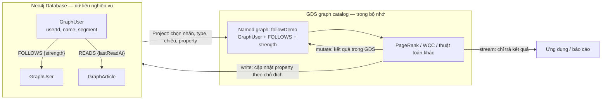
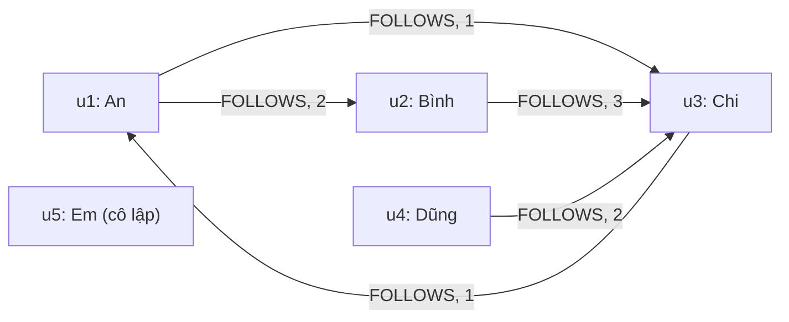
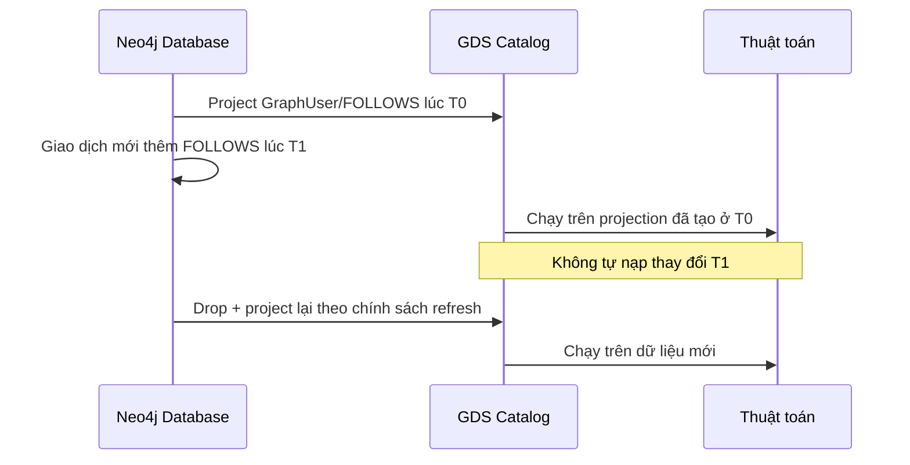
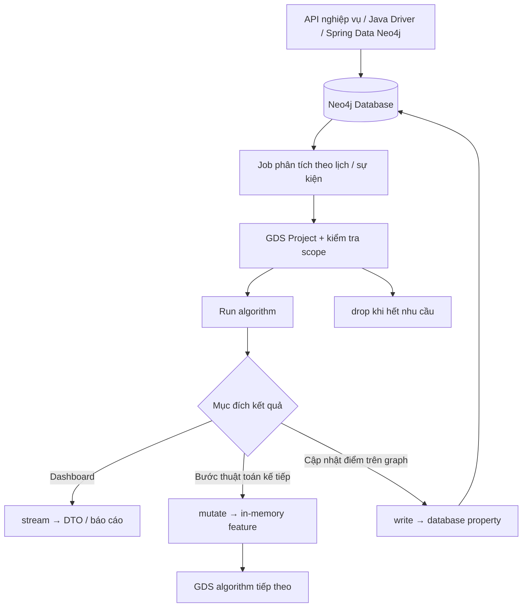

# Phân biệt dữ liệu nghiệp vụ trong Neo4j với đồ thị dùng để tính toán

## 1. Hai cách nhìn vào cùng một hệ thống đồ thị

Neo4j lưu dữ liệu ứng dụng theo mô hình **property graph**: node biểu diễn thực thể, relationship biểu diễn quan hệ, và property lưu thông tin của từng thực thể hoặc quan hệ. Ứng dụng dùng Cypher, **Neo4j Java Driver** hoặc **Spring Data Neo4j** để đọc, ghi và duy trì trạng thái nghiệp vụ trong các transaction.

Khi cần tính **PageRank, cộng đồng, thành phần liên thông, độ tương tự hoặc đường đi theo thuật toán**, ta thường dùng thư viện **Neo4j Graph Data Science (GDS)**. GDS có thể tạo một **graph projection**: biểu diễn đồ thị được **nạp vào bộ nhớ** để thuật toán xử lý hiệu quả. Projection chỉ lấy các node, relationship, chiều cạnh và property cần thiết từ nguồn. Nó không tự động trở thành «bản sao nghiệp vụ thứ hai» có giao dịch cập nhật đồng bộ với cơ sở dữ liệu.

Đây là bài đầu của chương **Thuật toán đồ thị** trong module `DATABASE_ENGINE_GRAPH_NEO4J`. Mục tiêu là hiểu đúng ranh giới giữa **đồ thị được lưu bền vững để phục vụ nghiệp vụ** và **đồ thị phục vụ tính toán**, trước khi lựa chọn thuật toán hoặc xây dựng pipeline phân tích.

Sau bài này, bạn có thể:

1. Phân biệt database property graph với **named graph projection** trong GDS.
2. Giải thích node/relationship/property nào đi vào projection và vì sao việc lựa chọn đó làm đổi ý nghĩa kết quả.
3. Thực hiện quy trình **project → inspect → estimate → stream/mutate/write → drop**.
4. Biết khi nào thuật toán **không ghi** vào database và khi nào nó **cố ý ghi kết quả**.
5. Nhận diện rủi ro dữ liệu không còn mới, chi phí bộ nhớ, sai chiều quan hệ và mất dấu định danh khi xuất kết quả.

> Các ví dụ GDS dưới đây sử dụng nhóm API thông dụng của **Neo4j Graph Data Science 2.x**. GDS là thành phần cần được cài đặt và cấp quyền phù hợp; các lệnh `gds.*` không mặc nhiên có trong mọi Neo4j Database. Kiểm tra phiên bản GDS, tài liệu và hỗ trợ môi trường thực tế trước khi chạy, nhất là khi sử dụng Aura hoặc hệ thống quản lý có hạn chế quyền.

## 2. Khái niệm nền tảng: graph nghiệp vụ khác graph tính toán

### 2.1. Dữ liệu nghiệp vụ lưu trong Neo4j Database

Ví dụ nền tảng cộng đồng có các node `:GraphUser`, `:GraphArticle` và các relationship `:FOLLOWS`, `:READS`:

```text
(u1:GraphUser {userId, name, segment})
    |
    +--[:FOLLOWS {strength}]->(u2:GraphUser)
    |
    +--[:READS {lastReadAt}]->(a1:GraphArticle {articleId, title})
```

Database phải lưu những thông tin ứng dụng cần duy trì:

- **Định danh nghiệp vụ**, chẳng hạn `userId` hoặc `articleId`, để tra cứu chính xác.
- **Thuộc tính nghiệp vụ** như tên hiển thị, phân khúc, thời gian đọc, trạng thái tài khoản.
- **Relationship thật** thể hiện các sự kiện hoặc quan hệ đã được hệ thống chấp nhận.
- **Constraint/index** để bảo vệ dữ liệu và tăng tốc truy vấn.
- **Transaction, quyền truy cập, backup** và cơ chế vận hành giúp dữ liệu tồn tại qua khởi động lại.

Đồ thị nghiệp vụ là **nguồn dữ liệu được quản lý**. Mỗi thao tác thêm/xóa node, đổi property hay tạo relationship cần tuân thủ quy tắc ứng dụng.

### 2.2. Graph projection trong bộ nhớ GDS

Một graph projection có thể chỉ giữ `GraphUser` và quan hệ `FOLLOWS`. Nó không cần node bài viết, quan hệ `READS` hay tên hiển thị nếu thuật toán chỉ cần cấu trúc theo dõi.



Tại thời điểm project, GDS dựng cấu trúc phù hợp với thuật toán, thường dùng định danh node nội bộ và biểu diễn quan hệ tối ưu cho các phép duyệt/tính song song. **Tên graph trong catalog** giúp gọi lại dữ liệu đã project mà không phải đọc lại toàn bộ database cho mỗi thuật toán.

### 2.3. Bảng phân biệt

| Tiêu chí | Đồ thị nghiệp vụ trong Neo4j | Named graph projection trong GDS |
| --- | --- | --- |
| Mục đích | Lưu trạng thái và quan hệ thực tế của ứng dụng | Cung cấp dữ liệu đầu vào cho thuật toán |
| Vị trí | Database được quản lý và lưu bền vững | Graph catalog trong bộ nhớ của GDS |
| Nội dung | Các node, relationship và property đã ghi | Tập con/biểu diễn được lựa chọn khi project |
| Thay đổi dữ liệu | `CREATE`, `MERGE`, `SET`, `DELETE` trong transaction | Tạo lại projection; hoặc `mutate` thêm kết quả vào graph GDS |
| Đồng bộ khi DB có thay đổi | Database là nơi thay đổi được commit | **Không tự làm mới** sau mỗi commit |
| Qua khởi động lại DBMS | Dữ liệu đã commit được lưu theo cơ chế bền vững | Named graph in-memory phải được tạo lại khi mất bộ nhớ/khởi động lại |
| Xóa graph | `DELETE`/`DETACH DELETE` có thể xóa dữ liệu thật | `gds.graph.drop` giải phóng graph projection, **không xóa node/relationship nghiệp vụ** |
| Dữ liệu trả cho client | Kết quả Cypher, record/DTO | Kết quả thuật toán; có thể dùng `stream`, `stats`, `mutate`, `write` |
| Quyền và vận hành | Quyền database, backup, transaction | Cần GDS và quyền dùng catalog/thuật toán; phải quản lý bộ nhớ và vòng đời projection |

**Điểm dễ nhầm:** Cả hai đều được gọi là «graph» nhưng không có nghĩa là hai database Neo4j độc lập. Graph projection GDS là **cấu trúc tính toán** được quản lý trong một graph catalog, không cung cấp cùng ngữ nghĩa lưu bền vững và cập nhật giao dịch như database nguồn.

## 3. Vì sao không cho thuật toán chạy trực tiếp lên toàn bộ graph nghiệp vụ?

Một hệ thống thật có thể chứa hàng triệu node thuộc nhiều loại: khách hàng, đơn hàng, sản phẩm, địa điểm, lịch sử sự kiện, thông tin phân quyền, các cạnh kỹ thuật và dữ liệu tạm.

Nếu bài toán là **đo mức ảnh hưởng giữa người dùng qua quan hệ theo dõi**, thuật toán PageRank thường chỉ cần:

- Các node người dùng đủ điều kiện phân tích.
- Relationship `FOLLOWS` theo đúng hướng.
- Property trọng số của relationship nếu sử dụng PageRank có trọng số.

Việc đưa thêm `READS`, `PURCHASED`, node đơn hàng hoặc lịch sử đăng nhập có thể làm **thay đổi đồ thị tính toán** và do đó thay đổi ý nghĩa của thuật toán. Không phải «thêm nhiều dữ liệu là luôn chính xác hơn».

Projection giúp:

1. **Định nghĩa phạm vi** theo đúng câu hỏi nghiệp vụ.
2. **Chọn hướng cạnh**: directed hay undirected.
3. **Chọn trọng số** cho thuật toán cần weighted relationship.
4. **Bỏ thuộc tính không phục vụ tính toán** để giảm bộ nhớ và nguy cơ đưa dữ liệu nhạy cảm vào pipeline phân tích.
5. **Tái sử dụng cấu trúc trong bộ nhớ** cho nhiều thuật toán liên tiếp.

Đổi lại, projection tốn bộ nhớ, cần thời gian tạo và **không tự cập nhật khi database nguồn thay đổi**.

## 4. Dữ liệu thực hành: một graph nghiệp vụ, một projection khác phạm vi

Các ví dụ dùng nhãn `GraphUser` và `GraphArticle` dành riêng cho thực hành. Giả sử có năm người dùng: An, Bình, Chi, Dũng và Em. Em chưa theo dõi ai và cũng chưa được ai theo dõi trong bộ dữ liệu mẫu.



### 4.1. Tạo node và relationship nghiệp vụ

Trước tiên tạo định danh duy nhất:

```cypher
CREATE CONSTRAINT graph_user_id_unique IF NOT EXISTS
FOR (u:GraphUser)
REQUIRE u.userId IS UNIQUE;

CREATE CONSTRAINT graph_article_id_unique IF NOT EXISTS
FOR (a:GraphArticle)
REQUIRE a.articleId IS UNIQUE;
```

Tạo năm người dùng:

```cypher
UNWIND [
  {userId: 'u1', name: 'An', segment: 'STANDARD'},
  {userId: 'u2', name: 'Bình', segment: 'STANDARD'},
  {userId: 'u3', name: 'Chi', segment: 'PREMIUM'},
  {userId: 'u4', name: 'Dũng', segment: 'STANDARD'},
  {userId: 'u5', name: 'Em', segment: 'PREMIUM'}
] AS row
MERGE (u:GraphUser {userId: row.userId})
SET u.name = row.name,
    u.segment = row.segment;
```

Tạo năm quan hệ theo dõi, mỗi quan hệ có trọng số `strength` là số dương:

```cypher
UNWIND [
  {source: 'u1', target: 'u2', strength: 2.0},
  {source: 'u1', target: 'u3', strength: 1.0},
  {source: 'u2', target: 'u3', strength: 3.0},
  {source: 'u3', target: 'u1', strength: 1.0},
  {source: 'u4', target: 'u3', strength: 2.0}
] AS edge
MATCH (source:GraphUser {userId: edge.source})
MATCH (target:GraphUser {userId: edge.target})
MERGE (source)-[r:FOLLOWS]->(target)
SET r.strength = edge.strength;
```

Tạo thêm thông tin nghiệp vụ **không cần cho thuật toán PageRank người dùng**:

```cypher
MERGE (a:GraphArticle {articleId: 'art01'})
SET a.title = 'Giới thiệu Neo4j';

MATCH (u:GraphUser {userId: 'u1'})
MATCH (a:GraphArticle {articleId: 'art01'})
MERGE (u)-[r:READS]->(a)
SET r.lastReadAt = datetime('2026-10-01T08:00:00Z');
```

Khi chạy trên database thực hành chưa có dữ liệu cũ với các nhãn trên, kết quả là **5 `GraphUser`, 1 `GraphArticle`, 5 cạnh `FOLLOWS` và 1 cạnh `READS`**.

Kiểm tra dữ liệu nghiệp vụ:

```cypher
MATCH (u:GraphUser)
RETURN u.userId, u.name, u.segment
ORDER BY u.userId;
```

```cypher
MATCH (a:GraphUser)-[r:FOLLOWS]->(b:GraphUser)
RETURN a.userId AS nguoiTheoDoi,
       b.userId AS nguoiDuocTheoDoi,
       r.strength AS mucDo
ORDER BY nguoiTheoDoi, nguoiDuocTheoDoi;
```

Đây là **truy vấn Cypher trên database**, chưa cần GDS. Chúng đọc trạng thái đã được lưu bền vững.

## 5. Tạo graph projection với GDS

### 5.1. Kiểm tra GDS có sẵn

```cypher
RETURN gds.version() AS gdsVersion;
```

Nếu GDS chưa được cài hoặc quyền thực thi bị hạn chế, bạn có thể gặp lỗi function/procedure không tồn tại hoặc lỗi quyền. Trong trường hợp đó, cần hoàn thành thiết lập GDS đúng phiên bản, không thể thay thế một thủ tục `gds.graph.project` bằng `MATCH` thông thường rồi kỳ vọng cùng khả năng tính toán in-memory.

### 5.2. Project các node, type và trọng số cần thiết

Với **GDS 2.x**, một cách project thông dụng từ database là:

```cypher
CALL gds.graph.project(
  'followDemo',
  'GraphUser',
  {
    FOLLOWS: {
      orientation: 'NATURAL',
      properties: 'strength'
    }
  }
)
YIELD graphName, nodeCount, relationshipCount
RETURN graphName, nodeCount, relationshipCount;
```

Ở đây:

- `'followDemo'`: tên **named graph** trong GDS catalog.
- `'GraphUser'`: chỉ project node có nhãn này; node `GraphArticle` không đi vào.
- `FOLLOWS`: chỉ project relationship thuộc type này; `READS` bị loại khỏi graph tính toán.
- `orientation: 'NATURAL'`: giữ chiều quan hệ có trong database, phù hợp PageRank theo hướng.
- `properties: 'strength'`: nạp thuộc tính trọng số của cạnh để thuật toán có thể sử dụng.

Với bộ dữ liệu mẫu, project dự kiến có **5 node và 5 relationship**. Node `u5` vẫn nằm trong projection dù không có cạnh, bởi ta project **toàn bộ node mang nhãn `GraphUser`**. Nếu dùng một cách project chỉ xuất phát từ các cặp node có quan hệ, các node cô lập như `u5` có thể bị bỏ sót; cần quyết định theo yêu cầu tính toán.

> GDS có nhiều phương án projection. Cú pháp **native projection** qua `gds.graph.project` và **Cypher projection** bằng hàm `gds.graph.project(...)` trong câu truy vấn Cypher có thể có khả năng lọc khác nhau tùy bản GDS. Một số API cũ đã được thay đổi hoặc đánh dấu deprecated. Hãy đối chiếu manual theo phiên bản đang chạy, đặc biệt nếu cần lọc điều kiện phức tạp trên node/relationship.

### 5.3. Project không copy toàn bộ property

Graph `followDemo` có thể sử dụng trọng số `strength`, nhưng điều đó **không có nghĩa** các trường `name`, `segment`, `lastReadAt` hoặc `title` cũng được project.

Nếu thuật toán cần một thuộc tính node, phải **khai báo node property tương ứng** ở bước projection và bảo đảm các giá trị có kiểu được thuật toán hỗ trợ. Đừng giả định thuật toán GDS tự nhìn thấy mọi property hiện có trong database.

Ví dụ, một thuật toán cần `segment` như một nhãn phân nhóm có thể phải mã hóa/biến đổi biến đầu vào hoặc dùng một thuật toán hỗ trợ kiểu thuộc tính đó. Không phải mọi property nghiệp vụ đều là đặc trưng tính toán phù hợp.

## 6. Kiểm tra graph trong catalog trước khi chạy thuật toán

### 6.1. Đọc số node và relationship

```cypher
CALL gds.graph.list('followDemo')
YIELD graphName, nodeCount, relationshipCount
RETURN graphName, nodeCount, relationshipCount;
```

Đây là thông tin về **graph projection**, không phải kết quả `MATCH` đếm toàn bộ database. Nếu lượng node/relationship khác dự tính, cần kiểm tra:

1. Nhãn node được project có đúng không?
2. Relationship type đã đúng phạm vi chưa?
3. Graph tính toán có chuyển chiều thành `UNDIRECTED` hoặc bỏ cạnh khi project không?
4. Có lọc mất node cô lập, node không có property cần thiết hoặc loại cạnh ngoài ý muốn không?
5. Dữ liệu database đã thay đổi kể từ khi projection được tạo chưa?

### 6.2. So sánh với database nguồn

```cypher
MATCH (u:GraphUser)
RETURN count(u) AS databaseUserCount;
```

```cypher
MATCH (:GraphUser)-[r:FOLLOWS]->(:GraphUser)
RETURN count(r) AS databaseFollowCount;
```

Ở thời điểm vừa tạo projection và chưa chỉnh sửa nguồn, hai số đếm này dự kiến tương ứng **5 node, 5 quan hệ**. Nhưng database còn chứa node bài viết và `READS`, nên `MATCH (n) RETURN count(n)` trên toàn database có thể lớn hơn nhiều.

**Không nên dùng `gds.graph.list` để suy ra toàn bộ dữ liệu đang lưu**. GDS catalog chỉ phản ánh những named graphs đã được tạo và còn tồn tại.

## 7. Chọn chiều quan hệ và trọng số trước khi thuật toán chạy

### 7.1. Hướng cạnh quyết định ngữ nghĩa

Với `(An)-[:FOLLOWS]->(Chi)`, hướng đọc nghiệp vụ là **An theo dõi Chi**. Nếu mục tiêu là phân tích ai được nhiều người quan tâm theo PageRank, hướng này thường có ý nghĩa: tín hiệu đi từ người theo dõi đến người được theo dõi.

Một số thuật toán xem quan hệ **không định hướng**, ví dụ phân tích thành phần liên thông yếu. Khi project với `orientation: 'UNDIRECTED'`, GDS có thể biểu diễn một quan hệ theo cả hai chiều phục vụ thuật toán. Điều đó **không tự tạo thêm relationship `FOLLOWS` ngược lại trong database**.

| Hướng trong projection | Ý nghĩa chính | Điều cần chú ý |
| --- | --- | --- |
| `NATURAL` | Giữ hướng của quan hệ nguồn | Phù hợp cho thuật toán cần hướng thực |
| `REVERSE` | Đảo hướng trong biểu diễn tính toán | Có thể cần cho bài toán lan truyền ngược |
| `UNDIRECTED` | Xét quan hệ theo hai chiều | Có thể làm thay đổi số cạnh được đếm trong projection và kết quả thuật toán |

Nếu một nghiệp vụ nói «bạn bè» vốn là quan hệ hai chiều, cần mô hình hóa và project phù hợp; không tự coi `FOLLOWS` là `FRIEND`.

### 7.2. Trọng số là quy tắc kinh doanh

Property `strength` ở ví dụ biểu thị mức độ liên hệ. Nếu chạy weighted PageRank, trọng số dương có thể ảnh hưởng cách truyền điểm qua các cạnh. Nếu bỏ qua trọng số, các cạnh được xử lý theo mô hình không trọng số của thuật toán.

Trước khi đưa dữ liệu vào tính toán, cần xác định:

- Giá trị `strength` được đo thế nào? Có cùng thang đo và cùng ý nghĩa giữa mọi quan hệ không?
- Giá trị có thiếu hoặc sai kiểu không? Thuật toán đang chạy có yêu cầu **trọng số số học** không?
- Thuật toán có chấp nhận `0`, số âm hoặc giá trị null không? Không suy đoán chung cho mọi thuật toán.
- Trọng số có đang phản ánh đúng câu hỏi phân tích? Trọng số cao không phải lúc nào cũng là quan hệ tích cực.

Đừng tùy tiện thay mọi giá trị bị thiếu bằng `1` nếu như điều đó có thể làm sai ý nghĩa kết quả. Hãy quyết định chính sách xử lý missing value ở bước chuẩn bị projection.

## 8. Chạy thuật toán theo chế độ `stream`: chỉ đọc kết quả

### 8.1. PageRank trên projection

```cypher
CALL gds.pageRank.stream(
  'followDemo',
  {
    maxIterations: 20,
    dampingFactor: 0.85,
    relationshipWeightProperty: 'strength'
  }
)
YIELD nodeId, score
WITH gds.util.asNode(nodeId) AS user, score
RETURN user.userId AS userId,
       user.name AS name,
       score AS pageRankScore
ORDER BY pageRankScore DESC, userId;
```

Các điểm cần đọc đúng:

- `gds.pageRank.stream` chạy PageRank **trên graph `followDemo`** đã project.
- `relationshipWeightProperty: 'strength'` yêu cầu thuật toán dùng property cạnh đã có trong projection.
- `nodeId` trong kết quả thuật toán cần được **ánh xạ** về node tương ứng khi muốn hiển thị định danh/người dùng nghiệp vụ.
- `gds.util.asNode(nodeId)` dùng để lấy lại node Neo4j tương ứng cho các node được project từ database bằng cách hỗ trợ ánh xạ đó.
- `stream` **trả kết quả cho truy vấn**, không tự thêm property `pageRankScore` vào node `GraphUser` trong database.

Không gán số PageRank kỳ vọng cố định: điểm phụ thuộc thuật toán, tham số, hướng cạnh, trọng số và tập node của projection. Ở ví dụ, `u3` nhận nhiều cạnh đi vào, nhưng kết luận về thứ tự điểm vẫn phải dựa trên kết quả thật.

### 8.2. Tính thành phần liên thông yếu

```cypher
CALL gds.wcc.stream('followDemo')
YIELD nodeId, componentId
WITH gds.util.asNode(nodeId) AS user, componentId
RETURN user.userId AS userId,
       componentId
ORDER BY componentId, userId;
```

Vì `u5` cô lập, nó thuộc một thành phần riêng so với nhóm các node `u1`–`u4` trong dữ liệu mẫu. `componentId` là **định danh kết quả thuật toán**, không phải khóa nghiệp vụ ổn định để đem lưu làm ID người dùng hay mã nhóm. Kết quả nhóm phụ thuộc đồ thị project, nên phải lưu cả thông tin phiên chạy nếu dùng để xây dựng báo cáo lịch sử.

### 8.3. Khi nào `stream` phù hợp?

`stream` thích hợp khi cần:

- Thử nghiệm thuật toán và tham số.
- Hiển thị kết quả trên dashboard hoặc xuất báo cáo.
- So sánh các kết quả trước khi quyết định ghi lại.
- Xử lý kết quả trong ứng dụng mà **không thay đổi dữ liệu nghiệp vụ**.

Nếu thuật toán trả rất nhiều dòng, ứng dụng cần phương án xử lý theo luồng và giới hạn dữ liệu đưa qua mạng. Đừng giả định chỉ thêm `LIMIT` ở cuối sẽ giảm toàn bộ lượng tính toán bên trong thuật toán GDS.

## 9. Phân biệt `stream`, `stats`, `mutate` và `write`

Đây là điểm quan trọng nhất khi nối pipeline tính toán với ứng dụng nghiệp vụ.

| Chế độ GDS | Dữ liệu đầu ra | Có thay database nguồn không? | Có làm đổi graph GDS không? |
| --- | --- | --- | --- |
| `stream` | Kết quả theo node/cạnh, trả về query | **Không**, nếu không có bước ghi bổ sung | Không |
| `stats` | Thống kê tổng hợp, không cần trả kết quả mỗi node | Không | Không |
| `mutate` | Kết quả tính toán được thêm thành **property/cạnh trong graph in-memory** nếu thuật toán hỗ trợ | **Không** | **Có** |
| `write` | Ghi kết quả thuật toán về property/relationship trong **Neo4j Database** nếu thuật toán hỗ trợ | **Có** | Không tự bảo đảm đồng bộ lại những projection đã có |

**Chú ý:** Không phải mọi thuật toán đều hỗ trợ cả bốn chế độ, và trường cấu hình/output có thể khác nhau. Hãy đọc tài liệu đúng thuật toán, đúng phiên bản. Chế độ `stats` thường được dùng để lấy thông tin phân bố/thống kê, không tương đương với việc stream mọi kết quả rồi `count(*)`.

### 9.1. `mutate` ghi vào graph GDS, không ghi vào Neo4j Database

```cypher
CALL gds.pageRank.mutate(
  'followDemo',
  {
    maxIterations: 20,
    dampingFactor: 0.85,
    relationshipWeightProperty: 'strength',
    mutateProperty: 'pageRankScore'
  }
)
YIELD nodePropertiesWritten
RETURN nodePropertiesWritten;
```

Sau đó có thể đọc property **trong projection**:

```cypher
CALL gds.graph.nodeProperties.stream(
  'followDemo',
  ['pageRankScore']
)
YIELD nodeId, nodeProperty, propertyValue
WITH gds.util.asNode(nodeId) AS user,
     nodeProperty,
     propertyValue
RETURN user.userId AS userId,
       nodeProperty,
       propertyValue
ORDER BY userId;
```

Nếu ngay sau `mutate` mà chạy:

```cypher
MATCH (u:GraphUser)
RETURN u.userId, u.pageRankScore
ORDER BY u.userId;
```

thì ở **database nguồn**, thuộc tính `pageRankScore` vẫn chưa được thuật toán `mutate` tạo ra. Nếu database ban đầu không có trường này, giá trị đọc là `null`. Kết quả `mutate` sống trong graph tính toán và có thể được dùng bởi bước GDS khác.

### 9.2. `write` chủ động ghi kết quả trở lại database

Khi đã xác nhận mục đích nghiệp vụ và tên property đích, có thể chạy:

```cypher
CALL gds.pageRank.write(
  'followDemo',
  {
    maxIterations: 20,
    dampingFactor: 0.85,
    relationshipWeightProperty: 'strength',
    writeProperty: 'computedPageRank'
  }
)
YIELD nodePropertiesWritten
RETURN nodePropertiesWritten;
```

Sau đó đọc trực tiếp từ database:

```cypher
MATCH (u:GraphUser)
RETURN u.userId AS userId,
       u.computedPageRank AS score
ORDER BY score DESC, userId;
```

Trong ví dụ, thuật toán ghi `computedPageRank` lên các node nghiệp vụ được ánh xạ từ projection. Đây là **thay đổi database thật** và cần cân nhắc quyền ghi, tên property, giao dịch, tải hệ thống và chính sách cập nhật.

**Không nên dùng `writeProperty: 'rank'` nếu `rank` đang có một ý nghĩa nghiệp vụ khác.** Nên đặt tên hoặc namespace rõ ràng như `computedPageRank`, kèm thông tin phiên bản thuật toán/dữ liệu và thời gian tính trong hệ thống metadata hoặc pipeline audit khi đưa vào sản xuất.

### 9.3. `mutate` và `write` không phải thao tác đồng bộ hai chiều

Nếu `mutate` tạo `pageRankScore` trong catalog rồi ứng dụng sửa `GraphUser` ở database, hai phía **không tự hợp nhất**. Nếu `write` thêm `computedPageRank` vào database, các named graph đã tạo từ trước **không tự nạp property mới**. Phải chủ động project lại hoặc dùng API phù hợp để tải property vào graph GDS nếu workflow yêu cầu.

## 10. Dữ liệu đổi theo thời gian: bài toán «snapshot» của projection

Giả sử sau khi tạo graph `followDemo`, ứng dụng thêm relationship:

```cypher
MATCH (a:GraphUser {userId: 'u5'})
MATCH (b:GraphUser {userId: 'u3'})
MERGE (a)-[r:FOLLOWS]->(b)
SET r.strength = 1.0;
```

Sau commit, `MATCH` trên database có thể thấy cạnh `u5 -> u3`. Nhưng `followDemo` đã nạp trước đó **không tự cập nhật relationship mới**. Nếu chạy PageRank/WCC trên projection cũ, thuật toán vẫn làm việc với **dữ liệu ở lần project trước**, nên `u5` có thể vẫn bị coi là cô lập.



Để bảo đảm kết quả phù hợp nhu cầu, cần chính sách làm mới:

- **Theo lô:** project lại mỗi giờ/ngày sau khi ETL hoàn tất.
- **Theo sự kiện:** khi các cập nhật quan trọng được commit, đưa graph vào trạng thái cần rebuild theo quy trình.
- **Theo yêu cầu:** tạo graph mới cho một lần phân tích có version/snapshot nguồn rõ ràng.

Chú ý **độ mới** và **tính nhất quán tại thời điểm project** là hai câu hỏi khác nhau. Một thao tác projection trên graph đang chịu nhiều giao dịch ghi đồng thời cần được đánh giá theo cơ chế đọc và phiên bản cụ thể, thay vì mặc định nó là snapshot tuyệt đối của toàn bộ database.

Trong môi trường cần tái lập kết quả, nên ghi lại ít nhất: **graphName, thời điểm project, phạm vi lọc, sơ đồ projected graph, cấu hình trọng số, phiên bản GDS, tên thuật toán, tham số và mã đợt dữ liệu nguồn**.

## 11. Graph catalog là tài nguyên vận hành

### 11.1. Graph projection tốn bộ nhớ

Một named graph có thể chứa hàng triệu node và hàng chục triệu relationship, cùng các property được project và các kết quả `mutate`. Bộ nhớ sử dụng phụ thuộc kiểu graph, topology, định dạng property, thuật toán và cấu hình GDS.

Trước khi project/chạy thuật toán trên dữ liệu lớn:

1. Chọn đúng nhãn và loại quan hệ; tránh project mọi thứ «cho chắc».
2. Chỉ nạp property thuật toán cần.
3. Xác định hướng cạnh phù hợp, vì cấu trúc `UNDIRECTED` có thể có chi phí khác `NATURAL`.
4. Dùng chức năng **memory estimation** của GDS nếu thuật toán và phiên bản hỗ trợ.
5. Kiểm tra giới hạn RAM và đồng thời nhiều graph/thuật toán trên môi trường chạy.

Ví dụ dự toán cho PageRank ở chế độ stream (cú pháp GDS 2.x; cần kiểm tra version):

```cypher
CALL gds.pageRank.stream.estimate(
  'followDemo',
  {
    relationshipWeightProperty: 'strength',
    maxIterations: 20
  }
)
YIELD nodeCount, relationshipCount, requiredMemory
RETURN nodeCount, relationshipCount, requiredMemory;
```

Ước lượng là công cụ lập kế hoạch; **không phải cam kết** mỗi lần chạy tiêu tốn đúng số byte đó. Việc có đủ RAM cho projection chưa chắc bảo đảm đủ RAM cho mọi thuật toán chạy đồng thời.

### 11.2. Dọn projection khi không còn dùng

```cypher
CALL gds.graph.drop('followDemo')
YIELD graphName
RETURN graphName;
```

Thao tác này xóa graph `followDemo` khỏi GDS catalog, giải phóng tài nguyên projection. Nó **không xóa** các node `GraphUser`, `GraphArticle`, các cạnh nghiệp vụ hay property `computedPageRank` đã được `write` vào database.

Sau `drop`, muốn chạy thuật toán trên `followDemo` phải project lại. Khi restart DBMS, graph in-memory cũng không được bảo đảm giữ nguyên; pipeline phải có bước tái tạo.

### 11.3. Môi trường cluster không mặc nhiên dùng chung một projection

Đừng coi named graph là tài nguyên được tự động đồng bộ và sao chép trên mọi thành viên của cluster giống dữ liệu nghiệp vụ. Graph catalog và bộ nhớ GDS gắn với môi trường chạy thuật toán và cơ chế quản lý của GDS. Nếu request được định tuyến đến thành viên khác, graph đã project ở nơi này có thể không có sẵn ở nơi kia.

Trong ứng dụng thực tế, cần xác định nơi **project**, nơi **chạy thuật toán**, nơi **ghi kết quả** và cơ chế retry/refresh phù hợp kiến trúc GDS đang sử dụng.

## 12. Định danh: đừng đánh đồng nodeId của thuật toán với ID nghiệp vụ

Trong Cypher thông thường, ứng dụng nên định danh người dùng bằng `userId` ổn định, chẳng hạn `'u3'`. Kết quả GDS thường trả `nodeId` đại diện cho node được project. Với graph được project từ database, `gds.util.asNode(nodeId)` có thể giúp lấy lại node nguồn:

```cypher
CALL gds.pageRank.stream('followDemo')
YIELD nodeId, score
WITH gds.util.asNode(nodeId) AS user, score
RETURN user.userId AS businessId,
       score;
```

**Không lưu `nodeId` như khóa nghiệp vụ vĩnh viễn.** Nó là định danh dùng cho quá trình tính toán/ánh xạ, không thay thế `userId` và không phải hợp đồng ổn định giữa các lần nhập, tái tạo graph hoặc môi trường khác nhau. Đặc biệt khi dùng **Cypher projection** hoặc tạo node ảo, cần kiểm tra cách ánh xạ ID và việc node nguồn có tồn tại hay không.

Kết quả được chuyển cho ứng dụng nên có **business key**, tên thuật toán, timestamp/version dữ liệu và metric cần dùng. Ví dụ một dòng có thể chứa:

```json
{
  "userId": "u3",
  "metric": "pageRank",
  "score": 1.234,
  "projection": "followDemo",
  "calculatedAt": "2026-11-25T00:00:00Z"
}
```

Giá trị `1.234` trong JSON chỉ là **minh họa cấu trúc dữ liệu**, không phải kết quả PageRank đã được tính từ bộ dữ liệu mẫu.

## 13. Khi nào chỉ dùng Cypher, khi nào dùng GDS?

| Nhu cầu | Công cụ thường phù hợp | Lý do |
| --- | --- | --- |
| Lấy hồ sơ một user theo `userId` | Cypher + index | Tra cứu nghiệp vụ trực tiếp, không cần projection |
| Tìm bạn bè trực tiếp hoặc đường đi tối đa vài hop | Cypher `MATCH` / mẫu đường đi | Phù hợp truy vấn trực tuyến theo cặp cụ thể |
| Tìm một đường đi ngắn nhất theo số hop giữa hai node | Cypher shortest-path phù hợp phiên bản | Có thể giải trong query, tránh tạo projection lớn chỉ cho một lần hỏi |
| Tính PageRank cho hàng triệu user theo chu kỳ | GDS PageRank | Tính toán toàn graph, có thể tái sử dụng projection |
| Phát hiện cộng đồng/connected components trên mạng lớn | GDS | Thuật toán chuyên dụng trên graph in-memory |
| Tính điểm similarity/embedding làm feature cho mô hình ML | GDS và pipeline feature | Kết quả cần được quản trị phiên bản, có thể dùng mutate/write |
| Ghi đơn hàng, quan hệ theo dõi hoặc cập nhật quyền | Cypher transaction | Đây là thay đổi nghiệp vụ cần bảo đảm nhất quán |

Việc chọn công cụ phụ thuộc **tần suất cập nhật, độ mới cần thiết, số node/relationship, giới hạn RAM và SLA**. Không nên dùng GDS để thay thế mọi query Cypher; cũng không nên bắt một query Cypher thông thường liệt kê mọi đường đi rồi tự viết thuật toán PageRank bằng phép `collect`.

## 14. Liên hệ Java Driver, Spring Data Neo4j và pipeline phân tích

Một pipeline ứng dụng điển hình:



### 14.1. Phân biệt transaction nghiệp vụ và job thuật toán

Một request ghi quan hệ `FOLLOWS` thường là transaction ngắn. Một job PageRank trên graph lớn có thể cần thời gian và bộ nhớ đáng kể. Không nên mở transaction ứng dụng dài chỉ để chờ việc project/tính toán hoàn tất.

Với Java Driver, application có thể:

- Gọi các truy vấn Cypher quản lý dữ liệu nghiệp vụ trong **managed read/write transactions**.
- Gọi `CALL gds.graph.project(...)` và `CALL gds.pageRank.stream(...)` như các query được phép trong môi trường đã cài GDS.
- Xử lý record kết quả theo luồng/nhóm và ánh xạ về `userId`.
- Có bước riêng có kiểm soát để **write** kết quả vào database khi nghiệp vụ chấp nhận.

Chính sách retry phải phù hợp với tác vụ. Callback transaction có thể được thực thi nhiều lần khi gặp lỗi tạm thời; đừng đặt side effect không idempotent vào callback chỉ để xử lý một lần. Khi ghi score về database, có thể cần metadata **calculationRunId**, thời gian tính và cơ chế tránh kết quả job cũ ghi đè job mới.

### 14.2. Spring Data Neo4j không tự tạo projection

Spring Data Neo4j giúp ánh xạ entity/repository và chạy Cypher, nhưng entity `@Node` hoặc relationship mapping trong Java **không mặc nhiên tạo đồ thị GDS trong bộ nhớ**. Graph projection, cấu hình thuật toán và vòng đời catalog vẫn phải được quản lý rõ ràng.

Ngược lại, property được GDS `write` vào node database sẽ trở thành một phần của dữ liệu được lưu. Nếu domain model Java cần sử dụng property đó, phải cân nhắc ánh xạ, tính tùy chọn, quyền ghi, version và việc property có thể chưa được tính cho một số node.

## 15. Các sai lầm thường gặp

| Ngộ nhận hoặc thao tác sai | Vì sao sai | Cách làm phù hợp |
| --- | --- | --- |
| «GDS chạy trên mọi node đang có» | Projection chỉ gồm phần được chọn, và có thể bỏ node cô lập tùy cách tạo | Kiểm tra nhãn/type, scope và `nodeCount`/`relationshipCount` |
| «Tên graph GDS là tên database Neo4j» | Named graph thuộc catalog tính toán, không phải database độc lập | Phân biệt database name và `graphName` |
| «Sau `MERGE` cạnh mới, PageRank sẽ tự thấy» | Projection cũ không tự cập nhật | Refresh/reproject theo quy trình |
| «`mutate` đã lưu vào Neo4j» | Mutate chỉ sửa biểu diễn in-memory | Dùng `write` khi chủ đích lưu kết quả |
| «`write` chỉ ghi vào catalog» | Write cập nhật dữ liệu database | Chọn tên property, quyền và kế hoạch rollback phù hợp |
| «Drop projection sẽ xóa node gốc» | `gds.graph.drop` chỉ bỏ graph khỏi catalog | Tách bước dọn GDS và bước quản lý dữ liệu nghiệp vụ |
| «`nodeId` là mã khách hàng lâu dài» | ID dùng cho thuật toán/ánh xạ không thay thế khóa nghiệp vụ | Trả/lưu `userId` hoặc định danh domain rõ ràng |
| «Đổi `UNDIRECTED` là tạo thêm cạnh ở database» | Hướng ở projection chỉ là cấu hình tính toán | Hiểu sự khác biệt giữa biểu diễn thuật toán và source relationship |
| «Có GDS thì khỏi cần index/constraint» | Index/constraint vẫn quản lý tính đúng và tra cứu của database | Giữ schema nghiệp vụ, dùng GDS cho thuật toán |
| «Projection chạy trên cluster nào cũng có sẵn» | Catalog gắn môi trường chạy, không tự đồng bộ như DB | Quản lý location/instance và vòng đời job |
| «Càng project nhiều property càng chính xác» | Property thừa tăng bộ nhớ và có thể làm lệch mô hình | Chỉ nạp feature có ý nghĩa và kiểu hợp lệ |

## 16. Bài tập thực hành

### Bài 1. Nhận diện tập dữ liệu của PageRank

Trong database có 5 `GraphUser`, 1 `GraphArticle`, 5 `FOLLOWS` và 1 `READS`. Khi project như mục 5.2, hãy dự đoán `nodeCount` và `relationshipCount`.

**Đáp án:** `nodeCount = 5`, `relationshipCount = 5`. Graph chỉ chứa `GraphUser` và `FOLLOWS`; `GraphArticle`/`READS` không được chọn. Node `u5` vẫn được project vì mang nhãn `GraphUser` dù không có cạnh.

### Bài 2. Dự đoán thay đổi sau `mutate`

Sau `gds.pageRank.mutate(..., mutateProperty:'pageRankScore')`:

1. Query `gds.graph.nodeProperties.stream` có đọc được `pageRankScore` không?
2. `MATCH (u:GraphUser) RETURN u.pageRankScore` trong database có giá trị mới hay không?

**Đáp án:** (1) Có, khi mutate thành công và graph còn trong catalog. (2) Không do riêng thao tác mutate; database chưa được cập nhật property đó.

### Bài 3. Phát hiện projection đã cũ

Một transaction mới thêm `(u5)-[:FOLLOWS]->(u3)` và commit, nhưng `followDemo` được tạo trước transaction này. Chạy lại `gds.wcc.stream('followDemo')` có làm `u5` đổi thành phần liên thông không?

**Đáp án:** Không chỉ vì thay đổi database. Trừ khi graph đã được refresh/reproject hoặc thay đổi tương ứng trong GDS, thuật toán vẫn dùng projection cũ. Sau khi project lại với cạnh mới, `u5` có thể nối vào thành phần của `u3`.

### Bài 4. Chọn đúng mode

Chọn chế độ phù hợp trong ba yêu cầu:

- API chỉ muốn hiển thị danh sách người dùng và điểm PageRank hiện tại.
- Pipeline muốn lấy PageRank làm property đầu vào để chạy một thuật toán GDS tiếp theo trong cùng named graph.
- Báo cáo vận hành muốn lưu điểm vào node `GraphUser` cho các truy vấn Cypher sau này.

**Đáp án:** Lần lượt dùng `stream`, `mutate` và `write`. Cần kiểm soát phiên dữ liệu, tài nguyên và metadata nếu sử dụng score lâu dài.

### Bài 5. Chọn dữ liệu project cho cộng đồng người dùng

Ứng dụng có `FOLLOWS`, `READS` và `PURCHASED`, nhưng mục tiêu là «nhóm người dùng có kết nối theo dõi trực tiếp/gián tiếp». Có nên đưa mọi relationship vào projection để «giàu dữ liệu» hơn?

**Đáp án gợi ý:** Không tự động. Cần định nghĩa nhóm theo mạng quan hệ nào. Nếu bài toán dựa trên `FOLLOWS`, chỉ project type đó và những node người dùng hợp lệ. Dùng `READS` hoặc `PURCHASED` đòi hỏi mô hình mới, có thể bao gồm bài viết/sản phẩm và làm đổi bản chất cộng đồng tìm được.

### Bài 6. Thiết kế metadata kết quả

Để có thể giải thích vì sao score của `u3` hôm nay khác hôm qua, hãy đề xuất ít nhất năm trường metadata ngoài `userId` và `score`.

**Đáp án gợi ý:** `algorithmName`, `gdsVersion`, `projectionName`, `projectionConfig` (nhãn/type/hướng/property), `calculationRunId`, `dataCutoff` hoặc `projectedAt`, `algorithmConfig` (damping factor, iteration, weight), `calculatedAt` và chính sách refresh.

## 17. Tổng kết

**Đồ thị nghiệp vụ** trong Neo4j là nơi ứng dụng lưu node, relationship và property theo các transaction cùng quy tắc toàn vẹn dữ liệu. **Graph projection GDS** là biểu diễn tính toán được tạo có chủ đích, thường chỉ chứa một phần nhãn, loại cạnh, hướng và trọng số cần cho thuật toán. Projection không tự đồng bộ với mọi thay đổi của database và phải được quản lý tài nguyên, phiên bản và độ mới.

Điểm then chốt khi dùng thuật toán là hiểu đúng chế độ kết quả: **`stream` để xem, `mutate` để dùng tiếp trong GDS, `write` để cố ý lưu vào Neo4j Database**. Kết quả nên được ánh xạ về **khóa nghiệp vụ** thay vì coi `nodeId` tính toán là định danh bền vững. Khi dùng Java Driver hoặc Spring Data Neo4j, hãy tách rõ transaction nghiệp vụ khỏi pipeline thuật toán và kiểm tra mô hình projection trước khi diễn giải score.

### Tài liệu tham khảo

- [Neo4j Graph Data Science – Introduction](https://neo4j.com/docs/graph-data-science/current/introduction/)
- [Neo4j Graph Data Science – Graph projection](https://neo4j.com/docs/graph-data-science/current/management-ops/graph-creation/)
- [Neo4j Graph Data Science – Graph catalog](https://neo4j.com/docs/graph-data-science/current/management-ops/graph-list/)
- [Neo4j Graph Data Science – PageRank](https://neo4j.com/docs/graph-data-science/current/algorithms/page-rank/)
- [Neo4j Graph Data Science – Weakly Connected Components](https://neo4j.com/docs/graph-data-science/current/algorithms/wcc/)
- [Neo4j Graph Data Science – Understanding algorithm modes](https://neo4j.com/docs/graph-data-science/current/common-usage/running-algos/)
