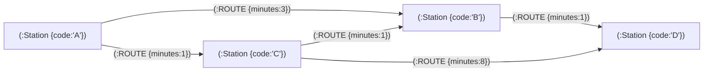
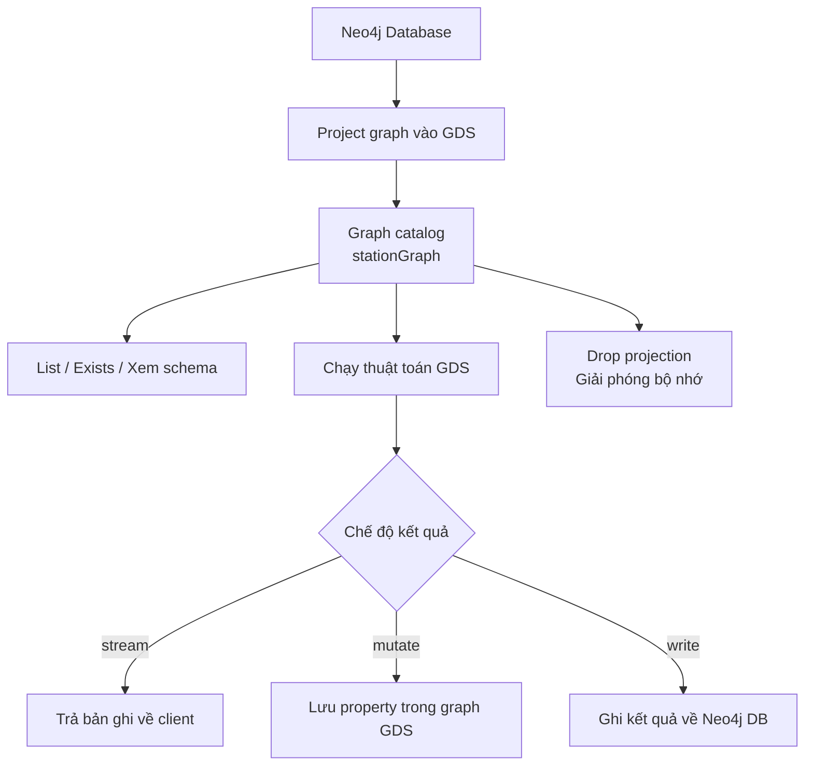
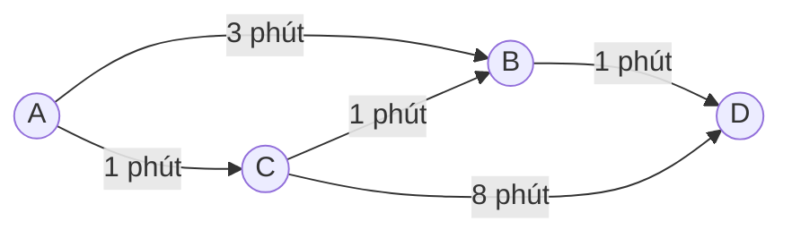
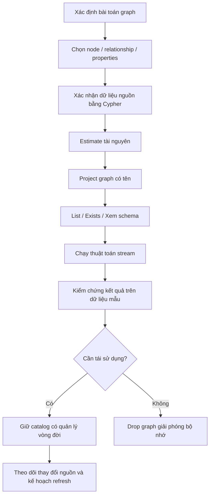

# Chiếu đồ thị vào bộ nhớ và quản lý graph catalog trong Neo4j

Trong **Neo4j**, node và relationship được lưu trong cơ sở dữ liệu để phục vụ truy vấn **Cypher**. Khi chạy các thuật toán như PageRank, phát hiện cộng đồng, tìm đường có trọng số hay độ tương đồng, **Neo4j Graph Data Science (GDS)** thường xử lý trên một **đồ thị được chiếu vào bộ nhớ (in-memory graph projection)**. Người phát triển chọn những nhãn node, loại relationship, thuộc tính và hướng cạnh cần thiết; GDS tạo một biểu diễn đồ thị có tên trong **graph catalog**, rồi dùng tên đó khi chạy thuật toán.

Bài học thuộc chương **Thuật toán đồ thị**, trong module **DATABASE_ENGINE_GRAPH_NEO4J**. Mục tiêu là hiểu **projection là gì, chọn đúng dữ liệu để project, kiểm tra graph catalog và quản lý vòng đời bộ nhớ**. Những thao tác này cũng quan trọng khi ứng dụng dùng **Neo4j Java Driver** hoặc **Spring Data Neo4j** để phối hợp giữa truy vấn Cypher thông thường và các thuật toán GDS.

> **Điều kiện thực hành:** Các ví dụ giả định môi trường đã cài và cho phép sử dụng **Neo4j Graph Data Science** tương thích với phiên bản Neo4j hiện có. Các thủ tục `gds.*` không phải chức năng tự động hiện diện trên mọi bản Neo4j hoặc mọi dịch vụ quản lý. Hãy thực hành trên database riêng để tránh trùng tên graph và dữ liệu mẫu.

## 1. Đồ thị lưu trữ và đồ thị trong bộ nhớ là hai lớp khác nhau

Ví dụ graph lưu trong Neo4j có:



Cypher có thể đọc và cập nhật các thực thể này trực tiếp. Để GDS tính đường đi ít thời gian nhất, ta có thể tạo projection chỉ chứa:

- Node có nhãn `:Station`.
- Relationship có loại `:ROUTE`, giữ hướng từ điểm đi đến điểm đến.
- Thuộc tính `minutes` của relationship để làm **trọng số**.

GDS không nhất thiết cần các thuộc tính khác như `address`, `description` hoặc `createdAt`, nếu thuật toán không dùng đến chúng. Việc chiếu đúng phạm vi giúp tránh giữ dữ liệu thừa trong bộ nhớ.

| Tiêu chí | Đồ thị Neo4j được lưu | Projection trong GDS |
| --- | --- | --- |
| Vị trí | Dữ liệu bền vững trong database | Biểu diễn đồ thị trong bộ nhớ GDS |
| Định danh | Node, relationship và thuộc tính trong Neo4j | Graph được đặt tên trong **graph catalog** |
| Cập nhật | Cypher `CREATE`, `MERGE`, `SET`, `DELETE`... | Tạo lại projection hoặc dùng cơ chế cập nhật catalog có hỗ trợ |
| Mục đích | Lưu, truy vấn, ràng buộc dữ liệu nghiệp vụ | Tính toán thuật toán đồ thị với cấu trúc đã chọn |
| Vòng đời | Theo dữ liệu của database | Theo catalog, tiến trình GDS và thao tác giải phóng |
| Xóa | Thao tác dữ liệu như `DELETE`/`DETACH DELETE` | `gds.graph.drop(...)` xóa **projection**, không xóa node/relationship Neo4j |

**Projection không phải bản sao database để ghi nghiệp vụ tùy ý.** Nó là một biểu diễn phục vụ tính toán, có tập node/cạnh/thuộc tính và hướng được quyết định khi khởi tạo.

## 2. Graph catalog là gì?

**Graph catalog** là nơi GDS quản lý các graph đã được project vào bộ nhớ. Mỗi graph có **tên**, cấu trúc, thông tin bộ nhớ và metadata liên quan. Thông thường, chu trình là:



Một số đặc điểm vận hành:

1. **Tên graph** như `stationGraph` là tên tham chiếu dùng cho `gds.pageRank.stream('stationGraph', ...)`, `gds.shortestPath.dijkstra.stream(...)` và các thuật toán khác.
2. Graph tồn tại trong bộ nhớ cho đến khi được drop hoặc vòng đời môi trường GDS kết thúc. **Không được xem graph catalog là kho lưu bền vững sau khi restart**.
3. Graph được gắn với ngữ cảnh database và quyền truy cập của GDS. Khả năng xem/chia sẻ graph giữa tài khoản phụ thuộc phiên bản, edition và cơ chế bảo mật; không nên giả định mọi user đều nhìn thấy mọi graph.
4. Đồ thị cùng tên có thể gây **xung đột khi project lại** trong phạm vi catalog liên quan. Trước khi tạo lại nên kiểm tra `exists` và quản lý việc drop theo chủ đích.
5. Projection có thể chiếm nhiều RAM hoặc bộ nhớ GDS được quản lý, nhất là đồ thị có hàng triệu node/cạnh và nhiều property; cần dự toán trước khi tạo.

### Graph catalog không phải query plan cache

Cypher planner chọn **execution plan** cho truy vấn, còn GDS graph catalog giữ **đồ thị đã được chuẩn bị cho thuật toán**. Hai cơ chế khác nhau:

- `EXPLAIN` hoặc `PROFILE` giúp phân tích kế hoạch truy vấn Cypher.
- `gds.graph.list`, `gds.graph.exists` và `gds.graph.drop` giúp quản lý graph GDS.
- Tối ưu query Cypher bằng index không tự động làm một projection đã tạo có thêm dữ liệu hoặc thuộc tính mới.

## 3. Quyết định nội dung projection trước khi tạo

Một projection cần xác định tối thiểu các quyết định sau:

| Quyết định | Câu hỏi cần hỏi | Ví dụ |
| --- | --- | --- |
| **Node** | Chỉ tính thuật toán trên những node nào? | `:Station`, không lấy `:AuditLog` |
| **Relationship** | Cạnh nào phản ánh quan hệ cần phân tích? | Chỉ `:ROUTE`, không lấy `:VIEWED` |
| **Hướng** | Cạnh có hướng hay xem như hai chiều? | Đường một chiều dùng `NATURAL` |
| **Thuộc tính** | Thuật toán cần dữ liệu nào trên node/cạnh? | `minutes` làm trọng số |
| **Định dạng/kiểu** | Trọng số có phải số hợp lệ không? | Mọi `minutes` là số không âm |
| **Phạm vi dữ liệu** | Có cần lọc một tenant, thời gian hay khu vực? | Chỉ tuyến trong một thành phố |
| **Bộ nhớ và vòng đời** | Cần bao nhiêu RAM, dùng xong có drop? | Graph ngắn hạn phục vụ một batch tính toán |

Nếu chỉ cần đếm node hoặc tìm một vài quan hệ trực tiếp, Cypher có thể đủ. Nếu cần tính thuật toán trên mạng liên kết lớn, projection GDS đáng cân nhắc hơn.

### Hướng relationship là một quyết định nghiệp vụ

Cùng một dữ liệu nguồn:

- `NATURAL` giữ hướng của relationship khi project; đi từ `A` sang `B` không đồng nghĩa đi được từ `B` về `A`.
- `UNDIRECTED` biểu diễn quan hệ để thuật toán có thể xem hai đầu kết nối với nhau không phụ thuộc hướng gốc.
- `REVERSE` đảo hướng relationship trong projection ở những API hỗ trợ chế độ này.

Chọn `UNDIRECTED` có thể làm cấu trúc lưu trữ các adjacency khác với projection có hướng, ảnh hưởng lượng cạnh được biểu diễn và bộ nhớ. Đừng chọn hai chiều để “thuận tiện chạy thuật toán” nếu bài toán thực sự là mạng đường một chiều.

## 4. Tạo dữ liệu thực hành có thể kiểm chứng

Bộ dữ liệu có bốn trạm `A`, `B`, `C`, `D` và năm chặng đường có hướng. Mỗi relationship chứa `minutes` là thời gian di chuyển tính bằng phút.

### 4.1. Tạo khóa duy nhất

Chạy trên database thực hành:

```cypher
CREATE CONSTRAINT alg_station_code_unique IF NOT EXISTS
FOR (s:AlgStation)
REQUIRE s.code IS UNIQUE;
```

Constraint giúp đảm bảo mỗi `code` ứng với nhiều nhất một node `AlgStation`. Nó cũng hỗ trợ việc tìm đúng điểm đầu và điểm cuối khi chạy thuật toán.

### 4.2. Tạo node, relationship và trọng số

```cypher
MERGE (a:AlgStation {code: 'A'})
MERGE (b:AlgStation {code: 'B'})
MERGE (c:AlgStation {code: 'C'})
MERGE (d:AlgStation {code: 'D'})
MERGE (a)-[ab:ALG_ROUTE]->(b)
SET ab.minutes = 3.0
MERGE (a)-[ac:ALG_ROUTE]->(c)
SET ac.minutes = 1.0
MERGE (c)-[cb:ALG_ROUTE]->(b)
SET cb.minutes = 1.0
MERGE (b)-[bd:ALG_ROUTE]->(d)
SET bd.minutes = 1.0
MERGE (c)-[cd:ALG_ROUTE]->(d)
SET cd.minutes = 8.0;
```

Sơ đồ của bộ dữ liệu:



Dùng Cypher để xác nhận đầu vào:

```cypher
MATCH (from:AlgStation)-[r:ALG_ROUTE]->(to:AlgStation)
RETURN from.code AS fromCode,
       to.code AS toCode,
       r.minutes AS minutes
ORDER BY fromCode, toCode;
```

Dữ liệu chuẩn phải có **4 node** và **5 relationship**; tổng thời gian của các chặng là `3 + 1 + 1 + 1 + 8 = 14` phút. Đường `A → C → B → D` có tổng **3 phút**, là đường tối ưu theo `minutes` trong ví dụ này; đường `A → B → D` mất 4 phút.

## 5. Chiếu graph bằng native projection

GDS hỗ trợ cách project theo **nhãn node**, **loại relationship** và cấu hình property. Ví dụ đặt tên projection là `stationGraph`:

```cypher
CALL gds.graph.project(
  'stationGraph',
  'AlgStation',
  {
    ALG_ROUTE: {
      orientation: 'NATURAL',
      properties: 'minutes'
    }
  }
)
YIELD graphName, nodeCount, relationshipCount, projectMillis
RETURN graphName,
       nodeCount,
       relationshipCount,
       projectMillis;
```

Giải thích:

- `'stationGraph'`: tên graph trong catalog; không phải nhãn node, tên database hoặc tên tệp.
- `'AlgStation'`: chỉ lấy node có nhãn này.
- `ALG_ROUTE`: chỉ lấy relationship thuộc loại này giữa các node được project.
- `orientation: 'NATURAL'`: giữ nguyên hướng relationship.
- `properties: 'minutes'`: đưa thuộc tính trọng số vào graph trong bộ nhớ.
- `nodeCount` và `relationshipCount`: số node/cạnh trong projection, không mặc định là toàn bộ node/cạnh của database.
- `projectMillis`: thời gian thực hiện phép project, hữu ích để quan sát chi phí nạp dữ liệu.

Kết quả dự kiến với bộ dữ liệu mẫu: `graphName = stationGraph`, `nodeCount = 4`, `relationshipCount = 5`. Giá trị `projectMillis` tùy môi trường, không nên đặt một con số cố định.

> **Tính tương thích:** Native projection vẫn xuất hiện trong nhiều phiên bản GDS, nhưng ở các phiên bản mới, **Cypher projection** là cách linh hoạt hơn và được tài liệu GDS nhấn mạnh. Tên API và tình trạng deprecated có thể khác theo phiên bản. Bài này minh họa cả hai để người học nhận diện khi làm việc với hệ thống thực tế.

### Chiếu nhiều node label hoặc relationship type

Với dữ liệu phong phú hơn, có thể project nhiều loại, chẳng hạn:

```cypher
CALL gds.graph.project(
  'commerceNetwork',
  ['Customer', 'Product'],
  {
    BOUGHT: {
      orientation: 'NATURAL'
    },
    VIEWED: {
      orientation: 'NATURAL'
    }
  }
)
YIELD graphName, nodeCount, relationshipCount
RETURN graphName, nodeCount, relationshipCount;
```

Ví dụ này chỉ mô tả **mẫu cấu hình**: cần tồn tại node/relationship tương ứng trong database mới có số liệu có ý nghĩa. Khi node thuộc nhiều label hoặc relationship thuộc nhiều loại, hãy chọn phạm vi phản ánh đúng thuật toán cần chạy, không project mọi loại chỉ vì có sẵn.

## 6. Kiểm tra graph catalog: `list`, `exists` và schema

Sau khi project thành công, nên xác minh graph thật sự có cấu trúc mong đợi trước khi chạy thuật toán.

### 6.1. Liệt kê graph

```cypher
CALL gds.graph.list()
YIELD graphName, nodeCount, relationshipCount, memoryUsage
RETURN graphName, nodeCount, relationshipCount, memoryUsage
ORDER BY graphName;
```

Kết quả có thể liệt kê **nhiều graph** mà tài khoản hiện tại có quyền nhìn thấy. `memoryUsage` là thông tin sử dụng bộ nhớ được GDS báo cáo theo khả năng của phiên bản; không suy diễn đây là toàn bộ mức tiêu thụ RAM của tiến trình Neo4j.

Để kiểm tra cụ thể `stationGraph`:

```cypher
CALL gds.graph.list('stationGraph')
YIELD graphName, nodeCount, relationshipCount, schema
RETURN graphName, nodeCount, relationshipCount, schema;
```

`schema` giúp xác định nhãn, loại quan hệ và thuộc tính được project. Một biểu đồ trông đúng trong Neo4j Browser **chưa bảo đảm** graph trong catalog đã mang property hoặc hướng cạnh như thuật toán yêu cầu.

### 6.2. Kiểm tra tồn tại trước khi dùng

```cypher
CALL gds.graph.exists('stationGraph')
YIELD graphName, exists
RETURN graphName, exists;
```

Nếu `exists = true`, graph có tên đó hiện diện trong catalog mà câu lệnh đang truy cập. Nếu `false`, không thể chạy thuật toán với tên này cho đến khi graph được tạo; hoặc cần tìm đúng database/user/đồ thị có thể truy cập.

### 6.3. Kiểm tra nhãn và loại relationship

Một số công cụ catalog có thể liệt kê tên nhãn và quan hệ theo projection:

```cypher
CALL gds.graph.nodeLabels('stationGraph')
YIELD nodeLabel
RETURN nodeLabel;
```

```cypher
CALL gds.graph.relationshipTypes('stationGraph')
YIELD relationshipType
RETURN relationshipType;
```

Với ví dụ, bạn mong thấy `AlgStation` và `ALG_ROUTE`. Đối với thuộc tính, ưu tiên xem `schema` từ `gds.graph.list` để biết `minutes` có được mang theo projection hay không.

## 7. Chạy một thuật toán để kiểm chứng dữ liệu trong projection

Để chứng minh GDS sử dụng **cạnh và trọng số được project**, chạy Dijkstra trên `stationGraph`. Thuật toán tìm đường có **tổng thời gian** nhỏ nhất nếu trọng số cạnh không âm.

```cypher
MATCH (source:AlgStation {code: 'A'}),
      (target:AlgStation {code: 'D'})
CALL gds.shortestPath.dijkstra.stream('stationGraph', {
  sourceNode: source,
  targetNodes: [target],
  relationshipWeightProperty: 'minutes'
})
YIELD totalCost, nodeIds
RETURN [nodeId IN nodeIds | gds.util.asNode(nodeId).code] AS route,
       totalCost AS totalMinutes;
```

Kết quả dự kiến:

```text
route                   totalMinutes
["A", "C", "B", "D"]      3.0
```

Đường qua ba cạnh `A → C → B → D` mất `1 + 1 + 1 = 3` phút, ngắn hơn `A → B → D` (4 phút) và `A → C → D` (9 phút). Kết quả cho thấy:

- `gds.shortestPath.dijkstra.stream` đọc graph tên `stationGraph` **trong bộ nhớ**, không tự chọn mọi node và relationship trong Neo4j.
- `relationshipWeightProperty: 'minutes'` yêu cầu thuật toán tính chi phí theo property đã project.
- `gds.util.asNode(nodeId)` ánh xạ ID node của GDS về node Neo4j nguồn trong kiểu projection này, rồi đọc `code` để trình bày.
- Chế độ `stream` chỉ **trả kết quả**; nó không tự ghi lại đường đi tối ưu thành các relationship mới trong Neo4j.

Nếu projection thiếu `minutes` hoặc chứa giá trị không phù hợp thuật toán, truy vấn có thể thất bại hoặc cho kết quả không đúng mục tiêu nghiệp vụ. Do đó, kiểm tra schema và dữ liệu đầu vào là bước cần thiết.

## 8. Cypher projection: chủ động chọn những node và cạnh khớp điều kiện

Ngoài native projection, GDS hỗ trợ **Cypher projection** bằng hàm `gds.graph.project(...)` trong truy vấn Cypher. Cách này hữu ích khi cần chọn tập node/cạnh theo logic khác với việc chọn toàn bộ một nhãn hoặc một loại relationship.

Ví dụ tạo **một graph tên khác** `stationCypherGraph` từ đúng các quan hệ `ALG_ROUTE`:

```cypher
MATCH (source:AlgStation)-[r:ALG_ROUTE]->(target:AlgStation)
WITH gds.graph.project(
  'stationCypherGraph',
  source,
  target,
  {
    sourceNodeLabels: labels(source),
    targetNodeLabels: labels(target),
    relationshipType: type(r),
    relationshipProperties: r { .minutes }
  }
) AS g
RETURN g.graphName AS graphName,
       g.nodeCount AS nodeCount,
       g.relationshipCount AS relationshipCount;
```

Trong ví dụ này:

- `MATCH` xác định những cặp node và relationship được đưa vào graph.
- `sourceNodeLabels`, `targetNodeLabels` lấy nhãn của node trong dữ liệu nguồn.
- `relationshipType: type(r)` giữ loại relationship nguồn.
- `relationshipProperties: r { .minutes }` đưa property `minutes` của mỗi cạnh vào projection.
- Tên `stationCypherGraph` khác `stationGraph` để tránh xung đột, vì đó là **hai graph độc lập trong catalog**, dù cùng tham chiếu dữ liệu nguồn.

**Điểm khác biệt quan trọng:** Cypher projection khởi tạo bằng `MATCH (source)-[r]->(target)` chỉ đưa vào những node xuất hiện trong các hàng do `MATCH` trả về. **Node cô lập** (không có relationship phù hợp) có thể bị bỏ qua. Nếu thuật toán cần tính cả node cô lập, phải thiết kế truy vấn projection bao gồm các node đó theo cú pháp và khả năng của phiên bản GDS.

### Ví dụ lọc một phần graph

Giả sử relationship có thêm `r.region`. Có thể thay mệnh đề nguồn thành:

```cypher
MATCH (source:AlgStation)-[r:ALG_ROUTE]->(target:AlgStation)
WHERE r.region = 'north'
WITH gds.graph.project(
  'northRoutes',
  source,
  target,
  {
    relationshipType: type(r),
    relationshipProperties: r { .minutes }
  }
) AS g
RETURN g.graphName AS graphName,
       g.nodeCount AS nodeCount,
       g.relationshipCount AS relationshipCount;
```

Đây là **mẫu mở rộng**; bộ dữ liệu `AlgStation` của bài không có thuộc tính `region` nên truy vấn lọc này chưa tạo tập cạnh hữu ích nếu chạy nguyên trạng. Khi thực hiện trên graph thật, cần xác nhận bộ lọc trả dữ liệu và xử lý trường hợp projection không có hàng như mong đợi.

### Khi nào dùng cách nào?

| Trường hợp | Native projection | Cypher projection |
| --- | --- | --- |
| Lấy toàn bộ node theo nhãn và toàn bộ relationship theo loại | Dễ đọc, ngắn | Làm được nhưng có thể dài hơn |
| Cần lọc theo property, tenant hoặc điều kiện nhiều bước | Ít linh hoạt hơn | Thể hiện điều kiện ngay trong Cypher |
| Muốn định hình node/relationship/property có tính tùy biến cao | Phụ thuộc tham số projection | Thường phù hợp hơn |
| Muốn đảm bảo tính đúng với GDS bản mới | Kiểm tra hỗ trợ API ở phiên bản đó | Kiểm tra cú pháp projection của phiên bản đó |
| Cần kiểm soát node cô lập | Có thể chọn node theo nhãn | Phải chú ý cách truy vấn `MATCH` tạo các hàng projection |

**Không trộn lẫn cú pháp:** `CALL gds.graph.project(...)` ở phần native là **procedure**; `gds.graph.project(...)` nằm trong biểu thức `WITH` ở Cypher projection là **function**. Hai API có ngữ nghĩa và kiểu cấu hình khác nhau, dù tên tương tự.

## 9. Graph catalog là snapshot, không tự đồng bộ với database

Một điều dễ bỏ sót: khi graph `stationGraph` đã được project, nó phản ánh dữ liệu **tại thời điểm tạo projection**. Nếu sửa trọng số hoặc thêm relationship trong Neo4j sau đó, projection **không tự nhận bản cập nhật**.

Ví dụ:

```cypher
MATCH (:AlgStation {code: 'A'})-[r:ALG_ROUTE]->
      (:AlgStation {code: 'B'})
SET r.minutes = 0.5;
```

Câu trên đổi thời gian `A → B` trong **database** từ 3 thành 0,5 phút. Nhưng nếu `stationGraph` được tạo **trước** khi thay đổi, thuật toán chạy trên `stationGraph` vẫn có thể dùng trọng số cũ. Khi tạo lại projection từ dữ liệu mới, đường `A → B → D` sẽ có tổng `0,5 + 1 = 1,5` phút và có thể trở thành đường tối ưu mới.

### Cách refresh đơn giản cho ví dụ thực hành

1. Kiểm tra các job thuật toán đang dùng graph; tránh drop khi chúng còn cần.
2. Drop projection cũ đã được xác nhận không còn dùng.
3. Project lại từ dữ liệu Neo4j hiện tại.
4. Kiểm tra node count, relationship count, schema rồi chạy lại thuật toán.

```cypher
CALL gds.graph.drop('stationGraph')
YIELD graphName
RETURN graphName;
```

```cypher
CALL gds.graph.project(
  'stationGraph',
  'AlgStation',
  {
    ALG_ROUTE: {
      orientation: 'NATURAL',
      properties: 'minutes'
    }
  }
)
YIELD graphName, nodeCount, relationshipCount
RETURN graphName, nodeCount, relationshipCount;
```

Với hệ thống sản xuất, cần thiết kế cập nhật an toàn hơn nếu có nhiều job dùng chung graph. Có thể tạo graph phiên bản mới (ví dụ `stationGraph_v2`), xác minh rồi chuyển job sang graph mới trước khi drop bản cũ, trong giới hạn bộ nhớ cho phép.

**Không đổi tên graph trong Cypher là đã cập nhật dữ liệu.** Cần tạo projection mới hoặc sử dụng những API cập nhật/mutate được GDS hỗ trợ đúng cho loại thay đổi đó.

## 10. Dự toán bộ nhớ và giữ graph catalog gọn

Mỗi graph GDS dùng tài nguyên bộ nhớ tùy theo:

- Số node và relationship được project.
- Hướng edge (một chiều/hai chiều) và biểu diễn adjacency.
- Số property trên node/relationship, kiểu số, dữ liệu thiếu.
- Cấu trúc phụ trợ và thuật toán chạy trên graph.
- Số graph đồng thời tồn tại, khả năng xử lý song song và cấu hình bộ nhớ.

Nếu có 10 triệu relationship và cần duy nhất trọng số `minutes`, đừng project thêm hàng chục thuộc tính văn bản chỉ vì chúng tồn tại trên node nguồn.

### Ước tính chi phí trước khi tạo

Với native projection, GDS có thủ tục ước tính kích thước projection:

```cypher
CALL gds.graph.project.estimate(
  'AlgStation',
  {
    ALG_ROUTE: {
      orientation: 'NATURAL',
      properties: 'minutes'
    }
  }
)
YIELD nodeCount, relationshipCount, requiredMemory
RETURN nodeCount, relationshipCount, requiredMemory;
```

Các giá trị `nodeCount`/`relationshipCount` trong kết quả estimate là **ước tính** theo dữ liệu và phương pháp của GDS; `requiredMemory` là hướng dẫn cho tài nguyên cần thiết, không phải bảo đảm tuyệt đối cho peak memory của toàn bộ quy trình phân tích.

Ngoài bộ nhớ projection, thuật toán cụ thể còn cần vùng nhớ làm việc riêng. Tùy thuật toán, GDS có thủ tục **estimate** tương ứng để đánh giá trước khi thực thi (ví dụ `gds.pageRank.stream.estimate` hoặc `gds.wcc.stream.estimate` trên graph đã có); cách tính và tham số phụ thuộc thuật toán.

### Dọn graph catalog sau khi xong việc

```cypher
CALL gds.graph.drop('stationCypherGraph')
YIELD graphName
RETURN graphName;
```

```cypher
CALL gds.graph.drop('stationGraph')
YIELD graphName
RETURN graphName;
```

Các lệnh drop trên chỉ dành cho graph đã tạo **trong catalog** của ví dụ. **Không xóa** các node `AlgStation`, relationship `ALG_ROUTE`, constraint hoặc dữ liệu Neo4j. Chạy drop chỉ khi không có job đang cần graph đó; nếu graph không tồn tại hoặc không có quyền, lệnh có thể báo lỗi.

## 11. Phân biệt `stream`, `mutate` và `write`

Sau khi đã có graph GDS, cách chạy thuật toán quyết định **kết quả nằm ở đâu**:

| Chế độ thuật toán | Kết quả | Tác động |
| --- | --- | --- |
| `stream` | Trả về qua kết quả Cypher/Driver | Không tự lưu property thuật toán |
| `stats` | Trả thống kê ở những thuật toán hỗ trợ | Thường dùng để đánh giá kết quả/chi phí mà không lưu từng node |
| `mutate` | Ghi property hoặc kết quả vào **graph trong bộ nhớ** | Graph catalog đổi, **database Neo4j không tự đổi** |
| `write` | Ghi kết quả về node/relationship trong Neo4j theo thuật toán | **Tác động dữ liệu bền vững**; cần quyền ghi và kế hoạch vận hành |

Ví dụ PageRank **chỉ stream**:

```cypher
CALL gds.pageRank.stream('stationGraph')
YIELD nodeId, score
RETURN gds.util.asNode(nodeId).code AS station,
       score
ORDER BY score DESC;
```

Kết quả là các điểm số do GDS tính trên graph đang có. Nếu muốn lưu `pagerank` vào database để query về sau, cần một bước ghi được thiết kế tường minh và lựa chọn API GDS phù hợp; chạy `stream` **không tự tạo property `pagerank`** trên node Neo4j.

### Kiểm tra kết quả đừng nhầm với dữ liệu gốc

Một projection có thể đã dùng property `minutes` cũ, trong khi `MATCH ... RETURN r.minutes` trực tiếp đọc property mới của database. Nếu hai kết quả khác nhau, trước khi kết luận thuật toán sai, hãy kiểm tra **thời điểm project và dữ liệu trong graph catalog**.

## 12. Sử dụng từ ứng dụng Java và Spring Data Neo4j

### Neo4j Java Driver

Các thao tác catalog như `gds.graph.list` hoặc `gds.graph.exists` được gọi bằng Cypher/procedure qua driver. Ví dụ kiểm tra graph tồn tại:

```java
import org.neo4j.driver.Driver;
import org.neo4j.driver.Session;
import org.neo4j.driver.SessionConfig;

import java.util.Map;

public boolean graphExists(Driver driver, String graphName) {
    try (Session session =
             driver.session(SessionConfig.forDatabase("neo4j"))) {

        return session.executeRead(tx ->
            tx.run("""
                CALL gds.graph.exists($name)
                YIELD exists
                RETURN exists
                """, Map.of("name", graphName))
              .single()
              .get("exists")
              .asBoolean()
        );
    }
}
```

Trong ứng dụng thật:

- **Chỉ định database rõ ràng** nếu môi trường có nhiều database.
- Dùng tên graph có quy ước và quản lý quyền để tránh các job trùng tên hoặc drop nhầm graph người khác dùng.
- Một graph được project trong GDS **không gắn với object `Session` Java** theo nghĩa tự drop khi Java đóng session.
- Không gọi `gds.graph.project` từ mọi request API: việc project lặp lại có thể gây xung đột tên và tiêu tốn bộ nhớ/thời gian.
- Tách workflow **chuẩn bị projection → chạy thuật toán → đọc kết quả → giải phóng graph**, cùng giám sát và cơ chế phục hồi khi job lỗi.

### Spring Data Neo4j

Spring Data Neo4j hỗ trợ thao tác với node và relationship nghiệp vụ thông qua repository hoặc `Neo4jClient`, nhưng **graph catalog của GDS là lớp riêng**. `repository.save(entity)` không cập nhật projection đã tồn tại.

Nếu muốn chạy GDS qua `Neo4jClient`, ứng dụng phải gửi Cypher phù hợp, quản lý quyền truy cập, tài nguyên và thời gian sống graph. Tránh giả định annotation `@Transactional` quanh thao tác lưu entity sẽ làm graph GDS tự đồng bộ sau khi transaction commit.

## 13. Lỗi thường gặp và cách tìm nguyên nhân

| Triệu chứng | Nguyên nhân khả dĩ | Cách kiểm tra |
| --- | --- | --- |
| `There is no procedure with the name gds...` | Chưa có GDS, không tương thích phiên bản hoặc không đủ quyền | Xác nhận cài đặt/phiên bản/quyền GDS |
| Graph đã tồn tại khi tạo lại | Tên `stationGraph` còn trong catalog | `gds.graph.exists`, `gds.graph.list`; quản lý tên/drop |
| Thuật toán báo thiếu property trọng số | Projection không chứa `minutes` hoặc tên property khác | Xem `schema` trong `gds.graph.list` |
| `nodeCount` nhỏ hơn dự kiến | Bộ lọc nhãn/`MATCH` loại node, đặc biệt node cô lập | Đối chiếu Cypher nguồn, projection config |
| `relationshipCount` khác dữ liệu Neo4j | Loại quan hệ, hướng, các node đầu mút hoặc cấu hình projection khác nhau | Xem relationshipProjection/schema và dữ liệu nguồn |
| Kết quả thuật toán khác dữ liệu vừa sửa | Graph GDS là snapshot từ trước | Refresh/reproject, kiểm tra mốc tạo |
| Out-of-memory hoặc projection quá lâu | Phạm vi lớn, nhiều property/graph cùng tồn tại | Estimate, thu hẹp dữ liệu, drop graph không dùng |
| Dijkstra không tìm thấy đường | Hướng cạnh hoặc các node/cạnh quan trọng bị loại | Kiểm tra `NATURAL`/`UNDIRECTED` và tập projection |
| Một user thấy graph, user khác không | Ngữ cảnh database, quyền/catalog khác | Kiểm tra đúng database, principal, chính sách GDS |
| Drop graph làm job khác lỗi | Nhiều job đang dùng cùng tên catalog | Quản lý quyền sở hữu và lịch sử sử dụng, dùng tên phiên bản |

Đừng vội giải quyết lỗi bằng cách project **toàn bộ database**. Đầu tiên phải xác định thuật toán cần những node, edge và property nào.

## 14. Quy trình thực hành có thể áp dụng cho dự án thật



Một checklist triển khai gồm:

1. **Đúng tập dữ liệu:** quy mô node/relationship, lọc tenant, mốc thời gian và nhãn/loại quan hệ.
2. **Đúng hướng cạnh:** có hướng thực tế hay quan hệ hai chiều.
3. **Đúng property:** có mặt trong schema GDS, đúng kiểu, đúng đơn vị và giá trị hợp lệ.
4. **Đúng tài nguyên:** estimate memory trước, giới hạn số graph đồng thời và chọn thuật toán phù hợp.
5. **Đúng vòng đời:** tránh tạo trùng tên; biết khi nào refresh và drop.
6. **Đúng ranh giới ghi:** phân biệt kết quả `stream`, `mutate` và `write`.
7. **Đúng vận hành:** theo dõi graph catalog, thời gian project, memory và số job chạy song song.

## 15. Câu hỏi tự kiểm tra

**Câu 1.** Dữ liệu Neo4j có node `:Station` và relationship `:ROUTE`. Sau khi chạy `gds.graph.project`, graph GDS có tự cập nhật nếu câu Cypher khác thêm một `:ROUTE` không?

<details>
<summary>Gợi ý đáp án</summary>

Không. Projection chứa dữ liệu đã được lấy tại thời điểm tạo. Thêm relationship trong Neo4j không tự thêm cạnh vào graph catalog. Cần refresh/reproject hoặc dùng API cập nhật graph có hỗ trợ và thiết kế cho trường hợp đó.

</details>

**Câu 2.** Tại sao gọi `gds.graph.drop('stationGraph')` không xóa node `AlgStation` khỏi database?

<details>
<summary>Gợi ý đáp án</summary>

Vì `gds.graph.drop` xóa đối tượng in-memory graph trong **GDS graph catalog**, không thực thi `DELETE` trên graph lưu trữ của Neo4j.

</details>

**Câu 3.** Một thuật toán yêu cầu `relationshipWeightProperty: 'minutes'`, nhưng projection chỉ chứa topology, không chứa property. Phải xử lý thế nào?

<details>
<summary>Gợi ý đáp án</summary>

Kiểm tra `schema` trong `gds.graph.list`; project lại với `properties: 'minutes'` hoặc cấu hình Cypher projection đưa thuộc tính đó vào graph. Đồng thời kiểm tra kiểu số và giá trị trọng số phù hợp thuật toán.

</details>

**Câu 4.** Vì sao Cypher projection có `MATCH (source)-[r]->(target)` có thể bỏ sót node cô lập?

<details>
<summary>Gợi ý đáp án</summary>

Vì những node không có relationship khớp sẽ không tạo hàng từ `MATCH`. Hàm projection chỉ nhận các node có mặt trong tập hàng được cấp; muốn tính cả node cô lập phải thiết kế truy vấn projection đưa cả chúng vào.

</details>

**Câu 5.** Sau khi chạy `gds.pageRank.stream('stationGraph')`, có thể khẳng định node Neo4j đã có property `pagerank` mới không?

<details>
<summary>Gợi ý đáp án</summary>

Không. `stream` trả kết quả, không ghi property vào database. Khi muốn ghi cần chọn bước ghi rõ ràng hoặc chế độ `write` thích hợp; `mutate` chỉ cập nhật graph trong bộ nhớ.

</details>

**Câu 6.** Vì sao một job phân tích nên dùng graph tên phiên bản mới rồi chuyển sang dùng, thay vì drop graph cũ ngay lập tức?

<details>
<summary>Gợi ý đáp án</summary>

Nếu job khác đang sử dụng graph cũ, drop sớm có thể làm job lỗi. Tạo projection mới, kiểm tra schema/kết quả, chuyển các job và chỉ drop graph cũ khi an toàn sẽ giảm gián đoạn; cách này đòi hỏi đủ bộ nhớ để giữ tạm hai graph.

</details>

## Ghi nhớ

- **Projection GDS** là một biểu diễn node, relationship, hướng cạnh và property **trong bộ nhớ** để chạy thuật toán, được truy cập qua **graph catalog** bằng tên.
- **Native projection** thuận tiện khi chọn dữ liệu theo nhãn/loại relationship; **Cypher projection** linh hoạt khi cần lọc và tạo cấu trúc tùy biến.
- Kiểm tra `gds.graph.list`, `gds.graph.exists` và `schema` trước khi chạy thuật toán; dùng `gds.graph.drop` để giải phóng bộ nhớ đúng lúc.
- Graph catalog phản ánh dữ liệu ở **thời điểm project**; Cypher ghi dữ liệu mới không tự cập nhật một graph đã tồn tại.
- **`stream` trả kết quả, `mutate` cập nhật graph GDS, `write` ghi về database** theo khả năng của thuật toán.
- Kiểm soát **hướng relationship, trọng số, bộ nhớ, tên graph và vòng đời** để kết quả vừa đúng nghĩa nghiệp vụ vừa ổn định khi vận hành.

### Tài liệu tham khảo

- [Neo4j Graph Data Science Manual — Graph catalog](https://neo4j.com/docs/graph-data-science/current/management-ops/graph-catalog-ops/)
- [Neo4j Graph Data Science Manual — Native projection](https://neo4j.com/docs/graph-data-science/current/management-ops/graph-creation/graph-project/)
- [Neo4j Graph Data Science Manual — Cypher projection](https://neo4j.com/docs/graph-data-science/current/management-ops/graph-creation/graph-project-cypher-projection/)
- [Neo4j Graph Data Science Manual — Dijkstra Source-Target](https://neo4j.com/docs/graph-data-science/current/algorithms/dijkstra-source-target/)
- [Neo4j Graph Data Science Manual — Memory estimation](https://neo4j.com/docs/graph-data-science/current/common-usage/memory-estimation/)
- [Neo4j Java Driver Manual](https://neo4j.com/docs/java-manual/current/)
