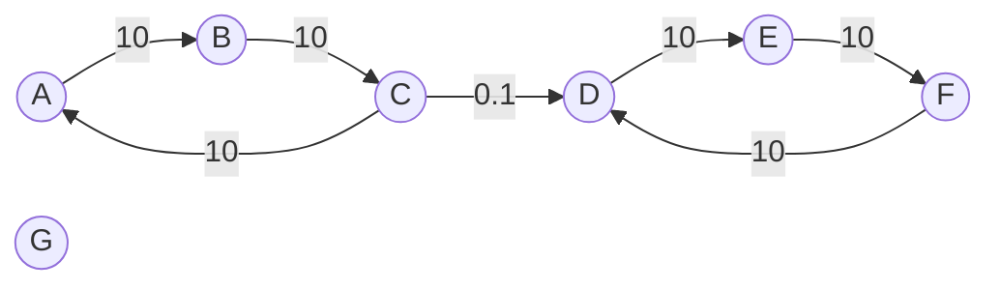

# Phát hiện cộng đồng và thành phần liên thông trong Neo4j

Một đồ thị thường gồm các nhóm node liên kết với nhau theo những cách rất khác nhau. Trong mạng xã hội, người dùng có thể tạo thành nhóm bạn bè; trong mạng giao dịch, nhiều tài khoản có thể hình thành cụm trao đổi; trong mạng sản phẩm, một nhóm mặt hàng có thể được mua cùng nhau thường xuyên. Tuy nhiên, **nhóm có liên kết** và **cộng đồng có liên kết nội bộ mạnh** là hai khái niệm khác nhau.

Bài thuộc chương **Thuật toán đồ thị** trong module **DATABASE_ENGINE_GRAPH_NEO4J**. Neo4j lưu dữ liệu theo mô hình property graph gồm node, relationship và thuộc tính; Cypher giúp truy vấn quan hệ, đường đi, index/constraint và dữ liệu nghiệp vụ. Khi muốn phân tích cấu trúc ở quy mô mạng, thư viện **Neo4j Graph Data Science (GDS)** cung cấp các thuật toán chuyên dụng như **Weakly Connected Components (WCC)**, **Strongly Connected Components (SCC)**, **Louvain**, **Leiden** và **Label Propagation**.

Sau bài này, bạn có thể phân biệt các bài toán, dựng graph projection, chạy thuật toán trên dữ liệu mẫu, hiểu kết quả, tránh gán ý nghĩa quá mức cho ID cộng đồng và thiết kế cách dùng kết quả trong ứng dụng Java Driver/Spring Data Neo4j.

## 1. Ba câu hỏi tưởng giống nhau nhưng khác nhau

Xét ba yêu cầu:

1. **Những node nào có thể nối với nhau nếu bỏ qua chiều quan hệ?** Đây là câu hỏi về *thành phần liên thông yếu*.
2. **Những node nào có thể đi tới nhau theo chiều mũi tên ở cả hai hướng?** Đây là câu hỏi về *thành phần liên thông mạnh*.
3. **Trong một mạng đã liên thông, có những nhóm nào kết nối với nhau dày đặc hơn phần còn lại?** Đây là câu hỏi về *phát hiện cộng đồng*.

| Khái niệm | Điều kiện cốt lõi | Thuật toán thường dùng | Lưu ý |
| --- | --- | --- | --- |
| **WCC** (*Weakly Connected Components*) | Xem cạnh có hướng như vô hướng; các node nối được với nhau qua chuỗi cạnh | `gds.wcc` | Một cầu nối duy nhất có thể gộp hai nhóm lớn thành một thành phần |
| **SCC** (*Strongly Connected Components*) | Với mọi cặp node trong nhóm, tồn tại đường có hướng đi từ node này tới node kia và ngược lại | `gds.scc` | Chỉ áp dụng ý nghĩa đầy đủ khi dữ liệu có hướng |
| **Community Detection** | Tìm cấu trúc nhóm dựa trên mật độ, trọng số hoặc sự lan truyền nhãn | Louvain, Leiden, Label Propagation | Cộng đồng không bắt buộc là một thành phần liên thông riêng biệt |
| **Shortest Path** | Tìm đường ngắn nhất giữa hai node theo tiêu chí cụ thể | Cypher shortest path, Dijkstra… | Không trực tiếp trả lời câu hỏi phân cụm |

Cần nhớ: **một thành phần liên thông có thể chứa nhiều cộng đồng**. Ngược lại, một cộng đồng được thuật toán phát hiện chỉ là **kết quả của phương pháp và cấu hình đã chọn**, không mặc nhiên là một phòng ban, tổ chức, nhóm gian lận hay tập người có cùng hành vi.

## 2. Trực giác từ đồ thị nhỏ

Giả sử có bảy node A, B, C, D, E, F, G. Hai bộ ba A–B–C và D–E–F liên kết chặt; có một cầu nối yếu giữa C và D; G đứng độc lập:



Sơ đồ thể hiện đúng **chiều cạnh đã lưu** và trọng số. Bảng sau liệt kê các quan hệ để tiện đối chiếu:

| Quan hệ có hướng được lưu | Trọng số `strength` |
| --- | ---: |
| A → B | 10 |
| B → C | 10 |
| C → A | 10 |
| D → E | 10 |
| E → F | 10 |
| F → D | 10 |
| C → D | 0.1 |
| G | Không có quan hệ |

Đối với **WCC**, các node A–F cùng thuộc một thành phần vì cầu C → D tạo kết nối, dù cầu rất yếu; G thuộc thành phần khác. Đối với **SCC**, các chu trình A → B → C → A và D → E → F → D tạo hai thành phần mạnh riêng, bởi không có đường có hướng từ D/E/F quay lại A/B/C. G là thành phần đơn.

Đối với **Louvain/Leiden** trên đồ thị vô hướng có trọng số, hai tam giác liên kết mạnh có khả năng được nhận diện thành hai cộng đồng, còn G có thể được xử lý thành một cộng đồng riêng. **Không nên khẳng định trước ID hoặc chính xác số cộng đồng cho mọi lần chạy**: việc tối ưu và các tham số có thể tạo ra những phân hoạch khác nhau.

## 3. Chuẩn bị database thực hành

Các ví dụ sử dụng Neo4j có **GDS** đã cài và tương thích. GDS không đồng nghĩa mọi bản Neo4j đều có sẵn thuật toán; cần có quyền gọi các procedure và đủ bộ nhớ cho graph projection. Thực hành trong database riêng để tránh ảnh hưởng dữ liệu khác.

Đầu tiên, đặt constraint cho danh tính node mẫu:

```cypher
CREATE CONSTRAINT demo_member_id_unique IF NOT EXISTS
FOR (p:DemoMember)
REQUIRE p.demoId IS UNIQUE;
```

Tạo bảy node:

```cypher
UNWIND ['A', 'B', 'C', 'D', 'E', 'F', 'G'] AS id
MERGE (:DemoMember {demoId: id});
```

Tạo bảy relationship và trọng số:

```cypher
UNWIND [
  ['A', 'B', 10.0],
  ['B', 'C', 10.0],
  ['C', 'A', 10.0],
  ['D', 'E', 10.0],
  ['E', 'F', 10.0],
  ['F', 'D', 10.0],
  ['C', 'D', 0.1]
] AS edge
MATCH (src:DemoMember {demoId: edge[0]})
MATCH (dst:DemoMember {demoId: edge[1]})
MERGE (src)-[r:DEMO_LINK]->(dst)
SET r.strength = edge[2];
```

Kiểm tra graph:

```cypher
MATCH (n:DemoMember)
OPTIONAL MATCH (n)-[r:DEMO_LINK]->(m:DemoMember)
RETURN n.demoId AS source,
       m.demoId AS target,
       r.strength AS strength
ORDER BY source, target;
```

Node G không có cạnh đi ra nên xuất hiện với `target = null`. Lệnh này trả quan hệ **theo chiều có sẵn**, không hiển thị những liên kết tưởng tượng theo chiều ngược lại.

### Vì sao có trọng số?

Thuộc tính `strength` mô tả độ mạnh của liên kết, chẳng hạn mức tương tác giữa hai người. Khi chạy thuật toán phát hiện cộng đồng có hỗ trợ trọng số, cạnh mạnh `10` có thể tác động nhiều hơn cạnh yếu `0.1`. Nhưng **WCC thông thường xét sự tồn tại của cạnh**: một cạnh yếu vẫn tạo kết nối trừ khi quy tắc lọc cạnh hoặc threshold được cấu hình phù hợp.

Không tự dùng số lượng tương tác làm trọng số nếu dữ liệu có thiên lệch lớn hoặc ý nghĩa “càng cao càng mạnh” chưa được xác minh. Với một số bài toán đường đi, trọng số thể hiện *chi phí* mà thấp hơn là tốt; với nhiều thuật toán cộng đồng, trọng số thể hiện *độ mạnh* mà cao hơn là quan hệ chặt hơn. Hai loại trọng số này có ý nghĩa khác nhau.

## 4. Cypher và GDS: khi nào cần thuật toán?

Cypher có thể tìm các đường đi hoặc những node đến được trong phạm vi độ sâu đã giới hạn:

```cypher
MATCH (a:DemoMember {demoId: 'A'})
MATCH p = (a)-[:DEMO_LINK*0..6]-(b:DemoMember)
RETURN DISTINCT b.demoId AS reachable
ORDER BY reachable;
```

Trên đồ thị mẫu, A có thể đến A–F nếu **bỏ qua hướng**. G không xuất hiện. Trong truy vấn trên, `*0..6` giới hạn độ dài path, phù hợp với ví dụ nhỏ.

Nhưng khi yêu cầu “tìm **toàn bộ thành phần liên thông** trong mạng hàng triệu node”, việc liệt kê các path rồi `DISTINCT` không phải chiến lược hiệu quả mặc định. Số path có thể tăng rất nhanh, còn WCC/SCC được thiết kế để tìm các thành phần cấu trúc đồ thị.

Tương tự, một câu `MATCH` đơn giản không trực tiếp tối ưu *modularity* hoặc phân nhóm dựa trên mật độ liên kết. Đây là lúc các thuật toán cộng đồng phát huy tác dụng.

## 5. Graph projection: đầu vào cho thuật toán GDS

Các thuật toán GDS thường chạy trên **named graph trong bộ nhớ** được *project* từ database Neo4j. Projection quy định node nào tham gia, relationship nào tham gia, chiều quan hệ ra sao và thuộc tính nào được nạp.

Ta tạo **hai projection** từ cùng dữ liệu:

- `demoCommunityUndirected`: xem cạnh vô hướng để chạy WCC và cộng đồng.
- `demoSccDirected`: giữ nguyên chiều để chạy SCC.

### 5.1. Projection vô hướng có trọng số

```cypher
CALL gds.graph.project(
  'demoCommunityUndirected',
  'DemoMember',
  {
    DEMO_LINK: {
      type: 'DEMO_LINK',
      orientation: 'UNDIRECTED',
      properties: 'strength'
    }
  }
)
YIELD graphName, nodeCount, relationshipCount
RETURN graphName, nodeCount, relationshipCount;
```

`orientation: 'UNDIRECTED'` cho phép thuật toán coi một quan hệ được lưu theo một chiều như kết nối dùng được theo cả hai chiều trong projection. Tùy cơ chế projection, số relationship được báo có thể phản ánh các hướng được biểu diễn trong bộ nhớ, nên **không mặc định bằng số relationship lưu trong store**.

`properties: 'strength'` nạp trọng số. Nếu không project thuộc tính này mà lại yêu cầu thuật toán dùng `relationshipWeightProperty: 'strength'`, cấu hình sẽ không đáp ứng đầu vào mong đợi.

### 5.2. Projection giữ nguyên hướng

```cypher
CALL gds.graph.project(
  'demoSccDirected',
  'DemoMember',
  {
    DEMO_LINK: {
      type: 'DEMO_LINK',
      orientation: 'NATURAL'
    }
  }
)
YIELD graphName, nodeCount, relationshipCount
RETURN graphName, nodeCount, relationshipCount;
```

`NATURAL` giữ nguyên chiều relationship để SCC nhận diện chính xác việc có hay không có đường đi **theo hướng dữ liệu**.

### 5.3. Kiểm tra projection trước khi chạy

```cypher
CALL gds.graph.list('demoCommunityUndirected')
YIELD graphName, nodeCount, relationshipCount
RETURN graphName, nodeCount, relationshipCount;
```

Chỉ tạo named graph khi tên chưa được sử dụng và bạn có quyền quản lý projection đó. Nếu chạy lại các ví dụ khi graph còn tồn tại trong GDS catalog, việc project cùng tên có thể báo lỗi. Việc cập nhật node/relationship trong Neo4j **không có nghĩa projection đã có tự động cập nhật toàn bộ**, vì vậy cần xác định cách refresh/re-project phù hợp trước khi phân tích dữ liệu mới.

## 6. WCC: tìm thành phần liên thông yếu

Một **weakly connected component** là tập node mà giữa hai node bất kỳ trong tập có thể tìm thấy đường đi **sau khi bỏ qua hướng của relationship**.

Với dữ liệu mẫu, A–F nằm trong cùng một thành phần vì C nối D. G đứng riêng. Thuật toán không tự tách các tam giác chỉ vì liên kết giữa chúng yếu hơn liên kết nội bộ.

Chạy WCC:

```cypher
CALL gds.wcc.stream('demoCommunityUndirected')
YIELD nodeId, componentId
RETURN gds.util.asNode(nodeId).demoId AS member,
       componentId
ORDER BY componentId, member;
```

Về ngữ nghĩa, kết quả gồm **hai nhóm thành phần**:

- Thành phần chứa A, B, C, D, E, F.
- Thành phần chỉ chứa G.

**Không giả định `componentId` cụ thể** như 0 hoặc 1. ID này do thuật toán gán, có thể thay đổi giữa các lần chạy, khi graph thay đổi hoặc khi đổi phiên bản. Để kiểm tra kết quả theo nhóm mà không phụ thuộc số ID, ta có thể tổng hợp:

```cypher
CALL gds.wcc.stream('demoCommunityUndirected')
YIELD nodeId, componentId
WITH componentId,
     collect(gds.util.asNode(nodeId).demoId) AS members
RETURN componentId,
       size(members) AS componentSize,
       members
ORDER BY componentSize DESC;
```

Nếu cần quan sát thống kê tổng thể:

```cypher
CALL gds.wcc.stats('demoCommunityUndirected')
YIELD componentCount, componentDistribution
RETURN componentCount, componentDistribution;
```

Các thông tin thống kê giúp trả lời: có bao nhiêu phần mạng tách rời, kích thước thành phần lớn nhất, có nhiều node đơn lẻ hay không? Với ứng dụng, đây là cơ sở để phát hiện dữ liệu liên kết bị mất hoặc cụm hoạt động cô lập.

### 6.1. Cạnh yếu vẫn nối hai thành phần

Giả sử cạnh C → D có trọng số `0.1` do tương tác hiếm hoi. WCC thông thường vẫn xem hai tam giác là cùng thành phần nếu cạnh đó tồn tại. Muốn khảo sát “các thành phần liên thông **chỉ dựa trên quan hệ đủ mạnh**”, cần tạo projection đã lọc cạnh hoặc sử dụng ngưỡng trọng số trong thuật toán có hỗ trợ, với cách định nghĩa ngưỡng phù hợp nghiệp vụ.

Điều đó khác bài toán phát hiện cộng đồng: thuật toán cộng đồng có thể **giữ cạnh yếu trong graph nhưng tách các node thành hai nhóm** dựa trên cấu trúc liên kết tổng thể.

### 6.2. Ứng dụng của WCC

- Kiểm tra mạng dữ liệu có nhiều “đảo” cô lập ngoài ý muốn.
- Chia một đồ thị lớn thành các phần liên thông để xử lý hoặc khảo sát riêng.
- Tìm những cụm thực thể có liên kết gián tiếp khi không quan tâm chiều.
- Phát hiện những sản phẩm/người dùng chưa được kết nối với phần còn lại.

**Giới hạn:** WCC không chứng minh các node trong cùng thành phần có mối liên hệ mật thiết. Một đường dài qua nhiều cạnh yếu cũng đủ để các node thuộc cùng WCC.

## 7. SCC: tìm thành phần liên thông mạnh

Với graph có hướng, **strongly connected component** yêu cầu với mọi cặp node `u` và `v` trong cùng nhóm, tồn tại cả đường đi có hướng `u → v` và đường đi có hướng `v → u`.

Ví dụ:

```text
A -> B -> C -> A

D -> E -> F -> D

C -> D

G (đứng riêng)
```

Trong mỗi tam giác có hướng, ta có thể đi một vòng để quay lại điểm bắt đầu. Nhưng cầu C → D chỉ cho phép đi **từ tam giác thứ nhất sang tam giác thứ hai**, không cho phép quay ngược về A/B/C. Vì vậy SCC chia thành các nhóm:

- A, B, C.
- D, E, F.
- G.

Chạy SCC trên projection **có hướng**:

```cypher
CALL gds.scc.stream('demoSccDirected')
YIELD nodeId, componentId
WITH componentId,
     collect(gds.util.asNode(nodeId).demoId) AS members
RETURN componentId,
       size(members) AS componentSize,
       members
ORDER BY componentSize DESC;
```

Đừng dùng projection `UNDIRECTED` để giải thích tính **liên thông mạnh của dữ liệu có hướng**: khi đã làm vô hướng, yêu cầu đường đi chiều thuận/nghịch bị thay đổi và kết quả không còn trả lời đúng câu hỏi ban đầu.

### Khi nào SCC hữu ích?

- Nhận diện các chu trình phụ thuộc trong một mạng có hướng.
- Kiểm tra các vùng điều hướng hoặc giao dịch mà thực thể có thể quay lại nhau.
- Phân rã mạng có hướng thành những nhóm nội bộ có khả năng đi đến qua lại.
- Phân tích dependency graph, luồng công việc hoặc những cấu trúc có hướng khác.

SCC phản ánh **khả năng tiếp cận có hướng**, không phải số lượng quan hệ dày hay thưa. Một chu trình rất dài vẫn là một SCC nếu mọi node đến được nhau theo chiều quan hệ.

## 8. Cộng đồng: phân nhóm theo cấu trúc nội bộ

**Community detection** đi xa hơn việc xác định tồn tại một đường nối. Nó cố gắng nhận diện những nhóm mà các quan hệ bên trong có cấu trúc chặt hoặc mạnh hơn so với quan hệ ra ngoài nhóm, theo **hàm mục tiêu hoặc quy tắc của thuật toán**.

Hai tam giác A–B–C và D–E–F có cầu yếu C–D. Nếu nhìn toàn bộ mạng vô hướng, chúng thuộc một WCC. Tuy nhiên, một phương pháp cộng đồng có xét trọng số có thể xếp chúng thành hai cộng đồng vì mỗi tam giác có liên kết mạnh `10`, còn cầu chỉ `0.1`.

Cộng đồng thường được diễn giải là:

- Nhóm người tương tác với nhau nhiều trong mạng xã hội.
- Nhóm sản phẩm thường được mua chung hoặc liên quan chặt.
- Nhóm tài liệu có liên kết tham chiếu cao.
- Nhóm tài khoản có mẫu giao dịch nội bộ cần **được chuyên gia đánh giá thêm**.

**Không nên dùng nhãn cộng đồng để tự động kết luận một cá nhân thuộc tổ chức nào hoặc có hành vi gian lận**. Thuật toán chỉ thấy cấu trúc và trọng số đã cung cấp; dữ liệu nguồn có thể thiếu, thiên lệch hoặc chứa quan hệ ngẫu nhiên.

## 9. Louvain: tối ưu modularity theo nhiều cấp

**Louvain** là phương pháp phát hiện cộng đồng phổ biến, thường tối ưu hóa **modularity** bằng các bước gộp/phân nhóm theo cấu trúc mạng. Nó có thể tạo phân hoạch ở nhiều cấp: cộng đồng nhỏ được xem như phần tử trong các bước gom nhóm tiếp theo.

### 9.1. Modularity là gì?

Với đồ thị vô hướng, modularity so sánh mức liên kết **thực tế bên trong cộng đồng** với mức liên kết **kỳ vọng theo một mô hình nền**. Diễn giải đơn giản:

- Nếu cộng đồng có nhiều cạnh nội bộ hơn kỳ vọng, đóng góp modularity có xu hướng tốt.
- Nếu chia nhóm tùy tiện không phản ánh cấu trúc, modularity có thể kém.
- Không phải cứ chia càng nhiều nhóm thì modularity càng cao.

Một biểu thức quen thuộc cho trường hợp vô hướng không trọng số:

\[
Q=\frac{1}{2m}\sum_{i,j}
\left(A_{ij}-\frac{k_i k_j}{2m}\right)\delta(c_i,c_j)
\]

Trong đó `A_{ij}` biểu thị liên kết giữa node `i,j`, `k_i` là bậc của node `i`, `m` là số cạnh và `\delta(c_i,c_j)` bằng 1 nếu hai node cùng cộng đồng. Với graph có trọng số, mô hình điều chỉnh theo tổng trọng số.

**Modularity không phải “độ đúng” tuyệt đối**. Có hiện tượng *resolution limit*: một số cộng đồng nhỏ có thể bị gộp theo đặc điểm của hàm mục tiêu và quy mô graph. Một phân hoạch có modularity cao vẫn cần được đánh giá theo câu hỏi nghiệp vụ.

### 9.2. Chạy Louvain với trọng số

```cypher
CALL gds.louvain.stream('demoCommunityUndirected', {
  relationshipWeightProperty: 'strength'
})
YIELD nodeId, communityId
RETURN gds.util.asNode(nodeId).demoId AS member,
       communityId
ORDER BY communityId, member;
```

Kết quả cho biết **mỗi node được thuật toán gán vào cộng đồng nào**. Với dữ liệu mẫu, hai tam giác có liên kết nội bộ mạnh có thể được tách thành hai cộng đồng, nhưng không cam kết ID hoặc phân hoạch cụ thể trên mọi phiên bản và cấu hình.

Để xem những thành viên được gom theo từng cộng đồng:

```cypher
CALL gds.louvain.stream('demoCommunityUndirected', {
  relationshipWeightProperty: 'strength'
})
YIELD nodeId, communityId
WITH communityId,
     collect(gds.util.asNode(nodeId).demoId) AS members
RETURN communityId,
       size(members) AS communitySize,
       members
ORDER BY communitySize DESC;
```

Khi graph thay đổi hoặc thuật toán được chạy lại, cộng đồng có thể được tách/gộp; **communityId không phải khóa định danh bền vững** để dùng trực tiếp làm `tenantId`, `organizationId` hoặc khóa phân quyền.

### 9.3. Những tham số cần hiểu

Tùy phiên bản GDS, Louvain có thể hỗ trợ lựa chọn như `maxLevels`, `maxIterations`, cấu hình trọng số và các tham số ảnh hưởng khả năng tái lập kết quả. Không nên điều chỉnh số cấp hay số vòng lặp chỉ để “có nhiều cộng đồng hơn” mà không đo độ ổn định, chất lượng và thời gian xử lý.

Nếu không cung cấp `relationshipWeightProperty`, thuật toán sử dụng cách diễn giải quan hệ theo cấu hình mặc định. Khi bài toán thật sự có trọng số tương tác, cần chỉ rõ thuộc tính và kiểm tra loại dữ liệu/đơn vị.

## 10. Leiden: cải thiện cấu trúc cộng đồng

**Leiden** là thuật toán phát hiện cộng đồng có liên hệ với Louvain nhưng thêm cơ chế tinh chỉnh (*refinement*) để khắc phục những hạn chế trong cấu trúc phân nhóm. Mục tiêu thiết kế bao gồm tránh tình huống cộng đồng được gộp theo cách thiếu kết nối nội bộ như có thể xảy ra với Louvain.

Gọi Leiden:

```cypher
CALL gds.leiden.stream('demoCommunityUndirected', {
  relationshipWeightProperty: 'strength'
})
YIELD nodeId, communityId
RETURN gds.util.asNode(nodeId).demoId AS member,
       communityId
ORDER BY communityId, member;
```

Nếu mô hình có mạng lớn, độ phức tạp của graph, số cạnh và yêu cầu chất lượng phân nhóm quyết định nên so sánh Louvain hay Leiden. Không có kết luận chung “Leiden lúc nào cũng nhanh hơn” hoặc “Louvain lúc nào cũng kém chính xác” cho mọi dữ liệu và cấu hình.

### Louvain và Leiden khác nhau ở đâu?

| Tiêu chí | Louvain | Leiden |
| --- | --- | --- |
| Ý tưởng chính | Cải thiện cộng đồng và gom cấp dựa trên chất lượng phân hoạch | Bổ sung bước refinement để hình thành cộng đồng có cấu trúc tốt hơn |
| Rủi ro cấu trúc | Có thể tạo cộng đồng kết nối nội bộ không như mong đợi ở một số trường hợp | Được thiết kế để khắc phục vấn đề đó |
| Kết quả | `communityId` cho từng node | `communityId` cho từng node |
| Trọng số | Có thể dùng trọng số cạnh | Có thể dùng trọng số cạnh |
| Độ ổn định | Phụ thuộc cấu trúc, thứ tự xử lý, phiên bản/cấu hình | Cũng phụ thuộc cấu trúc, phiên bản/cấu hình |
| Cách đánh giá | Modularity, quy mô cộng đồng, ổn định, nghiệp vụ | Các phép đo tương tự và kiểm tra kết nối nội bộ |

Để chọn phù hợp, chạy trên **cùng projection và cùng cách dùng trọng số**, rồi so sánh phân bố kích thước, độ ổn định và ý nghĩa nghiệp vụ.

## 11. Label Propagation: lan truyền nhãn theo láng giềng

**Label Propagation** khởi đầu với nhãn gắn cho node và cập nhật nhãn theo ảnh hưởng của các node lân cận cho đến khi đạt điều kiện dừng. Nó phù hợp để khảo sát nhanh một cấu trúc nhóm, nhưng kết quả có thể nhạy với thứ tự cập nhật, khởi tạo và những lựa chọn của thuật toán.

Trong GDS:

```cypher
CALL gds.labelPropagation.stream('demoCommunityUndirected')
YIELD nodeId, communityId
RETURN gds.util.asNode(nodeId).demoId AS member,
       communityId
ORDER BY communityId, member;
```

Một số phiên bản/cấu hình hỗ trợ thuộc tính trọng số và nhãn khởi tạo; cần đối chiếu với thủ tục cụ thể trước khi đưa vào production. Đừng mặc định kết quả LPA và Louvain/Leiden phải giống nhau: chúng có **quy tắc phân nhóm khác nhau**.

LPA có thể hữu ích trong khám phá ban đầu hoặc bài toán cần phân nhóm nhanh, nhưng nếu mục tiêu là báo cáo cộng đồng có ý nghĩa ổn định, cần đo **độ nhạy khi chạy lặp** và so sánh với những cách phân nhóm khác.

## 12. Chọn thuật toán theo câu hỏi nghiệp vụ

| Câu hỏi | Nên bắt đầu bằng | Vì sao |
| --- | --- | --- |
| Những phần mạng nào không có đường nối với nhau nếu bỏ qua hướng? | **WCC** | Nhận diện thành phần liên thông yếu |
| Trong network có hướng, nhóm nào đi đến nhau được theo cả hai chiều? | **SCC** | Giữ đúng ngữ nghĩa đường đi có hướng |
| Những nhóm tương tác dày đặc trong mạng có thể liên thông toàn bộ? | **Louvain hoặc Leiden** | Phân hoạch theo cấu trúc và trọng số |
| Muốn thử một cách phân nhóm dựa trên nhãn láng giềng? | **Label Propagation** | Khám phá phân bố nhóm theo lan truyền |
| Muốn biết node A nối với B trong 2 bước hay không? | **Cypher MATCH/EXISTS** | Truy vấn phạm vi nhỏ, không cần phân hoạch cả mạng |
| Tìm tuyến chi phí nhỏ nhất giữa hai node? | **Dijkstra/A\*** hoặc phương pháp đường đi phù hợp | Là bài toán đường đi có trọng số, không phải cộng đồng |
| Tìm nhóm khách hàng thuộc cùng một công ty theo `companyId` đã biết? | **Cypher và khóa nghiệp vụ** | Nhóm có sẵn từ dữ liệu chuẩn, không cần suy luận bằng thuật toán |

Một điểm thường bị nhầm: **community detection không phải entity resolution**. Hai node rơi vào cùng cộng đồng không chứng minh chúng là cùng một thực thể. Muốn hợp nhất dữ liệu khách hàng trùng, cần quy tắc danh tính, khóa chuẩn và kiểm chứng nghiệp vụ.

## 13. Trình tự phân tích hợp lý trên đồ thị thật

Một quy trình thực tế:

1. **Xác định ý nghĩa của node và relationship.** Quan hệ `:PAID_TO`, `:KNOWS`, `:MEMBER_OF` có ngữ nghĩa rất khác nhau.
2. **Xác định câu hỏi cần giải.** Muốn thành phần liên thông, nhóm mật độ cao hay cộng đồng trong mạng có hướng?
3. **Định nghĩa phạm vi projection.** Chỉ những label, relationship type, trạng thái và khoảng thời gian phù hợp.
4. **Chọn hướng cạnh.** Với SCC, phải giữ hướng; với một mạng quan hệ đối xứng, có thể chọn vô hướng nếu hợp lý.
5. **Kiểm tra trọng số.** Có thiếu/âm/không đồng nhất không? Trọng số cao thể hiện quan hệ mạnh hay chi phí lớn?
6. **Ước tính tài nguyên và chạy thử.** Kiểm tra bộ nhớ, CPU, thời gian và kích thước graph.
7. **Chạy thuật toán bằng `stream` hoặc `stats` trước.** Chưa vội ghi ID cộng đồng xuống database.
8. **Đánh giá kết quả.** Xem số nhóm, phân bố kích thước, chất lượng nội bộ, độ ổn định khi thay đổi tham số.
9. **Gắn kết quả với nghiệp vụ.** Kiểm tra nhóm có ý nghĩa với chuyên gia hay không; không diễn giải nhãn kỹ thuật thành sự thật.
10. **Lưu và cập nhật theo chu kỳ có kiểm soát.** Quản lý version của lần tính, graph snapshot và khi nào cần recompute.

### Định nghĩa graph đúng quan trọng hơn chọn thuật toán phức tạp

Nếu một graph gồm tất cả quan hệ `:VIEWED`, mỗi user truy cập hàng trăm sản phẩm, cộng đồng có thể bị chi phối bởi sản phẩm phổ biến và bot. Khi đó, cần lọc hành vi đáng tin cậy, chuẩn hóa trọng số theo tần suất, chọn thời gian quan sát và cân nhắc bỏ các node quá phổ biến trước khi kết luận nhóm hành vi.

Với graph thanh toán, một liên kết chuyển tiền không nhất thiết là quan hệ xã hội. Trọng số có thể biểu diễn tổng tiền nhưng tổng tiền lớn chưa chắc cho biết tương tác “gần gũi”. Phải định nghĩa loại liên kết và hướng theo câu hỏi phân tích.

## 14. Đánh giá chất lượng cộng đồng

Không có một chỉ số đủ để kết luận kết quả cộng đồng “đúng”. Nên phối hợp:

| Tiêu chí | Cần quan sát | Giới hạn |
| --- | --- | --- |
| **Số cộng đồng** | Quá ít hoặc quá nhiều so với kỳ vọng? | Không có một số lượng đúng cho mọi mạng |
| **Phân bố kích thước** | Có một cộng đồng quá lớn và hàng nghìn nhóm đơn? | Có thể phản ánh graph thật hoặc sai thiết kế projection |
| **Mật độ liên kết nội bộ** | Các node cùng nhóm liên kết chặt đến đâu? | Phụ thuộc chiều, loại và trọng số cạnh |
| **Modularity** | Phân hoạch nổi bật hơn kỳ vọng theo mô hình nền không? | Có resolution limit, không chứng minh đúng nghiệp vụ |
| **Độ ổn định** | Kết quả có đổi mạnh giữa các lần chạy và các cấu hình? | Cần so sánh nhóm theo tập node, không theo ID |
| **Độ bao phủ** | Có bao nhiêu node bị cô lập/ở nhóm đơn? | Node đơn có thể là dữ liệu hợp lệ |
| **Độ mới dữ liệu** | Projection có phản ánh các quan hệ mới nhất không? | Projection cũ có thể cho phân hoạch cũ |
| **Đánh giá chuyên gia** | Nhóm có ý nghĩa trong sản phẩm/kinh doanh không? | Cần tránh thiên lệch khi gán nhãn |

### Không so `communityId` giữa hai lần chạy bằng phép bằng

Một cộng đồng trong lần chạy 1 có thể có `communityId = 17`, nhưng trong lần chạy 2 cùng tập node đó lại có `communityId = 42`. Ngược lại, cùng số ID có thể đại diện tập node khác.

Muốn đo độ ổn định, hãy so sánh **thành viên của nhóm** hoặc các chỉ số giữa hai phân hoạch như ARI/NMI trên cùng tập node, thay vì so ID trực tiếp. Nếu nhóm được dùng làm đối tượng nghiệp vụ lâu dài, phải có quy trình ánh xạ/ghép các cộng đồng qua thời gian và quản lý version rõ ràng.

### Vì sao không nên đánh giá bằng một ví dụ quá nhỏ?

Đồ thị bảy node giúp hiểu cấu trúc nhưng không đại diện cho mạng có triệu node, nhiều node bậc lớn và dữ liệu nhiều thời điểm. Trên graph nhỏ, chỉ thêm hoặc xóa một cạnh có thể thay đổi đáng kể kết quả. Khi đánh giá, nên dùng tập dữ liệu đại diện và nhiều mốc thời gian.

## 15. Stream, stats, mutate và write trong GDS

Các thuật toán GDS thường cung cấp nhiều chế độ thực thi. Tên/trường kết quả có thể thay đổi tùy thuật toán và phiên bản, nhưng phân biệt cơ bản như sau:

| Chế độ | Mục tiêu | Tác động |
| --- | --- | --- |
| `stream` | Trả kết quả từng node qua Cypher | Không tự lưu thuộc tính cộng đồng vào database |
| `stats` | Trả thống kê của thuật toán | Không ghi trực tiếp kết quả theo node vào store |
| `mutate` | Ghi thuộc tính kết quả vào **named graph trong bộ nhớ** | Phục vụ pipeline thuật toán tiếp theo, không đồng nghĩa ghi store |
| `write` | Ghi thuộc tính kết quả về **Neo4j database** | Là thao tác ghi thật, cần quyền, đánh giá chi phí và chính sách cập nhật |

Để tránh tác động không cần thiết, bắt đầu với `stream` hoặc `stats`. Nếu có nhu cầu lưu thành phần vào database thử nghiệm:

```cypher
CALL gds.wcc.write('demoCommunityUndirected', {
  writeProperty: 'demoWccComponent'
})
YIELD nodePropertiesWritten, componentCount
RETURN nodePropertiesWritten, componentCount;
```

Lệnh này thêm/cập nhật thuộc tính `demoWccComponent` trên các node `:DemoMember` được xử lý trong database. Nó **không** tạo node `:Community` riêng. Từ đây, câu Cypher thông thường có thể lọc:

```cypher
MATCH (p:DemoMember)
RETURN p.demoId AS member,
       p.demoWccComponent AS componentId
ORDER BY componentId, member;
```

**Cẩn thận với tên thuộc tính:** không ghi vào trường nghiệp vụ do hệ thống nguồn sở hữu. Một lần tính mới có thể gán ID khác. Nên dùng tên có phạm vi rõ ràng, ghi kèm `algorithm`, `projectionVersion`, `computedAt` và cấu hình chạy trong một bản ghi metadata phù hợp nếu kết quả được ứng dụng dùng lâu dài.

Nếu cần lưu cộng đồng Louvain, quy trình tương tự có thể dùng `gds.louvain.write` với `writeProperty` được chỉ định. Không chạy ghi hàng loạt vào production trước khi kiểm tra kết quả `stream` và đánh giá tài nguyên.

## 16. Quản lý graph projection và độ mới

Named graph GDS là một cấu trúc phục vụ tính toán trong bộ nhớ. Sau khi cập nhật cạnh hoặc thuộc tính trong store Neo4j, một projection đã tạo trước đó **không nhất thiết tự đồng bộ thay đổi**.

Điều này đặc biệt quan trọng trong hệ thống đồng bộ dữ liệu từ CRM, mạng xã hội hoặc các nguồn event: bảng cộng đồng tháng trước có thể không phản ánh các quan hệ mới hôm nay.

Khi vận hành, cần:

- Ghi rõ **thời điểm/phiên bản dữ liệu nguồn** của graph đã project.
- Biết những loại thay đổi cần khiến projection được tái tạo hoặc cập nhật bằng cơ chế GDS hỗ trợ.
- Không so sánh kết quả hai thuật toán nếu chúng chạy trên **hai projection khác nhau**.
- Đặt lịch recompute dựa trên yêu cầu độ mới; tránh recompute toàn bộ graph sau mọi event nhỏ nếu chi phí không đáp ứng.
- Giám sát dung lượng projection; nhiều projection trùng dữ liệu tiêu tốn bộ nhớ.

Khi kết thúc ví dụ và chắc chắn không có công việc nào còn cần các graph mẫu, giải phóng chúng:

```cypher
CALL gds.graph.drop('demoCommunityUndirected')
YIELD graphName
RETURN graphName;
```

```cypher
CALL gds.graph.drop('demoSccDirected')
YIELD graphName
RETURN graphName;
```

Các lệnh trên **xóa projection trong bộ nhớ GDS**, không xóa các node/relationship gốc khỏi database Neo4j. Đừng drop graph đang được một job hoặc người dùng khác sử dụng.

## 17. Hiệu năng và tài nguyên

Thuật toán đồ thị trên mạng lớn có thể dùng đáng kể CPU và RAM. Những điểm cần kiểm tra:

### 17.1. Graph projection có đúng kích thước?

Nếu chỉ cần phân tích tương tác giữa `:Customer`, project cả mọi loại node như sản phẩm, giao dịch, session, địa điểm có thể làm đổi ý nghĩa cộng đồng và tăng tài nguyên. Giới hạn nhãn và kiểu quan hệ theo bài toán.

### 17.2. Trọng số có phân bố hợp lý?

Nếu một cạnh có trọng số 1.000.000 còn phần lớn cạnh là 1, kết quả có thể bị chi phối bởi vài cạnh. Cần xác nhận ý nghĩa, chuẩn hóa nếu được nghiệp vụ phê duyệt, kiểm tra `null`, giá trị không phù hợp và đơn vị.

### 17.3. Mức độ đồng thời có cần thiết?

Tăng concurrency có thể tăng tốc trên phần cứng phù hợp nhưng cũng làm tăng áp lực lên CPU/RAM và ảnh hưởng workload truy vấn giao dịch. Không dùng tối đa tài nguyên trong giờ cao điểm nếu chưa đo tác động.

### 17.4. Ước tính bộ nhớ trước khi chạy

GDS có các procedure ước tính bộ nhớ cho nhiều thuật toán. Với WCC:

```cypher
CALL gds.wcc.stream.estimate('demoCommunityUndirected', {})
YIELD nodeCount, relationshipCount, requiredMemory
RETURN nodeCount, relationshipCount, requiredMemory;
```

Cú pháp `.estimate` và trường thống kê phụ thuộc phiên bản GDS; cần kiểm tra trong môi trường đang chạy. Quan sát bộ nhớ projection, bộ nhớ phục vụ thuật toán và các tải khác trên Neo4j, vì số byte cần thiết không chỉ là số lượng node nhân một hằng số đơn giản.

### 17.5. Tránh trộn kết quả thuật toán với dữ liệu chuẩn

Kết quả WCC/SCC/Louvain/Leiden nên được xem là **dữ liệu dẫn xuất**. Nếu ứng dụng cần dựa vào kết quả nhóm để phân quyền, tính phí hay quyết định có tác động lớn, phải có bước xác minh và cơ chế chịu trách nhiệm nghiệp vụ riêng, vì phân nhóm có thể thay đổi khi dữ liệu hoặc thuật toán thay đổi.

## 18. Đọc kết quả từ Java Driver và Spring Data Neo4j

Ứng dụng có thể gọi thuật toán GDS qua câu Cypher tương tự các procedure khác. Ví dụ sau đọc WCC bằng **Neo4j Java Driver** khi projection đã tồn tại:

```java
import java.util.List;
import org.neo4j.driver.Driver;
import org.neo4j.driver.Session;
import org.neo4j.driver.SessionConfig;

public final class ConnectivityService {
    private final Driver driver;

    public ConnectivityService(Driver driver) {
        this.driver = driver;
    }

    public record MemberComponent(String memberId, long componentId) {}

    public List<MemberComponent> readComponents() {
        String cypher = """
            CALL gds.wcc.stream('demoCommunityUndirected')
            YIELD nodeId, componentId
            RETURN gds.util.asNode(nodeId).demoId AS memberId,
                   componentId
            ORDER BY memberId
            """;

        try (Session session = driver.session(
                SessionConfig.builder()
                    .withDatabase("neo4j")
                    .build())) {

            return session.executeRead(tx ->
                tx.run(cypher).list(record -> new MemberComponent(
                    record.get("memberId").asString(),
                    record.get("componentId").asLong()
                ))
            );
        }
    }
}
```

Lưu ý:

- `Driver` nên dùng lại theo vòng đời ứng dụng; `Session` có vòng đời ngắn.
- GDS procedure phải được cài đặt, có quyền chạy và named graph phải tồn tại trong phạm vi catalog mà phiên có thể truy cập.
- `executeRead` có thể retry callback với lỗi transient, nên callback chỉ thực hiện thao tác đọc phù hợp.
- Với graph hàng triệu node, `.list()` tải toàn bộ kết quả vào bộ nhớ ứng dụng. Cần phân trang, stream/cursor phù hợp hoặc chuẩn bị bảng kết quả dẫn xuất để tránh bùng nổ RAM.
- Kiểu `componentId` ở đây là số do thuật toán tạo, **không phải ID nghiệp vụ để lưu vĩnh viễn**.

Trong **Spring Data Neo4j**, entity giúp ánh xạ node/relationship còn truy vấn `CALL gds...` có thể được thực thi bằng query tùy biến hay `Neo4jClient`. Nếu cần trả thêm `communityId` và thông tin về phiên tính toán, nên ánh xạ sang **DTO chuyên biệt**, không tự ghép community ID vào entity `Organization` hay `Tenant`.

Với môi trường service, nên cân nhắc chạy phân tích GDS như **job nền được điều phối** với nguồn dữ liệu có phiên bản, sau đó API đọc kết quả đã chốt. Một request HTTP tương tác thường không phải nơi phù hợp để khởi chạy phân tích toàn mạng nếu thời gian chạy không đáp ứng SLA.

## 19. Những hiểu nhầm phổ biến

| Nhận định | Vì sao sai hoặc thiếu | Cách hiểu đúng |
| --- | --- | --- |
| “WCC tìm cộng đồng.” | WCC chỉ xem khả năng nối được với nhau | Một WCC có thể có nhiều cộng đồng |
| “SCC và WCC giống nhau nếu graph có hướng.” | SCC đòi hỏi đường đi hai chiều theo hướng | WCC bỏ qua chiều, SCC giữ chiều |
| “Có một cầu nối yếu thì hai nhóm không còn cộng đồng riêng.” | Cộng đồng xét cấu trúc/trọng số, không chỉ tồn tại cạnh | Louvain/Leiden có thể tách nhóm dù cùng WCC |
| “`communityId = 1` nghĩa là cộng đồng đó tồn tại mãi mãi.” | ID kỹ thuật có thể thay đổi giữa các lần tính | Lưu version và so nhóm bằng thành viên |
| “Modularity cao chứng minh cộng đồng đúng về nghiệp vụ.” | Modularity là chỉ số cấu trúc với giả định | Cần đánh giá theo miền và dữ liệu |
| “GDS tự dùng trọng số `strength` trên relationship.” | Thuật toán chỉ dùng weight khi được cấu hình phù hợp | Project thuộc tính và chỉ định weight |
| “Dùng projection vô hướng cho SCC vẫn đúng.” | Mất ý nghĩa chiều đi của dữ liệu gốc | Dùng graph có hướng để chạy SCC |
| “LPA, Louvain và Leiden phải cho cùng kết quả.” | Các thuật toán dùng chiến lược khác nhau | So sánh chất lượng trên cùng graph |
| “`mutate` đã cập nhật trực tiếp Neo4j.” | Mutate tác động vào graph trong bộ nhớ GDS | `write` mới ghi thuộc tính về store |
| “Projection tự phản ánh mọi thay đổi ở database.” | Projection có vòng đời và độ mới riêng | Thiết kế refresh/recompute |
| “Hai node cùng cộng đồng là cùng một người.” | Cộng đồng không phải entity resolution | Dùng khóa và quy tắc định danh |
| “Một lần chạy trên đồ thị nhỏ chứng minh hiệu năng production.” | Cardinality, bậc node và tải thực tế rất khác | Đo bộ nhớ/CPU/độ ổn định trên dữ liệu đại diện |

## 20. Bài tập áp dụng

**Bài 1 — WCC và SCC.** Với graph có hướng A → B → C → A, C → D và D → E → D, hãy xác định số WCC và số SCC nếu bỏ qua những node khác. Vì sao A và E có thể thuộc cùng WCC nhưng không cùng SCC?

**Bài 2 — Cộng đồng trong một thành phần liên thông.** Hai nhóm người tương tác dày đặc được nối bằng một quan hệ hiếm. WCC cho một nhóm hay hai nhóm? Vì sao Louvain hoặc Leiden có thể trả hai cộng đồng?

**Bài 3 — Trọng số.** Nếu trong graph tương tác, cạnh mạnh có `strength=10` và cầu yếu có `strength=0.1`, điều gì xảy ra khi thuật toán cộng đồng được cấu hình dùng hoặc không dùng `strength`? Vì sao phải kiểm tra đơn vị và phân bố trọng số?

**Bài 4 — Projection sai hướng.** Một workflow chứa quan hệ `:DEPENDS_ON` có hướng. Hãy nêu lỗi khi dùng projection `UNDIRECTED` để tìm SCC và sửa bằng cấu hình phù hợp.

**Bài 5 — Kiểm tra độ ổn định.** Bạn chạy Louvain hai lần và thấy một nhóm có ID 12 ở lần đầu, 88 ở lần sau. Làm thế nào để biết đó vẫn là cùng tập node hoặc nhóm đã thay đổi?

**Bài 6 — Truy vấn Cypher hay GDS?** Một API hỏi “người dùng A có quan hệ với B trong tối đa hai bước hay không”, trong khi báo cáo định kỳ hỏi “mạng có bao nhiêu thành phần liên thông?”. Chọn công cụ cho từng nhu cầu và giải thích chi phí.

**Bài 7 — Lưu kết quả.** Một dashboard hiển thị cộng đồng từ kết quả tuần trước. Nêu những metadata nên lưu cùng kết quả để giải thích vì sao cộng đồng thay đổi ở tuần sau.

**Bài 8 — Hệ thống Java.** Thiết kế một service chạy WCC định kỳ, kiểm tra projection đã sẵn sàng, lưu kết quả với version và cung cấp API đọc các node cùng thành phần. Nêu cách xử lý trường hợp có cập nhật graph trong lúc job đang chạy.

### Checklist trước khi dùng thuật toán trên graph thật

- [ ] Phân biệt đúng bài toán **kết nối** với **phân cộng đồng**.
- [ ] Chọn label, relationship type, hướng và khoảng thời gian phù hợp.
- [ ] Trọng số được diễn giải đúng, có kiểu và đơn vị hợp lệ.
- [ ] Projection có đủ node cần phân tích và được cập nhật theo chính sách độ mới.
- [ ] Đã ước lượng tài nguyên và chọn thời điểm chạy thích hợp.
- [ ] Đã kiểm tra WCC/SCC hoặc cộng đồng trên ví dụ có kết quả kỳ vọng.
- [ ] Không sử dụng `componentId` / `communityId` như khóa nghiệp vụ bất biến.
- [ ] Đã đánh giá kích thước nhóm, modularity/ổn định và ý nghĩa chuyên môn.
- [ ] Có chính sách lưu kết quả, version, metadata và lịch recompute.
- [ ] Đã phân biệt `stream`, `mutate` và `write` trước khi thao tác database.
- [ ] Ứng dụng Java không tải kết quả khổng lồ vào bộ nhớ trong một lần.

## 21. Tài liệu đối chiếu

Khi đưa bài vào môi trường cụ thể, đối chiếu cú pháp và tùy chọn với **phiên bản Neo4j/GDS đã cài**:

- [Neo4j GDS — Weakly Connected Components](https://neo4j.com/docs/graph-data-science/current/algorithms/wcc/): WCC, chế độ stream/stats/write và cấu hình.
- [Neo4j GDS — Strongly Connected Components](https://neo4j.com/docs/graph-data-science/current/algorithms/scc/): SCC và ngữ nghĩa graph có hướng.
- [Neo4j GDS — Louvain](https://neo4j.com/docs/graph-data-science/current/algorithms/louvain/): thuật toán cộng đồng và các tham số.
- [Neo4j GDS — Leiden](https://neo4j.com/docs/graph-data-science/current/algorithms/leiden/): phương pháp cộng đồng có refinement.
- [Neo4j GDS — Label Propagation](https://neo4j.com/docs/graph-data-science/current/algorithms/label-propagation/): cộng đồng dựa trên lan truyền nhãn.
- [Neo4j GDS — Native Projection](https://neo4j.com/docs/graph-data-science/current/management-ops/graph-creation/graph-project/): chọn node, relationship, hướng và thuộc tính trong projection.

**Ghi nhớ:** **WCC** trả lời “các node có nối nhau nếu bỏ qua chiều không?”, **SCC** trả lời “các node có đi tới nhau theo cả hai chiều không?”, còn **Louvain, Leiden và Label Propagation** tìm cấu trúc cộng đồng theo quy tắc của từng thuật toán. Kết quả chỉ có ý nghĩa khi mô hình graph, trọng số, độ mới dữ liệu và cách đánh giá đều phù hợp với câu hỏi nghiệp vụ.
