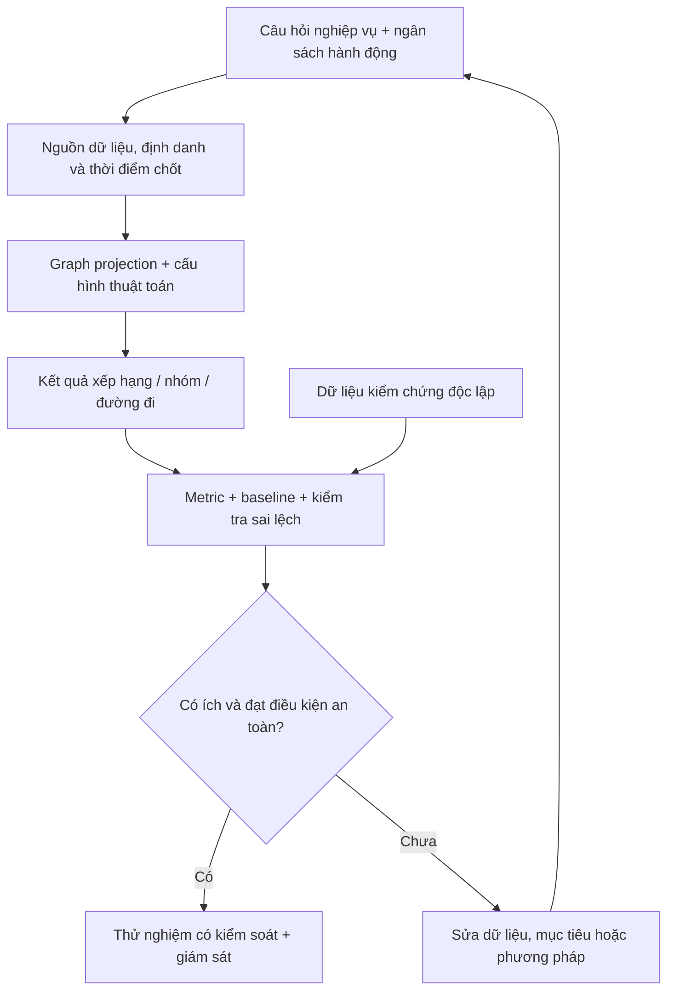
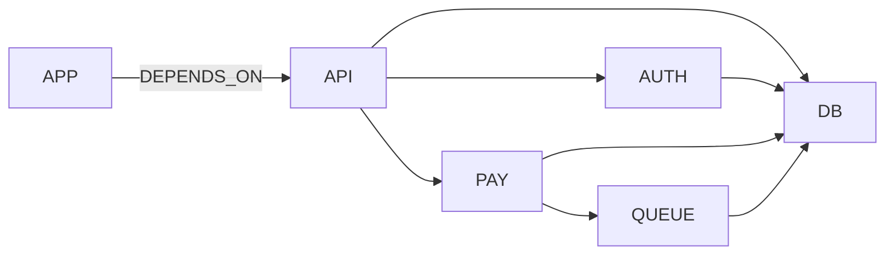

# Đánh giá kết quả thuật toán theo ý nghĩa nghiệp vụ và dữ liệu kiểm chứng trong Neo4j

## 1. Vì sao chạy thuật toán thành công chưa đồng nghĩa kết quả hữu ích?

Trong Neo4j, **property graph** biểu diễn dữ liệu bằng node, relationship và property. Các thuật toán đồ thị có thể xếp hạng node quan trọng, tìm cộng đồng, đề xuất liên kết, phát hiện cấu trúc bất thường hoặc tìm đường đi. Neo4j **Graph Data Science (GDS)** cung cấp nhiều thuật toán để chạy trên một đồ thị được chiếu (*graph projection*) vào bộ nhớ.

Giả sử GDS trả về một node có điểm PageRank cao nhất. Điều đó cho biết node ấy **nổi bật theo một phép tính trên đồ thị đã chọn**; nó **không tự chứng minh** node ấy có xác suất hỏng cao, gây thiệt hại lớn nhất hay cần đầu tư ngay. Tương tự, hai node thuộc cùng một community chưa chắc thuộc cùng một nhóm nghiệp vụ; một tuyến đường có chi phí toán học thấp nhất chưa chắc hợp lệ theo chính sách vận hành.

Bài thuộc chương **Thuật toán đồ thị** của mô-đun `DATABASE_ENGINE_GRAPH_NEO4J`. Nội dung kết nối cách mô hình hóa graph, truy vấn Cypher, GDS, index/constraint, kiểm tra dữ liệu và khả năng tích hợp Java Driver/Spring Data Neo4j để trả lời câu hỏi:

> **Kết quả thuật toán này có giúp quyết định nghiệp vụ tốt hơn phương án hiện tại hay không, và chúng ta có dữ liệu độc lập nào để kiểm chứng?**

Sau bài này, bạn sẽ có thể:

1. Chuyển mục tiêu nghiệp vụ thành đầu ra thuật toán và tiêu chí chấp nhận đo được.
2. Kiểm tra **đồ thị đầu vào, hướng relationship, property, tập node và thời điểm chụp dữ liệu**.
3. Xây dựng dữ liệu kiểm chứng (*ground truth*) đủ tin cậy và tránh rò rỉ dữ liệu tương lai.
4. Đánh giá ranking bằng `Precision@K`, `Recall@K`, `Lift@K`; so sánh baseline và hiểu giới hạn của metric.
5. Chọn tiêu chí phù hợp riêng cho PageRank, đường đi ngắn nhất, community detection, similarity và link prediction.
6. Ghi lại cấu hình, phiên bản, run ID và giám sát khi mô hình/đồ thị thay đổi.

> **Điều kiện chạy ví dụ:** Cypher cơ bản dùng Neo4j 5. Các ví dụ gọi `gds.*` chỉ hoạt động nếu **GDS đã được cài đặt, được cấp quyền và hỗ trợ chữ ký tương ứng**. APOC là một phần mở rộng khác, không phải điều kiện mặc định để dùng GDS. Một số tên thủ tục/cấu hình có thể thay đổi theo bản phát hành; hãy đối chiếu `SHOW PROCEDURES` trên hệ thống thực tế.

## 2. Bắt đầu từ quyết định nghiệp vụ, không phải tên thuật toán

Với hệ thống dịch vụ phần mềm, giả sử một relationship có hướng:

```text
(caller:Service)-[:DEPENDS_ON]->(dependency:Service)
```

Ý nghĩa là **caller cần dependency** để hoạt động. Một node có nhiều dịch vụ khác phụ thuộc vào có thể đáng ưu tiên kiểm thử khả năng chịu lỗi. Nhưng “được nhiều dịch vụ dùng” khác với “thường xuyên bị lỗi”.

Hãy viết hợp đồng đánh giá trước:

| Câu hỏi | Ví dụ câu trả lời cần chốt |
| --- | --- |
| Quyết định cần hỗ trợ? | Chọn 5 dịch vụ để kiểm thử phục hồi trong mỗi tuần |
| Tập ứng viên? | Các dịch vụ đang hoạt động, nằm trong phạm vi quyền quản trị |
| Hành động sau xếp hạng? | Đội SRE kiểm thử chaos/failover cho 5 dịch vụ đầu |
| Định nghĩa “có ích”? | Phát hiện nhiều dịch vụ có tác động gián đoạn đã được kiểm chứng hơn baseline |
| Bằng chứng độc lập? | Báo cáo sự cố, bản đồ phụ thuộc đã kiểm toán, thử nghiệm lỗi có kiểm soát |
| Chi phí sai? | Kiểm thử nhầm dịch vụ tốn công; bỏ sót dịch vụ quan trọng có thể gây gián đoạn |
| Giới hạn? | Không được dùng điểm PageRank như xác suất sự cố hoặc tự động ngắt dịch vụ |

Ví dụ trên có mục tiêu là **ưu tiên kiểm thử khả năng chịu lỗi**, không phải dự đoán xác suất hỏng. Nếu bài toán đổi thành “dịch vụ nào sẽ hỏng trong 7 ngày tới?”, chỉ có PageRank thường **không đủ**: cần dữ liệu độ tin cậy, lỗi, tải, thay đổi triển khai và một mô hình dự báo phù hợp.

Quy trình đánh giá đề xuất:



**Không được đảo ngược lập luận** bằng cách lấy một thuật toán có sẵn, nhìn vào các node xếp đầu rồi mới tự chọn một câu chuyện nghiệp vụ để chứng minh chúng “đúng”.

## 3. Ví dụ xuyên suốt: xếp hạng dịch vụ phụ thuộc bằng PageRank

### 3.1. Chuẩn bị một property graph nhỏ

Trong cơ sở dữ liệu thực hành, tạo sáu node demo. Dùng nhãn riêng `:GdsEvalService` để tránh trùng với dữ liệu ứng dụng. Chạy constraint trước:

```cypher
CREATE CONSTRAINT gds_eval_service_unique IF NOT EXISTS
FOR (s:GdsEvalService) REQUIRE s.id IS UNIQUE;
```

Tạo node:

```cypher
UNWIND ['APP', 'API', 'AUTH', 'PAY', 'DB', 'QUEUE'] AS serviceId
MERGE (s:GdsEvalService {id: serviceId});
```

Tạo relationship có hướng từ dịch vụ sử dụng đến dịch vụ được sử dụng:

```cypher
UNWIND [
  {from: 'APP',   to: 'API'},
  {from: 'API',   to: 'AUTH'},
  {from: 'API',   to: 'PAY'},
  {from: 'API',   to: 'DB'},
  {from: 'AUTH',  to: 'DB'},
  {from: 'PAY',   to: 'DB'},
  {from: 'PAY',   to: 'QUEUE'},
  {from: 'QUEUE', to: 'DB'}
] AS edge
MATCH (caller:GdsEvalService {id: edge.from})
MATCH (dependency:GdsEvalService {id: edge.to})
MERGE (caller)-[:EVAL_DEPENDS_ON]->(dependency);
```

Hình dung:



Với mô hình này, `DB` có nhiều **đường phụ thuộc đi vào** và có thể là điểm tập trung phụ thuộc. Nhưng hình vẽ chưa cho biết khả năng lỗi của DB, mức độ quan trọng của người dùng APP hay khả năng failover của từng service.

Kiểm tra graph đầu vào:

```cypher
MATCH (s:GdsEvalService)
RETURN count(s) AS nodeCount;
```

```cypher
MATCH (a:GdsEvalService)-[r:EVAL_DEPENDS_ON]->(b:GdsEvalService)
RETURN count(r) AS relationshipCount;
```

Với dữ liệu mẫu sạch, kết quả lần lượt là **6 node** và **8 relationship**. Nếu database đã có thêm node cùng nhãn từ bài thực hành khác, số lượng có thể cao hơn. Vì vậy cần kiểm tra tập nguồn trước khi so sánh với kết quả giả định.

### 3.2. Chạy baseline dễ giải thích: số dịch vụ phụ thuộc trực tiếp

Không cần GDS, ta có thể xếp hạng theo **in-degree** (*số node gọi vào*):

```cypher
MATCH (s:GdsEvalService)
OPTIONAL MATCH (caller:GdsEvalService)-[:EVAL_DEPENDS_ON]->(s)
RETURN s.id AS serviceId,
       count(DISTINCT caller) AS directDependents
ORDER BY directDependents DESC, serviceId ASC;
```

Trong graph demo, `DB` có bốn caller trực tiếp: `API`, `AUTH`, `PAY` và `QUEUE`. Baseline này đo được, dễ giải thích và có thể hữu ích nếu ngân sách kiểm thử có hạn.

**Giới hạn:** in-degree không xem xét tầm quan trọng của các caller, mức độ phụ thuộc gián tiếp hoặc cơ chế dự phòng. Một dịch vụ có nhiều caller không đương nhiên gây thiệt hại lớn nhất khi hỏng.

### 3.3. Kiểm tra tính khả dụng của GDS trước khi gọi

```cypher
SHOW PROCEDURES
YIELD name, signature
WHERE name IN [
  'gds.graph.project',
  'gds.pageRank.stream',
  'gds.graph.drop'
]
RETURN name, signature
ORDER BY name;
```

Nếu thiếu procedure, kiểm tra cài đặt GDS, quyền tài khoản và phiên bản Neo4j/GDS. **Không** thay việc kiểm tra bằng giả định “Neo4j luôn có sẵn GDS”. GDS có bộ catalog đồ thị trong bộ nhớ và hệ thống quyền riêng với dữ liệu lưu trên disk.

### 3.4. Chiếu đồ thị và chạy PageRank

Ví dụ dùng chữ ký GDS 2.x thông dụng:

```cypher
CALL gds.graph.project(
  'eval-service-pr-010',
  'GdsEvalService',
  'EVAL_DEPENDS_ON'
)
YIELD graphName, nodeCount, relationshipCount
RETURN graphName, nodeCount, relationshipCount;
```

Graph projection này chỉ chọn các node mang nhãn `GdsEvalService` và các relationship loại `EVAL_DEPENDS_ON` phù hợp. Nếu tên graph đã tồn tại trong catalog của người dùng, việc tạo lần nữa có thể thất bại: dùng tên khác hoặc chỉ dọn graph demo do chính bạn sở hữu sau khi chắc chắn không ai còn dùng.

Chạy PageRank ở chế độ **stream**, không ghi điểm vào property của node:

```cypher
CALL gds.pageRank.stream(
  'eval-service-pr-010',
  {dampingFactor: 0.85, maxIterations: 20}
)
YIELD nodeId, score
RETURN gds.util.asNode(nodeId).id AS serviceId,
       score
ORDER BY score DESC, serviceId ASC;
```

Đọc kết quả:

- `nodeId` trong kết quả GDS là định danh node được thuật toán sử dụng; dùng `gds.util.asNode(nodeId)` để lấy node trong cùng database ngữ cảnh khi phiên bản hỗ trợ. Đối với API và báo cáo lâu dài, nên lưu **`serviceId` nghiệp vụ**, không lưu chỉ mỗi ID nội bộ.
- `score` là điểm PageRank **trên graph projection và cấu hình đã chọn**. Điểm số không phải xác suất dịch vụ bị lỗi và không phải số lượng khách hàng sẽ bị ảnh hưởng.
- `ORDER BY score DESC, serviceId ASC` giúp kết quả **có thứ tự phân xử** nếu các điểm bằng nhau.
- `maxIterations` và `dampingFactor` ảnh hưởng kết quả; cần ghi lại chúng cùng graph version. Điều kiện dừng và độ hội tụ thực tế cũng cần kiểm tra theo cấu hình/phiên bản.

Với hướng `caller -> dependency`, các node nhận nhiều liên kết từ dịch vụ khác có thể được điểm cao hơn. Nếu đảo toàn bộ hướng relationship, **ý nghĩa PageRank thay đổi**. Chọn hướng dựa trên câu hỏi nghiệp vụ, không đổi hướng chỉ để có kết quả “đẹp”.

Sau khi sử dụng xong, nếu không còn tác vụ nào đang dùng graph demo:

```cypher
CALL gds.graph.drop('eval-service-pr-010')
YIELD graphName
RETURN graphName;
```

Lệnh trên giải phóng graph **trong catalog GDS**, không xóa các node `GdsEvalService` khỏi database Neo4j. Chỉ drop graph demo bạn sở hữu, không xóa projection đang phục vụ job khác.

### 3.5. Tại sao không so điểm PageRank trực tiếp với in-degree?

PageRank và in-degree có **thang điểm khác nhau**. Không kết luận PageRank “tốt hơn” chỉ vì giá trị điểm lớn hơn. Cần so:

1. Hai cách xếp hạng có chọn ra **cùng tập dịch vụ đầu K** hay không.
2. Những dịch vụ được chọn có đúng với **bằng chứng tác động** từ dữ liệu kiểm chứng hay không.
3. Nếu giao cùng ngân sách kiểm thử, cách nào tìm được nhiều trường hợp quan trọng hơn.
4. Chi phí tính toán, thời gian cập nhật, giải thích cho người vận hành và tác động của dữ liệu thiếu.

Đây mới là so sánh theo mục tiêu nghiệp vụ.

## 4. Xây dựng dữ liệu kiểm chứng độc lập

**Ground truth** là dữ liệu đại diện cho kết quả đúng hoặc kết quả cần dự báo theo định nghĩa nghiệp vụ. Không có ground truth hoàn hảo cho mọi thuật toán: community có thể không có “nhãn đúng” duy nhất; PageRank vốn không có nhãn true/false tự nhiên.

### 4.1. Chốt thời điểm: điều gì được phép biết khi tính điểm?

Giả sử muốn dự báo hay ưu tiên theo tác động của sự cố trong 7 ngày tới:

```text
Trước T0                              Sau T0
────────────────────────────────────┬─────────────────────
Graph, telemetry, quyền truy cập     │  Sự cố thực tế,
và property đã quan sát đến T0      │  mức độ ảnh hưởng
               ↓                    │        ↓
         Tính ranking               │  Ground truth
                                    └─ [T0, T0 + 7 ngày]
```

Quy tắc: graph projection và đặc trưng **không được chứa thông tin chỉ biết sau T0**. Cũng không được dùng nhãn sự cố của chính cửa sổ kiểm chứng để thiết kế tập ứng viên hoặc chọn tham số rồi lại báo cáo kết quả đó như kiểm thử độc lập.

Với dữ liệu có thời gian, cần kiểm tra:

- Ngày relationship bắt đầu và kết thúc có hiệu lực.
- Thời điểm ETL nhận được sự kiện, không chỉ timestamp do nguồn gửi.
- Các node dịch vụ đã ngừng hoạt động hay mới xuất hiện sau T0.
- Quyền của tenant, vùng triển khai và các bộ lọc thực tế của người dùng.
- Khả năng đường dẫn dữ liệu đã được bổ sung sau sự cố khi đội vận hành điều tra. Nếu đem dữ liệu hậu kiểm đó chiếu trở lại trước T0, sẽ xảy ra **data leakage**.

### 4.2. Định nghĩa nhãn phải tương ứng với quyết định

Ba nhãn dưới đây trả lời **ba câu hỏi khác nhau**:

| Nhãn kiểm chứng | Ý nghĩa | Có thể dùng để kết luận gì? |
| --- | --- | --- |
| `hadOutageInNext7Days` | Dịch vụ bị gián đoạn trong 7 ngày sau T0 | Bằng chứng cho bài toán **dự báo xảy ra sự cố**, không phải tác động khi hỏng |
| `affectedServicesIfFailed` | Số dịch vụ thực tế bị ảnh hưởng khi dịch vụ này lỗi | Đo **tác động quan sát được**, chỉ có với những tình huống đã lỗi hoặc được thử nghiệm |
| `expertCriticalTier` | Chuyên gia phân loại mức độ quan trọng theo tiêu chí đã quy định | Đo mức phù hợp với **đánh giá chuyên gia**, có thể mang sai lệch chủ quan |

Nếu nhiệm vụ là ưu tiên kiểm thử các **điểm phụ thuộc trọng yếu**, dữ liệu `affectedServicesIfFailed` từ thử nghiệm chaos/failover có kiểm soát hoặc từ báo cáo sự cố được điều tra kỹ thường gần ý nghĩa nghiệp vụ hơn nhãn “có lỗi hay không”.

**Thiên lệch lựa chọn:** dịch vụ chưa từng hỏng không có nghĩa là nếu hỏng thì không nguy hiểm. Đừng coi “chưa quan sát tác động” là “tác động bằng 0” trong đánh giá; có thể cần nhãn **unknown**, một tập kiểm chứng có quan sát đầy đủ hoặc kế hoạch lấy mẫu thử nghiệm có kiểm soát.

### 4.3. Tách dữ liệu dùng tính thuật toán và dữ liệu dùng chấm điểm

Một thiết kế chặt chẽ gồm:

1. **Feature/graph snapshot:** đồ thị và property tại thời điểm T0.
2. **Validation window:** dùng để chọn cấu hình như hướng cạnh, `dampingFactor`, K và ngưỡng lọc.
3. **Test window:** khoảng thời gian tương lai hoặc nhóm/tenant độc lập chưa được dùng để ra quyết định cấu hình.
4. **Baseline:** phương án hiện tại, chẳng hạn in-degree, quy tắc vận hành hoặc danh sách do con người chọn.

Đối với graph, chia ngẫu nhiên từng relationship có thể làm rò rỉ cấu trúc lân cận sang tập kiểm thử. Với link prediction hoặc node similarity, nên tách theo **thời điểm hình thành quan hệ** hoặc theo thiết kế đánh giá phù hợp, kiểm tra rằng cạnh đích không xuất hiện trong bất kỳ feature/projection nào ở mốc dự báo.

Khi dữ liệu rất mất cân bằng, tạo toàn bộ tập test với các ví dụ “âm” quá dễ cũng có thể làm kết quả đẹp giả tạo. Hãy chấm điểm trên **tập ứng viên mà ứng dụng thật sự sẽ xem xét**.

## 5. Đánh giá ranking bằng Precision@K, Recall@K và Lift@K

Nếu đội vận hành chỉ có thể kiểm thử **K = 3** dịch vụ mỗi tuần, bài toán là xếp hạng các ứng viên, không cần điểm `score` trở thành xác suất. Với nhãn kiểm chứng nhị phân độc lập:

- **Precision@K** = số trường hợp có nhãn dương trong top K / số phần tử thực được chọn.
- **Recall@K** = số trường hợp dương trong top K / tổng số trường hợp dương của tập ứng viên đã được đánh giá.
- **Prevalence** = tỷ lệ dương trong toàn tập ứng viên hợp lệ.
- **Lift@K** = Precision@K / Prevalence (khi mẫu số dương); lớn hơn 1 cho thấy top K giàu nhãn dương hơn trung bình của tập ứng viên.

Các metric có thể viết:

```text
TP@K       = số nhãn dương trong K kết quả đầu
Precision@K = TP@K / K               (khi có ít nhất K ứng viên)
Recall@K    = TP@K / TotalPositive  (khi TotalPositive > 0)
Lift@K      = Precision@K / (TotalPositive / TotalCandidates)
```

Nếu ứng viên ít hơn K, dùng mẫu số là **số thực được chọn** và ghi rõ. Nếu không có nhãn dương, Recall/Lift là **không xác định**, không nên tự đặt bằng 0 hoặc 1 mà không có quy ước báo cáo.

### 5.1. Dữ liệu nhỏ để tự tính, không phải đầu ra GDS thực tế

Để minh họa metric, giả sử một hệ thống chấm điểm đã trả bảng sau, đồng thời đội kiểm toán có nhãn sự cố **độc lập**:

| Vị trí | Dịch vụ | Điểm mô phỏng | Có sự cố trong cửa sổ kiểm chứng? |
| ---: | --- | ---: | --- |
| 1 | S1 | 0.92 | Có |
| 2 | S2 | 0.84 | Không |
| 3 | S3 | 0.77 | Có |
| 4 | S4 | 0.65 | Không |
| 5 | S5 | 0.50 | Có |
| 6 | S6 | 0.21 | Không |

> Đây là **điểm giả lập cho bài tập metric**, không phải điểm PageRank của đồ thị `GdsEvalService` ở mục 3. Nhãn “có sự cố” dùng để thực hành ranking; nếu mục tiêu thực sự là **tác động khi hỏng**, phải thay bằng nhãn tác động tương ứng.

Với `K = 3`: top 3 là `S1, S2, S3`, có hai dương tính; toàn bộ tập có ba dương tính.

```text
Precision@3 = 2 / 3 ≈ 0.667
Recall@3    = 2 / 3 ≈ 0.667
Prevalence  = 3 / 6 = 0.5
Lift@3      = (2 / 3) / 0.5 ≈ 1.333
```

### 5.2. Tính bằng Cypher không cần tạo node

Đoạn dưới chỉ dùng danh sách map, chạy được độc lập trong Neo4j:

```cypher
WITH [
  {id: 'S1', score: 0.92, incident: true},
  {id: 'S2', score: 0.84, incident: false},
  {id: 'S3', score: 0.77, incident: true},
  {id: 'S4', score: 0.65, incident: false},
  {id: 'S5', score: 0.50, incident: true},
  {id: 'S6', score: 0.21, incident: false}
] AS cases
UNWIND cases AS item
WITH item ORDER BY item.score DESC, item.id ASC
WITH collect(item) AS ranking
WITH ranking,
     ranking[0..3] AS topK,
     size([x IN ranking WHERE x.incident = true]) AS positives
WITH ranking, topK, positives,
     size([x IN topK WHERE x.incident = true]) AS hits
RETURN size(ranking) AS evaluatedCandidates,
       size(topK) AS selected,
       positives AS actualPositives,
       hits AS truePositives,
       toFloat(hits) / size(topK) AS precisionAt3,
       CASE WHEN positives = 0 THEN null
            ELSE toFloat(hits) / positives
       END AS recallAt3,
       CASE WHEN positives = 0 THEN null
            ELSE (toFloat(hits) / size(topK))
                 / (toFloat(positives) / size(ranking))
       END AS liftAt3;
```

Kết quả kỳ vọng là `selected = 3`, `actualPositives = 3`, `truePositives = 2` và các tỷ số nêu trên. `ORDER BY item.score DESC, item.id ASC` trước `collect` tạo danh sách có thứ tự phục vụ việc lấy top K; khóa `id` phân xử trường hợp hai điểm bằng nhau.

### 5.3. Metric phải gắn với ngân sách và tác động

`Precision@K` trả lời “trong K ca cần kiểm tra, có bao nhiêu ca đúng theo nhãn”. Nhưng nếu một dịch vụ có tác động tới 100.000 người dùng còn dịch vụ khác ảnh hưởng 10 người, hai true positive không nhất thiết mang **giá trị bằng nhau**.

Vì vậy, ngoài các metric @K, cân nhắc:

- **Utility@K:** tổng giá trị nghiệp vụ được bảo toàn/phát hiện trong top K, sau khi tính chi phí kiểm thử.
- **Cost-weighted recall:** mức độ tác động được bao phủ, dựa trên thang đo đã thống nhất.
- **Time-to-action:** thời gian từ dữ liệu mới đến quyết định mà đội vận hành dùng được.
- **False positive burden:** số lượt phân tích/kiểm thử tốn nguồn lực nhưng không cung cấp phát hiện mới.
- **Coverage:** bao nhiêu phần trăm dịch vụ/tenant được chấm điểm, bao nhiêu bản ghi bị thiếu nhãn.

Không ghép metric thành một “điểm tổng hợp” thiếu giải thích. Nếu có trọng số, phải công bố nguồn và lý do chọn trọng số.

## 6. So sánh baseline công bằng

Nếu đã có quy tắc nghiệp vụ đang hoạt động, kết quả thuật toán mới chỉ có ý nghĩa khi so được với quy tắc ấy **trên cùng dữ liệu**.

Các baseline khả dĩ:

| Baseline | Cách xây dựng | Câu hỏi cần trả lời |
| --- | --- | --- |
| In-degree | Đếm caller trực tiếp vào mỗi dịch vụ | PageRank có hơn một quy tắc dễ hiểu không? |
| Danh sách P0/P1 do đội SRE lập | Dùng mức criticality hiện tại | Thuật toán giúp phát hiện gì ngoài kiến thức hiện có? |
| Chọn ngẫu nhiên hợp lệ | Mẫu ngẫu nhiên trong cùng tập ứng viên | Mức tăng so với may rủi là bao nhiêu? |
| Quy tắc tải hoặc lượng truy cập | Xếp theo lưu lượng thực | Cấu trúc đồ thị bổ sung được gì so với telemetry? |

Để so công bằng:

1. Dùng **cùng tập ứng viên**, cùng tenant/quyền, thời điểm chốt và nhãn kiểm chứng.
2. Cấp cùng **ngân sách K**, hoặc cùng chi phí thực tế khi mỗi phép kiểm thử khác nhau.
3. Khóa thuật toán/cấu hình trước khi xem **test window**.
4. Báo cáo cả chất lượng lẫn chi phí chạy, độ phức tạp triển khai và khả năng giải thích.
5. Lặp lại ở nhiều cửa sổ thời gian hoặc nhóm hệ thống để tránh kết luận từ một tuần bất thường.

Kết quả `Lift@K > 1` so với prevalence chưa chứng minh PageRank hơn baseline hiện tại; baseline đơn giản có thể đạt lift cao hơn. Báo cáo nên có **bảng so sánh**, không chỉ một con số của mô hình mới.

## 7. Mỗi họ thuật toán cần cách kiểm chứng khác nhau

### 7.1. Centrality: PageRank, degree, betweenness

**Đầu ra:** điểm hoặc thứ hạng của node.

**Ý nghĩa thường gặp:** độ nổi bật do cấu trúc graph; “quan trọng” phải gắn với định nghĩa cạnh và câu hỏi nghiệp vụ. PageRank hướng tới sự quan trọng theo dòng liên kết; betweenness đo vai trò nằm trên các đường đi ngắn nhất theo định nghĩa thuật toán; degree là số liên kết cục bộ.

**Kiểm chứng phù hợp:**

- Ranking top K có trùng với các điểm gián đoạn tác động cao **được ghi nhận độc lập** không?
- Khi làm thử nghiệm lỗi có kiểm soát, những dịch vụ xếp cao có gây phạm vi ảnh hưởng lớn hơn không?
- So với in-degree và danh sách criticality đang dùng, độ bao phủ và chi phí thay đổi ra sao?

**Sai lầm:** diễn giải `PageRank = 0.2` thành “20% khả năng hỏng”, hoặc dùng thang điểm giữa **hai graph projection khác nhau** để so trực tiếp mà không hiệu chỉnh.

### 7.2. Community detection: Louvain, Leiden

**Đầu ra:** mỗi node được gán vào một community, có thể đi kèm chỉ số mô-đun hoặc kết quả phân cấp tùy thuật toán.

**Giá trị nghiệp vụ khả dĩ:** phân nhóm hệ thống có nhiều phụ thuộc nội bộ để hỗ trợ quan sát kiến trúc, phân quyền vận hành hoặc phát hiện ranh giới nhóm chưa rõ.

**Kiểm chứng:**

- Xem tỷ lệ relationship **nội nhóm/ngoại nhóm**, kích thước nhóm và các node cầu nối.
- Nếu có nhãn nhóm độc lập đủ tin cậy, dùng các thước đo so phân cụm như **ARI** hoặc **NMI**, bên cạnh kiểm tra bằng chuyên gia.
- Chạy lại theo snapshot hoặc seed khác nhau, xem cộng đồng có **ổn định** hay thay đổi mạnh.
- Khảo sát những nhóm quá nhỏ, quá lớn, hoặc chứa node thuộc tenant không được phép trộn.

**Sai lầm:** coi `communityId = 7` là một nhãn nghiệp vụ có ý nghĩa bền vững. ID nhóm là ký hiệu thuật toán, có thể đổi giữa các lần chạy; modularity cao không tự chứng minh “đúng cơ cấu tổ chức”.

### 7.3. Shortest path: BFS, Dijkstra và đường đi có trọng số

**Đầu ra:** một hoặc nhiều path và tổng chi phí theo quy tắc chọn đường.

**Ý nghĩa:** phụ thuộc vào **hướng cạnh**, điều kiện được phép đi và **đơn vị trọng số**. Đường ít hop nhất không nhất thiết là đường ít độ trễ, rẻ tiền hoặc ít rủi ro nhất.

Ví dụ hai lựa chọn:

```text
A ─────────9─────────> D
A ──3──> B ──4─────> D
```

Nếu trọng số là **độ trễ** và được cộng dồn, đường `A -> B -> D` có tổng `7`, tốt hơn đường trực tiếp `A -> D` có tổng `9` dù đi nhiều hop hơn. Nếu yêu cầu “ít hop nhất”, đáp án lại là `A -> D`.

**Kiểm chứng:**

- Kiểm tra từng cạnh của path **tồn tại và đúng hướng** ở snapshot được xét.
- Tính lại tổng trọng số bằng nguồn độc lập, đúng đơn vị; xác định cách xử lý trọng số thiếu và các giá trị âm.
- Kiểm tra quy định nghiệp vụ: tuyến bị cấm, đường không có thật, thời điểm đóng/mở kết nối, giới hạn tài nguyên.
- So chi phí thực tế với phương án vận hành hiện tại trên nhiều tuyến có ground truth.

**Sai lầm:** kết luận “đã tối ưu chi phí” khi mô hình chỉ dùng số hop, hoặc đưa quan hệ không có trọng số hợp lệ vào Dijkstra rồi hiểu nhầm ý nghĩa kết quả.

### 7.4. Node similarity và gợi ý liên kết

**Đầu ra:** cặp node có mức độ tương tự cao, ví dụ theo tập hàng xóm hoặc embedding.

**Kiểm chứng:** trong bài toán gợi ý, đánh giá `Precision@K`, `Recall@K`, tỷ lệ gợi ý được chấp nhận và độ đa dạng; phân tách tương lai để xác minh liệu quan hệ mới **thực sự xuất hiện sau thời điểm dự đoán**.

**Sai lầm:** cho rằng hai tài khoản có cùng hàng xóm thì cùng vai trò hay chắc chắn nên kết nối. Similarity là mô tả theo đặc trưng đã chọn, không phải “quan hệ thật”.

### 7.5. Link prediction và graph embedding

**Đầu ra:** xác suất/điểm dự báo liên kết hoặc vector biểu diễn node; điểm có thể cần hiệu chỉnh nếu muốn diễn giải như xác suất.

**Kiểm chứng:**

- Tách **edge tương lai** khỏi graph huấn luyện/chiếu và khỏi mọi đặc trưng; tránh tạo đường rò rỉ thông qua những property hậu nghiệm.
- Đánh giá trên tập ứng viên thực tế, gồm các trường hợp khó chứ không chỉ các negative dễ.
- Với sự kiện hiếm, xem **precision–recall curve / PR-AUC**, `Precision@K` và độ phù hợp với chi phí xử lý; **ROC-AUC** một mình có thể che giấu số false positive lớn.
- Theo dõi drift, node mới, cold start, độ công bằng giữa phân khúc và tính ổn định của embedding theo thời gian.

**Sai lầm:** chấm điểm dự báo “cạnh mới” bằng chính cạnh đã có trong graph dùng sinh embedding hoặc tạo mẫu test lệch quá xa tần suất ứng viên ở sản phẩm.

## 8. Đánh giá chất lượng graph đầu vào trước khi chấm thuật toán

Một kết quả có thể hợp lệ về toán học nhưng sai về nghiệp vụ vì **graph projection sai**.

### 8.1. Các kiểm tra tối thiểu

| Kiểm tra | Lý do |
| --- | --- |
| Tập nhãn node, loại relationship được chiếu | Tránh bỏ sót dịch vụ hoặc lẫn node thử nghiệm |
| Hướng relationship | Đảo hướng `DEPENDS_ON` có thể đổi ý nghĩa centrality/path |
| Trọng số và đơn vị đo | `cost` không đồng nghĩa `latencyMs`; không dùng giá trị âm khi thuật toán yêu cầu không âm |
| Trùng relationship hoặc tự liên kết | Có thể làm sai degree, PageRank, similarity và kết quả cộng đồng |
| Node cô lập và độ bao phủ | Node không có cạnh vẫn có thể quan trọng nghiệp vụ; biết vì sao không có trong kết quả |
| Dữ liệu theo thời gian | Không dùng cạnh/property chỉ xuất hiện sau T0 |
| Multi-tenant và quyền | Không chiếu hoặc chấm điểm chéo tenant khi không có quyền |
| Property thiếu/khác kiểu | Cấu hình trọng số và bộ lọc phải có cách xử lý xác định |

Ví dụ kiểm tra relationship trùng theo cùng cặp đầu mút:

```cypher
MATCH (a:GdsEvalService)-[r:EVAL_DEPENDS_ON]->(b:GdsEvalService)
WITH a, b, count(r) AS parallelRelationships
WHERE parallelRelationships > 1
RETURN a.id AS caller,
       b.id AS dependency,
       parallelRelationships
ORDER BY parallelRelationships DESC, caller, dependency;
```

Nếu kết quả có dòng, hãy quyết định relationship song song có hợp lệ theo nghiệp vụ hay là dữ liệu trùng. Không tự động `DISTINCT` hoặc xóa bớt khi mỗi quan hệ vốn biểu diễn một kênh phụ thuộc riêng.

Kiểm tra self-loop:

```cypher
MATCH (s:GdsEvalService)-[:EVAL_DEPENDS_ON]->(s)
RETURN s.id AS serviceId;
```

Một self-loop có thể hợp lệ trong graph khác; trong graph phụ thuộc dịch vụ, nó thường cần điều tra xem quan hệ có bị tạo sai hoặc mô hình hóa vòng nội bộ hay không.

### 8.2. Projection là ảnh của dữ liệu tại lúc tạo

GDS thường chạy thuật toán trên **named graph trong bộ nhớ**. Khi dữ liệu Neo4j được thay đổi sau lúc tạo projection, không mặc định thuật toán nhìn thấy thay đổi ấy ngay. Phải có chiến lược refresh/re-project hoặc cập nhật catalog theo chức năng GDS được phiên bản hỗ trợ.

Khi đánh giá, ghi lại:

```text
sourceSnapshotId
projectionCreatedAt
nodeLabels
relationshipTypes
relationshipOrientation
relationshipWeightProperty (nếu có)
nodeCount, relationshipCount
excludedNodes / missingProperties
```

Nếu thuật toán A chạy trên projection hôm qua còn baseline B truy vấn dữ liệu mới nhất hôm nay, so sánh kết quả có thể không công bằng.

## 9. Thiết kế thí nghiệm chống rò rỉ và kiểm tra độ ổn định

### 9.1. Chia dữ liệu theo thời gian

Một phương án **rolling-origin**:

```text
Lần 1: graph đến T1 → đánh giá kết quả (T1, T2]
Lần 2: graph đến T2 → đánh giá kết quả (T2, T3]
Lần 3: graph đến T3 → đánh giá kết quả (T3, T4]
```

Chỉ dùng các lần 1–2 để chọn thuật toán/cấu hình; giữ lần 3 như kiểm tra chưa nhìn trước. Với graph có thay đổi theo mùa/triển khai, thử nhiều cửa sổ và báo cáo mức dao động thay vì chỉ điểm trung bình.

### 9.2. Đánh giá ổn định của thứ hạng

Ngay cả khi metric @K tương đối tốt, hai lần chạy có thể đưa ra hai tập dịch vụ rất khác nhau. Có thể so:

- **Jaccard@K:** kích thước giao của hai tập top K chia kích thước hợp của chúng.
- **Rank correlation:** mức tương đồng thứ tự trên cùng tập node, khi cách xử lý node thiếu được xác định.
- **Sensitivity:** kết quả thay đổi thế nào khi loại bỏ một cạnh nghi ngờ, thay hướng cạnh có lỗi hoặc thay nhỏ tham số.
- **Coverage drift:** số node không có score, node mới, node biến mất và tỷ lệ cạnh thiếu.

Nếu một thay đổi ETL nhỏ làm top 5 biến động hoàn toàn, đội vận hành cần biết trước khi tích hợp ranking vào quy trình kiểm thử.

### 9.3. Ước lượng độ không chắc chắn

Không lấy `Precision@3 = 0.667` trên sáu ví dụ rồi tuyên bố thuật toán đã được chứng minh ưu việt. Nên đánh giá trên số lượng đủ lớn, báo cáo các nhóm thời gian/tenant, và ước lượng độ tin cậy bằng cách lấy mẫu lại ở **mức nhóm độc lập** phù hợp (ví dụ theo tuần hoặc hệ thống), thay vì mặc định từng relationship là quan sát độc lập.

Khi có nhiều ứng viên không có nhãn, ghi rõ **label coverage** và kiểm tra thiên lệch: những dịch vụ được kiểm thử nhiều hơn dễ được gắn nhãn, có thể khiến thuật toán đang được dùng có vẻ tốt hơn một cách giả tạo.

## 10. Từ metric offline đến tác động nghiệp vụ thực tế

Một ranking vượt baseline trên dữ liệu lịch sử là **điều kiện cần**, chưa chắc là điều kiện đủ để đưa vào vận hành.

### 10.1. Thử nghiệm có kiểm soát

Với hệ thống SRE, có thể chọn một giai đoạn **shadow mode**:

1. Chạy ranking GDS nhưng chưa tác động trực tiếp lên lịch kiểm thử.
2. So top K của GDS và baseline hiện tại trên cùng tập dịch vụ.
3. Đưa một tập trường hợp đã chọn vào quy trình kiểm thử lỗi được phê duyệt, có giới hạn tác động.
4. Ghi lại mức ảnh hưởng thực tế, chi phí nhân lực và tỷ lệ phát hiện mới.
5. Chỉ mở rộng khi kết quả đáng tin cậy và có cơ chế dừng an toàn.

Không dùng PageRank để tự động vô hiệu hóa dịch vụ quan trọng. Kết quả thuật toán nên hỗ trợ ra quyết định có thể giải thích và kiểm soát.

### 10.2. Theo dõi sau triển khai

| Nhóm giám sát | Ví dụ chỉ số |
| --- | --- |
| Dữ liệu | Số node/cạnh, tỷ lệ thiếu trọng số, độ trễ ETL, dữ liệu ngoài cửa sổ |
| Thuật toán | Thời gian chạy, bộ nhớ projection, trạng thái hội tụ, top-K overlap |
| Chất lượng | Precision@K trên nhãn đến trễ, coverage, utility, drift theo tenant |
| Nghiệp vụ | Số phát hiện hữu ích/tuần, thời gian kiểm thử, chi phí sự cố giảm |
| An toàn | Quyền truy cập, danh sách dịch vụ không được thử nghiệm, cảnh báo sai lệch |

Khi nhãn chỉ có sau vài tuần, dashboard phải ghi rõ **mốc tính điểm** và **mốc có nhãn**; không coi nhãn chưa đến là false. Phân tích “kết quả đã cải thiện” cần xem cả những thay đổi ngoài thuật toán như quy trình SRE, hạ tầng và mùa vụ.

## 11. Tích hợp Java Driver và Spring Data Neo4j

### 11.1. Gọi GDS stream từ Java Driver

Sau khi projection được tạo và GDS có quyền chạy, Java Driver có thể dùng parameter cho tên graph và cấu hình:

```java
import java.util.List;
import java.util.Map;
import org.neo4j.driver.Driver;
import org.neo4j.driver.Session;
import org.neo4j.driver.SessionConfig;

public final class ServiceRanking {
    public record RankedService(String serviceId, double score) {}

    public static List<RankedService> readTopK(
        Driver driver, String graphName, int topK
    ) {
        if (graphName == null || graphName.isBlank()
            || topK < 1 || topK > 100) {
            throw new IllegalArgumentException("Invalid ranking request");
        }

        String cypher = """
            CALL gds.pageRank.stream(
              $graphName,
              {dampingFactor: 0.85, maxIterations: 20}
            )
            YIELD nodeId, score
            RETURN gds.util.asNode(nodeId).id AS serviceId, score
            ORDER BY score DESC, serviceId ASC
            LIMIT $topK
            """;

        try (Session session =
                 driver.session(SessionConfig.forDatabase("neo4j"))) {
            return session.executeRead(tx ->
                tx.run(cypher, Map.of(
                    "graphName", graphName,
                    "topK", topK
                )).list(record -> new RankedService(
                    record.get("serviceId").asString(),
                    record.get("score").asDouble()
                ))
            );
        }
    }
}
```

**Lưu ý quan trọng:** `LIMIT $topK` chỉ giới hạn **số dòng kết quả trả về sau tính toán**. Không được kết luận GDS chỉ xử lý K node của projection; PageRank thường cần xem xét toàn graph được chiếu. Phải đo chi phí thực tế trước khi gọi lại cho từng HTTP request. Với graph lớn, có thể chạy ranking định kỳ, lưu kết quả cùng `runId` và phục vụ API từ dữ liệu đã kiểm tra.

Giữ tên graph, quyền và thời điểm tạo projection được kiểm soát từ backend; không để client tự đặt tên projection chứa dữ liệu không thuộc quyền của họ. Khi lưu kết quả, dùng `serviceId` bền vững và metadata của lần chạy.

### 11.2. Vai trò của Spring Data Neo4j

Spring Data Neo4j thích hợp khi quản lý entity/relationship nghiệp vụ và truy vấn ứng dụng. Đối với GDS, có thể dùng `Neo4jClient` hoặc truy vấn Cypher qua cơ chế được hỗ trợ để đọc kết quả stream thành DTO. **Graph projection trong GDS không phải một bảng entity tự động cập nhật** trong repository SDN; cần điều phối vòng đời projection và job thuật toán riêng.

Không tự động `SET s.riskProbability = score`: PageRank **không phải xác suất rủi ro**. Nếu lưu score vào graph để hiển thị, hãy đặt tên chính xác như `pageRankScore`, gắn `runId`/thời điểm/tập projection và có chính sách hết hạn khi dữ liệu thay đổi.

### 11.3. Kiểm tra hiệu năng bằng công cụ phù hợp

- Dùng `EXPLAIN` và `PROFILE` cho truy vấn Cypher chuẩn bị dữ liệu, bộ lọc, tìm node nguồn và truy vấn đọc kết quả theo quy tắc vận hành.
- Với GDS, xem **thống kê chạy, graph catalog, log và tài nguyên** theo khả năng của phiên bản; không giả định `EXPLAIN` của Cypher thể hiện toàn bộ tính toán thuật toán trong GDS như một plan operator thông thường.
- Index và constraint giúp truy vấn tìm node theo ID/thuộc tính trong Neo4j, nhưng không tự khiến bước PageRank trong graph projection nhanh hơn theo tỷ lệ tương ứng. Hiệu năng GDS phụ thuộc kích thước đồ thị, cấu trúc liên kết, cấu hình và phần cứng.

## 12. Những sai lầm thường gặp

| Nhầm lẫn | Hệ quả | Cách xử lý |
| --- | --- | --- |
| “PageRank cao là khả năng hỏng cao” | Ra quyết định sai bản chất metric | Diễn giải điểm theo topology; dùng nhãn và mô hình phù hợp mục tiêu |
| Graph bị đảo chiều cạnh | Ranking phản ánh chiều quan hệ không mong muốn | Kiểm tra semantics `caller -> dependency` trước projection |
| Điểm trên hai graph khác nhau đem so trực tiếp | Khác tập node, liên kết hoặc chuẩn hóa | So ranking/metric trên cùng tập ứng viên và cấu hình được lưu |
| Dùng nhãn từ tương lai để tạo graph hiện tại | Data leakage | Chốt cutoff và tách nguồn feature khỏi label window |
| Chỉ dùng ROC-AUC khi liên kết dương rất hiếm | Bỏ qua nhiều false positive ở top K | Xem PR-AUC, Precision@K và chi phí nghiệp vụ |
| Chấm chất lượng community bằng mỗi modularity | Nhóm toán học chưa chắc là nhóm nghiệp vụ | Thêm nhãn độc lập, chuyên gia và độ ổn định |
| Đường đi ít hop được coi là rẻ nhất | Bỏ qua trọng số/giới hạn thực tế | Kiểm tra đúng cost function và ràng buộc |
| Baseline chạy trên snapshot mới hơn | So sánh thiếu công bằng | Dùng cùng cutoff và tập ứng viên |
| Score tốt nhờ chọn ví dụ dễ | Chất lượng thật bị thổi phồng | Test theo thời gian, negative hợp lý và coverage |
| Chạy lại projection cũ sau khi dữ liệu thay đổi | Kết quả không phản ánh hiện trạng | Quản lý refresh/re-project và phiên bản |
| Chỉ nhìn metric trung bình | Che giấu lỗi ở tenant nhỏ hoặc hệ thống quan trọng | Báo cáo theo phân khúc và quan sát kết quả sai |
| Hiểu `LIMIT 10` là thuật toán tính 10 node | Dự báo sai chi phí tính toán | Đo toàn bộ thời gian và bộ nhớ GDS |

## 13. Bài tập thực hành có gợi ý

### Bài 1: Diễn giải điểm theo nghiệp vụ

`DB` có PageRank cao hơn `APP` trong graph demo. Có thể kết luận `DB` có xác suất hỏng cao hơn `APP` không? Nếu nhiệm vụ là chọn ba dịch vụ cần thử nghiệm tác động khi hỏng, dữ liệu kiểm chứng nào cần có?

**Gợi ý:** không. PageRank mô tả sự quan trọng theo topology được chiếu. Cần số dịch vụ/người dùng bị ảnh hưởng khi lỗi, báo cáo sự cố hoặc thử nghiệm có kiểm soát, kèm so sánh baseline và chi phí.

### Bài 2: Tính metric top K

Với sáu trường hợp `S1..S6` ở mục 5, hãy tính `Precision@3`, `Recall@3` và `Lift@3`. Nếu top 3 của baseline chỉ chứa **một** trong ba trường hợp dương, baseline có precision bao nhiêu?

**Đáp án:** thuật toán giả lập có `2/3`, `2/3`, `(2/3)/(3/6) = 4/3`. Baseline có `Precision@3 = 1/3`. Kết luận chỉ có ý nghĩa nếu cùng nhãn, tập ứng viên và ngân sách K.

### Bài 3: Đường ít hop và đường có tổng chi phí thấp nhất

Cho các cạnh `A -> D` trọng số 9, `A -> B` trọng số 3 và `B -> D` trọng số 4. Chọn đường nếu tối ưu số hop; chọn đường nếu tối ưu tổng độ trễ.

**Đáp án:** ít hop là `A -> D` (1 hop); độ trễ là `A -> B -> D` (tổng 7, nhỏ hơn 9). Trước khi dùng Dijkstra phải kiểm tra trọng số, hướng và tính hợp lệ của mô hình.

### Bài 4: Phát hiện data leakage

Ngày 20/11, hệ thống tính điểm để dự báo sự cố từ 21–27/11. Sau một sự cố ngày 24/11, đội vận hành bổ sung thêm cạnh phụ thuộc còn thiếu, rồi dùng graph ngày 25/11 để “kiểm chứng lại” dự báo ngày 20/11. Có vấn đề gì?

**Gợi ý:** graph chứa thông tin được phát hiện sau cutoff 20/11; đó là rò rỉ dữ liệu tương lai. Phải dùng snapshot và kiến thức thực sự có tại 20/11, sau đó dùng nhãn từ cửa sổ tương lai để chấm.

### Bài 5: Community ID thay đổi

Louvain tạo `communityId = 2` cho nhóm dịch vụ thanh toán ở lần chạy thứ nhất, rồi `communityId = 5` ở lần sau. Có thể kết luận nhóm đã thay đổi không?

**Gợi ý:** không. ID nhóm là ký hiệu; hãy so **tập thành viên**, overlap, mức ổn định và dữ liệu snapshot. ID 2 và 5 có thể chỉ khác tên nhưng cùng tập node.

### Bài 6: Thiết kế một đánh giá hoàn chỉnh

Bạn có dữ liệu phụ thuộc giữa 10.000 dịch vụ và được phép kiểm thử 20 dịch vụ mỗi tuần. Hãy mô tả:

1. Phạm vi ứng viên và ý nghĩa hướng relationship.
2. Snapshot trước T0, nhãn tác động độc lập, chính sách với dịch vụ chưa có thử nghiệm.
3. Baseline và metric @20, cùng chi phí/giới hạn an toàn.
4. Cách kiểm tra graph thiếu cạnh, các tenant và khả năng thay đổi ranking.
5. Điều kiện chuyển từ đánh giá offline sang shadow mode và vận hành.

**Đáp án tham khảo:** dùng dependency graph có hướng, in-degree hoặc xếp hạng SRE làm baseline; đánh giá trên nhãn tác động đã kiểm toán với unknown được phân biệt; so Precision@20/utility@20, tài nguyên tính toán, độ ổn định và kết quả theo tenant; chỉ triển khai sau các đợt thử nghiệm có kiểm soát.

## 14. Checklist trước khi sử dụng kết quả thuật toán

- [ ] Có quyết định nghiệp vụ cụ thể, giới hạn hành động và tiêu chí thành công.
- [ ] Hiểu điểm thuật toán **đo cái gì** và **không đo cái gì**.
- [ ] Node, relationship, hướng, trọng số và quyền truy cập trong projection được xác minh.
- [ ] Graph và tập ứng viên có snapshot/cutoff rõ ràng; biết dữ liệu bị thiếu hoặc bị loại.
- [ ] Ground truth có nguồn độc lập, định nghĩa nhãn và thời gian tương ứng mục tiêu.
- [ ] Không có leakage từ graph/feature sang label window hoặc từ test sang chọn cấu hình.
- [ ] Có baseline đáng tin cậy trên cùng tập ứng viên và cùng ngân sách.
- [ ] Metric phù hợp: ranking @K, route cost, community stability, PR-AUC hoặc utility thực tế.
- [ ] Có phân tích sai lệch, false positive/negative, nhóm nhỏ và nhãn unknown.
- [ ] Kết quả ổn định qua các cửa sổ thời gian và thay đổi graph hợp lý.
- [ ] Ghi được run ID, phiên bản GDS/Neo4j, projection, tham số, seed khi hỗ trợ, nhãn và kết quả.
- [ ] Java Driver/SDN không nhầm điểm cấu trúc với xác suất hay tạo quyết định tự động ngoài kiểm soát.
- [ ] Có thử nghiệm nghiệp vụ, cơ chế giám sát và khả năng dừng/rollback việc sử dụng ranking.

## Kết luận

**Đúng thuật toán chưa đủ; cần đúng câu hỏi, đúng đồ thị và đúng bằng chứng kiểm chứng.** PageRank, community detection, shortest path và similarity đều tạo ra kết quả có ý nghĩa toán học riêng, nhưng chỉ trở thành công cụ ra quyết định khi kết quả được diễn giải theo nghiệp vụ, so với baseline trên cùng dữ liệu và đánh giá bằng nhãn hoặc ràng buộc độc lập phù hợp. Cách làm có hệ thống là **chốt mục tiêu → kiểm tra graph projection → chạy thuật toán → đo với dữ liệu kiểm chứng → phân tích sai lệch → thử nghiệm có kiểm soát → giám sát**. Khi làm vậy, Neo4j và GDS không chỉ tạo ra các con số mà còn cung cấp kết quả có thể giải thích, tái lập và hành động một cách có trách nhiệm.

### Tài liệu tham khảo

- [Neo4j Graph Data Science — Documentation](https://neo4j.com/docs/graph-data-science/current/)
- [Neo4j GDS — Graph catalog](https://neo4j.com/docs/graph-data-science/current/management-ops/graph-catalog/)
- [Neo4j GDS — PageRank](https://neo4j.com/docs/graph-data-science/current/algorithms/page-rank/)
- [Neo4j GDS — Louvain](https://neo4j.com/docs/graph-data-science/current/algorithms/louvain/)
- [Neo4j GDS — Dijkstra source-target](https://neo4j.com/docs/graph-data-science/current/algorithms/dijkstra-source-target/)
- [Neo4j Cypher Manual — Execution plans](https://neo4j.com/docs/cypher-manual/current/planning-and-tuning/execution-plans/)
- [Neo4j Java Driver Manual](https://neo4j.com/docs/java-manual/current/)
