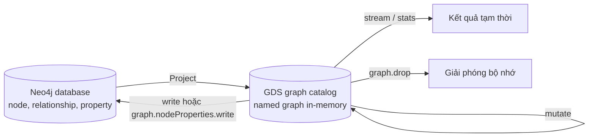
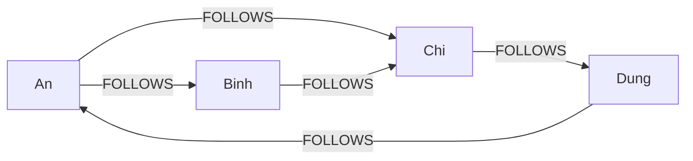

# Quản lý vòng đời đồ thị chiếu và cập nhật kết quả về dữ liệu nguồn trong Neo4j GDS

## 1. Hai lớp đồ thị: dữ liệu nguồn và đồ thị phân tích

Trong **Neo4j**, dữ liệu nghiệp vụ tồn tại trong *property graph* của database: node có label/property, relationship có type, hướng và property. Cypher dùng để tạo, truy vấn và cập nhật dữ liệu đó. **Neo4j Graph Data Science (GDS)** bổ sung thuật toán phân tích đồ thị như PageRank, Louvain, Weakly Connected Components, Node Similarity và các thuật toán đường đi.

Để chạy phần lớn thuật toán GDS nhiều lần, ứng dụng thường **chiếu (project)** một phần dữ liệu nguồn sang **named graph nằm trong bộ nhớ** của *graph catalog*. Ví dụ, từ các node `:GdsLifecycleUser` cùng relationship `:FOLLOWS`, ta tạo graph tên `gds_lifecycle_demo` để tính độ quan trọng của người dùng.

Hai graph có **vòng đời độc lập**:

| Khía cạnh | Đồ thị nguồn trong Neo4j database | Đồ thị chiếu trong GDS graph catalog |
| --- | --- | --- |
| Nơi lưu | Neo4j database, quản lý bởi database engine | Cấu trúc dữ liệu tối ưu cho thuật toán, chủ yếu trong bộ nhớ |
| Dữ liệu | Node, relationship, property nghiệp vụ | Các node, relationship, hướng và thuộc tính **đã chọn lúc chiếu** |
| Cách đọc | `MATCH ... RETURN` | Thuật toán GDS, `gds.graph.*.stream` |
| Cách sửa | Cypher `SET`/`CREATE`/`DELETE`, Java Driver, Spring Data Neo4j | GDS graph operations hoặc thuật toán ở chế độ `mutate` |
| Đồng bộ tự động | Nhận các transaction được commit | **Không tự cập nhật theo transaction mới ở nguồn** |
| Xóa | Xóa dữ liệu bằng Cypher theo transaction | `gds.graph.drop(...)` chỉ loại graph khỏi catalog, giải phóng bộ nhớ |
| Khởi động lại | Dữ liệu đã commit vẫn tồn tại | Named graph thông thường biến mất khi database/DBMS dừng; cần chiếu hoặc khôi phục lại |

Hình dung luồng:



**Điểm phân biệt:** `mutate` thay đổi graph trong GDS; `write` cập nhật database nguồn. Việc tính xong thuật toán **không** có nghĩa kết quả đã được ghi vào các node nghiệp vụ.

## 2. Xác định vòng đời đầy đủ trước khi chạy thuật toán

Một job GDS có kiểm soát thường qua các bước:

1. **Chuẩn bị nguồn:** định nghĩa tập node/relationship, kiểm tra khóa nghiệp vụ, type dữ liệu, hướng và quyền truy cập.
2. **Ước lượng:** xem quy mô node/relationship, dung lượng graph chiếu và bộ nhớ thuật toán.
3. **Project:** tạo named graph trong catalog với tên và phạm vi rõ ràng.
4. **Kiểm tra:** xác minh graph tồn tại, đúng số node/cạnh, schema, hướng và bộ nhớ.
5. **Compute:** chạy thuật toán ở chế độ `stream` hoặc `stats` để khảo sát, `mutate` để xâu chuỗi thuật toán.
6. **Write back nếu cần:** dùng `algorithm.write` hoặc `gds.graph.nodeProperties.write` để lưu kết quả trở lại database nguồn, sau đó đọc lại bằng Cypher.
7. **Dọn dẹp:** `gds.graph.drop` khi không dùng nữa; nếu nguồn đổi và cần phân tích cập nhật thì **chiếu lại**.

Trước khi viết pipeline, cần trả lời ba câu hỏi:

- Kết quả chỉ phục vụ một báo cáo, hay phải được ứng dụng khác **truy vấn lại lâu dài**?
- Nếu dữ liệu nguồn liên tục thay đổi, graph phân tích được phép **cũ tối đa bao lâu**?
- Job cần giữ các kết quả trung gian giữa nhiều thuật toán hay chỉ chạy một thuật toán rồi bỏ graph?

Các câu trả lời quyết định chọn `stream`, `mutate` hay `write`, cũng như thời điểm giải phóng bộ nhớ.

## 3. Chuẩn bị GDS và dữ liệu mẫu

### 3.1. Kiểm tra GDS có được cài đặt và được phép dùng

GDS là **thư viện riêng** so với Cypher và APOC, có yêu cầu tương thích về phiên bản Neo4j, edition và môi trường triển khai. Trên Neo4j tự quản lý, cần cài/cấu hình GDS theo tài liệu; trên Aura, sử dụng các khả năng được dịch vụ tương ứng cung cấp. Không mặc định database nào cũng có GDS.

Kiểm tra:

```cypher
RETURN gds.version() AS gdsVersion;
```

```cypher
SHOW PROCEDURES
YIELD name
WHERE name STARTS WITH 'gds.graph.'
   OR name STARTS WITH 'gds.pageRank.'
RETURN name ORDER BY name;
```

Nếu gặp lỗi không tìm thấy hàm/procedure hoặc không đủ quyền, kiểm tra phiên bản plugin, database đang chọn và quyền gọi procedure. **Quyền tạo graph trong catalog và quyền ghi dữ liệu nguồn không giống nhau**. Ví dụ `stream` có thể được cho phép nhưng `write` không được phép.

### 3.2. Dữ liệu Demo: bốn người dùng và quan hệ theo dõi

Thực hiện các câu lệnh sau **trên database thử nghiệm**. Khóa `userId` được dùng để xác minh định danh trong Neo4j, còn GDS sử dụng ID nội bộ của graph khi tính toán.

```cypher
CREATE CONSTRAINT gds_lifecycle_user_id IF NOT EXISTS
FOR (u:GdsLifecycleUser)
REQUIRE u.userId IS UNIQUE;
```

```cypher
MERGE (a:GdsLifecycleUser {userId: 'gds-u-1'})
  ON CREATE SET a.name = 'An'
MERGE (b:GdsLifecycleUser {userId: 'gds-u-2'})
  ON CREATE SET b.name = 'Binh'
MERGE (c:GdsLifecycleUser {userId: 'gds-u-3'})
  ON CREATE SET c.name = 'Chi'
MERGE (d:GdsLifecycleUser {userId: 'gds-u-4'})
  ON CREATE SET d.name = 'Dung'
MERGE (a)-[:FOLLOWS]->(b)
MERGE (a)-[:FOLLOWS]->(c)
MERGE (b)-[:FOLLOWS]->(c)
MERGE (c)-[:FOLLOWS]->(d)
MERGE (d)-[:FOLLOWS]->(a);
```

Sơ đồ:



Kiểm tra số lượng từ database nguồn:

```cypher
MATCH (u:GdsLifecycleUser)
RETURN count(u) AS sourceNodes;
```

```cypher
MATCH (a:GdsLifecycleUser)-[r:FOLLOWS]->(b:GdsLifecycleUser)
RETURN count(r) AS sourceRelationships;
```

Trên database chỉ có dữ liệu demo vừa tạo, dự kiến **4 node** và **5 relationship**. Nếu đã có thêm node cùng label hoặc quan hệ cùng type, số đếm có thể khác. `MERGE` giúp hạn chế tạo trùng dữ liệu theo khóa nghiệp vụ; các lệnh demo không nhằm xóa hoặc đặt lại dữ liệu đã tồn tại.

## 4. Ước lượng bộ nhớ và tạo đồ thị chiếu

### 4.1. Ước lượng trước khi project

Đối với graph lớn, ước lượng kích thước graph trước khi chiếu:

```cypher
CALL gds.graph.project.estimate(
  'GdsLifecycleUser',
  'FOLLOWS'
)
YIELD nodeCount, relationshipCount, requiredMemory
RETURN nodeCount, relationshipCount, requiredMemory;
```

Lệnh `.estimate` **không tạo** named graph. Nó giúp đánh giá dữ liệu sẽ được nạp và mức bộ nhớ, nhưng là **ước lượng**, không phải bộ nhớ thực tế. Khi một graph dùng orientation `UNDIRECTED`, quan hệ có thể được biểu diễn ở cả hai hướng nên số cạnh GDS khác số quan hệ vật lý trong database.

Đối với thuật toán lớn, còn có `gds.pageRank.mutate.estimate(...)`, `gds.pageRank.write.estimate(...)` và các chế độ estimate của thuật toán cụ thể. Cần ước lượng **cả graph và thuật toán**, đặc biệt khi chạy nhiều job song song trên cùng heap.

### 4.2. Tạo named graph

```cypher
CALL gds.graph.project(
  'gds_lifecycle_demo',
  'GdsLifecycleUser',
  {FOLLOWS: {orientation: 'NATURAL'}}
)
YIELD graphName, nodeCount, relationshipCount, projectMillis
RETURN graphName, nodeCount, relationshipCount, projectMillis;
```

Các thành phần:

- `'gds_lifecycle_demo'`: tên graph trong catalog. Tên phải khác các graph đã tồn tại trong phạm vi catalog của user/database.
- `'GdsLifecycleUser'`: chỉ chiếu node mang label đó.
- `FOLLOWS`: chỉ chiếu relationship có type này và có hai đầu nằm trong tập node được chọn.
- `orientation: 'NATURAL'`: giữ chiều quan hệ như trong database Neo4j. Có thể chọn `UNDIRECTED` hoặc `REVERSE` nếu **đúng ngữ nghĩa thuật toán**.
- `projectMillis`: thời gian chiếu theo summary của GDS, không phải thời gian chạy thuật toán.

Trong bộ dữ liệu demo độc lập, kết quả dự kiến là `nodeCount = 4` và `relationshipCount = 5`. Lệnh này chỉ tạo graph **trong bộ nhớ**; không tạo bản sao node trong Neo4j database và không ghi thuộc tính PageRank.

**Chạy lại cùng tên:** `gds.graph.project` sẽ báo lỗi nếu named graph cùng tên vẫn có trong catalog. Hãy kiểm tra `gds.graph.exists` trước. Chỉ drop graph khi chắc chắn nó thuộc job mình sở hữu và không còn thuật toán nào đang sử dụng.

### 4.3. Phân biệt native projection và Cypher projection

Ví dụ trên dùng **native projection** vì chỉ cần label/type và hướng. Khi muốn chiếu theo điều kiện phức tạp, một cách khác là **Cypher projection** qua hàm tổng hợp `gds.graph.project(...)`:

```cypher
MATCH (a:GdsLifecycleUser)-[r:FOLLOWS]->(b:GdsLifecycleUser)
WHERE a.userId IN ['gds-u-1', 'gds-u-2']
RETURN gds.graph.project(
  'gds_lifecycle_subset',
  a,
  b,
  {
    sourceNodeLabels: labels(a),
    targetNodeLabels: labels(b),
    relationshipType: type(r)
  }
) AS projection;
```

Ví dụ này chỉ chiếu các node và relationship xuất hiện trong các dòng `MATCH` thỏa điều kiện; **node cô lập không có trong các dòng đó sẽ không tự được đưa vào**. Cypher projection có cách xử lý node cô lập, thuộc tính và định danh riêng; xem tài liệu phiên bản cụ thể khi cần.

Trên GDS hiện hành, `gds.graph.project.cypher(...)` ở dạng **procedure cũ** đã deprecated; tránh dùng hướng dẫn cũ từ Neo4j 4.x/5.x mà chưa đối chiếu API mới. Native projection đủ cho bài thực hành tiếp theo; graph subset chỉ để minh họa tình huống cần lọc. Nếu đã chạy ví dụ tạo `gds_lifecycle_subset`, hãy chủ động `CALL gds.graph.drop('gds_lifecycle_subset', false)` khi không dùng nữa để tránh giữ graph phụ trong bộ nhớ.

## 5. Quản lý graph catalog: `exists`, `list` và `drop`

### 5.1. Kiểm tra graph có tồn tại

```cypher
CALL gds.graph.exists('gds_lifecycle_demo')
YIELD graphName, exists
RETURN graphName, exists;
```

Hoặc gọi dưới dạng function:

```cypher
RETURN gds.graph.exists('gds_lifecycle_demo') AS graphExists;
```

Nếu `exists = false`, thuật toán gọi graph này sẽ không chạy. Một tình huống thường gặp là database vừa restart, graph catalog trong bộ nhớ đã mất mặc dù node/relationship **nguồn vẫn nguyên**.

### 5.2. Liệt kê metadata của graph

```cypher
CALL gds.graph.list('gds_lifecycle_demo')
YIELD graphName, nodeCount, relationshipCount,
      memoryUsage, creationTime, modificationTime
RETURN graphName, nodeCount, relationshipCount,
       memoryUsage, creationTime, modificationTime;
```

Để xem các graph mà user có quyền truy cập:

```cypher
CALL gds.graph.list()
YIELD graphName, nodeCount, relationshipCount, memoryUsage
RETURN graphName, nodeCount, relationshipCount, memoryUsage
ORDER BY graphName;
```

Các chỉ số nên đọc:

| Chỉ số | Ý nghĩa / cách dùng |
| --- | --- |
| `graphName` | Tên dùng trong lệnh thuật toán và quản lý |
| `nodeCount`, `relationshipCount` | Quy mô graph **đã chiếu**, không nhất thiết bằng toàn bộ database |
| `schema` / `schemaWithOrientation` | Nhãn, loại quan hệ, thuộc tính và chiều có trong projection |
| `memoryUsage` / `sizeInBytes` | Thông tin dung lượng nếu runtime/JDK hỗ trợ; có thể không trả được số hữu ích |
| `creationTime` | Thời điểm tạo projection trong catalog |
| `modificationTime` | Thời điểm graph GDS được thay đổi, ví dụ thuật toán `mutate` |

**Không nhầm `modificationTime` với timestamp của database nguồn:** nó phản ánh graph trong catalog, không tự chứng minh graph đã nhận các transaction mới của ứng dụng.

Catalog gắn với **database và chủ sở hữu/user**. Graph do user khác project có thể không hiển thị hoặc không truy cập được, trừ trường hợp có quyền quản trị phù hợp. Cùng tên graph ở hai database/user không bảo đảm là cùng tập dữ liệu.

### 5.3. Xóa graph khỏi catalog khi hết sử dụng

```cypher
CALL gds.graph.drop('gds_lifecycle_demo')
YIELD graphName, nodeCount, relationshipCount
RETURN graphName, nodeCount, relationshipCount;
```

Đây là thao tác **giải phóng graph GDS trong bộ nhớ**. Nó **không** chạy `DELETE` trên các node nguồn, **không** xóa các relationship nguồn và **không** xóa property đã được viết về database.

Nếu muốn script dọn dẹp có thể chạy lại mà không lỗi khi graph đã bị xóa, dùng đối số `false`:

```cypher
CALL gds.graph.drop('gds_lifecycle_demo', false)
YIELD graphName;
```

Chỉ dùng đoạn dọn dẹp ở **cuối quy trình** sau khi đã đọc/ghi và xác minh xong kết quả; các bước thực hành phía dưới vẫn cần graph đang tồn tại.

## 6. Bốn chế độ chạy thuật toán: `stream`, `stats`, `mutate`, `write`

Để quản lý đúng vòng đời, phải phân biệt **nơi kết quả được lưu**:

| Chế độ | Kết quả trả về | Thay đổi graph GDS? | Ghi dữ liệu Neo4j nguồn? | Dùng khi nào |
| --- | --- | --- | --- | --- |
| `stream` | Các dòng kết quả, ví dụ `nodeId` và `score` | Không | Không | Xem top N, kiểm tra phân bố, quyết định có lưu không |
| `stats` | Một dòng tổng hợp thuật toán | Không | Không | Kiểm tra thống kê và thời gian tính |
| `mutate` | Summary và thuộc tính/quan hệ mới trong GDS | **Có** | Không | Dùng kết quả làm đầu vào cho thuật toán tiếp theo |
| `write` | Summary, kết quả được ghi ra Neo4j | Không tự đồng bộ ngược vào graph GDS | **Có** | Cần ứng dụng Cypher/Spring đọc kết quả lâu dài |

Các mode phụ thuộc vào **thuật toán cụ thể**: không phải thuật toán nào cũng hỗ trợ cả bốn mode hoặc ghi cùng loại property/relationship.

### 6.1. `stream`: xem PageRank mà không ghi

```cypher
CALL gds.pageRank.stream('gds_lifecycle_demo', {
  maxIterations: 20,
  dampingFactor: 0.85
})
YIELD nodeId, score
RETURN gds.util.asNode(nodeId).userId AS userId,
       score
ORDER BY score DESC, userId;
```

`nodeId` trong kết quả GDS dùng để ánh xạ về node nguồn; `gds.util.asNode(nodeId)` có thể truy cập node nguồn phù hợp trong database. **Không lưu `nodeId`/`elementId` làm khóa nghiệp vụ bền vững**; khi tích hợp, dùng `userId` hoặc ID bất biến của miền nghiệp vụ.

Giá trị PageRank phụ thuộc cấu trúc, hướng cạnh và cấu hình. **Không có điểm chuẩn cố định cho mọi graph**; không kết luận user đứng đầu chỉ dựa trên thứ tự node được tạo.

### 6.2. `stats`: lấy thống kê trước khi công bố kết quả

```cypher
CALL gds.pageRank.stats('gds_lifecycle_demo', {
  maxIterations: 20
})
YIELD ranIterations, didConverge, computeMillis, centralityDistribution
RETURN ranIterations, didConverge, computeMillis,
       centralityDistribution;
```

`stats` phù hợp khi chỉ cần biết thuật toán đã chạy ra sao mà chưa muốn lưu từng score. `didConverge = false` có thể xảy ra nếu chưa hội tụ trong số vòng lặp được phép; ứng dụng cần đánh giá chất lượng kết quả, không chỉ lỗi/thành công API.

### 6.3. `mutate`: giữ điểm PageRank trong GDS graph

```cypher
CALL gds.pageRank.mutate('gds_lifecycle_demo', {
  maxIterations: 20,
  dampingFactor: 0.85,
  mutateProperty: 'pagerankScore'
})
YIELD nodePropertiesWritten, ranIterations, didConverge
RETURN nodePropertiesWritten, ranIterations, didConverge;
```

Thuật toán thêm property `pagerankScore` cho các node **trong graph chiếu**. Có thể đọc ngay từ catalog:

```cypher
CALL gds.graph.nodeProperty.stream(
  'gds_lifecycle_demo',
  'pagerankScore'
)
YIELD nodeId, propertyValue
RETURN gds.util.asNode(nodeId).userId AS userId,
       propertyValue AS pagerankScore
ORDER BY pagerankScore DESC, userId;
```

Nhưng nếu chưa có bước `write` riêng, truy vấn Cypher nguồn:

```cypher
MATCH (u:GdsLifecycleUser)
RETURN u.userId, u.pagerankScore;
```

**không tự nhìn thấy** property mới chỉ từ `mutate` (trừ trường hợp nguồn đã có property cùng tên từ một lần ghi trước). `mutate` hữu ích cho workflow nối nhiều thuật toán, ví dụ PageRank → cộng đồng → scoring, mà không ghi các kết quả trung gian vào database.

### 6.4. `write`: chạy thuật toán và ghi trực tiếp về Neo4j

Nếu không cần giữ kết quả trung gian trong GDS, có thể chạy:

```cypher
CALL gds.pageRank.write('gds_lifecycle_demo', {
  maxIterations: 20,
  dampingFactor: 0.85,
  writeProperty: 'pagerankDirect'
})
YIELD nodePropertiesWritten, ranIterations, writeMillis
RETURN nodePropertiesWritten, ranIterations, writeMillis;
```

Khi lệnh hoàn tất thành công, đọc lại database nguồn:

```cypher
MATCH (u:GdsLifecycleUser)
RETURN u.userId AS userId, u.pagerankDirect AS pagerankDirect
ORDER BY pagerankDirect DESC, userId;
```

**Điểm khác `mutate`:** `write` thực hiện tính toán và ghi property `pagerankDirect` về các node Neo4j nguồn. Nó **không** đồng thời thêm `pagerankDirect` vào graph GDS nếu graph đã chiếu trước đó. Nếu thuật toán kế tiếp muốn sử dụng property vừa ghi ở Neo4j mà graph GDS chưa có, cần chiếu lại hoặc nạp property phù hợp theo API được hỗ trợ.

## 7. Ghi một loạt kết quả `mutate` về nguồn

Một pipeline đôi khi phải chạy **nhiều thuật toán** rồi mới quyết định lưu các kết quả đã chọn. Khi đó nên:

1. Chiếu graph một lần.
2. Chạy `mutate` để bổ sung thuộc tính trong GDS.
3. Đọc lại kết quả từ GDS, đối chiếu chất lượng.
4. Ghi các property cần thiết bằng `gds.graph.nodeProperties.write`.
5. Đọc lại node nguồn bằng Cypher, rồi `drop` graph khi xong.

Ví dụ sau bước `pageRank.mutate` ở mục 6.3:

```cypher
CALL gds.graph.nodeProperties.write(
  'gds_lifecycle_demo',
  'pagerankScore'
)
YIELD graphName, nodeProperties, propertiesWritten, writeMillis
RETURN graphName, nodeProperties, propertiesWritten, writeMillis;
```

Sau đó xác minh:

```cypher
MATCH (u:GdsLifecycleUser)
RETURN u.userId AS userId, u.pagerankScore AS pagerankScore
ORDER BY pagerankScore DESC, userId;
```

Có thể đổi tên property khi ghi ra nguồn:

```cypher
CALL gds.graph.nodeProperties.write(
  'gds_lifecycle_demo',
  {pagerankScore: 'pagerankScorePublished'}
)
YIELD propertiesWritten
RETURN propertiesWritten;
```

Điều này giúp lưu kết quả dưới tên riêng của ứng dụng mà vẫn giữ tên property trung gian trong GDS. Trường `propertiesWritten` đếm **số thao tác ghi property theo thống kê của procedure**, không phải tổng số người dùng nghiệp vụ mới hoặc bằng chứng rằng score có ý nghĩa đúng.

### 7.1. Thuật toán tạo relationship và node label

Không phải thuật toán nào cũng trả score node. Ví dụ Node Similarity có thể sinh **relationship giữa các node tương tự**:

```cypher
// Cú pháp minh họa cho bài toán similarity phù hợp.
CALL gds.nodeSimilarity.write('graphForSimilarity', {
  writeRelationshipType: 'SIMILAR_TO',
  writeProperty: 'similarityScore'
})
YIELD nodesCompared, relationshipsWritten
RETURN nodesCompared, relationshipsWritten;
```

Ví dụ này **không chạy trên `gds_lifecycle_demo` của bài** vì dữ liệu và cấu trúc cần phù hợp với thuật toán similarity; tên graph là giả định. Khi ghi relationship, cần xem hướng cạnh, trùng quan hệ khi chạy lại, threshold và quy tắc nghiệp vụ. Ngoài ra, GDS có procedure viết relationship/label đã tạo bằng `mutate` về Neo4j theo phiên bản và API tương ứng.

Nếu dùng cộng đồng Louvain, một ví dụ node property:

```cypher
CALL gds.louvain.mutate('gds_lifecycle_demo', {
  mutateProperty: 'communityId'
})
YIELD communityCount, nodePropertiesWritten
RETURN communityCount, nodePropertiesWritten;
```

Đây là ví dụ cho cách xâu chuỗi kết quả `mutate`. Với bài toán phát hiện cộng đồng thực tế, Louvain thường phù hợp hơn khi quan hệ được chiếu theo hướng `UNDIRECTED`; cần đánh giá mô hình và tạo projection với orientation thích hợp, thay vì mặc nhiên dùng graph `NATURAL` của PageRank. Sau khi xác minh community ID có ý nghĩa với yêu cầu phân tích, có thể ghi:

```cypher
CALL gds.graph.nodeProperties.write(
  'gds_lifecycle_demo',
  ['pagerankScore', 'communityId']
)
YIELD propertiesWritten
RETURN propertiesWritten;
```

Lưu ý community ID là **nhãn cụm do thuật toán tạo**, có thể thay đổi sau mỗi lần chạy khi graph hoặc cấu hình khác đi; không sử dụng như ID nghiệp vụ bất biến.

## 8. Graph chiếu trở nên cũ khi database nguồn thay đổi

Giả sử sau khi đã project và tính PageRank, ứng dụng thực thi:

```cypher
MERGE (u:GdsLifecycleUser {userId: 'gds-u-5'})
ON CREATE SET u.name = 'Em'
WITH u
MATCH (v:GdsLifecycleUser {userId: 'gds-u-1'})
MERGE (u)-[:FOLLOWS]->(v);
```

Database nguồn đã có thêm user và relationship, nhưng `gds_lifecycle_demo` **vẫn là graph được chiếu ở thời điểm trước đó**. Kiểm tra:

```cypher
MATCH (u:GdsLifecycleUser)
RETURN count(u) AS sourceNodes;
```

```cypher
CALL gds.graph.list('gds_lifecycle_demo')
YIELD nodeCount, relationshipCount
RETURN nodeCount AS projectedNodes,
       relationshipCount AS projectedRelationships;
```

Trên dữ liệu demo khởi tạo mới, nguồn tăng lên 5 node còn graph GDS vẫn chỉ có 4. **Một transaction Cypher mới không tự tái chiếu GDS graph**. Ngay cả khi thay đổi property nguồn chứ không tạo node, các property đã nạp trong projection cũng có thể **cũ**.

### 8.1. Tái chiếu khi cần kết quả mới

Khi không có job đang dùng graph cũ:

```cypher
CALL gds.graph.drop('gds_lifecycle_demo')
YIELD graphName;
```

```cypher
CALL gds.graph.project(
  'gds_lifecycle_demo',
  'GdsLifecycleUser',
  {FOLLOWS: {orientation: 'NATURAL'}}
)
YIELD graphName, nodeCount, relationshipCount
RETURN graphName, nodeCount, relationshipCount;
```

Lúc này graph mới nhận dữ liệu nguồn được commit trước khi chiếu; **các property chỉ có trong graph GDS cũ từ `mutate` sẽ mất** trừ khi đã ghi về Neo4j và được chiếu lại trong cấu hình projection. Phải chạy lại thuật toán nếu muốn score dựa trên topology mới.

### 8.2. Tránh ghi kết quả phân tích đã quá hạn

Trong production, việc reproject không đủ nếu nguồn **đang thay đổi liên tục**. Ví dụ:

- 09:00 chiếu graph từ dữ liệu tuần trước.
- 09:10 một số quan hệ được xóa hoặc thêm trong Neo4j.
- 09:30 job PageRank ghi score tính từ projection 09:00 lên node đang tồn tại.

Lệnh ghi có thể thành công về kỹ thuật, nhưng score **không nhất thiết phản ánh trạng thái mới nhất**. Cần chính sách:

- Chụp mốc dữ liệu nguồn theo phiên bản, thời điểm hoặc watermark.
- Gắn metadata của lần chạy (mã job, thời điểm chiếu, thuật toán, cấu hình và version dữ liệu nguồn) cho kết quả đã xuất bản, bằng cơ chế nghiệp vụ phù hợp.
- Kiểm tra yêu cầu freshness trước khi ghi đè property mà ứng dụng đang dùng.
- Với pipeline quan trọng, tính ở graph riêng và chỉ chuyển sang property/nhãn kết quả “đang dùng” sau bước đối soát.
- Nếu node nguồn bị xóa/đổi trong khi job chạy, cần xử lý lỗi ánh xạ ID và kiểm tra số property/relationship thực ghi; không mặc nhiên rằng mọi node GDS vẫn còn tồn tại nguyên vẹn ở nguồn.

## 9. Trình tự chạy lại, cleanup và quyền sở hữu

### 9.1. Một job có thể chạy lại an toàn cần có tên riêng

Trước khi project, có thể kiểm tra:

```cypher
CALL gds.graph.exists('gds_lifecycle_demo')
YIELD graphName, exists
RETURN graphName, exists;
```

Nếu graph đã tồn tại, **đừng drop ngay một cách máy móc**: có thể một job khác còn dùng. Trong hệ thống đồng thời, đặt tên graph theo job/run, hoặc dùng cơ chế điều phối và quản lý quyền sở hữu để tránh hai tiến trình tranh nhau graph cùng tên.

Một nguyên tắc cleanup:

```text
validate source + check estimate
        |
        v
project with a unique, owned name
        |
        v
verify graph metadata
        |
        v
algorithm stream/stats -> quality checks
        |
        v
mutate (optional) -> verify -> write (optional)
        |
        v
verify persisted Neo4j data
        |
        v
drop owned graph; release memory
```

Nếu job thất bại giữa chừng, phải có cleanup dựa trên graph **mình sở hữu**, kể cả khi không ghi kết quả. Tuy nhiên, không được xóa một graph chung đang phục vụ thuật toán khác.

### 9.2. Bộ nhớ và vòng đời catalog

- GDS graph có thể chiếm nhiều bộ nhớ cùng với cấu trúc thuật toán, batch và kết quả `mutate`. Không chỉ nhìn `nodeCount` mà bỏ qua `relationshipCount`, property đã nạp, orientation và số job đồng thời.
- Lệnh `gds.graph.drop` giải phóng graph khỏi catalog; có thể cần thời gian để runtime thu hồi bộ nhớ vật lý.
- Khi Neo4j database/DBMS dừng, các named graph trong catalog thông thường bị mất. Có tính năng backup/restore GDS tùy **edition, mức ổn định API và môi trường**; không xem đó là tính năng mặc định cho mọi dịch vụ.
- Graph catalog được phân quyền theo user/database. Việc `gds.graph.exists(...)` trả `false` với user này không chứng minh graph không tồn tại dưới quyền user khác.

### 9.3. Java Driver và Spring Data Neo4j

Trong Java, GDS được gọi bằng Cypher qua Neo4j Java Driver. Ví dụ kiểm tra graph và xem PageRank mà không ghi:

```java
import java.util.Map;
import org.neo4j.driver.AuthTokens;
import org.neo4j.driver.Driver;
import org.neo4j.driver.GraphDatabase;
import org.neo4j.driver.Session;
import org.neo4j.driver.SessionConfig;

public class GdsLifecycleRead {
    public static void main(String[] args) {
        try (
            Driver driver = GraphDatabase.driver(
                "neo4j://localhost:7687",
                AuthTokens.basic("neo4j", "change-me")
            );
            Session session = driver.session(
                SessionConfig.forDatabase("neo4j")
            )
        ) {
            boolean exists = session.run("""
                RETURN gds.graph.exists($graphName) AS found
                """, Map.of("graphName", "gds_lifecycle_demo"))
                .single()
                .get("found")
                .asBoolean();

            if (!exists) {
                throw new IllegalStateException(
                    "Chưa có graph GDS để phân tích"
                );
            }

            var rows = session.run("""
                CALL gds.pageRank.stream($graphName)
                YIELD nodeId, score
                RETURN gds.util.asNode(nodeId).userId AS userId, score
                ORDER BY score DESC
                LIMIT 10
                """, Map.of("graphName", "gds_lifecycle_demo"))
                .list();

            rows.forEach(row ->
                System.out.printf("%s = %.6f%n",
                    row.get("userId").asString(),
                    row.get("score").asDouble())
            );
        }
    }
}
```

Nếu ứng dụng cần **ghi**:

- Thực hiện `gds.pageRank.write(...)` hoặc `gds.graph.nodeProperties.write(...)` qua đường gọi có **quyền ghi**, kiểm tra lỗi và metadata số lượng được ghi.
- Không xem `gds.pageRank.mutate(...)` là transaction ghi dữ liệu Neo4j; nó tác động vào catalog trong bộ nhớ.
- Tách các bước project, compute, persist, verify, cleanup theo một pipeline có khả năng retry. **Không mặc định toàn bộ workflow GDS là một transaction Cypher duy nhất có thể rollback**.
- Trong callback `executeWrite(...)` của Driver, tránh hiệu ứng ngoài database không idempotent vì callback có thể bị retry. Với GDS catalog/mutation, cần chủ động quản lý tác dụng lên bộ nhớ và khả năng gọi lặp.

Trong **Spring Data Neo4j**, custom repository hoặc `Neo4jClient` có thể chạy Cypher gọi GDS procedure; `repository.save(...)` thông thường không tự project graph và không tự chạy thuật toán. Chú ý phân quyền gọi procedure, đặt transaction phù hợp và xác minh sau ghi. Trên môi trường production, triển khai các job GDS nặng qua một dịch vụ/batch worker riêng thường giúp quản lý tài nguyên và vòng đời dễ hơn.

## 10. Các lỗi thường gặp và phương án khắc phục

| Triệu chứng | Nguyên nhân thường gặp | Cách xử lý |
| --- | --- | --- |
| Không gọi được `gds.version()` hoặc `gds.graph.project` | Chưa cài GDS, sai phiên bản hoặc thiếu quyền | Kiểm tra plugin, edition, database và quyền |
| Tạo projection báo graph name đã tồn tại | Named graph cùng tên chưa được drop | Kiểm tra `gds.graph.list/exists`, chỉ drop graph của job mình |
| Thuật toán báo graph không tồn tại | Graph chưa project, đã drop, restart, khác user/database | Project lại đúng database và quyền |
| `nodeCount` thấp hơn dữ liệu nguồn | Chọn label/predicate sai; relationship có đầu-cuối ngoài node projection | Đối chiếu nguồn, projection config, node label/type |
| `relationshipCount` gấp đôi dự kiến | Chọn `UNDIRECTED`, mỗi cạnh có thể có hai hướng | Xác nhận orientation đúng thuật toán |
| Heap/memory không đủ | Projection quá rộng, property nặng, nhiều graph hoặc job song song | Ước lượng, giảm phạm vi, drop graph không dùng, điều chỉnh tài nguyên hợp lý |
| `mutate` xong, `MATCH` nguồn không thấy score | Chỉ ghi vào graph GDS | Gọi `gds.graph.nodeProperties.write` hoặc `algorithm.write` |
| `write` xong, graph GDS không có property mới | `write` không tự làm mới projection đã tạo | Reproject/nạp property thích hợp khi thuật toán sau cần dùng |
| Neo4j nguồn có node mới nhưng GDS không thấy | Projection không auto-refresh | Tạo graph mới theo dữ liệu mới, rerun thuật toán |
| Sau `drop` vẫn thấy `pagerankScore` trên node | `drop` chỉ xóa graph trong bộ nhớ | Xóa/đổi property nguồn bằng Cypher riêng **nếu** nghiệp vụ yêu cầu |
| Job thành công nhưng score cũ | Dữ liệu nguồn thay đổi khi job xử lý | Gắn mốc dữ liệu, kiểm tra freshness trước khi xuất bản |
| Cùng mã graph nhưng kết quả khác giữa hai lần chạy | Topology, orientation, phiên bản GDS, tham số hoặc tính ổn định thuật toán thay đổi | Ghi lại cấu hình, seed nếu có, source version và thống kê |

## 11. Bài thực hành và tiêu chí hoàn thành

Trên database thử nghiệm có GDS tương thích:

1. Tạo dữ liệu `GdsLifecycleUser` và `FOLLOWS`; xác minh số node/cạnh.
2. Chạy `gds.graph.project.estimate` rồi tạo `gds_lifecycle_demo`. Dùng `gds.graph.exists` và `gds.graph.list` để xác nhận graph đã được chiếu.
3. Chạy PageRank ở `stream` và `stats`; ghi lại ba node có score cao nhất và tình trạng hội tụ.
4. Chạy PageRank ở `mutate`, đọc `pagerankScore` bằng `gds.graph.nodeProperty.stream` và xác minh property chưa tự xuất hiện ở Neo4j nguồn.
5. Dùng `gds.graph.nodeProperties.write` để lưu `pagerankScore` vào node nguồn. Đọc lại bằng `MATCH`, ghi nhận `propertiesWritten`.
6. Nếu cần đối chiếu, chạy `gds.pageRank.write` với property đích khác là `pagerankDirect`. Giải thích điểm khác biệt với `mutate`.
7. Tạo node `gds-u-5` và quan hệ mới, so số đếm nguồn với catalog để xác nhận projection cũ. Drop rồi project lại và chạy lại PageRank.
8. Cuối cùng drop graph của bài và chứng minh node nguồn cùng property đã ghi **vẫn tồn tại**. Không xóa node dữ liệu demo trừ khi được phép và đã hoàn tất bài.

Một workflow GDS đạt yêu cầu khi:

- Đồ thị được chiếu **đúng label, type, hướng và phạm vi**; có ước lượng bộ nhớ trước việc lớn.
- Người triển khai nắm graph nào nằm trong **catalog**, graph nào là **dữ liệu nguồn**.
- Kết quả thuật toán được chọn đúng chế độ `stream`/`stats`/`mutate`/`write`.
- Trước khi công bố, có kiểm tra **chất lượng kết quả**, trạng thái ghi, định danh node và mức độ mới của dữ liệu.
- Có chính sách **drop/reproject** và quản lý tên graph theo job/user để tránh rò rỉ bộ nhớ hoặc xóa nhầm công việc.

## Tài liệu tham khảo chính thức

- [Neo4j Graph Data Science — Graph management](https://neo4j.com/docs/graph-data-science/current/management-ops/): catalog, vòng đời graph chiếu, ghi và dọn dẹp.
- [Neo4j GDS — Native graph projection](https://neo4j.com/docs/graph-data-science/current/management-ops/graph-creation/graph-project/): `gds.graph.project`, orientation, label/type/property.
- [Neo4j GDS — Cypher projection](https://neo4j.com/docs/graph-data-science/current/management-ops/graph-creation/graph-project-cypher-projection/): tạo graph chiếu có điều kiện từ Cypher.
- [Neo4j GDS — Listing graphs](https://neo4j.com/docs/graph-data-science/current/management-ops/graph-list/): kiểm tra metadata, kích thước và thời điểm sửa graph.
- [Neo4j GDS — Check graph existence](https://neo4j.com/docs/graph-data-science/current/management-ops/graph-exists/): kiểm tra graph có trong catalog hay không.
- [Neo4j GDS — Dropping graphs](https://neo4j.com/docs/graph-data-science/current/management-ops/graph-drop/): xóa graph chiếu khỏi bộ nhớ.
- [Neo4j GDS — Running algorithms](https://neo4j.com/docs/graph-data-science/current/common-usage/running-algos/): phân biệt `stream`, `stats`, `mutate` và `write`.
- [Neo4j GDS — PageRank](https://neo4j.com/docs/graph-data-science/current/algorithms/page-rank/): các mode, tham số và cách ghi score.
- [Neo4j GDS — Write node properties](https://neo4j.com/docs/graph-data-science/current/management-ops/graph-write-to-neo4j/write-back-to-nodes/): ghi các property đã `mutate` về database nguồn.
- [Neo4j GDS — Memory estimation](https://neo4j.com/docs/graph-data-science/current/common-usage/memory-estimation/): estimate cho projection và thuật toán.
