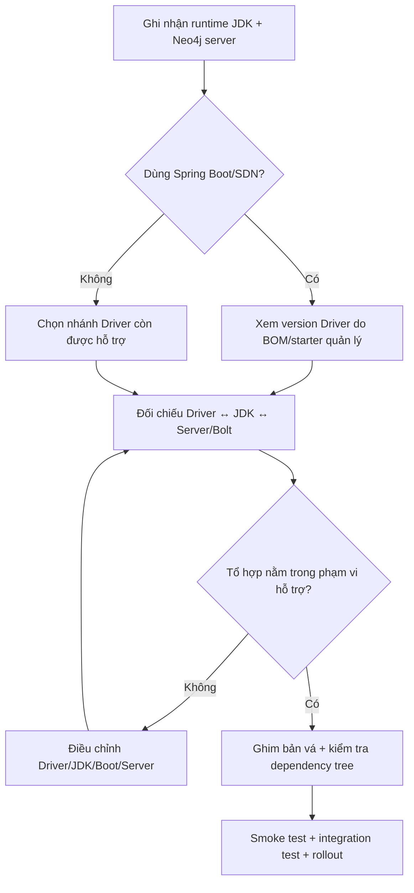

# Thêm Neo4j Java Driver và chọn phiên bản tương thích

Để ứng dụng Java làm việc với property graph trong Neo4j, cần một **Neo4j Java Driver** có thể mở kết nối Bolt, xác thực, thực thi Cypher, truyền parameter, đọc node/relationship/path và quản lý transaction. Việc thêm dependency chỉ là bước đầu: **JDK đang chạy, phiên bản Driver, phiên bản Neo4j server và framework quản lý thư viện phải tương thích**.

Bài học thuộc chương **Java Driver** của module `DATABASE_ENGINE_GRAPH_NEO4J`, nơi dùng Neo4j để mô hình hóa dữ liệu liên kết, tra cứu quan hệ/đường đi, tối ưu bằng index/constraint và tích hợp Java/Spring Data Neo4j. Mục tiêu của bài này là lựa chọn thư viện phù hợp, thêm bằng Maven hoặc Gradle, kiểm chứng kết nối và xây dựng quy trình nâng cấp an toàn.

> **Nguyên tắc cốt lõi:** không chọn Driver chỉ vì nó “mới nhất” hay có cùng số major với server. Phải xác minh **Driver ↔ JDK ↔ Bolt/Neo4j server ↔ Spring Boot/SDN**, khóa một bản vá cụ thể và kiểm thử trên môi trường tương đương production.

## 1. Bốn lớp tương thích không được nhầm lẫn

```text
Ứng dụng Java
  ├── JDK biên dịch và JDK runtime
  ├── Neo4j Java Driver
  │      └── giao thức Bolt / kết nối / transaction
  ├── Spring Boot & Spring Data Neo4j (nếu dùng)
  │      └── dependency management / mapping / transaction
  └── Cypher do ứng dụng gửi
            │
            ▼
      Neo4j Server hoặc Cluster
      (schema, index, APOC, Cypher, dữ liệu)
```

| Thành phần | Tại sao quan trọng? | Kiểm tra thế nào? |
| --- | --- | --- |
| **JDK runtime** | Driver phải nạp được bytecode và các API Java cần thiết | `java -version` trên máy/container thực sự chạy |
| **Neo4j Java Driver** | Cung cấp API Java, cơ chế routing, Bolt, connection pool | Dependency tree và tài liệu của nhánh Driver |
| **Neo4j server** | Quyết định cú pháp Cypher, index, constraint, các procedure được hỗ trợ | Version server, release notes và ma trận tương thích |
| **Spring Boot/SDN** | Có thể tự quản lý phiên bản Driver và cấu hình lifecycle | BOM, starter, dependency tree |

**Đừng suy luận theo số:** Neo4j server và Neo4j Java Driver không bắt buộc có cùng số major. Một bản Driver mới có thể giao tiếp được với một số bản server cũ trong phạm vi được nhà phát hành hỗ trợ, và ngược lại. Tuy nhiên, **kết nối Bolt thành công không có nghĩa là mọi tính năng Cypher của server mới đều hiện diện trên server cũ**.

Ví dụ, Java Driver chỉ gửi câu `CREATE FULLTEXT INDEX ...` hoặc `CALL apoc.path.expandConfig(...)` tới server. Tính năng full-text/APOC còn tùy **phiên bản Neo4j, plugin server, edition và quyền**, không tự xuất hiện khi nâng Driver.

## 2. Khảo sát môi trường trước khi chọn version

Trước khi sửa `pom.xml` hoặc `build.gradle`, hãy lập bảng thông tin:

1. **Build JDK và runtime JDK:** `java -version`, `mvn -version` hoặc `gradle -version`. CI/CD và container có thể dùng JDK khác máy phát triển.
2. **Phiên bản server/cluster:** Neo4j 5.x hay dòng phát hành mới; có nhiều database/cluster hay không.
3. **Framework:** Java thuần, Spring Boot, Spring Data Neo4j hay một thư viện tự quản lý Driver.
4. **Môi trường kết nối:** URI dạng `bolt://`, `neo4j://`, `neo4j+s://`; yêu cầu TLS/certificate.
5. **Yêu cầu kỹ thuật:** cần managed transaction, reactive, routing, xác thực nào và API mới nào.
6. **Giới hạn nâng cấp:** có thể thay đổi JDK, Spring Boot và server đồng thời hay phải từng bước.

Có thể hỏi server bằng Cypher (trong Neo4j Browser hoặc công cụ đã có quyền):

```cypher
CALL dbms.components()
YIELD name, versions, edition
RETURN name, versions, edition;
```

`versions` là thông tin phiên bản của thành phần server. Ghi lại **môi trường** đang chạy câu lệnh; kết quả từ laptop không thể dùng thay thông tin staging/production.

Một bảng quyết định:

| Thành phần | Ví dụ điền | Cần chứng minh |
| --- | --- | --- |
| Runtime JVM | Java 17 | `java -version` của container |
| Neo4j server | Phiên bản do đội vận hành cung cấp | Server version/release channel thực tế |
| Java Driver | Bản vá cụ thể đã chọn | Dependency resolve, trang tương thích |
| Spring Boot/SDN | Có hoặc không | BOM và dependency tree |
| URI/TLS | `neo4j+s://...` nếu hệ thống yêu cầu | Smoke test trong staging |
| Kết quả | PASS/FAIL | Log kiểm thử, không chứa bí mật |

## 3. Thêm dependency trong Maven

Tọa độ thư viện chính thức là:

| Maven coordinate | Giá trị |
| --- | --- |
| `groupId` | `org.neo4j.driver` |
| `artifactId` | `neo4j-java-driver` |
| `version` | Một bản vá **chính xác** phù hợp với hệ thống |

Ví dụ `pom.xml` cho ứng dụng Java thuần:

```xml
<project xmlns="http://maven.apache.org/POM/4.0.0"
         xmlns:xsi="http://www.w3.org/2001/XMLSchema-instance"
         xsi:schemaLocation="http://maven.apache.org/POM/4.0.0
                             https://maven.apache.org/xsd/maven-4.0.0.xsd">
    <modelVersion>4.0.0</modelVersion>

    <groupId>example</groupId>
    <artifactId>neo4j-driver-demo</artifactId>
    <version>1.0.0</version>

    <properties>
        <maven.compiler.release>17</maven.compiler.release>
        <neo4j.driver.version>6.0.0</neo4j.driver.version>
    </properties>

    <dependencies>
        <dependency>
            <groupId>org.neo4j.driver</groupId>
            <artifactId>neo4j-java-driver</artifactId>
            <version>${neo4j.driver.version}</version>
        </dependency>
    </dependencies>
</project>
```

**Hai con số trong ví dụ chỉ minh họa cấu hình:** Java 17 là môi trường giả định và `6.0.0` là một version *được ghim để minh họa cú pháp*, **không phải khẳng định đó là bản vá mới nhất hoặc lựa chọn được đề xuất cho mọi deployment**. Trước khi triển khai, thay bằng bản vá còn được hỗ trợ và đã kiểm tra theo mục 5. Không xem đây là phiên bản mặc định của toàn bộ module.

Nếu dự án đã có POM, chỉ cần thêm `<dependency>` vào `<dependencies>` và khai báo/version management theo chuẩn dự án, không tạo thêm một POM khác.

Kiểm tra phiên bản Maven thật sự resolve:

```bash
mvn dependency:tree -Dincludes=org.neo4j.driver:neo4j-java-driver
```

Tại dự án nhiều module, chạy ở module đóng gói ứng dụng. Một `<version>` trong POM có thể bị ảnh hưởng bởi `dependencyManagement`, parent hoặc dependencies của framework; **runtime classpath mới là kết quả cuối cần quan sát**.

## 4. Thêm dependency trong Gradle

### Groovy DSL — build.gradle

```groovy
plugins {
    id 'java'
}

java {
    toolchain {
        languageVersion = JavaLanguageVersion.of(17)
    }
}

dependencies {
    implementation 'org.neo4j.driver:neo4j-java-driver:6.0.0'
}
```

### Kotlin DSL — build.gradle.kts

```kotlin
plugins {
    java
}

java {
    toolchain {
        languageVersion.set(JavaLanguageVersion.of(17))
    }
}

dependencies {
    implementation("org.neo4j.driver:neo4j-java-driver:6.0.0")
}
```

Đây là **hai cách viết thay thế**, không phải hai dependency cần thêm đồng thời. Tương tự Maven, `6.0.0` chỉ là version minh họa; hãy chốt bản vá đã xác minh, ưu tiên quản lý tập trung bằng version catalog hoặc quy ước Gradle của dự án.

Xem phiên bản thực sự được chọn:

```bash
./gradlew dependencyInsight --dependency neo4j-java-driver --configuration runtimeClasspath
```

Trong dự án có nhiều module hoặc configuration, chọn đúng runtime classpath của thành phần đang chạy ứng dụng. Nếu phát hiện một version khác, xem lại platform/BOM, constraint, resolution strategy và dependency transitive trước khi dùng biện pháp ép version.

## 5. Cách chọn phiên bản tương thích theo ma trận

Không có một bảng version cứng nào đúng cho mọi thời điểm. Quy trình an toàn là **chọn một bản phát hành cụ thể, đọc ma trận tương thích và thử trên hệ thống đích**.



### 5.1. Những câu hỏi bắt buộc

- **Driver ↔ Java:** nhánh Driver đó yêu cầu mức JDK tối thiểu nào? Java runtime thực tế của container có đáp ứng không?
- **Driver ↔ Server/Bolt:** cặp phiên bản có nằm trong phạm vi hỗ trợ không? Có yêu cầu đặc biệt đối với cluster/routing không?
- **Driver API ↔ code:** ứng dụng có dùng API đã bị thay thế, deprecated hoặc loại bỏ ở major mới không?
- **Spring Boot/SDN ↔ Driver:** framework có xác nhận tương thích với nhánh Driver đó không?
- **Tính năng Cypher ↔ server:** các câu truy vấn thực tế sử dụng tính năng có tồn tại ở server không?
- **TLS/auth ↔ môi trường:** URI, chứng thư, trust store và quyền truy cập có hoạt động trên môi trường đích không?

### 5.2. Patch, minor và major

| Kiểu thay đổi | Rủi ro chính | Cách hành động |
| --- | --- | --- |
| Bản vá trong cùng nhánh | Sửa lỗi/bảo mật có thể ảnh hưởng một số đường chạy | Đọc release notes, chạy hồi quy |
| Minor | API/tính năng mới, thay đổi tương thích có điều kiện | Kiểm tra API, server và test |
| Major | Có thể đổi mức Java tối thiểu, API, hành vi kết nối | Đọc upgrade guide, lên kế hoạch migration |
| Nâng Driver độc lập khi có BOM | Framework có thể chưa kiểm thử tổ hợp đó | Ưu tiên version do BOM quản lý hoặc override có kiểm chứng |

**Không áp dụng** “server Neo4j 5.26 phải dùng Driver 5.26” hay “Driver 6.x chỉ dùng server 6.x” mà không có xác nhận từ tài liệu tương thích. Số version sản phẩm và version giao thức Bolt không phải cùng một quy ước.

Một số dòng Driver cũ có thể vẫn *kết nối được* nhưng đã hết vòng đời bảo trì. **Kết nối được**, **được hỗ trợ** và **sử dụng được tính năng server mới** là ba câu hỏi riêng.

### 5.3. Nguồn tra cứu cần dùng khi chốt

- [Neo4j Java Driver Manual — Install](https://neo4j.com/docs/java-manual/current/install/): cách thêm dependency, hỗ trợ Java.
- [Neo4j Java Driver Manual — Upgrade](https://neo4j.com/docs/java-manual/current/upgrade/): thay đổi khi nâng major.
- [Neo4j Java Driver Manual — Connect](https://neo4j.com/docs/java-manual/current/connect/): URI, xác thực và TLS.
- [Neo4j Java Driver Manual](https://neo4j.com/docs/java-manual/current/): bảng tương thích của nhánh Driver đang xem.
- [Maven Central — Neo4j Java Driver](https://central.sonatype.com/artifact/org.neo4j.driver/neo4j-java-driver): các bản phát hành chính xác.

Những trang này có thể thay đổi theo thời gian; **không copy số version trong ví dụ của bài như quyết định production**. Hãy xem bản vá đang được bảo trì tại thời điểm triển khai và lưu kết quả kiểm thử/ma trận version trong tài liệu release.

## 6. Neo4j Java Driver là client, không phải database nhúng

Phân biệt các thành phần:

| Thư viện/thành phần | Vai trò |
| --- | --- |
| `org.neo4j.driver:neo4j-java-driver` | Java client kết nối server qua Bolt |
| Neo4j server / cluster | Lưu node, relationship, index, constraint và thực thi Cypher |
| `spring-boot-starter-data-neo4j` | Tích hợp Spring Boot và Spring Data Neo4j, dùng Driver phía dưới |
| APOC | Procedure/function mở rộng **trên server**; thêm Driver không tự cài APOC |
| Graph Data Science | Các thuật toán đồ thị/phần mở rộng server theo môi trường triển khai |

Thêm `neo4j-java-driver` không làm một server Neo4j tự chạy bên trong JVM. Cần có Neo4j instance/cluster, connection URI, tài khoản hợp lệ và network access.

Tương tự, Driver mới không tự nâng phiên bản Cypher, plugin APOC hay tính năng index/constraint trong database. Điều này đặc biệt quan trọng khi ứng dụng vừa truy vấn đường đi, vừa nhập dữ liệu và tối ưu graph.

## 7. Smoke test đầu tiên với Java Driver

Giả sử server thử nghiệm chạy local, các biến môi trường được cấu hình:

```text
NEO4J_URI       = bolt://localhost:7687
NEO4J_USERNAME  = neo4j
NEO4J_PASSWORD  = (bí mật, không ghi vào source code)
NEO4J_DATABASE  = neo4j
```

Java code dưới đây sử dụng API chuẩn của Java Driver và ví dụ JDK 17:

```java
import java.util.Map;
import org.neo4j.driver.AuthTokens;
import org.neo4j.driver.Driver;
import org.neo4j.driver.GraphDatabase;
import org.neo4j.driver.Record;
import org.neo4j.driver.Session;
import org.neo4j.driver.SessionConfig;

public class Neo4jConnectionCheck {

    public static void main(String[] args) {
        String uri = envOrDefault(
            "NEO4J_URI", "bolt://localhost:7687");
        String user = envOrDefault("NEO4J_USERNAME", "neo4j");
        String password = requiredEnv("NEO4J_PASSWORD");
        String database = envOrDefault("NEO4J_DATABASE", "neo4j");

        try (Driver driver = GraphDatabase.driver(
                uri, AuthTokens.basic(user, password))) {

            driver.verifyConnectivity();

            try (Session session = driver.session(
                    SessionConfig.forDatabase(database))) {

                Record row = session.run(
                    "RETURN $value AS answer",
                    Map.of("value", 42)
                ).single();

                System.out.println("Connected. Answer = "
                    + row.get("answer").asInt());
            }
        }
    }

    private static String requiredEnv(String key) {
        String value = System.getenv(key);
        if (value == null || value.isBlank()) {
            throw new IllegalStateException(
                "Missing required environment variable: " + key);
        }
        return value;
    }

    private static String envOrDefault(String key, String fallback) {
        String value = System.getenv(key);
        return value == null || value.isBlank() ? fallback : value;
    }
}
```

Kết quả mong đợi khi server/URI/credential đúng:

```text
Connected. Answer = 42
```

Đây là smoke test tối thiểu: nạp Driver vào JVM, xác thực, mở Session, truyền parameter, lấy một giá trị trả về và đóng tài nguyên. Nó **không chứng minh** mọi transaction hoặc API graph của ứng dụng sẽ hoạt động.

Điểm cần hiểu:

1. `GraphDatabase.driver(...)` tạo Driver có connection pool; **không** nên tạo một Driver mới cho mỗi truy vấn.
2. `verifyConnectivity()` chủ động kiểm tra kết nối; không gọi lại cho từng HTTP request.
3. `SessionConfig.forDatabase(...)` chỉ rõ database, hữu ích trong môi trường nhiều database.
4. `Map.of("value", 42)` là parameter binding, không ghép input thành chuỗi Cypher.
5. `single()` phù hợp vì câu `RETURN $value` có đúng một hàng; truy vấn có nhiều hàng cần cách tiêu thụ khác.
6. `try-with-resources` đóng Driver/Session. **Ứng dụng web chạy lâu** nên chỉ đóng Driver khi shutdown thay vì sau từng request.

Nếu server chạy Docker nhưng chương trình chạy trong container khác, `localhost` là container hiện tại, không nhất thiết là địa chỉ Neo4j. Hãy dùng host và port đã cấu hình đúng cho mạng triển khai.

## 8. URI Bolt, routing và TLS

Tiền tố URI không chỉ mang tính hình thức. Nó nói cho Driver biết yêu cầu kết nối trực tiếp hay routing và kỳ vọng TLS:

| URI | Ý nghĩa |
| --- | --- |
| `bolt://localhost:7687` | Kết nối Bolt trực tiếp, thường dùng trong phát triển local |
| `neo4j://host:7687` | Kết nối dùng cơ chế routing do Neo4j Driver hỗ trợ |
| `neo4j+s://host:7687` | Routing với TLS và kiểm tra chứng thư tin cậy |
| `bolt+s://host:7687` | Kết nối trực tiếp với TLS và xác minh chứng thư |
| `neo4j+ssc://...` / `bolt+ssc://...` | TLS chấp nhận chứng thư không được xác minh như `+s`; chỉ dùng theo chính sách được phê duyệt |

**Không đổi `neo4j+s://` thành `neo4j://` chỉ để tránh lỗi chứng thư.** Trong production, phải cấu hình chứng thư CA, hostname, trust store và DNS đúng theo thiết kế bảo mật.

Với Neo4j Aura, nên dùng **URI được cung cấp từ trang thông tin kết nối của instance** thay vì tự đoán host, scheme hoặc port. Với cluster tự quản lý, routing có thể cần kết nối đến các địa chỉ member do server quảng bá; một URI ban đầu đúng vẫn có thể lỗi nếu các địa chỉ đó không truy cập được từ ứng dụng.

Những lỗi phổ biến không liên quan trực tiếp tới version Driver:

- Host/port sai, firewall chặn Bolt hoặc DNS không phân giải được.
- Chứng thư TLS không tin cậy, hostname mismatch hoặc trust store thiếu CA.
- Username/password không đúng hoặc tài khoản không có quyền trên database.
- Dùng routing URI khi các địa chỉ cluster trả về không thể kết nối.
- Container dùng `localhost` sai phạm vi mạng.

Do đó, phải test trong staging đúng TLS/routing/network của production, không chỉ ở laptop.

## 9. Vòng đời Driver, Session và connection pool

```text
Ứng dụng Java hoạt động liên tục
  └── 1 Driver dùng lại (thread-safe; connection pool)
        ├── Request A → Session A → read/write → close Session A
        ├── Request B → Session B → read/write → close Session B
        └── Worker C  → Session C → read/write → close Session C
  └── Close Driver khi ứng dụng shutdown
```

`Driver` được thiết kế để chia sẻ giữa các thread và quản lý pool; `Session` là đối tượng làm việc ngắn hạn, **không được dùng chung tùy tiện giữa nhiều thread**.

Anti-pattern:

```java
// Sai hướng: tạo và đóng Driver cho từng HTTP request
void handleEveryRequest() {
    try (Driver driver = GraphDatabase.driver(
            uri, AuthTokens.basic(user, password))) {
        // Chạy một truy vấn rồi đóng toàn bộ Driver...
    }
}
```

`uri`, `user`, `password` trong ví dụ anti-pattern là biến giả định đã được khai báo. Việc tạo và đóng liên tục có thể làm tăng chi phí kết nối, TLS handshake và giảm lợi ích pooling.

Một ứng dụng web/worker nên khởi tạo Driver một lần trong dependency injection, dùng Session cho mỗi đơn vị công việc và chỉ đóng Driver khi shutdown. Khi tăng tải, quan sát connection acquisition time, pool usage, số Session/transaction đang hoạt động và DB latency trước khi điều chỉnh pool size.

## 10. Transaction và truy vấn Cypher có parameter

Sau khi kết nối được, ứng dụng cần nhập/query dữ liệu đúng nghiệp vụ. Ví dụ dùng node `:DriverDemoPerson` và khóa `personId`. Trên database thử nghiệm, có thể tạo uniqueness constraint trước khi nạp:

```cypher
CREATE CONSTRAINT driver_demo_person_id IF NOT EXISTS
FOR (p:DriverDemoPerson)
REQUIRE p.personId IS UNIQUE;
```

**Đây là DDL thực sự sửa schema**, không chạy tùy tiện trên production. Constraint giúp tránh trùng khóa khi nhiều worker cùng ghi.

Một lớp Java viết dữ liệu bằng managed transaction:

```java
import java.util.Map;
import org.neo4j.driver.Driver;
import org.neo4j.driver.Session;
import org.neo4j.driver.SessionConfig;

public class PersonWriter {
    private final Driver driver;

    public PersonWriter(Driver driver) {
        this.driver = driver;
    }

    public void upsert(String personId, String name) {
        try (Session session = driver.session(
                SessionConfig.forDatabase("neo4j"))) {
            session.executeWrite(tx -> {
                tx.run("""
                    MERGE (p:DriverDemoPerson {personId: $personId})
                    SET p.name = $name
                    """, Map.of(
                        "personId", personId,
                        "name", name
                    )).consume();
                return null;
            });
        }
    }
}
```

Giải thích:

- `MERGE` trên khóa ổn định cho phép chạy lại thao tác. Tránh `MERGE` cả tên, trạng thái hay thuộc tính có thể thay đổi.
- `session.executeWrite(...)` sử dụng managed transaction, có thể retry một số lỗi tạm thời. **Callback phải idempotent** và không gửi email/tính phí bên ngoài transaction.
- `consume()` đảm bảo truy vấn được tiêu thụ trước khi callback kết thúc.
- `SessionConfig.forDatabase("neo4j")` nên được cấu hình bằng database thực tế ở production.
- Đối với truy vấn chỉ đọc, dùng `session.executeRead(...)` và chỉ nhận các field/DTO cần thiết, tránh trả cả graph lớn.

Kết quả Java Driver mang kiểu `Value`. Ví dụ `row.get("name").asString()`, `row.get("count").asLong()`, `row.get("node").asNode()`. Trước khi gọi phương thức ép kiểu, kiểm tra giá trị có tồn tại và khác `null` theo hợp đồng Cypher.

## 11. Spring Boot và Spring Data Neo4j: tránh xung đột BOM

Ứng dụng dùng **Spring Data Neo4j (SDN)** qua Spring Boot starter thường để **Spring Boot BOM/dependency management** quyết định phiên bản Driver:

```xml
<dependency>
    <groupId>org.springframework.boot</groupId>
    <artifactId>spring-boot-starter-data-neo4j</artifactId>
</dependency>
```

Với dự án có Spring Boot parent/BOM quản lý đúng, không cần khai báo một version riêng cho starter. Nếu tự thêm:

```xml
<dependency>
    <groupId>org.neo4j.driver</groupId>
    <artifactId>neo4j-java-driver</artifactId>
    <version>6.0.0</version>
</dependency>
```

thì có thể **override** Driver do framework đã chọn. Điều này đôi khi cần để xử lý lỗi đã biết, nhưng phải xem tương thích của chính bản Spring Boot/SDN đang chạy và chạy integration test. Không nên override chỉ vì muốn “cao hơn”.

Ví dụ cấu hình `application.yml` thường gặp cho Spring Boot (xác nhận tên property theo bản Boot của dự án):

```yaml
spring:
  neo4j:
    uri: ${NEO4J_URI:bolt://localhost:7687}
    authentication:
      username: ${NEO4J_USERNAME:neo4j}
      password: ${NEO4J_PASSWORD}
  data:
    neo4j:
      database: ${NEO4J_DATABASE:neo4j}
```

Dự án có starter thường được tự động cấu hình một `Driver` bean. Không tạo thêm bean Driver/connection pool thứ hai nếu không có yêu cầu kiến trúc cụ thể và hiểu rõ cách auto-configuration hoạt động.

**Spring Data Neo4j không chỉ là Java Driver:** nó thêm mapping entity, repository, tích hợp transaction và framework lifecycle. Vì vậy test `driver.verifyConnectivity()` riêng lẻ chưa đủ; cần test repository, mapping relationship và transaction của ứng dụng Spring.

## 12. Lỗi thường gặp khi khai báo sai phiên bản hoặc cấu hình

| Triệu chứng | Nguyên nhân có thể | Hướng kiểm tra |
| --- | --- | --- |
| `ClassNotFoundException` / `NoClassDefFoundError` | Thiếu JAR ở runtime classpath, scope sai hoặc packaging thiếu | Dependency tree, artifact deploy |
| `UnsupportedClassVersionError` | Driver hoặc app được biên dịch cho Java cao hơn runtime | `java -version` trên container, JDK toolchain, yêu cầu Driver |
| `NoSuchMethodError` / `NoSuchFieldError` | API compile-time khác runtime, duplicate JAR/transitive conflict | Runtime dependency tree, BOM, clean rebuild |
| `ServiceUnavailableException` / timeout | Network, URI, routing, server down | DNS, firewall, Bolt port, server logs |
| `AuthenticationException` | Sai thông tin xác thực | Credential từ secret store, quyền database |
| Lỗi TLS / handshake | CA, trust store, hostname hoặc scheme không phù hợp | `+s`, certificate, hostname |
| `ClientException` với Cypher | Query sai, tính năng server thiếu, quyền hoặc database không đúng | Error code/message, phiên bản server, query |
| Hết pool / chờ connection | Tạo quá nhiều request, Session giữ quá lâu, pool size chưa phù hợp | Lifecycle, metrics pool và transaction |
| Spring startup lỗi sau khi override Driver | BOM/SDN không tương thích, cấu hình bean trùng | dependencyInsight, Boot release notes |

**Không gán mọi lỗi kết nối cho Driver version.** Một Driver phù hợp vẫn lỗi nếu TLS, DNS, quyền hoặc địa chỉ cluster không đúng. Và kết nối thành công không chứng minh mọi Cypher của ứng dụng được server hỗ trợ.

## 13. Kiểm thử tương thích theo bốn lớp

### Lớp 1 — Build và dependency

- Build thành công bằng JDK đã chọn.
- Maven/Gradle resolve đúng một version Driver theo kế hoạch.
- Không có `UnsupportedClassVersionError`, `NoSuchMethodError` khi chạy packaged artifact.

### Lớp 2 — Kết nối

- `verifyConnectivity()` thành công với host, routing, TLS và credential của staging.
- Session mở đúng database.
- Dùng parameter với `RETURN 1 AS ok` trả đúng kiểu dữ liệu.

### Lớp 3 — Tính năng nghiệp vụ

- Truy vấn `MATCH`, index seek, query quan hệ/đường đi hoạt động.
- `MERGE`, constraint và transaction ghi/rollback hoạt động như kỳ vọng.
- Các tính năng đặc biệt như APOC, full-text hay cú pháp Cypher mới có mặt trên server.
- Retry trên lỗi tạm thời không nhân đôi nghiệp vụ.

### Lớp 4 — Spring và vận hành

- Repository/projection SDN và mapping node/relationship chạy đúng.
- Driver được dùng chung, Session/transaction có vòng đời hợp lý.
- Pool không cạn ở tải đại diện; ứng dụng có metric timeout/error/latency.
- Kết nối qua cluster/routing/TLS thật được kiểm chứng, không chỉ local.

Một smoke test nhanh:

```cypher
RETURN 1 AS ok;
```

Nó chứng minh ứng dụng gửi/nhận Cypher cơ bản, nhưng **không** thay thế test về permission, transaction, routing, APOC hoặc query nghiệp vụ.

## 14. Quy trình nâng cấp Driver an toàn

1. **Chốt hiện trạng:** ghi JDK, Driver, server, URI/TLS, Spring Boot/SDN, dependency tree và lỗi đang gặp.
2. **Đọc upgrade guide:** xem API đã đổi, yêu cầu JDK và thay đổi hành vi ở nhánh mới.
3. **Kiểm tra BOM/framework:** nâng Spring Boot/SDN theo cặp đã kiểm thử nếu cần, thay vì ép Driver riêng lẻ.
4. **Chọn bản vá cố định:** không dùng version động, và lưu quyết định chọn version trong PR.
5. **Build và test:** smoke test, integration test, retry/transaction, TLS/routing.
6. **Triển khai staging/canary:** quan sát timeout, connection acquisition, lỗi Cypher và latency.
7. **Rollout có kế hoạch:** biết cách rollback artifact/Driver; kiểm tra xem nâng server/schema đồng thời có ảnh hưởng rollback không.

### Câu hỏi cần tự trả lời

**Câu 1.** Tại sao Neo4j server và Neo4j Java Driver không nhất thiết có cùng số major?

**Câu 2.** Nếu ứng dụng build thành công nhưng container báo `UnsupportedClassVersionError`, cần kiểm tra những phiên bản nào?

**Câu 3.** Vì sao Spring Boot project nên xem BOM trước khi tự ghim `neo4j-java-driver`?

**Câu 4.** `GraphDatabase.driver(...)` có nên được tạo trong mỗi request HTTP không? Vì sao?

**Câu 5.** Driver kết nối thành công nhưng `CALL apoc.path.expandConfig(...)` lỗi. Những nguyên nhân nào có thể nằm ở server?

**Câu 6.** Khi dùng `executeWrite`, tại sao không nên gửi email hoặc thu tiền ngay trong transaction callback?

**Đáp án gợi ý:** (1) Hai thành phần có lịch phát hành riêng và giao tiếp qua Bolt theo ma trận tương thích. (2) JDK biên dịch, runtime container và mức Java Driver yêu cầu. (3) SDN/Boot quản lý tập phiên bản được kiểm thử. (4) Không; Driver có connection pool để tái sử dụng. (5) Thiếu APOC, thiếu quyền hoặc không hỗ trợ procedure. (6) Managed transaction có thể retry, gây lặp side effect.

## 15. Checklist trước khi đưa ứng dụng lên production

| Kiểm tra | Yêu cầu |
| --- | --- |
| Phiên bản JDK build và runtime | Đã ghi rõ, phù hợp mức Driver yêu cầu |
| Phiên bản Neo4j server và môi trường | Đã xác minh, không lấy từ máy cá nhân |
| Java Driver | Bản vá cụ thể, còn trong phạm vi hỗ trợ |
| Dependency tree | Bản resolve đúng, không xung đột transitives |
| Spring Boot/SDN | Không override BOM khi chưa có kiểm chứng |
| URI, routing, TLS | Đúng scheme/certificate/địa chỉ cluster |
| Bí mật đăng nhập | Secret store; không hard-code password |
| Smoke test | `verifyConnectivity` + Cypher parameterized PASS |
| Integration test | Query nghiệp vụ, transaction, constraint, mapping PASS |
| Lifecycle | Driver dùng chung, Session đóng đúng |
| Quan sát vận hành | Timeout, pool, lỗi, latency được theo dõi |
| Rollback | Có kế hoạch nếu nâng cấp gây lỗi |

## Tài liệu tham khảo

- [Neo4j Java Driver Manual](https://neo4j.com/docs/java-manual/current/): cài đặt, kết nối, transaction, upgrade và cấu hình.
- [Neo4j Java Driver API](https://neo4j.com/docs/api/java-driver/current/): các kiểu `Driver`, `Session` và `SessionConfig`.
- [Neo4j Java Driver trên Maven Central](https://central.sonatype.com/artifact/org.neo4j.driver/neo4j-java-driver): tọa độ artifact và các bản vá.
- [Spring Boot Reference — Neo4j](https://docs.spring.io/spring-boot/reference/data/nosql.html): quản lý dependency/cấu hình trong Boot.
- [Spring Data Neo4j Reference](https://docs.spring.io/spring-data/neo4j/reference/): repository, entity mapping và transaction.

**Ghi nhớ:** thêm Java Driver là khai báo **`org.neo4j.driver:neo4j-java-driver`**, nhưng chọn version đúng phải xem **JDK + Driver + Neo4j server/Bolt + Spring Boot/SDN** như một hệ thống. Chỉ coi cấu hình sẵn sàng khi đã khóa bản vá, kiểm tra dependency thực tế và chứng minh kết nối cùng các truy vấn nghiệp vụ qua kiểm thử.
