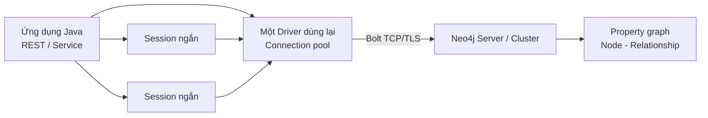
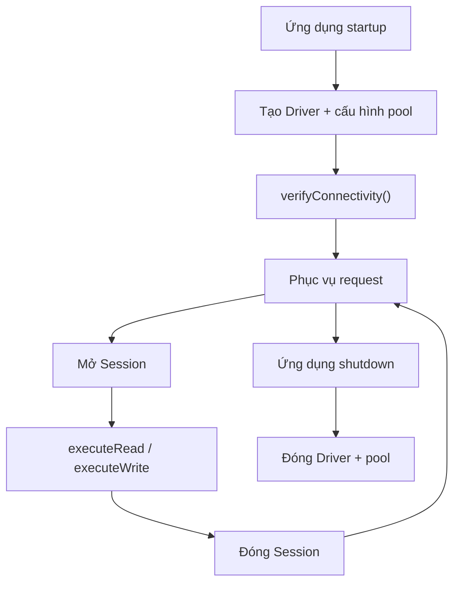
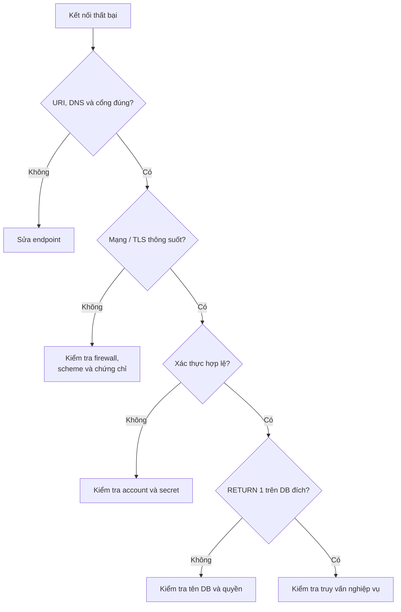

# Tạo Driver, cấu hình URI, xác thực và kiểm tra kết nối

**Neo4j Java Driver** là thư viện chính thức để ứng dụng Java kết nối Neo4j qua giao thức **Bolt**, gửi truy vấn **Cypher** có tham số, quản lý session, transaction và các kết nối trong pool. Nếu ứng dụng chọn sai URI, thiếu xác thực hoặc quản lý vòng đời driver không đúng, các thao tác với node, relationship, index và dữ liệu đồ thị sẽ thất bại ngay cả khi câu Cypher hợp lệ.

Bài thuộc chương **Java Driver** của module **DATABASE_ENGINE_GRAPH_NEO4J**, hướng dẫn bốn việc theo đúng thứ tự: **thêm thư viện → tạo Driver → cấu hình URI và xác thực → kiểm tra kết nối thật**. Các ví dụ sử dụng Java hiện đại và API Neo4j Java Driver **5.x**; với dòng Driver 6.x hoặc phiên bản khác, hãy đối chiếu tài liệu API và tương thích server trước khi áp dụng.

## 1. Hiểu Driver, Session và Transaction



| Thành phần | Trách nhiệm | Vòng đời nên dùng |
| --- | --- | --- |
| `Driver` | Chứa cấu hình endpoint, xác thực, pool và routing | **Một đối tượng được dùng lại**, thường bằng vòng đời ứng dụng |
| `Session` | Phạm vi thao tác hướng tới một database | Tạo khi cần và **đóng sớm** sau request/công việc |
| `Transaction` | Gom các lệnh cần commit/rollback nguyên tử | Gắn với một đơn vị nghiệp vụ ngắn |
| `Result` và `Record` | Trả bản ghi từ câu Cypher | Đọc trong phạm vi session/transaction thích hợp |

**`Driver` được thiết kế để sử dụng đồng thời giữa nhiều luồng**, còn `Session` và transaction không nên bị chia sẻ tùy tiện giữa các luồng. Tạo Driver mới cho từng HTTP request làm mất lợi ích connection pool, tốn công thiết lập TLS và xác thực. Ngược lại, dùng một session chung cho cả ứng dụng làm vòng đời transaction khó kiểm soát.

Bản thân `GraphDatabase.driver(...)` chủ yếu tạo đối tượng và cấu hình. **Nó không tự chứng minh rằng Neo4j đang kết nối được**: cần gọi `verifyConnectivity()` hoặc gửi một truy vấn thật.

## 2. Thêm dependency Java Driver

Với Maven, thêm dependency:

```xml
<dependency>
    <groupId>org.neo4j.driver</groupId>
    <artifactId>neo4j-java-driver</artifactId>
    <version>${neo4j.driver.version}</version>
</dependency>
```

`neo4j.driver.version` phải được khai báo trong POM hoặc quản lý bởi BOM/build tool với phiên bản **đã chọn, có thật và tương thích**. Đừng để placeholder này mà chưa định nghĩa khi build. Với Spring Boot/Spring Data Neo4j, có thể framework đã cung cấp dependency và quản lý phiên bản, nên kiểm tra cơ chế quản lý của dự án trước khi thêm thủ công.

Các lớp chính:

```java
import org.neo4j.driver.AuthTokens;
import org.neo4j.driver.Config;
import org.neo4j.driver.Driver;
import org.neo4j.driver.GraphDatabase;
import org.neo4j.driver.Session;
import org.neo4j.driver.SessionConfig;
```

Driver là lớp giao tiếp kết nối; Spring Data Neo4j là lớp ánh xạ dữ liệu/repository dùng để xây dựng ứng dụng ở mức cao hơn. Một dự án có thể dùng Spring Data nhưng vẫn dựa trên Driver để giao tiếp với Neo4j.

### 2.1. Kiểm tra tương thích

Trước khi triển khai, xác nhận:

- Phiên bản Driver hỗ trợ bản JDK dự án sử dụng.
- Driver và Neo4j server tương thích về giao thức Bolt.
- API, cấu hình timeout, chứng chỉ và quản lý xác thực có thay đổi ở phiên bản mới không.
- Nếu có Spring Boot/BOM, không ép hai phiên bản Driver khác nhau lên classpath.

Dùng phiên bản phát hành được hỗ trợ và ghi rõ phiên bản trong tài liệu triển khai của dự án.

## 3. URI: chọn địa chỉ, routing và TLS

URI là địa chỉ mà **tiến trình Java** có thể truy cập, không phải đường dẫn mở Neo4j Browser. Bolt thường sử dụng cổng `7687`, nhưng cần kiểm tra cấu hình thực tế.

| Scheme | Ý nghĩa | Thường dùng khi |
| --- | --- | --- |
| `bolt://host:7687` | Kết nối trực tiếp, scheme không yêu cầu TLS | Neo4j single server trong mạng test/tin cậy |
| `bolt+s://host:7687` | Kết nối trực tiếp qua TLS với chứng chỉ được tin cậy | Single server yêu cầu TLS |
| `bolt+ssc://host:7687` | Direct qua TLS với cơ chế tin cậy chứng chỉ tự ký | Kiểm thử môi trường được kiểm soát |
| `neo4j://host:7687` | Hỗ trợ routing/discovery | Cluster hoặc server có cấu hình routing |
| `neo4j+s://host:7687` | Routing và TLS có xác minh chứng chỉ | Neo4j Aura hoặc cluster bảo mật |
| `neo4j+ssc://host:7687` | Routing và TLS với chứng chỉ tự ký | Môi trường đặc biệt, không làm mặc định production |

`neo4j://` và `bolt://` khác nhau ở **routing so với kết nối trực tiếp**. `+s` và `+ssc` khác nhau về cách tin cậy chứng chỉ. Không nên đổi sang `+ssc` chỉ để che lỗi chứng chỉ trong production vì có thể làm suy yếu xác minh danh tính server.

### 3.1. Neo4j chạy cùng laptop

Một URI minh họa:

```text
bolt://localhost:7687
```

`localhost` đúng khi **ứng dụng Java cũng chạy trên cùng máy** với Bolt listener. Neo4j Browser có thể dùng HTTP/HTTPS (ví dụ cổng `7474` ở một số bản cài), nhưng Java Driver Bolt không kết nối qua cổng giao diện Browser đó.

### 3.2. Ứng dụng chạy trong Docker

Nếu Java nằm trong container khác với Neo4j, `localhost` chỉ tới **container Java**. Cần dùng hostname được phân giải trong mạng container, ví dụ:

```text
bolt://neo4j:7687
```

Tên `neo4j` ở đây là tên service giả định trong cùng network. Nếu DNS/service hoặc network policy không đúng, đổi scheme không giải quyết được kết nối.

### 3.3. Neo4j Aura và cluster

Neo4j Aura thường cấp URI có dạng:

```text
neo4j+s://example.databases.neo4j.io
```

Hãy dùng **đúng URI được cấp**, gồm scheme TLS và hostname; đừng tự đổi thành địa chỉ HTTP. Với cluster tự quản trị, ứng dụng có thể cần truy cập những server được cơ chế routing trả về; chỉ kết nối được địa chỉ entrypoint chưa đủ nếu các địa chỉ thành viên bị firewall chặn.

### 3.4. Database name là cấu hình riêng

Database name không phải một phần cần tùy tiện nối vào path của Bolt URI. Trong Java:

```java
try (Session session = driver.session(
        SessionConfig.forDatabase("sales"))) {
    // Cypher sẽ thực thi trên database "sales".
}
```

Nếu bỏ tên database, driver sử dụng cơ chế mặc định/home database của người dùng theo môi trường. Với ứng dụng nhiều database, nên **chỉ định rõ tên đích** để tránh kiểm tra kết nối thành công nhưng đọc nhầm dữ liệu.

## 4. Xác thực bằng AuthTokens

Cách phổ biến là thông tin `username/password`:

```java
Driver driver = GraphDatabase.driver(
    "bolt://localhost:7687",
    AuthTokens.basic("neo4j", "example-password")
);
```

Đoạn này minh họa API, **không nên dùng mật khẩu cố định trong mã nguồn**. Trên môi trường thật, nhận bí mật từ biến môi trường, secret manager hoặc nền tảng triển khai. Không đưa bí mật vào URI, exception message, source control hoặc log ứng dụng.

### 4.1. Biến môi trường đề xuất

| Biến | Ý nghĩa | Ví dụ công khai |
| --- | --- | --- |
| `NEO4J_URI` | Endpoint Bolt và TLS/routing | `bolt://localhost:7687` |
| `NEO4J_USER` | Tài khoản database | `neo4j` |
| `NEO4J_PASSWORD` | Bí mật xác thực | Được cấp riêng, không ghi vào tài liệu |
| `NEO4J_DATABASE` | Tên database đích, tùy chọn | `sales` |

Java đọc:

```java
String uri = System.getenv("NEO4J_URI");
String user = System.getenv("NEO4J_USER");
String password = System.getenv("NEO4J_PASSWORD");
```

Cần kiểm tra null/rỗng trước khi dùng. Hàm `requiredEnv(...)` trong ví dụ hoàn chỉnh sẽ báo tên biến thiếu mà không in giá trị bí mật.

### 4.2. Môi trường không dùng xác thực

Nếu Neo4j server **được chủ động cấu hình không yêu cầu authentication**, Driver có thể dùng:

```java
Driver driver = GraphDatabase.driver(
    "bolt://localhost:7687",
    AuthTokens.none()
);
```

Đây chỉ là kịch bản phát triển được kiểm soát. **Không tắt xác thực của server để khắc phục lỗi mật khẩu.** Với hệ thống thực, ưu tiên tài khoản có quyền tối thiểu, quản lý xoay vòng bí mật và kiểm soát TLS.

## 5. Cấu hình Driver và connection pool

Ví dụ tạo Driver với một giới hạn pool:

```java
Config config = Config.builder()
    .withMaxConnectionPoolSize(40)
    .build();

Driver driver = GraphDatabase.driver(
    uri, AuthTokens.basic(user, password), config
);
```

`40` chỉ là giá trị minh họa. Pool nhỏ có thể làm request phải chờ lấy connection; pool quá lớn có thể khiến ứng dụng và server có quá nhiều socket và tài nguyên. Điều chỉnh theo số request đồng thời, lượng transaction và metric thực tế.

Các tùy chọn khác có thể cân nhắc, tùy bản Driver: **connection timeout**, **connection acquisition timeout**, **max connection lifetime** và **liveness check**. Khi cấu hình cụ thể, đối chiếu tên API và đơn vị thời gian với version đang dùng.

Nên tạo **một Driver theo vòng đời ứng dụng**, dùng lại Driver cho nhiều request, tạo Session ngắn và đóng Driver khi shutdown.



## 6. Chương trình Java hoàn chỉnh: tạo và kiểm tra kết nối

Chương trình dưới đây sử dụng các API thông dụng của **Neo4j Java Driver 5.x**:

- Đọc URI, user, password từ biến môi trường.
- Kiểm tra biến bắt buộc không rỗng.
- Tạo một `Driver` có connection pool.
- Gọi **`driver.verifyConnectivity()`**.
- Chạy `RETURN 1 AS ok` trên database được chọn để xác minh truy vấn đọc.
- Đóng `Session` và `Driver` bằng `try-with-resources`.

```java
import org.neo4j.driver.AuthTokens;
import org.neo4j.driver.Config;
import org.neo4j.driver.Driver;
import org.neo4j.driver.GraphDatabase;
import org.neo4j.driver.Session;
import org.neo4j.driver.SessionConfig;

public final class Neo4jConnectionCheck {

    public static void main(String[] args) {
        String uri = requiredEnv("NEO4J_URI");
        String username = requiredEnv("NEO4J_USER");
        String password = requiredEnv("NEO4J_PASSWORD");

        String database = System.getenv("NEO4J_DATABASE");

        SessionConfig sessionConfig =
            database == null || database.isBlank()
                ? SessionConfig.defaultConfig()
                : SessionConfig.forDatabase(database);

        Config config = Config.builder()
            .withMaxConnectionPoolSize(40)
            .build();

        try (Driver driver = GraphDatabase.driver(
                uri, AuthTokens.basic(username, password), config)) {

            // Bắt đầu kết nối và kiểm tra URI + mạng + xác thực.
            driver.verifyConnectivity();

            try (Session session = driver.session(sessionConfig)) {
                int ok = session.executeRead(tx ->
                    tx.run("RETURN 1 AS ok")
                      .single()
                      .get("ok")
                      .asInt()
                );
                if (ok != 1) {
                    throw new IllegalStateException(
                        "Unexpected Neo4j check result");
                }
            }

            System.out.println("Neo4j connectivity check: OK");
        }
    }

    private static String requiredEnv(String name) {
        String value = System.getenv(name);
        if (value == null || value.isBlank()) {
            throw new IllegalArgumentException(
                "Missing environment variable: " + name);
        }
        return value;
    }
}
```

Thành công:

```text
Neo4j connectivity check: OK
```

Nếu thất bại, để exception hoặc cơ chế giám sát được thiết kế sẵn báo lỗi theo nhóm, nhưng **không in password/token ra log**. Đối với chương trình độc lập, `try-with-resources` đảm bảo đóng Driver khi kết thúc. Trong server Java chạy dài hạn, đưa Driver vào lifecycle ứng dụng thay vì đóng sau mỗi request.

### 6.1. Vì sao có hai bước kiểm tra?

| Bước | Có thể xác minh | Giới hạn |
| --- | --- | --- |
| `GraphDatabase.driver(...)` | Tạo đối tượng với URI/config/auth | Chưa chắc đã mở kết nối hay xác thực thành công |
| `driver.verifyConnectivity()` | Có thể thiết lập kết nối tới Neo4j theo cấu hình | Chưa chứng minh mọi database và truy vấn nghiệp vụ đều được phép |
| `RETURN 1 AS ok` trong `SessionConfig.forDatabase(...)` | Có thể chạy truy vấn đọc trên database được chọn | Chưa chứng minh quyền truy cập mọi label/relationship hoặc quyền ghi |
| Truy vấn `MATCH` nghiệp vụ | Kiểm tra thêm schema, quyền và dữ liệu thực | Không thay thế kiểm thử nghiệp vụ đầy đủ |
| Truy vấn ghi trên database thử nghiệm | Kiểm thử quyền ghi và giao dịch | Không dùng làm health check mặc định trên production |

`RETURN 1` là phép đọc nhỏ, ít phụ thuộc dữ liệu. Nếu muốn kiểm tra quyền đọc thực tế, chạy thêm truy vấn chỉ đọc đúng schema ứng dụng và so sánh kết quả theo ngữ cảnh. `RETURN 1` thành công nhưng truy vấn `MATCH` trả rỗng chưa đủ để khẳng định lỗi kết nối: dữ liệu có thể thật sự trống hoặc database được chọn khác.

### 6.2. Chỉ định đúng database

Ví dụ server có database `neo4j` và `sales`. Để đọc Customer từ `sales`:

```java
try (Session session = driver.session(
        SessionConfig.forDatabase("sales"))) {

    long total = session.executeRead(tx ->
        tx.run("MATCH (c:Customer) RETURN count(c) AS total")
          .single()
          .get("total")
          .asLong()
    );

    System.out.println("Customers visible: " + total);
}
```

Kết quả `0` có thể hợp lệ. Đừng sử dụng số đếm bất kỳ làm phép đánh giá “server đang sống” nếu database chưa có dữ liệu; hãy dựa vào mục đích của từng bước kiểm tra.

## 7. Truy vấn đầu tiên sau khi kết nối

Ứng dụng cần tìm khách hàng trong property graph, ví dụ:

```cypher
MATCH (c:Customer {customerId: $customerId})
RETURN c.name AS name, c.segment AS segment;
```

Dùng **tham số** thay vì ghép chuỗi:

```java
import java.util.Map;
import java.util.Optional;
import org.neo4j.driver.Driver;
import org.neo4j.driver.Session;
import org.neo4j.driver.SessionConfig;

public final class CustomerService {

    public static Optional<String> findName(
            Driver driver, String customerId) {

        try (Session session = driver.session(
                SessionConfig.forDatabase("sales"))) {
            return session.executeRead(tx -> {
                var result = tx.run("""
                    MATCH (c:Customer {customerId: $id})
                    RETURN c.name AS name
                    """, Map.of("id", customerId));

                if (!result.hasNext()) {
                    return Optional.<String>empty();
                }
                return Optional.of(
                    result.next().get("name").asString());
            });
        }
    }
}
```

`executeRead` là managed read transaction; Driver có thể thực hiện retry cho một số lỗi tạm thời theo chính sách hiện hành. Session được tạo và đóng đúng phạm vi. Mã `sales` phải lấy từ cấu hình phù hợp của ứng dụng, thay vì luôn ghi cứng như trong ví dụ minh họa.

Khi cần ghi dữ liệu, hãy dùng `executeWrite` cùng Cypher như `MERGE` và `SET` với transaction phù hợp. **Không dùng một lệnh ghi chỉ để “ping” Neo4j trong production.** Quy tắc idempotency cũng quan trọng vì callback transaction được phép retry trong một số trường hợp.

## 8. Cấu hình ứng dụng theo môi trường

### 8.1. Laptop và Docker

Ví dụ PowerShell để đặt các biến **không nhạy cảm**:

```powershell
$env:NEO4J_URI = "bolt://localhost:7687"
$env:NEO4J_USER = "neo4j"
$env:NEO4J_DATABASE = "neo4j"
```

Cấp `NEO4J_PASSWORD` qua cơ chế secret riêng của môi trường/IDE/terminal, hạn chế ghi password vào shell history. Với Docker, thay `localhost` bằng service hostname phù hợp như `neo4j` nếu Java chạy trong container khác.

### 8.2. Spring Boot / Spring Data Neo4j

Nếu dùng Spring Boot, cấu hình URI/xác thực thường được cung cấp theo dạng:

```yaml
spring:
  neo4j:
    uri: ${NEO4J_URI}
    authentication:
      username: ${NEO4J_USER}
      password: ${NEO4J_PASSWORD}
```

Đây là **application config** của Spring, không phải `neo4j.conf` trên máy chủ. Các tùy chọn khác, bao gồm tên database đích và pool, cần xem theo phiên bản Spring Boot/Spring Data Neo4j được sử dụng.

Khi framework tạo và quản lý Driver, nên **inject bean Driver**, dùng repository hoặc `Neo4jClient` tùy thiết kế. Đừng tạo thêm Driver bên trong từng service vì việc đó phát sinh pool không cần thiết và khó kiểm soát shutdown.

## 9. Chẩn đoán lỗi kết nối theo từng tầng

Nếu `verifyConnectivity()` hoặc `RETURN 1` thất bại, hãy phân loại lỗi trước khi thay cấu hình.

| Dấu hiệu | Nguyên nhân có thể | Việc cần kiểm tra |
| --- | --- | --- |
| Host không phân giải | Sai hostname hoặc DNS/network | Kiểm tra DNS từ **máy/container Java** |
| `Connection refused` | Sai port, Bolt chưa chạy hoặc network mapping lỗi | Xác nhận endpoint Bolt và container/server đã sẵn sàng |
| `Connection timeout` | Firewall, network policy, routing hoặc server không đáp ứng | Kiểm tra cổng, firewall và đường mạng |
| Authentication failed | Sai user/password hoặc account không hợp lệ | Kiểm tra secret và tình trạng tài khoản |
| TLS handshake/certificate error | Scheme, hostname hoặc CA không phù hợp | Kiểm tra `+s`, chứng chỉ, DNS và đồng hồ hệ thống |
| Driver kết nối được, sai database | Không chỉ định `SessionConfig` hoặc tên DB sai | Xác nhận database đích từ cấu hình |
| `RETURN 1` chạy được, `MATCH` lỗi | Quyền, nhãn, schema hoặc cú pháp nghiệp vụ | Kiểm tra role/privileges và query |
| Kết nối chập chờn khi tải tăng | Pool, mạng, cluster topology, server quá tải | Theo dõi connection acquisition và metrics |
| `localhost` chạy ở host nhưng lỗi trong Docker | `localhost` trỏ container Java | Dùng DNS service đã cấu hình |
| `neo4j://` tới cluster lỗi sau discovery | Địa chỉ thành viên cluster client không tiếp cận được | Xác nhận advertised addresses và chính sách mạng |

Hướng kiểm tra có thể theo trình tự:



Không nên tự chuyển sang `+ssc` để bỏ qua lỗi chứng chỉ. Với ứng dụng có monitoring, hãy log tên loại lỗi, thời điểm, request ID và endpoint đã **loại bỏ bí mật**, tránh lộ thông tin xác thực qua stack trace công khai.

## 10. Connection pool, timeout và xử lý lỗi tạm thời

Driver quản lý pool; các biến ảnh hưởng hiệu năng gồm:

- **Max connection pool size:** kiểm soát giới hạn kết nối phục vụ workload.
- **Connection acquisition timeout:** thời gian chờ có kết nối rảnh hoặc tạo kết nối phù hợp.
- **Connection timeout:** thời gian chờ thiết lập kết nối.
- **Max connection lifetime:** thời gian sống tối đa của kết nối pool.
- **Liveness check:** xác nhận kết nối cũ còn dùng được khi được tái sử dụng.

Tên API, giá trị mặc định và đơn vị thời gian có thể thay đổi theo dòng Driver. Không tăng pool bừa bãi khi lỗi là sai DNS hoặc TLS. Không tạo/đóng Driver liên tục để “retry”, vì sẽ tạo thêm pool và gây tải.

### 10.1. Retry transaction cần tính idempotent

Đối với `executeRead` và `executeWrite`, driver có thể retry callback khi gặp lỗi tạm thời. Vì vậy, code bên trong callback cần có cách kiểm soát tác động khi chạy lại.

```java
session.executeWrite(tx -> {
    tx.run("""
        MERGE (c:Customer {customerId: $id})
        SET c.name = $name
        """, Map.of("id", "C01", "name", "An")).consume();
    return null;
});
```

Với các side effect nằm ngoài Neo4j như gửi email hoặc gọi dịch vụ thanh toán, không đặt chúng trực tiếp vào callback với giả định chỉ chạy đúng một lần. Cần quy trình đảm bảo idempotency và ranh giới transaction riêng phù hợp.

### 10.2. Readiness và liveness

- **Liveness:** tiến trình Java còn hoạt động.
- **Readiness:** ứng dụng có thể phục vụ yêu cầu cần Neo4j.
- **Business health:** nghiệp vụ truy vấn đúng dữ liệu/quyền và đáp ứng ngưỡng hiệu năng.

`verifyConnectivity()` hoặc `RETURN 1` có thể hỗ trợ readiness khi dùng tần suất hợp lý. Không biến health check thành một truy vấn tạo dữ liệu hay quét toàn bộ đồ thị, và không khởi tạo Driver mới cho mỗi lần probe.

## 11. Các lỗi thiết kế cần tránh

| Cách làm | Hậu quả | Cách sửa |
| --- | --- | --- |
| Tạo Driver cho mỗi HTTP request | Tốn kết nối, pool và tài nguyên | Một Driver dùng lại theo lifecycle |
| Chia sẻ một Session cho nhiều thread | Rủi ro lỗi trạng thái và transaction | Session ngắn, tách theo công việc |
| Chỉ gọi `GraphDatabase.driver` rồi coi kết nối thành công | Bỏ qua lỗi mạng/auth/TLS chưa được phát hiện | `verifyConnectivity()` và query đọc nhỏ |
| Hard-code password | Dễ rò rỉ qua Git, log, tài liệu | Secret manager/biến môi trường |
| Dùng `bolt://localhost` từ container khác | Trỏ sai máy | Dùng DNS service/endpoint đúng |
| Bỏ kiểm tra TLS bằng `+ssc` trong production | Làm yếu xác minh chứng chỉ | Sửa cấu hình CA/chứng chỉ |
| Không chỉ định database cần dùng | Đọc/ghi nhầm home/default database | `SessionConfig.forDatabase` |
| Không đóng Driver khi shutdown | Rò rỉ connection pool và socket | Lifecycle hoặc `try-with-resources` |
| Log toàn bộ thông tin kết nối | Lộ bí mật | Log đã làm sạch dữ liệu nhạy cảm |
| Ping bằng `CREATE` hoặc `SET` | Gây tác động dữ liệu không cần thiết | Dùng `RETURN 1 AS ok` |

## 12. Bài tập thực hành

### Bài tập 1 — Chọn URI

Java chạy cùng máy Neo4j local, Bolt dùng cổng `7687`. URI thử nghiệm nào phù hợp? Sau đó đưa Java vào container khác có DNS service `neo4j`; URI phải đổi như thế nào?

*Đối chiếu:* `bolt://localhost:7687` cho cùng máy; `bolt://neo4j:7687` khi service `neo4j` phân giải được từ container.

### Bài tập 2 — Tạo Driver và kiểm tra

Viết mã lấy `NEO4J_URI`, `NEO4J_USER` và `NEO4J_PASSWORD` rồi tạo Driver với `AuthTokens.basic`. Vì sao việc tạo đối tượng Driver không đủ chứng minh kết nối thành công? Hãy bổ sung `driver.verifyConnectivity()`.

### Bài tập 3 — Chọn database

Server có database `neo4j` và `sales`. Tạo `Session` bằng `SessionConfig.forDatabase("sales")`, sau đó chạy `RETURN 1 AS ok`. Điều gì xảy ra nếu chỉ kiểm tra kết nối vào server nhưng ứng dụng vô tình sử dụng home database khác?

### Bài tập 4 — Xử lý biến rỗng

Viết hàm `requiredEnv(name)` trả chuỗi không rỗng hoặc ném ngoại lệ ghi rõ **tên biến** đang thiếu. Giải thích vì sao không in giá trị `NEO4J_PASSWORD` khi báo lỗi.

### Bài tập 5 — Lifecycle

Một endpoint tạo Driver mới và quên đóng session khi request thất bại. Thiết kế lại để Driver sống cùng ứng dụng, còn session tồn tại trong `try-with-resources` cho mỗi công việc.

### Bài tập 6 — Đọc dữ liệu nghiệp vụ

Từ `Driver` đã kết nối, dùng `executeRead` truy vấn `MATCH (c:Customer {customerId: $id}) RETURN c.name`. Trả `Optional.empty()` nếu không tìm thấy. Giải thích tác dụng của parameter map.

### Bài tập 7 — Debug lỗi

Java trong Docker gặp `connection refused` khi dùng `bolt://localhost:7687`. Neo4j container vẫn hoạt động. Hãy kiểm tra hostname, DNS, port và network; giải thích vì sao đổi scheme sang `neo4j+ssc://` không xử lý bản chất lỗi địa chỉ.

### Bài tập 8 — Readiness production

Xây thứ tự kiểm tra khi ứng dụng chạy trên Neo4j Aura: lấy URI `neo4j+s://...` và secret từ nơi được cấp, tạo Driver, gọi `verifyConnectivity()`, chạy `RETURN 1` trên database đích và đóng Driver đúng lúc shutdown. Ghi rõ những thông tin không được xuất ra log.

## Ghi nhớ

**Tạo Driver** bằng `GraphDatabase.driver(...)` là bước chuẩn bị; **kiểm tra kết nối thật** cần `verifyConnectivity()` và, khi thích hợp, một truy vấn đọc nhỏ như `RETURN 1 AS ok` trên **database được chọn**. URI phải đúng host, port, routing và TLS. Xác thực bằng `AuthTokens` dùng bí mật được quản lý riêng; không hard-code password.

Trong ứng dụng Java, hãy **dùng lại Driver**, tạo **Session ngắn**, sử dụng transaction và tham số Cypher phù hợp, rồi đóng tài nguyên khi hết vòng đời. Khi kết nối lỗi, kiểm tra lần lượt **DNS/host/port → mạng/TLS → xác thực → database/quyền → truy vấn nghiệp vụ**. Đây là nền tảng để tiếp tục làm việc với quan hệ đồ thị, tối ưu Cypher, index, constraint, nhập dữ liệu và Spring Data Neo4j.
