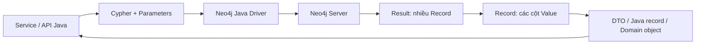
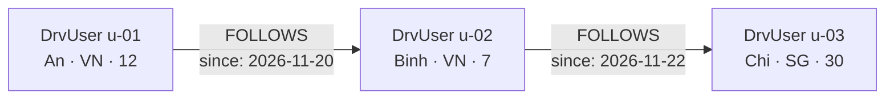
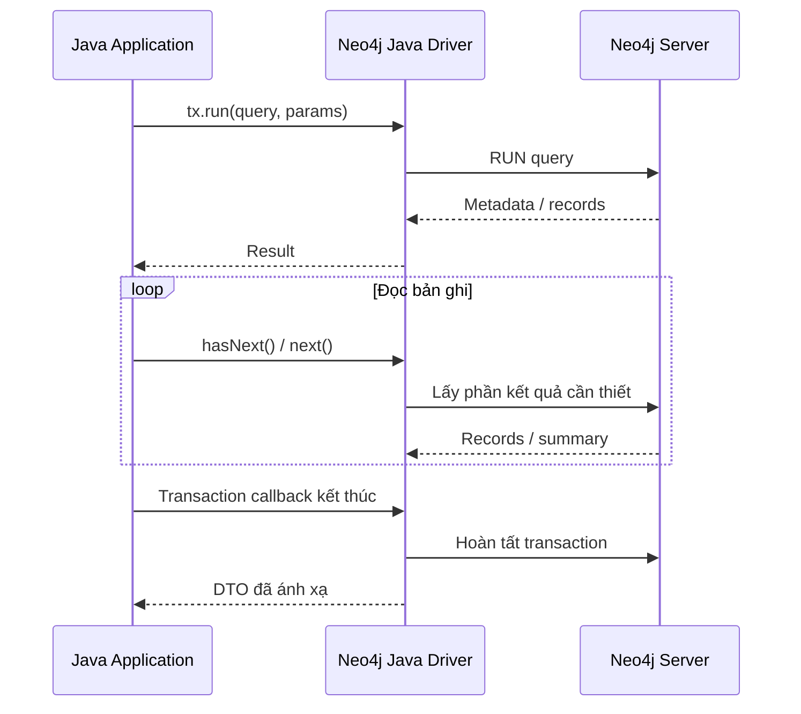

# Thực thi truy vấn có tham số và ánh xạ Record hoặc Value bằng Neo4j Java Driver

Trong ứng dụng Java làm việc với **Neo4j**, câu lệnh **Cypher** thường được xây dựng theo mẫu cố định, còn dữ liệu đầu vào thay đổi theo từng yêu cầu: mã khách hàng, trạng thái, mốc thời gian hoặc số kết quả cần lấy. **Neo4j Java Driver** cho phép truyền những giá trị này bằng **tham số (parameters)**, gửi truy vấn đến Neo4j và đọc các hàng kết quả thông qua `Result`, `Record` và `Value`.

Điểm quan trọng của bài là hiểu đủ ba bước: **gửi Cypher cùng tham số**, **đọc dữ liệu theo đúng kiểu** và **chuyển kết quả thành đối tượng Java** trong khi session/transaction còn hiệu lực. Đây là phần kiến thức thuộc chương **Java Driver** của module **DATABASE_ENGINE_GRAPH_NEO4J**, phục vụ ứng dụng mô hình **property graph**, truy vấn node/relationship/path bằng Cypher và tích hợp với các lớp service hoặc **Spring Data Neo4j**.

Sau bài học, bạn có thể:

- Sử dụng cú pháp `$parameterName` và truyền `Map<String, Object>` khi gọi `tx.run(...)`.
- Chọn `executeRead`, `executeWrite` hoặc `session.run` theo ranh giới transaction.
- Phân biệt `Result` (luồng hàng), `Record` (một hàng) và `Value` (một ô có kiểu).
- Ánh xạ `Record` thành Java record/DTO, xử lý `null`, số, ngày giờ, list, map và các đối tượng graph.
- Tránh trả về kết quả chưa đọc hết ra ngoài phạm vi transaction hoặc vô tình nạp quá nhiều bản ghi vào bộ nhớ.

## 1. Hình dung luồng truy vấn từ Java đến Neo4j



Ví dụ nghiệp vụ: tìm những tài khoản `:DrvUser` tại Việt Nam có ít nhất 5 lượt theo dõi, lấy tối đa 20 người dùng. Giá trị `country`, `minFollowers` và `limit` đến từ yêu cầu ứng dụng, còn cấu trúc Cypher vẫn ổn định.

```cypher
MATCH (u:DrvUser)
WHERE u.country = $country
  AND u.followers >= $minFollowers
RETURN u.userId AS userId,
       u.name AS displayName,
       u.followers AS followers
ORDER BY followers DESC, userId ASC
LIMIT $limit;
```

Ba tên bắt đầu bằng dấu `$` là **tham số của Cypher**. Chúng được cung cấp riêng ở phía Java:

```java
Map<String, Object> params = Map.of(
    "country", "VN",
    "minFollowers", 5L,
    "limit", 20
);
```

Trong `Map`, khóa là tên **không có ký tự `$`**. Neo4j nhận câu lệnh và giá trị tham số theo giao thức driver; ứng dụng không cần nối giá trị `"VN"` vào chuỗi Cypher.

## 2. Chuẩn bị property graph để thực hành

Tạo dữ liệu trên **database thử nghiệm**, với ba người dùng và hai relationship `:FOLLOWS`.

### 2.1. Constraint cho định danh ổn định

```cypher
CREATE CONSTRAINT drv_user_id_unique IF NOT EXISTS
FOR (u:DrvUser)
REQUIRE u.userId IS UNIQUE;
```

Constraint giúp tránh hai node `DrvUser` có cùng `userId` và hỗ trợ tìm một người dùng theo mã nghiệp vụ.

### 2.2. Tạo node và relationship

```cypher
UNWIND [
  {id: 'u-01', name: 'An',   country: 'VN', followers: 12, nickname: 'an.neo'},
  {id: 'u-02', name: 'Binh', country: 'VN', followers: 7,  nickname: null},
  {id: 'u-03', name: 'Chi',  country: 'SG', followers: 30, nickname: 'chi.graph'}
] AS row
MERGE (u:DrvUser {userId: row.id})
SET u.name = row.name,
    u.country = row.country,
    u.followers = row.followers,
    u.nickname = row.nickname;
```

```cypher
MATCH (a:DrvUser {userId: 'u-01'})
MATCH (b:DrvUser {userId: 'u-02'})
MATCH (c:DrvUser {userId: 'u-03'})
MERGE (a)-[r1:FOLLOWS]->(b)
SET r1.since = date('2026-11-20')
MERGE (b)-[r2:FOLLOWS]->(c)
SET r2.since = date('2026-11-22');
```



Truy vấn kiểm tra:

```cypher
MATCH (u:DrvUser)
RETURN u.userId, u.name, u.country, u.followers, u.nickname
ORDER BY u.userId;
```

Trong Neo4j, `SET u.nickname = null` **loại bỏ thuộc tính** đó khỏi node. Vì vậy, dữ liệu `u-02` không có property `nickname`; khi truy vấn `RETURN u.nickname`, giá trị cột tương ứng là `null`.

## 3. Quản lý Driver, Session và Transaction đúng phạm vi

**`Driver`** quản lý kết nối đến Neo4j và thường được tạo **một lần cho vòng đời ứng dụng**. **`Session`** là một đơn vị làm việc nhẹ, nên tạo cho thao tác/request và đóng khi xong. Session **không được thiết kế để chia sẻ sử dụng đồng thời giữa nhiều luồng**. Các request khác nhau có thể tạo session riêng từ cùng một `Driver`.

Sơ đồ phạm vi:

```text
Ứng dụng khởi động
└── Driver (dùng lại, đóng khi ứng dụng dừng)
    ├── Request A -> Session A -> Transaction -> Result -> DTO -> close
    ├── Request B -> Session B -> Transaction -> Result -> DTO -> close
    └── Request C -> Session C -> Transaction -> Result -> DTO -> close
```

Ví dụ tạo Driver trong mã khởi động (thông số và thông tin đăng nhập lấy từ cấu hình an toàn):

```java
import org.neo4j.driver.AuthTokens;
import org.neo4j.driver.Driver;
import org.neo4j.driver.GraphDatabase;

Driver driver = GraphDatabase.driver(
    "neo4j+s://db.example.com",
    AuthTokens.basic(username, password)
);
driver.verifyConnectivity();

// Driver được giữ để tái sử dụng.
// Khi ứng dụng dừng: driver.close().
```

`neo4j+s://` minh họa kết nối routing có TLS và xác thực chứng chỉ. Trong môi trường local, URI và lựa chọn bảo mật có thể khác. Không nhúng thông tin đăng nhập thật vào mã nguồn.

Hai cách gọi phù hợp cho ứng dụng thông thường:

| API | Ý nghĩa | Ranh giới thành công |
| --- | --- | --- |
| `session.executeRead(tx -> ...)` | Managed read transaction; driver quản lý transaction và retry phù hợp | Callback đã chạy xong và transaction hoàn tất |
| `session.executeWrite(tx -> ...)` | Managed write transaction; driver có thể retry callback | Commit thành công trước khi phương thức trả kết quả |
| `session.run(cypher, params)` | Implicit/auto-commit transaction cho câu lệnh | Chủ động đọc hết/`consume()` để chờ hoàn tất |
| `session.beginTransaction()` | Explicit transaction | Ứng dụng gọi `tx.commit()` hoặc `tx.rollback()` |

Trong bài này, ví dụ đọc nghiệp vụ chủ yếu dùng `executeRead` và ví dụ ghi dùng `executeWrite`. Với môi trường nhiều database, chọn database rõ ràng:

```java
try (Session session =
         driver.session(SessionConfig.forDatabase("neo4j"))) {
    // Mọi query trong session dùng database đã chỉ định.
}
```

Nếu dùng tên database khác trong triển khai thực tế, thay `"neo4j"` bằng giá trị cấu hình tương ứng.

## 4. Thực thi Cypher có tham số và ánh xạ thành DTO

Một Java `record` biểu diễn dữ liệu trả về của truy vấn:

```java
public record UserSummary(
    String userId,
    String displayName,
    long followers
) {}
```

Ví dụ một lớp dịch vụ Java Driver hoàn chỉnh ở mức phương thức:

```java
import org.neo4j.driver.Driver;
import org.neo4j.driver.Result;
import org.neo4j.driver.Session;
import org.neo4j.driver.SessionConfig;

import java.util.List;
import java.util.Map;
import java.util.Objects;

public final class UserQueryService {

    private final Driver driver;

    public UserQueryService(Driver driver) {
        this.driver = Objects.requireNonNull(driver);
    }

    public record UserSummary(
        String userId,
        String displayName,
        long followers
    ) {}

    public List<UserSummary> search(
            String country, long minFollowers, int limit) {

        Objects.requireNonNull(country, "country");
        if (minFollowers < 0 || limit < 1 || limit > 100) {
            throw new IllegalArgumentException("Invalid query criteria");
        }

        String cypher = """
            MATCH (u:DrvUser)
            WHERE u.country = $country
              AND u.followers >= $minFollowers
            RETURN u.userId AS userId,
                   u.name AS displayName,
                   u.followers AS followers
            ORDER BY followers DESC, userId ASC
            LIMIT $limit
            """;

        Map<String, Object> params = Map.of(
            "country", country,
            "minFollowers", minFollowers,
            "limit", limit
        );

        try (Session session =
                 driver.session(SessionConfig.forDatabase("neo4j"))) {

            return session.executeRead(tx -> {
                Result result = tx.run(cypher, params);

                return result.list(record -> new UserSummary(
                    record.get("userId").asString(),
                    record.get("displayName").asString(),
                    record.get("followers").asLong()
                ));
            });
        }
    }
}
```

Gọi:

```java
List<UserQueryService.UserSummary> users =
    service.search("VN", 5L, 20);
```

Với dữ liệu mẫu, danh sách có hai người dùng theo thứ tự giảm dần số followers:

| userId | displayName | followers |
| --- | --- | ---: |
| `u-01` | An | 12 |
| `u-02` | Binh | 7 |

**Phân tích các dòng quan trọng:**

1. `tx.run(cypher, params)` gửi câu lệnh **cùng map tham số** vào transaction.
2. `Result` đại diện cho các bản ghi có thể được truyền về dần; không tự coi nó là `List` đã có sẵn.
3. `result.list(mapper)` duyệt toàn bộ kết quả của truy vấn, chuyển mỗi `Record` thành `UserSummary`.
4. `record.get("userId")` trả một `Value`; `asString()` hoặc `asLong()` trích xuất kiểu Java tương ứng.
5. Kết quả trả từ callback là `List<UserSummary>` đã materialize, có thể dùng an toàn sau khi session đóng.

`result.list(...)` phù hợp khi tập kết quả **được giới hạn và có kích thước nhỏ/vừa**. Với hàng triệu bản ghi, cần lọc, phân trang hoặc duyệt theo luồng thay vì đưa toàn bộ vào một danh sách.

## 5. Tham số thay thế dữ liệu, không thay thế tùy ý cấu trúc Cypher

So sánh:

```java
// KHÔNG NÊN: ghép đầu vào vào chuỗi lệnh.
String unsafe = "MATCH (u:DrvUser {userId: '" + userId + "'}) "
              + "RETURN u.name";
```

```java
// NÊN: câu lệnh ổn định, dữ liệu truyền riêng.
String cypher = """
    MATCH (u:DrvUser {userId: $userId})
    RETURN u.name AS name
    """;

Map<String, Object> parameters = Map.of("userId", userId);
```

Cách có tham số:

- Tránh để dấu nháy hoặc cú pháp đặc biệt trong giá trị đầu vào biến thành một phần của Cypher.
- Giúp truy vấn dễ kiểm thử, log cấu trúc câu lệnh riêng với dữ liệu nhạy cảm.
- Cho phép Neo4j tái sử dụng kế hoạch truy vấn trong những trường hợp phù hợp.
- Truyền được số, boolean, temporal, list và map mà không phải tự dựng literal Cypher.

### Phần nào không thể viết thành tham số theo cách thông thường?

```cypher
// Sai: vị trí nhãn không chấp nhận $label theo cú pháp này.
MATCH (n:$label)
RETURN n;
```

`$label`, `$relationshipType` hay `$sortDirection` không thể tùy tiện đặt vào mọi vị trí cần token/cú pháp Cypher. Một số bản Neo4j mới có hỗ trợ **nhãn/loại quan hệ động** bằng cú pháp riêng như `:$(label)`, nhưng cú pháp và khả năng tối ưu phải đối chiếu đúng phiên bản. Với cấu trúc truy vấn cần biến đổi, thiết kế các mẫu Cypher được cho phép hoặc dùng khả năng động chính thức, không ghép chuỗi tùy ý từ người dùng.

Tương tự, không nên cho client gửi nguyên câu `ORDER BY` hay đoạn `MATCH` rồi nối thẳng vào Cypher. Nếu nghiệp vụ yêu cầu chọn trường sắp xếp, ánh xạ các lựa chọn hợp lệ sang danh sách cố định của ứng dụng.

### Truyền tham số list và map

Ví dụ tìm một nhóm tài khoản bằng danh sách ID:

```cypher
MATCH (u:DrvUser)
WHERE u.userId IN $ids
RETURN u.userId AS userId, u.name AS name
ORDER BY userId;
```

Java:

```java
Map<String, Object> parameters = Map.of(
    "ids", List.of("u-01", "u-03")
);
```

Khi truyền map lồng nhau, truy vấn có thể dùng `$payload.userId` hoặc `$payload.country` nếu cấu trúc map hợp lệ. Nếu phải gửi nhiều hàng để cập nhật, xem ví dụ `UNWIND` ở phần sau.

## 6. `Result`, `Record` và `Value` khác nhau ở đâu?

Giả sử query trả:

```cypher
MATCH (u:DrvUser {userId: 'u-01'})
RETURN u.userId AS id,
       u.name AS name,
       u.followers AS followers;
```

Có thể hình dung kết quả:

```text
Result
└── Record #1
    ├── "id"        -> Value("u-01")
    ├── "name"      -> Value("An")
    └── "followers" -> Value(12)
```

| Đối tượng | Chứa gì? | API thường dùng |
| --- | --- | --- |
| `Result` | Luồng các hàng `Record` | `hasNext()`, `next()`, `single()`, `list()`, `consume()` |
| `Record` | Một hàng, các ô được đặt theo cột/alias | `get("id")`, `get(0)`, `keys()`, `containsKey(...)` |
| `Value` | Giá trị một ô theo hệ kiểu Neo4j | `isNull()`, `asString()`, `asLong()`, `asNode()`, `asList(...)`... |

**Dùng alias rõ ràng** như `RETURN u.userId AS userId` để mapper không phụ thuộc biểu thức Cypher nguyên gốc hoặc vị trí cột. Truy cập theo `get(0)` có thể hợp lệ nhưng dễ hỏng khi chỉnh thứ tự cột `RETURN`.

### Đọc đúng một hàng

Nếu constraint `DrvUser.userId` bảo đảm một node:

```java
String name = session.executeRead(tx -> {
    var result = tx.run("""
        MATCH (u:DrvUser {userId: $id})
        RETURN u.name AS name
        """, Map.of("id", "u-01"));

    return result.single().get("name").asString();
});
```

`single()` dành cho truy vấn **mong đợi đúng một hàng**. Nếu không có hàng, hoặc có nhiều hơn một hàng, nó báo lỗi thay vì im lặng chọn đại một hàng. Khi zero-row là tình huống hợp lệ, xử lý tường minh bằng `hasNext()`:

```java
Optional<String> maybeName = session.executeRead(tx -> {
    var result = tx.run("""
        MATCH (u:DrvUser {userId: $id})
        RETURN u.name AS name
        """, Map.of("id", "missing-id"));

    if (!result.hasNext()) {
        return Optional.empty();
    }
    return Optional.of(result.single().get("name").asString());
});
```

Vì `userId` có constraint duy nhất, sau khi `hasNext()` cho biết có hàng, `single()` còn kiểm tra được giả định rằng truy vấn chỉ có một hàng. Với truy vấn không bảo đảm uniqueness, phải quyết định rõ có cho nhiều hàng hay không, tránh dùng `single()` một cách tùy tiện.

## 7. Ánh xạ `Value` sang kiểu Java

Mỗi `Value` có kiểu dữ liệu Neo4j; hãy gọi phương thức ép kiểu phù hợp với giá trị **thực tế của cột**.

| Kiểu dữ liệu Cypher thường gặp | Ví dụ | Phương thức Java Driver |
| --- | --- | --- |
| `STRING` | `'An'` | `value.asString()` |
| `INTEGER` | `12` | `value.asLong()` hoặc `asInt()` khi chắc chắn nằm trong phạm vi `int` |
| `FLOAT` | `3.5` | `value.asDouble()` |
| `BOOLEAN` | `true` | `value.asBoolean()` |
| `DATE` | `date('2026-11-25')` | `value.asLocalDate()` |
| `LOCAL DATETIME` | `localdatetime(...)` | `value.asLocalDateTime()` |
| `DATETIME` | `datetime(...)` | `value.asZonedDateTime()` |
| `LIST` | `['A','B']` | `value.asList(...)` |
| `MAP` | `{id:'u-01'}` | `value.asMap()` |
| `NODE` | `RETURN u AS user` | `value.asNode()` |
| `RELATIONSHIP` | `RETURN r AS rel` | `value.asRelationship()` |
| `PATH` | `RETURN p AS path` | `value.asPath()` |
| `null` | `RETURN null AS nickname` | `value.isNull()` trước khi chuyển đổi |

**Không nên dùng `toString()` của `Value` để lấy dữ liệu nghiệp vụ.** `toString()` chủ yếu biểu diễn đối tượng để quan sát/debug; `asString()` mới là lựa chọn khi cột thực sự có kiểu chuỗi.

### Số nguyên, số thực và tiền tệ

Neo4j `INTEGER` dùng số nguyên 64 bit. `asInt()` chỉ phù hợp nếu giá trị nằm trong phạm vi `int` Java; với ID số hoặc bộ đếm có khả năng lớn, dùng `asLong()`. Với tiền tệ, tránh phụ thuộc vào `double` nếu nghiệp vụ đòi chính xác tuyệt đối; mô hình hóa bằng số nguyên ở đơn vị nhỏ nhất hoặc quy tắc số thập phân được kiểm soát.

Nếu bạn gọi `asLong()` trên một giá trị thực sự là chuỗi không tương thích, driver có thể báo lỗi chuyển kiểu. Điều đó thường báo hiệu **khác biệt giữa schema/query và DTO**, nên xử lý nguồn dữ liệu hoặc mapper thay vì mặc định nuốt ngoại lệ.

### `null` và thuộc tính không tồn tại

Query:

```cypher
MATCH (u:DrvUser {userId: 'u-02'})
RETURN u.userId AS userId,
       u.nickname AS nickname;
```

`nickname` trả `null` do node không có property. Mapper:

```java
var record = result.single();
String userId = record.get("userId").asString();

var nicknameValue = record.get("nickname");
String nickname = nicknameValue.isNull()
    ? null
    : nicknameValue.asString();
```

Nếu muốn DTO không có giá trị `null`, có thể dùng Java `Optional<String>`:

```java
Optional<String> nickname = nicknameValue.isNull()
    ? Optional.empty()
    : Optional.of(nicknameValue.asString());
```

Ngoài ra, Cypher có thể đặt giá trị mặc định ngay trong `RETURN`:

```cypher
RETURN coalesce(u.nickname, '(chưa có)') AS nickname;
```

**Phân biệt hai trường hợp:** “cột `nickname` tồn tại trong `Record` nhưng có giá trị `null`” khác với “query không trả cột mang alias `nickname`”. Nếu mapper phụ thuộc tên cột, luôn giữ `RETURN ... AS nickname` nhất quán và có thể dùng `record.containsKey("nickname")` để kiểm tra schema kết quả.

### Danh sách và bản đồ

Cypher:

```cypher
RETURN ['Graph', 'Cypher', 'Java'] AS tags,
       {userId: 'u-01', active: true} AS profile;
```

Java:

```java
var record = result.single();

List<String> tags = record.get("tags")
    .asList(value -> value.asString());

Map<String, Object> profile =
    record.get("profile").asMap();

String id = (String) profile.get("userId");
Boolean active = (Boolean) profile.get("active");
```

Với `LIST` hoặc `MAP` phức tạp, nên xác định rõ kiểu từng phần tử, không ép kiểu mù trên dữ liệu có thể chứa cả số, chuỗi và giá trị null. Nếu map dùng để tạo DTO, truy cập và kiểm tra từng trường quan trọng vẫn dễ bảo trì hơn dựa vào kết quả chuyển đổi không kiểm soát.

## 8. Ánh xạ node, relationship và path của property graph

`Record` không chỉ chứa số hoặc chuỗi. Câu Cypher có thể trả trực tiếp **NODE**, **RELATIONSHIP** và **PATH**; Java Driver cung cấp các kiểu trong `org.neo4j.driver.types`.

### 8.1. Node

```cypher
MATCH (u:DrvUser {userId: $id})
RETURN u AS user;
```

```java
import org.neo4j.driver.types.Node;

var record = result.single();
Node userNode = record.get("user").asNode();

String id = userNode.get("userId").asString();
String name = userNode.get("name").asString();
Iterable<String> labels = userNode.labels();
String elementId = userNode.elementId();
```

`elementId()` là **định danh kỹ thuật** của thực thể trong Neo4j. Không sử dụng nó như **business key bền vững** để trao đổi giữa các hệ thống; trong ví dụ, `userId` mới là khóa nghiệp vụ đã được constraint bảo vệ.

Trong các API trả response cho client, thường nên `RETURN` trực tiếp những property cần thiết, thay vì tải cả node rồi để controller tự đoán field.

### 8.2. Relationship

```cypher
MATCH (:DrvUser {userId: 'u-01'})-[r:FOLLOWS]->(:DrvUser)
RETURN r AS relation;
```

```java
import org.neo4j.driver.types.Relationship;

Relationship rel = result.single()
    .get("relation")
    .asRelationship();

String type = rel.type();
LocalDate since = rel.get("since").asLocalDate();
```

`since` là property đã đặt kiểu `DATE` trong dữ liệu mẫu. Tránh giả định mọi relationship `FOLLOWS` trong graph thật đều có property này; nếu optional thì kiểm tra `isNull()` trước khi ánh xạ.

### 8.3. Path

```cypher
MATCH p = (:DrvUser {userId: 'u-01'})
          -[:FOLLOWS*1..2]->(:DrvUser {userId: 'u-03'})
RETURN p AS path;
```

```java
import org.neo4j.driver.types.Node;
import org.neo4j.driver.types.Path;

Path path = result.single().get("path").asPath();

List<String> ids = new ArrayList<>();
for (Node n : path.nodes()) {
    ids.add(n.get("userId").asString());
}
// Với ví dụ: ["u-01", "u-02", "u-03"]
```

Trong ví dụ này có đường đi hai cạnh `u-01 → u-02 → u-03`. `path.length()` đếm số relationship trên đường, **không** tự cộng một thuộc tính trọng số.

### Chọn trả entity hay trả DTO?

| Kết quả Cypher | Ưu điểm | Khi nào dùng |
| --- | --- | --- |
| `RETURN u AS user` | Truy cập node, labels, properties trong mapper | Cần metadata graph hoặc xử lý nhiều thuộc tính |
| `RETURN u.userId AS id, u.name AS name` | Hợp đồng cột rõ, ít dữ liệu hơn | API trả DTO hoặc query dạng danh sách |
| `RETURN r AS relation` | Có loại relationship và properties | Logic duyệt/hiển thị quan hệ |
| `RETURN p AS path` | Giữ nguyên các node và cạnh trên đường | Tính năng giải thích đường đi/traversal |

Đối với API Java, **DTO thường giúp giữ ranh giới giữa model Neo4j và contract trả về** rõ hơn, nhất là khi graph schema thay đổi.

## 9. Vòng đời `Result` và tiêu thụ bản ghi an toàn

`Result` có thể được driver **stream/buffer** khi client gọi `hasNext()`, `next()`, `list()` hoặc `consume()`. Việc có object `Result` trong tay **không đồng nghĩa** mọi hàng đã về Java.



Sơ đồ là minh họa khái niệm: driver có thể prefetch, batch hoặc buffer, nên không phải mỗi `next()` đều phát sinh một round-trip mạng.

### 9.1. Đọc theo từng Record

```java
try (Session session =
         driver.session(SessionConfig.forDatabase("neo4j"))) {

    session.executeRead(tx -> {
        Result result = tx.run("""
            MATCH (u:DrvUser)
            RETURN u.userId AS userId
            ORDER BY userId
            """);

        while (result.hasNext()) {
            var record = result.next();
            System.out.println(record.get("userId").asString());
        }
        return null;
    });
}
```

Cách này xử lý tuần tự thay vì nạp tất cả kết quả vào `List`. Nhưng việc in/log từng bản ghi ngay trong callback managed transaction **có thể được thực hiện lại nếu callback bị retry**. Khi thao tác ngoài Neo4j có tác dụng phụ, phải cân nhắc retry và tách side effect ra khỏi callback.

### 9.2. Lấy toàn bộ thành List

```java
List<String> ids = session.executeRead(tx -> {
    Result result = tx.run("""
        MATCH (u:DrvUser)
        RETURN u.userId AS id
        ORDER BY id
        LIMIT 100
        """);

    return result.list(record ->
        record.get("id").asString()
    );
});
```

`list(mapper)` gọn và tiện với danh sách đã giới hạn. Không nên dùng `list()` trên truy vấn có thể trả hàng triệu node nếu chưa xác định ngân sách bộ nhớ.

### 9.3. `consume()` để lấy thống kê khi không cần record

```java
long updated = session.executeWrite(tx -> {
    var summary = tx.run("""
        MATCH (u:DrvUser {userId: $id})
        SET u.country = $country
        """, Map.of("id", "u-01", "country", "VN")
    ).consume();

    return (long) summary.counters().propertiesSet();
});
```

`consume()` bỏ qua các bản ghi chưa đọc và trả `ResultSummary`; **không tiếp tục duyệt `Result` sau khi đã consume**. `propertiesSet()` phản ánh số lần đặt property theo thống kê truy vấn, **không phải** số node hợp lệ về mặt nghiệp vụ. Đặc biệt, query có thể cập nhật 0 node mà không tự ném exception.

Trong `executeWrite`, `consume()` giúp hoàn tất kết quả câu lệnh; việc commit do **managed transaction** thực hiện khi callback hoàn tất thành công. Nếu dùng `session.run()` (implicit transaction), `consume()` còn là cách chủ động đợi query/commit hoàn tất trước khi báo thành công.

### 9.4. Không trả `Result` ra ngoài Session đã đóng

Mã sai về vòng đời:

```java
public Result findBad(Driver driver) {
    try (Session session = driver.session()) {
        return session.run("""
            MATCH (u:DrvUser)
            RETURN u.userId AS id
            """);
    } // Session đóng; caller không có phạm vi an toàn để đọc Result.
}
```

Giải pháp là **ánh xạ dữ liệu trước khi rời khỏi transaction/session**, như `List<UserSummary>`, DTO đơn lẻ hoặc kết quả phân trang. Không dựa vào việc driver có tình cờ buffer đủ bản ghi trong một lần chạy thử.

## 10. Ghi dữ liệu có tham số và kiểm tra kết quả

Truy vấn ghi cũng dùng parameter map như truy vấn đọc. Ví dụ cập nhật followers theo mã người dùng:

```java
public Optional<UserQueryService.UserSummary> updateFollowers(
        Driver driver, String userId, long followers) {

    if (followers < 0) {
        throw new IllegalArgumentException("followers must be >= 0");
    }

    try (Session session =
             driver.session(SessionConfig.forDatabase("neo4j"))) {

        return session.executeWrite(tx -> {
            Result result = tx.run("""
                MATCH (u:DrvUser {userId: $id})
                SET u.followers = $followers
                RETURN u.userId AS userId,
                       u.name AS displayName,
                       u.followers AS followers
                """, Map.of(
                    "id", userId,
                    "followers", followers
                ));

            if (!result.hasNext()) {
                return Optional.empty();
            }

            var row = result.single();
            return Optional.of(new UserQueryService.UserSummary(
                row.get("userId").asString(),
                row.get("displayName").asString(),
                row.get("followers").asLong()
            ));
        });
    }
}
```

Nếu `userId` không tồn tại, `MATCH` trả **0 hàng** và phương thức trả `Optional.empty()`. Ứng dụng có thể chuyển thành thông báo “không tìm thấy” thay vì coi cập nhật thành công.

**Managed transaction có thể retry callback** khi gặp một số lỗi tạm thời. Vì vậy, callback nên chứa các thao tác thuần trên Neo4j có thể thực thi lại an toàn. Không gửi email, gọi API thanh toán hay phát message ra ngoài trong callback rồi giả định chúng được rollback cùng Neo4j.

### Gửi nhiều hàng bằng `UNWIND $rows`

Khi cần cập nhật nhiều thực thể, truyền **danh sách map** thay vì ghép một chuỗi Cypher cho từng người dùng:

```cypher
UNWIND $rows AS row
MERGE (u:DrvUser {userId: row.userId})
SET u.name = row.name,
    u.country = row.country;
```

```java
List<Map<String, Object>> rows = List.of(
    Map.of(
        "userId", "u-04",
        "name", "Dung",
        "country", "VN"
    ),
    Map.of(
        "userId", "u-05",
        "name", "Em",
        "country", "SG"
    )
);

session.executeWrite(tx -> {
    tx.run("""
        UNWIND $rows AS row
        MERGE (u:DrvUser {userId: row.userId})
        SET u.name = row.name,
            u.country = row.country
        """, Map.of("rows", rows)
    ).consume();

    return null;
});
```

Cách này giữ cấu trúc query ổn định và phù hợp với batch. Với file hoặc stream lớn, nên chia batch theo kích thước phù hợp, có constraint trên khóa `userId` và quy tắc retry/ghi lặp rõ ràng.

### Truyền null từ Java

`Map.of(...)` của Java **không cho phép key/value là `null`**. Nếu một property thực sự được phép null, dùng map có thể chứa null:

```java
Map<String, Object> params = new HashMap<>();
params.put("userId", "u-02");
params.put("nickname", null);

tx.run("""
    MATCH (u:DrvUser {userId: $userId})
    SET u.nickname = $nickname
    """, params
).consume();
```

`SET u.nickname = null` loại bỏ property trong Neo4j. Nếu nghiệp vụ cần phân biệt “không gửi field” với “cố ý xóa field”, phải xây dựng quy ước cập nhật riêng; không đánh đồng hai tình huống.

## 11. Ánh xạ ngày giờ và giá trị phức hợp trong service

Trong Neo4j, `DATE`, `LOCAL DATETIME` và `DATETIME` có ngữ nghĩa múi giờ khác nhau. Ví dụ query:

```cypher
RETURN date('2026-11-25') AS birthday,
       localdatetime('2026-11-25T09:30:00') AS localMeeting,
       datetime('2026-11-25T09:30:00+07:00') AS globalMeeting;
```

Java:

```java
var row = result.single();

LocalDate birthday =
    row.get("birthday").asLocalDate();

LocalDateTime localMeeting =
    row.get("localMeeting").asLocalDateTime();

ZonedDateTime globalMeeting =
    row.get("globalMeeting").asZonedDateTime();
```

Các kiểu nằm trong `java.time`. Khi trả API, cần quy ước timezone và định dạng JSON rõ ràng; không chuyển `DATETIME` sang `LocalDateTime` một cách tùy tiện nếu làm mất ý nghĩa timezone của thời điểm.

### Map projection trong Cypher để giảm lượng dữ liệu

```cypher
MATCH (u:DrvUser {userId: $id})
RETURN u {
    .userId,
    .name,
    followerCount: u.followers
} AS profile;
```

Java có thể đọc:

```java
Map<String, Object> profile =
    result.single().get("profile").asMap();
```

Map projection giúp chủ động chọn dữ liệu trả về thay vì chuyển toàn bộ node. Khi thiết kế API lớn, DTO có kiểu rõ ràng vẫn dễ kiểm chứng và tránh lỗi ép kiểu hơn việc truyền thẳng `Map<String,Object>` qua nhiều lớp.

## 12. Các lỗi hay gặp và cách chẩn đoán

| Triệu chứng | Nguyên nhân thường gặp | Hướng xử lý |
| --- | --- | --- |
| Query báo thiếu parameter | Cypher dùng `$id` nhưng map không có key `"id"` | Đối chiếu tên tham số, không kèm `$` trong key |
| Câu lệnh ghép chuỗi bị lỗi cú pháp khi input có dấu nháy | Ghép dữ liệu vào Cypher | Chuyển sang `tx.run(query, params)` |
| `asLong()`/`asString()` ném lỗi kiểu | Kiểu `Value` không khớp mapper | Kiểm tra Cypher `RETURN` và dữ liệu/nullable |
| `NullPointerException` ở `Map.of` | Truyền giá trị Java `null` | Validate đầu vào hoặc dùng map hỗ trợ null |
| `single()` báo không có/không đúng số hàng | Query trả 0 hoặc nhiều hàng | Kiểm tra uniqueness; dùng `hasNext()` hoặc `list()` khi phù hợp |
| Lấy `Record` sai alias | `RETURN u.name AS displayName` nhưng đọc `"name"` | Cố định contract alias/DTO |
| Đọc `Result` sau khi session đóng | Result chưa materialize trong phạm vi sống | Map sang DTO/list trong callback |
| Out-of-memory khi `list()` | Kết quả quá lớn | Lọc, phân trang, đọc lần lượt hoặc chia batch |
| `MERGE` không tạo node mong đợi | Dữ liệu khóa null/sai kiểu hoặc transaction lỗi | Validate tham số, kiểm tra constraint, summary, lỗi commit |
| Callback `executeWrite` gây tác dụng phụ lặp | Managed transaction retry | Đưa side effect ra ngoài callback và thiết kế idempotent |
| Query chậm dù có tham số | Index, cardinality, traversal, thứ tự sắp xếp | Dùng `EXPLAIN`/`PROFILE` trên dữ liệu đại diện |

### Theo dõi hiệu năng và kế hoạch thực thi

Đặt `EXPLAIN` hoặc `PROFILE` trước truy vấn khi thử trên cơ sở dữ liệu phù hợp:

```cypher
EXPLAIN
MATCH (u:DrvUser)
WHERE u.country = 'VN'
  AND u.followers >= 5
RETURN u.userId AS id, u.followers AS followers
ORDER BY followers DESC
LIMIT 20;
```

`EXPLAIN` chỉ lập kế hoạch; `PROFILE` **chạy truy vấn** và cung cấp dữ liệu thực thi. Đánh giá index, `Estimated Rows`, `Rows`, `DB Hits` và các bước quét/sắp xếp nếu truy vấn đủ lớn để có vấn đề hiệu năng.

Một câu Cypher có tham số được viết đúng **không tự bảo đảm** tối ưu. Chỉ mục và constraint nên được thiết kế theo mẫu `WHERE`/`ORDER BY` thường dùng. Với API nhận `limit` từ client, luôn xác thực giới hạn để tránh kéo lượng dữ liệu vượt khả năng bộ nhớ.

## 13. Liên hệ Spring Data Neo4j và ranh giới DTO

Nếu đang dùng **Spring Data Neo4j**, repository hoặc `Neo4jClient` có thể tự hỗ trợ một phần ánh xạ dữ liệu. Nhưng khi dùng trực tiếp **Neo4j Java Driver**, lập trình viên phải kiểm soát `Record` và `Value` rõ ràng.

Các điểm chung:

- **Truyền tham số** thay cho nối chuỗi Cypher từ input.
- Giữ **khóa nghiệp vụ ổn định**, sử dụng constraint khi cần uniqueness.
- Xử lý kết quả **trong transaction/session** rồi trả DTO cho các lớp khác.
- Phân biệt lỗi **không tìm thấy dữ liệu**, lỗi **kiểu/ánh xạ** và lỗi **truy vấn/transaction**.
- Xem xét hành vi retry và việc ghi lặp của các thao tác quan trọng.

Một transaction do Spring quản lý không mặc nhiên bao trùm một `Driver Session` tự tạo riêng. Nếu ứng dụng dùng đồng thời repository Spring và Java Driver trực tiếp, cần thiết kế ranh giới transaction rõ ràng thay vì mặc định mọi thao tác nằm chung một transaction.

## 14. Bài tập tự kiểm tra

**Câu 1.** Vì sao truyền `Map.of("userId", input)` vào `tx.run(query, params)` tốt hơn viết `"... {userId: '" + input + "'} ..."`?

<details>
<summary>Gợi ý đáp án</summary>

Vì tham số giữ input ở vị trí **giá trị dữ liệu**, tránh nó trở thành cú pháp Cypher và giảm lỗi trích dẫn, đồng thời hỗ trợ kiểu dữ liệu rõ ràng và tái sử dụng kế hoạch truy vấn. Cần validate đầu vào nghiệp vụ và giữ cấu trúc Cypher an toàn.

</details>

**Câu 2.** `result.single()` và `result.list()` khác nhau thế nào?

<details>
<summary>Gợi ý đáp án</summary>

`single()` yêu cầu đúng một hàng và báo lỗi khi số hàng khác một. `list()` lấy toàn bộ các hàng vào danh sách (có thể dùng mapper), phù hợp dữ liệu có nhiều hàng nhưng phải kiểm soát kích thước.

</details>

**Câu 3.** Khi `u.nickname` không tồn tại, đoạn `record.get("nickname").asString()` có luôn an toàn không?

<details>
<summary>Gợi ý đáp án</summary>

Không. Khi `RETURN u.nickname AS nickname` cho giá trị null, cần kiểm tra `Value.isNull()` hoặc dùng `coalesce(...)` nếu muốn giá trị mặc định. Ngoài ra còn phải chắc alias `nickname` thực sự có trong `Record`.

</details>

**Câu 4.** Tại sao không nên trả thẳng `Result` từ một phương thức đã đóng `Session`?

<details>
<summary>Gợi ý đáp án</summary>

Vì `Result` là luồng bản ghi gắn với query/session và có thể chưa được đọc hết. Caller sẽ không còn phạm vi an toàn để tiêu thụ nó. Hãy chuyển sang DTO/List trong transaction trước khi trả về.

</details>

**Câu 5.** Query `RETURN u AS user` và `RETURN u.userId AS id` khác nhau gì trong ánh xạ Java?

<details>
<summary>Gợi ý đáp án</summary>

Câu đầu trả `Value` kiểu `NODE`, có thể đọc bằng `asNode()` rồi lấy property. Câu sau trả riêng một giá trị `STRING`, đọc bằng `record.get("id").asString()`. Dạng trả property rõ alias thường phù hợp hơn cho DTO nhỏ.

</details>

**Câu 6.** Vì sao cần kiểm tra `followers` bằng `asLong()` thay vì mặc định `asInt()`?

<details>
<summary>Gợi ý đáp án</summary>

Neo4j `INTEGER` dùng số nguyên 64 bit. `asInt()` chỉ phù hợp khi số nằm trong phạm vi của Java `int`; với bộ đếm lớn, chọn `long`/`asLong()` để tránh sai lệch hoặc lỗi ép kiểu.

</details>

**Câu 7.** Lời gọi `executeWrite` tạo node rồi callback bị retry vì lỗi tạm thời. Vì sao callback không nên tự gửi email xác nhận?

<details>
<summary>Gợi ý đáp án</summary>

Vì email là tác dụng phụ nằm ngoài transaction Neo4j. Retry có thể khiến email được gửi nhiều lần ngay cả khi transaction trước chưa commit hoặc đã commit nhưng chưa có xác nhận. Cần tách side effect ngoài database và dùng cơ chế idempotency/outbox phù hợp.

</details>

## Ghi nhớ

- Dùng `tx.run(cypher, params)` với `$param` trong Cypher và key không có dấu `$` ở `Map`.
- **`Result` chứa các `Record`; mỗi `Record` có nhiều `Value`.** Đọc đúng alias, kiểm tra kiểu và nullable trước khi tạo DTO.
- `result.single()` yêu cầu một hàng; `list(mapper)` phù hợp kết quả đã giới hạn; `hasNext()/next()` hỗ trợ duyệt lần lượt.
- Với property graph, `Value` có thể chứa **NODE**, **RELATIONSHIP**, **PATH**; chỉ dùng metadata của graph khi thật sự cần, ưu tiên business key thay vì internal `elementId`.
- Ánh xạ dữ liệu **trong callback transaction**, không trả `Result` chưa tiêu thụ ra ngoài Session đã đóng.
- **`executeRead`/`executeWrite`** quản lý transaction và có thể retry callback; cần kiểm soát tác dụng phụ ngoài Neo4j và các tình huống không tìm thấy bản ghi.
- Truyền tham số giúp câu lệnh an toàn và dễ bảo trì, nhưng vẫn cần validate đầu vào, thiết kế index và kiểm tra `EXPLAIN`/`PROFILE` khi cần tối ưu.

### Tài liệu tham khảo

- [Neo4j Java Driver Manual — Run your queries](https://neo4j.com/docs/java-manual/current/query-simple/)
- [Neo4j Java Driver Manual — Transactions](https://neo4j.com/docs/java-manual/current/transactions/)
- [Neo4j Java Driver Manual — Data types](https://neo4j.com/docs/java-manual/current/data-types/)
- [Neo4j Java Driver API — Record](https://neo4j.com/docs/api/java-driver/current/org.neo4j.driver/org/neo4j/driver/Record.html)
- [Neo4j Java Driver API — Value](https://neo4j.com/docs/api/java-driver/current/org.neo4j.driver/org/neo4j/driver/Value.html)
- [Neo4j Cypher Manual — Parameters](https://neo4j.com/docs/cypher-manual/current/syntax/parameters/)
- [Spring Data Neo4j Reference](https://docs.spring.io/spring-data/neo4j/reference/)
