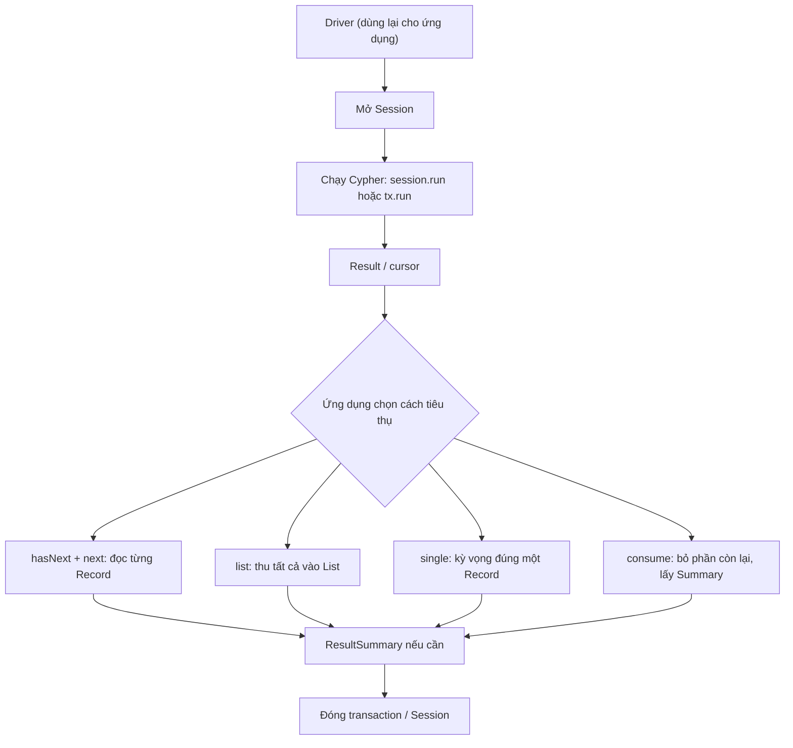

# Đọc kết quả theo luồng và quản lý thời điểm tiêu thụ kết quả

## 1. Vấn đề thực tế: truy vấn trả về nhiều dòng

Trong Neo4j, Cypher có thể trả về node, relationship, đường đi, hoặc các cột tổng hợp được tính từ **property graph**. Khi gọi truy vấn từ Java, một kết quả có hàng trăm nghìn dòng không nên mặc nhiên được chuyển thành một `List` trong bộ nhớ ứng dụng. Ngược lại, nếu chỉ lấy vài dòng đầu rồi đóng session, ta cũng không được tùy ý giả định rằng mọi phần còn lại của truy vấn đã được xử lý xong.

**Neo4j Java Driver** hỗ trợ đọc kết quả dần qua đối tượng `Result`. Driver nhận dữ liệu từ Neo4j qua giao thức Bolt và có thể lấy bản ghi theo từng đợt. Lúc ứng dụng gọi `session.run(...)` hoặc `tx.run(...)`, điều đó **không đồng nghĩa** toàn bộ các `Record` đã được chuyển về Java và tiêu thụ.

Bài này thuộc chương **Java Driver** trong module `DATABASE_ENGINE_GRAPH_NEO4J`. Kiến thức áp dụng cho các luồng đọc Cypher về node/relationship/đường đi, truy vấn dùng index và `ORDER BY`, cũng như các dịch vụ Java/Spring tích hợp Neo4j.

**Mục tiêu học tập**:

1. Phân biệt tạo `Result`, kéo từng `Record`, vật hóa toàn bộ và lấy `ResultSummary`.
2. Dùng `hasNext()`, `next()`, `list()`, `single()`, `stream()`, `consume()` đúng mục đích.
3. Đặt thời điểm đọc trong phạm vi còn sống của `Session` và transaction.
4. Biết khi nào nên dùng `LIMIT`, fetch size và xử lý theo dòng thay cho giữ toàn bộ dữ liệu.
5. Thiết kế đo độ trễ, kiểm tra lỗi và quản lý tài nguyên khi phục vụ API hoặc batch.

## 2. Vòng đời một truy vấn Java Driver



Sơ đồ là **luồng logic**. Trên thực tế, các phương thức của `Result` có thể yêu cầu thêm dữ liệu qua mạng, và hoạt động của driver còn phụ thuộc transaction cùng bộ đệm. Không phải mỗi lần `next()` đều tạo một round trip: driver có thể giữ sẵn một nhóm record theo *fetch size*.

Các khái niệm cần phân biệt:

| Thành phần | Vai trò | Quản lý như thế nào? |
|---|---|---|
| `Driver` | Quản lý cấu hình, kết nối/pool và truy cập Neo4j | Thường tạo một lần cho ứng dụng, dùng lại giữa nhiều request và đóng khi ứng dụng dừng |
| `Session` | Đơn vị ngữ cảnh thực hiện công việc | Thường mở trong phạm vi thao tác, đóng bằng `try-with-resources`; **không chia sẻ giữa các thread** |
| `TransactionContext` / transaction | Phạm vi một giao dịch | Đọc và tiêu thụ `Result` trước khi callback/transaction kết thúc |
| `Result` | Con trỏ kết quả của một truy vấn | Tiêu thụ khi session/transaction còn sống |
| `Record` | Một dòng dữ liệu nhận được | Ánh xạ ngay thành dữ liệu ứng dụng; tránh giữ không cần thiết |
| `ResultSummary` | Thống kê/metadata cuối truy vấn | Nhận khi truy vấn được tiêu thụ hoàn tất hoặc gọi `consume()` |

**Nguyên tắc cốt lõi:** một `Result` không phải danh sách độc lập có thể trả về từ bất kỳ hàm nào. Nó gắn với thời gian sống của session và transaction phát sinh nó.

## 3. Chuẩn bị dữ liệu mẫu

Dùng một nhãn riêng `JD006Document` để có thể chạy lại bài mà không trùng với dữ liệu nghiệp vụ. Chỉ chạy các lệnh ghi trên database thực hành.

```cypher
CREATE CONSTRAINT jd006_document_id IF NOT EXISTS
FOR (d:JD006Document)
REQUIRE d.id IS UNIQUE;
```

```cypher
UNWIND range(1, 12) AS i
MERGE (d:JD006Document {id: 'doc-' + toString(i)})
SET d.title = 'Tài liệu ' + toString(i),
    d.score = i,
    d.category = CASE WHEN i % 2 = 0
                      THEN 'graph' ELSE 'java' END;
```

Kiểm tra:

```cypher
MATCH (d:JD006Document)
RETURN d.id AS id, d.title AS title,
       d.score AS score, d.category AS category
ORDER BY score;
```

Trong database chỉ có fixture này, truy vấn trả **12 dòng**, `score` từ 1 đến 12. Bài sẽ sử dụng cùng câu đọc có `ORDER BY score` và `LIMIT $limit` để người học dự đoán thứ tự:

```cypher
MATCH (d:JD006Document)
RETURN d.id AS id, d.title AS title, d.score AS score
ORDER BY score
LIMIT $limit;
```

`LIMIT` là **giới hạn kết quả do Cypher xử lý tại Neo4j**, khác với việc ứng dụng dừng đọc sau `k` dòng trong khi câu truy vấn máy chủ có thể vẫn tạo nhiều dòng. Khi chỉ cần trang đầu, hãy giới hạn truy vấn bằng tham số thay vì hy vọng bỏ qua phần còn lại ở client sẽ có chi phí tương đương.

## 4. Đọc lần lượt với hasNext() và next()

Ví dụ Java Driver đồng bộ (*blocking API*) với các phiên bản gần đây của Java Driver. Đoạn code giả định `Driver driver` đã được cấu hình kết nối Neo4j; `Session` được mở và đóng trong phương thức.

```java
import java.util.Map;
import java.util.concurrent.TimeUnit;
import org.neo4j.driver.AccessMode;
import org.neo4j.driver.Driver;
import org.neo4j.driver.Result;
import org.neo4j.driver.Session;
import org.neo4j.driver.SessionConfig;
import org.neo4j.driver.summary.ResultSummary;

public final class DocumentReader {
    private final Driver driver;

    public DocumentReader(Driver driver) {
        this.driver = driver;
    }

    public void printFirstSix() {
        String cypher = """
            MATCH (d:JD006Document)
            RETURN d.id AS id, d.title AS title, d.score AS score
            ORDER BY score
            LIMIT $limit
            """;

        SessionConfig config = SessionConfig.builder()
            .withDefaultAccessMode(AccessMode.READ)
            .withFetchSize(3)
            .build();

        try (Session session = driver.session(config)) {
            Result result = session.run(cypher, Map.of("limit", 6));

            int count = 0;
            while (result.hasNext()) {
                org.neo4j.driver.Record record = result.next();
                String id = record.get("id").asString();
                int score = record.get("score").asInt();
                System.out.printf("%s score=%d%n", id, score);
                count++;
            }

            ResultSummary summary = result.consume();
            System.out.printf("records=%d, availableAfter=%d ms%n",
                count,
                summary.resultAvailableAfter(TimeUnit.MILLISECONDS));
        }
    }
}
```

Trên dữ liệu mẫu, phương thức in lần lượt `doc-1` đến `doc-6`; `count = 6`. Đọc `ResultSummary` sau vòng lặp là hợp lệ. Trường `resultAvailableAfter` cung cấp một chỉ số thời gian do Neo4j báo cho giai đoạn sẵn sàng kết quả; **nó không phải thời gian end-to-end** của toàn bộ hoạt động HTTP/Java và không thay thế benchmark.

Diễn giải từng thao tác:

1. `session.run(...)` gửi truy vấn và nhận một `Result`; chưa thể coi 6 record đã xuất hiện trong Java.
2. `hasNext()` kiểm tra còn record, và có thể phải chờ driver kéo thêm dữ liệu từ Neo4j.
3. `next()` chuyển con trỏ sang record tiếp theo. Nên đọc cột và xử lý ngay, tránh tích lũy record không cần thiết.
4. `consume()` kết thúc việc tiêu thụ kết quả và cho `ResultSummary`. Vì vòng lặp đã đọc hết, không có record chưa xử lý cần giữ lại.
5. `Session` đóng ở cuối `try-with-resources`, kể cả khi xử lý ném ngoại lệ.

**Đọc theo dòng không đồng nghĩa giữ đúng một record trong RAM**: driver vẫn có bộ đệm theo fetch size, giá trị thuộc tính có thể lớn, và code của bạn có thể giữ dữ liệu trong collection. Nhưng nó tránh nhu cầu giữ **toàn bộ N record** chỉ để xử lý tuần tự.

## 5. Khi nào dùng list(), single(), peek(), stream() và consume()?

`Result` hỗ trợ nhiều cách tiêu thụ. Chọn phương thức phù hợp với hợp đồng dữ liệu, không chọn theo sở thích.

| Phương thức | Hành vi | Khi nên dùng | Rủi ro |
|---|---|---|---|
| `hasNext()` + `next()` | Duyệt tuần tự từng `Record` | Export, ETL, xử lý nhiều dòng | Giữ transaction/session mở trong suốt thời gian xử lý |
| `list()` | Đọc hết phần kết quả còn lại vào `List<Record>` | Tập trả về nhỏ và bị giới hạn | Giữ nhiều record trong heap |
| `list(mapper)` | Đọc hết, chuyển record thành DTO/giá trị | Response danh sách nhỏ, rõ kích thước | Vẫn vật hóa toàn bộ danh sách |
| `single()` | Đọc với kỳ vọng **đúng một** record | Truy vấn theo khóa duy nhất hoặc một hàng tổng hợp | Ném lỗi nếu số dòng không đúng một |
| `peek()` | Xem record kế tiếp mà **không tiến con trỏ** | Kiểm tra trước khi đọc bằng `next()` | Không phù hợp làm cơ chế lặp chính |
| `stream()` | Cung cấp Java `Stream<Record>` có nguồn là result | Pipeline xử lý có kiểm soát trong session | Java stream bị trả ra khỏi session hoặc bị thu thành `toList()` rất lớn |
| `consume()` | Kết thúc đọc, **bỏ qua record chưa lấy**, nhận `ResultSummary` | Ghi/lệnh không cần dòng trả về, hoặc muốn kết thúc con trỏ | Mất quyền đọc các record chưa tiêu thụ |

### 5.1. Vật hóa dữ liệu có giới hạn bằng list(mapper)

```java
record DocumentDto(String id, String title, int score) {}

var documents = session.executeRead(tx ->
    tx.run("""
        MATCH (d:JD006Document)
        RETURN d.id AS id, d.title AS title, d.score AS score
        ORDER BY score
        LIMIT $limit
        """, Map.of("limit", 6))
      .list(row -> new DocumentDto(
          row.get("id").asString(),
          row.get("title").asString(),
          row.get("score").asInt()
      ))
);
```

Đoạn code nằm **bên trong** phạm vi `try (Session session = ...)` của chương trình; `DocumentDto` là kiểu dữ liệu ứng dụng định nghĩa. `list(mapper)` lấy toàn bộ kết quả của truy vấn (ở đây đã giới hạn 6) và trả danh sách DTO độc lập có thể sử dụng **sau khi transaction đóng**. Câu lệnh có `LIMIT` giúp xác định trần số record; từng record vẫn có thể mang dữ liệu lớn nếu trả toàn bộ node.

### 5.2. single() có hợp đồng đúng một dòng

```java
long total = session.executeRead(tx ->
    tx.run("""
        MATCH (d:JD006Document)
        RETURN count(d) AS total
        """)
      .single()
      .get("total").asLong()
);
```

`count(d)` không nhóm trả **một dòng**, kể cả khi graph không có document (`total = 0`). Vì vậy `single()` phù hợp. Ngược lại, nếu chạy `MATCH (d:JD006Document) RETURN d`, dùng `single()` là sai vì có 12 dòng. Với truy vấn trả 0 dòng hoặc hơn 1 dòng, `single()` không thể dùng làm "lấy dòng đầu tiên".

### 5.3. stream() chỉ nên được tiêu thụ khi session còn mở

```java
try (Session session = driver.session()) {
    Result result = session.run("""
        MATCH (d:JD006Document)
        RETURN d.id AS id
        ORDER BY d.score
        LIMIT 6
        """);

    try (var records = result.stream()) {
        records.map(row -> row.get("id").asString())
               .forEach(System.out::println);
    }
    result.consume();
}
```

Java `Stream` cung cấp cú pháp map/filter/forEach cho client. Tuy nhiên, đừng trả `Stream` từ hàm đã đóng session; pipeline xử lý sẽ cố đọc từ `Result` không còn nằm trong ngữ cảnh hợp lệ. Và `stream().toList()` vẫn vật hóa cả kết quả, tương tự vấn đề bộ nhớ của `list()`.

### 5.4. consume() không thay cho xử lý tất cả record

```java
try (Session session = driver.session()) {
    Result result = session.run("""
        MATCH (d:JD006Document)
        RETURN d.id AS id
        ORDER BY d.score
        """);

    if (result.hasNext()) {
        System.out.println("First: " +
            result.next().get("id").asString());
    }
    // Từ đây không cần thêm record; các record chưa đọc bị bỏ qua.
    var summary = result.consume();
    System.out.println("Query type: " + summary.queryType());
}
```

Ví dụ in `doc-1`, rồi hủy quyền đọc phần còn lại của kết quả khi gọi `consume()`. **Không gọi tiếp `next()`/`list()` trên `Result` đã tiêu thụ**. Việc bỏ qua các record không có nghĩa mọi phép toán server đã được bỏ qua; muốn giảm số dòng server phải tạo, cân nhắc điều kiện lọc và `LIMIT` trong Cypher.

## 6. Thời điểm tiêu thụ và ranh giới transaction

Hai kiểu gọi Java Driver thường dùng có ranh giới vòng đời khác nhau:

| Cách gọi | Phạm vi kết quả | Cần nhớ |
|---|---|---|
| `session.run(...)` | Truy vấn chạy trong **auto-commit transaction** | Phải tiêu thụ result để chắc chắn transaction hoàn tất; đóng session khi xong |
| `session.executeRead(tx -> ...)` | Managed read transaction | Tiêu thụ `Result` **trong callback** rồi trả về DTO/danh sách/giá trị |
| `session.executeWrite(tx -> ...)` | Managed write transaction, có thể retry | Callback phải an toàn khi lặp; tiêu thụ kết quả trước khi rời callback |
| `session.beginTransaction()` | Explicit transaction | Giữ transaction mở trong lúc đọc; commit/rollback có chủ đích |

### 6.1. Sai: trả Result ra ngoài executeRead()

Đoạn **không nên dùng**:

```java
// Sai: callback kết thúc -> transaction kết thúc,
// con trỏ không còn được bảo đảm có thể kéo record.
Result result = session.executeRead(tx ->
    tx.run("""
        MATCH (d:JD006Document)
        RETURN d.id AS id
        """)
);
while (result.hasNext()) {
    System.out.println(result.next().get("id").asString());
}
```

Thay bằng **xử lý trong callback**, chỉ trả dữ liệu độc lập:

```java
long processed = session.executeRead(tx -> {
    Result result = tx.run("""
        MATCH (d:JD006Document)
        RETURN d.id AS id
        ORDER BY d.score
        """);
    long count = 0L;
    while (result.hasNext()) {
        String id = result.next().get("id").asString();
        // Ví dụ kiểm tra dữ liệu ngay trong phạm vi transaction:
        if (id.isBlank()) {
            throw new IllegalStateException("Document ID rỗng");
        }
        count++;
    }
    result.consume();
    return count;
});
```

Kết quả `processed = 12`. Callback quản lý transaction có thể **được chạy lại** nếu gặp lỗi tạm thời; không đưa thao tác không thể lặp an toàn như gửi email hoặc ack message vào callback đọc/ghi. Nếu xử lý thực sự cần đẩy record ra hệ ngoài, phải thiết kế checkpoint và idempotency riêng.

### 6.2. Auto-commit: đừng để result dang dở

`session.run(...)` sử dụng **auto-commit transaction**; một query có thể trả kết quả theo dòng trong lúc transaction còn tồn tại trên server. Theo hướng dẫn Neo4j Driver, **chỉ sau khi result được tiêu thụ đầy đủ mới có thể bảo đảm transaction auto-commit đã hoàn tất**. Vì vậy:

```java
try (Session session = driver.session()) {
    Result result = session.run("""
        CREATE (m:JD006Log {source: 'exercise'})
        RETURN m.source AS source
        """);

    // Tải record và summary, bảo đảm truy vấn đã được tiêu thụ.
    System.out.println(result.single().get("source").asString());
    result.consume();
}
```

Chỉ chạy ví dụ ghi này trong database học tập. Một lệnh ghi không có `RETURN` cũng cần tiêu thụ hoặc lấy `ResultSummary` để nhận counters và nhận biết kết quả hoàn tất:

```java
try (Session session = driver.session()) {
    var summary = session.run("""
        CREATE (:JD006Log {source: 'exercise-no-return'})
        """).consume();
    System.out.println("Created nodes: " +
        summary.counters().nodesCreated());
}
```

Nếu đóng session khi result còn chưa hoàn tất, hoặc phát truy vấn mới trước khi xử lý result cũ, driver có thể phải **buffer/discard** dữ liệu để giữ giao thức đúng. Không dựa vào hành vi này để quản lý bộ nhớ: tiêu thụ result cũ trước khi chạy truy vấn kế tiếp, hoặc quản lý các transaction một cách tường minh.

### 6.3. Explicit transaction: đọc và đóng trong cùng scope

```java
try (Session session = driver.session()) {
    try (var tx = session.beginTransaction()) {
        Result result = tx.run("""
            MATCH (d:JD006Document)
            RETURN d.id AS id
            ORDER BY d.score
            """);

        while (result.hasNext()) {
            var row = result.next();
            System.out.println(row.get("id").asString());
        }
        result.consume();
        tx.commit();
    }
}
```

Với explicit transaction, ứng dụng chịu trách nhiệm `commit()` hoặc `rollback()`. Đừng giữ transaction mở trong thời gian chờ người dùng, stream HTTP quá chậm hoặc một lời gọi API có thể treo lâu: điều đó kéo dài việc sử dụng connection, ảnh hưởng timeout và tính sẵn sàng.

## 7. Fetch size: điều khiển kích thước các đợt kéo record

Để đọc một lượng lớn bản ghi, cấu hình `fetchSize` tại `SessionConfig`:

```java
SessionConfig config = SessionConfig.builder()
    .withFetchSize(200)
    .withDefaultAccessMode(AccessMode.READ)
    .build();

try (Session session = driver.session(config)) {
    Result result = session.run("""
        MATCH (d:JD006Document)
        RETURN d.id AS id
        ORDER BY d.score
        """);

    while (result.hasNext()) {
        var row = result.next();
        // Xử lý nhanh từng record; không lưu toàn bộ vào List.
        System.out.println(row.get("id").asString());
    }
    result.consume();
}
```

**Fetch size là kích thước đợt cấp bản ghi giữa server và driver**, không phải `LIMIT`, giới hạn tổng record hay kích thước transaction. Một truy vấn trả một triệu record vẫn có thể trả đủ một triệu record nếu bạn lặp đến cuối, dù fetch size là 200.

| Fetch size | Đặc điểm có thể xảy ra | Phù hợp để thử khi |
|---|---|---|
| Nhỏ | Bộ đệm/đợt nhận nhỏ; có thể cần nhiều lượt kéo hơn | Record lớn, ứng dụng xử lý chậm, giới hạn bộ nhớ |
| Lớn | Giảm số lần yêu cầu đợt dữ liệu; có thể tăng memory và thời gian chờ của từng đợt | Record nhỏ, mạng có độ trễ cao, consumer nhanh |
| Mặc định | Do driver/phiên bản quyết định | Bước khởi đầu trước khi benchmark |

Không có một giá trị tối ưu cho mọi workload. Nếu truy vấn có `Sort`, `Aggregation`, `DISTINCT` hoặc mở rộng graph đắt tiền, các toán tử server có thể phải xử lý lượng dữ liệu lớn **trước khi có record để truyền**. Thay đổi fetch size không loại bỏ chi phí nội bộ đó.

### 7.1. Backpressure và tốc độ consumer

Khi code gọi `next()` chậm, việc kéo dữ liệu có thể chậm theo; nó không bảo đảm lượng RAM ở Neo4j, driver hay mạng bằng 0. Hãy tách ba giới hạn:

- **Server:** Cypher cần bao nhiêu CPU, page cache, bộ nhớ và thời gian để sản xuất record?
- **Driver:** có bao nhiêu record đã được kéo và buffer theo cấu hình?
- **Consumer:** mỗi record được ghi file/API/biến đổi với tốc độ nào, có tự giữ dữ liệu trong danh sách không?

Nếu mục tiêu là stream hàng triệu dòng tới client HTTP, nên xem xét framework có khả năng quản lý lưu lượng, hủy khi client ngắt và giới hạn thời gian. Không mặc định phiên bản **blocking** Java Driver chuyển thành non-blocking chỉ vì kết quả được đọc tuần tự.

## 8. Sắp xếp, phân trang và giới hạn lượng dữ liệu

### 8.1. Luôn có thứ tự rõ ràng khi phân trang

Truy vấn trả node không có `ORDER BY` **không bảo đảm thứ tự**. Nếu API phân trang bằng `SKIP`/`LIMIT`, hãy chọn thứ tự xác định và khóa phụ để giải quyết giá trị trùng:

```cypher
MATCH (d:JD006Document)
WHERE d.category = $category
RETURN d.id AS id, d.score AS score
ORDER BY d.score, d.id
SKIP $offset
LIMIT $pageSize;
```

`SKIP` với offset lớn có thể tốn chi phí vì server phải đi qua nhiều ứng viên. Với tập lớn, cân nhắc **keyset pagination**: lấy tiếp các dòng có khóa sắp xếp lớn hơn cursor cuối:

```cypher
MATCH (d:JD006Document)
WHERE d.category = $category
  AND (
    d.score > $lastScore OR
    (d.score = $lastScore AND d.id > $lastId)
  )
RETURN d.id AS id, d.score AS score
ORDER BY d.score, d.id
LIMIT $pageSize;
```

Ví dụ bắt đầu trang thứ hai sau `lastScore = 4, lastId = 'doc-4'`; với `category = 'graph'`, trang tiếp theo bắt đầu từ `doc-6`. Keyset giảm vấn đề offset nhưng **không tự tạo snapshot nhất quán** khi có dữ liệu cập nhật giữa hai lần truy vấn; ứng dụng cần quyết định semantics phân trang và có index phù hợp cho workload.

### 8.2. Đọc ít cột hơn để giảm chi phí truyền

Nếu API chỉ cần `id` và `title`, hãy chọn đúng hai cột:

```cypher
MATCH (d:JD006Document)
RETURN d.id AS id, d.title AS title
ORDER BY d.score
LIMIT 6;
```

Trả nguyên node `RETURN d` có thể mang theo nhiều thuộc tính không cần thiết; với node lớn, điều đó tăng chi phí truyền Bolt, giải mã dữ liệu và memory của ứng dụng. Để tối ưu, đo cả *rows*, kích thước payload và thời gian xử lý record.

## 9. Kết quả lớn và giao dịch ghi: cần kiểm soát đặc biệt

Khi dùng `session.executeWrite(...)`, Driver có thể retry callback do lỗi tạm thời. Nếu callback vừa `tx.run(...)` vừa gọi một dịch vụ bên ngoài cho mỗi record, callback chạy lại sẽ có nguy cơ gây **side effect trùng**. Tách các thao tác bên ngoài transaction, dùng outbox/checkpoint hoặc khóa idempotency trong thiết kế tích hợp.

Các nguyên tắc khi xử lý ghi:

1. Gửi query có tham số, `MERGE` theo khóa nghiệp vụ và dùng uniqueness constraint để tránh tạo node trùng.
2. Đọc hết kết quả hoặc gọi `consume()` để thu summary/counters trước khi transaction kết thúc.
3. Kiểm tra ngoại lệ Neo4j, timeout và retry; không ack thông điệp nguồn trước khi đã xác định giao dịch ghi thành công.
4. Không giữ một transaction mở chỉ để trả dòng dữ liệu ghi ra một HTTP client chậm.
5. Đối với ETL lớn, phân batch ở tầng ứng dụng theo kích thước hợp lý và đo thời gian/heap/lock. `fetchSize` chỉ tác động tới record trả về, **không** biến một write transaction thành nhiều commit.

Ví dụ cập nhật một thuộc tính:

```java
long updated = session.executeWrite(tx -> {
    Result result = tx.run("""
        MATCH (d:JD006Document)
        WHERE d.category = $category
        SET d.reviewed = true
        RETURN count(d) AS total
        """, Map.of("category", "graph"));
    long count = result.single().get("total").asLong();
    result.consume();
    return count;
});
```

Với fixture gốc, `updated = 6`. Trong thực tế, phần ghi này cần đặt trong scope session quản lý đúng vòng đời. Lệnh `SET d.reviewed = true` có thể chạy lại an toàn về giá trị cuối, nhưng một `SET d.counter = d.counter + 1` **không** có tính lặp an toàn nếu transaction được áp dụng nhiều lần ở những lần xử lý message khác nhau.

## 10. Đo thời điểm tiêu thụ để tìm nguyên nhân chậm

Nên đo riêng **thời gian có record đầu tiên**, **thời gian đọc hết record** và **thời gian tổng của API**. Ví dụ Java đơn giản:

```java
long started = System.nanoTime();
try (Session session = driver.session(
        SessionConfig.builder()
            .withDefaultAccessMode(AccessMode.READ)
            .withFetchSize(100)
            .build()
    )) {

    Result result = session.run("""
        MATCH (d:JD006Document)
        RETURN d.id AS id, d.score AS score
        ORDER BY d.score
        """);

    long firstRecordNs = -1L;
    long rows = 0L;
    while (result.hasNext()) {
        if (firstRecordNs < 0) {
            firstRecordNs = System.nanoTime();
        }
        var record = result.next();
        record.get("id").asString();
        rows++;
    }
    result.consume();

    long finishedNs = System.nanoTime();
    System.out.printf("rows=%d firstMs=%.2f totalMs=%.2f%n",
        rows,
        firstRecordNs < 0 ? -1.0 :
            (firstRecordNs - started) / 1_000_000.0,
        (finishedNs - started) / 1_000_000.0);
}
```

Đoạn code đo từ trước khi mở session đến sau khi tiêu thụ kết quả; **không bao gồm logic HTTP** bên ngoài scope. Lần đầu dùng driver có thể chịu chi phí kết nối/cold cache, vì vậy benchmark cần warm-up và ghi rõ trạng thái nóng/lạnh. Với tập kết quả rỗng, `firstMs = -1` biểu diễn **không có record đầu tiên**, không phải latency âm.

| Tình huống đo được | Giả thuyết cần kiểm tra | Phép đo tiếp theo |
|---|---|---|
| Record đầu tiên chậm | `Sort`, aggregation, scan, query plan chưa phù hợp | `EXPLAIN`/`PROFILE`, `Rows` và `DB Hits` |
| Record đầu nhanh, đọc hết rất lâu | Nhiều dòng, payload lớn, consumer chậm, mạng | Số record, byte truyền, fetch size, thời gian mỗi bước |
| `list()` gây heap tăng | Vật hóa toàn bộ `Record` hoặc DTO lớn | Heap/GC, đổi sang duyệt từng dòng, `LIMIT` |
| `executeRead` giữ kết nối quá lâu | Xử lý business logic/I/O ngoài DB trong callback | Tách I/O bên ngoài, rút ngắn transaction |
| p95 cao ở tải đồng thời | Pool/CPU/cache/network, fan-out graph | Pool metrics, QPS, page cache, CPU, timeout |

**Không tối ưu chỉ bằng fetch size:** đôi khi chi phí chính là bộ lập kế hoạch Cypher chọn scan thay vì index, bước mở rộng relationship tạo quá nhiều dòng hoặc server phải sắp xếp trước khi trả. Khi đó cần giải quyết ở Cypher/index và đo lại toàn bộ.

## 11. Các lỗi phổ biến và cách sửa

### 11.1. Trả Result ra khỏi hàm đã đóng Session

```java
// Không nên:
Result unsafe(Driver driver) {
    try (Session session = driver.session()) {
        return session.run("MATCH (d:JD006Document) RETURN d");
    }
}
```

Lúc caller dùng `next()`, session đã đóng. Cách sửa là **tiêu thụ trong scope**, trả DTO/list nhỏ hoặc kết quả tính toán. Nếu cần streaming liên tục, xây một API kiểm soát vòng đời reader và session trong suốt thời gian stream.

### 11.2. Tưởng Result là collection đã ở Java

`session.run(...)` trả `Result`, còn record được kéo khi client tiêu thụ. Không gọi `list()` chỉ để xem số dòng nếu số record có thể rất lớn; hãy dùng câu Cypher `RETURN count(...)` riêng cho nhu cầu đếm.

### 11.3. Chỉ đọc một record nhưng tưởng transaction đã hoàn tất

`result.next()` chỉ lấy một record; phần kết quả còn lại có thể chưa được tiêu thụ. Với auto-commit, chỉ có bảo đảm hoàn tất sau khi result đã được tiêu thụ; dùng `consume()` khi không cần record còn lại.

### 11.4. Gọi truy vấn tiếp theo khi còn result cũ

Driver có thể phải đệm result trước để thực hiện câu truy vấn sau trong cùng ngữ cảnh. Nếu result trước rất lớn, bộ nhớ có thể tăng. Hãy đọc hết hoặc `consume()` trước khi thực hiện query tiếp theo.

### 11.5. Đưa I/O chậm vào callback của managed transaction

Không để callback `executeRead` hoặc `executeWrite` giữ transaction lâu vì gửi response HTTP, ghi hàng triệu dòng vào dịch vụ bên ngoài hoặc chờ người dùng. Khi callback được retry, side effect còn có nguy cơ bị lặp.

### 11.6. Nhầm fetch size với phân trang

`withFetchSize(100)` có thể kéo từng đợt 100 record, nhưng không giới hạn truy vấn ở 100 record. Muốn trang 100 dòng, dùng `LIMIT 100` trong Cypher và định nghĩa thứ tự phù hợp.

## 12. Bài tập thực hành

1. **Quan sát iterator:** với `LIMIT 6`, in `hasNext()` và `next()` từng vòng. Ghi số record và `ResultSummary` sau khi đọc hết.
2. **So list với cursor:** chạy truy vấn trả 12 dòng theo hai cách, đối chiếu kết quả. Giải thích bộ nhớ khi số dòng tăng lên một triệu.
3. **Kiểm tra single:** chạy `RETURN count(d) AS n` rồi `single()`; sau đó thử `RETURN d.id`. Phương án nào có thể ném lỗi? Vì sao?
4. **Phát hiện lỗi scope:** viết một hàm trả `Result` từ `executeRead`. Giải thích vì sao không nên dùng. Sửa bằng `list(mapper)` hoặc xử lý trong callback.
5. **Thử fetch size:** chạy cùng truy vấn với `3`, `100` và mặc định. Ghi độ trễ có record đầu, độ trễ tiêu thụ hết, heap; không kết luận chỉ từ một lần chạy.
6. **Dừng sớm:** chỉ đọc hai dòng của truy vấn trả 12 dòng, gọi `consume()`. So sánh với Cypher có `LIMIT 2` về kết quả được tiêu thụ và khả năng giảm công việc server.
7. **Phân trang:** lấy các document `graph` lần lượt bằng `SKIP/LIMIT` và keyset cursor `score/id`; thay đổi dữ liệu giữa hai trang rồi giải thích ảnh hưởng tính ổn định.
8. **Thiết kế HTTP API:** API xuất 500.000 kết quả. Phác thảo vòng đời `Driver → Session → Result → HTTP`, cách đóng session khi client ngắt, timeout, giới hạn băng thông và checkpoint xử lý.

**Tiêu chí hoàn thành:** người học phân biệt được cursor với danh sách, xử lý record trước khi session/transaction đóng, biết khi nào dùng `consume()`, không dùng `single()` cho query nhiều dòng, và giải thích đúng khác biệt giữa `fetchSize` với `LIMIT`.

### Dọn dữ liệu thực hành

Chỉ dọn dữ liệu do bài này tạo trên database thử nghiệm:

```cypher
MATCH (d:JD006Document)
DETACH DELETE d;
```

```cypher
MATCH (m:JD006Log)
DETACH DELETE m;
```

```cypher
DROP CONSTRAINT jd006_document_id IF EXISTS;
```

## 13. Tài liệu tham khảo

- [Neo4j Java Driver Manual — Query the database](https://neo4j.com/docs/java-manual/current/query-simple/): `Session`, `Result`, truy vấn có tham số và tiêu thụ bản ghi.
- [Neo4j Java Driver Manual — Transactions](https://neo4j.com/docs/java-manual/current/transactions/): managed transaction, auto-commit, callback retry và tiêu thụ result.
- [Neo4j Java Driver Manual — Performance recommendations](https://neo4j.com/docs/java-manual/current/performance/): fetch size, giới hạn truy vấn và đo hiệu năng.
- [Neo4j Java Driver API — Result](https://neo4j.com/docs/api/java-driver/current/org.neo4j.driver/org/neo4j/driver/Result.html): `hasNext`, `next`, `list`, `single`, `stream`, `consume`.
- [Neo4j Cypher Manual — Execution plans](https://neo4j.com/docs/cypher-manual/current/planning-and-tuning/execution-plans/): `EXPLAIN`, `PROFILE` và số liệu Rows/DB Hits phục vụ phân tích truy vấn chậm.
