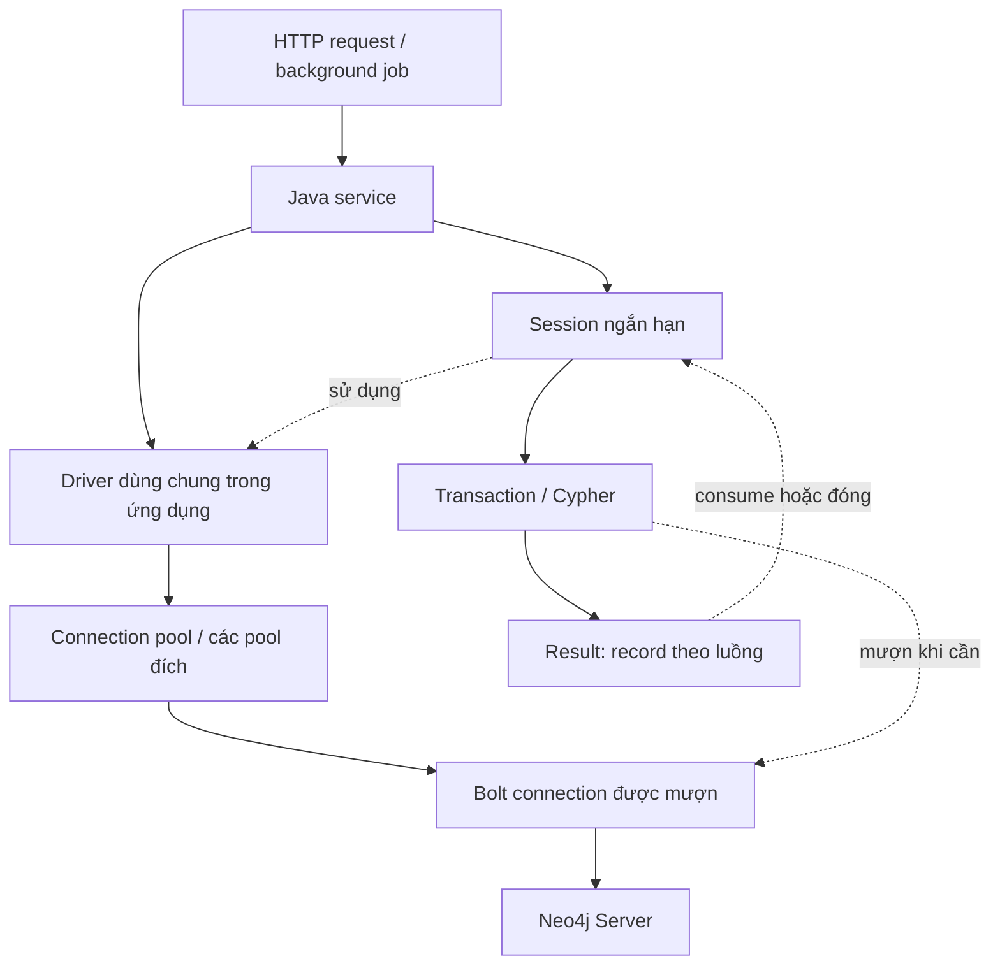
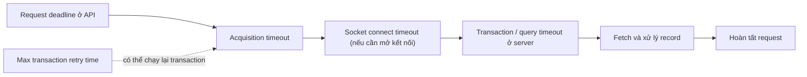

# Connection pool, thời gian chờ và giới hạn tài nguyên trong Neo4j Java Driver

## 1. Vì sao phải quản lý kết nối khi dùng Neo4j?

Trong module `DATABASE_ENGINE_GRAPH_NEO4J`, ứng dụng Java tương tác với **Neo4j property graph** để tạo và truy vấn node, relationship, thuộc tính, đường đi bằng Cypher. Khi chỉ thử một truy vấn, việc kết nối đơn giản. Nhưng trong dịch vụ có hàng trăm request đồng thời, mỗi request có thể cần một kết nối Bolt, một transaction và tài nguyên CPU/bộ nhớ ở cả ứng dụng lẫn Neo4j.

Nếu không quản lý tốt, một ứng dụng có thể gặp các hiện tượng:

- Nhiều request chờ kết nối mặc dù cú pháp Cypher không có lỗi.
- Request timeout nhưng transaction phía server vẫn đang làm việc hoặc còn giữ khóa trong một khoảng thời gian.
- Số connection tăng khi mở thêm replica/pod và làm quá tải Bolt server.
- Một query trả rất nhiều record khiến ứng dụng hết bộ nhớ dù connection pool chưa đầy.
- Lỗi mạng tạm thời gây retry dồn dập, làm tình trạng quá tải trầm trọng hơn.
- Session, result hoặc transaction không được đóng đúng vòng đời, khiến tài nguyên bị giữ lâu.

**Connection pool** chỉ giải quyết việc **tái sử dụng và giới hạn kết nối**. Nó không thay thế việc tối ưu truy vấn, quản lý transaction, kiểm soát kết quả, đo tải và đặt timeout ở các tầng.

### Mục tiêu học tập

Sau bài này, bạn có thể:

1. Giải thích quan hệ giữa `Driver`, `Session`, `Transaction`, `Result`, Bolt connection và connection pool.
2. Cấu hình pool, thời gian chờ cấp kết nối, kết nối mạng, kiểm tra kết nối cũ và thời hạn sống kết nối.
3. Phân biệt timeout kết nối, timeout transaction, retry timeout và deadline của request.
4. Tính sơ bộ sức chứa pool khi ứng dụng chạy nhiều instance hoặc kết nối cluster.
5. Tránh tải toàn bộ kết quả vào bộ nhớ; áp dụng `fetchSize`, lọc dữ liệu và phân trang.
6. Điều tra pool saturation, leaked session, transaction dài và các dấu hiệu nghẽn tài nguyên.

> **Phạm vi API:** Ví dụ dùng **Neo4j Java Driver 5.x/6.x** với `org.neo4j.driver`, `Config.builder()`, `session.executeRead()` và `session.executeWrite()`. Một số API hoặc giá trị mặc định thay đổi giữa các phiên bản. Trước khi áp dụng vào dự án, cần đối chiếu **phiên bản Java Driver, Neo4j Server, Spring Boot/Spring Data Neo4j** đang sử dụng và tài liệu API tương ứng.

## 2. Những thành phần của vòng đời truy vấn

### 2.1. Từ request đến một kết nối Bolt



| Thành phần | Vai trò | Vòng đời nên dùng |
| --- | --- | --- |
| `Driver` | Quản lý cấu hình, routing, kết nối và pool | Thường **một instance dùng chung** cho một cấu hình kết nối trong ứng dụng |
| `Session` | Ngữ cảnh thực thi query và bookmark, chọn database/access mode | **Ngắn hạn**; tạo cho một request hoặc một đơn vị công việc, đóng bằng `try-with-resources` |
| `Transaction` | Đơn vị thao tác nguyên tử, quản lý commit/rollback | Càng ngắn càng hợp lý, không giữ khi chờ I/O ngoài |
| `Result` | Dữ liệu query trả về, có thể chưa được lấy hết | Đọc/consume trong vòng đời transaction/session phù hợp |
| Bolt connection | Kênh vật lý giữa driver và server qua Bolt | Được pool tái sử dụng; **không tạo thủ công cho mỗi query** |
| Connection pool | Quản lý kết nối khả dụng/đang được mượn và giới hạn kết nối | Thuộc `Driver`, đóng khi đóng driver |

**Phân biệt quan trọng:** Tạo một `Session` **không đồng nghĩa** mở một TCP connection mới. Session là đối tượng logic nhẹ; khi chạy query, driver mới cần lấy một connection phù hợp từ pool. Khi hoàn tất và giải phóng tài nguyên, connection có thể được trả về pool để tái sử dụng.

### 2.2. Driver dùng chung, Session không dùng đồng thời giữa các thread

Một `Driver` được thiết kế để dùng lại và có thể phục vụ nhiều luồng. Ngược lại, **Session không thread-safe**: không chia sẻ một session duy nhất cho nhiều request song song.

Mẫu kiến trúc:

```java
public final class UserQueryService {
    private final org.neo4j.driver.Driver driver;

    // Driver được tạo và quản lý ở composition root / DI container.
    public UserQueryService(org.neo4j.driver.Driver driver) {
        this.driver = driver;
    }

    public String findName(String userId) {
        try (var session = driver.session(
                org.neo4j.driver.SessionConfig.forDatabase("neo4j"))) {
            return session.executeRead(tx -> {
                var result = tx.run(
                    """
                    MATCH (u:AppUser {userId: $id})
                    RETURN u.name AS name
                    """,
                    java.util.Map.of("id", userId)
                );
                return result.hasNext()
                    ? result.single().get("name").asString()
                    : null;
            });
        }
    }
}
```

Ở đây chỉ đọc tên người dùng, nên kết quả rỗng có thể trả `null`. Ứng dụng thật có thể trả `Optional<String>` và kiểm tra quyền truy cập. Điều cần học là **Driver dùng chung, Session đóng sau sử dụng**, không phải chi tiết kiểu DTO.

> Với `hasNext()` rồi `single()`, driver chỉ trả kết quả khi tập query có tối đa một dòng theo khóa nghiệp vụ. Để bảo đảm điều đó ở mức dữ liệu, tạo unique constraint trên `AppUser.userId`; không dùng `single()` nếu truy vấn có thể trả nhiều người dùng.

### 2.3. Không tạo Driver cho từng request

Một anti-pattern:

```java
// Không dùng cách này ở mỗi HTTP request:
try (var driver = org.neo4j.driver.GraphDatabase.driver(
        uri, org.neo4j.driver.AuthTokens.basic(user, password))) {
    // chạy một query rồi đóng driver
}
```

Mỗi Driver có thể quản lý pool và routing riêng. Tạo/đóng Driver liên tục làm tăng chi phí TLS, bắt tay kết nối, xác thực, số socket và áp lực GC. Trong Spring, nên để container sở hữu Driver bean và đóng nó khi ứng dụng dừng.

## 3. Pool hoạt động như thế nào?

### 3.1. Mượn, dùng và trả kết nối

1. Request mở Session và thực thi query.
2. Driver xác định database và server đích (có thể qua routing).
3. Driver thử tái sử dụng connection phù hợp đã nhàn rỗi.
4. Nếu chưa có connection nhàn rỗi và chưa đạt giới hạn, driver có thể mở connection mới.
5. Nếu đã chạm giới hạn, request có thể **chờ** cho tới khi có connection được trả về.
6. Khi vượt thời gian chờ cấp connection, driver báo lỗi.
7. Khi transaction/result hoàn tất và session được đóng đúng cách, connection có thể tái sử dụng.

Kết nối nằm trong pool **không nhất thiết được tạo đầy đủ ngay lúc khởi tạo Driver**. Số connection thực tế tăng/giảm tùy tải, lifetime và trạng thái đường truyền.

### 3.2. Giới hạn pool là theo nơi kết nối, không phải «tổng mọi pod»

Ở Java Driver hiện đại, `withMaxConnectionPoolSize` đặt giới hạn cho pool kết nối đến đích; với URI trực tiếp `bolt://`, nó giới hạn pool cho đích trực tiếp, còn với `neo4j://` dùng routing, giới hạn thường áp dụng **theo mỗi cluster member/đích**. Vì thế:

- Một Driver nối cluster ba thành viên **có thể** sử dụng nhiều pool theo các máy đích, không chỉ một con số chung toàn cluster.
- Mỗi instance của ứng dụng (pod, VM, process) có Driver/pool **riêng**.
- Nếu ứng dụng tự tạo nhiều Driver cho cùng database, mỗi Driver lại có hệ pool của nó.

Ví dụ sức chứa **lý thuyết**, không phải số socket được mở chắc chắn:

\[
\text{giới hạn gần đúng} =
\text{số ứng dụng} \times
\text{số Driver mỗi ứng dụng} \times
\text{giới hạn pool trên một đích}
\]

Với **8 pod**, mỗi pod có **1 Driver**, và `maxConnectionPoolSize = 40`, tổng số connection **có khả năng** đến **một đích** có thể lên đến `8 \times 1 \times 40 = 320`. Số thực tế phụ thuộc routing, tốc độ request và trạng thái pool.

**Không áp dụng công thức này như cam kết tuyệt đối** cho nhiều database/đích. Nó là cách nhanh để phát hiện việc nhân bản số pool khi scale-out. Giới hạn ứng dụng phải được cân đối với **giới hạn Bolt connection, thread, transaction và bộ nhớ của server**.

## 4. Các cấu hình connection pool chủ chốt

### 4.1. Cấu hình đầy đủ để bắt đầu thử nghiệm

```java
import java.util.concurrent.TimeUnit;
import org.neo4j.driver.AuthTokens;
import org.neo4j.driver.Config;
import org.neo4j.driver.Driver;
import org.neo4j.driver.GraphDatabase;

public final class DriverFactory {
    public static Driver create(
            String uri, String username, String password) {

        Config config = Config.builder()
            .withMaxConnectionPoolSize(40)
            .withConnectionTimeout(5, TimeUnit.SECONDS)
            .withConnectionAcquisitionTimeout(15, TimeUnit.SECONDS)
            .withConnectionLivenessCheckTimeout(3, TimeUnit.MINUTES)
            .withMaxConnectionLifetime(30, TimeUnit.MINUTES)
            .withMaxTransactionRetryTime(10, TimeUnit.SECONDS)
            .withFetchSize(500)
            .withLeakedSessionsLogging()
            .build();

        Driver driver = GraphDatabase.driver(
            uri,
            AuthTokens.basic(username, password),
            config
        );

        // Phát hiện sớm lỗi DNS/TLS/auth/network khi ứng dụng khởi động.
        driver.verifyConnectivity();
        return driver;
    }
}
```

Đoạn trên chỉ là **cấu hình minh họa cho thử tải**, không phải giá trị mặc định hay khuyến nghị chung cho mọi hệ thống. URI và tài khoản phải đến từ cấu hình bảo mật của ứng dụng; không ghi mật khẩu vào source code.

Trong ví dụ:

- Pool tối đa **40** connection trên mỗi đích áp dụng.
- Socket connect timeout **5 giây**.
- Thời gian chờ lấy connection tối đa **15 giây**.
- Connection đã nhàn rỗi quá **3 phút** sẽ được kiểm tra sức sống trước khi tái sử dụng.
- Connection có tuổi đời trên **30 phút** thuộc diện được thay mới theo chính sách pool.
- Managed transaction có ngân sách retry tối đa **10 giây**.
- Mặc định fetch theo từng đợt **500 record**.

**Chú ý:** Đặt `withConnectionAcquisitionTimeout` lớn hơn `withConnectionTimeout` giúp có ngân sách cho việc thiết lập và lựa chọn kết nối. Không được suy ra tổng thời gian gọi API bị chặn ở 15 giây, vì còn thời gian routing, chạy query, fetch kết quả, backoff retry và xử lý Java.

### 4.2. Bảng các tùy chọn và hiện tượng chúng kiểm soát

| Tùy chọn | Tác động | Không phải là |
| --- | --- | --- |
| `withMaxConnectionPoolSize(n)` | Giới hạn số connection pool có thể giữ đến một đích | Giới hạn số request hay số thread toàn ứng dụng |
| `withConnectionAcquisitionTimeout(t, unit)` | Thời gian driver cố lấy connection phù hợp | Thời gian chạy Cypher |
| `withConnectionTimeout(t, unit)` | Timeout thiết lập socket connection | Deadline từ đầu đến cuối của HTTP request |
| `withConnectionLivenessCheckTimeout(t, unit)` | Ngưỡng thời gian **nhàn rỗi** để test connection trước khi dùng | Thời gian tối đa của một transaction |
| `withMaxConnectionLifetime(t, unit)` | Giới hạn tuổi đời connection trong pool | Timeout query hoặc thời gian thuê một connection đang được sử dụng |
| `withMaxTransactionRetryTime(t, unit)` | Ngân sách thử lại với managed transaction khi gặp lỗi có thể retry | Timeout thực thi một transaction |
| `withFetchSize(n)` | Số record mỗi lượt lấy trong cơ chế fetch theo lô | Giới hạn tổng số record hoặc trần heap |
| `withLeakedSessionsLogging()` | Hỗ trợ chẩn đoán Session không được đóng | Cơ chế tự khắc phục mọi resource leak |

Giá trị `0`, số âm hoặc các trường hợp đặc biệt có ngữ nghĩa khác nhau ở từng option và phiên bản. **Không sử dụng một quy tắc «0 là vô hạn» cho mọi timeout**.

### 4.3. Tham khảo mặc định của Java Driver 6.3

Theo API Java Driver 6.3, một số giá trị mặc định đáng biết:

| Tham số | Mặc định tài liệu hóa | Ý nghĩa |
| --- | ---: | --- |
| `maxConnectionPoolSize` | 100 | Số connection tối đa theo phạm vi pool đích |
| `connectionAcquisitionTimeout` | 60 giây | Ngân sách lấy connection |
| `maxConnectionLifetime` | 1 giờ | Tuổi đời connection trước khi được thay thế |
| `maxTransactionRetryTime` | 30 giây | Ngân sách retry của managed transaction |
| `fetchSize` | 1.000 record | Kích thước một đợt fetch |

Các con số trên là **tham khảo của một phiên bản API**, không phải «best practice bất biến». Ví dụ, một hệ thống có 50 pod và mỗi pod được phép mở 100 connection đến mỗi server có khả năng đặt áp lực kết nối rất khác một ứng dụng chạy trong một JVM.

### 4.4. Connection lifetime và proxy/load balancer

Hệ thống có proxy, firewall hoặc load balancer có thể đóng các kết nối nhàn rỗi hoặc quá tuổi. Nếu Driver cố tái sử dụng một socket đã bị mạng đóng, request có thể gặp lỗi mạng và cần kết nối lại.

Giải pháp:

- Hiểu **idle timeout/lifetime** của thiết bị mạng hoặc dịch vụ Neo4j.
- Đặt **max connection lifetime** đủ ngắn so với giới hạn tuổi kết nối của hạ tầng, khi thích hợp.
- Dùng **liveness check** cho connection nhàn rỗi đủ lâu.
- Theo dõi số lỗi kết nối cũ, reconnect và acquisition delay sau các khoảng không tải.

Đừng tự động giảm lifetime xuống vài giây, vì mở kết nối liên tục có thể gây tốn TLS/authentication và gia tăng tải trên server.

## 5. Phân biệt năm loại «timeout»

Các timeout phổ biến thuộc **những lớp khác nhau**:



Sơ đồ là minh họa các giai đoạn; một connection sẵn có không cần connect lại, và managed transaction có thể bao gồm nhiều lần chạy với backoff.

### 5.1. Connection acquisition timeout: chờ slot pool

Khi pool đã đạt giới hạn và tất cả connection phù hợp đang bận, request phải đợi. `withConnectionAcquisitionTimeout` giới hạn **thời gian chờ driver lấy connection**. Hết thời gian mà không có connection, driver trả lỗi.

Lỗi acquisition không chứng minh database đã «chậm trả một query»; có thể do:

- Pool quá nhỏ so với lưu lượng và **thời gian giữ connection**.
- Transaction dài, query xử lý nhiều dữ liệu hoặc client tiêu thụ result quá chậm.
- Session/result không được đóng kịp.
- Số request tăng đột biến hoặc retry bão.
- Routing tới một đích đang có tải cao.

Tăng timeout có thể làm request **chờ lâu hơn**, nhưng **không tạo thêm khả năng xử lý thực tế**. Tăng pool cũng không luôn tốt: nó có thể chuyển nghẽn từ client sang server.

### 5.2. Connection timeout: kết nối mạng mới

`withConnectionTimeout` quy định thời gian thiết lập socket khi Driver cần mở connection mới. Nếu server không thể kết nối, DNS/routing/TCP/network không thông, lỗi có thể xảy ra trước khi gửi Cypher.

Nó **không giới hạn** thời gian thực thi một query vốn đã chạy trên connection được mượn.

### 5.3. Transaction timeout: giới hạn công việc phía Neo4j

Với Java Driver hiện đại, có thể truyền `TransactionConfig` khi gọi managed transaction:

```java
import java.time.Duration;
import java.util.List;
import java.util.Map;
import org.neo4j.driver.SessionConfig;
import org.neo4j.driver.TransactionConfig;

public List<String> findPeople(org.neo4j.driver.Driver driver, String city) {
    TransactionConfig txConfig = TransactionConfig.builder()
        .withTimeout(Duration.ofSeconds(8))
        .withMetadata(Map.of(
            "operation", "findPeople",
            "component", "user-service"))
        .build();

    try (var session = driver.session(
            SessionConfig.forDatabase("neo4j"))) {
        return session.executeRead(tx -> tx.run(
                """
                MATCH (p:AppPerson {city: $city})
                RETURN p.personId AS id
                ORDER BY id
                LIMIT 100
                """,
                Map.of("city", city)
            ).list(record -> record.get("id").asString()),
            txConfig);
    }
}
```

Ý nghĩa:

- `withTimeout(Duration.ofSeconds(8))` yêu cầu server giới hạn **transaction** theo cấu hình hỗ trợ.
- `withMetadata(...)` đính kèm thông tin truy vết vào transaction. Chỉ đưa **nhãn kỹ thuật không nhạy cảm**, không ghi token/mật khẩu/dữ liệu cá nhân vào metadata.
- `LIMIT 100` chỉ hạn chế số record trả về; nó không đồng nghĩa với query chắc chắn nhẹ. Cần nhãn, index và predicate đúng.
- `list(...)` ổn trong ví dụ vì đã giới hạn tối đa 100 dòng, nhưng không nên dùng cách này cho một kết quả nhiều triệu record.

Thời gian timeout của transaction có thể còn phụ thuộc giới hạn server và phiên bản. Đặc biệt, theo tài liệu Java Driver, với Neo4j Server **4.2–5.2**, yêu cầu đặt timeout **cao hơn timeout mặc định ở server** có thể không được chấp nhận như mong muốn và fallback về mặc định. Cần tra tài liệu tương ứng khi quản lý nhiều phiên bản.

### 5.4. Maximum transaction retry time: tổng ngân sách thử lại

Managed transaction như `executeRead()` / `executeWrite()` có thể tự retry khi gặp lỗi tạm thời đủ điều kiện (ví dụ kết nối bị mất, lỗi transient). `withMaxTransactionRetryTime` giới hạn khoảng thời gian Driver cố thử lại transaction.

Nó **không phải** thời gian tối đa của một lần chạy Cypher. Từng lần thử có thể có transaction timeout riêng và mất thời gian lấy connection. Do đó, **đừng cộng trừ các timeout như thể mọi hoạt động đều thực hiện nối tiếp đúng một lần**.

Callback có thể chạy lại, vì vậy tránh side effect không thể rollback:

```java
// Không an toàn nếu callback bị thực thi lại:
session.executeWrite(tx -> {
    // externalPaymentGateway.charge(card, amount); // tránh ở đây
    tx.run("MATCH (n:Counter {id: $id}) SET n.value = n.value + 1",
           Map.of("id", counterId));
    return null;
});
```

Nếu cần tạo một sự kiện nghiệp vụ chỉ một lần, dùng idempotency key và unique constraint phù hợp, đồng thời thiết kế tích hợp hệ thống ngoài bằng outbox/saga hoặc cơ chế bảo đảm riêng.

### 5.5. HTTP request deadline và hủy client không tự thay thế server timeout

Một HTTP gateway có thể cắt request sau 3 giây, nhưng nếu database query được phép chạy 30 giây thì phía server có thể vẫn đang xử lý trong một khoảng thời gian, tùy cách client đóng/hủy transaction và giao thức.

Thiết kế nhiều lớp:

1. Giới hạn **công việc ở Cypher**: index, anchor, số hop, phân trang.
2. Đặt **transaction timeout ở server** cho những thao tác cần giới hạn.
3. Đặt **acquisition timeout** để tránh đợi pool quá lâu.
4. Điều chỉnh **retry policy** để không vượt xa deadline nghiệp vụ.
5. Có **deadline và cơ chế cancel/close** ở tầng API, kèm giám sát transaction còn chạy.

Không hứa rằng tổng thời gian của HTTP request bằng một giá trị `withTimeout` duy nhất.

## 6. Pool size và giới hạn tài nguyên: không phải càng lớn càng nhanh

### 6.1. Bài toán sức chứa

Giả sử một query giữ connection trung bình **100 ms**. Trong điều kiện lý tưởng, một connection phục vụ khoảng **10 lượt/giây**; 20 connection có thể phục vụ khoảng **200 lượt/giây** nếu server, CPU, network và query đều không nghẽn. Nếu query cần **1 giây**, cùng pool 20 connection chỉ xử lý được khoảng **20 lượt/giây** trước khi hình thành hàng đợi.

Đây chỉ là **ước lượng đơn giản**, không phải benchmark hay cam kết TPS. Thời gian giữ connection gồm cả chờ khóa, chạy query, truyền kết quả và thời gian client đọc result.

Theo dạng trực giác của định luật Little:

\[
\text{concurrency đang hoạt động} \approx
\text{arrival rate} \times
\text{thời gian giữ tài nguyên}
\]

Một truy vấn chậm có thể làm tăng số connection cần đồng thời ngay cả khi QPS không đổi. Vì vậy, **tối ưu Cypher và tiêu thụ Result** thường hiệu quả hơn tăng pool bằng mọi giá.

### 6.2. Tăng pool có thể làm server nghẽn hơn

Khi pool quá nhỏ, queue phía client tăng. Khi pool quá lớn, nhiều query được đưa vào server cùng lúc:

- CPU và I/O đĩa tranh chấp.
- Page cache hoặc bộ nhớ transaction bị áp lực.
- Query có thể đợi lock lâu hơn.
- Server có thể thiếu Bolt thread/connection hoặc chạm giới hạn tài nguyên.
- Latency P95/P99 tăng dù QPS không tăng tương ứng.

Cần tìm điểm cân bằng qua **load test**, không chọn số connection dựa vào số thread HTTP một cách máy móc.

### 6.3. Không nhầm giới hạn pool với giới hạn truy vấn

Nếu một query là:

```cypher
MATCH p = (a:Account)-[:TRANSFERRED_TO*1..8]->(b:Account)
RETURN p;
```

nó có thể mở rộng quá nhiều đường đi. Pool dù lớn cũng không giải quyết được bùng nổ dữ liệu. Nên thay bằng mẫu có **điểm bắt đầu, type/hướng relationship, cận hop và điều kiện lọc**, rồi chỉ lấy phần kết quả ứng dụng cần.

Tương tự, query thiếu index có thể quét rất rộng và giữ connection lâu; index, constraint và kế hoạch `PROFILE` có thể đem lại lợi ích lớn hơn chỉnh pool.

## 7. Result streaming, fetch size và bộ nhớ ứng dụng

### 7.1. `fetchSize` là kích thước mỗi batch, không phải giới hạn kết quả

Tùy chọn `withFetchSize(500)` yêu cầu Driver thông thường lấy record theo **từng đợt 500**, hỗ trợ cơ chế **backpressure** của Bolt khi server và Driver tương thích. Nó không có nghĩa query chỉ trả tối đa 500 record.

Mô tả:

```text
Cypher trả 1.000.000 dòng
    -> Driver fetch 500 dòng/lượt
    -> ứng dụng xử lý từng record/batch
    -> tiếp tục fetch khi cần
```

Giá trị mặc định trong API 6.3 là **1.000 record**. Giá trị `-1` được API tài liệu hóa là cách tắt backpressure và yêu cầu lấy tất cả sau khi chạy query; với kết quả lớn, cần tránh vì có thể tăng nhu cầu bộ nhớ.

Với reactive API, backpressure phụ thuộc **subscription demand** chứ không chỉ cấu hình fetchSize của session đồng bộ. Không đánh đồng `fetchSize` với buffer tối đa do toàn bộ ứng dụng có thể chiếm.

### 7.2. Có thể cấu hình fetch size theo Session

```java
import org.neo4j.driver.SessionConfig;

SessionConfig sessionConfig = SessionConfig.builder()
    .withDatabase("neo4j")
    .withFetchSize(200)
    .build();

try (var session = driver.session(sessionConfig)) {
    // Chạy truy vấn phù hợp với kế hoạch đọc theo từng đợt.
}
```

Tùy chọn ở Session có thể ghi đè mặc định đặt qua `Config.withFetchSize(...)`. Dùng giá trị nhỏ hơn khi record lớn/ứng dụng có ít RAM; giá trị quá nhỏ có thể làm tăng số lần trao đổi Bolt và giảm throughput. Đo trên dữ liệu thật để chọn.

### 7.3. `list()` và `collect()` có thể tạo điểm nghẽn bộ nhớ

```java
// Nếu query trả hàng triệu record, đoạn này giữ tất cả trong List ở heap:
List<String> ids = session.executeRead(tx ->
    tx.run("""
        MATCH (p:AppPerson)
        RETURN p.personId AS id
        """).list(record -> record.get("id").asString()));
```

`fetchSize(200)` không cứu được ví dụ trên vì `list()` vẫn tạo một Java List chứa **toàn bộ kết quả**. Còn nếu query dùng `collect(p)` trên server, chính Cypher có thể tạo một giá trị danh sách lớn trước khi driver nhận record.

Nếu muốn giới hạn bộ nhớ:

- Trả về **property cần thiết** thay vì mọi node/relationship.
- Dùng điều kiện lọc và **phân trang có thứ tự ổn định**.
- Xử lý từng record khi còn trong transaction/session.
- Không dùng `list()` cho dữ liệu quá lớn.
- Với export dữ liệu nhiều triệu dòng, thiết kế job riêng với **batch, checkpoint và backpressure**.

### 7.4. Xử lý Result theo từng record

```java
import java.util.Map;
import org.neo4j.driver.Result;

int inspected;
try (var session = driver.session(
        SessionConfig.forDatabase("neo4j"))) {
    inspected = session.executeRead(tx -> {
        Result result = tx.run(
            """
            MATCH (p:AppPerson)
            WHERE p.status = $status
            RETURN p.personId AS id
            ORDER BY id
            LIMIT 5000
            """,
            Map.of("status", "ACTIVE")
        );
        int count = 0;
        while (result.hasNext()) {
            var record = result.next();
            String id = record.get("id").asString();
            if (!id.isBlank()) {
                count++;
            }
        }
        return count;
    });
}
```

Ví dụ **không lưu 5.000 ID vào Java List**, nhưng vẫn phải lấy record và giữ transaction/connection trong lúc đọc. Vòng lặp xử lý phải nhẹ. Nếu cần gửi từng record qua API mạng bên ngoài, **không thực hiện thao tác chậm đó ngay trong transaction callback**: sẽ giữ connection/lock lâu và còn bị rủi ro thực thi lại callback.

### 7.5. Phân trang theo khóa ổn định

Với dữ liệu có unique constraint trên `AppPerson.personId`, một cách phân trang:

```cypher
MATCH (p:AppPerson)
WHERE p.personId > $afterId
RETURN p.personId AS id, p.name AS name
ORDER BY id
LIMIT $pageSize;
```

Ứng dụng khởi đầu với `$afterId = ''` nếu quy tắc định danh cho phép, sau đó lưu ID cuối trang và truy vấn trang kế tiếp. `$pageSize` cần có **cận trên tại tầng ứng dụng**. Việc có index trên khóa giúp hỗ trợ điều kiện so sánh/phân trang.

Phân trang qua nhiều transaction **không bảo đảm snapshot nhất quán** nếu dữ liệu thay đổi đồng thời; với export yêu cầu nhất quán theo thời điểm, phải thiết kế thêm phiên dữ liệu/cutoff hoặc cơ chế snapshot phù hợp.

## 8. Tài nguyên của Session và Transaction

### 8.1. Luôn đóng Session

```java
try (var session = driver.session(
        SessionConfig.forDatabase("neo4j"))) {
    var rows = session.executeRead(tx ->
        tx.run("""
            MATCH (u:AppUser)
            RETURN u.userId AS id
            LIMIT 10
            """).list());
    // Sử dụng rows sau khi callback đã hoàn tất.
}
```

`try-with-resources` bảo đảm `session.close()` được gọi kể cả khi có exception. Với `Driver` dùng chung, chỉ đóng khi ứng dụng shutdown; nếu đóng sau một request, các request khác không thể tiếp tục dùng driver đó.

### 8.2. Result chưa consume có thể giữ tài nguyên

Khi tạo `Result` từ query, record có thể còn nằm trên server hoặc trong buffer của driver. Nếu bỏ qua Result nhưng tiếp tục dùng session/transaction không đúng cách, tài nguyên có thể bị giữ hoặc driver phải đợi/consume result trước khi thực hiện hành động tiếp.

Quy tắc:

- Với query chỉ cần **update counters/query summary**, gọi `result.consume()` để hoàn thành.
- Với query trả record, đọc hết record cần xử lý **trước khi kết thúc vòng đời transaction**.
- Không trả một đối tượng `Result` còn mở từ callback managed transaction để dùng bên ngoài.
- Không giữ Session trong singleton hoặc cache trạng thái người dùng.

Ví dụ:

```java
long created;
try (var session = driver.session(
        SessionConfig.forDatabase("neo4j"))) {
    created = session.executeWrite(tx ->
        tx.run("""
            UNWIND $ids AS id
            MERGE (:AppUser {userId: id})
            """, java.util.Map.of("ids", java.util.List.of("u1", "u2")))
            .consume().counters().nodesCreated()
    );
}
```

Đây là lệnh ghi theo khóa định danh; trên dữ liệu thật cần unique constraint và bảo đảm ID đầu vào không null/không rỗng. `nodesCreated()` là số node được tạo trong lần gọi, **không phải** tổng số user có trong database.

### 8.3. Explicit transaction và managed transaction

| Kiểu sử dụng | API thường gặp | Retry |
| --- | --- | --- |
| Managed transaction | `session.executeRead(...)`, `session.executeWrite(...)` | Driver quản lý retry cho lỗi đủ điều kiện |
| Explicit transaction | `session.beginTransaction()`, `commit()`, `rollback()` | Ứng dụng phải tự thiết kế retry nếu muốn |
| Implicit/auto-commit query | `session.run(...)` | Hành vi retry tùy API/phiên bản; không tự xem giống managed transaction |

Giữ transaction ngắn: không gọi API bên thứ ba, không chờ người dùng, không giữ socket ứng dụng bất động trong lúc transaction còn mở. Với dữ liệu nhập lớn, cân nhắc **chia batch** bằng `UNWIND` và transaction phù hợp để tránh một transaction khổng lồ.

## 9. Triệu chứng pool cạn và quy trình điều tra

### 9.1. Chẩn đoán theo lớp

| Triệu chứng | Những nguyên nhân cần kiểm tra | Hướng xử lý |
| --- | --- | --- |
| Nhiều request timeout khi mượn connection | Pool hết slot, transaction giữ lâu, connection leak | Đo thời gian acquisition, session lifecycle, query latency |
| Kết nối thất bại ngay khi tải thấp | URI/TLS/auth/DNS/firewall/server không sẵn sàng | Kiểm tra `verifyConnectivity`, log mạng, routing |
| P99 tăng sau khi tăng pool | Server CPU/I/O/lock tranh chấp | Giảm concurrency, tối ưu Cypher, theo dõi server |
| Heap Java tăng theo lượng record | `list()`/cache kết quả quá lớn | Streaming, cột cần thiết, phân trang |
| Lỗi connection sau thời gian idle | Proxy đóng socket, stale connection | Lifetime/liveness check, quan sát reconnect |
| Request vượt SLA dù query thường nhanh | Retry, acquisition wait, fetch chậm, GC | Phân tách latency theo pha và điều chỉnh ngân sách |
| Cluster chỉ nghẽn một member | Routing/phân bố tải/đích đọc-ghi | Kiểm tra routing và metric theo server |
| Deadlock hoặc transaction timeout | Transaction dài, nhiều lệnh ghi tranh chấp | Thứ tự khóa ổn định, transaction ngắn, retry có giới hạn |

### 9.2. Chỉ số nên theo dõi

Các metric hữu ích ở ứng dụng:

1. **QPS/throughput** theo endpoint và kiểu query.
2. **Latency P50/P95/P99** của HTTP request, query, pool acquisition.
3. **Số connection active/idle/waiting**, nếu phiên bản và hệ thống metric cho phép quan sát.
4. **Connection acquisition timeout**, retry count và lỗi kết nối theo nhóm.
5. **Số transaction đang chạy** và thời gian transaction dài nhất.
6. **Heap/direct memory, GC, CPU**, số thread đang bận và queue ở ứng dụng.
7. **Bolt connection, CPU, memory, query log và lock contention** ở Neo4j server.

Không giả định mọi bản Java Driver đều xuất sẵn một bộ metric pool tên giống nhau. Có thể đo latency và lỗi ở wrapper dịch vụ, dùng log driver, OpenTelemetry/Micrometer phù hợp, cùng hệ thống giám sát của Neo4j. Nếu bật debug logging, **tránh ghi thông tin đăng nhập, parameter nhạy cảm hoặc log quá chi tiết** trong môi trường sản xuất.

### 9.3. Thứ tự điều tra khi tăng thời gian chờ

1. **Kiểm tra lỗi thuộc loại nào**: acquisition, TCP connect, TLS/auth, transaction timeout, retry hay result fetch.
2. Xem **SLA thực tế** và biểu đồ P95/P99 theo thời điểm thay vì chỉ trung bình.
3. Đo **thời gian giữ connection**: query chậm, result lớn, xử lý Java nặng, khóa chờ?
4. Kiểm tra **số pod/Driver và routing**: tổng số connection tiềm năng có vượt tải server?
5. Kiểm tra **kế hoạch Cypher bằng `EXPLAIN`/`PROFILE`**, index, cardinality, số row trung gian.
6. Thử giảm tải, tối ưu query, rút ngắn transaction, **sau đó** mới thử đổi pool size và timeout.
7. Thử tải lại trên môi trường đại diện, so sánh throughput, tail latency, lỗi và chi phí tài nguyên.

Không tự động khuyến nghị «tăng `maxConnectionPoolSize` từ 100 lên 1000» khi có acquisition timeout. Đó có thể là cách đẩy một hàng đợi sang Neo4j và làm hệ thống chậm hơn.

## 10. Backpressure ở tầng ứng dụng và giới hạn đồng thời

Pool là một hình thức giới hạn tài nguyên, nhưng việc để hàng nghìn HTTP thread cùng chờ pool có thể gây nghẽn chính ứng dụng. Khi đã biết sức chứa dịch vụ, có thể áp dụng **concurrency gate** ở tầng API:

```java
import java.util.concurrent.Semaphore;
import java.util.concurrent.TimeUnit;

public final class GraphAdmissionControl {
    private final Semaphore permits = new Semaphore(32);

    public <T> T call(java.util.concurrent.Callable<T> task)
            throws Exception {
        if (!permits.tryAcquire(200, TimeUnit.MILLISECONDS)) {
            throw new IllegalStateException("Graph service is busy");
        }
        try {
            return task.call();
        } finally {
            permits.release();
        }
    }
}
```

`Semaphore` chỉ là ví dụ cơ chế **nhận/hoãn request có giới hạn**. Trong API thật, lỗi «busy» nên được chuyển thành HTTP status thích hợp (thường 429 hoặc 503 tùy hợp đồng), kèm retry policy hợp lý cho client.

Chú ý:

- Con số **32** là ví dụ, **không được suy ra** tự động từ `maxConnectionPoolSize = 40`.
- Nếu một request chạy nhiều query/transaction hoặc dùng nhiều database, một permit không nhất thiết bằng một connection.
- Nếu nhiều instance, mỗi instance có gate riêng; muốn giới hạn **toàn cluster ứng dụng** cần thiết kế admission control phân tán hoặc giới hạn phía server.
- Semaphore không thay thế timeout, index, pagination hoặc cơ chế đóng Session.

Nếu số lượng yêu cầu vượt sức chứa liên tục, cần **giảm tải, scale hợp lý hoặc xử lý bất đồng bộ qua queue**; không mở rộng vô hạn hàng đợi người dùng.

## 11. Kịch bản tích hợp Spring Boot / Spring Data Neo4j

Spring Data Neo4j sử dụng Neo4j Java Driver thông qua cấu hình ứng dụng và driver bean do framework quản lý. Nguyên tắc không đổi:

- **Một Driver dùng chung** do container quản lý cho cùng cấu hình kết nối, không tạo Driver trong mỗi repository call.
- **Session/transaction ngắn**, khai báo transaction boundary hợp lý.
- Pool/timeout được quản lý qua cấu hình tích hợp Driver hoặc customization API, tùy phiên bản Spring Boot.
- Dùng `@Transactional(readOnly = true)` cho phương thức đọc khi phù hợp, nhưng annotation này **không tự giảm số record** hay tối ưu Cypher.
- Tránh đặt `@Transactional` quanh thao tác chờ I/O bên ngoài hoặc phát file dài nhiều phút.

Ví dụ service minh họa **phạm vi transaction**:

```java
import java.util.List;
import org.springframework.stereotype.Service;
import org.springframework.transaction.annotation.Transactional;

@Service
public class PersonService {
    private final PersonRepository repository;

    public PersonService(PersonRepository repository) {
        this.repository = repository;
    }

    @Transactional(readOnly = true)
    public List<PersonSummary> findActivePeople(int limit) {
        int safeLimit = Math.min(Math.max(limit, 1), 100);
        return repository.findActiveSummaries(safeLimit);
    }
}
```

`PersonRepository` và `PersonSummary` đại diện các interface/DTO của ứng dụng, không phải class có sẵn trong Neo4j Driver. Khi triển khai, repository phải có query đúng, ví dụ `MATCH (p:AppPerson {status: 'ACTIVE'}) RETURN ... ORDER BY ... LIMIT $limit`.

Tên property cấu hình pool trong `application.yml` có thể khác theo **Spring Boot version** và cách khởi tạo Driver. Không dùng bừa khóa cấu hình từ một hướng dẫn version khác, vì property bị bỏ qua sẽ khiến ứng dụng vẫn chạy với mặc định ngoài ý muốn. Hãy đối chiếu metadata cấu hình của Spring Boot đang sử dụng và xác nhận giá trị Driver đã nhận.

## 12. Bảo vệ tính đúng đắn khi gặp timeout và retry

### 12.1. Timeout không phải bằng chứng transaction đã rollback

Nếu tầng HTTP hết deadline, đó **không phải bằng chứng** transaction đã bị rollback hoặc commit. Ở kết nối lỗi ngay quanh thời điểm commit, phía ứng dụng có thể không chắc kết quả commit đã được ghi nhận hay chưa. Retry mù một thao tác không idempotent có thể tạo dữ liệu trùng.

Khi ghi dữ liệu:

```cypher
CREATE CONSTRAINT app_order_request_unique IF NOT EXISTS
FOR (o:AppOrder)
REQUIRE o.requestId IS UNIQUE;
```

```cypher
MERGE (o:AppOrder {requestId: $requestId})
ON CREATE SET
    o.createdAt = datetime(),
    o.status = 'PENDING'
RETURN o.requestId AS id, o.status AS status;
```

`$requestId` do caller tạo ổn định cho **cùng một yêu cầu nghiệp vụ**. Khi retry, cùng khóa sẽ tìm lại node cũ thay vì tạo thêm đơn hàng mới. Tuy nhiên, cần kiểm tra tình huống cùng `requestId` nhưng payload khác nhau; unique constraint một mình **không bảo vệ** khỏi mọi xung đột nội dung.

### 12.2. Phân biệt lỗi tạm thời và lỗi nghiệp vụ

| Loại lỗi | Có nên retry tự động? |
| --- | --- |
| Lỗi kết nối hoặc cluster tạm thời đủ điều kiện | Có thể, trong ngân sách retry và với callback an toàn |
| Deadlock/transaction transient error | Có thể retry cả transaction |
| Cypher syntax error | **Không**: sửa query |
| Unique constraint violation do request khác đã chiếm khóa | Không retry vô điều kiện; cần xử lý xung đột nghiệp vụ |
| Sai định dạng parameter hoặc thiếu quyền | Không: sửa input/cấu hình |
| HTTP timeout không biết trạng thái commit | Cần kiểm tra trạng thái bằng idempotency key trước khi quyết định thử lại |

**Retry storm** là tình huống nhiều client đồng thời gặp lỗi rồi thử lại liên tục, làm tăng tải. Giới hạn thời gian/số lần retry, dùng backoff và jitter khi thích hợp, và tránh để tầng HTTP, tầng service và Driver **đều retry cùng một request** mà không có ngân sách tổng.

## 13. Phương pháp thử tải để chọn cấu hình

### 13.1. Chuẩn bị dữ liệu đại diện

Tạo dữ liệu tương tự production về số node, fan-out relationship, index và tỷ lệ truy vấn đọc/ghi. Query rất nhanh trên graph 100 node có thể không đại diện cho graph nhiều triệu node.

### 13.2. Đo baseline

Giữ một cấu hình nhất quán và ghi lại:

- QPS, P50/P95/P99, tỷ lệ lỗi.
- Thời gian pool acquisition nếu quan sát được.
- Thời gian query và thời gian fetch kết quả.
- CPU, heap, GC ứng dụng; CPU, memory, Bolt connection trên Neo4j.
- Số pod/Driver và số server đích.

### 13.3. Thay đổi một biến ở mỗi vòng

Thử các pool size phù hợp tải và giới hạn server, chẳng hạn 20 → 40 → 60, trong điều kiện nguồn lực kiểm soát được. Sau đó thử acquisition timeout, fetch size và transaction timeout với workload tương ứng. **Không thay cả năm tham số cùng một lúc** rồi kết luận cái nào cải thiện.

Trong test, chú ý:

- **Warm-up:** connection pool và JVM cần thời gian ổn định.
- **Steady state:** chạy đủ lâu để phát hiện queue và GC.
- **Burst:** kiểm tra khả năng hấp thụ đỉnh request.
- **Failure:** mạng chập chờn, một server chậm, transaction timeout, deadlock và retry.
- **Scale-out:** tăng số instance ứng dụng có thể nhân tổng số connection đến server.

### 13.4. Quy tắc lựa chọn

Một cấu hình tốt không phải cấu hình có QPS cực đại trong vài giây, mà là cấu hình giữ **latency ổn định, ít lỗi, tài nguyên server còn dự phòng và ứng dụng phục hồi được khi quá tải**.

## 14. Lỗi thường gặp khi vận hành

| Ngộ nhận | Hậu quả | Cách sửa |
| --- | --- | --- |
| Tạo Driver mỗi request | Pool không được tái dùng, tăng socket/TLS | Dùng Driver singleton do container quản lý |
| Chia sẻ Session giữa thread | Race/vi phạm hợp đồng driver | Mỗi đơn vị đồng thời dùng Session riêng |
| Không đóng Session | Tài nguyên bị giữ, pool cạn | `try-with-resources`, kiểm tra đường lỗi |
| Tăng pool vô hạn để xử lý query chậm | Neo4j server quá tải | Tối ưu query, rút transaction, giới hạn concurrency |
| Hiểu connection timeout là query timeout | Query có thể chạy rất lâu | `TransactionConfig.withTimeout` |
| Hiểu retry timeout là deadline API | Request có thể vượt SLA | Ngân sách end-to-end và cancellation |
| Coi fetchSize là LIMIT | Vẫn trả nhiều triệu dòng | Lọc, `LIMIT` đúng, pagination và streaming |
| Gọi `list()` trên query không giới hạn | Heap tăng đến OOM | Xử lý theo batch/record |
| Đặt fetchSize = -1 để «nhanh nhất» | Mất backpressure, tăng bộ nhớ | Chọn batch phù hợp và đo |
| Bỏ qua routing cluster | Một đích nghẽn hoặc thiếu connection | Kiểm tra URI `neo4j://`/`bolt://`, access mode |
| Để callback managed transaction gọi hệ thống ngoài | Retry gây side effect lặp | Idempotency/outbox, tách luồng |
| Timeout khi commit nên chạy lại bằng `CREATE` | Có thể tạo bản ghi trùng | Idempotency key và constraint |
| Bật log debug liên tục ở production | I/O và dữ liệu nhạy cảm lộ qua log | Chọn log level, redaction, giới hạn thời gian |

## 15. Bài tập tự kiểm tra và đáp án gợi ý

### Bài 1. Tính giới hạn pool khi scale-out

Một hệ thống có 6 pod, mỗi pod tạo một Driver với `maxConnectionPoolSize = 50`. Nếu tất cả pod định tuyến tới cùng một server đích, tối đa bao nhiêu connection có thể được duy trì đến **đích đó** theo giới hạn pool?

**Gợi ý:** `6 × 1 × 50 = 300` connection **tiềm năng**. Đây không phải bảo đảm sẽ có 300 connection được mở. Nếu cluster có nhiều server đích, phải tính theo routing và pool cụ thể.

### Bài 2. Phân biệt timeout

Driver cấu hình `connectionTimeout = 5s`, `connectionAcquisitionTimeout = 15s`, transaction timeout = 8s và managed retry time = 10s. Một request cần 30s mới báo lỗi. Có mâu thuẫn không?

**Đáp án:** Không thể kết luận mâu thuẫn chỉ bằng bốn con số: chúng giới hạn các giai đoạn khác nhau; có thể có acquisition, routing, retry và fetch/Java xử lý. Cần đo latency end-to-end, phân tách từng giai đoạn và deadline tầng HTTP.

### Bài 3. Vì sao giảm fetchSize không giảm heap?

Đoạn Java `result.list()` xử lý query trả 2 triệu record. Sau khi giảm fetchSize từ 1.000 xuống 100, heap vẫn tăng mạnh. Tại sao?

**Đáp án:** Fetch size chỉ giới hạn **mỗi đợt nhận record**, còn `list()` tích lũy toàn bộ record vào Java List. Cần giới hạn kết quả, phân trang hoặc xử lý record theo luồng.

### Bài 4. Tìm nguyên nhân pool saturation

Ứng dụng có pool 20 connection, tải 100 request/giây, mỗi query giữ connection trung bình 600 ms. Theo ước lượng đơn giản, concurrency trung bình là bao nhiêu? Có rủi ro phải đợi pool không?

**Đáp án:** `100 × 0,6 = 60` request cần connection đồng thời theo ước lượng, cao hơn 20; dễ hình thành hàng đợi và timeout. Cần giảm thời gian giữ connection, giảm tải hoặc tăng năng lực sau khi đo server, không chỉ tăng timeout.

### Bài 5. Thiết kế retry an toàn cho đơn hàng

Một lệnh tạo đơn hàng bị mất kết nối ngay quanh commit. Client không biết đơn đã tạo hay chưa. Hãy đề xuất cách thử lại tránh tạo hai đơn.

**Đáp án:** Sinh `requestId` cố định, dùng unique constraint và `MERGE` theo ID đó; kiểm tra payload và trạng thái cũ trước khi nhận retry. Đồng thời bảo đảm side effect ngoài Neo4j được xử lý idempotent.

### Bài 6. Đọc một nghìn bản ghi có deadline 2 giây

API muốn trả một nghìn `AppPerson` theo status, P99 dưới 2 giây. Hãy nêu ít nhất năm bước trước khi đổi pool size.

**Đáp án gợi ý:** Xác định query/index, giới hạn `LIMIT 1000` và cột trả về; `EXPLAIN`/`PROFILE`; đo P99 query/fetch; đặt transaction timeout phù hợp; giới hạn request concurrency; đo acquisition delay; theo dõi CPU/memory/GC; xác minh Session/Result được đóng.

## 16. Checklist triển khai production

Trước khi đưa ứng dụng Neo4j Java Driver vào môi trường nhiều request, kiểm tra:

- [ ] Driver được tạo **một lần cho cấu hình kết nối** và đóng khi ứng dụng dừng.
- [ ] Mỗi luồng/request có Session riêng, đóng bằng `try-with-resources` hoặc vòng đời framework đúng.
- [ ] Database đích được khai báo rõ ràng và access mode phù hợp query đọc/ghi.
- [ ] Pool size tính theo **số pod, số Driver và routing destinations**, không chỉ nhìn một JVM.
- [ ] Đã phân biệt **acquisition, connect, transaction, retry và HTTP deadline**.
- [ ] Transaction ngắn, result được đọc/consume đúng vòng đời.
- [ ] Query có nhãn, predicate/index phù hợp; hạn chế mở rộng path không cần thiết.
- [ ] Fetch size và kích thước batch được đo bằng workload thật; không tích lũy list khổng lồ.
- [ ] Managed callback retry không có side effect bên ngoài không idempotent.
- [ ] Có idempotency key cho các thao tác tạo dữ liệu quan trọng.
- [ ] Có metric về query, acquisition, retry, lỗi kết nối, CPU/bộ nhớ và server Bolt.
- [ ] Đã chạy load test ở steady state, burst, failure và scale-out.
- [ ] Đã đối chiếu cấu hình, mặc định và API với **phiên bản Driver/Server/Spring** thực tế.

## 17. Tổng kết

Trong Neo4j Java Driver, **Driver dùng chung** giữ cấu hình và connection pool; **Session và Transaction** là các đơn vị công việc ngắn hạn; **Result** phải được tiêu thụ hoặc đóng đúng vòng đời. `withMaxConnectionPoolSize` giới hạn khả năng cấp connection cho từng đích, trong khi acquisition timeout, connect timeout, transaction timeout và retry timeout quản lý **các giai đoạn khác nhau**. Không có tham số đơn lẻ nào bảo đảm toàn bộ HTTP request hoàn tất đúng SLA.

Tối ưu tốt cần kết hợp **connection pooling, quản lý tài nguyên, truy vấn Cypher chọn lọc, giới hạn kết quả, streaming/backpressure, retry an toàn, telemetry và load test**. Khi hệ thống mở rộng nhiều pod hoặc cluster, phải tính tổng sức chứa và tải phía Neo4j Server, không chỉ chỉnh pool trong một process.

### Tài liệu tham khảo chính thức

- [Neo4j Java Driver Manual – Advanced connection information](https://neo4j.com/docs/java-manual/current/connect-advanced/)
- [Neo4j Java Driver Manual – Run your own transactions](https://neo4j.com/docs/java-manual/current/transactions/)
- [Neo4j Java Driver Manual – Performance recommendations](https://neo4j.com/docs/java-manual/current/performance/)
- [Neo4j Java Driver Manual – Further query mechanisms](https://neo4j.com/docs/java-manual/current/query-advanced/)
- [Neo4j Java Driver API – Config.ConfigBuilder](https://neo4j.com/docs/api/java-driver/current/org.neo4j.driver/org/neo4j/driver/Config.ConfigBuilder.html)
- [Neo4j Java Driver API – TransactionConfig.Builder](https://neo4j.com/docs/api/java-driver/current/org.neo4j.driver/org/neo4j/driver/TransactionConfig.Builder.html)
- [Neo4j Java Driver API – SessionConfig.Builder](https://neo4j.com/docs/api/java-driver/current/org.neo4j.driver/org/neo4j/driver/SessionConfig.Builder.html)
