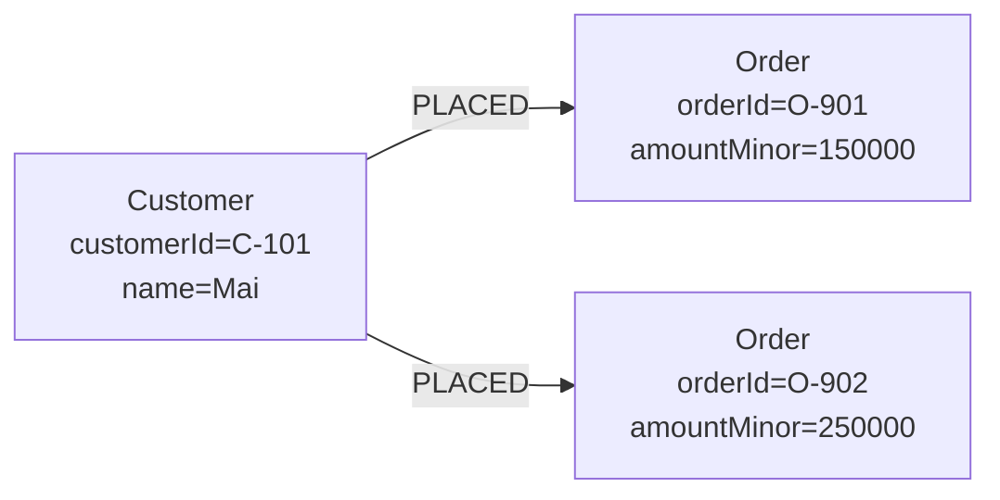
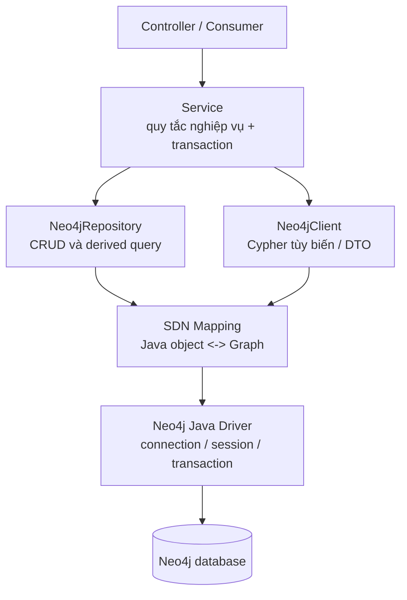

# Spring Data Neo4j giải quyết ánh xạ đối tượng–đồ thị như thế nào

Trong Neo4j, dữ liệu được mô hình hóa theo **property graph**: node có label và property, relationship nối các node theo hướng và cũng có thể mang property. Trong Java, ứng dụng lại muốn làm việc với **class, object, field, collection và domain service**. Nếu chỉ dùng Neo4j Java Driver, lập trình viên thường phải gửi Cypher, đọc `Record`, nhận các node/relationship rồi tự tạo object tương ứng.

**Spring Data Neo4j (SDN)** cung cấp cơ chế **Object–Graph Mapping (OGM)** để kết nối hai cách biểu diễn này: định nghĩa entity Java tương ứng với node, dùng annotation mô tả relationship và thuộc tính của cạnh, rồi tận dụng repository, query mapping và transaction integration của Spring.

Đây là bài mở đầu của chương **Spring Data Neo4j** trong module **DATABASE_ENGINE_GRAPH_NEO4J**, với phạm vi sử dụng Neo4j để mô hình hóa dữ liệu liên kết, truy vấn Cypher về node, relationship, đường đi, tối ưu bằng index/constraint, nhập dữ liệu và tích hợp ứng dụng Java. Bài tập trung trả lời **Spring Data Neo4j ánh xạ đối tượng–đồ thị như thế nào, giải quyết gì và không giải quyết gì**.

Sau bài, bạn có thể:

- Hiểu cách các annotation `@Node`, `@Id`, `@Property`, `@Relationship`, `@RelationshipProperties`, `@TargetNode`, `@RelationshipId` tương ứng với thành phần property graph.
- Ánh xạ cả **node** lẫn **thuộc tính trên relationship** vào object Java.
- Sử dụng `Neo4jRepository`, `@Query` và `Neo4jClient` theo mục tiêu đọc/ghi.
- Nhận diện rủi ro khi tải **một phần object graph** rồi lưu lại như thể đã có toàn bộ quan hệ.
- Giải thích khi nào nên dùng SDN, Cypher tường minh hoặc Java Driver thuần.

> **Phạm vi phiên bản:** Các ví dụ định hướng Spring Boot 3.x, Spring Data Neo4j hiện đại, Java 17+ và Neo4j 5+. Cần kiểm tra tương thích giữa các phiên bản của dự án. Spring Data Neo4j hiện đại không đồng nhất với thư viện **Neo4j-OGM** đời cũ và cũng **không phải JPA/Hibernate cho Neo4j**.

## 1. Ánh xạ object ↔ graph là vấn đề gì?

Giả sử mô hình thương mại điện tử có hai thực thể `Customer` và `Order`:



Trong Neo4j, dữ liệu được biểu diễn thành các node và cạnh:

```cypher
(:Customer {customerId: 'C-101', name: 'Mai'})
  -[:PLACED]->
(:Order {orderId: 'O-901', amountMinor: 150000})
```

Trong Java, ta muốn dùng:

```java
Customer customer = ...;
String name = customer.getName();
List<Order> orders = customer.getOrders();
```

Điểm khó là **`List<Order>` không phải property “mảng đơn hàng” trên node Customer**. Nó biểu thị **những node Order liên kết với Customer qua relationship `:PLACED`**.

| Neo4j property graph | Java / Spring Data Neo4j | Vai trò |
| --- | --- | --- |
| Node `(:Customer)` | Instance `Customer` có `@Node` | Thực thể |
| Label `:Customer` | `@Node("Customer")` | Xác định loại node |
| Property `customerId` | Field `customerId` | Danh tính nghiệp vụ |
| Property `name` | Field `name` | Dữ liệu scalar |
| `(Customer)-[:PLACED]->(Order)` | Field `@Relationship List<Order>` | Liên kết object qua cạnh |
| Relationship có `role` hoặc `since` | Object có `@RelationshipProperties` | Thuộc tính của cạnh |
| Dữ liệu trả về từ `MATCH` | Entity hoặc DTO do mapper tạo | Đọc dữ liệu |
| Lệnh `CREATE`, `MERGE`, `SET` | Repository save hoặc Cypher tùy biến | Ghi dữ liệu |

SDN giúp Java code diễn đạt đồ thị như một mô hình domain, đồng thời giữ được ý nghĩa **node và relationship là hai loại thành phần khác nhau**.

## 2. SDN ở vị trí nào trong hệ thống Spring?



**Neo4j Java Driver** cung cấp kết nối và thực thi Cypher ở mức thấp: session, transaction, result, retry khi phù hợp. **Spring Data Neo4j** xây dựng trên nền đó, cung cấp metadata mapping và tích hợp với Spring.

Các lợi ích chính:

1. Khai báo entity với annotation thay vì tự chuyển từng property từ `Record` sang Java field.
2. Dùng repository để lưu/truy vấn model phổ biến.
3. Tạo truy vấn từ tên method cho những điều kiện đơn giản.
4. Dùng `@Query` cho truy vấn Cypher có chủ đích, ánh xạ kết quả theo metadata.
5. Dùng `Neo4jClient` để nhận DTO cho thống kê, đường đi hoặc các kết quả không thuần entity.
6. Kết hợp `@Transactional` để xác định ranh giới nhất quán của thao tác trong ứng dụng.

**Điều SDN không tự làm:** quyết định nhãn/loại cạnh nên có, chọn khóa định danh chính xác, tạo mọi constraint cần thiết, tối ưu mọi truy vấn, hoặc tự hiểu một graph lớn cần tải đến độ sâu nào cho từng API.

### SDN không phải một ORM quan hệ đổi tên

Với JPA, ta thường thấy `@Entity`, `@OneToMany` và khóa ngoại. Neo4j không lưu `Order.customer_id` làm điều kiện nối bảng bắt buộc; nó lưu cạnh `:PLACED` nối trực tiếp hai node.

Trong SDN:

- Dùng `@Node` thay vì `@Entity`.
- Dùng `@Relationship` với **type** và **direction** thay vì nghĩ theo foreign key.
- Một relationship có thể chứa thuộc tính nghiệp vụ.
- Không mặc định có lazy proxy và persistence context hoạt động giống Hibernate.
- Cách tải và lưu phụ thuộc metadata mapping, hình dạng truy vấn và ranh giới aggregate.

Đó là lý do không nên chỉ đổi annotation trên các class JPA rồi xem việc chuyển sang Neo4j đã hoàn tất.

## 3. Khởi tạo phụ thuộc và cấu hình kết nối

Với Spring Boot dùng Gradle, có thể thêm starter:

```gradle
dependencies {
    implementation 'org.springframework.boot:spring-boot-starter-data-neo4j'
}
```

Để Spring Boot quản lý phiên bản tương thích, tránh ghép tùy tiện những phiên bản SDN và Neo4j Driver khác nhau.

Ví dụ `application.yml`:

```yaml
spring:
  neo4j:
    uri: bolt://localhost:7687
    authentication:
      username: neo4j
      password: "${NEO4J_PASSWORD}"
  data:
    neo4j:
      database: neo4j
```

Ở bản cuối, giá trị mật khẩu được tham chiếu từ biến môi trường `NEO4J_PASSWORD`, không hard-code bí mật vào source code. Trong hệ managed/cluster, URI, TLS, quyền và database có thể khác.

Spring Boot tự cấu hình các bean phù hợp khi có starter và kết nối. Sau đó repository SDN có thể được Spring quét và inject vào service.

## 4. Khai báo node với `@Node`, `@Id` và `@Property`

Dữ liệu mẫu cần hai Java class. Mỗi đoạn có `public class` dưới đây giả định được đặt trong **tệp Java riêng**.

### 4.1. Entity Customer

```java
import java.util.ArrayList;
import java.util.List;

import org.springframework.data.annotation.Id;
import org.springframework.data.neo4j.core.schema.Node;
import org.springframework.data.neo4j.core.schema.Property;
import org.springframework.data.neo4j.core.schema.Relationship;

@Node("Customer")
public class Customer {

    @Id
    @Property("customerId")
    private String customerId;

    @Property("name")
    private String name;

    @Relationship(
        type = "PLACED",
        direction = Relationship.Direction.OUTGOING
    )
    private List<Order> orders = new ArrayList<>();

    public Customer() {}

    public Customer(String customerId, String name) {
        this.customerId = customerId;
        this.name = name;
    }

    public String getCustomerId() { return customerId; }
    public String getName() { return name; }
    public void setName(String name) { this.name = name; }
    public List<Order> getOrders() { return orders; }
}
```

### 4.2. Entity Order

```java
import org.springframework.data.annotation.Id;
import org.springframework.data.neo4j.core.schema.Node;

@Node("Order")
public class Order {

    @Id
    private String orderId;

    private Long amountMinor;

    public Order() {}

    public Order(String orderId, Long amountMinor) {
        this.orderId = orderId;
        this.amountMinor = amountMinor;
    }

    public String getOrderId() { return orderId; }
    public Long getAmountMinor() { return amountMinor; }
    public void setAmountMinor(Long amountMinor) {
        this.amountMinor = amountMinor;
    }
}
```

### 4.3. Giải nghĩa cách ánh xạ

| Annotation / field | Thể hiện trong graph |
| --- | --- |
| `@Node("Customer")` | Node có label `:Customer` |
| `@Id String customerId` | Thuộc tính nhận diện entity `customerId` |
| `@Property("name")` | Property `name` trên node |
| `@Relationship(type="PLACED", direction=OUTGOING)` | Cạnh từ Customer sang Order |
| `List<Order> orders` | Nhiều node đích có thể liên kết đến Customer |
| `@Node("Order")` | Node đích có label `:Order` |

**Không nhầm:** `orders` không được lưu như một property JSON chứa danh sách các đơn. Neo4j lưu các node `Order` và cạnh `PLACED`; SDN dựng danh sách dựa trên những node/cạnh đó.

### Tại sao chọn khóa nghiệp vụ làm ID?

`customerId = "C-101"` do hệ thống cấp định danh ổn định, nên phù hợp để đồng bộ từ CRM hoặc import lại nhiều lần. Mã có thể dùng để định vị node mà không phụ thuộc vào `elementId()` do Neo4j cung cấp.

`@Id` xác định danh tính trong model Java, nhưng **không tự thay thế uniqueness constraint** ở database. Nên quản lý schema bằng migration:

```cypher
CREATE CONSTRAINT customer_id_unique IF NOT EXISTS
FOR (c:Customer)
REQUIRE c.customerId IS UNIQUE;

CREATE CONSTRAINT order_id_unique IF NOT EXISTS
FOR (o:Order)
REQUIRE o.orderId IS UNIQUE;
```

Nếu không có uniqueness constraint phù hợp, việc nhập song song hoặc dữ liệu cũ có thể dẫn tới nhiều node cùng khóa, trong khi một object Java vẫn chỉ có một `customerId`.

SDN hỗ trợ `@GeneratedValue` và các chiến lược sinh ID cho một số model. Nhưng cần chọn rõ **mã do ứng dụng cấp** hay **ID do tầng lưu trữ cấp**; không coi ID nội bộ là khóa bền vững khi trao đổi giữa các hệ thống hoặc tái tạo database.

## 5. `@Relationship` thể hiện type và direction

Cạnh trong Neo4j có hướng:

```cypher
MATCH (c:Customer)-[:PLACED]->(o:Order)
RETURN c, o;
```

Với `Customer.orders`:

```java
@Relationship(
    type = "PLACED",
    direction = Relationship.Direction.OUTGOING
)
private List<Order> orders;
```

Nếu có nhu cầu từ `Order` tìm về khách hàng, model có thể khai báo field theo hướng ngược:

```java
@Relationship(
    type = "PLACED",
    direction = Relationship.Direction.INCOMING
)
private Customer customer;
```

Tuy nhiên, **không bắt buộc ánh xạ cả hai chiều trong mọi entity**. Vòng tham chiếu như Customer → Order → Customer khiến object graph lớn, có thể gây đệ quy vô hạn khi tuần tự hóa JSON nếu đưa entity trực tiếp ra HTTP. Nên thiết kế API DTO và phạm vi quan hệ thực sự cần.

### Quan hệ một-nhiều không mặc định có thứ tự

`List<Order>` thể hiện collection ở Java, nhưng không chứng minh Neo4j bảo đảm một thứ tự nghiệp vụ. Nếu UI cần “đơn mới nhất trước”, dùng `ORDER BY o.createdAt DESC` trong truy vấn và trả DTO phù hợp.

Nếu model yêu cầu mỗi đơn thuộc một khách hàng, cần kiểm soát quy tắc đó ở tầng nghiệp vụ và truy vấn ghi. Một field `private Customer customer` không phải **ràng buộc database toàn cục** rằng mỗi Order chỉ có đúng một incoming `:PLACED`.

## 6. Quan hệ có thuộc tính: `@RelationshipProperties`

Trong graph, relationship có thể mang thuộc tính chứ không chỉ nối hai node:

```cypher
(:Member {memberId: 'M-01'})
  -[:ENROLLED_IN {
      role: 'MENTOR',
      joinedAt: date('2026-01-10')
    }]->
(:Course {courseId: 'COURSE-01'})
```

Nếu Java chỉ lưu `List<Course>`, ứng dụng không có chỗ rõ ràng để ánh xạ `role` và `joinedAt` vì chúng thuộc **cạnh**, không thuộc Member hay Course.

Dùng `@RelationshipProperties`.

### 6.1. Node đích

```java
import org.springframework.data.annotation.Id;
import org.springframework.data.neo4j.core.schema.Node;

@Node("Course")
public class Course {
    @Id
    private String courseId;

    private String title;

    public Course() {}

    public Course(String courseId, String title) {
        this.courseId = courseId;
        this.title = title;
    }

    public String getCourseId() { return courseId; }
    public String getTitle() { return title; }
}
```

### 6.2. Object cho relationship

```java
import java.time.LocalDate;

import org.springframework.data.neo4j.core.schema.RelationshipId;
import org.springframework.data.neo4j.core.schema.RelationshipProperties;
import org.springframework.data.neo4j.core.schema.TargetNode;

@RelationshipProperties
public class Enrollment {

    @RelationshipId
    private Long relationshipId;

    @TargetNode
    private Course course;

    private String role;
    private LocalDate joinedAt;

    public Enrollment() {}

    public Enrollment(Course course, String role, LocalDate joinedAt) {
        this.course = course;
        this.role = role;
        this.joinedAt = joinedAt;
    }

    public Course getCourse() { return course; }
    public String getRole() { return role; }
    public LocalDate getJoinedAt() { return joinedAt; }
}
```

### 6.3. Node nguồn ánh xạ collection của cạnh

```java
import java.util.ArrayList;
import java.util.List;

import org.springframework.data.annotation.Id;
import org.springframework.data.neo4j.core.schema.Node;
import org.springframework.data.neo4j.core.schema.Relationship;

@Node("Member")
public class Member {

    @Id
    private String memberId;

    @Relationship(type = "ENROLLED_IN",
                  direction = Relationship.Direction.OUTGOING)
    private List<Enrollment> enrollments = new ArrayList<>();

    public Member() {}

    public Member(String memberId) {
        this.memberId = memberId;
    }

    public List<Enrollment> getEnrollments() {
        return enrollments;
    }
}
```

Các annotation trong ví dụ:

- `@RelationshipProperties`: class `Enrollment` đại diện cho các property của relationship.
- `@TargetNode`: chỉ ra node đích `Course`.
- `@RelationshipId`: SDN theo dõi định danh của quan hệ đã được lưu; **không nên dùng ID kỹ thuật này thay khóa nghiệp vụ ổn định**.
- `role`, `joinedAt`: property của `:ENROLLED_IN`.
- `Member.enrollments`: collection gồm những object mô tả các cạnh xuất phát từ Member.

**Đặc biệt:** `Enrollment` trong ví dụ **không tự biến thành node `:Enrollment`**. Nếu nghiệp vụ cần một thực thể ghi danh độc lập, lưu lịch sử nhiều sự kiện và có ID riêng, có thể chủ động thiết kế một node sự kiện thay vì chỉ dùng relationship property.

## 7. SDN dựng lại object graph từ kết quả Cypher ra sao?

Dữ liệu ban đầu:

```cypher
MERGE (c:Customer {customerId: 'C-101'})
SET c.name = 'Mai'
MERGE (o1:Order {orderId: 'O-901'})
SET o1.amountMinor = 150000
MERGE (o2:Order {orderId: 'O-902'})
SET o2.amountMinor = 250000
MERGE (c)-[:PLACED]->(o1)
MERGE (c)-[:PLACED]->(o2);
```

Một truy vấn phục vụ ánh xạ root entity và relationship:

```cypher
MATCH (c:Customer {customerId: $customerId})
OPTIONAL MATCH (c)-[r:PLACED]->(o:Order)
RETURN c, collect(DISTINCT r), collect(DISTINCT o);
```

SDN có thể sử dụng metadata entity để:

1. Xác định node gốc có label `:Customer`.
2. Đọc property `customerId`, `name` vào field Java.
3. Xem tập cạnh `:PLACED` được trả về.
4. Tạo hoặc tái sử dụng các object `Order` theo danh tính khi ánh xạ kết quả.
5. Gắn những Order đó vào `Customer.orders`.

Hình dạng kết quả **có ý nghĩa**. Nếu một custom query chỉ trả:

```cypher
MATCH (c:Customer {customerId: $customerId})
RETURN c;
```

thì không có đủ thông tin về các cạnh và node Order để SDN dựng đầy đủ `orders`. Trái lại, `RETURN c, collect(r), collect(o)` mô tả cả root, cạnh và node đích.

### Không mặc định mọi quan hệ sẽ được tải tự động vô hạn

Không có nghĩa cứ truy vấn được `Customer` là Java có thể đi sâu qua mọi loại relationship và lấy mọi node của database như một graph vô hạn. Truy vấn repository và custom query xác định dữ liệu được lấy, cùng metadata mapping.

Với custom query **chỉ tải một phần collection**, object được dựng cũng có thể chứa **chỉ phần đó**. Đây là giới hạn quan trọng khi sau đó định gọi `save()`.

## 8. Repository: dùng model Java để thực hiện CRUD

Spring Data Neo4j cung cấp `Neo4jRepository`:

```java
import java.util.Optional;
import org.springframework.data.neo4j.repository.Neo4jRepository;

public interface CustomerRepository
        extends Neo4jRepository<Customer, String> {

    Optional<Customer> findByName(String name);
}
```

Ở đây `Customer` là entity, `String` là kiểu ID. Các phương thức repository tiêu chuẩn gồm tìm theo ID, lưu entity và xóa theo ID khi phù hợp. Method `findByName` minh họa **derived query** dựa vào property của domain model.

Một service:

```java
import org.springframework.stereotype.Service;
import org.springframework.transaction.annotation.Transactional;

@Service
public class CustomerLookupService {

    private final CustomerRepository repository;

    public CustomerLookupService(CustomerRepository repository) {
        this.repository = repository;
    }

    @Transactional(readOnly = true)
    public Customer findById(String customerId) {
        return repository.findById(customerId)
            .orElseThrow(() ->
                new IllegalArgumentException("Customer not found"));
    }
}
```

Điều này giảm code truy cập dữ liệu cho các nhu cầu phổ biến. Tuy nhiên, nó không đảm bảo truy vấn được tạo luôn tối ưu trên graph lớn; vẫn cần quan sát chi phí và phạm vi relationship.

### Custom Cypher bằng `@Query`

Khi cần xác định rõ cách lấy một customer cùng các order:

```java
import java.util.Optional;
import org.springframework.data.neo4j.repository.Neo4jRepository;
import org.springframework.data.neo4j.repository.query.Query;
import org.springframework.data.repository.query.Param;

public interface CustomerRepository
        extends Neo4jRepository<Customer, String> {

    @Query("""
        MATCH (c:Customer {customerId: $customerId})
        OPTIONAL MATCH (c)-[r:PLACED]->(o:Order)
        RETURN c, collect(DISTINCT r), collect(DISTINCT o)
        """)
    Optional<Customer> findWithOrders(
        @Param("customerId") String customerId
    );
}
```

Đây là **một biến thể mở rộng của interface CustomerRepository ở trên**, không phải yêu cầu tạo hai interface cùng tên trong dự án. `@Query` cho phép dùng Cypher cụ thể thay vì suy ra từ tên method.

`OPTIONAL MATCH` giữ customer kể cả khi chưa có order. `collect(DISTINCT ...)` giúp chuẩn bị các thực thể liên quan để mapper tái dựng collection, và tránh một số bản ghi lặp trong kết quả.

**Cảnh báo:** Câu lệnh `@Query` phức tạp có thể tạo nhiều hàng trung gian khi mở rộng nhiều nhánh relationship. Kết quả entity được map không tự làm những phép tổng hợp Cypher sai trở nên đúng.

## 9. Khi nào nên đọc DTO thay vì entity?

Một API báo cáo chỉ cần:

```json
{
  "orderId": "O-901",
  "amountMinor": 150000
}
```

Không có lý do bắt buộc tải toàn bộ `Customer` và collection `orders` chỉ để trả hai trường này.

`Neo4jClient` là công cụ phù hợp để viết Cypher và ánh xạ kết quả sang DTO:

```java
import java.util.List;

import org.springframework.data.neo4j.core.Neo4jClient;
import org.springframework.stereotype.Service;
import org.springframework.transaction.annotation.Transactional;

@Service
public class OrderReportService {

    private final Neo4jClient client;

    public OrderReportService(Neo4jClient client) {
        this.client = client;
    }

    public record OrderRow(String orderId, long amountMinor) {}

    @Transactional(readOnly = true)
    public List<OrderRow> findOrders(String customerId) {
        return client.query("""
                MATCH (c:Customer {customerId: $customerId})
                      -[:PLACED]->(o:Order)
                RETURN o.orderId AS orderId,
                       o.amountMinor AS amountMinor
                ORDER BY o.orderId
                """)
            .bind(customerId)
            .to("customerId")
            .fetchAs(OrderRow.class)
            .mappedBy((typeSystem, record) ->
                new OrderRow(
                    record.get("orderId").asString(),
                    record.get("amountMinor").asLong()
                )
            )
            .all()
            .stream()
            .toList();
    }
}
```

Đoạn mã giả định `amountMinor` tồn tại và có kiểu integer phù hợp. Trong dữ liệu thực tế, xử lý trường thiếu/`null` và giới hạn số lượng kết quả trước khi chuyển hàng triệu hàng thành `List`.

Đây là **read model**, không phải entity để dùng `save()`. Việc tách DTO khỏi entity giúp tránh vô tình đồng bộ cả object graph khi chỉ cần một báo cáo.

## 10. Cẩn thận với việc lưu một graph chưa được tải đầy đủ

Một trong những cạm bẫy lớn nhất khi dùng SDN là **nhầm object graph đã tải với toàn bộ quan hệ đang lưu**.

Giả sử trong Neo4j, customer C-101 có **100 đơn hàng**. Ứng dụng chạy một custom query chỉ trả 5 đơn gần nhất:

```cypher
MATCH (c:Customer {customerId: 'C-101'})-[r:PLACED]->(o:Order)
WHERE o.createdAt >= datetime('2026-11-01T00:00:00Z')
RETURN c, collect(r), collect(o);
```

Object `Customer` ở Java chỉ nhìn thấy 5 Order này. **Không nên suy diễn** rằng 95 đơn còn lại không tồn tại trong graph.

Nếu sau đó chỉ muốn đổi tên khách hàng nhưng gọi:

```java
customer.setName("Mai Nguyễn");
customerRepository.save(customer);
```

thì cơ chế đồng bộ relationship khi lưu object graph có thể dẫn đến thay đổi **ngoài ý muốn** nếu mapping và trạng thái collection không đại diện cho đầy đủ quan hệ của aggregate.

### Cách sửa một property an toàn hơn

Khi chỉ cần cập nhật tên:

```cypher
MATCH (c:Customer {customerId: $customerId})
SET c.name = $newName
RETURN c.customerId AS customerId,
       c.name AS name;
```

Câu lệnh chỉ sửa `name` và không cần tải/lưu collection `orders`. Có thể thực hiện bằng `Neo4jClient`, repository custom query hoặc Driver theo ranh giới transaction tương ứng.

**Nguyên tắc:** `save()` thích hợp khi service nắm quyền cập nhật một **aggregate được định nghĩa rõ**. Nếu đối tượng lấy từ custom query chỉ mang một phần quan hệ, hãy xem đó là **projection để đọc** trừ khi hành vi ghi đã được thiết kế và kiểm thử.

## 11. Lưu object graph khi phạm vi rõ ràng

Ví dụ ghi đơn giản:

```java
Customer c = new Customer("C-101", "Mai");
c.getOrders().add(new Order("O-901", 150000L));
customerRepository.save(c);
```

Nhờ ánh xạ `@Node` và `@Relationship`, SDN có thể lưu node và quan hệ theo model. Nhưng trước khi dùng một API như vậy trên production cần hỏi:

- Đây là khách hàng mới hay đã tồn tại?
- Trên database đã có constraint để bảo đảm khóa duy nhất chưa?
- Danh sách `orders` là **toàn bộ** quan hệ aggregate hay chỉ phần được tải?
- Một service khác có được quyền sửa `Order.status` hoặc `Customer.name` không?
- Cùng lúc có request khác đang sửa object này không?
- Nếu thao tác bị retry, có thể tạo thêm quan hệ hoặc ghi đè thuộc tính không?

Sự tiện lợi về coding không tự tạo bảo đảm về **ownership** và **idempotency**.

### Optimistic locking và cạnh tranh cập nhật

Nếu hai request đọc cùng một entity rồi lần lượt ghi cập nhật, request sau có thể ghi đè giá trị của request trước. SDN hỗ trợ cơ chế versioning cho entity khi cấu hình phù hợp, ví dụ qua `@Version` ở những phiên bản thư viện hỗ trợ.

Lưu ý phải phân biệt:

- **Version của entity trong ứng dụng:** dùng để phát hiện cập nhật lạc hậu.
- **Version từ CDC/hệ thống nguồn:** dùng để phân xử event cũ/mới khi đồng bộ.
- **ID relationship hoặc node:** dùng để nhận diện phần tử, không phải version.

Ba khái niệm có mục tiêu khác nhau và không thể thay thế trực tiếp.

## 12. Transaction với `@Transactional`

Spring Data Neo4j tích hợp với Spring transaction manager:

```java
import org.springframework.stereotype.Service;
import org.springframework.transaction.annotation.Transactional;

@Service
public class CustomerApplicationService {

    private final CustomerRepository repository;

    public CustomerApplicationService(CustomerRepository repository) {
        this.repository = repository;
    }

    @Transactional
    public void rename(String customerId, String newName) {
        Customer c = repository.findById(customerId)
            .orElseThrow(() ->
                new IllegalArgumentException("Customer not found"));
        c.setName(newName);
        repository.save(c);
    }
}
```

Ví dụ cho thấy phạm vi transaction, nhưng **không phải lời khuyên tải rồi lưu toàn bộ graph chỉ để đổi một field**. Với aggregate lớn, câu Cypher `SET` trực tiếp ở mục 10 thường có phạm vi ghi hẹp hơn.

Một số nguyên tắc vận hành:

1. Giữ transaction ngắn; không gọi HTTP bên ngoài hoặc chờ thao tác lâu trong transaction.
2. Ghi nhiều node và relationship trong cùng transaction nếu nghiệp vụ yêu cầu nguyên tử.
3. Trước commit, lỗi có thể rollback toàn bộ thay đổi của transaction; dữ liệu đã commit ở transaction trước không tự rollback.
4. Chú ý Spring proxy: một phương thức gọi phương thức `@Transactional` khác trong cùng instance có thể không đi qua proxy như mong đợi.
5. Nếu dùng thêm Java Driver thuần, đừng mặc nhiên giả định session/transaction do Driver tự mở chia sẻ cùng transaction Spring đang quản lý.
6. Cần hiểu timeout, lock contention, optimistic locking và chính sách retry của ứng dụng.

## 13. Kiểu property và giới hạn ánh xạ

Neo4j property graph hỗ trợ các kiểu giá trị cụ thể; không phải mọi Java object đều trở thành property hợp lệ nếu chỉ khai báo field.

| Java field | Cách lưu thường gặp | Cần chú ý |
| --- | --- | --- |
| `String` | String property | Khóa nghiệp vụ phải chuẩn hóa nhất quán |
| `Long`, `Integer` | Integer property | Kiểu và phạm vi số |
| `Double` | Floating-point property | Không mặc định phù hợp tiền tệ |
| `Boolean` | Boolean property | `false` khác thuộc tính không tồn tại |
| `LocalDate` | Date property | Neo4j hỗ trợ kiểu temporal |
| `LocalDateTime` | Local date-time property | Múi giờ và ý nghĩa thời điểm |
| `List<String>` | List property nếu kiểu phần tử phù hợp | Không phải collection node |
| `List<Order>` với `@Relationship` | Nhiều node Order và cạnh PLACED | Không phải JSON array |
| Value object tùy biến | Converter hoặc mô hình property được thiết kế | Không tự động ánh xạ mọi class |
| `null` | Property có thể vắng mặt | Không đồng nghĩa `0` hoặc chuỗi rỗng |

Ví dụ `Long amountMinor` đại diện cho tiền theo **đơn vị nhỏ nhất**, tránh sai số số thực nếu nghiệp vụ quy định số tiền nguyên. Nếu hệ thống dùng nhiều tiền tệ, cần lưu thêm loại tiền, quy tắc làm tròn và xử lý tương ứng.

Một object lồng nhau trong Java có thể cần được mô hình thành node/relationship riêng hoặc dùng converter/`@CompositeProperty` thích hợp. Không ép mọi domain object thành property bản đồ chỉ để giữ cấu trúc giống JSON.

## 14. Tối ưu truy vấn vẫn là trách nhiệm của ứng dụng

SDN giảm code mapping nhưng không làm Cypher thiếu index trở nên nhanh, không tự ngăn bùng nổ path và không tự sửa phép tổng hợp trên dữ liệu bị nhân hàng.

### 14.1. Khởi đầu từ khóa được index

```cypher
MATCH (c:Customer {customerId: $customerId})
RETURN c;
```

Uniqueness constraint cho `customerId` giúp định vị thực thể nhanh hơn. Nhưng một customer có hàng trăm nghìn cạnh `:PLACED` vẫn có thể tạo ra kết quả rất lớn nếu tải toàn bộ collection.

### 14.2. Hai nhánh có thể nhân hàng

Một khách hàng có 2 đơn và 3 phiếu hỗ trợ. Truy vấn:

```cypher
MATCH (c:Customer {customerId: $customerId})
MATCH (c)-[:PLACED]->(o:Order)
MATCH (c)-[:OPENED]->(t:Ticket)
RETURN c, o, t;
```

có thể sinh **2 × 3 = 6 hàng**. `sum(o.amountMinor)` trên những hàng đó sẽ cộng mỗi đơn nhiều lần. Hãy tổng hợp từng nhánh bằng `WITH` hoặc `CALL` subquery.

Đừng chữa lỗi này bằng `sum(DISTINCT o.amountMinor)` một cách máy móc: **hai đơn khác nhau có thể có cùng số tiền** và khi đó phép tổng sẽ bị thiếu.

### 14.3. N+1 round trips

Nếu API tải 200 khách hàng rồi gọi repository 200 lần để tìm đơn hàng từng người, tổng round trip có thể tăng mạnh. Cần cân nhắc query theo danh sách ID, DTO, batch fetch hoặc cách đọc phù hợp.

Ngược lại, một câu truy vấn lấy cả đồ thị cho mọi khách hàng cũng có thể tốn nhiều RAM. **Cân bằng giữa số round trip và kích thước kết quả** mới là mục tiêu.

### 14.4. Sử dụng execution plan

```cypher
EXPLAIN
MATCH (c:Customer {customerId: $customerId})
MATCH (c)-[:PLACED]->(o:Order)
RETURN o.orderId
LIMIT 20;
```

`EXPLAIN` cho kế hoạch dự kiến mà không thực thi; `PROFILE` thực thi và cho biết số hàng/DB hits theo operator tùy runtime. Không chạy `PROFILE` trên truy vấn ghi nguy hiểm trong production nếu chưa đánh giá tác động.

## 15. SDN, Neo4jClient và Driver: so sánh lựa chọn

| Nhu cầu | SDN Repository | `Neo4jClient` | Java Driver thuần |
| --- | --- | --- | --- |
| CRUD entity thông thường | Thuận tiện | Có thể dùng | Tự ánh xạ nhiều hơn |
| Tra cứu theo property | Derived method, `@Query` | Có thể dùng | Có thể dùng |
| Tải aggregate có relationship | Phù hợp nếu phạm vi rõ | Có thể truy vấn tùy biến | Tự dựng object |
| Kết quả DTO/aggregate | Có thể query tùy biến | Rõ ràng, linh hoạt | Linh hoạt |
| Đường đi, graph analytics, GDS | Có thể gọi `@Query` nhưng không phải entity CRUD | Phù hợp | Phù hợp |
| Mapping node/relationship tự động | Có | Dùng các khả năng phù hợp | Chủ yếu tự làm |
| Transaction tích hợp Spring | Có | Có | Cần chủ động phối hợp |
| Kiểm soát chính xác câu Cypher ghi | Ít tường minh với `save()` | Rõ | Rõ |

Trong một dự án, có thể kết hợp nhiều cấp:

- **Repository** cho lưu và đọc aggregate theo domain.
- **Neo4jClient** cho DTO, thống kê và cập nhật một phần có phạm vi rõ ràng.
- **Java Driver** khi cần kiểm soát mức thấp, sử dụng procedure đặc thù hoặc tích hợp khác.

Không nên trộn các session do Driver tự mở trong một quy trình Spring transaction rồi giả định chúng mặc nhiên chia sẻ một giao dịch.

## 16. Aggregate là ranh giới nghiệp vụ, không phải toàn bộ graph

Một graph có thể kết nối khách hàng với đơn hàng, thanh toán, sản phẩm, địa chỉ, nhà cung cấp, nhóm cộng đồng và hàng triệu người dùng khác. **Không có nghĩa toàn bộ đó phải nằm trong một aggregate để gọi `save()` cùng lúc.**

Ví dụ:

- CRM có quyền cập nhật `Customer.name`.
- OMS có quyền cập nhật `Order.status` và quan hệ đặt đơn.
- Billing có quyền cập nhật `Payment.status`.
- Job phân tích có quyền cập nhật `recommendationScore`.

Nếu class `Customer` tham chiếu đến mọi loại node rồi bị sửa/lưu từ mọi service, ranh giới sở hữu dữ liệu trở nên mơ hồ. Một thiết kế rõ ràng hơn:

1. Xác định thực thể và relationship thuộc phạm vi ghi của từng service.
2. Model các quan hệ cần thiết để đọc graph, không bắt buộc ánh xạ mọi cạnh hai chiều.
3. Dùng `save()` trên aggregate được tải/kiểm soát đầy đủ.
4. Dùng Cypher cập nhật mục tiêu cho các thay đổi một thuộc tính hoặc một cạnh.
5. Sử dụng khóa nghiệp vụ và version để đối chiếu thực thể và xử lý cạnh tranh.
6. Ánh xạ DTO cho báo cáo, thay vì tái sử dụng entity như dữ liệu trả mọi API.

OGM giải quyết **ánh xạ kỹ thuật**; không thể thay thế việc phân định **ownership** giữa các nguồn và quy tắc nghiệp vụ.

## 17. Kiểm thử mapping với Neo4j thật

Annotation có thể biên dịch nhưng chưa chắc mapping đã đúng ý nghĩa graph. Cần kiểm thử tích hợp, chẳng hạn với `@DataNeo4jTest` và Neo4j test instance (có thể qua Testcontainers khi môi trường hỗ trợ).

| Trường hợp | Điều cần xác minh |
| --- | --- |
| Lưu `Customer` mới | Đúng label, `customerId` và `name` |
| Lưu Customer có Order | Có đúng cạnh `Customer-[:PLACED]->Order` |
| Tải từ repository | Các scalar field được map đúng |
| Custom `@Query` trả root + quan hệ | `orders` được tái dựng từ cạnh thực tế |
| Lưu `Enrollment` | `role` và `joinedAt` thuộc **relationship**, không thuộc Course |
| Không có order | Hành vi collection/optional hợp lý |
| Có hai order cùng số tiền | Không tổng hợp sai vì `sum(DISTINCT amount)` |
| Tải một phần graph rồi chỉnh tên | Không tác động các relationship không định sửa |
| Ghi cạnh tranh | Có chính sách version/retry phù hợp |
| Câu Cypher trực tiếp kiểm tra graph | Đúng type/direction, không chỉ object Java trông hợp lệ |

Mock repository chỉ kiểm thử code gọi hàm; nó **không xác minh** logic ánh xạ node/relationship xuống Neo4j. Vì vậy các đường ghi quan trọng nên có kiểm thử với database thực, sử dụng khóa test riêng và dọn dữ liệu có kiểm soát.

## 18. Những sai lầm phổ biến

| Sai lầm | Hệ quả | Cách xử lý |
| --- | --- | --- |
| Nghĩ `@Node` giống hệt `@Entity` JPA | Thiết kế theo bảng và foreign key | Thiết kế theo property graph |
| Nghĩ `@Id` tự bảo đảm unique trong DB | Có nguy cơ trùng khóa | Tạo uniqueness constraint |
| Coi `List<Order>` là JSON property | Mất nghĩa của relationship | Dùng `@Relationship` |
| Bỏ qua hướng của cạnh | Ghép sai dữ liệu | Khai báo type/direction đúng |
| Đặt `role` của liên kết trên node Course | Sai thuộc tính theo cặp | `@RelationshipProperties` |
| Dùng `@RelationshipId` làm khóa nguồn lâu dài | Tham chiếu không ổn định | Thiết kế khóa nghiệp vụ |
| `RETURN c` nhưng muốn tải đủ `orders` | Không có đủ thông tin trong query | Trả quan hệ và node đích thích hợp |
| Lưu partial object graph như toàn bộ aggregate | Có thể sửa/xóa quan hệ không mong muốn | Chỉ sửa field bằng query mục tiêu |
| Dùng `save()` cho mọi thao tác nhỏ | Đọc/ghi thừa phần graph | Chọn repository hoặc query tùy nhu cầu |
| Tưởng Spring tự sửa Cypher nhân hàng | Sai `count()` và `sum()` | Tổng hợp đúng theo entity |
| Gọi query một lần cho mỗi record | N+1, nhiều round trip | Batch/query theo tập |
| Serialize entity graph trực tiếp ra JSON | Vòng tham chiếu hoặc payload quá lớn | Dùng DTO/API boundary |
| Chạy transaction bao HTTP call lâu | Giữ lock và tài nguyên quá lâu | Giữ transaction ngắn |
| Chỉ mock repository | Không kiểm tra mapping thật | Integration test với Neo4j |

## 19. Bài tập thực hành

**Bài 1 — Node mapping.** Viết class `Product` với `@Node("Product")`, `@Id String sku`, `name` và `priceMinor`. Tạo uniqueness constraint cho `sku` và giải thích vì sao `@Id` không đủ thay constraint.

**Bài 2 — Hướng quan hệ.** Với `(Customer)-[:PLACED]->(Order)`, khai báo `List<Order>` trong Customer. Nếu Order cũng cần tham chiếu ngược về Customer, chọn direction nào? Giải thích rủi ro vòng object graph.

**Bài 3 — Thuộc tính trên cạnh.** Cho `(User)-[:RATED {stars: 5, comment: 'Tốt'}]->(Product)`. Thiết kế class `@RelationshipProperties` với `@RelationshipId` và `@TargetNode`. Property `stars` lưu ở đâu?

**Bài 4 — Kết quả custom query.** So sánh `RETURN c` và `RETURN c, collect(r), collect(o)`. Câu nào mang thông tin cần thiết để ánh xạ danh sách đơn? Tại sao?

**Bài 5 — Partial graph.** Khách hàng có 500 đơn nhưng API chỉ tải 10 đơn gần nhất. Vì sao gọi `save(customer)` sau khi đổi tên có rủi ro? Viết Cypher cập nhật riêng `name`.

**Bài 6 — DTO.** API chỉ cần `orderId` và `amountMinor`. Chọn repository entity hay `Neo4jClient` trả DTO? Giải thích lợi ích và giới hạn bộ nhớ.

**Bài 7 — Hiệu năng.** Một endpoint tải 200 khách hàng rồi gửi 200 truy vấn lấy đơn. Đây là dạng vấn đề nào? Đề xuất chiến lược giảm round trip mà không kéo về toàn bộ graph quá lớn.

**Bài 8 — Kiểm thử.** Viết kịch bản integration test xác minh một `Enrollment` có thuộc tính `role` trên relationship, không trên node; kiểm tra thêm trường hợp không có cạnh và hướng bị khai báo sai.

### Checklist trước khi triển khai

- [ ] Node/relationship được mô hình theo nghiệp vụ, không sao chép nguyên xi JPA.
- [ ] `@Id` có khóa phù hợp và database có constraint/index cần thiết.
- [ ] `@Relationship` đúng type và direction.
- [ ] Thuộc tính của cạnh dùng `@RelationshipProperties` khi phù hợp.
- [ ] Custom query trả đủ root, relationship và target node nếu cần hydrate entity.
- [ ] Đã xác định rõ phạm vi object graph dùng để `save()`.
- [ ] Có query cập nhật hẹp cho thay đổi một property/một cạnh.
- [ ] Kết quả phân tích được trả qua DTO/Neo4jClient khi không cần graph entity.
- [ ] Transaction, quyền sở hữu dữ liệu và concurrency đã được thiết kế.
- [ ] Có kiểm tra execution plan, cardinality, N+1 và độ lớn collection.
- [ ] Có integration test với Neo4j thật cho những ánh xạ quan trọng.

## 20. Tài liệu đối chiếu

Để xác minh API và behavior tương thích với phiên bản dự án:

- [Spring Data Neo4j — Reference Documentation](https://docs.spring.io/spring-data/neo4j/reference/): mapping, annotation, repository, Cypher và `Neo4jClient`.
- [Spring Data Commons — Reference Documentation](https://docs.spring.io/spring-data/commons/reference/): nguyên tắc repository, entity identity và các phương thức truy vấn.
- [Spring Boot — Reference Documentation](https://docs.spring.io/spring-boot/reference/): starter, cấu hình và transaction integration.
- [Neo4j Cypher Manual](https://neo4j.com/docs/cypher-manual/current/): `MATCH`, `MERGE`, `OPTIONAL MATCH`, constraint và query tuning.
- [Neo4j Java Driver Manual](https://neo4j.com/docs/java-manual/current/): kết nối, session, transaction và result mapping ở tầng thấp.

**Ghi nhớ:** Spring Data Neo4j ánh xạ **Java object ↔ Neo4j property graph** thông qua metadata annotation, repository và hạ tầng Spring. Nó giúp làm việc với node, relationship và thuộc tính trên cạnh như những đối tượng Java, nhưng không làm biến mất các quyết định về khóa nghiệp vụ, hình dạng Cypher, phạm vi tải/lưu, transaction và hiệu năng. Chọn **repository cho aggregate**, **Neo4jClient/Driver cho kết quả đặc thù**, và luôn kiểm tra graph thực tế để bảo đảm object Java phản ánh đúng dữ liệu được lưu.
