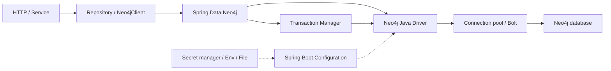
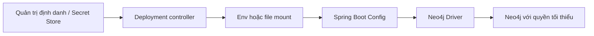

# Cấu hình kết nối trong Spring Boot và quản lý bí mật với Spring Data Neo4j

## 1. Mục tiêu và phạm vi

Neo4j lưu dữ liệu theo mô hình **property graph**: ứng dụng đọc và ghi node, relationship cùng các thuộc tính bằng Cypher. Trong dự án Java, **Spring Data Neo4j (SDN)** giúp ánh xạ entity, xây repository và quản lý giao dịch. Tuy nhiên, một ứng dụng chỉ an toàn khi **kết nối đúng database, đúng quyền, đúng cấu hình mã hóa và không làm lộ thông tin xác thực**.

Bài thuộc chương **Spring Data Neo4j** của mô-đun `DATABASE_ENGINE_GRAPH_NEO4J`. Chúng ta tập trung vào lớp cấu hình, gồm Spring Boot auto-configuration, Neo4j Java Driver, thông tin kết nối, quản lý secret, pool, kiểm tra vận hành và xử lý lỗi. Đây là nền tảng trước khi triển khai repository, quan hệ giữa entity, index/constraint, truy vấn Cypher hoặc xử lý dữ liệu lớn.

Sau bài này, bạn có thể:

1. Phân biệt vai trò của Spring Boot, SDN và Java Driver trong kết nối Neo4j.
2. Khai báo URI, tài khoản và database bằng `application.yml` cùng biến môi trường.
3. Chọn URI Bolt/Neo4j routing và chế độ TLS phù hợp môi trường.
4. Tránh hard-code mật khẩu; dùng secret store, Kubernetes Secret hoặc file cấu hình được mount an toàn.
5. Hiểu cách quản lý pool, timeout, quyền truy cập và vòng đời xoay vòng thông tin xác thực.
6. Kiểm chứng kết nối mà không ghi secret vào log hoặc trả secret trong API lỗi.

> **Phạm vi phiên bản:** Ví dụ cấu hình nhắm tới Spring Boot 3.x, Spring Data Neo4j tương ứng do Spring Boot quản lý, Java 17+ và Neo4j hỗ trợ Bolt. Các property và API nên được đối chiếu với tài liệu **đúng phiên bản** mà dự án đang dùng; Spring Boot/SDN và Neo4j có thể phát triển khác nhau theo từng bản phát hành.

## 2. Kiến trúc kết nối: lớp nào làm việc gì?

Một yêu cầu đọc dữ liệu thường đi qua các thành phần:



| Thành phần | Trách nhiệm chính |
| --- | --- |
| **Spring Boot** | Đọc cấu hình, tạo các bean cần thiết, ghép dependency và quản lý lifecycle |
| **Neo4j Java Driver** | Quản lý kết nối Bolt, xác thực, pool, routing và thực thi Cypher |
| **Spring Data Neo4j** | Ánh xạ graph entity, repository, `Neo4jClient` và tích hợp giao dịch Spring |
| **Neo4j server/cluster** | Xác thực, phân quyền, thực thi query, lưu node/relationship/index/constraint |
| **Nguồn secret** | Cung cấp thông tin xác thực tại thời điểm triển khai, tách khỏi mã nguồn và artifact |

Spring Data Neo4j **không phải Neo4j server** và không tự tạo database chỉ vì repository được khai báo. Mật khẩu được dùng khi ứng dụng kết nối tới Neo4j; nó không cần nằm trong entity hoặc bản ghi nghiệp vụ. Tránh tạo thêm một `Driver` tùy ý nếu Spring Boot đã auto-configure driver, vì điều đó có thể sinh nhiều pool và gây khó quản lý lifecycle.

## 3. Thêm dependency và chọn đúng hệ phiên bản

Với Maven và một dự án Spring Boot đã có dependency management/BOM phù hợp, thêm starter:

```xml
<dependencies>
    <dependency>
        <groupId>org.springframework.boot</groupId>
        <artifactId>spring-boot-starter-data-neo4j</artifactId>
    </dependency>

    <!-- Tùy chọn: kiểm tra trạng thái và số liệu vận hành -->
    <dependency>
        <groupId>org.springframework.boot</groupId>
        <artifactId>spring-boot-starter-actuator</artifactId>
    </dependency>
</dependencies>
```

`spring-boot-starter-data-neo4j` kéo theo các thành phần SDN và driver phù hợp với hệ dependency của Spring Boot. Không thêm phiên bản Neo4j Driver hay SDN khác một cách tùy ý chỉ để sửa một lỗi kết nối; việc ghi đè version có thể gây lệch tương thích. Khi thật sự cần ghi đè, kiểm tra ma trận tương thích và chạy integration test.

Trong ứng dụng thực tế, có thể dùng cả `Neo4jRepository`, `Neo4jClient` và bean `org.neo4j.driver.Driver` tùy nhu cầu. Việc inject bean driver do Boot tạo **không đồng nghĩa** phải tự new một driver mới.

## 4. Cấu hình tối thiểu qua application.yml

Cách triển khai dễ kiểm soát là để cấu hình **không bí mật** và các tham chiếu đến bí mật trong file, còn giá trị thực nằm ở môi trường chạy.

```yaml
spring:
  application:
    name: graph-service

  neo4j:
    uri: ${NEO4J_URI}
    authentication:
      username: ${NEO4J_USERNAME}
      password: ${NEO4J_PASSWORD}

  data:
    neo4j:
      database: ${NEO4J_DATABASE}
```

Đây là những thuộc tính quan trọng:

| Thuộc tính Spring Boot | Vai trò | Ví dụ giá trị **không bí mật** |
| --- | --- | --- |
| `spring.neo4j.uri` | Địa chỉ và cách kết nối/routing tới Neo4j | `bolt://localhost:7687` cho máy thử nghiệm |
| `spring.neo4j.authentication.username` | Tên tài khoản được cấp phép | `graph_app` |
| `spring.neo4j.authentication.password` | Mật khẩu/tài liệu xác thực của tài khoản | **Không đưa giá trị thật vào file** |
| `spring.data.neo4j.database` | Database mà SDN nhắm tới | `neo4j`, hoặc tên database đã cấp phép |

Tương ứng, môi trường triển khai phải cung cấp `NEO4J_URI`, `NEO4J_USERNAME`, `NEO4J_PASSWORD` và `NEO4J_DATABASE` trước khi Spring Boot khởi tạo ứng dụng.

**Không dùng giá trị mật khẩu mặc định** trong cú pháp như `${NEO4J_PASSWORD:password123}`. Nếu biến bí mật bị thiếu, ứng dụng nên báo lỗi khởi động rõ ràng và an toàn thay vì âm thầm dùng một mật khẩu cố định.

### 4.1. Lưu ý về đường dẫn property

Đừng nhầm `spring.neo4j.uri` với `spring.data.neo4j.database`. Nhóm `spring.neo4j` chủ yếu cấu hình **driver và kết nối**, còn `spring.data.neo4j` cấu hình hành vi của **Spring Data Neo4j**, gồm database mục tiêu.

Nếu database không được chỉ định, driver/SDN có thể dựa vào database mặc định của tài khoản hoặc cấu hình hệ thống. Cách rõ ràng hơn trong ứng dụng nhiều database là **khai báo database đích tường minh**; điều này cũng giúp tránh việc một tài khoản có default database khác giữa môi trường test và production.

### 4.2. Hai cách đưa biến môi trường vào Spring Boot

Ví dụ ở trên dùng **biến tự đặt tên** `NEO4J_PASSWORD` rồi tham chiếu qua placeholder `${...}`.

Spring Boot cũng có cơ chế *relaxed binding*: thay vì placeholder, môi trường có thể truyền tên tương ứng trực tiếp như:

```text
SPRING_NEO4J_URI
SPRING_NEO4J_AUTHENTICATION_USERNAME
SPRING_NEO4J_AUTHENTICATION_PASSWORD
SPRING_DATA_NEO4J_DATABASE
```

Khi chọn cách thứ hai, không cần khai báo lại tất cả placeholder trong `application.yml`. Tránh pha trộn hai nguồn với các giá trị khác nhau mà không biết thứ tự ưu tiên cấu hình; đặc biệt, biến môi trường hoặc tham số dòng lệnh có thể ghi đè giá trị trong YAML theo quy tắc Spring Boot.

## 5. URI, routing, Bolt và TLS

Neo4j Java Driver giao tiếp bằng giao thức Bolt. **Scheme trong URI** ảnh hưởng đến routing và bảo mật đường truyền:

| URI minh họa | Ý nghĩa thường gặp | Khuyến nghị |
| --- | --- | --- |
| `bolt://localhost:7687` | Kết nối Bolt trực tiếp, thường dùng máy phát triển cục bộ | Chỉ dùng không TLS trong môi trường thử nghiệm tin cậy |
| `neo4j://host:7687` | Scheme routing Neo4j, driver có thể tìm các server phù hợp | Dùng theo kiến trúc server/cluster; không ngầm có TLS |
| `neo4j+s://host:7687` | Routing, có TLS với chứng chỉ được xác minh | Phù hợp dịch vụ có TLS và CA tin cậy |
| `bolt+s://host:7687` | Kết nối trực tiếp, có TLS với chứng chỉ được xác minh | Phù hợp đích Bolt trực tiếp cần TLS |
| `neo4j+ssc://host:7687` | Kết nối được mã hóa nhưng chấp nhận chứng chỉ tự ký theo cơ chế của driver | Chỉ cân nhắc trong dev/test được kiểm soát |

`host` trong bảng là ký hiệu mô tả; khi triển khai thay bằng DNS hợp lệ. Chọn scheme dựa trên cách Neo4j server triển khai: một server hay cluster, routing có được hỗ trợ không, và chính sách TLS.

### 5.1. Vì sao chỉ có TLS chưa đủ?

Một đường truyền được mã hóa nhưng **không xác minh danh tính server** vẫn có thể bị tấn công trung gian trong một số tình huống. Với production, ưu tiên cấu hình xác minh chuỗi chứng chỉ và tên máy chủ; quản lý CA/certificate theo chính sách của tổ chức.

Không dùng `+ssc` như cách “sửa nhanh” lỗi chứng chỉ ở production. Khi `neo4j+s://` thất bại, hãy kiểm tra CA, thời hạn chứng chỉ, tên DNS và đường đi mạng trước.

### 5.2. Routing khác với một cổng TCP có thể truy cập

Trong chế độ routing, driver có thể nhận thông tin địa chỉ từ Neo4j và sau đó kết nối đến các thành viên khác của hệ thống. Việc kết nối thành công tới seed URI **chưa chứng minh** các địa chỉ mà server quảng bá đều đi được từ mạng của ứng dụng.

Nếu xảy ra `ServiceUnavailableException` hoặc lỗi bảng định tuyến, kiểm tra DNS, firewall, port, advertised addresses, cấu hình cluster và khả năng kết nối tới những thành viên thực tế. Không dùng một thay đổi mã ứng dụng để che lỗi hạ tầng.

## 6. Quản lý cấu hình theo môi trường

Một dự án thường có ít nhất **local**, **test/staging** và **production**. Những môi trường này không nên dùng cùng credential hoặc cùng database nếu không có chủ đích rõ ràng.

### 6.1. Phân chia trách nhiệm

| Loại thông tin | Có thể đưa vào repository? | Nơi lưu phù hợp |
| --- | --- | --- |
| Tên ứng dụng, giá trị pool không nhạy cảm | Có | `application.yml`, profile YAML |
| URI nội bộ/tên database | Tùy mức nhạy cảm của hạ tầng | ConfigMap/config service/biến môi trường |
| Username ứng dụng | Tùy chính sách bảo mật; nên tách theo môi trường | Cấu hình triển khai/secret store |
| Password, token, private key, tài liệu xác thực | **Không** | Secret manager, secret mount, cơ chế cấp phát bí mật |
| Mật khẩu quản trị Neo4j | **Không đưa vào ứng dụng** | Hệ quản trị bí mật dành cho quản trị viên |

**Ví dụ local:** ứng dụng Spring Boot chạy trên máy phát triển và Neo4j chạy tại `localhost:7687`. Nhà phát triển thiết lập `NEO4J_URI=bolt://localhost:7687`, `NEO4J_DATABASE=neo4j` và một tài khoản thử nghiệm **chỉ có quyền trên database thử nghiệm**. Password được cung cấp qua tính năng secret của IDE, trình quản lý bí mật cục bộ hoặc cơ chế nhập không lưu vào lịch sử terminal.

Nếu dùng `application-local.yml`, nên chỉ ghi cấu hình không bí mật:

```yaml
spring:
  config:
    activate:
      on-profile: local
  neo4j:
    pool:
      max-connection-pool-size: 10
```

Giữ cấu hình credential chung qua biến môi trường. Không tạo `application-prod.yml` với password production rồi đặt nó vào `.gitignore` như biện pháp bảo vệ duy nhất: tệp có thể đã xuất hiện trong Git history, file build, log hoặc bản sao lưu.

### 6.2. Ưu tiên cấu hình và nguy cơ ghi đè

Spring Boot có nhiều property source như file YAML, environment, command-line arguments và hệ cung cấp cấu hình ngoài. Thứ tự ưu tiên cần được hiểu rõ:

- Một biến môi trường có thể ghi đè property trong `application.yml`.
- Một startup argument cũng có thể thay đổi URI/database nếu được phép.
- Profile đang bật có thể nạp thêm tài liệu cấu hình.
- Một ứng dụng sử dụng cả file secret và biến môi trường phải quy định **nguồn nào được phép là nguồn sự thật**.

Không in toàn bộ `Environment` hoặc dump bean configuration ra log để “xem cấu hình”. Các endpoint như `/actuator/env` và `/actuator/configprops` có thể bộc lộ metadata nhạy cảm nếu không được bảo vệ phù hợp; mặc định nên hạn chế hoặc không expose ra bên ngoài.

## 7. Secret manager, Kubernetes Secret và file mount

### 7.1. Secret manager là nguồn cấp phát, không phải một file cố định

Một thiết kế production thường có luồng:



Hệ cung cấp bí mật có thể là cloud secret manager, vault hoặc giải pháp được doanh nghiệp phê duyệt. Spring Boot có thể nhận secret bằng biến môi trường, file mount hoặc tích hợp cấu hình chuyên dụng. Tên giải pháp cụ thể không làm thay đổi nguyên tắc: **nguồn bí mật nằm ngoài repository và quyền truy cập có thể kiểm toán**.

### 7.2. Kubernetes: tham chiếu secret, không viết password vào manifest

Ví dụ phần `env` bên trong một container của Kubernetes Deployment:

```yaml
env:
  - name: NEO4J_URI
    value: "neo4j+s://db.example.com:7687"
  - name: NEO4J_DATABASE
    value: "neo4j"
  - name: NEO4J_USERNAME
    valueFrom:
      secretKeyRef:
        name: graph-app-credentials
        key: username
  - name: NEO4J_PASSWORD
    valueFrom:
      secretKeyRef:
        name: graph-app-credentials
        key: password
```

Đây là **đoạn manifest minh họa**, không phải toàn bộ Deployment. Kubernetes `Secret` mang tên `graph-app-credentials` phải được cấp phát bằng quy trình quản trị trước. Dữ liệu trong Kubernetes Secret được **mã hóa Base64 khi biểu diễn**, nhưng Base64 **không phải mã hóa bảo mật**. Cần có RBAC, kiểm soát truy cập API/etcd, mã hóa khi lưu nếu phù hợp, quyền namespace tối thiểu và cơ chế audit.

Giá trị đưa vào biến môi trường có thể được các công cụ chẩn đoán/process hoặc hệ thống quản trị container có đặc quyền đọc được. Với mức bảo mật cao hơn, đánh giá **file mount với quyền đọc hạn chế** hoặc integration có thời hạn truy cập ngắn theo threat model.

### 7.3. Spring Boot config tree với secret mount

Spring Boot hỗ trợ đọc cấu hình từ **config tree**: mỗi tên tệp biểu diễn một khóa property, nội dung tệp là giá trị. Để dùng biến thể **file mount** thay vì `NEO4J_PASSWORD`, có thể cấu hình:

```yaml
spring:
  config:
    import: "configtree:/run/secrets/neo4j/"
  neo4j:
    uri: ${NEO4J_URI}
  data:
    neo4j:
      database: ${NEO4J_DATABASE}
```

Giả sử thư mục được mount có các tệp (tên tệp là đường dẫn property):

```text
/run/secrets/neo4j/
    spring.neo4j.authentication.username
    spring.neo4j.authentication.password
```

**Nội dung hai tệp không được đưa vào tài liệu hoặc repository.** Cách này cung cấp trực tiếp username/password qua property source mà không cần khai báo placeholder password trong `application.yml`.

Vì `configtree:` **không có tiền tố `optional:`**, nếu mount bắt buộc vắng mặt, quá trình khởi động sẽ thất bại thay vì âm thầm bỏ qua. Đây là cách hành xử phù hợp với môi trường production yêu cầu secret phải sẵn sàng. Đây là **phương án thay thế** cho mẫu `NEO4J_USERNAME`/`NEO4J_PASSWORD` ở mục 4, không phải hướng dẫn bắt buộc nạp cùng lúc cả hai nguồn.

**Lưu ý vận hành:** file secret được cập nhật trong container không đồng nghĩa Java Driver và connection pool tự nhận credential mới ngay. Kiểm tra cơ chế refresh thực tế hoặc triển khai rolling restart/đổi phiên bản credential theo quy trình kiểm soát.

## 8. Phân quyền Neo4j: mỗi ứng dụng một định danh phù hợp

Tài khoản dùng kết nối ứng dụng nên là **service identity**, không phải tài khoản quản trị cá nhân. Trong Neo4j, quyền có thể được cấp theo database, role và thao tác; mức độ chi tiết phụ thuộc edition/phiên bản và cấu hình bảo mật.

Nguyên tắc cấp quyền:

1. **Tách người quản trị khỏi ứng dụng.** Không sử dụng tài khoản `neo4j` mặc định/administrator trong service production chỉ để tránh thiết kế role.
2. **Chỉ cấp database cần thiết.** Đường dẫn cấu hình tới `billing` không được phép đọc database `hr` trừ khi có yêu cầu nghiệp vụ rõ ràng.
3. **Chia quyền đọc và ghi khi phù hợp.** Ứng dụng chỉ xem báo cáo không cần quyền tạo/xóa node hoặc chạy thủ tục ghi.
4. **Hạn chế schema/admin operations.** Tạo index/constraint và quản trị user/role nên thuộc quy trình migration/quản trị riêng, không để tài khoản ứng dụng thường xuyên có toàn quyền.
5. **Kiểm soát procedure và function.** Gọi APOC, GDS hoặc user-defined procedures có thể cần quyền riêng; không nới quyền không giới hạn chỉ để khắc phục lỗi một truy vấn.

Ví dụ một ứng dụng chỉ cần đọc danh sách `Service` và các relationship `DEPENDS_ON` không nhất thiết có quyền `DELETE` hoặc `CREATE`. Một job nhập liệu có thể dùng tài khoản riêng được cấp phép ghi trong một database, với thời hạn hoặc phạm vi quyền phù hợp.

**Không nhầm tenant với database:** lọc `tenantId` trong Cypher là kiểm soát nghiệp vụ, không tự tương đương với phân tách bảo mật ở lớp Neo4j. Trong sản phẩm đa tenant, backend phải ràng buộc tenant từ danh tính người dùng, kiểm thử query và cân nhắc kiến trúc phân tách phù hợp.

## 9. Quản lý connection pool, timeout và tải

Driver thường duy trì **connection pool** để tái sử dụng kết nối thay vì mở socket mới cho từng truy vấn. Việc điều chỉnh pool có ảnh hưởng tới hiệu năng và số kết nối tới Neo4j.

Một ví dụ tùy chọn cho Spring Boot 3.x:

```yaml
spring:
  neo4j:
    pool:
      max-connection-pool-size: 30
      connection-acquisition-timeout: 30s
```

Trong đó:

- `max-connection-pool-size` là giới hạn số kết nối trong pool tương ứng với cách driver quản lý kết nối; **không phải** số truy vấn toàn hệ thống được phép chạy đồng thời tuyệt đối.
- `connection-acquisition-timeout` liên quan tới thời gian chờ lấy kết nối từ pool. Nó **khác** network connection timeout và transaction timeout.
- Các giá trị 30 và 30 giây chỉ là **ví dụ**, không phải cấu hình tốt nhất cho mọi ứng dụng.

| Tình huống | Điều cần phân biệt |
| --- | --- |
| Không kết nối được tới host/port | DNS, network, TLS, connect timeout |
| Chờ quá lâu để lấy connection | Pool bận, tải đồng thời, connection acquisition timeout |
| Truy vấn Cypher chạy lâu | Query plan, index, fan-out relationship, transaction timeout |
| Đọc/ghi nhiều node liên kết | Batch, số dòng, thời gian khóa, dữ liệu trung gian |
| Cluster có nhiều server | Routing, địa chỉ quảng bá, số pool/kết nối tới từng server |

Nếu ứng dụng dùng nhiều replica, **tổng số kết nối có thể tăng theo số replica** và số đích của routing. Tăng pool chỉ có thể làm Neo4j nhận nhiều tác vụ hơn; không đảm bảo giảm latency nếu server đã bão hòa CPU, RAM, disk hoặc đang chờ khóa.

Khi tối ưu, đo `p50/p95/p99` độ trễ API, thời gian truy vấn, thời gian chờ pool, retry, timeout, active/idle connections và tài nguyên Neo4j. Với Cypher nặng, dùng `EXPLAIN`/`PROFILE` trên dữ liệu thử nghiệm để kiểm tra index seek, scan, sort và số dòng trung gian. **Đừng dùng password trong tham số log để debug pool.**

## 10. Kiểm tra kết nối trong code mà không tiết lộ bí mật

Spring Boot tạo bean driver từ cấu hình; vì vậy Java có thể inject `Driver` thay vì tự tạo kết nối bằng `GraphDatabase.driver(...)` ở mỗi request.

Ví dụ Java 17+ sử dụng một câu Cypher chỉ đọc:

```java
import org.neo4j.driver.Driver;
import org.neo4j.driver.Session;
import org.neo4j.driver.SessionConfig;
import org.springframework.beans.factory.annotation.Value;
import org.springframework.stereotype.Service;

@Service
public class Neo4jConnectivityProbe {
    private final Driver driver;
    private final String database;

    public Neo4jConnectivityProbe(
        Driver driver,
        @Value("${spring.data.neo4j.database}") String database
    ) {
        this.driver = driver;
        this.database = database;
    }

    public boolean checkRead() {
        try (Session session =
                 driver.session(SessionConfig.forDatabase(database))) {
            int value = session.executeRead(tx ->
                tx.run("RETURN 1 AS ok")
                  .single()
                  .get("ok")
                  .asInt()
            );
            return value == 1;
        }
    }
}
```

Điểm quan trọng:

- Inject bean `Driver` do Boot quản lý giúp tái sử dụng pool.
- Chọn **database tường minh** bằng `SessionConfig.forDatabase(...)` thay vì dựa vào default tình cờ.
- `executeRead` dùng transaction đọc, không chỉnh sửa graph.
- `RETURN 1 AS ok` cho biết một truy vấn đơn giản thực thi được; nó **không chứng minh** tài khoản có đủ quyền `MATCH`, `CREATE` hoặc `MERGE` cho nghiệp vụ.
- Không ghi giá trị `password`, authentication token hoặc toàn bộ cấu hình driver ra log. Khi báo lỗi, chỉ công khai mã lỗi không nhạy cảm và correlation ID.

Đây là một **service nội bộ**, không phải API công khai. Nếu expose health endpoint, hãy bảo vệ endpoint theo chính sách xác thực, network và rate limit. Tránh trả lỗi driver thô, tên server nội bộ hoặc stack trace cho người dùng cuối.

### 10.1. Repository và transaction trong SDN

Khi dùng `Neo4jRepository` hoặc `Neo4jClient`, các thao tác đi qua cấu hình driver mà Spring Boot quản lý. Với `@Transactional` của Spring, transaction manager quản lý phạm vi giao dịch cho các thao tác SDN phù hợp.

Không tạo hai kết nối/driver khác nhau trong cùng một service rồi cho rằng chúng sẽ tự tham gia **một** transaction Spring. Nếu trộn thao tác trực tiếp trên Java Driver với SDN trong một unit of work, phải hiểu cơ chế transaction và session thực tế; ưu tiên cách truy cập thống nhất hoặc quy trình phối hợp được thiết kế rõ.

Một yêu cầu `save(...)` thành công không có nghĩa index/constraint đã tồn tại. Tạo constraint unique và index phù hợp nên nằm trong migration hoặc bước triển khai có kiểm soát; khi truy vấn chậm, kiểm tra kế hoạch thay vì đổi thông tin kết nối.

## 11. Giám sát bằng Spring Boot Actuator

Nếu đã thêm `spring-boot-starter-actuator`, có thể bật những endpoint cần thiết và hạn chế bề mặt tấn công:

```yaml
management:
  endpoints:
    web:
      exposure:
        include: health,info
  endpoint:
    health:
      show-details: never
```

Tùy cấu hình và các bean hiện có, Spring Boot Actuator có thể cung cấp health indicator cho Neo4j. Kiểm tra thực tế ở `/actuator/health` sau khi khởi động ứng dụng. **Không dùng health status `UP` làm chứng nhận đủ quyền dữ liệu hoặc tính đúng của toàn bộ repository**; health check thường chỉ kiểm tra một khả năng kết nối/truy vấn nhất định.

Giữ riêng:

- **Liveness:** tiến trình còn hoạt động và không bị treo; không nên làm restart liên tục chỉ vì Neo4j tạm thời mất kết nối.
- **Readiness:** ứng dụng hiện có đủ khả năng phục vụ lưu lượng phụ thuộc Neo4j hay không; có thể đưa trạng thái database vào theo thiết kế.
- **Business check:** truy vấn đúng database, đúng schema, đúng quyền của user dùng thật; có thể chạy bài test riêng sau deployment.

Không expose `/actuator/env`, `/actuator/configprops`, heap dump hoặc log debug có khả năng chứa thông tin nhạy cảm tới Internet. Nếu cần kiểm tra giá trị cấu hình, chỉ báo **có/không có**, loại scheme và tên môi trường được phép công bố; không in credential.

## 12. Xoay vòng mật khẩu và xử lý rò rỉ bí mật

Một hệ thống vận hành tốt không chỉ bảo vệ secret lúc triển khai mà còn hỗ trợ **rotation** và thu hồi.

### 12.1. Quy trình rotation được kiểm soát

Ví dụ một lần xoay credential có thể gồm:

1. **Chuẩn bị:** xác định tài khoản ứng dụng, database/role, tác động tới số replica và pool; có phương án rollback.
2. **Cấp thông tin mới:** theo khả năng hệ thống, tạo credential/identity mới có quyền tối thiểu, thay vì lập tức làm mất hiệu lực tài khoản đang phục vụ.
3. **Cập nhật nguồn secret:** secret manager/Kubernetes hoặc mount được quản trị thay đổi sang credential mới; hạn chế thời gian credential cũ và mới cùng hợp lệ.
4. **Áp dụng vào ứng dụng:** dùng cơ chế refresh đã được kiểm chứng hoặc rollout/restart có kiểm soát để driver/pool nhận credential mới.
5. **Xác minh:** kết nối TLS, database đích, truy vấn đọc/ghi được phép, health/readiness và các luồng lỗi đều đạt.
6. **Thu hồi credential cũ:** sau khi xác nhận không còn workload dùng, hủy quyền và kiểm tra log/audit.

Không giả định rằng thay đổi một biến môi trường trong hệ triển khai sẽ cập nhật ngay giá trị bên trong một JVM đang chạy. Không giả định connection pool tự đổi mật khẩu chỉ vì file secret được mount đã thay nội dung.

### 12.2. Khi nghi ngờ mật khẩu đã bị lộ

- Đánh giá phạm vi lộ: Git history, CI log, artifact, secret store, shell history, log ứng dụng, dashboard.
- Thu hồi hoặc xoay credential bị ảnh hưởng nhanh chóng theo quy trình ứng phó sự cố.
- Kiểm tra quyền đã bị lợi dụng hay chưa; xem audit, truy vấn bất thường, nguồn kết nối và thời điểm truy cập.
- Xóa hoặc cô lập các bản sao không cần thiết, đồng thời tuân thủ quy trình lưu giữ bằng chứng.
- **Không chỉ xóa dòng chứa mật khẩu trong commit mới** rồi coi secret cũ đã an toàn: nội dung có thể còn trong lịch sử hoặc bản sao khác.

Mức độ khẩn cấp và quy trình cụ thể phụ thuộc mức quyền của credential và chính sách tổ chức. Tài khoản app chỉ có quyền đọc một database có phạm vi ảnh hưởng khác với một credential quản trị toàn hệ thống.

## 13. Chẩn đoán lỗi kết nối có hệ thống

Trước khi sửa `application.yml`, phân loại lỗi theo tầng:

| Triệu chứng | Khả năng nguyên nhân | Cách kiểm tra an toàn |
| --- | --- | --- |
| Startup báo chưa resolve `NEO4J_PASSWORD` | Secret chưa được inject, sai tên hoặc profile | Kiểm tra **sự hiện diện** của biến/mount, không in nội dung |
| Authentication failed | Sai username/password, tài khoản bị khóa/thu hồi | Xác minh identity và secret store; thử bằng credential kiểm soát |
| DNS/connection refused/timeout | Host, cổng, firewall, DNS hoặc server chưa chạy | Kiểm tra kết nối mạng và địa chỉ triển khai |
| TLS handshake/certificate failure | CA không tin cậy, tên chứng chỉ sai, chứng chỉ hết hạn | Kiểm tra chứng chỉ và trust chain; không tắt xác minh ở prod |
| Routing table unavailable | Server quảng bá địa chỉ không tới được hoặc cấu hình cluster sai | Kiểm tra routing/advertised addresses và mạng ứng dụng |
| Database does not exist / unavailable | Sai `spring.data.neo4j.database` hoặc DB không hoạt động | Kiểm tra database theo quyền được cấp |
| Forbidden/permission denied | User thiếu quyền trên database/label/operation/procedure | So quyền thực tế với quyền nghiệp vụ cần có |
| Connection acquisition timeout | Pool bị chiếm lâu, tải quá cao hoặc truy vấn treo | Đo active connections, latency, query plan và mức đồng thời |
| Chỉ ghi thất bại, đọc vẫn được | Tài khoản chỉ đọc hoặc thiếu quyền ghi/schema | Kiểm tra role và câu Cypher gây lỗi, không nâng quyền toàn diện |
| Lỗi xảy ra sau khi rotate secret | Pod/JVM còn credential cũ hoặc pool chưa được thay | Kiểm tra trạng thái rollout và phiên bản secret đã áp dụng |

### 13.1. Một trình tự kiểm tra hiệu quả

1. Xác minh ứng dụng đang bật đúng profile và đúng **tên database**.
2. Kiểm tra các giá trị **không nhạy cảm** như scheme URI, tên host/cổng theo mức log được phép.
3. Xác minh secret đã được cấp phát và tài khoản còn hiệu lực bằng hệ quản lý identity.
4. Kiểm tra DNS, firewall, TLS, routing và tính sẵn sàng của Neo4j.
5. Chạy một **query đọc nhỏ** trên database đích với đúng tài khoản của ứng dụng.
6. Thử một thao tác nghiệp vụ trong môi trường test để xác minh quyền, index/constraint và transaction.
7. Nếu lỗi do tải, đo pool, p95/p99, số query đồng thời, `EXPLAIN`/`PROFILE` và tài nguyên Neo4j.

Không “sửa” lỗi authentication bằng cách đổi sang tài khoản admin. Không “sửa” lỗi TLS bằng cách chuyển `neo4j+s://` thành `neo4j+ssc://` trong production.

## 14. Kiểm thử cấu hình mà không đưa secret thật vào test

Các cấp kiểm thử có giá trị khác nhau:

| Cấp kiểm thử | Điều cần xác minh | Môi trường phù hợp |
| --- | --- | --- |
| Unit test | Bean xử lý cấu hình không tự log secret, validate tham số | Không cần server Neo4j thật |
| Integration test | SDN mapping, database selection, Cypher, transaction | Neo4j dùng riêng cho test, ví dụ qua Testcontainers |
| Staging smoke test | DNS, TLS, routing, identity, quyền và pool thực | Hạ tầng staging với credential staging |
| Production smoke check | Health/readiness và một query ít tác động | Sau deploy, kiểm soát quyền và logging |

Trong integration test, nên tạo database/container thử nghiệm **tách biệt** và thông tin xác thực chỉ dành cho test. Chẳng hạn Spring Boot hỗ trợ nhiều cách cấp property động cho Testcontainers tùy phiên bản, qua `@DynamicPropertySource` hoặc tích hợp service connection khi phù hợp. Không phải vì bài test qua được với `bolt://localhost` mà kết luận `neo4j+s://`, trust chain hoặc routing production đều đúng.

Kiểm thử âm tính rất quan trọng:

- Bỏ `NEO4J_PASSWORD` và xác nhận ứng dụng **không dùng mật khẩu dự phòng**.
- Cấp sai database và xem chương trình báo lỗi an toàn.
- Cấp role chỉ đọc, thử thao tác ghi và xác nhận bị từ chối.
- Dùng chứng chỉ TLS không đáng tin cậy ở staging, bảo đảm ứng dụng không âm thầm hạ cấp bảo mật.
- Mô phỏng Neo4j tạm thời không sẵn sàng, đo hành vi retry và readiness, tránh retry vô hạn ở tất cả tầng.
- Kiểm tra log và response để chắc chắn không có password, URI chứa credential, token hoặc stack trace nội bộ.

## 15. Bài tập thực hành có lời giải gợi ý

### Bài 1: Phân loại thông tin bí mật

Một đồng nghiệp muốn commit các dòng sau vào `application-prod.yml`:

```yaml
spring:
  neo4j:
    uri: "neo4j+s://db.example.com:7687"
    authentication:
      username: "graph_app"
      password: "example-production-password"
```

**Câu hỏi:** dòng nào nguy hiểm nhất? Nên sửa cấu hình thế nào?

**Gợi ý:** không đưa password production thật vào Git. Đoạn `example-production-password` ở đây là chuỗi minh họa, **không phải secret sử dụng được**. Sửa thành `password: ${NEO4J_PASSWORD}` và cấp giá trị thật từ nguồn secret phù hợp. Đồng thời cân nhắc tách username/URI nếu chính sách tổ chức coi chúng nhạy cảm.

### Bài 2: Chọn scheme kết nối

Ứng dụng A chạy trên laptop kết nối Neo4j thử nghiệm tại localhost. Ứng dụng B chạy trên Kubernetes kết nối Neo4j có chứng chỉ do CA tin cậy cấp. Ứng dụng C dùng một cluster có routing.

**Gợi ý:** A có thể thử `bolt://localhost:7687` trong môi trường cục bộ tin cậy; B nên dùng `bolt+s://` hoặc `neo4j+s://` tùy kiến trúc; C cần URI routing phù hợp, thường `neo4j+s://` khi yêu cầu TLS. Không quyết định chỉ dựa vào hostname mà chưa kiểm tra cấu hình server.

### Bài 3: Một service không kết nối được dù URI đúng

Spring Boot báo không có giá trị `NEO4J_PASSWORD`. Trong Kubernetes đã có `Secret` nhưng `Deployment` tham chiếu sai key.

**Gợi ý:** kiểm tra `secretKeyRef.name`, `secretKeyRef.key`, namespace, quyền và trạng thái rollout. Không in secret bằng `kubectl describe` hoặc các lệnh chẩn đoán không được phê duyệt. Sau khi sửa tham chiếu, chạy lại smoke test.

### Bài 4: Phân biệt connection pool với timeout truy vấn

Một ứng dụng có pool 30 kết nối. Khi nhiều yêu cầu cùng chạy truy vấn mở rộng relationship quá lớn, xuất hiện `connection acquisition timeout`. Tăng pool lên 200 có chắc giải quyết vấn đề?

**Gợi ý:** không. Pool có thể hết vì query giữ kết nối lâu; tăng pool có thể làm Neo4j quá tải hơn. Đo query plan, số dòng, latency và active connections; tối ưu Cypher, index, giới hạn đồng thời/batch trước khi tăng pool một cách có căn cứ.

### Bài 5: Thiết kế rotation

Đội vận hành đã cập nhật Kubernetes Secret nhưng container ứng dụng vẫn chạy với credential cũ.

**Gợi ý:** thay đổi dữ liệu Secret không đồng nghĩa biến môi trường của tiến trình thay đổi; cần rollout/restart có kiểm soát hoặc cơ chế refresh đã kiểm thử. Xác minh instance mới dùng credential mới, sau đó mới thu hồi credential cũ.

### Bài 6: Kiểm chứng quyền đúng nhu cầu

Ứng dụng chỉ trả danh sách các node `:Service` và đường đi `DEPENDS_ON`. Một thành viên đề xuất cấp quyền administrator để tránh lỗi giao dịch.

**Gợi ý:** không cấp admin chỉ để truy vấn đọc. Xác định database và quyền đọc cần thiết, cấp qua role theo edition/phiên bản, sau đó chạy truy vấn đọc thực tế cùng tài khoản app. Nếu truy vấn fail, đọc lỗi quyền cụ thể thay vì nâng toàn quyền.

## 16. Checklist trước khi triển khai

- [ ] Dùng phiên bản Spring Boot/SDN/Java Driver tương thích qua BOM đã kiểm chứng.
- [ ] URI và scheme Bolt/routing phù hợp với môi trường triển khai.
- [ ] Ở production, TLS được bật với xác minh chứng chỉ và hostname đúng chính sách.
- [ ] `spring.data.neo4j.database` trỏ đúng database, không phụ thuộc default tình cờ.
- [ ] Username/password không hard-code trong Git, image, CI log hoặc command-line argument.
- [ ] Secret được cấp từ nguồn đáng tin cậy, có RBAC/audit và kế hoạch rotation.
- [ ] Tài khoản ứng dụng có quyền tối thiểu; không dùng tài khoản quản trị cho tác vụ thông thường.
- [ ] Cấu hình profile, precedence và nguồn secret không mâu thuẫn.
- [ ] Driver/pool do Spring Boot quản lý, không tạo thêm pool không cần thiết.
- [ ] Pool, timeout, retry được đo trên lưu lượng và Cypher thực tế.
- [ ] Health/readiness và log không tiết lộ password hoặc cấu hình nhạy cảm.
- [ ] Đã thử lỗi thiếu secret, sai mật khẩu, sai database, TLS và mất kết nối.
- [ ] Tài khoản staging/test tách biệt và không có quyền vào production.
- [ ] Có quy trình rollback, thu hồi credential cũ và ứng phó khi bí mật bị lộ.

## Kết luận

Với Spring Data Neo4j, kết nối an toàn bắt đầu từ **cấu hình đúng nguồn, đúng database và đúng quyền**. Spring Boot có thể tạo và quản lý Java Driver qua `spring.neo4j.*`, trong khi `spring.data.neo4j.database` xác định database dùng cho SDN. URI và TLS quyết định cách ứng dụng giao tiếp với Neo4j; **secret manager, environment hoặc config tree** giúp giữ thông tin xác thực khỏi mã nguồn; quyền tối thiểu, rotation, pool, kiểm thử và giám sát đảm bảo ứng dụng vận hành lâu dài. Mỗi lỗi kết nối cần được chẩn đoán ở đúng tầng, không giải quyết bằng việc bỏ TLS hoặc nâng tài khoản lên administrator.

### Tài liệu tham khảo

- [Spring Boot Reference — Data, Neo4j](https://docs.spring.io/spring-boot/reference/data/nosql.html#data.nosql.neo4j)
- [Spring Boot Reference — Externalized Configuration](https://docs.spring.io/spring-boot/reference/features/external-config.html)
- [Spring Data Neo4j — Reference Documentation](https://docs.spring.io/spring-data/neo4j/reference/)
- [Neo4j Java Driver — Connect to the database](https://neo4j.com/docs/java-manual/current/connect/)
- [Neo4j Java Driver — Advanced connection information](https://neo4j.com/docs/java-manual/current/connect-advanced/)
- [Neo4j Operations Manual — Security](https://neo4j.com/docs/operations-manual/current/security/)
