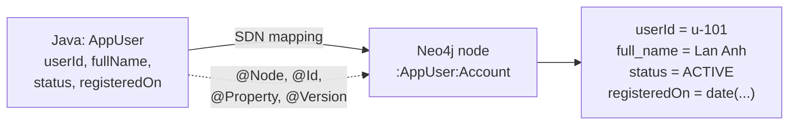

# Ánh xạ nút, nhãn, định danh và thuộc tính thực thể trong Spring Data Neo4j

## 1. Từ property graph đến đối tượng Java

Trong **Neo4j**, dữ liệu được tổ chức dưới dạng **property graph**: một node có một hoặc nhiều *label*, các *property* là cặp khóa–giá trị, và các relationship nối các node theo type, hướng và property riêng. Ở ứng dụng Java, **Spring Data Neo4j (SDN)** cung cấp cơ chế **object mapping** để biểu diễn node thành lớp Java, thuộc tính Java thành property và quan hệ giữa các đối tượng thành relationship.

Ví dụ một node trong database:

```cypher
CREATE (u:AppUser:Account {
  userId: 'u-101',
  full_name: 'Lan Anh',
  status: 'ACTIVE',
  registeredOn: date('2026-10-01')
})
RETURN u;
```

Ta muốn lớp Java tương ứng có tên `AppUser`, ID ổn định `userId`, tên hiển thị `fullName` và ngày `registeredOn`. Tuy nhiên, tên property trong Neo4j là `full_name`, khác tên trường `fullName`; node còn mang **hai label** `AppUser` và `Account`. SDN giải quyết những khác biệt đó bằng annotation.

Sơ đồ ánh xạ khái niệm:



Các annotation quan trọng trong phạm vi bài:

| Annotation | Gắn ở đâu | Công dụng |
| --- | --- | --- |
| `@Node` | Class | Xác định lớp ánh xạ thành node và cấu hình label |
| `@Id` | Field | Chọn trường dùng để nhận diện **thực thể Java** |
| `@GeneratedValue` | Cùng trường `@Id` | Cấu hình ID được sinh tự động |
| `@Property` | Field | Ánh xạ tên trường Java sang tên property khác trong Neo4j |
| `@DynamicLabels` | `Collection<String>` field | Ánh xạ các label thêm/bớt được trong thời gian chạy |
| `@CompositeProperty` | `Map` field | Trải phẳng các cặp key-value thành nhiều property có cùng prefix |
| `@Version` | `Long` field | Quản lý phiên bản phục vụ optimistic locking và phát hiện entity mới với business ID |
| `@Transient` | Field | Không lưu trường đó vào database (từ Spring Data Commons) |
| `@ReadOnlyProperty` | Field | Đọc giá trị từ database nhưng không ghi trường đó khi lưu entity |

**Mục tiêu:** hiểu rõ lớp Java nào tương ứng với node nào, label nào luôn được gắn, ID nào dùng để truy vấn ổn định, property nào thực sự lưu và những gì xảy ra khi `repository.save(...)`.

## 2. Cấu hình dự án Spring Boot tối thiểu

Giả định ứng dụng Java có Spring Boot, Spring Data Neo4j và một Neo4j server hoạt động. Với Maven, thông thường dùng starter được Spring Boot quản lý phiên bản:

```xml
<dependency>
    <groupId>org.springframework.boot</groupId>
    <artifactId>spring-boot-starter-data-neo4j</artifactId>
</dependency>
```

Ví dụ cấu hình `application.yml`:

```yaml
spring:
  neo4j:
    uri: neo4j://localhost:7687
    authentication:
      username: neo4j
      password: ${NEO4J_PASSWORD}
  data:
    neo4j:
      database: neo4j
```

`NEO4J_PASSWORD` là biến môi trường chỉ để minh họa cấu hình. Trên môi trường thực cần sử dụng secret manager/cấu hình bảo mật phù hợp. Đừng ghi mật khẩu thật vào Git hoặc tài liệu công khai.

Các ví dụ Java dùng nhóm import sau:

```java
import org.springframework.data.neo4j.core.schema.Node;
import org.springframework.data.neo4j.core.schema.Id;
import org.springframework.data.neo4j.core.schema.GeneratedValue;
import org.springframework.data.neo4j.core.schema.Property;
import org.springframework.data.neo4j.core.schema.DynamicLabels;
import org.springframework.data.neo4j.core.schema.CompositeProperty;
import org.springframework.data.annotation.Version;
```

Đây là các annotation của **Spring Data Neo4j và Spring Data Commons**. Không dùng `@Entity`, `@Table`, `@Column` hoặc `jakarta.persistence.Id` theo thói quen từ JPA để khai báo mapping node; đó là bộ annotation có ngữ nghĩa khác.

Tài liệu tham khảo trong bài hướng tới dòng Spring Data Neo4j hiện đại; khi triển khai hãy dùng phiên bản starter tương thích với Spring Boot, Java và Neo4j thực tế. Không trộn ví dụ của thư viện Neo4j-OGM đời cũ với SDN hiện hành.

## 3. `@Node`: ánh xạ class thành node và xác định label

### 3.1. Một label mặc định hoặc được chỉ định

```java
@Node
public class Product {
    @Id
    private String sku;
}
```

Khi chỉ ghi `@Node`, **tên class** thường trở thành label chính, trong ví dụ là `:Product`. Để tránh phụ thuộc vào tên class Java khi refactor mã:

```java
@Node("Product")
public class CatalogItem {
    @Id
    private String sku;
}
```

Class `CatalogItem` vẫn ánh xạ với node `:Product`. Label phân biệt hoa/thường: `:Product` và `:product` là hai tên khác nhau trong Cypher.

**Vì sao label chính quan trọng?** Khi repository đọc theo lớp `CatalogItem`, SDN dùng metadata của lớp để tìm các node có label chính phù hợp. Label thêm có thể phục vụ phân loại; **label chính** phải mô tả rõ tập thực thể mà class quản lý.

### 3.2. Một node mang nhiều label tĩnh

Neo4j cho phép một node mang nhiều label:

```cypher
MATCH (u:AppUser {userId: 'u-101'})
SET u:Account;
```

Trong Java, cấu hình:

```java
@Node(primaryLabel = "AppUser", labels = {"Account"})
public class AppUser {
    @Id
    private String userId;
}
```

`AppUser` là **primary label**; `Account` là label bổ sung. Cũng có thể khai báo `@Node(labels = {"AppUser", "Account"})`, khi đó phần tử **đầu tiên** trong mảng được xem là primary label.

Đọc/ghi một node qua repository cho lớp này cần xác định được node mang label chính. Với entity được lưu, SDN đảm bảo những label tĩnh cấu hình ở mapping. Không suy ra rằng việc đặt thêm label trên node tạo ra một bản sao node khác: một node vẫn là **một thực thể đồ thị**.

### 3.3. Đổi tên class Java có đồng nghĩa đổi schema không?

Nếu dùng `@Node` không tham số và đổi tên class `Product` thành `InventoryItem`, label mặc định **có thể đổi từ `Product` thành `InventoryItem`**. Điều này có thể khiến repository tìm tập node khác với trước.

Khi database đã được vận hành:

- Khai báo tên label rõ ràng bằng `@Node("Product")` hoặc `primaryLabel`.
- Nếu thực sự muốn đổi label trong Neo4j, thiết kế **migration Cypher** và xác minh tương thích; đổi annotation đơn thuần không tự di chuyển toàn bộ dữ liệu cũ sang label mới.
- Kiểm tra lại index, constraint, truy vấn thủ công và API ứng dụng phụ thuộc label.

### 3.4. Kế thừa class và nhiều loại node

Với hệ phân cấp Java, `@Node` **không tự được kế thừa** giống một cấu hình annotation thông thường. SDN có hỗ trợ ánh xạ đa hình dựa trên các lớp cha trừu tượng có `@Node` và label cụ thể, nhưng cần khai báo rõ cho từng kiểu và kiểm tra metadata.

Ví dụ một lớp `Customer` và `Employee` đều là người dùng không có nghĩa có thể tùy ý dùng cùng primary label mà không thiết kế quy tắc nhận diện kiểu. Với domain đơn giản, ưu tiên một class ánh xạ một primary label rõ ràng; chỉ dùng mapping đa hình khi truy vấn thật sự cần.

## 4. `@Id`: chọn định danh ổn định cho entity

### 4.1. Business ID và khóa tự sinh không giống nhau

`@Id` nói với SDN **trường nào nhận diện một entity** để tạo, tìm và cập nhật nó. Có ba lựa chọn tiêu biểu:

| Cách khai báo | Lưu trong Neo4j | Phù hợp với | Giới hạn |
| --- | --- | --- | --- |
| `@Id String userId` | Property `userId` trên node | Khóa nghiệp vụ ổn định từ hệ thống nguồn | Cần bảo đảm tính duy nhất và phát hiện entity mới |
| `@Id @GeneratedValue Long id` | Neo4j internal numeric ID, không phải property thường | Mô hình demo/đối tượng nội bộ có đời sống ngắn | Internal ID không nên làm khóa giao tiếp lâu dài; có thể thay đổi/tái sử dụng |
| `@Id @GeneratedValue String id` | Neo4j `elementId`, không phải property thường | Trường hợp muốn SDN quản lý định danh nội bộ trên Neo4j 5+ | `elementId` cũng không phải business ID bền vững qua import/backup/migration |
| `@Id @GeneratedValue(UUIDStringGenerator.class) String id` | Property string UUID được SDN sinh và lưu trên node | Surrogate ID phía ứng dụng | Cần uniqueness constraint, quy tắc retry và phối hợp dữ liệu nguồn |

**Quy tắc thực hành:** đối tượng được tham chiếu từ API, event, data import hoặc hệ thống khác nên có **business key/surrogate key ổn định** độc lập với internal ID của Neo4j. Đừng lưu numeric ID/elementId của một database rồi giả định giữ nguyên giữa các môi trường, import và vòng đời database.

### 4.2. Business ID do ứng dụng cung cấp

```java
@Node("AppUser")
public class AppUser {
    @Id
    private String userId;

    @Version
    private Long version;

    private String fullName;

    public AppUser() {}

    public AppUser(String userId, String fullName) {
        this.userId = userId;
        this.fullName = fullName;
    }

    public String getUserId() { return userId; }
    public Long getVersion() { return version; }
    public String getFullName() { return fullName; }
    public void setFullName(String fullName) {
        this.fullName = fullName;
    }
}
```

Node tương ứng:

```text
(:AppUser {
  userId: 'u-101',
  fullName: 'Lan',
  version: 0
})
```

`userId` là property được quản lý qua `@Id`. Nó **không tự trở thành uniqueness constraint của Neo4j** chỉ vì có annotation trong Java. Cần migration tạo constraint:

```cypher
CREATE CONSTRAINT app_user_user_id_unique IF NOT EXISTS
FOR (u:AppUser)
REQUIRE u.userId IS UNIQUE;
```

Constraint giúp tránh hai transaction cạnh tranh tạo hai node `:AppUser` cùng `userId`. Nó cũng thường tạo index hỗ trợ lookup theo ID. `IF NOT EXISTS` hỗ trợ chạy lại migration khi đối tượng phù hợp đã tồn tại, nhưng vẫn cần kiểm tra schema thực tế.

**Vì sao có `@Version`?** Khi khóa `userId` luôn được gán ngay từ lúc khởi tạo, SDN không thể chỉ nhìn `userId != null` để xác định entity mới. Với business ID được ứng dụng cung cấp, tài liệu SDN hiện hành yêu cầu trường `@Version` để phân biệt entity mới với entity đã lưu và thực hiện optimistic locking. Khởi tạo `Long version = null` cho thực thể mới; SDN quản lý giá trị khi save. **Không tự tăng/sửa `version` bằng code nghiệp vụ.**

Trường `@Version` khác với version từ hệ thống nguồn. Nếu nguồn có `sourceVersion`, nên dùng một property riêng và quy tắc so sánh phiên bản nguồn; đừng dùng `@Version` làm cả hai chức năng.

### 4.3. ID do Neo4j cấp: Long và elementId

```java
@Node("TemporaryJob")
public class TemporaryJob {
    @Id
    @GeneratedValue
    private Long id;

    private String status;

    public TemporaryJob() {}

    public TemporaryJob(String status) {
        this.status = status;
    }

    public Long getId() { return id; }
    public String getStatus() { return status; }
}
```

Khi chưa lưu, `id == null`. Sau `repository.save(...)`, SDN có thể gán ID nội bộ từ Neo4j. Dùng `Long` thay cho primitive `long` làm cho giá trị `null` biểu diễn “chưa được cấp ID” rõ ràng hơn.

Trên Neo4j 5+, một trường `String` kèm `@Id @GeneratedValue` mặc định có thể ánh xạ `elementId` của node; đây cũng **không phải** property string được lưu ở graph. Nếu cần một property string bền vững, dùng generator phía ứng dụng hoặc business ID.

### 4.4. Surrogate ID string do SDN tạo

```java
import org.springframework.data.neo4j.core.schema.GeneratedValue.UUIDStringGenerator;
import org.springframework.data.neo4j.core.schema.GeneratedValue;
import org.springframework.data.neo4j.core.schema.Id;
import org.springframework.data.neo4j.core.schema.Node;

@Node("ImportRun")
public class ImportRun {
    @Id
    @GeneratedValue(UUIDStringGenerator.class)
    private String runId;

    private String state;

    public ImportRun() {}

    public ImportRun(String state) {
        this.state = state;
    }

    public String getRunId() { return runId; }
    public String getState() { return state; }
}
```

`UUIDStringGenerator` sinh một UUID ở phía ứng dụng, lưu dưới dạng **property string** của node, khác cơ chế lấy ID nội bộ khi chỉ ghi `@GeneratedValue`. Với môi trường nhiều instance, vẫn cần bảo vệ uniqueness ở database:

```cypher
CREATE CONSTRAINT import_run_id_unique IF NOT EXISTS
FOR (r:ImportRun)
REQUIRE r.runId IS UNIQUE;
```

Có thể cung cấp `IdGenerator` tùy biến qua `@GeneratedValue(generatorClass = ...)` hoặc `generatorRef = "beanName"`. Không nên tự tạo khóa từ một bộ đếm trong bộ nhớ của từng instance, vì có thể trùng khi restart hoặc chạy nhiều instance.

### 4.5. Khi nào ID làm thay đổi dữ liệu hiện có?

Đổi `@Id` từ `userId` sang `email` không chỉ là refactor Java. Đó là thay đổi cách SDN nhận diện node, có thể dẫn đến truy vấn khác, tạo node mới hoặc bỏ qua bản ghi hiện có khi save. Trước khi đổi ID:

1. Phân tích tất cả node hiện có, duplicate/missing key.
2. Chọn khóa mới có tính bất biến và duy nhất thực sự.
3. Tạo constraint/index và thực hiện migration dữ liệu bằng Cypher.
4. Cập nhật mapping, repository, API và data import cùng lúc theo kế hoạch.
5. Chạy kiểm tra đọc–ghi trên dữ liệu đã migrate, nhất là retry và cập nhật đồng thời.

## 5. `@Property`: Java field khác tên Neo4j property

### 5.1. Mặc định dùng cùng tên

Nếu khai báo:

```java
@Node("Product")
public class Product {
    @Id
    private String sku;

    private String name;
    private Long inventoryCount;
}
```

SDN ánh xạ `sku`, `name`, `inventoryCount` thành các property **cùng tên**. Nếu graph cũ dùng `stock_quantity` thay vì `inventoryCount`:

```java
@Property("stock_quantity")
private Long inventoryCount;
```

Khi đọc, SDN lấy property `stock_quantity` vào trường `inventoryCount`. Khi ghi, giá trị trường đó được ghi lại dưới tên `stock_quantity`. Mã truy vấn Cypher phải dùng **tên trong database**, ví dụ `p.stock_quantity`; repository derived query thì khai báo theo **tên property Java** khi tạo method.

Ví dụ:

```cypher
MATCH (p:Product {sku: 'sku-001'})
RETURN p.name, p.stock_quantity;
```

Đổi tên field Java nhưng giữ `@Property("stock_quantity")` có thể không yêu cầu migration dữ liệu. Ngược lại, đổi giá trị annotation từ `stock_quantity` sang `inventoryCount` có thể khiến SDN đọc property khác, cần migration nếu graph cũ đang dùng tên trước đó.

### 5.2. Kiểu dữ liệu Java và Neo4j

Neo4j property không lưu Java object tùy ý. SDN chuyển đổi một tập kiểu được hỗ trợ:

| Java field | Kiểu Neo4j điển hình | Lưu ý |
| --- | --- | --- |
| `String` | `STRING` | Phân biệt null với chuỗi rỗng |
| `Boolean` | `BOOLEAN` | Dùng wrapper `Boolean` nếu cần biểu diễn “chưa có” |
| `Long`/`Integer` | `INTEGER` | Cypher integer là số nguyên; kiểm tra giới hạn kiểu Java |
| `Double` | `FLOAT` | Không dùng để lưu tiền tệ cần chính xác tuyệt đối |
| `LocalDate` | `DATE` | Không mang giờ hoặc timezone |
| `LocalDateTime` | `LOCAL DATETIME` | Không mang thông tin múi giờ |
| `ZonedDateTime` | `ZONED DATETIME`/Neo4j `DateTime` | Dùng khi cần thời điểm với timezone |
| `List<String>`/`String[]` | Danh sách các giá trị cùng kiểu được hỗ trợ | Neo4j property không lưu list chứa map/node tùy ý |
| `Enum` | Thường được chuyển thành `STRING` | Xem tác động khi đổi tên enum constant |
| `UUID` | Thường chuyển thành `STRING` | Đừng nhầm UUID với internal node ID |

Neo4j không hỗ trợ lưu trực tiếp một arbitrary `Map<String, Object>` hay cây JSON lồng sâu làm **một** property. Khi cần lưu dữ liệu như vậy, chọn một trong các cách:

- Trải các trường thành nhiều property riêng.
- Dùng `@CompositeProperty` với map phẳng có prefix.
- Mô hình hóa thành node và relationship nếu cần truy vấn theo liên kết.
- Serialize thành chuỗi JSON bằng converter khi phù hợp; cần chấp nhận hạn chế index/truy vấn từng trường.

Tránh sử dụng `double` cho giá tiền, phần trăm cần tính toán chính xác. Với `BigDecimal`, kiểm tra chiến lược chuyển đổi được SDN hỗ trợ; trong nhiều phiên bản nó được lưu thành string chứ không phải Cypher FLOAT.

### 5.3. `@Transient` và `@ReadOnlyProperty`

Một class domain có thể chứa dữ liệu chỉ để tính toán hoặc nhận từ nguồn khác:

```java
import org.springframework.data.annotation.Transient;
import org.springframework.data.annotation.ReadOnlyProperty;

@Node("Product")
public class ProductReadModel {
    @Id
    private String sku;

    private Long inventoryCount;

    @Transient
    private boolean selectedInUi;

    @ReadOnlyProperty
    private Long legacyScore;
}
```

- `@Transient`: bỏ qua trường `selectedInUi` khi ánh xạ database, phù hợp với state tạm cho UI/business calculation.
- `@ReadOnlyProperty`: đọc `legacyScore` có sẵn ở graph nhưng không ghi trường này khi SDN save. Phù hợp cho thuộc tính do pipeline ngoài quản lý.

Trong ví dụ này, label của class theo `@Node("Product")` nhưng trường ID là `sku`. Đây chỉ là một **lát cắt mapping**; với mã ứng dụng thực tế vẫn phải có constructor và accessor phù hợp.

**Lưu ý về dữ liệu ngoài:** nếu một pipeline Cypher/GDS cập nhật `legacyScore`, hãy tránh ánh xạ nó thành field ghi hai chiều trong một entity mà repository lưu thường xuyên; nếu không có thể gây ghi đè ngoài ý muốn.

## 6. `@CompositeProperty`: một map Java thành nhiều property node

### 6.1. Map phẳng có prefix

Giả sử mỗi user có các thuộc tính nguồn linh hoạt:

```java
import java.util.HashMap;
import java.util.Map;
import org.springframework.data.neo4j.core.schema.CompositeProperty;

@CompositeProperty(prefix = "meta", delimiter = "_")
private Map<String, Object> metadata = new HashMap<>();
```

Khi Java map là:

```java
metadata.put("source", "crm");
metadata.put("region", "apac");
metadata.put("level", 3L);
```

Neo4j lưu thành **các property riêng**:

```text
(:AppUser {
  meta_source: 'crm',
  meta_region: 'apac',
  meta_level: 3
})
```

`prefix = "meta"` và `delimiter = "_"` giúp tránh trùng tên với property cố định. Khi đọc lại, SDN gom các property có prefix tương ứng vào `metadata`. Nếu không cấu hình, prefix mặc định là **tên field Java** và dấu phân cách mặc định là dấu chấm (ví dụ `metadata.source`).

Vì Neo4j property names có thể chứa dấu chấm, khi truy vấn thủ công cần escape bằng backtick:

```cypher
MATCH (u:AppUser {userId: 'u-101'})
RETURN u.`metadata.source` AS source;
```

**Giới hạn quan trọng:** `@CompositeProperty` hoạt động với các giá trị có thể chuyển sang Neo4j property type được hỗ trợ; **nested map không được hỗ trợ trực tiếp** trong converter mặc định. Tránh lưu `Map<String, Map<String, Object>>` mà không xây dựng converter/phương án mô hình hóa khác.

### 6.2. Khi nào không nên dùng composite property?

Nếu metadata chứa hàng trăm khóa tùy ý từ người dùng, có thể:

- Tạo một lượng lớn tên property khác nhau, khó kiểm soát schema/index.
- Gây xung đột với tên property tĩnh nếu prefix/delimiter không nhất quán.
- Khó bảo đảm quy tắc gán kiểu và phân quyền từng trường.

Với metadata có tính cấu trúc ổn định, các field Java rõ ràng thường dễ bảo trì hơn. Với dữ liệu liên kết nhiều cấp, node/relationship sẽ phù hợp hơn một map phẳng.

## 7. `@DynamicLabels`: nhãn bổ sung thay đổi lúc chạy

### 7.1. Label tĩnh và động

Label tĩnh được khai báo ở `@Node` và không thay đổi theo từng object. Nếu mỗi user còn được gắn nhãn theo phân loại runtime như `:Premium` hoặc `:BetaTester`, SDN cung cấp `@DynamicLabels`:

```java
import java.util.HashSet;
import java.util.Set;
import org.springframework.data.neo4j.core.schema.DynamicLabels;

@DynamicLabels
private Set<String> extraLabels = new HashSet<>();
```

Trên entity `@Node(primaryLabel = "AppUser", labels = {"Account"})`, nếu `extraLabels = {"Premium"}`, node có thể mang:

```text
(:AppUser:Account:Premium {userId: 'u-101'})
```

Khi đọc một node, SDN thu các label **không thuộc nhãn tĩnh đã cấu hình** vào collection. Khi lưu lại entity có `@DynamicLabels`, SDN coi tập nhãn **tĩnh + dynamic** trên object là tập nhãn chuẩn được ghi ra graph.

### 7.2. Cảnh báo khi nhiều ứng dụng cùng thêm label

Giả sử một service khác vừa thêm `:FraudReview` cho user, nhưng entity `AppUser` đang giữ `extraLabels = {"Premium"}` được đọc từ trước. Khi service SDN lưu lại entity, `:FraudReview` có nguy cơ **bị loại** vì không có trong tập label hiện tại của object.

Vì vậy:

- Chỉ dùng `@DynamicLabels` khi service đó **sở hữu toàn bộ tập dynamic label** của node.
- Nếu label được nhiều pipeline độc lập quản lý, cân nhắc giữ các nhãn tĩnh và dùng property riêng (ví dụ `riskStatus`), hoặc câu Cypher chuyên dụng `SET u:FraudReview` ở transaction có kiểm soát.
- Không lấy dữ liệu người dùng bất kỳ làm tên label mà chưa kiểm tra whitelist/quy tắc nghiệp vụ. Label là một phần mô hình truy vấn, không phải trường text tự do.

**Đừng dùng label động làm thay thế mọi trạng thái biến đổi liên tục.** Một property như `status = 'ACTIVE'` có thể phù hợp hơn `:Active_2026_11_25` khi giá trị thay đổi nhiều và cần thống kê theo thời gian.

## 8. Ví dụ entity đầy đủ: kết hợp nhãn, ID và thuộc tính

Ví dụ dưới đây là lớp Java **độc lập có thể sử dụng làm điểm bắt đầu** trong một dự án SDN. Để tránh dùng nhầm class trùng tên ở các snippet riêng, tập trung vào bản hoàn chỉnh này khi thực hành.

```java
import java.time.LocalDate;
import java.util.HashMap;
import java.util.HashSet;
import java.util.Map;
import java.util.Set;

import org.springframework.data.annotation.Version;
import org.springframework.data.neo4j.core.schema.CompositeProperty;
import org.springframework.data.neo4j.core.schema.DynamicLabels;
import org.springframework.data.neo4j.core.schema.Id;
import org.springframework.data.neo4j.core.schema.Node;
import org.springframework.data.neo4j.core.schema.Property;

@Node(primaryLabel = "AppUser", labels = {"Account"})
public class AppUser {

    @Id
    private String userId;

    @Version
    private Long version;

    @Property("full_name")
    private String fullName;

    private String status;
    private LocalDate registeredOn;

    @DynamicLabels
    private Set<String> extraLabels = new HashSet<>();

    @CompositeProperty(prefix = "meta", delimiter = "_")
    private Map<String, Object> metadata = new HashMap<>();

    public AppUser() {
    }

    public AppUser(String userId, String fullName, String status) {
        this.userId = userId;
        this.fullName = fullName;
        this.status = status;
    }

    public String getUserId() { return userId; }
    public Long getVersion() { return version; }
    public String getFullName() { return fullName; }
    public String getStatus() { return status; }
    public LocalDate getRegisteredOn() { return registeredOn; }
    public Set<String> getExtraLabels() { return extraLabels; }
    public Map<String, Object> getMetadata() { return metadata; }

    public void setFullName(String fullName) {
        this.fullName = fullName;
    }

    public void setStatus(String status) {
        this.status = status;
    }

    public void setRegisteredOn(LocalDate registeredOn) {
        this.registeredOn = registeredOn;
    }
}
```

**Giải thích từng trường:**

| Java | Neo4j sau khi lưu | Ghi chú |
| --- | --- | --- |
| `@Node(primaryLabel="AppUser", labels={"Account"})` | `:AppUser:Account` | Hai label tĩnh, trong đó `AppUser` là primary |
| `userId` + `@Id` | `userId: 'u-101'` | Khóa nghiệp vụ do ứng dụng cung cấp, có uniqueness constraint |
| `version` + `@Version` | `version` do SDN quản lý | Phát hiện entity mới và kiểm soát xung đột cập nhật |
| `fullName` + `@Property("full_name")` | `full_name: 'Lan Anh'` | Java field và Neo4j property khác tên |
| `status` | `status: 'ACTIVE'` | Tên giữ nguyên |
| `registeredOn` | `registeredOn: date(...)` | `LocalDate` thành Neo4j DATE |
| `extraLabels` | Ví dụ thêm `:Premium` | Collection label, không lưu như property dạng list |
| `metadata` với `@CompositeProperty` | `meta_source`, `meta_region` | Nhiều property tách từ map |

### 8.1. Repository và truy vấn đơn giản

```java
import java.util.Optional;
import org.springframework.data.neo4j.repository.Neo4jRepository;
import org.springframework.data.neo4j.repository.query.Query;
import org.springframework.data.repository.query.Param;

public interface AppUserRepository
        extends Neo4jRepository<AppUser, String> {

    // Spring Data derived query dùng tên field Java.
    Optional<AppUser> findByFullName(String fullName);

    @Query("""
        MATCH (u:AppUser {userId: $userId})
        RETURN u
        """)
    Optional<AppUser> findExactlyByUserId(@Param("userId") String userId);
}
```

`Neo4jRepository<AppUser, String>` dùng `String` vì `@Id userId` là string. `findById("u-101")` là method sẵn có; `findByFullName("Lan Anh")` dựa trên trường Java nhưng SDN sẽ dùng metadata mapping để sinh query theo Neo4j property `full_name`.

Nếu viết `@Query` thủ công thì chính người viết phải dùng tên Cypher/Neo4j phù hợp (ở đây `u.userId`, `u.full_name`). Khi chỉ cần tìm entity đơn giản theo ID hoặc property, ưu tiên repository method thay vì tự viết Cypher phức tạp.

### 8.2. Service lưu và cập nhật trong transaction

```java
import java.time.LocalDate;
import org.springframework.stereotype.Service;
import org.springframework.transaction.annotation.Transactional;

@Service
public class AppUserService {
    private final AppUserRepository repository;

    public AppUserService(AppUserRepository repository) {
        this.repository = repository;
    }

    @Transactional
    public AppUser createExampleUser() {
        AppUser user = new AppUser("u-101", "Lan", "ACTIVE");
        user.setRegisteredOn(LocalDate.of(2026, 10, 1));
        user.getExtraLabels().add("Premium");
        user.getMetadata().put("source", "crm");
        user.getMetadata().put("region", "apac");

        return repository.save(user);
    }

    @Transactional
    public AppUser renameUser(String userId, String name) {
        AppUser user = repository.findById(userId)
            .orElseThrow(() ->
                new IllegalArgumentException("Không tìm thấy: " + userId));
        user.setFullName(name);
        return repository.save(user);
    }
}
```

Khi gọi `createExampleUser()` qua Spring proxy, việc lưu diễn ra trong transaction do Spring quản lý. **Bài thực hành giả định `u-101` chưa tồn tại**. Với business ID và `@Version` rỗng, không nên gọi lại `createExampleUser()` để cập nhật cùng user đã tồn tại: hãy đọc bằng `findById(...)` và sửa đối tượng hiện có như `renameUser(...)`.

Trường hợp hai transaction cùng đọc `version = v` rồi cùng sửa, một transaction có thể lưu trước và tăng version; transaction còn lại gặp `OptimisticLockingFailureException`. Cách xử lý thường là báo xung đột hoặc đọc dữ liệu mới nhất và quyết định retry **theo nghiệp vụ**. Không tự tăng trường version để “vượt” kiểm tra.

### 8.3. Kiểm tra graph thực sau khi save

Sau transaction tạo mới commit thành công:

```cypher
MATCH (u:AppUser {userId: 'u-101'})
RETURN
  labels(u) AS labels,
  u.userId AS userId,
  u.full_name AS fullName,
  u.status AS status,
  u.registeredOn AS registeredOn,
  u.version AS version,
  u.meta_source AS source,
  u.meta_region AS region;
```

Trên database thử nghiệm đã có constraint và chưa có `u-101`, kết quả cần phản ánh label tĩnh `AppUser`/`Account`, label động `Premium` và các property đúng tên. **Không phụ thuộc vào thứ tự** các phần tử trong `labels(u)` khi kiểm tra.

Nếu dùng `MATCH (u:AppUser:Account {userId: 'u-101'}) RETURN u`, đây vẫn là cùng một node; multi-label không nhân bản entity.

## 9. Thiết kế schema, index và constraint song hành với mapping

Annotation SDN mô tả cách **Java object được ánh xạ**; Neo4j schema quyết định những ràng buộc nào thực sự được database thực thi.

Ví dụ một database phục vụ user có thể cần:

```cypher
CREATE CONSTRAINT app_user_id_unique IF NOT EXISTS
FOR (u:AppUser)
REQUIRE u.userId IS UNIQUE;
```

```cypher
CREATE RANGE INDEX app_user_name_idx IF NOT EXISTS
FOR (u:AppUser)
ON (u.full_name);
```

Lệnh đầu bảo vệ định danh; lệnh sau hỗ trợ các truy vấn lọc/sắp xếp phù hợp theo `full_name` khi planner thấy có lợi. Để xem:

```cypher
SHOW CONSTRAINTS;
SHOW INDEXES;
```

**Không mặc định** `@Id` của SDN tạo uniqueness constraint khi ứng dụng khởi động; cần quản lý schema bằng migration/DDL phù hợp. Không dùng label `:Account` trong constraint ID nếu nghiệp vụ chỉ yêu cầu uniqueness trên `:AppUser`: phạm vi label trong constraint ảnh hưởng chính xác tập node bị ràng buộc.

Ngoài ra:

- Không tạo index property `fullName` nếu Neo4j lưu trường này dưới tên `full_name`.
- `@CompositeProperty` với `meta_source` có thể cần index riêng trên `u.meta_source` nếu thật sự được truy vấn thường xuyên.
- `@DynamicLabels` tạo tên label theo trạng thái chạy; quá nhiều loại label không có kiểm soát sẽ làm model và quản lý index khó hơn.
- Dùng `EXPLAIN`/`PROFILE` để xác minh query planner sử dụng index có ích; index có chi phí khi ghi.

## 10. Các nhầm lẫn thường gặp

| Hiện tượng | Vì sao xảy ra | Cách kiểm tra hoặc sửa |
| --- | --- | --- |
| `repository.findById(...)` không tìm được node | Sai primary label, ID field, database hoặc property ID | Kiểm tra `@Node`, `@Id` và `MATCH` thủ công theo đúng database |
| Đổi tên class Java thì dữ liệu “biến mất” | Label mặc định đổi theo class | Khai báo `@Node("LabelỔnĐịnh")` hoặc migration label có kế hoạch |
| Graph có `full_name` nhưng Java đọc `fullName = null` | Thiếu `@Property("full_name")` | Khai báo mapping tên property |
| Dùng `@Id` nhưng database vẫn có duplicate ID | Annotation không phải constraint Neo4j | Tạo uniqueness constraint trong database |
| Business ID có giá trị ngay khi new khiến save xử lý sai | Không có thông tin entity mới/đã lưu | Dùng `@Version Long`; xem quy tắc newness của SDN |
| `@GeneratedValue Long` bị dùng làm public API ID lâu dài | Internal ID không bảo đảm ổn định ngoài vòng đời database | Dùng business ID hoặc UUID property |
| Label do service khác thêm bị mất khi save | `@DynamicLabels` ghi lại tập label tĩnh + động từ entity | Chỉ dùng khi service sở hữu nhãn; nếu không, dùng Cypher riêng/property |
| Map lồng nhau không ghi được như mong muốn | Neo4j property không chứa arbitrary nested map | Dùng `@CompositeProperty` cho map phẳng hoặc converter/mô hình graph |
| Property `meta_source` không đọc được bằng `u.metadata.source` | Composite map được trải thành nhiều property | Dùng `u.meta_source` ở Cypher |
| Cập nhật đồng thời gây `OptimisticLockingFailureException` | Phiên bản entity cũ | Đọc lại và xử lý xung đột; không sửa version thủ công |
| Dùng `jakarta.persistence.Id` cho entity SDN | Nhầm JPA và SDN metadata | Import `org.springframework.data.neo4j.core.schema.Id` hoặc Spring Data Commons `Id` |
| Đổi `@Property` rồi dữ liệu cũ không xuất hiện | Tên field ở graph chưa được migration | Duy trì tên cũ hoặc chạy migration Cypher |
| Save entity kéo theo nhiều quan hệ ngoài dự kiến | Object mapping có thể đi theo mối quan hệ đã khai báo trong model | Xem chiều quan hệ và giới hạn graph được quản lý |

### 10.1. Tránh mapping toàn bộ graph thành object graph

SDN cho phép `@Relationship` để nối entity Java với entity khác, ví dụ:

```java
import java.util.HashSet;
import java.util.Set;
import org.springframework.data.neo4j.core.schema.Relationship;

@Relationship(type = "FOLLOWS", direction = Relationship.Direction.OUTGOING)
private Set<AppUser> follows = new HashSet<>();
```

Đoạn trên là **một field có thể thêm vào entity**, không phải class độc lập. Chủ đề chính của bài là mapping **node, label, ID và property**, nên relationship chỉ nhắc để phân biệt:

- Các field scalar/map phù hợp thường trở thành **node property**.
- Field có `@Relationship` mô tả **cạnh nối node**; không phải một property JSON.
- Relationship có property riêng cần `@RelationshipProperties`, `@TargetNode` và `@RelationshipId` theo hướng dẫn SDN.
- Mapping quan hệ hai chiều quá rộng có thể khiến repository đọc một object rồi kéo theo rất nhiều node/relationship; không phải lúc nào cũng nên ánh xạ mọi cạnh trong model Java.

## 11. Bài thực hành theo thứ tự

Trên Neo4j **database thử nghiệm**, hoàn thành các bước:

1. Tạo uniqueness constraint cho `AppUser.userId` và kiểm tra bằng `SHOW CONSTRAINTS`.
2. Tạo class `AppUser` đầy đủ ở mục 8, repository và service. Khởi tạo `u-101` có `fullName = "Lan"`, label động `Premium` và map metadata.
3. Sau khi save commit, dùng Cypher kiểm tra `labels(u)`, `userId`, `full_name`, `meta_source`, `meta_region` và `version`. Giải thích vì sao không có property `extraLabels` chứa danh sách.
4. Gọi `renameUser("u-101", "Lan Anh")`, đọc lại trong transaction mới và kiểm tra version thay đổi do SDN quản lý.
5. Từ một transaction khác, thêm label `:FraudReview` bằng Cypher; thảo luận tác động khi save lại entity `AppUser` có `@DynamicLabels` và state cũ.
6. Khai báo một class `ImportRun` dùng `UUIDStringGenerator`; save hai instance, so sánh ID property sinh ra với internal ID của node.
7. Tạo một field `@Property("stock_quantity")` trên entity `Product`, tìm bằng repository và kiểm tra Cypher đang lưu property dưới tên gì.
8. Thử map `metadata` có nested map và giải thích vì sao converter mặc định của `@CompositeProperty` không phù hợp. Chọn một cách mô hình hóa khác.

Tự trả lời:

- Khi nào `@Id String userId` nên được ưu tiên hơn `@Id @GeneratedValue Long id`?
- Có `@Id` rồi thì có cần constraint Neo4j không?
- Vì sao `@Version` quan trọng khi business ID đã có giá trị trước lần lưu đầu tiên?
- Khác biệt giữa `@Node(labels = ...)` và `@DynamicLabels`?
- Field Java `fullName` và property Neo4j `full_name` cần được ánh xạ thế nào?

**Tiêu chí hoàn thành:** người học tạo được entity SDN có label rõ ràng, chọn đúng chiến lược ID và constraint, ánh xạ đúng tên/kiểu property, sử dụng được dynamic label/composite property khi cần, và xác minh kết quả bằng Cypher sau giao dịch.

## Tài liệu tham khảo chính thức

- [Spring Data Neo4j — Metadata-based Mapping](https://docs.spring.io/spring-data/neo4j/reference/object-mapping/metadata-based-mapping.html): `@Node`, primary/secondary labels, `@Id`, `@Version`, `@Property` và `@DynamicLabels`.
- [Spring Data Neo4j — Handling and provisioning of unique IDs](https://docs.spring.io/spring-data/neo4j/reference/object-mapping/mapping-ids.html): internal ID, elementId, UUID generator và business keys.
- [Spring Data Neo4j — Conversions](https://docs.spring.io/spring-data/neo4j/reference/appendix/conversions.html): kiểu property hỗ trợ, `@CompositeProperty` và converter.
- [Spring Data Neo4j — Repositories](https://docs.spring.io/spring-data/neo4j/reference/repositories.html): repository, query method và thực hiện truy vấn theo domain type.
- [Spring Data Neo4j — Neo4jTransactionManager](https://docs.spring.io/spring-data/neo4j/reference/api/java/org/springframework/data/neo4j/core/transaction/Neo4jTransactionManager.html): quản lý transaction và cơ chế commit/rollback khi làm việc với graph.
- [Neo4j Cypher Manual — Constraints](https://neo4j.com/docs/cypher-manual/current/constraints/): unique property constraint, schema và tương tác với index.
