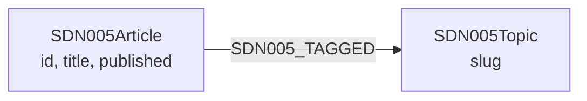

# Repository, truy vấn khai báo và truy vấn Cypher tùy chỉnh

## 1. Từ mô hình đồ thị đến tầng truy cập dữ liệu Java

**Spring Data Neo4j (SDN)** giúp ánh xạ node, relationship và thuộc tính của **property graph** Neo4j sang các lớp Java. Từ một thực thể đã ánh xạ, ứng dụng có thể sử dụng `Neo4jRepository` để thực hiện các thao tác thông thường; Spring Data có thể **suy diễn truy vấn** từ tên phương thức hoặc chạy **Cypher khai báo** bằng `@Query`. Khi kết quả không khớp hoàn toàn với một thực thể, `Neo4jClient` cho phép ánh xạ tùy chỉnh thành DTO.

Ba phương thức tiếp cận thường gặp:

| Cách truy cập | Điểm mạnh | Phù hợp nhất |
|---|---|---|
| **Repository có sẵn / truy vấn suy diễn** | Ít mã, thống nhất kiểu dữ liệu, hỗ trợ repository CRUD | Đọc/ghi aggregate và lọc thuộc tính đơn giản |
| **Repository + `@Query`** | Chủ động biểu diễn `MATCH`, quan hệ, đường đi, tổng hợp | Câu hỏi graph rõ ràng nhưng vẫn muốn gọi qua repository |
| **`Neo4jClient` + Cypher tùy chỉnh** | Điều khiển câu truy vấn và cách chuyển mỗi `Record` | DTO nhẹ, thống kê, patch một thuộc tính, truy vấn động có kiểm soát |

**Bài toán lựa chọn không chỉ là câu truy vấn ngắn hay dài.** Khi một entity có quan hệ với nhiều node khác, tải thiếu dữ liệu quan hệ rồi gọi `save()` có thể tạo tác dụng không mong muốn đối với phần graph được SDN quản lý. Cần phân biệt **đọc một aggregate đầy đủ** với **đọc một lát cắt dữ liệu để hiển thị**.

Bài này thuộc chương **Spring Data Neo4j** trong module `DATABASE_ENGINE_GRAPH_NEO4J`. Nó dựa trên nền tảng Cypher, node/relationship, index/constraint và Java Driver, sau đó nối các khái niệm đó với repository, transaction và cách vận hành ứng dụng Spring.

### Sau bài này, bạn có thể

1. Khai báo `@Node`, `@Id`, `@Relationship` và repository tương ứng với mô hình đồ thị.
2. Tạo truy vấn theo tên phương thức như `findByTitleContaining`, `findByPublishedTrue`.
3. Viết `@Query` với tham số `$slug` để lọc theo relationship và hiểu cách trả về **đủ dữ liệu để ánh xạ aggregate**.
4. Dùng `Neo4jClient` để đọc DTO hoặc cập nhật thuộc tính mà không phải nạp/lưu toàn bộ đồ thị.
5. Phân trang, kiểm tra kết quả, quản lý transaction và nhận diện các lỗi N+1, trả thiếu quan hệ, nhân dòng.

## 2. Dự án và dữ liệu minh họa

Giả sử hệ thống học tập lưu bài viết và chủ đề:



Một bài viết có thể thuộc nhiều chủ đề, một chủ đề có thể được nhiều bài viết tham chiếu. `Article` là gốc aggregate dùng trong ví dụ, còn `Topic` là node được tham chiếu qua relationship.

### 2.1. Cấu hình Spring

Với ứng dụng Spring Boot dùng Spring Data Neo4j đồng bộ (*imperative*), bổ sung starter tương ứng:

```xml
<dependency>
    <groupId>org.springframework.boot</groupId>
    <artifactId>spring-boot-starter-data-neo4j</artifactId>
</dependency>
```

Ví dụ `application.yml` cho database thực hành:

```yaml
spring:
  neo4j:
    uri: bolt://localhost:7687
    authentication:
      username: neo4j
      password: ${NEO4J_PASSWORD}
```

Biến môi trường `NEO4J_PASSWORD` chỉ là chỗ tham chiếu; không lưu mật khẩu thật vào file nguồn. Phiên bản Java, Spring Boot, Spring Data Neo4j và Neo4j Driver nên lấy theo **bộ phiên bản được Spring Boot quản lý**; đừng gắn ngẫu nhiên một bản driver khác với bản framework đang chạy. Với Neo4j nhiều database, cấu hình lựa chọn database theo môi trường dự án.

Các ví dụ Java sau sử dụng cú pháp Java 17+ (text block/record) và API SDN trong các phiên bản Spring Boot hiện đại. Đây là ví dụ thực hành, cần cấu hình kết nối và dependency trong dự án thật.

### 2.2. Tạo dữ liệu và constraint

Chỉ chạy lệnh ghi trên **database thực hành**. Tiền tố `SDN005` giúp tránh ảnh hưởng dữ liệu của bài khác:

```cypher
CREATE CONSTRAINT sdn005_article_id IF NOT EXISTS
FOR (a:SDN005Article)
REQUIRE a.id IS UNIQUE;
```

```cypher
CREATE CONSTRAINT sdn005_topic_slug IF NOT EXISTS
FOR (t:SDN005Topic)
REQUIRE t.slug IS UNIQUE;
```

```cypher
UNWIND [
  {id: 'art-001', title: 'Học Neo4j với Cypher', published: true},
  {id: 'art-002', title: 'Spring Data Neo4j', published: true},
  {id: 'art-003', title: 'Tối ưu Cypher', published: false},
  {id: 'art-004', title: 'Java Driver', published: true}
] AS row
MERGE (a:SDN005Article {id: row.id})
SET a.title = row.title, a.published = row.published;
```

```cypher
UNWIND ['neo4j', 'spring', 'java'] AS slug
MERGE (:SDN005Topic {slug: slug});
```

```cypher
UNWIND [
  {article: 'art-001', topic: 'neo4j'},
  {article: 'art-002', topic: 'spring'},
  {article: 'art-002', topic: 'neo4j'},
  {article: 'art-003', topic: 'neo4j'},
  {article: 'art-004', topic: 'java'}
] AS row
MATCH (a:SDN005Article {id: row.article})
MATCH (t:SDN005Topic {slug: row.topic})
MERGE (a)-[:SDN005_TAGGED]->(t);
```

Kiểm tra bộ dữ liệu:

```cypher
MATCH (a:SDN005Article)
OPTIONAL MATCH (a)-[:SDN005_TAGGED]->(t:SDN005Topic)
RETURN a.id AS id, a.title AS title,
       a.published AS published,
       collect(t.slug) AS topics
ORDER BY id;
```

| ID | Tiêu đề | Published | Chủ đề (không bảo đảm thứ tự) |
|---|---|---|---|
| `art-001` | Học Neo4j với Cypher | `true` | `neo4j` |
| `art-002` | Spring Data Neo4j | `true` | `spring, neo4j` |
| `art-003` | Tối ưu Cypher | `false` | `neo4j` |
| `art-004` | Java Driver | `true` | `java` |

Số dòng đúng là **4**, dù `art-002` có hai relationship. Khi truy vấn qua relationship, `MATCH` có thể tạo một dòng cho mỗi cạnh, cần dùng `DISTINCT` hoặc tổng hợp khi yêu cầu là một dòng trên mỗi article.

## 3. Ánh xạ node và relationship bằng annotation

### 3.1. Thực thể Article

Trong một file `Article.java`:

```java
import java.util.ArrayList;
import java.util.List;
import org.springframework.data.annotation.Id;
import org.springframework.data.neo4j.core.schema.Node;
import org.springframework.data.neo4j.core.schema.Relationship;

@Node("SDN005Article")
public class Article {
    @Id
    private String id;

    private String title;
    private boolean published;

    @Relationship(
        type = "SDN005_TAGGED",
        direction = Relationship.Direction.OUTGOING
    )
    private List<Topic> topics = new ArrayList<>();

    protected Article() {
        // Dành cho cơ chế ánh xạ của Spring Data.
    }

    public Article(String id, String title, boolean published) {
        this.id = id;
        this.title = title;
        this.published = published;
    }

    public String getId() { return id; }
    public String getTitle() { return title; }
    public boolean isPublished() { return published; }
    public List<Topic> getTopics() { return topics; }
}
```

`@Node("SDN005Article")` gắn lớp Java với node có nhãn `SDN005Article`; `@Id` chọn khóa cho entity; `@Relationship` mô tả loại và hướng liên kết. Trong ví dụ, ID là chuỗi từ hệ thống nghiệp vụ, **không** dùng `@GeneratedValue`. Với dự án khác có thể sử dụng UUID/surrogate ID, nhưng phải thống nhất với schema, constraint và cách import.

### 3.2. Thực thể Topic

Trong file `Topic.java`:

```java
import org.springframework.data.annotation.Id;
import org.springframework.data.neo4j.core.schema.Node;

@Node("SDN005Topic")
public class Topic {
    @Id
    private String slug;

    protected Topic() {}

    public Topic(String slug) {
        this.slug = slug;
    }

    public String getSlug() { return slug; }
}
```

Chú ý các ngữ nghĩa quan trọng:

- Khóa `id` hoặc `slug` phải ổn định trong vòng đời entity. Khi hai nguồn khác nhau có thể cùng một khóa, thiết kế thêm namespace/khóa tổng hợp trước khi ánh xạ.
- `@Id` ở SDN đánh dấu định danh cho mapper; **không tự tạo uniqueness constraint trong Neo4j** cho mọi môi trường. Constraint cần được quản lý bằng migration/schema rõ ràng.
- `@Relationship` không tương đương foreign key của cơ sở dữ liệu quan hệ. Nó biểu diễn cạnh trong graph; việc đổi/xóa cạnh cần được thiết kế nhất quán với aggregate.
- Nếu relationship có thuộc tính như `since` hoặc `weight`, dùng mô hình `@RelationshipProperties` cùng `@TargetNode` thay vì cho rằng Java collection node đã chứa toàn bộ dữ liệu cạnh.
- Với ID được **gán sẵn** và thao tác `save()`, cần hiểu cơ chế phát hiện entity mới của phiên bản SDN. Trong ứng dụng thực tế có thể thiết kế `@Version`/optimistic locking hoặc một chiến lược lưu phù hợp. Các ví dụ chính bên dưới tập trung vào **đọc** và cập nhật Cypher có chủ đích.

## 4. Repository: truy vấn suy diễn từ tên phương thức

Với entity gốc `Article`, có thể tạo interface:

```java
import java.util.List;
import org.springframework.data.domain.Page;
import org.springframework.data.domain.Pageable;
import org.springframework.data.neo4j.repository.Neo4jRepository;

public interface ArticleRepository
        extends Neo4jRepository<Article, String> {

    List<Article> findByTitleContaining(String fragment);

    List<Article> findByPublishedTrue();

    Page<Article> findByPublishedTrue(Pageable pageable);
}
```

`Neo4jRepository<Article, String>` cung cấp các thao tác thường gặp như `findById`, `findAll`, `save`, `deleteById`. Tên phương thức được Spring Data phân tích để tạo câu truy vấn cho các điều kiện thuộc tính phổ biến.

| Phương thức | Ý nghĩa | Kết quả trên dữ liệu mẫu |
|---|---|---|
| `findById("art-002")` | Tìm đúng khóa node | `art-002` |
| `findByTitleContaining("Neo4j")` | Tiêu đề chứa chuỗi `Neo4j` | `art-001`, `art-002` |
| `findByPublishedTrue()` | `published = true` | `art-001`, `art-002`, `art-004` |
| `findByPublishedTrue(pageable)` | Lấy một trang node published | Tùy page number, size và thứ tự sắp xếp |

Với `Containing`, ý nghĩa tương ứng lọc chuỗi con như `CONTAINS` trong Cypher, **khác** tìm toàn văn có phân tích từ khóa và chấm điểm relevance. Với tiếng Việt hoặc yêu cầu không phân biệt hoa/thường, hãy định nghĩa rõ hành vi tìm kiếm và index phù hợp trước khi lựa chọn tên phương thức suy diễn.

### 4.1. Gọi repository từ service

```java
import java.util.List;
import org.springframework.stereotype.Service;
import org.springframework.transaction.annotation.Transactional;

@Service
public class ArticleReadService {
    private final ArticleRepository repository;

    public ArticleReadService(ArticleRepository repository) {
        this.repository = repository;
    }

    @Transactional(readOnly = true)
    public List<Article> findPublished() {
        return repository.findByPublishedTrue();
    }

    @Transactional(readOnly = true)
    public List<Article> findTitleContaining(String fragment) {
        return repository.findByTitleContaining(fragment);
    }
}
```

Ghi nhớ:

1. `@Transactional(readOnly = true)` giúp xác lập ranh giới giao dịch đọc ở tầng service; nó không thay thế phân quyền, timeout hoặc điều kiện lọc.
2. Repo trả các **entity đã được mapping**, có thể gồm relationship nếu truy vấn SDN nạp đủ; việc trả toàn bộ entity trực tiếp qua REST có thể làm lộ thuộc tính không cần thiết hoặc serialize graph quá lớn. Dùng DTO khi kết quả chỉ phục vụ hiển thị.
3. Các truy vấn theo tên phương thức phù hợp cho **thuộc tính**. Với mẫu nhiều hop, nhiều loại relationship, tổng hợp hoặc điều kiện dựa trên node liên quan, dùng `@Query` hoặc `Neo4jClient` sẽ rõ hơn.

## 5. @Query: chủ động viết Cypher trong repository

Khi nghiệp vụ yêu cầu "các bài đã xuất bản thuộc chủ đề `neo4j`", mẫu graph không còn là lọc một thuộc tính của `Article`. Viết `@Query` để định nghĩa điều kiện traversal:

```cypher
MATCH (a:SDN005Article)-[:SDN005_TAGGED]->
      (tag:SDN005Topic {slug: 'neo4j'})
WHERE a.published = true
RETURN DISTINCT a.id AS id
ORDER BY id;
```

Kết quả: `art-001` và `art-002`. Có hai vấn đề cần lưu ý khi ánh xạ trực tiếp câu truy vấn này sang `Article`:

- `RETURN a.id` chỉ trả scalar, **không trả đủ node** cho mapper ánh xạ entity `Article`.
- `RETURN a` có node gốc nhưng có thể **không trả đủ các relationship** để điền `topics`. Nếu sau đó gọi `save()` trên entity đã tải thiếu liên kết, có nguy cơ làm mất/cập nhật sai cạnh trong graph mà SDN quản lý.

### 5.1. Trả root node và đầy đủ liên kết cần ánh xạ

Mẫu repository có `@Query` khai báo như sau:

```java
import java.util.List;
import org.springframework.data.neo4j.repository.Neo4jRepository;
import org.springframework.data.neo4j.repository.query.Query;
import org.springframework.data.repository.query.Param;

public interface ArticleGraphRepository
        extends Neo4jRepository<Article, String> {

    @Query("""
        MATCH (a:SDN005Article)
              -[:SDN005_TAGGED]->(:SDN005Topic {slug: $slug})
        WHERE a.published = true
        WITH DISTINCT a
        OPTIONAL MATCH (a)-[r:SDN005_TAGGED]->(t:SDN005Topic)
        RETURN a, collect(r), collect(t)
        ORDER BY a.id
        """)
    List<Article> findPublishedByTopic(@Param("slug") String slug);

    @Query("""
        MATCH (a:SDN005Article)
              -[:SDN005_TAGGED]->(:SDN005Topic {slug: $slug})
        WHERE a.published = true
        RETURN count(DISTINCT a)
        """)
    long countPublishedByTopic(@Param("slug") String slug);
}
```

Với `slug = "neo4j"`:

- `findPublishedByTopic` có **hai entity** `art-001` và `art-002`; riêng `art-002` có cả chủ đề `neo4j` và `spring`.
- `countPublishedByTopic` trả `2`.
- `WITH DISTINCT a` giúp lấy một dòng đầu vào cho **mỗi article** trước khi mở rộng các liên kết cần nạp.
- `OPTIONAL MATCH` bảo đảm phần graph đọc tiếp có thể giữ node ngay cả khi không có thêm relationship; `collect(r)`/`collect(t)` đưa cả cạnh và node liên kết vào kết quả để SDN có dữ liệu ánh xạ thuộc tính `topics`.

**Phân biệt lọc tập gốc với nạp relationship:** trước tiên dùng một nhánh `MATCH` để **chọn article thỏa chủ đề**, sau đó mở rộng lại **toàn bộ cạnh `SDN005_TAGGED` của article đó**. Nếu chỉ trả các cạnh khớp với `slug`, article hai chủ đề sẽ bị ánh xạ như chỉ có một chủ đề. Trong ứng dụng với nhiều loại relationship, hãy trả đủ những phần của aggregate mà logic lưu tiếp theo phụ thuộc.

Truy vấn trên cố ý chỉ minh họa một loại relationship. Đối với graph phức tạp hơn, cân nhắc **DTO chỉ đọc** hoặc nhiều bước truy vấn để tránh nhân dòng do đồng thời tải nhiều collection một-nhiều.

### 5.2. Truyền tham số thay vì nối chuỗi

`@Param("slug")` liên kết tham số Java với `$slug` của Cypher. Nếu đầu vào là `neo4j' ...` hoặc một chuỗi chứa dấu nháy, Spring Data vẫn truyền nó như **giá trị dữ liệu**, không biến thành một đoạn query tùy ý.

Không dùng:

```java
// Không nên: tự nối chuỗi người dùng vào cú pháp Cypher.
String unsafe = "MATCH (t:SDN005Topic {slug: '" + slug + "'}) RETURN t";
```

Tham số được dùng cho **giá trị**; với cấu trúc động như tên nhãn, loại relationship hoặc chuỗi `ORDER BY`, cần sử dụng khả năng tham số hóa phù hợp với phiên bản Cypher hoặc danh sách cấu trúc được cho phép, không ghép trực tiếp đầu vào chưa kiểm soát.

### 5.3. Trả kết quả tổng hợp mà không cần entity graph

Một truy vấn chỉ trả số lượng nên dùng `long`/`Long`, thay vì dựng danh sách `Article` rồi đếm trong Java:

```cypher
MATCH (a:SDN005Article)-[:SDN005_TAGGED]->
      (t:SDN005Topic {slug: 'neo4j'})
WHERE a.published = true
RETURN count(DISTINCT a) AS total;
```

Kỳ vọng `total = 2`. `DISTINCT` được dùng vì graph có thể có nhiều đường/quan hệ khớp về cùng một article, trong khi câu hỏi đang đếm **article phân biệt**. Với báo cáo nhiều cột hoặc hình chiếu DTO phức tạp, `Neo4jClient` thường cho phép kiểm soát cách đọc mỗi `Record` rõ ràng hơn.

## 6. Neo4jClient: tùy chỉnh Cypher và ánh xạ DTO

Khi màn hình chỉ cần `id` và `title`, không cần tải toàn bộ entity `Article` cùng tập quan hệ. Sử dụng `Neo4jClient` để đọc record theo tên cột:

```java
public record ArticleCard(String id, String title) {}
```

Trong service:

```java
import java.util.Collection;
import org.springframework.data.neo4j.core.Neo4jClient;
import org.springframework.stereotype.Service;
import org.springframework.transaction.annotation.Transactional;

@Service
public class ArticleCardService {
    private final Neo4jClient client;

    public ArticleCardService(Neo4jClient client) {
        this.client = client;
    }

    @Transactional(readOnly = true)
    public Collection<ArticleCard> cardsByTitle(String fragment) {
        return client.query("""
                MATCH (a:SDN005Article)
                WHERE a.published = true
                  AND a.title CONTAINS $fragment
                RETURN a.id AS id, a.title AS title
                ORDER BY id
                """)
            .bind(fragment).to("fragment")
            .fetchAs(ArticleCard.class)
            .mappedBy((typeSystem, record) ->
                new ArticleCard(
                    record.get("id").asString(),
                    record.get("title").asString()
                )
            )
            .all();
    }
}
```

Với `fragment = "Neo4j"`, dịch vụ trả hai `ArticleCard`: `art-001` và `art-002`. Không cần đọc `SDN005_TAGGED` hoặc tạo cây đối tượng `Topic`. Ở đây:

- `query(...)` gửi một câu Cypher rõ ràng.
- `bind(fragment).to("fragment")` cung cấp tham số `$fragment`.
- `fetchAs(...).mappedBy(...)` điều khiển cách chuyển từ mỗi `Record` thành DTO.
- `all()` lấy toàn bộ kết quả vào `Collection`, phù hợp khi số record có giới hạn và phù hợp bộ nhớ. Với dataset lớn, cần **phân trang/giới hạn** và đo chi phí.

### 6.1. Cập nhật một thuộc tính có chủ đích

Giả sử một API chỉ được phép đổi **tiêu đề**. Nếu nạp article nhưng thiếu `topics`, sau đó gọi `save(article)` để cập nhật `title`, việc lưu aggregate có thể đụng tới relationship. Một câu Cypher cập nhật trực tiếp có phạm vi thay đổi dễ kiểm chứng hơn:

```java
import java.util.Map;
import org.springframework.data.neo4j.core.Neo4jClient;
import org.springframework.stereotype.Service;
import org.springframework.transaction.annotation.Transactional;

@Service
public class ArticleWriteService {
    private final Neo4jClient client;

    public ArticleWriteService(Neo4jClient client) {
        this.client = client;
    }

    @Transactional
    public boolean rename(String id, String newTitle) {
        return client.query("""
                MATCH (a:SDN005Article {id: $id})
                SET a.title = $newTitle
                RETURN a.id AS id
                """)
            .bindAll(Map.of("id", id, "newTitle", newTitle))
            .fetchAs(String.class)
            .mappedBy((typeSystem, record) ->
                record.get("id").asString()
            )
            .one()
            .isPresent();
    }
}
```

Ví dụ gọi `rename("art-001", "Neo4j và Cypher căn bản")` sẽ đổi `title` và giữ nguyên các relationship. Giá trị Boolean phản ánh có tìm được node theo ID hay không. Một API thực tế nên xác thực tiêu đề, kiểm tra quyền cập nhật, ghi nhật ký thay đổi cần thiết và thống nhất chính sách concurrency.

**Giới hạn:** Câu `SET a.title = ...` không tự bật optimistic locking của entity SDN. Nếu hai request có thể sửa cùng dữ liệu, cân nhắc `@Version` ở entity hoặc predicate điều kiện phiên bản trong Cypher (`WHERE a.version = $expectedVersion` rồi tăng version trong cùng transaction). Nếu có nhiều lối ghi cùng một aggregate, cần đồng bộ hóa quy tắc phiên bản trên tất cả các lối đó.

## 7. Phân trang, sort và tránh nhân dòng

### 7.1. Phân trang bằng repository

Repository method dựa trên thuộc tính đơn giản có thể trả `Page<Article>`:

```java
import org.springframework.data.domain.Page;
import org.springframework.data.domain.PageRequest;
import org.springframework.data.domain.Sort;

Page<Article> firstPage = repository.findByPublishedTrue(
    PageRequest.of(0, 2, Sort.by(Sort.Direction.ASC, "id"))
);
```

Trong fixture có ba bài `published = true`, vì vậy trang đầu tiên (size 2) kỳ vọng `art-001` và `art-002`; tổng phần tử là `3`. Dùng `Sort` ổn định (khóa `id`) để kết quả phân trang có thứ tự xác định.

### 7.2. Với Cypher tùy chỉnh, phân trang tập node gốc trước

Nếu mở rộng quan hệ trước `SKIP/LIMIT`, một bài có nhiều tag có thể chiếm nhiều dòng và làm mất công bằng giữa các bài. Quy trình đúng là phân trang **article** trước rồi mới nạp relationship:

```cypher
MATCH (a:SDN005Article)
WHERE a.published = true
WITH a
ORDER BY a.id
SKIP $offset
LIMIT $pageSize
OPTIONAL MATCH (a)-[r:SDN005_TAGGED]->(t:SDN005Topic)
RETURN a, collect(r), collect(t)
ORDER BY a.id;
```

Với `offset = 0` và `pageSize = 2`, truy vấn trả **hai article**, kể cả khi tổng số dòng relationship lớn hơn hai. Trong ứng dụng, kiểm tra `offset >= 0`, `pageSize` nằm trong giới hạn API và phân trang trên khóa ổn định.

Nếu dùng `@Query` trả `Page<T>`, cần đối chiếu cách phiên bản Spring Data hiện tại xử lý `Pageable`, `countQuery` và các tham số pagination. **Không giả định** việc thêm `Pageable` vào một custom `@Query` sẽ tự động ghép đúng `SKIP/LIMIT` cho mọi câu Cypher có aggregate và nhiều relationship.

### 7.3. Tìm bằng index không đồng nghĩa truy vấn nhanh

Có thể tạo TEXT index phục vụ predicate chuỗi con nếu đây là nhu cầu thường gặp:

```cypher
CREATE TEXT INDEX sdn005_article_title_text IF NOT EXISTS
FOR (a:SDN005Article)
ON (a.title);
```

Kiểm tra kế hoạch của truy vấn:

```cypher
EXPLAIN
MATCH (a:SDN005Article)
WHERE a.title CONTAINS 'Neo4j'
RETURN a.id AS id, a.title AS title;
```

Planner có thể chọn TEXT index hoặc quét theo nhãn tùy số lượng node, thống kê và độ chọn lọc. Nếu kết quả phải xếp hạng theo độ phù hợp của văn bản, đây là vấn đề **full-text/vector search**, không phải hệ quả tự động từ `findByTitleContaining`.

## 8. Transaction, save và quyền sở hữu relationship

Một số điểm cần phân biệt khi dùng repository:

| Tình huống | Lựa chọn | Vì sao |
|---|---|---|
| Lưu trọn một aggregate đã đọc đầy đủ và thuộc quyền service | `repository.save(article)` | Mapper có đủ trạng thái node/relationship để lưu |
| Chỉ đổi một thuộc tính theo event/patch | Cypher `MATCH ... SET ...` qua `Neo4jClient` | Giới hạn phạm vi thay đổi, tránh xóa cạnh do thiếu dữ liệu |
| Đọc DTO cho API | `Neo4jClient` hoặc projection phù hợp | Không nạp graph quá lớn |
| Đọc theo khóa và lọc trường đơn | Derived query method | Mã ngắn, dễ đọc và duy trì |
| Duyệt relationship cụ thể, gom node và cạnh | `@Query` | Điều khiển mẫu graph và nội dung ánh xạ |

Trong Spring service, `@Transactional` có thể bao nhiều lệnh repository hoặc `Neo4jClient` trong một transaction. Tuy nhiên:

- Không giữ transaction mở khi gọi HTTP bên ngoài, chờ người dùng hoặc stream dữ liệu chậm.
- Nếu một sự kiện cập nhật nhiều node và relationship, đảm bảo các thao tác cần nguyên tử được thực hiện trong cùng transaction.
- `save()` không mặc nhiên có ngữ nghĩa **PATCH**; với aggregate chứa nhiều relationship, hãy hiểu rõ quan hệ được SDN tải/lưu ở phiên bản đang sử dụng.
- Không trộn truy vấn đọc và ghi từ nhiều nguồn lên cùng thuộc tính/relationship mà chưa có quy tắc ownership.
- Với hệ thống phải chống lost update, sử dụng version/optimistic locking hoặc cơ chế concurrency rõ ràng; chỉ có uniqueness constraint trên ID chưa giải quyết tranh chấp cập nhật.

### 8.1. Cảnh báo về partial mapping

Xét câu truy vấn:

```cypher
MATCH (a:SDN005Article)-[:SDN005_TAGGED]->
      (t:SDN005Topic {slug: 'neo4j'})
RETURN a, t;
```

Nó **không trả các relationship khác của article**: `art-002` có hai tag nhưng chỉ có tag `neo4j` trong dữ liệu trả về. Nếu ánh xạ kết quả thành `Article` có `topics` rồi lưu như aggregate đầy đủ, trạng thái mối quan hệ có thể không còn tương đương graph nguồn. Cần phân biệt:

1. **Tập article thỏa bộ lọc** — dùng để chọn node gốc.
2. **Tập relationship của mỗi article cần ánh xạ** — dùng để nạp đúng aggregate.
3. **Một DTO chỉ đọc** — không mang kỳ vọng sẽ được `save()` như một graph đầy đủ.

Mẫu `@Query` trong mục 5 giải quyết bằng hai bước chọn article rồi `OPTIONAL MATCH` nạp các tag; khi có nhiều collection hoặc vòng quan hệ, cần thiết kế truy vấn tùy thuộc graph và thử kỹ trên dữ liệu có nhiều cạnh.

## 9. Kiểm chứng kết quả và thử nghiệm tích hợp

### 9.1. Kiểm tra trực tiếp bằng Cypher

Trên fixture chưa bị sửa bởi ví dụ `rename` ở mục 6, câu kiểm tra sau xác nhận cả số node, trạng thái published và số cạnh:

```cypher
MATCH (a:SDN005Article)
OPTIONAL MATCH (a)-[:SDN005_TAGGED]->(t:SDN005Topic)
WITH a, count(t) AS tagCount
WITH collect({
  id: a.id,
  published: a.published,
  tagCount: tagCount
}) AS actual
RETURN size(actual) = 4
   AND any(x IN actual WHERE
       x.id = 'art-001' AND x.published = true AND x.tagCount = 1)
   AND any(x IN actual WHERE
       x.id = 'art-002' AND x.published = true AND x.tagCount = 2)
   AND any(x IN actual WHERE
       x.id = 'art-003' AND x.published = false AND x.tagCount = 1)
   AND any(x IN actual WHERE
       x.id = 'art-004' AND x.published = true AND x.tagCount = 1)
   AS passed;
```

Kỳ vọng `passed = true`. Khi chạy API Java, cũng cần so các bất biến:

- `findByTitleContaining("Neo4j")` trả đúng `art-001`, `art-002`.
- `findPublishedByTopic("neo4j")` trả đúng `art-001`, `art-002`; `art-002` vẫn có **hai tag**.
- `countPublishedByTopic("neo4j")` trả `2`.
- `cardsByTitle("Neo4j")` trả hai DTO đúng ID/tiêu đề.
- Sau khi đổi tên một bài, số relationship của bài đó **không đổi**.

### 9.2. Kiểm thử repository với Neo4j thật

`@DataNeo4jTest` có thể giúp kiểm thử phần repository/mapping với Spring Test; để xác minh traversal và constraint, nên chạy trên **Neo4j thực** trong test environment, ví dụ một container được cấu hình với phiên bản tương thích.

```java
import static org.assertj.core.api.Assertions.assertThat;

import org.junit.jupiter.api.Test;
import org.springframework.beans.factory.annotation.Autowired;
import org.springframework.boot.test.autoconfigure.data.neo4j.DataNeo4jTest;

@DataNeo4jTest
class ArticleRepositoryTest {
    @Autowired
    ArticleRepository repository;

    @Test
    void findsArticleTitlesContainingNeo4j() {
        // Fixture gồm art-001 ... art-004 phải được nạp trước test.
        assertThat(repository.findByTitleContaining("Neo4j"))
            .extracting(Article::getId)
            .containsExactlyInAnyOrder("art-001", "art-002");
    }
}
```

Đoạn test minh họa một phép kiểm tra có ý nghĩa; cần thêm bước nạp/dọn fixture cô lập theo bộ test. Không nên chỉ mock repository rồi tuyên bố đã kiểm chứng `@Query` đúng: mock không chạy Cypher, không xác minh phép ánh xạ quan hệ, transaction hay constraint.

## 10. Những lỗi thiết kế thường gặp

### 10.1. Xem repository như JPA rồi suy rằng quan hệ là foreign key

Neo4j lưu relationship trực tiếp, không phải foreign key nằm trong cột. Với graph nhiều hop hoặc relationship có thuộc tính, cần mô hình phù hợp `@Relationship`/`@RelationshipProperties`. Đặc biệt, `save()` trên aggregate có thể tác động đến các cạnh do mapper quản lý.

### 10.2. Dùng tên method quá phức tạp để diễn đạt graph traversal

Một phương thức suy diễn lọc nhiều trường đơn giản có thể dễ đọc, nhưng với quan hệ động, nhiều hop, aggregation hoặc điều kiện trên node khác, viết `@Query` rõ ràng sẽ giúp review hướng relationship và điều kiện ngay trong Cypher. Đừng suy rằng mọi đường đi thuộc tính Java đều được SDN hỗ trợ như phép join tùy ý.

### 10.3. Trả node không đủ relationship rồi gọi save()

`RETURN a` hoặc trả chỉ vài relationship có thể tạo entity phản ánh **một lát cắt**, không phải aggregate đầy đủ. Hãy dùng projection DTO chỉ đọc, hoặc sửa query để nạp đủ các cạnh trước khi có ý định lưu.

### 10.4. Nhân dòng trước LIMIT

`MATCH (a)-[:SDN005_TAGGED]->(t) RETURN a LIMIT 2` có thể trả hai dòng từ cùng một article. Phân trang **node gốc** bằng `WITH DISTINCT a ORDER BY ... SKIP/LIMIT` trước khi mở rộng các collection.

### 10.5. Trả toàn bộ entity graph qua REST

Đọc một node với hàng nghìn relationship có thể tạo payload lớn, tăng thời gian ánh xạ và có thể lộ thông tin không mong muốn. Nên viết DTO/projection thể hiện đúng trường cần trả và đặt giới hạn kết quả.

### 10.6. Bỏ qua tham số và transaction

Nối chuỗi đầu vào trực tiếp vào Cypher tạo rủi ro injection và khó tận dụng query cache; cập nhật nhiều thực thể ngoài một transaction có thể để graph ở trạng thái dở dang. Truyền `$param` và xây ranh giới transaction rõ ràng trong service.

### 10.7. Chỉ test bằng dữ liệu một tag trên mỗi bài

Nếu fixture mỗi article chỉ có một relationship, truy vấn tải thiếu quan hệ có thể trông đúng. Bài này cố tình cho `art-002` có **hai tag** để phát hiện lỗi partial mapping và pagination.

## 11. Bài tập thực hành

1. **Derived query:** bổ sung `findByTitleStartingWith(String prefix)`, dự đoán ID trả về với tiền tố `"Spring"` rồi kiểm tra kết quả. Phân biệt với full-text search.
2. **Repository và pagination:** dùng `findByPublishedTrue(PageRequest.of(0, 2, Sort.by("id")))`. Kiểm tra trang đầu có hai bài, trang sau có một bài và `totalElements = 3`.
3. **Custom `@Query`:** sửa `findPublishedByTopic` để lọc thêm một phần tiêu đề bằng `$fragment`. Thử trường hợp tag `neo4j` và từ khóa `Neo4j`; bảo đảm `art-002` vẫn có hai topic sau mapping.
4. **Tổng hợp:** thêm repository method trả số bài theo một slug. Vì sao `count(DISTINCT a)` đáng dùng khi query đi qua nhiều relationship?
5. **DTO:** tạo `ArticleCard` chỉ gồm ID và title bằng `Neo4jClient`. Đo kích thước kết quả so với trả toàn bộ `Article`/`Topic` khi số tag tăng.
6. **Cập nhật có phạm vi:** gọi `rename`, kiểm tra title thay đổi nhưng tập cạnh `SDN005_TAGGED` và khóa `id` giữ nguyên. Tạo trường hợp ID không tồn tại và xác minh trả `false`.
7. **Phân trang graph:** viết một câu truy vấn phân trang 2 article **trước** khi nạp tag. So sánh với phương án `LIMIT 2` trên dòng đã mở rộng relationship.
8. **Thiết kế concurrency:** đề xuất cách dùng `@Version` hoặc predicate version trong Cypher để hai request sửa cùng một article không ghi đè âm thầm. Giải thích tại sao constraint ID chưa đủ.
9. **Kiểm thử tích hợp:** với `@DataNeo4jTest`/Testcontainers, chứng minh việc load `art-002` trả cả hai tag và bài `art-003` bị loại khi lọc published. Không dùng mock thay cho database trong phép thử mapping này.

**Tiêu chí hoàn thành:** người học biết đặt đúng `@Node`, `@Id`, `@Relationship`, phân biệt derived query với `@Query` và `Neo4jClient`, dùng tham số an toàn, trả entity/DTO đúng mục đích, và không vô tình sửa relationship vì tải thiếu dữ liệu khi lưu.

### Dọn dữ liệu thực hành

Chỉ thực hiện trong database học tập chứa dữ liệu `SDN005` của bài; `DETACH DELETE` xóa cả các relationship gắn với node:

```cypher
MATCH (a:SDN005Article)
DETACH DELETE a;
```

```cypher
MATCH (t:SDN005Topic)
DETACH DELETE t;
```

```cypher
DROP INDEX sdn005_article_title_text IF EXISTS;
```

```cypher
DROP CONSTRAINT sdn005_article_id IF EXISTS;
```

```cypher
DROP CONSTRAINT sdn005_topic_slug IF EXISTS;
```

## 12. Tài liệu tham khảo

- [Spring Data Neo4j Reference — Object mapping](https://docs.spring.io/spring-data/neo4j/reference/object-mapping.html): `@Node`, `@Id`, `@Relationship`, entity mapping.
- [Spring Data Neo4j Reference — Repositories](https://docs.spring.io/spring-data/neo4j/reference/repositories.html): repository interface, truy vấn suy diễn, pagination.
- [Spring Data Neo4j Reference — Custom queries](https://docs.spring.io/spring-data/neo4j/reference/repositories/custom-queries.html): `@Query`, mapping node và relationship.
- [Spring Data Neo4j Reference — Neo4jClient](https://docs.spring.io/spring-data/neo4j/reference/neo4j-client.html): chạy Cypher tùy chỉnh và ánh xạ record.
- [Neo4j Cypher Manual — MATCH](https://neo4j.com/docs/cypher-manual/current/clauses/match/): mẫu graph và quan hệ; `OPTIONAL MATCH` và cách tạo nhiều dòng.
- [Neo4j Cypher Manual — Execution plans](https://neo4j.com/docs/cypher-manual/current/planning-and-tuning/execution-plans/): `EXPLAIN`/`PROFILE`, index/scan và cardinality.
